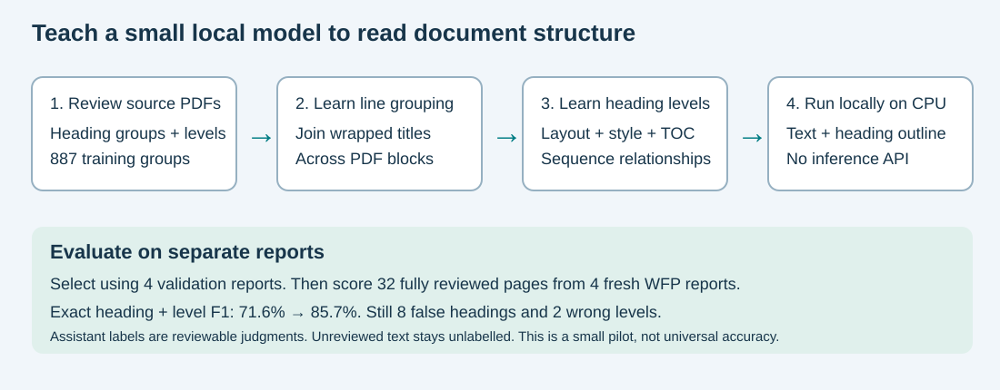
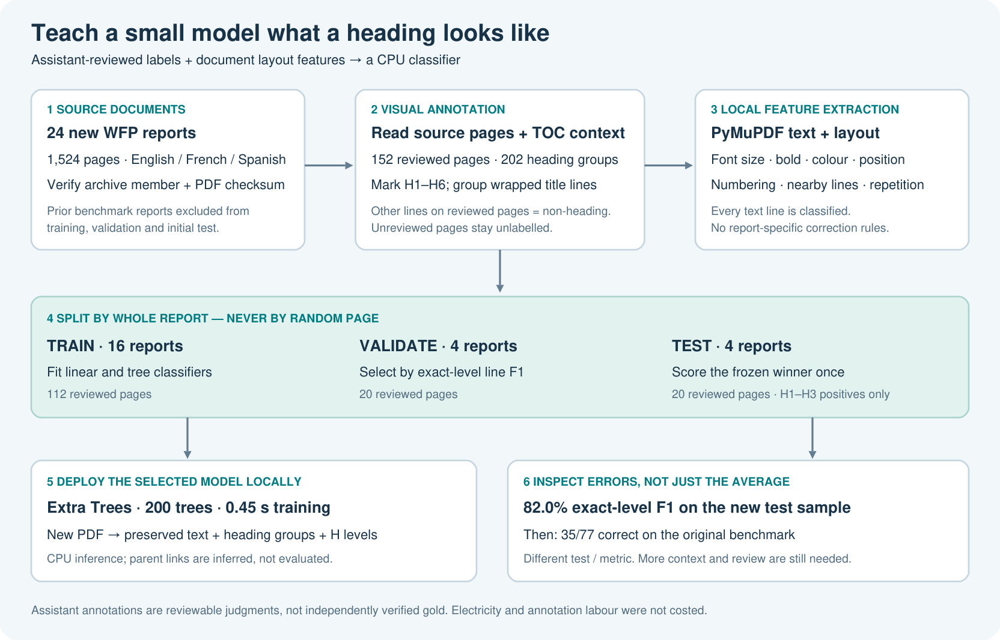
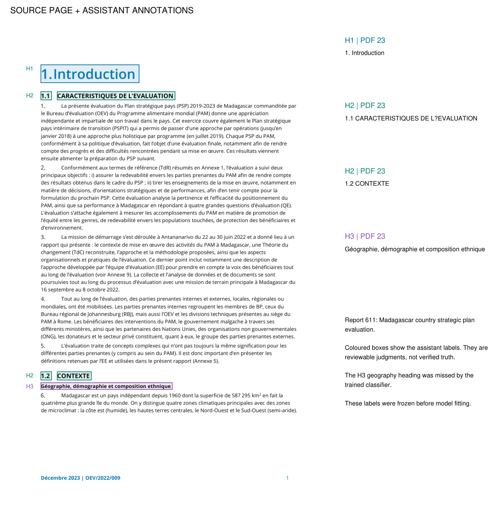
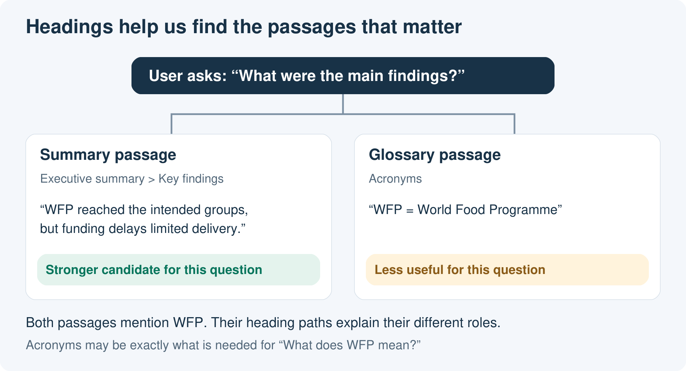
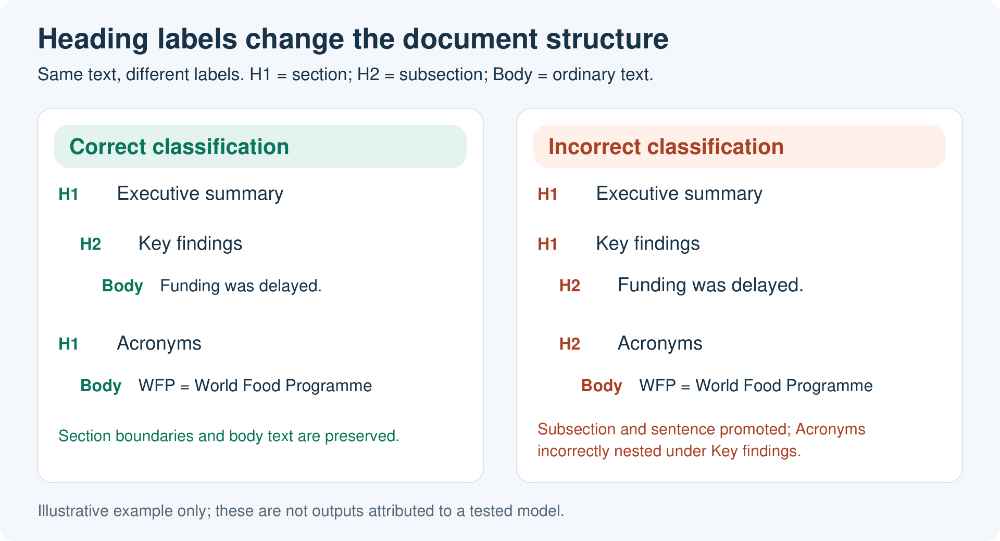

# PDF heading benchmark

How well do PDF parsers recover **heading text, page numbers and hierarchy levels** from long evaluation reports?

This repository packages a small experiment on four public World Food Programme reports. It includes runnable extraction methods, frozen annotations and predictions, and a reproducible on-premises league table of 21 completed local configurations with scores, processing times and links to the exact method code.

**TL;DR:** Larger models can do a great job of recovering document structure, but their compute overhead and processing times may prevent their use in many practical settings. The strongest configuration here, Qwen3.6-27B with sampled visual memory, recovered 65/77 headings at the correct level (84.4%), all 77 titles, and two extra headings. Its heading stage took about 62 minutes for 32 sampled pages on a shared 48 GB Apple M4 Pro, excluding candidate extraction. These observations do not establish a universal runtime or isolate model size from the rest of the configuration.

Chandra OCR 2 reached 53/77; LightOnOCR-3-0.8B and 4B each reached 46/77. These are configuration-specific results on 32 selected pages, annotated visually by one assistant. They do not establish general document accuracy. Hardware, electricity, setup, review and licensing costs were not measured in dollars.

[Full local scores, timings and methods (Markdown)](outputs/report/league_table.md) · [HTML report](outputs/report/index.html) · [Reproducibility and limitations](docs/reproducibility.md) · [Source documents](configs/corpus.json)

## Improved trained model (v2)

Expanded assistant-reviewed training from **154 to 887 heading groups**, then compared extra data, learned line grouping, and document context/level relationships. On four fresh WFP reports (32 fully reviewed pages, 38 headings), exact group-and-level F1 rose from **71.6% to 85.7%**. The selected model recovered all 38 groups, got 36 levels right, and produced eight false headings. These are assistant labels, not independently adjudicated gold; the split holds out reports, not template families.

On the original diagnostic benchmark, correct heading-plus-level recovery rose from **35/77 to 50/77**. Full 523-page CPU inference took **12.6 seconds**; deployment JSON totals about **23 MiB**. No inference API is used. Annotation work, electricity and hardware costs were not measured.

[Full v2 experiment and reproduction](outputs/structure-v2/report.md) · [HTML report](outputs/structure-v2/index.html) · [Frozen annotations](configs/structure-v2/annotations.json) · [Code](scripts/structure) · [Review viewer generator](scripts/structure/review.py)



## Supervised learning pilot on 24 new WFP reports

A separate experiment uses assistant annotations to train small CPU classifiers: **202 heading groups across 152 reviewed pages**, with whole-report train/validation/test splits. The selected Extra Trees model reached **82.0% exact-level F1** on 20 held-out pages (22/27 complete headings correct). These are different documents and metrics from the original league table; the test contains H1–H3 only.

[Experiment, complete report table and runnable commands](outputs/supervised/report.md) · [HTML](outputs/supervised/report.html) · [Annotations](configs/supervised/labels.tsv) · [Source manifest](configs/supervised/corpus.json) · [Training scripts](scripts/supervised)

[Visual annotation review: contents pages, overlays and review controls](docs/annotation-review/README.md)





The frozen classifier has now also been tested on the original four benchmark reports: **35/77 correct heading levels, 59/77 titles recovered, 20 extras**, in 7.7 seconds over all 523 pages. This same-corpus result is included in the main table; it is separate from the 82.0% line F1 above.

## Why heading classification matters

Headings help determine whether a block of text is relevant to the user's question. Someone looking for summary findings may prefer a passage under **Executive summary > Key findings** to an **Acronyms** entry, even if both contain the same search term. The acronyms entry may be exactly what is needed when the question asks for an abbreviation's meaning. Relevance depends on the task; an acronyms section is not inherently unimportant.



*Illustrative example; the sentences are invented, not quotations from the WFP reports.*

Correct classification preserves both a block's role and its place in the hierarchy. In the example below, **Key findings** is an H2 subsection of **Executive summary**, **Acronyms** starts a separate H1 section, and an ordinary sentence remains body text. The incorrect version promotes the subsection and sentence, then incorrectly nests Acronyms under Key findings. Systems that rely on those boundaries could group or label passages incorrectly.



*Explanatory classifications of the same text, not outputs attributed to any tested model. H1 and H2 follow this experiment's section-level convention.*

Heading titles and hierarchy provide context for passage selection alongside the text and the user's question. This benchmark measures heading extraction, not downstream search or answer quality. Editable SVGs and PNGs are in [docs/images](docs/images/README.md).

## Quick start: reproduce the scores without downloading models

Requires Git, [uv](https://docs.astral.sh/uv/) and Python 3.12 (uv can install it).

```bash
git clone https://github.com/dividor/pdf-heading-benchmark.git
cd pdf-heading-benchmark
uv sync --locked
uv run pdf-headings score --historical
uv run pdf-headings report
```

Open `outputs/report/index.html` locally, or read the Markdown version on GitHub. GitHub's file view displays HTML source, not the rendered report. The scorer recomputes the bundled historical predictions. The report selects the 20 local configurations listed in `configs/report-methods.json`; original historical records remain unchanged. Report generation runs entirely offline.

## Run the benchmark yourself

```bash
# Optional: put PDFs, raw model responses and run metadata wherever you have space.
export PDF_BENCHMARK_DATA="$PWD/../pdf-heading-benchmark-data"
uv run pdf-headings download

# Small CPU baseline, with no model downloads:
uv run pdf-headings run pdf_tags_audit_only
uv run pdf-headings score

# Other CPU parsers (may download layout models on first use):
uv run pdf-headings run pymupdf4llm
uv run pdf-headings run docling_default
```

The Docling command writes **default, hierarchy and tolerance-0.15** variants from one conversion. `run docling_hierarchy` and `run docling_tuned` invoke that same three-variant runner. Marker and MinerU basic are also available. Run `uv run pdf-headings run --help` for available configuration identifiers.

Each backend runs in an isolated uv environment using `configs/environments/*.txt`. Tested top-level backend versions are pinned, including **Docling 2.151.1**. The core environment is fully locked in `uv.lock`; backend transitive dependencies are resolved on installation, so these are not complete historical environment locks. Installation and model loading can take substantially longer than the table's processing times.

### Apple Silicon models

The MLX runners require macOS on Apple Silicon. The original machine had 48 GB unified memory. CPU, Linux CUDA and Apple MLX runs are different configurations; these runners do not silently switch backends.

```bash
uv run pdf-headings run lighton_mlx
uv run pdf-headings run chandra2_mlx
uv run pdf-headings run qwen36_visual_memory
uv run pdf-headings score
```

The last command automatically prepares PyMuPDF candidates and PDF-tag context before running Qwen. Exact model revisions are in `configs/models.json`; upstream helper revisions and quantization are fixed in `scripts/runners/prepare_model.py`. Hugging Face caches use their standard location; set `HF_HOME` to move them. Expect large downloads, particularly Qwen and Popo.

### Your own PDF

```bash
uv run pdf-headings extract pymupdf4llm /path/to/report.pdf --output /path/to/new-run
```

Use a **new** output directory. The output includes `results/document/<method>.headings.json`, with original PDF page numbers, and Markdown or structured text depending on the parser. Docling writes three versions. The PDF-tag baseline supplies headings only; Marker retains body text in its structured HTML JSON. Qwen preserves native page text and predicts headings separately; it is not a scanned-document OCR pipeline.

For your own document, image methods process every page, including Qwen's sequential memory. The published Qwen score covers only 32 sampled pages across the WFP reports; full-document behavior has not been validated by this pilot. WFP scoring commands are specific to the frozen WFP corpus. To resume an interrupted custom run, set `PDF_BENCHMARK_DATA` to that run directory and use `run <method>`.

## What is in the repository?

| Directory | Purpose |
| --- | --- |
| `src/pdf_heading_benchmark/` | CLI, corpus verification, scoring, report generation |
| `scripts/runners/` | Backend adapters, prompts, decoding and raw-response persistence |
| `configs/` | Public corpus URLs/hashes, labels, page sample, methods, dependency pins |
| `outputs/` | Frozen summaries and compact audit predictions; no credentials or full PDFs |
| `outputs/report/` | Generated HTML and Markdown league table |
| `tests/` | Offline scoring, decoding, hosted-request and report tests |
| `scripts/quality/` | Complexity and notebook-output checks |
| `docs/` | Protocol, limitations and report narrative |
| `notebooks/` | Reserved for thin exploratory notebooks; no notebook is needed to run the benchmark |

The full original raw experiment archive is not distributed here. New runs save raw responses, timings and errors in your external data directory. Missing levels stay missing; there are no WFP-specific title repairs.

## Quality and contribution

This follows the structure and quality approach in [tiered-taxonomy-tagging](https://github.com/dividor/tiered-taxonomy-tagging): src layout, uv lockfile, pre-commit, Ruff, mypy, Bandit, secret scanning, complexity gates, pytest, dependency auditing, deterministic report checks and an SBOM in CI.

```bash
uv run pre-commit install
uv run pre-commit run --all-files
uv run pytest -q
```

See [CONTRIBUTING.md](CONTRIBUTING.md). Code is MIT licensed. Models, parsers and source documents retain their own licenses; see [THIRD_PARTY_NOTICES.md](THIRD_PARTY_NOTICES.md).

### Explore each technique and the calibration follow-up

The [HTML league table](outputs/report/index.html) opens a diagram modal when you select a configuration or method. Every local configuration has its own pipeline, interpretation notes, benchmark code and relevant project, paper or Hugging Face links. Our methods show training separately from CPU inference. The [Markdown report](outputs/report/league_table.md) includes equivalent text diagrams and direct source links. The HTML is self-contained and works from a local file or web server.

The [decoding-calibration experiment](outputs/structure-calibration/report.md) improves exact F1 from **85.7% to 94.7%** on the **previously inspected** 38-heading regression set: eight false headings fall to one, 36 correct heading-and-level predictions remain, and one genuine heading is newly missed. It regresses on the original league corpus, from **50/77 to 47/77** correct heading-and-level matches. This is a separate experimental row; the original v2 model remains highlighted. No new independent test score is claimed.

The report includes the nine-setting validation search, all report sources, frozen audit predictions, measured timings and runnable commands. Pass `--calibration /path/to/calibration-run` to `scripts/structure/predict.py` to try the selected setting; omit it for original v2 behavior. More varied fully reviewed negatives and untouched report-family evaluation are the next priorities.
