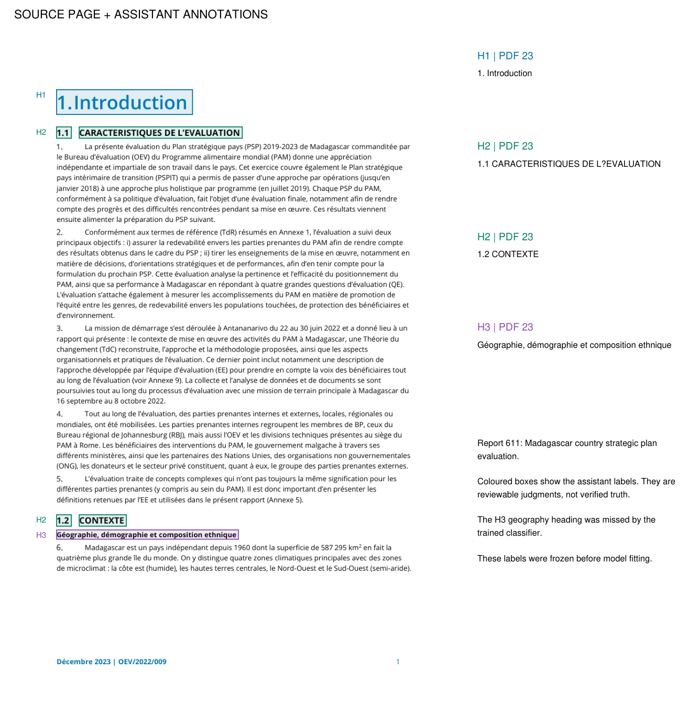
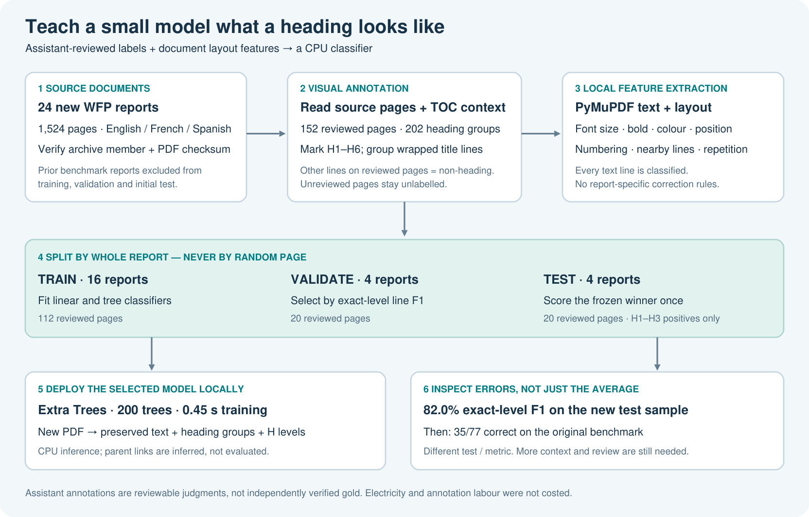

# Visual annotation review

The generated HTML pack shows all 24 selected WFP reports, all 202 frozen heading groups and all 152 reviewed pages. It also includes 26 contents pages from 22 reports, collated in an overview image. Reports 534 and 584 are board summaries with no contents page found. The source TOC is context, not a new set of H-level training labels: inspect the indented assessed-heading list and source-page overlays together.





## Build and open

First prepare the corpus, fit/select the model and run full inference using the [supervised experiment commands](../../outputs/supervised/report.md#reproduce-locally). Then:

```bash
# DATA points to the external supervised experiment directory.
uv run python scripts/supervised/visual_review.py \
  --data "$DATA" --run "$DATA/my-run" --output "$DATA/visual-review"
# Open visual-review/index.html directly, or serve it only on your own computer:
uv run python -m http.server 8765 --bind 127.0.0.1 --directory "$DATA/visual-review"
```

Open http://127.0.0.1:8765. Keep `index.html` and its `assets` directory together. The full review pack includes source-page images and extracted page text, and stays outside Git. This directory contains the template and browser code; the generator is [visual_review.py](../../scripts/supervised/visual_review.py). The repository includes a small number of illustrative images, rather than the full page-image collection.

## Review the annotations

1. Choose a report and compare its contents pages with the indented assessed-heading list. Collapse the contents section when you want more room for the body page.
2. Click an assessed heading or its coloured box. Record **Confirm**, **Change** or **Uncertain**, a proposed H level and a note. Choose **Not a heading** to reject a label.
3. Enable **Other text lines** to propose a missed heading. For a wrapped heading, assess each constituent line and use a shared group description in the notes.
4. Optionally enable **Model predictions**. Dashed magenta M-levels are classifier outputs, not the assistant labels; matching colours/levels do not prove correctness.
5. Export the review JSON. A copy is shown in the page if a browser blocks the download. Import checks the frozen label-version checksum. Browser storage is a convenience; the exported JSON is the portable record.

Assessments never overwrite the reference labels or recalculate scores. Changes require adjudication and a new dataset/run version. A context-only TOC page has `original_level: null`; an unmarked line on a reviewed page has `original_level: 0`.

## Same-corpus benchmark comparison

The frozen model was also run on the original four benchmark PDFs, none used for training. The [comparison runner](../../scripts/supervised/compare.py) checks the model and source hashes, completes all inference before reading reference headings, and uses the unchanged historical scorer. It produced 59/77 matched titles, 35/77 correct levels and 20 false headings in 7.7 seconds for 523 pages. Its row is now in the [main table](../../outputs/report/league_table.md). Do not substitute the separate 82.0% line F1 into that table.

```bash
uv run python scripts/supervised/compare.py \
  --data /path/to/pdf-heading-benchmark-data \
  --model-run "$DATA/my-run" --output "$DATA/new-comparison"
# Generic inference through the main CLI:
export PDF_HEADING_MODEL="$DATA/my-run/trees.json"
uv run pdf-headings run supervised_extra_trees
```
