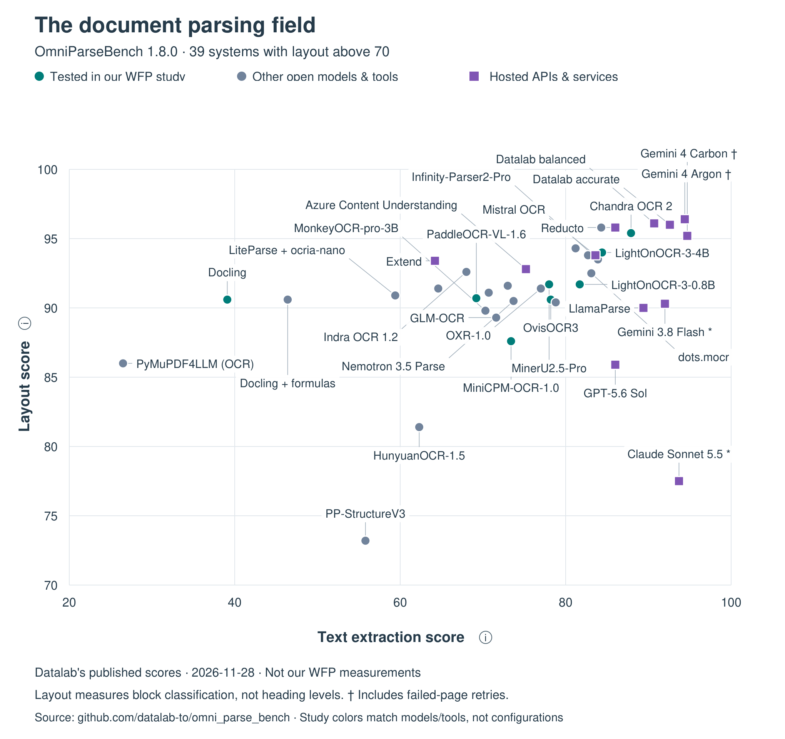

# Can local AI recover document headings?

Headings tell a search system what a passage is for: an executive summary may answer a user’s question; an acronyms list may not. We tested local tools on WFP evaluation reports to see whether they preserve both headings and their hierarchy.

## Results at a glance

**34 configurations · 4 WFP reports · 32 audited pages · 77 reference headings · Apple M4 Pro, 48 GB**

- **Highest score:** Qwen3.6-27B with visual memory gets **65/77** heading-level pairs right; **54 min 2 sec** for 32 pages. It receives extra PDF text, tags and document context.
- **Image-only alternative:** Chandra OCR 2 gets **53/77** right in **14 min 46 sec**. OvisOCR3 gets **36/77** right in **6 min 58 sec**.
- **OUR METHOD:** small trained CPU classifiers get **34/77** right with two extra headings. Fast, but the missing headings make this configuration unsuitable when coverage matters.

**Score = correct title, page and level.** F0.5 favors precision; recall shows what is missing. References are assistant annotations without independent review.

## Full configuration results

Select a row’s **i** for its exact model, steps, settings and predictions. **Estimated** times scale longer runs to 32 pages.

| Configuration | Time for 32 pages | Primary score: joint F0.5 | Joint precision | Joint recall | Method / code | Status | Headings recovered | False headings | Native prose retention | Time per page |
| --- | --- | --- | --- | --- | --- | --- | --- | --- | --- | --- |
| [Qwen3.6-27B / MLX 4-bit / sampled visual memory](https://huggingface.co/Qwen/Qwen3.6-27B) | **54 min 2 sec** Measured | **82.7%** | 82.3% (65/79) | 84.4% (65/77) | [Ask Qwen3.6-27B to identify headings using the current page’s image and text, possible headings from the whole document, author-supplied tags and selected earlier page images.](https://github.com/dividor/pdf-heading-benchmark/blob/codex/full-method-verification/scripts/runners/run_qwen_visual_memory.py) | completed | 100.0% (77/77) | 2 | — | **1 min 41 sec** Latest sequential run |
| [Qwen3.6-27B 4-bit — single image](https://github.com/dividor/pdf-heading-benchmark/blob/codex/full-method-verification/outputs/qwen-compact/report.md) | **35 min 33 sec** Measured | **77.1%** | 76.9% (60/78) | 77.9% (60/77) | [Qwen3.6-27B MLX 4-bit; one 1280-pixel image and text-only heading memory.](https://github.com/dividor/pdf-heading-benchmark/blob/codex/full-method-verification/scripts/runners/run_qwen_compact.py) | completed | 100.0% (77/77) | 1 | — | **1 min 7 sec** Latest sequential run |
| [Chandra OCR 2 / MLX](https://huggingface.co/datalab-to/chandra-ocr-2) | **14 min 46 sec** Measured | **72.6%** | 73.6% (53/72) | 68.8% (53/77) | [Chandra OCR 2 reads page images using its authors’ layout-reading prompt and image preparation.](https://github.com/dividor/pdf-heading-benchmark/blob/codex/full-method-verification/scripts/runners/run_chandra_batch.py) | completed | 90.9% (70/77) | 2 | 98.7% | **27.7 sec** Latest sequential run |
| [**OUR METHOD — confidence-filtered v2 (F0.5-selected)**](https://github.com/dividor/pdf-heading-benchmark/blob/codex/full-method-verification/outputs/structure-precision/report.md) | **0.714 sec** Estimated from 11.7 sec measured over 523 pages | **70.5%** | 82.9% (34/41) | 44.2% (34/77) | [Three Extra Trees classifiers trained locally for this benchmark on 20 WFP reports: join lines, assign heading levels and compare successive levels. Reuse those models with a validation-selected 0.70 confidence filter.](https://github.com/dividor/pdf-heading-benchmark/blob/codex/full-method-verification/scripts/structure/optimize_precision.py) | completed | 50.6% (39/77) | 2 | — | **0.022 sec** |
| [Qwen3.6-35B-A3B 4-bit — visual memory](https://github.com/dividor/pdf-heading-benchmark/blob/codex/full-method-verification/outputs/qwen-compact/report.md) | **8 min 19 sec** Measured | **69.0%** | 69.3% (52/75) | 67.5% (52/77) | [Qwen3.6-35B-A3B MLX 4-bit; original prompt, larger current image and up to six previous page images.](https://github.com/dividor/pdf-heading-benchmark/blob/codex/full-method-verification/scripts/runners/run_qwen_sparse_memory.py) | completed | 97.4% (75/77) | 0 | — | **15.6 sec** Latest sequential run |
| [Qwen3.6-35B-A3B 4-bit — single image](https://github.com/dividor/pdf-heading-benchmark/blob/codex/full-method-verification/outputs/qwen-compact/report.md) | **5 min 42 sec** Measured | **68.8%** | 68.8% (53/77) | 68.8% (53/77) | [Qwen3.6-35B-A3B MLX 4-bit; one 1280-pixel image and text-only heading memory.](https://github.com/dividor/pdf-heading-benchmark/blob/codex/full-method-verification/scripts/runners/run_qwen_compact.py) | completed | 100.0% (77/77) | 0 | — | **10.7 sec** Latest sequential run |
| [OvisOCR3 — upstream prompt and vLLM Metal](https://huggingface.co/ATH-MaaS/OvisOCR3) | **6 min 58 sec** Measured | **65.0%** | 72.0% (36/50) | 46.8% (36/77) | [OvisOCR3 reads each page with its official Markdown prompt through vLLM Metal. We use the upstream cleanup and preserve the model’s heading levels.](https://github.com/dividor/pdf-heading-benchmark/blob/codex/full-method-verification/scripts/runners/run_ovis_official.py) | completed | 63.6% (49/77) | 1 | 99.5% | **13.1 sec** |
| [**OUR METHOD — calibrated decoding (experimental)**](https://github.com/dividor/pdf-heading-benchmark/blob/codex/full-method-verification/outputs/structure-calibration/report.md) | **0.885 sec** Estimated from 14.5 sec measured over 523 pages | **59.2%** | 58.8% (47/80) | 61.0% (47/77) | [Reuse our three Extra Trees classifiers trained locally on 20 WFP reports; apply a validation-selected body-score multiplier of two.](https://github.com/dividor/pdf-heading-benchmark/blob/codex/full-method-verification/scripts/structure/calibrate.py) | completed | 76.6% (59/77) | 21 | — | **0.028 sec** |
| [OUR METHOD — grouped context v2 (previous selection)](https://github.com/dividor/pdf-heading-benchmark/blob/codex/full-method-verification/outputs/structure-v2/report.md) | **0.768 sec** Estimated from 12.6 sec measured over 523 pages | **58.8%** | 57.5% (50/87) | 64.9% (50/77) | [Use three Extra Trees classifiers to join wrapped titles, recognize headings and levels, and compare the levels of neighboring headings.](https://github.com/dividor/pdf-heading-benchmark/blob/codex/full-method-verification/scripts/structure/train.py) | completed | 83.1% (64/77) | 23 | — | **0.024 sec** |
| [OUR METHOD — retrained trees (coverage trial; target not met)](https://github.com/dividor/pdf-heading-benchmark/blob/codex/full-method-verification/outputs/structure-recall/report.md) | **1 sec** Estimated from 16.4 sec measured over 523 pages | **58.8%** | 57.5% (50/87) | 64.9% (50/77) | [Refit Extra Trees on the same 20 training reports; compare 64 validation settings for precision and coverage. No setting met both 80% targets; this is the predeclared diagnostic fallback.](https://github.com/dividor/pdf-heading-benchmark/blob/codex/full-method-verification/scripts/structure/retrain_recall.py) | completed | 85.7% (66/77) | 21 | — | **0.031 sec** |
| [LightOnOCR-3-0.8B / MLX](https://huggingface.co/lightonai/LightOnOCR-3-0.8B) | **6 min 9 sec** Measured | **57.9%** | 57.5% (46/80) | 59.7% (46/77) | [LightOnOCR-3-0.8B reads one page image at a time and returns text with locations on the page.](https://github.com/dividor/pdf-heading-benchmark/blob/codex/full-method-verification/scripts/runners/run_lighton_mlx.py) | completed | 93.5% (72/77) | 8 | 99.5% | **11.5 sec** Latest sequential run |
| [LightOnOCR-3-4B / MLX grounding](https://huggingface.co/lightonai/LightOnOCR-3-4B) | **17 min 36 sec** Measured | **57.9%** | 57.5% (46/80) | 59.7% (46/77) | [LightOnOCR-3-4B reads page images and returns text with page locations, using the same output convention as the 0.8-billion-parameter model.](https://github.com/dividor/pdf-heading-benchmark/blob/codex/full-method-verification/scripts/runners/run_chandra_batch.py) | completed | 93.5% (72/77) | 8 | 99.3% | **33 sec** Latest sequential run |
| [v2: learned grouping](https://github.com/dividor/pdf-heading-benchmark/blob/codex/full-method-verification/outputs/structure-v2/report.md) | **0.732 sec** Estimated from 12 sec measured over 523 pages | **55.8%** | 53.7% (51/95) | 66.2% (51/77) | [Train two Extra Trees classifiers: one decides which neighboring lines belong to the same heading, and one labels the resulting text groups as body text or H1–H5.](https://github.com/dividor/pdf-heading-benchmark/blob/codex/full-method-verification/scripts/structure/train.py) | completed | 96.1% (74/77) | 21 | — | **0.023 sec** |
| [EvidenceLab — Docling + hierarchical post-processing](https://github.com/dividor/evidencelab) | **36.1 sec** Estimated from 9 min 50 sec measured over 523 pages | **51.8%** | 52.9% (37/70) | 48.1% (37/77) | [Parse full PDFs with EvidenceLab’s pinned Docker image, including its hierarchy and final TOC processing.](https://github.com/dividor/pdf-heading-benchmark/blob/codex/full-method-verification/scripts/runners/benchmark_evidencelab.py) | completed | 81.8% (63/77) | 7 | 96.7% | **1.1 sec** |
| [v2: more annotations](https://github.com/dividor/pdf-heading-benchmark/blob/codex/full-method-verification/outputs/structure-v2/report.md) | **0.567 sec** Estimated from 9.3 sec measured over 523 pages | **44.9%** | 43.2% (41/95) | 53.2% (41/77) | [Test whether more labeled examples improve the original single-classifier design.](https://github.com/dividor/pdf-heading-benchmark/blob/codex/full-method-verification/scripts/structure/train.py) | completed | 89.6% (69/77) | 26 | — | **0.018 sec** |
| [LLM annotations → Extra Trees v1 (CPU)](https://github.com/dividor/pdf-heading-benchmark/blob/codex/full-method-verification/src/pdf_heading_benchmark/supervised_models.py) | **0.473 sec** Estimated from 7.7 sec measured over 523 pages | **44.5%** | 44.3% (35/79) | 45.5% (35/77) | [Train one Extra Trees classifier to decide whether each PDF text line is body text or a heading at a particular level.](https://github.com/dividor/pdf-heading-benchmark/blob/codex/full-method-verification/scripts/supervised/compare.py) | completed | 76.6% (59/77) | 20 | — | **0.015 sec** |
| [MinerU 4.2.3 basic CPU](https://github.com/opendatalab/MinerU) | **41.1 sec** Estimated from 11 min 12 sec measured over 523 pages | **44.4%** | 45.6% (31/68) | 40.3% (31/77) | [MinerU 4.2.3 uses its basic PDF parser on the CPU through ONNX Runtime.](https://github.com/dividor/pdf-heading-benchmark/blob/codex/full-method-verification/scripts/runners/run_mineru.py) | completed | 85.7% (66/77) | 2 | 99.1% | **1.3 sec** |
| [Xiaomi-OCR-0 — upstream two-stage pipeline, Metal](https://huggingface.co/xiaomi-research/Xiaomi-OCR-0) | **7 min 52 sec** Measured | **42.9%** | 43.7% (31/71) | 40.3% (31/77) | [Xiaomi’s upstream two-stage pipeline detects page regions with PaddleX on CPU, recognizes each crop with original BF16 weights on Metal, and assembles Markdown using its default title profile.](https://github.com/dividor/pdf-heading-benchmark/blob/codex/full-method-verification/scripts/runners/run_official_xiaomi.py) | completed | 88.3% (68/77) | 3 | 98.6% | **14.8 sec** |
| [Qwen3.5-4B / union candidates](https://huggingface.co/Qwen/Qwen3.5-4B) | Unavailable | **41.0%** | 43.9% (25/57) | 32.5% (25/77) | [Ask Qwen3.5-4B to assign levels to possible headings extracted by Docling and PyMuPDF4LLM.](https://github.com/dividor/pdf-heading-benchmark/blob/codex/full-method-verification/scripts/runners/run_qwen_ids.py) | completed | 70.1% (54/77) | 3 | — | Page average unavailable 1 min 41 sec for the hierarchy stage |
| [Xiaomi-OCR-0 — MLX whole page](https://huggingface.co/xiaomi-research/Xiaomi-OCR-0) | **6 min 12 sec** Measured | **39.7%** | 40.3% (29/72) | 37.7% (29/77) | [Xiaomi-OCR-0 reads each complete page through MLX and returns native Markdown.](https://github.com/dividor/pdf-heading-benchmark/blob/codex/full-method-verification/scripts/runners/run_field_candidate.py) | completed | 89.6% (69/77) | 3 | 98.8% | **11.6 sec** |
| [Qwen3.5-4B / PyMuPDF candidates](https://huggingface.co/Qwen/Qwen3.5-4B) | Unavailable | **37.5%** | 40.7% (22/54) | 28.6% (22/77) | [Ask Qwen3.5-4B to assign levels to possible headings extracted by PyMuPDF4LLM.](https://github.com/dividor/pdf-heading-benchmark/blob/codex/full-method-verification/scripts/runners/run_qwen_ids.py) | completed | 70.1% (54/77) | 0 | — | Page average unavailable 1 min 29 sec for the hierarchy stage |
| [PyMuPDF4LLM 2.1](https://github.com/pymupdf/pymupdf4llm) | **3.2 sec** Estimated from 51.8 sec measured over 523 pages | **37.5%** | 37.8% (28/74) | 36.4% (28/77) | [PyMuPDF4LLM 2.1 turns the PDF’s existing text into Markdown.](https://github.com/dividor/pdf-heading-benchmark/blob/codex/full-method-verification/scripts/runners/run_pymupdf4llm.py) | completed | 93.5% (72/77) | 2 | 98.8% | **0.099 sec** |
| [Qwen3.5-4B / MinerU candidates](https://huggingface.co/Qwen/Qwen3.5-4B) | Unavailable | **33.3%** | 34.3% (23/67) | 29.9% (23/77) | [Ask Qwen3.5-4B to assign levels to possible headings extracted by MinerU’s basic parser.](https://github.com/dividor/pdf-heading-benchmark/blob/codex/full-method-verification/scripts/runners/run_qwen_ids.py) | completed | 85.7% (66/77) | 1 | — | Page average unavailable 1 min 16 sec for the hierarchy stage |
| [Docling fixed tolerance 0.15](https://github.com/docling-project/docling) | **6.3 sec** Estimated from 1 min 42 sec measured over 523 pages | **30.8%** | 31.4% (22/70) | 28.6% (22/77) | [Use Docling 2.151.1 with a fixed font-style tolerance of 0.15 in its hierarchy step.](https://github.com/dividor/pdf-heading-benchmark/blob/codex/full-method-verification/scripts/runners/run_docling.py) | completed | 88.3% (68/77) | 2 | 98.4% | **0.196 sec** |
| [Marker 2.2 no OCR/LLM](https://github.com/datalab-to/marker) | **2.7 sec** Estimated from 44 sec measured over 523 pages | **25.5%** | 25.7% (19/74) | 24.7% (19/77) | [Marker 2.2 parses the complete PDF locally on the CPU.](https://github.com/dividor/pdf-heading-benchmark/blob/codex/full-method-verification/scripts/runners/run_marker.py) | completed | 84.4% (65/77) | 9 | 98.8% | **0.084 sec** |
| [PaddleOCR-VL-1.6 — official Apple Silicon pipeline](https://huggingface.co/PaddlePaddle/PaddleOCR-VL-1.6) | **4 min 52 sec** Measured | **24.9%** | 25.4% (18/71) | 23.4% (18/77) | [PaddleOCR 3.7.0 runs its complete v1.6 pipeline: native PaddleX layout on CPU, PaddleOCR-VL-1.6 on Metal, then Paddle’s own Markdown assembly.](https://github.com/dividor/pdf-heading-benchmark/blob/codex/full-method-verification/scripts/runners/run_official_paddle.py) | completed | 88.3% (68/77) | 3 | 98.4% | **9.1 sec** |
| [Docling 2.151.1 default](https://github.com/docling-project/docling) | **6.3 sec** Estimated from 1 min 42 sec measured over 523 pages | **22.4%** | 22.9% (16/70) | 20.8% (16/77) | [Use the heading levels returned by Docling 2.151.1 when it first reads the PDF.](https://github.com/dividor/pdf-heading-benchmark/blob/codex/full-method-verification/scripts/runners/run_docling.py) | completed | 88.3% (68/77) | 2 | 98.4% | **0.196 sec** |
| [Docling built-in hierarchy](https://github.com/docling-project/docling) | **6.3 sec** Estimated from 1 min 42 sec measured over 523 pages | **22.4%** | 22.9% (16/70) | 20.8% (16/77) | [Use Docling 2.151.1 to find headings, then run its built-in HeadingHierarchyModel to assign their levels.](https://github.com/dividor/pdf-heading-benchmark/blob/codex/full-method-verification/scripts/runners/run_docling.py) | completed | 88.3% (68/77) | 2 | 98.4% | **0.196 sec** |
| [MiniCPM-OCR 1.0 — MLX + CPU layout](https://huggingface.co/openbmb/MiniCPM-OCR-1.0) | **7 min 50 sec** Measured | **22.2%** | 22.5% (16/71) | 20.8% (16/77) | [PP-DocLayoutV3 detects regions on CPU; MiniCPM-OCR 1.0 recognizes their content on the Metal GPU; MiniCPM SDK assembles Markdown.](https://github.com/dividor/pdf-heading-benchmark/blob/codex/full-method-verification/scripts/runners/run_field_candidate.py) | completed | 88.3% (68/77) | 3 | 98.1% | **14.7 sec** |
| [PaddleOCR-VL-1.6 — MLX + CPU layout](https://huggingface.co/PaddlePaddle/PaddleOCR-VL-1.6) | **4 min 39 sec** Measured | **22.2%** | 22.5% (16/71) | 20.8% (16/77) | [PP-DocLayoutV3 detects regions on CPU; PaddleOCR-VL-1.6 recognizes their content on the Metal GPU; MiniCPM SDK assembles Markdown.](https://github.com/dividor/pdf-heading-benchmark/blob/codex/full-method-verification/scripts/runners/run_field_candidate.py) | completed | 88.3% (68/77) | 3 | 98.4% | **8.7 sec** |
| [MiniCPM-OCR 1.0 — official package, Ollama Q8 + DSpark](https://huggingface.co/openbmb/MiniCPM-OCR-1.0) | **7 min 46 sec** Measured | **22.2%** | 22.5% (16/71) | 20.8% (16/77) | [MiniCPM’s official package rotates pages, detects layout, recognizes crops through Ollama with Q8 weights and DSpark, then assembles its native Markdown.](https://github.com/dividor/pdf-heading-benchmark/blob/codex/full-method-verification/scripts/runners/run_official_minicpm.py) | completed | 88.3% (68/77) | 3 | 98.1% | **14.6 sec** |
| [Docling — full-page RapidOCR + heading hierarchy](https://github.com/docling-project/docling) | **34.5 sec** Estimated from 9 min 23 sec measured over 523 pages | **21.2%** | 21.7% (15/69) | 19.5% (15/77) | [Run full-page RapidOCR in Docling, then its default heading-hierarchy stage.](https://github.com/dividor/pdf-heading-benchmark/blob/codex/full-method-verification/scripts/runners/run_docling_ocr.py) | completed | 87.0% (67/77) | 2 | 86.6% | **1.1 sec** |
| [Popo + Docling / experimental MLX 8-bit](https://github.com/opendatalab/MinerU-Popo) | Unavailable | **21.0%** | 21.4% (15/70) | 19.5% (15/77) | [Use MinerU-Popo to assign levels to headings first detected by Docling.](https://github.com/dividor/pdf-heading-benchmark/blob/codex/full-method-verification/scripts/runners/run_popo_mlx.py) | completed | 88.3% (68/77) | 2 | 98.4% | Page average unavailable 14 min 57 sec for the hierarchy stage |
| [MinerU2.5-Pro-2605-1.2B / direct MLX interface](https://huggingface.co/opendatalab/MinerU2.5-Pro-2605-1.2B) | **9 min 30 sec** Measured | **0.0%** | 0.0% (0/72) | 0.0% (0/77) | [MinerU2.5-Pro-2605-1.2B reads the layout and text of page images.](https://github.com/dividor/pdf-heading-benchmark/blob/codex/full-method-verification/scripts/runners/run_mineru_pro.py) | completed | 89.6% (69/77) | 3 | 99.0% | **17.8 sec** |

## Published comparison

### Text and layout across the field

*Figure by the author from [Datalab’s OmniParseBench results](https://github.com/datalab-to/omni_parse_bench#results), retrieved November 26, 2026. Both axes use published scores out of 100. This is a selected field overview, not our WFP experiment.*

The [layout score](https://github.com/datalab-to/omni_parse_bench/blob/main/docs/scoring/layout_kind.md) tests whether blocks are labeled as text, heading or table at the expected location. It does not test heading levels. Models without a published layout score, including Xiaomi-OCR-0, are omitted. Our trained model has not been evaluated on this benchmark.

Text and layout scores cover both local and hosted systems. Published timings do not cover the local models, so this plot does not use speed. The planned service runs will compare heading-and-level quality and seconds per page on our WFP sample. [Chart data](https://github.com/dividor/pdf-heading-benchmark/blob/codex/full-method-verification/configs/field-overview.json) · [Reproduce the plot](https://github.com/dividor/pdf-heading-benchmark/blob/codex/full-method-verification/scripts/field_overview.py).

### Cloud services queued for comparison

These requested API configurations are the next comparison group. They are not included in the 34 local result rows. Use the same WFP reference headings and joint F0.5; record service version, request settings, elapsed time and billed usage separately.

| Service | Configuration to test | Status |
| --- | --- | --- |
| [Mistral OCR 3](https://docs.mistral.ai/models/ocr-3-25-12) | `mistral-ocr-2512`; native Markdown, without custom annotations | Queued. The older runner targets OCR 4.1, so it is not this configuration. |
| [Azure Document Intelligence](https://learn.microsoft.com/en-us/azure/ai-services/document-intelligence/prebuilt/layout?view=doc-intel-4.0.0) | `prebuilt-layout`, API `2024-11-30`, Markdown and section hierarchy | Earlier API evidence is archived outside the local table; verify its configuration before reuse. |
| [Google Document AI Layout Parser](https://docs.cloud.google.com/document-ai/docs/layout-parse-chunk) | Gemini Layout Parser `pretrained-layout-parser-v3.5-2026-07-09`, listed as stable November 18, 2026 | Queued. Score its document hierarchy, rather than basic text-only OCR. |
| [LlamaParse](https://www.llamaindex.ai/pricing) | Cost Effective, Agentic and Agentic Plus as separate configurations; record the resolved model version | Queued. Compare price against heading-level quality. |

**Published league tables and diagrams (checked November 26, 2026):** [ParseBench-2 interactive charts](https://www.llamaindex.ai/blog/introducing-parsebench-v2) and [leaderboard](https://www.parsebench.ai/) cover current LlamaParse, Azure and Mistral OCR 4.1. [Mistral's OCR 3 comparison chart](https://mistral.ai/news/mistral-ocr-3/) covers the requested OCR 3 alongside Azure and Google, but dates from December 2025 and omits LlamaParse. [OmniParseBench](https://github.com/datalab-to/omni_parse_bench) provides another open leaderboard.

These are vendor-produced benchmarks of broader parsing quality, not our heading-and-level score. The sources do not establish a common ranking of all four exact requested configurations. In particular, OCR 4.1 results are not OCR 3 results, and direct Gemini results are not Document AI Layout Parser results.

### The OCR field: quality versus speed

Higher means better document parsing; farther right means faster processing. **This is OpenBMB’s October 27, 2026 snapshot, not a live ranking.** It omits OvisOCR3, which we now test separately.

*OpenBMB, October 27, 2026. Original figure reproduced unchanged under Apache 2.0. [Source and methodology](https://github.com/OpenBMB/MiniCPM-OCR/blob/c21a3ca524263ef8166cb6d350864b10c3056b61/docs/minicpm_ocr_1dot0_en.md#evaluation) · [Original image](https://raw.githubusercontent.com/OpenBMB/MiniCPM-OCR/c21a3ca524263ef8166cb6d350864b10c3056b61/assets/minicpm-ocr/efficiency-performance-en.png).*

This author-reported chart averages four parsing benchmarks and measures throughput on an RTX 5090, with one page at a time and possible region concurrency. It does **not** measure our WFP heading-level accuracy or Mac speed. Its selected models are not the whole field.

### Which chart models did we test?

| Model in the chart | Quality relative to Chandra in this chart | Our WFP coverage |
| --- | --- | --- |
| MiniCPM-OCR 1.0 | Higher | Official package with Ollama Q8 + DSpark: **22.2%** joint F0.5. Earlier MLX adaptation: also **22.2%**. |
| Xiaomi-OCR-0 | Higher | Upstream two-stage pipeline on Metal: **42.9%**. Earlier whole-page MLX: **39.7%**. |
| PaddleOCR-VL-1.6 | Higher | Official Apple Silicon pipeline: **24.9%**. Earlier MiniCPM-assembly adaptation: **22.2%**. |
| [Ovis-OCR2](https://huggingface.co/ATH-MaaS/OvisOCR2) | Higher | Not tested. The newer OvisOCR3 is tested separately below. |
| Chandra OCR 2 | Reference | Tested: MLX, **72.6%**. |
| TeleOCR | Lower | Not tested. |
| MinerU2.5-Pro | Lower | Tested through the direct MLX interface; no heading levels returned. |
| Unlimited-OCR-2 | Lower | Not tested. |
| GLM-OCR | Lower | Not tested. |
| HunyuanOCR-1.5 | Lower | Not tested. |
| Surya OCR 2 | Lower | No standalone run of this chart configuration. |
| dots.ocr | Lower | Not tested. |
| LightOnOCR-3-1B | Lower | Exact chart variant not tested; our rows use 0.8B and 4B variants. |
| Unlimited-OCR | Lower | Not tested. |

**OvisOCR3 is not in this chart.** Our separate Metal run scores **65.0% joint F0.5**, with **36/77** heading-level pairs correct. Ovis-OCR2 remains untested.

Broad OCR quality does not establish heading-level accuracy. Our WFP measurements use different hardware and input conditions. [Pipeline reproduction](https://github.com/dividor/pdf-heading-benchmark/blob/codex/full-method-verification/docs/official-pipelines.md).

## Documents and their sources

Four born-digital WFP evaluation reports: **523 pages**, three English and one Spanish. The table links the official PDFs; the [manifest](https://github.com/dividor/pdf-heading-benchmark/blob/codex/full-method-verification/configs/corpus.json) records download URLs and checksums.

We scored **eight selected pages per report**. Page numbers are physical PDF pages, counting from the cover. Pages span front matter, chapters, subsections and annexes; this is not a random sample. The assistant-created reference labels have not been independently reviewed.

The original 2018 resilience report was excluded after document-specific exploratory work. Scanned documents are outside this experiment. None of these PDFs has outline bookmarks; some Qwen configurations do use available author-supplied structure tags.

| WFP report / official PDF | Language | PDF pages | Audited PDF pages | Reference headings |
| --- | --- | --- | --- | --- |
| [Strategic evaluation of WFP’s Approaches to Targeting and Prioritization for Food and Nutrition Assistance](https://api.godocs.wfp.org/api/documents/WFP-0000171594/download/) | English | 172 | 7, 11, 24, 27, 33, 67, 96, 109 | 15 |
| [Mid-Term Evaluation of WFP’s Strategic Plan 2022–2025](https://docs.wfp.org/api/documents/WFP-0000162023/download/) | English | 176 | 8, 10, 26, 27, 36, 61, 87, 98 | 18 |
| [Evaluation of Indonesia WFP country strategic plan 2021–2025 — Volume I](https://docs.wfp.org/api/documents/WFP-0000168942/download/) | English | 76 | 7, 11, 20, 33, 42, 48, 56, 68 | 21 |
| [Evaluación del Plan estratégico para Colombia 2021–2024](https://docs.wfp.org/api/documents/WFP-0000157262/download/) | Spanish | 99 | 7, 13, 28, 42, 56, 72, 73, 93 | 23 |

## How the experiment works

1. **Annotate:** identify heading text, page and level on the same 32 pages. Main chapters and annexes are H1. [Pages](https://github.com/dividor/pdf-heading-benchmark/blob/codex/full-method-verification/configs/audit_pages.json) · [Reference labels](https://github.com/dividor/pdf-heading-benchmark/blob/codex/full-method-verification/configs/gold.json).
2. **Extract:** run each local configuration without reference labels. CPU parsers process the complete PDFs; later OCR models process page images. Some Qwen runs also receive native text, tags and document context. These are different input conditions.
3. **Match and score:** match titles one-to-one on the same page, using normalized similarity ≥90%. Award joint credit only when the level also matches. [Scorer](https://github.com/dividor/pdf-heading-benchmark/blob/codex/full-method-verification/src/pdf_heading_benchmark/evaluation.py).
4. **Measure:** record processing time and, where applicable, retained prose. Run large models one at a time. No per-report heading corrections are applied.

### Three kinds of technique

| Approach | What happens | Examples |
| --- | --- | --- |
| PDF parser | Read PDF text or use OCR; infer heading styles and hierarchy. | Docling, PyMuPDF4LLM, MinerU basic |
| Local vision model | Read page images; generate text and structure. Some configurations add text or document context. | Chandra, Qwen, MiniCPM, Xiaomi, Paddle |
| OUR METHOD | Use assistant-labeled reports to train small Extra Trees classifiers for line grouping, heading levels and neighboring-heading relationships. No LLM runs at inference. | Original, calibrated and confidence-filtered variants |

A row’s **i** opens only that configuration’s flow and settings. Expand its predictions to inspect misses and wrong levels. [Runnable repository](https://github.com/dividor/pdf-heading-benchmark) · [Reproduction guide](https://github.com/dividor/pdf-heading-benchmark/blob/codex/full-method-verification/docs/reproducibility.md).

### What is shared across the runs?

We preserve each pipeline’s output without WFP-specific level repairs. Different inputs are explicit: native-text parsers, image-only OCR, and Qwen with additional document context. Page numbers count from the cover. Predictions and references use the same scorer in the table and dialogs.

OUR METHOD uses Extra Trees: classifiers that combine randomized decision trees. Its variants learn from assistant annotations on separate reports. Each dialog identifies the fitted components and the validation choices for that variant; it links the full training record.

## Heading-level audit

A recognized title can still have the wrong depth. The first three counts below add to the 77 references; extra predictions are counted separately. Open a method's details in Results to inspect every prediction beside its reference.

| Configuration | Correct title + level | Title found, wrong level | Missed title | Extra prediction |
| --- | --- | --- | --- | --- |
| Xiaomi: earlier whole-page adaptation | 29 | 40 | 8 | 3 |
| MiniCPM: earlier MLX adaptation | 16 | 52 | 9 | 3 |
| Paddle: earlier MiniCPM assembly adaptation | 16 | 52 | 9 | 3 |
| Chandra OCR 2: existing MLX run | 53 | 17 | 7 | 2 |
| Paddle: official Apple Silicon pipeline | 18 | 50 | 9 | 3 |
| OvisOCR3: upstream prompt, vLLM Metal | 36 | 13 | 28 | 1 |
| MiniCPM: official package, Ollama Q8 + DSpark | 16 | 52 | 9 | 3 |
| Xiaomi: upstream two-stage pipeline, Metal | 31 | 37 | 9 | 3 |

**What we verified:** on the mid-term report's PDF page 26, “1. Introduction” is visually the main section and “1.1 Evaluation features” its subsection. The earlier MiniCPM assembler emits both as H3. It also promotes the ordinary paragraph “3. The MTE's key features are:” to a heading. Paddle's full pipeline reproduces these three outputs on that page.

In the earlier Xiaomi whole-page run, 65 of its 69 matched titles were H2. Those titles span reference levels H1-H5, so changing every level by one cannot fix the result. We have applied no offsets or rules fitted to these reports.

**Xiaomi's upstream default formatter assigns H2 to paragraph titles.** Executing that formatter on H1, H3 and numbered example titles returned H2 each time. On mid-term page 26, both Introduction and its Evaluation features subsection are H2. The upstream two-stage run still has 37 wrong-level matches; no WFP correction was applied.

**OvisOCR3 sometimes transcribes a title without marking it as a heading.** On Indonesia page 7, Executive summary, Introduction and Evaluation features appear as ordinary text. On targeting page 33, 2 Evaluation findings has no heading marker, although its subsections have H2-H4 markers. These are classification misses, not necessarily unreadable or absent text.

[All level disagreements and counts](https://github.com/dividor/pdf-heading-benchmark/blob/codex/full-method-verification/outputs/level-audit.json) · [Raw region-to-heading assembly examples](https://github.com/dividor/pdf-heading-benchmark/blob/codex/full-method-verification/outputs/assembly-trace.json) · [Xiaomi formatter measurements](https://github.com/dividor/pdf-heading-benchmark/blob/codex/full-method-verification/outputs/xiaomi-assembly-trace.json) · [Rerun protocol and runtime differences](https://github.com/dividor/pdf-heading-benchmark/blob/codex/full-method-verification/docs/official-pipelines.md).

## Primary metric: heading-and-level F0.5

A correct prediction must match **title, page and exact level**. Let **C** be correct predictions, **P** all predictions and **G** reference headings. Counts are pooled across the four reports before scoring.

| Measure | Formula | Meaning |
| --- | --- | --- |
| **Joint F0.5** | **1.25C / (P + 0.25G)** | Primary score; weights precision more than recall. |
| Joint precision | C / P | How much of the output is correct, including level? |
| Joint recall | C / G | How much of the reference was recovered correctly? |
| Joint F1 | 2C / (P + G) | Equal emphasis on precision and recall. |

**Wrong level = both a false positive and a false negative.** An invented heading is a false positive; a missed heading is a false negative. Unknown levels receive no joint credit. No predictions scores zero. Heading-only detection ignores level mistakes and is available as a diagnostic; there is no separate PASS/FAIL gate.

**Example:** 10 reference headings, 12 predictions and 9 correct heading-level pairs give precision **75%**, recall **90%**, and F0.5 **77.6%**. Recovering every title is not enough if the levels are wrong.

**Selection history:** OUR METHOD’s confidence filter was selected on separate validation reports using joint F0.5 with a heading-only precision constraint. The published training procedure has not been changed retrospectively. Its full selection rule, thresholds and provenance are in the method modal and [experiment record](https://github.com/dividor/pdf-heading-benchmark/blob/codex/full-method-verification/outputs/structure-precision/report.md).

## How to read the table

- **Timing:** large models ran one at a time on a shared 48 GB M4 Pro. Other workloads were not controlled. Setup exclusions vary by configuration; each method records its timing scope.
- **Scope:** Full-document parsers, including Docling OCR and EvidenceLab, read all 523 pages. Vision-to-text models read 32 audit pages. Qwen3.6 timing excludes candidate extraction; Qwen3.5 and Popo time only the hierarchy stage.
- **Measured versus estimated:** a 32-page run is measured. Scaling a longer run’s average to 32 pages is estimated. Neither is a promise of individual-page latency.
- **Prose retention:** the share of five-word sequences retained from native PDF blocks with at least 50 words. This does not measure reading order, table accuracy or meaning.
- **Cost:** hardware, electricity, setup and review were not priced. Local execution is not zero-cost. Model licenses are separate from the repository’s MIT license.
- **Reproduction:** frozen labels and predictions reproduce scores without downloading models. Full raw responses remain external. [Commands and limits](https://github.com/dividor/pdf-heading-benchmark/blob/codex/full-method-verification/docs/reproducibility.md) · [Licenses](https://github.com/dividor/pdf-heading-benchmark/blob/codex/full-method-verification/THIRD_PARTY_NOTICES.md).

Configuration-specific exceptions and training records are linked from each method’s details.

## Sequential GPU reruns

Seven selected MLX configurations were rerun one at a time on the same four PDFs, 32 audit pages and 77 reference headings. Every rerun reproduced the original heading titles, pages and levels exactly, with no parse errors, timeouts or token-limit truncations. The main table now uses these new timings, marked “Latest sequential run”; this comparison preserves the original measurements.

Chandra and the two LightOn runs took **14–31% less processing time**. Qwen results were mixed: visual-memory 27B improved **12.5%**, while single-image 27B took **4.7% longer**. Median system GPU utilization ranged from **92% to 100%**, with the Metal GPU independently verified inside each inference process. These observations confirm GPU execution; they do not establish optimal kernel efficiency or isolate the effect of background load.

How these reruns were measured: protocol, settings and hardware

**Execution and provenance:** each configuration ran in a fresh process and output directory, with only one benchmark model loaded at a time. The runner checked the default MLX device and Metal availability before model loading. It retained model/package versions, source and input hashes, raw page responses, process wall time, GPU activity and virtual-memory counters. The main timing column accepts only error-free, untruncated reruns with the same page scope and exactly matching heading predictions; the historical source evidence remains unchanged.

**Timing:** all rates below use seconds per page. Earlier and rerun processing rates use the original runners' measurement boundaries, excluding model loading and upstream candidate extraction. Whole-process rates include interpreter imports, model loading, image preparation, generation and output writes; they still exclude previously prepared candidate extraction and downloads. OCR batch time is divided by the number of pages, so it measures average throughput rather than single-page latency. Smaller values are faster. This is one repeat per configuration, not a statistical estimate of typical performance.

**Settings:** Qwen models retain their pinned MLX 4-bit weights, greedy decoding, seed 42, non-thinking prompts and 4,096-token limit. Single-image runs use a 1,280-pixel image; visual-memory runs use a 1,792-pixel current image plus up to six earlier 1,280-pixel images. Chandra retains batch four and a 12,384-token limit. LightOn 4B uses batch two throughout and a 12,384-token limit; its historical run mixed five single-page checkpoints (12,288-token limit) with batching, so that comparison includes a batching and token-limit change. LightOn 0.8B remains one image at a time with an 8,192-token limit. No headings or levels are repaired after generation.

**Hardware and limits:** this Mac has an Apple M4 Pro with a 20-core GPU and 48 GiB unified memory. GPU inference is active, but other applications still share memory and GPU resources. In the initial rerun, loading the sparse Qwen model increased total system swap usage from approximately 15 GB to 20 GB. The reruns therefore must not be described as measurements on an idle or memory-pressure-free machine. Swap-counter differences below show actual activity during each run, rather than treating existing swap allocation as proof of ongoing paging. PDF rendering, tokenization and JSON handling also use the CPU. [MLX's unified-memory and device documentation](https://ml-explore.github.io/mlx/build/html/usage/unified_memory.html) explains how CPU and GPU execution share memory; the recorded device selection and telemetry establish what happened in these runs.

[Sequential runner](https://github.com/dividor/pdf-heading-benchmark/blob/codex/full-method-verification/scripts/runners/repeat_models.py) · [Importer and scorer](https://github.com/dividor/pdf-heading-benchmark/blob/codex/full-method-verification/scripts/repeat_report.py) · [Rerun predictions versus reference](https://github.com/dividor/pdf-heading-benchmark/blob/codex/full-method-verification/outputs/sequential-repeat/report.md) · [Compact evidence](https://github.com/dividor/pdf-heading-benchmark/tree/codex/full-method-verification/outputs/sequential-repeat)

**Completed: 7/7 configurations.**

| Repeated configuration | Original time per page | Original time for 32 pages | Latest time per page | Latest time for 32 pages | Including startup, per page | Correct heading + level | Joint F0.5: earlier → rerun | Rerun extras | Errors | Timeouts |
| --- | --- | --- | --- | --- | --- | --- | --- | --- | --- | --- |
| Qwen3.6-35B-A3B 4-bit — single image | 9.8 sec | 5 min 13 sec | 10.7 sec | 5 min 42 sec | 11.6 sec | 53/77 → 53/77 | 68.8% → 68.8% | 0 | 0 | 0 |
| Qwen3.6-35B-A3B 4-bit — visual memory | 16.3 sec | 8 min 40 sec | 15.6 sec | 8 min 19 sec | 16.5 sec | 52/77 → 52/77 | 69.0% → 69.0% | 0 | 0 | 0 |
| Chandra OCR 2 / MLX | 32.3 sec | 17 min 12 sec | 27.7 sec | 14 min 46 sec | 28.2 sec | 53/77 → 53/77 | 72.6% → 72.6% | 2 | 0 | 0 |
| LightOnOCR-3-4B / MLX grounding | 44.1 sec | 23 min 33 sec | 33 sec | 17 min 36 sec | 33.5 sec | 46/77 → 46/77 | 57.9% → 57.9% | 8 | 0 | 0 |
| LightOnOCR-3-0.8B / MLX | 16.6 sec | 8 min 51 sec | 11.5 sec | 6 min 9 sec | 11.8 sec | 46/77 → 46/77 | 57.9% → 57.9% | 8 | 0 | 0 |
| Qwen3.6-27B 4-bit — single image | 1 min 4 sec | 33 min 58 sec | 1 min 7 sec | 35 min 33 sec | 1 min 7 sec | 60/77 → 60/77 | 77.1% → 77.1% | 1 | 0 | 0 |
| Qwen3.6-27B / MLX 4-bit / sampled visual memory | 1 min 56 sec | 1 hr 1 min 47 sec | 1 min 41 sec | 54 min 2 sec | 1 min 42 sec | 65/77 → 65/77 | 82.7% → 82.7% | 2 | 0 | 0 |

### GPU and memory observations

| Repeated configuration | Samples | Median GPU % | Maximum GPU % | Swap read GB | Swap written GB |
| --- | --- | --- | --- | --- | --- |
| Qwen3.6-35B-A3B 4-bit — single image | 38 | 99.0 | 100 | 0.492 | 4.719 |
| Qwen3.6-35B-A3B 4-bit — visual memory | 53 | 99 | 100 | 0.098 | 0.029 |
| Chandra OCR 2 / MLX | 90 | 99.0 | 100 | 0.099 | 0.000 |
| LightOnOCR-3-4B / MLX grounding | 107 | 99 | 100 | 0.143 | 0.000 |
| LightOnOCR-3-0.8B / MLX | 38 | 92.0 | 100 | 0.201 | 0.000 |
| Qwen3.6-27B 4-bit — single image | 215 | 100 | 100 | 0.537 | 0.238 |
| Qwen3.6-27B / MLX 4-bit / sampled visual memory | 326 | 100.0 | 100 | 0.758 | 1.513 |

GPU and swap measurements are system-wide; they include other applications and model loading. A high GPU percentage confirms activity but does not prove optimal inference or identify a bottleneck.

## Results by report

| Runner / configuration | Report | Recovered | Correct heading + level | False headings | Heading-only precision (diagnostic) |
| --- | --- | --- | --- | --- | --- |
| run_docling.py / docling_default | targeting | 13/15 | 3/15 | 0 | 100.0% |
| run_docling.py / docling_default | midterm | 17/18 | 5/18 | 0 | 100.0% |
| run_docling.py / docling_default | indonesia | 17/21 | 4/21 | 0 | 100.0% |
| run_docling.py / docling_default | colombia | 21/23 | 4/23 | 2 | 91.3% |
| run_docling.py / docling_hierarchy | targeting | 13/15 | 0/15 | 0 | 100.0% |
| run_docling.py / docling_hierarchy | midterm | 17/18 | 1/18 | 0 | 100.0% |
| run_docling.py / docling_hierarchy | indonesia | 17/21 | 7/21 | 0 | 100.0% |
| run_docling.py / docling_hierarchy | colombia | 21/23 | 8/23 | 2 | 91.3% |
| run_docling.py / docling_tuned | targeting | 13/15 | 0/15 | 0 | 100.0% |
| run_docling.py / docling_tuned | midterm | 17/18 | 6/18 | 0 | 100.0% |
| run_docling.py / docling_tuned | indonesia | 17/21 | 4/21 | 0 | 100.0% |
| run_docling.py / docling_tuned | colombia | 21/23 | 12/23 | 2 | 91.3% |
| run_pymupdf4llm.py / pymupdf4llm | targeting | 14/15 | 3/15 | 0 | 100.0% |
| run_pymupdf4llm.py / pymupdf4llm | midterm | 18/18 | 0/18 | 0 | 100.0% |
| run_pymupdf4llm.py / pymupdf4llm | indonesia | 18/21 | 16/21 | 2 | 90.0% |
| run_pymupdf4llm.py / pymupdf4llm | colombia | 22/23 | 9/23 | 0 | 100.0% |
| run_marker.py / marker | targeting | 13/15 | 6/15 | 4 | 76.5% |
| run_marker.py / marker | midterm | 18/18 | 6/18 | 2 | 90.0% |
| run_marker.py / marker | indonesia | 17/21 | 4/21 | 0 | 100.0% |
| run_marker.py / marker | colombia | 17/23 | 3/23 | 3 | 85.0% |
| run_mineru.py / mineru_basic | targeting | 13/15 | 8/15 | 0 | 100.0% |
| run_mineru.py / mineru_basic | midterm | 18/18 | 9/18 | 1 | 94.7% |
| run_mineru.py / mineru_basic | indonesia | 17/21 | 7/21 | 1 | 94.4% |
| run_mineru.py / mineru_basic | colombia | 18/23 | 7/23 | 0 | 100.0% |
| run_lighton_mlx.py / lighton_mlx | targeting | 13/15 | 8/15 | 2 | 86.7% |
| run_lighton_mlx.py / lighton_mlx | midterm | 18/18 | 13/18 | 0 | 100.0% |
| run_lighton_mlx.py / lighton_mlx | indonesia | 19/21 | 13/21 | 2 | 90.5% |
| run_lighton_mlx.py / lighton_mlx | colombia | 22/23 | 12/23 | 4 | 84.6% |
| run_popo_mlx.py / popo_docling | targeting | 13/15 | 0/15 | 0 | 100.0% |
| run_popo_mlx.py / popo_docling | midterm | 17/18 | 5/18 | 0 | 100.0% |
| run_popo_mlx.py / popo_docling | indonesia | 17/21 | 5/21 | 0 | 100.0% |
| run_popo_mlx.py / popo_docling | colombia | 21/23 | 5/23 | 2 | 91.3% |
| run_qwen_ids.py / qwen_ids_union | targeting | 0/15 | 0/15 | 0 | 0.0% |
| run_qwen_ids.py / qwen_ids_union | midterm | 14/18 | 6/18 | 0 | 100.0% |
| run_qwen_ids.py / qwen_ids_union | indonesia | 18/21 | 12/21 | 1 | 94.7% |
| run_qwen_ids.py / qwen_ids_union | colombia | 22/23 | 7/23 | 2 | 91.7% |
| run_qwen_ids.py / qwen_ids_mineru_basic | targeting | 13/15 | 2/15 | 0 | 100.0% |
| run_qwen_ids.py / qwen_ids_mineru_basic | midterm | 18/18 | 10/18 | 1 | 94.7% |
| run_qwen_ids.py / qwen_ids_mineru_basic | indonesia | 17/21 | 8/21 | 0 | 100.0% |
| run_qwen_ids.py / qwen_ids_mineru_basic | colombia | 18/23 | 3/23 | 0 | 100.0% |
| run_qwen_ids.py / qwen_ids_pymupdf4llm | targeting | 14/15 | 4/15 | 0 | 100.0% |
| run_qwen_ids.py / qwen_ids_pymupdf4llm | midterm | 0/18 | 0/18 | 0 | 0.0% |
| run_qwen_ids.py / qwen_ids_pymupdf4llm | indonesia | 18/21 | 6/21 | 0 | 100.0% |
| run_qwen_ids.py / qwen_ids_pymupdf4llm | colombia | 22/23 | 12/23 | 0 | 100.0% |
| run_mineru_pro.py / mineru_pro_mlx | targeting | 13/15 | 0/15 | 0 | 100.0% |
| run_mineru_pro.py / mineru_pro_mlx | midterm | 18/18 | 0/18 | 1 | 94.7% |
| run_mineru_pro.py / mineru_pro_mlx | indonesia | 19/21 | 0/21 | 0 | 100.0% |
| run_mineru_pro.py / mineru_pro_mlx | colombia | 19/23 | 0/23 | 2 | 90.5% |
| run_chandra_batch.py / lighton4b_mlx | targeting | 13/15 | 9/15 | 3 | 81.2% |
| run_chandra_batch.py / lighton4b_mlx | midterm | 18/18 | 13/18 | 0 | 100.0% |
| run_chandra_batch.py / lighton4b_mlx | indonesia | 19/21 | 13/21 | 1 | 95.0% |
| run_chandra_batch.py / lighton4b_mlx | colombia | 22/23 | 11/23 | 4 | 84.6% |
| run_chandra_batch.py / chandra2_mlx | targeting | 13/15 | 8/15 | 0 | 100.0% |
| run_chandra_batch.py / chandra2_mlx | midterm | 18/18 | 15/18 | 0 | 100.0% |
| run_chandra_batch.py / chandra2_mlx | indonesia | 19/21 | 16/21 | 0 | 100.0% |
| run_chandra_batch.py / chandra2_mlx | colombia | 20/23 | 14/23 | 2 | 90.9% |
| run_qwen_visual_memory.py / qwen36_visual_memory | targeting | 15/15 | 12/15 | 0 | 100.0% |
| run_qwen_visual_memory.py / qwen36_visual_memory | midterm | 18/18 | 18/18 | 0 | 100.0% |
| run_qwen_visual_memory.py / qwen36_visual_memory | indonesia | 21/21 | 19/21 | 0 | 100.0% |
| run_qwen_visual_memory.py / qwen36_visual_memory | colombia | 23/23 | 16/23 | 2 | 92.0% |
| compare.py / supervised_extra_trees | targeting | 10/15 | 4/15 | 10 | 50.0% |
| compare.py / supervised_extra_trees | midterm | 16/18 | 13/18 | 2 | 88.9% |
| compare.py / supervised_extra_trees | indonesia | 14/21 | 9/21 | 6 | 70.0% |
| compare.py / supervised_extra_trees | colombia | 19/23 | 9/23 | 2 | 90.5% |
| train.py / structure_expanded_line | targeting | 12/15 | 7/15 | 11 | 52.2% |
| train.py / structure_expanded_line | midterm | 18/18 | 14/18 | 0 | 100.0% |
| train.py / structure_expanded_line | indonesia | 18/21 | 10/21 | 13 | 58.1% |
| train.py / structure_expanded_line | colombia | 21/23 | 10/23 | 2 | 91.3% |
| train.py / structure_learned_groups | targeting | 15/15 | 12/15 | 7 | 68.2% |
| train.py / structure_learned_groups | midterm | 16/18 | 14/18 | 1 | 94.1% |
| train.py / structure_learned_groups | indonesia | 21/21 | 12/21 | 11 | 65.6% |
| train.py / structure_learned_groups | colombia | 22/23 | 13/23 | 2 | 91.7% |
| train.py / structure_context_relations | targeting | 15/15 | 9/15 | 10 | 60.0% |
| train.py / structure_context_relations | midterm | 16/18 | 15/18 | 2 | 88.9% |
| train.py / structure_context_relations | indonesia | 14/21 | 13/21 | 11 | 56.0% |
| train.py / structure_context_relations | colombia | 19/23 | 13/23 | 0 | 100.0% |
| calibrate.py / structure_calibrated | targeting | 15/15 | 9/15 | 9 | 62.5% |
| calibrate.py / structure_calibrated | midterm | 16/18 | 15/18 | 2 | 88.9% |
| calibrate.py / structure_calibrated | indonesia | 12/21 | 11/21 | 10 | 54.5% |
| calibrate.py / structure_calibrated | colombia | 16/23 | 12/23 | 0 | 100.0% |
| optimize_precision.py / structure_precision | targeting | 7/15 | 6/15 | 1 | 87.5% |
| optimize_precision.py / structure_precision | midterm | 12/18 | 12/18 | 0 | 100.0% |
| optimize_precision.py / structure_precision | indonesia | 7/21 | 7/21 | 1 | 87.5% |
| optimize_precision.py / structure_precision | colombia | 13/23 | 9/23 | 0 | 100.0% |
| retrain_recall.py / structure_recall | targeting | 15/15 | 10/15 | 10 | 60.0% |
| retrain_recall.py / structure_recall | midterm | 18/18 | 16/18 | 0 | 100.0% |
| retrain_recall.py / structure_recall | indonesia | 14/21 | 12/21 | 11 | 56.0% |
| retrain_recall.py / structure_recall | colombia | 19/23 | 12/23 | 0 | 100.0% |
| run_qwen_compact.py / qwen36_27b_compact | targeting | 15/15 | 13/15 | 0 | 100.0% |
| run_qwen_compact.py / qwen36_27b_compact | midterm | 18/18 | 16/18 | 0 | 100.0% |
| run_qwen_compact.py / qwen36_27b_compact | indonesia | 21/21 | 16/21 | 0 | 100.0% |
| run_qwen_compact.py / qwen36_27b_compact | colombia | 23/23 | 15/23 | 1 | 95.8% |
| run_qwen_compact.py / qwen36_35b_compact | targeting | 15/15 | 10/15 | 0 | 100.0% |
| run_qwen_compact.py / qwen36_35b_compact | midterm | 18/18 | 16/18 | 0 | 100.0% |
| run_qwen_compact.py / qwen36_35b_compact | indonesia | 21/21 | 12/21 | 0 | 100.0% |
| run_qwen_compact.py / qwen36_35b_compact | colombia | 23/23 | 15/23 | 0 | 100.0% |
| run_qwen_sparse_memory.py / qwen36_35b_visual_memory | targeting | 15/15 | 13/15 | 0 | 100.0% |
| run_qwen_sparse_memory.py / qwen36_35b_visual_memory | midterm | 18/18 | 16/18 | 0 | 100.0% |
| run_qwen_sparse_memory.py / qwen36_35b_visual_memory | indonesia | 19/21 | 11/21 | 0 | 100.0% |
| run_qwen_sparse_memory.py / qwen36_35b_visual_memory | colombia | 23/23 | 12/23 | 0 | 100.0% |
| run_field_candidate.py / minicpm_ocr10 | targeting | 13/15 | 4/15 | 1 | 92.9% |
| run_field_candidate.py / minicpm_ocr10 | midterm | 18/18 | 5/18 | 1 | 94.7% |
| run_field_candidate.py / minicpm_ocr10 | indonesia | 17/21 | 3/21 | 1 | 94.4% |
| run_field_candidate.py / minicpm_ocr10 | colombia | 20/23 | 4/23 | 0 | 100.0% |
| run_field_candidate.py / xiaomi_ocr0 | targeting | 13/15 | 7/15 | 0 | 100.0% |
| run_field_candidate.py / xiaomi_ocr0 | midterm | 18/18 | 7/18 | 0 | 100.0% |
| run_field_candidate.py / xiaomi_ocr0 | indonesia | 17/21 | 7/21 | 1 | 94.4% |
| run_field_candidate.py / xiaomi_ocr0 | colombia | 21/23 | 8/23 | 2 | 91.3% |
| run_field_candidate.py / paddleocr_vl16 | targeting | 13/15 | 4/15 | 1 | 92.9% |
| run_field_candidate.py / paddleocr_vl16 | midterm | 18/18 | 5/18 | 1 | 94.7% |
| run_field_candidate.py / paddleocr_vl16 | indonesia | 17/21 | 3/21 | 1 | 94.4% |
| run_field_candidate.py / paddleocr_vl16 | colombia | 20/23 | 4/23 | 0 | 100.0% |
| run_official_paddle.py / paddleocr_vl16_official | targeting | 13/15 | 4/15 | 1 | 92.9% |
| run_official_paddle.py / paddleocr_vl16_official | midterm | 18/18 | 5/18 | 1 | 94.7% |
| run_official_paddle.py / paddleocr_vl16_official | indonesia | 17/21 | 5/21 | 1 | 94.4% |
| run_official_paddle.py / paddleocr_vl16_official | colombia | 20/23 | 4/23 | 0 | 100.0% |
| run_ovis_official.py / ovisocr3_official_metal | targeting | 12/15 | 11/15 | 0 | 100.0% |
| run_ovis_official.py / ovisocr3_official_metal | midterm | 12/18 | 9/18 | 0 | 100.0% |
| run_ovis_official.py / ovisocr3_official_metal | indonesia | 8/21 | 6/21 | 0 | 100.0% |
| run_ovis_official.py / ovisocr3_official_metal | colombia | 17/23 | 10/23 | 1 | 94.4% |
| run_official_minicpm.py / minicpm_ocr10_official_ollama | targeting | 13/15 | 4/15 | 1 | 92.9% |
| run_official_minicpm.py / minicpm_ocr10_official_ollama | midterm | 18/18 | 5/18 | 1 | 94.7% |
| run_official_minicpm.py / minicpm_ocr10_official_ollama | indonesia | 17/21 | 3/21 | 1 | 94.4% |
| run_official_minicpm.py / minicpm_ocr10_official_ollama | colombia | 20/23 | 4/23 | 0 | 100.0% |
| run_official_xiaomi.py / xiaomi_ocr0_official_metal | targeting | 13/15 | 7/15 | 1 | 92.9% |
| run_official_xiaomi.py / xiaomi_ocr0_official_metal | midterm | 18/18 | 9/18 | 1 | 94.7% |
| run_official_xiaomi.py / xiaomi_ocr0_official_metal | indonesia | 17/21 | 6/21 | 1 | 94.4% |
| run_official_xiaomi.py / xiaomi_ocr0_official_metal | colombia | 20/23 | 9/23 | 0 | 100.0% |
| benchmark_evidencelab.py / evidencelab | targeting | 11/15 | 7/15 | 2 | 84.6% |
| benchmark_evidencelab.py / evidencelab | midterm | 18/18 | 5/18 | 0 | 100.0% |
| benchmark_evidencelab.py / evidencelab | indonesia | 17/21 | 15/21 | 0 | 100.0% |
| benchmark_evidencelab.py / evidencelab | colombia | 17/23 | 10/23 | 5 | 77.3% |
| run_docling_ocr.py / docling_ocr | targeting | 13/15 | 1/15 | 0 | 100.0% |
| run_docling_ocr.py / docling_ocr | midterm | 17/18 | 1/18 | 0 | 100.0% |
| run_docling_ocr.py / docling_ocr | indonesia | 17/21 | 4/21 | 0 | 100.0% |
| run_docling_ocr.py / docling_ocr | colombia | 20/23 | 9/23 | 2 | 90.9% |

## Configuration details

### Qwen3.6-27B / MLX 4-bit / sampled visual memory

Qwen3.6-27B uses 4-bit MLX weights. Each call receives the current page, up to six earlier sampled images, native text, candidate titles and author PDF tags.

- **Collect document-wide clues:** Supply possible titles and page numbers from PyMuPDF4LLM, plus any author-supplied heading tags. Omit the parser’s predicted levels.
- **Show the current and earlier pages:** Use the current page at up to 1792 pixels and at most six earlier sampled-page images at up to 1280 pixels. This is what “visual memory” means here.
- **Generate heading decisions locally:** Run Qwen3.6-27B with 4-bit weights through MLX. Include the current page’s text; disable thinking; use temperature=0 and max_tokens=4096.
- **Carry selected images forward:** Read the predicted headings and keep the latest sampled page for each H1–H6 level as context for later pages. Unseen intervening pages are not included.

Settings, training and sources

| Setting | Value |
| --- | --- |
| Model | mlx-community/Qwen3.6-27B-4bit; revision c000ac2c2057 |
| Page ordering | Audit targets processed in ascending order within each report; memory resets between reports |
| Rendering | PyMuPDF Matrix(2,2), nominal 144 dpi; target thumbnail ≤1792; memory thumbnails ≤1280 pixels |
| Memory | Latest predicted heading page at each of H1–H6; deduplicate pages, sort; at most six earlier sampled images |
| Generation | enable_thinking=False; temperature=0; max_tokens=4096; seed=42 |
| Timeout | Soft 600-second limit, checked between streamed chunks |

[Benchmark code](https://github.com/dividor/pdf-heading-benchmark/blob/codex/full-method-verification/scripts/runners/run_qwen_visual_memory.py) · [Base model / Hugging Face](https://huggingface.co/Qwen/Qwen3.6-27B) · [Tested 4-bit model / HF](https://huggingface.co/mlx-community/Qwen3.6-27B-4bit) · [Structured reply decoder](https://github.com/dividor/pdf-heading-benchmark/blob/codex/full-method-verification/scripts/runners/decode_qwen.py) · [Model revision](https://github.com/dividor/pdf-heading-benchmark/blob/codex/full-method-verification/configs/models.json) · [Main-table scoring implementation](https://github.com/dividor/pdf-heading-benchmark/blob/codex/full-method-verification/src/pdf_heading_benchmark/evaluation.py) · [Qwen quantization and speed options](https://github.com/dividor/pdf-heading-benchmark/blob/codex/full-method-verification/docs/qwen-speed-options.md) · [Measured single-image speed trials](https://github.com/dividor/pdf-heading-benchmark/blob/codex/full-method-verification/outputs/qwen-compact/report.md)

All predictions versus reference

**Predicted headings versus reference (all scored pages)**

65 correct · 12 wrong/absent level · 0 missed · 2 extra

Frozen assistant references; not independently human-verified. Same scorer as the table; one-to-one same-page title similarity ≥90%, exact H level. Physical PDF pages.

**[Strategic evaluation of WFP’s Approaches to Targeting and Prioritization for Food and Nutrition Assistance](https://api.godocs.wfp.org/api/documents/WFP-0000171594/download/)**

12 correct · 3 wrong/absent level · 0 missed · 0 extra

| Page | Reference heading and level | Predicted heading and level | Result |
| --- | --- | --- | --- |
| 11 | H3 — Conclusion 2: WFP has a clear understanding of the strengths and weaknesses of various targeting and prioritization approaches and increasingly takes into account vulnerabilities in the way it targets and prioritizes. Selected approaches were found to be largely appropriate for their specific contexts but evidence related to the costs of various approaches is inconclusive. In addition, WFP’s targeting and prioritization practices were found to be insufficiently agile and cooperative. | H2 — Conclusion 2: WFP has a clear understanding of the strengths and weaknesses of various targeting and prioritization approaches and increasingly takes into account vulnerabilities in the way it targets and prioritizes. Selected approaches were found to be largely appropriate for their specific contexts but evidence related to the costs of various approaches is inconclusive. In addition, WFP’s targeting and prioritization practices were found to be insufficiently agile and cooperative. | Wrong or absent level |
| 11 | H4 — Appropriateness | H3 — Appropriateness | Wrong or absent level |
| 24 | H1 — 1 Introduction | H1 — 1 Introduction | Correct heading + level |
| 24 | H2 — 1.1 Evaluation features | H2 — 1.1 Evaluation features | Correct heading + level |
| 33 | H1 — 2 Evaluation findings | H1 — 2 Evaluation findings | Correct heading + level |
| 33 | H2 — 2.1 How relevant and appropriate are WFP’s approaches to targeting and prioritization? | H2 — 2.1 How relevant and appropriate are WFP’s approaches to targeting and prioritization? | Correct heading + level |
| 33 | H3 — 2.1.1 WFP’s normative framework and support structures for targeting and prioritization provide a broad and relevant operational foundation | H3 — 2.1.1 WFP’s normative framework and support structures for targeting and prioritization provide a broad and relevant operational foundation | Correct heading + level |
| 33 | H4 — 2.1.1.1 WFP’s normative framework on targeting and prioritization has clarified key aspects of the process | H4 — 2.1.1.1 WFP’s normative framework on targeting and prioritization has clarified key aspects of the process | Correct heading + level |
| 67 | H4 — 2.2.1.4 Good practices in reducing targeting errors are unevenly applied | H4 — 2.2.1.4 Good practices in reducing targeting errors are unevenly applied | Correct heading + level |
| 96 | H1 — 3 Conclusions and recommendations | H1 — 3 Conclusions and recommendations | Correct heading + level |
| 96 | H2 — 3.1 Conclusions | H2 — 3.1 Conclusions | Correct heading + level |
| 96 | H3 — Conclusion 1: WFP’s normative framework and support structures for targeting and prioritization have evolved considerably over the past years and largely serve their purpose well, although country offices are asking for clearer strategic guidance in an era of unprecedented budget cuts. | H2 — Conclusion 1: WFP’s normative framework and support structures for targeting and prioritization have evolved considerably over the past years and largely serve their purpose well, although country offices are asking for clearer strategic guidance in an era of unprecedented budget cuts. | Wrong or absent level |
| 109 | H2 — Objectives and users of the evaluation | H2 — Objectives and users of the evaluation | Correct heading + level |
| 109 | H2 — Evaluation questions | H2 — Evaluation questions | Correct heading + level |
| 109 | H2 — Methodology and ethical considerations | H2 — Methodology and ethical considerations | Correct heading + level |

**[Mid-Term Evaluation of WFP’s Strategic Plan 2022–2025](https://docs.wfp.org/api/documents/WFP-0000162023/download/)**

18 correct · 0 wrong/absent level · 0 missed · 0 extra

| Page | Reference heading and level | Predicted heading and level | Result |
| --- | --- | --- | --- |
| 8 | H1 — Executive summary | H1 — Executive summary | Correct heading + level |
| 8 | H2 — INTRODUCTION | H2 — INTRODUCTION | Correct heading + level |
| 8 | H3 — What was evaluated? | H3 — What was evaluated? | Correct heading + level |
| 8 | H3 — Why was the evaluation conducted and in which context? | H3 — Why was the evaluation conducted and in which context? | Correct heading + level |
| 10 | H2 — FINDINGS | H2 — FINDINGS | Correct heading + level |
| 10 | H3 — Relevance and strategic focus of the design of the strategic plan | H3 — Relevance and strategic focus of the design of the strategic plan | Correct heading + level |
| 26 | H1 — 1. Introduction | H1 — 1. Introduction | Correct heading + level |
| 26 | H2 — 1.1 EVALUATION FEATURES | H2 — 1.1 EVALUATION FEATURES | Correct heading + level |
| 27 | H2 — 1.2 CONTEXT | H2 — 1.2 CONTEXT | Correct heading + level |
| 27 | H3 — Global economic, climate, conflict and inequality trends | H3 — Global economic, climate, conflict and inequality trends | Correct heading + level |
| 36 | H1 — 2. Evaluation findings | H1 — 2. Evaluation findings | Correct heading + level |
| 36 | H2 — 2.1 STRENGTH AND RELEVANCE OF STRATEGIC PLAN DESIGN | H2 — 2.1 STRENGTH AND RELEVANCE OF STRATEGIC PLAN DESIGN | Correct heading + level |
| 36 | H3 — 2.1.1 Did the SP in its design clearly articulate its intended changes? | H3 — 2.1.1 Did the SP in its design clearly articulate its intended changes? | Correct heading + level |
| 61 | H3 — 2.2.3 How does the ambition of the SP compare to the evolving reality of funding? | H3 — 2.2.3 How does the ambition of the SP compare to the evolving reality of funding? | Correct heading + level |
| 87 | H1 — 3. Conclusions and recommendations | H1 — 3. Conclusions and recommendations | Correct heading + level |
| 87 | H2 — 2.3 3.1 CONCLUSIONS | H2 — 3.1 CONCLUSIONS | Correct heading + level |
| 98 | H1 — Annex III. Methodology | H1 — Annex III. Methodology | Correct heading + level |
| 98 | H2 — Overall approach | H2 — Overall approach | Correct heading + level |

**[Evaluation of Indonesia WFP country strategic plan 2021–2025 — Volume I](https://docs.wfp.org/api/documents/WFP-0000168942/download/)**

19 correct · 2 wrong/absent level · 0 missed · 0 extra

| Page | Reference heading and level | Predicted heading and level | Result |
| --- | --- | --- | --- |
| 7 | H1 — Executive summary | H1 — Executive summary | Correct heading + level |
| 7 | H2 — Introduction | H2 — Introduction | Correct heading + level |
| 7 | H3 — Evaluation features | H3 — Evaluation features | Correct heading + level |
| 7 | H3 — Context | H3 — Context | Correct heading + level |
| 11 | H2 — Evaluation key insights and conclusions | H2 — Evaluation key insights and conclusions | Correct heading + level |
| 11 | H3 — Insight 1. CSP architecture | H3 — Insight 1. CSP architecture | Correct heading + level |
| 11 | H3 — Insight 2. Country capacity strengthening | H3 — Insight 2. Country capacity strengthening | Correct heading + level |
| 20 | H1 — Introduction | H1 — Introduction | Correct heading + level |
| 20 | H2 — 1.1. Evaluation features | H2 — 1.1. Evaluation features | Correct heading + level |
| 20 | H2 — 1.2. Context | H2 — 1.2. Context | Correct heading + level |
| 20 | H3 — Geography, Demography, and Government | H3 — Geography, Demography, and Government | Correct heading + level |
| 20 | H3 — National policies and Sustainable Development Goals (SDG) | H3 — National policies and Sustainable Development Goals (SDG) | Correct heading + level |
| 33 | H1 — Evaluation findings | H1 — Evaluation findings | Correct heading + level |
| 33 | H2 — 2.1. EQ1: To what extent and in what ways is the CSP evidence-based and strategically focused to address the institutional capacity needs on food security, nutrition, and emergency preparedness of the Government of Indonesia? | H2 — 2.1. EQ1: To what extent and in what ways is the CSP evidence-based and strategically focused to address the institutional capacity needs on food security, nutrition, and emergency preparedness of the Government of Indonesia? | Correct heading + level |
| 33 | H3 — EQ 1.1 To what extent was the design of the CSP informed by credible evidence (including by the evaluation of the previous CSP as relevant) and strategically and realistically targeted to address the food security, nutrition, and emergency preparedness institutional capacity needs of the Government? | H3 — EQ 1.1 To what extent was the design of the CSP informed by credible evidence (including by the evaluation of the previous CSP as relevant) and strategically and realistically targeted to address the food security, nutrition, and emergency preparedness institutional capacity needs of the Government? | Correct heading + level |
| 33 | H3 — EQ 1.2 To what extent and in what ways was the CSP designed to support the UN cooperation framework and the SDGs? | H3 — EQ 1.2 To what extent and in what ways was the CSP designed to support the UN cooperation framework and the SDGs? | Correct heading + level |
| 42 | H4 — EQ2.1a: CSP Output Achievements and Contributions to Outcomes | H3 — EQ2.1a: CSP Output Achievements and Contributions to Outcomes | Wrong or absent level |
| 48 | H5 — SO1: Evidence and Data | H3 — SO1: Evidence and Data | Wrong or absent level |
| 56 | H3 — EQ 2.3 To what extent are the enhanced food security, nutrition and emergency preparedness country capacities envisaged by the CSP likely to be sustainable, in particular from a financial, social, and institutional perspective? | H3 — EQ 2.3 To what extent are the enhanced food security, nutrition and emergency preparedness country capacities envisaged by the CSP likely to be sustainable, in particular from a financial, social, and institutional perspective? | Correct heading + level |
| 68 | H1 — Conclusions and recommendations | H1 — Conclusions and recommendations | Correct heading + level |
| 68 | H2 — 3.1. Conclusions | H2 — 3.1. Conclusions | Correct heading + level |

**[Evaluación del Plan estratégico para Colombia 2021–2024](https://docs.wfp.org/api/documents/WFP-0000157262/download/)**

16 correct · 7 wrong/absent level · 0 missed · 2 extra

| Page | Reference heading and level | Predicted heading and level | Result |
| --- | --- | --- | --- |
| 7 | H1 — Resumen ejecutivo | H1 — Resumen ejecutivo | Correct heading + level |
| 7 | H2 — Introducción | H2 — Introducción | Correct heading + level |
| 7 | H3 — Características de la evaluación | H3 — Características de la evaluación | Correct heading + level |
| 7 | H3 — Contexto | H3 — Contexto | Correct heading + level |
| 13 | H2 — Hallazgos derivados de la evaluación | H1 — Hallazgos derivados de la evaluación | Wrong or absent level |
| 13 | H3 — ¿En qué medida el plan estratégico para el país se basa en datos empíricos y está orientado estratégicamente para atender las necesidades de los más vulnerables? | H2 — ¿En qué medida el plan estratégico para el país se basa en datos empíricos y está orientado estratégicamente para atender las necesidades de los más vulnerables? | Wrong or absent level |
| 13 | H4 — Pertinencia con respecto a las necesidades | H3 — Pertinencia con respecto a las necesidades | Wrong or absent level |
| 13 | H3 — ¿Cuáles son el alcance y la calidad de la contribución del PMA a los efectos estratégicos del plan estratégico para Colombia? | H2 — ¿Cuáles son el alcance y la calidad de la contribución del PMA a los efectos estratégicos del plan estratégico para Colombia? | Wrong or absent level |
| 28 | H1 — 1. Introducción | H1 — 1. Introducción | Correct heading + level |
| 28 | H2 — 1.1. CARACTERÍSTICAS DE LA EVALUACIÓN | H2 — 1.1. CARACTERÍSTICAS DE LA EVALUACIÓN | Correct heading + level |
| 28 | H2 — 1.2. CONTEXTO | H2 — 1.2. CONTEXTO | Correct heading + level |
| 28 | H3 — Contexto general | H3 — Contexto general | Correct heading + level |
| 42 | H1 — 2. Resultados de la evaluación | H1 — 2. Resultados de la evaluación | Correct heading + level |
| 42 | H2 — 2.1. PE 1: ¿EN QUÉ MEDIDA EL PEP ESTÁ BASADO EN EVIDENCIA Y ORIENTADO ESTRATÉGICAMENTE A SATISFACER LAS NECESIDADES DE LOS MÁS VULNERABLES? | H2 — 2.1. PE 1: ¿EN QUÉ MEDIDA EL PEP ESTÁ BASADO EN EVIDENCIA Y ORIENTADO ESTRATÉGICAMENTE A SATISFACER LAS NECESIDADES DE LOS MÁS VULNERABLES? | Correct heading + level |
| 42 | H3 — PE 1.1: ¿En qué medida el PEP se basó en los datos empíricos existentes sobre los desafíos relacionados con el hambre y los problemas de seguridad alimentaria y nutrición imperantes en el país, para asegurar así la pertinencia de su diseño a nivel territorial, tomando en cuenta la interculturalidad? | H3 — PE 1.1: ¿En qué medida el PEP se basó en los datos empíricos existentes sobre los desafíos relacionados con el hambre y los problemas de seguridad alimentaria y nutrición imperantes en el país, para asegurar así la pertinencia de su diseño a nivel territorial, tomando en cuenta la interculturalidad? | Correct heading + level |
| 42 | — | H4 — Resumen | Extra prediction |
| 56 | H4 — Dimensión 2: Entorno político | H3 — Dimensión 2: Entorno político | Wrong or absent level |
| 56 | H5 — Productos | H4 — Productos | Wrong or absent level |
| 56 | H5 — Resultados | H4 — Resultados | Wrong or absent level |
| 72 | H2 — 2.3. PE 3: ¿EN QUÉ MEDIDA EL PMA HA UTILIZADO SUS RECURSOS DE MANERA EFICIENTE PARA CONTRIBUIR A LOS PRODUCTOS Y EFECTOS ESTRATÉGICOS DEL PEP? | H2 — 2.3. PE 3: ¿EN QUÉ MEDIDA EL PMA HA UTILIZADO SUS RECURSOS DE MANERA EFICIENTE PARA CONTRIBUIR A LOS PRODUCTOS Y EFECTOS ESTRATÉGICOS DEL PEP? | Correct heading + level |
| 72 | H3 — PE 3.1 ¿En qué medida se entregaron los productos en el plazo previsto? | H3 — PE 3.1 ¿En qué medida se entregaron los productos en el plazo previsto? | Correct heading + level |
| 72 | H4 — Productos y logros | H4 — Productos y logros | Correct heading + level |
| 72 | — | H4 — Resumen | Extra prediction |
| 93 | H1 — 3. Conclusiones y recomendaciones | H1 — 3. Conclusiones y recomendaciones | Correct heading + level |
| 93 | H2 — 3.1. CONCLUSIONES | H2 — 3.1. CONCLUSIONES | Correct heading + level |

### Qwen3.6-27B 4-bit — single image

Qwen3.6-27B uses 4-bit MLX weights with one current-page image. Earlier predictions are text only; native text, candidate titles and author tags remain inputs.

- **Keep the document context:** Reuse the full PyMuPDF4LLM title/page outline (without its predicted levels) and author-provided PDF heading tags. No reference labels are supplied.
- **Render only the current page:** Extract sorted native text; render with PyMuPDF Matrix(2,2) and thumbnail to a maximum 1280-pixel edge. Earlier page images are omitted.
- **Run Qwen3.6-27B with 4-bit weights:** Use the dense 27B model, retaining its pinned weights so the comparison tests the reduced image inputs. MLX-VLM 0.8.0; thinking disabled; temperature 0; seed 42; 4096-token cap.
- **Carry predictions forward as text:** Keep the last predicted heading at each H1–H6 level. Reset memory per report. Save raw JSON replies and native page text; validate schema without changing titles or levels.

Settings, training and sources

| Setting | Value |
| --- | --- |
| Model | mlx-community/Qwen3.6-27B-4bit; revision c000ac2c2057 |
| Architecture | Dense 27B; 64 text layers; hidden width 5120 |
| Weight quantization | Affine quantization; 4 bits; group size 64 (from the pinned model configuration) |
| Runtime | MLX 0.32.4; mlx-vlm 0.8.0; Apple M4 Pro, 48 GB shared memory |
| Images | Exactly one current-page image; aspect-preserving thumbnail ≤1280 pixels; Matrix(2,2) render |
| Context | Full candidate titles/pages; full PDF heading tags; current native text; latest prediction per H level as text |
| Generation | enable_thinking=False; temperature=0; seed=42; max_tokens=4096 |
| Timeout | Soft 600-second limit checked between streamed chunks |
| Scope | 32 sampled images, not 523-page visual inference; ascending pages; memory resets per document |

[Benchmark code](https://github.com/dividor/pdf-heading-benchmark/blob/codex/full-method-verification/scripts/runners/run_qwen_compact.py) · [Official base model](https://huggingface.co/Qwen/Qwen3.6-27B) · [Tested MLX 4-bit weights](https://huggingface.co/mlx-community/Qwen3.6-27B-4bit) · [Exact prompt](https://github.com/dividor/pdf-heading-benchmark/blob/codex/full-method-verification/src/pdf_heading_benchmark/compact_prompt.py) · [Protocol, predictions and page telemetry](https://github.com/dividor/pdf-heading-benchmark/blob/codex/full-method-verification/outputs/qwen-compact/evidence/qwen36_27b_compact.json) · [Experiment and reproduction commands](https://github.com/dividor/pdf-heading-benchmark/blob/codex/full-method-verification/outputs/qwen-compact/report.md) · [Pinned architecture and quantization configuration](https://huggingface.co/mlx-community/Qwen3.6-27B-4bit/blob/c000ac2c2057d94be3fa931000c31723aac53282/config.json)

All predictions versus reference

**Predicted headings versus reference (all scored pages)**

60 correct · 17 wrong/absent level · 0 missed · 1 extra

Frozen assistant references; not independently human-verified. Same scorer as the table; one-to-one same-page title similarity ≥90%, exact H level. Physical PDF pages.

**[Strategic evaluation of WFP’s Approaches to Targeting and Prioritization for Food and Nutrition Assistance](https://api.godocs.wfp.org/api/documents/WFP-0000171594/download/)**

13 correct · 2 wrong/absent level · 0 missed · 0 extra

| Page | Reference heading and level | Predicted heading and level | Result |
| --- | --- | --- | --- |
| 11 | H3 — Conclusion 2: WFP has a clear understanding of the strengths and weaknesses of various targeting and prioritization approaches and increasingly takes into account vulnerabilities in the way it targets and prioritizes. Selected approaches were found to be largely appropriate for their specific contexts but evidence related to the costs of various approaches is inconclusive. In addition, WFP’s targeting and prioritization practices were found to be insufficiently agile and cooperative. | H2 — Conclusion 2: WFP has a clear understanding of the strengths and weaknesses of various targeting and prioritization approaches and increasingly takes into account vulnerabilities in the way it targets and prioritizes. Selected approaches were found to be largely appropriate for their specific contexts but evidence related to the costs of various approaches is inconclusive. In addition, WFP’s targeting and prioritization practices were found to be insufficiently agile and cooperative. | Wrong or absent level |
| 11 | H4 — Appropriateness | H3 — Appropriateness | Wrong or absent level |
| 24 | H1 — 1 Introduction | H1 — 1 Introduction | Correct heading + level |
| 24 | H2 — 1.1 Evaluation features | H2 — 1.1 Evaluation features | Correct heading + level |
| 33 | H1 — 2 Evaluation findings | H1 — 2 Evaluation findings | Correct heading + level |
| 33 | H2 — 2.1 How relevant and appropriate are WFP’s approaches to targeting and prioritization? | H2 — 2.1 How relevant and appropriate are WFP’s approaches to targeting and prioritization? | Correct heading + level |
| 33 | H3 — 2.1.1 WFP’s normative framework and support structures for targeting and prioritization provide a broad and relevant operational foundation | H3 — 2.1.1 WFP’s normative framework and support structures for targeting and prioritization provide a broad and relevant operational foundation | Correct heading + level |
| 33 | H4 — 2.1.1.1 WFP’s normative framework on targeting and prioritization has clarified key aspects of the process | H4 — 2.1.1.1 WFP’s normative framework on targeting and prioritization has clarified key aspects of the process | Correct heading + level |
| 67 | H4 — 2.2.1.4 Good practices in reducing targeting errors are unevenly applied | H4 — 2.2.1.4 Good practices in reducing targeting errors are unevenly applied | Correct heading + level |
| 96 | H1 — 3 Conclusions and recommendations | H1 — 3 Conclusions and recommendations | Correct heading + level |
| 96 | H2 — 3.1 Conclusions | H2 — 3.1 Conclusions | Correct heading + level |
| 96 | H3 — Conclusion 1: WFP’s normative framework and support structures for targeting and prioritization have evolved considerably over the past years and largely serve their purpose well, although country offices are asking for clearer strategic guidance in an era of unprecedented budget cuts. | H3 — Conclusion 1: WFP’s normative framework and support structures for targeting and prioritization have evolved considerably over the past years and largely serve their purpose well, although country offices are asking for clearer strategic guidance in an era of unprecedented budget cuts. | Correct heading + level |
| 109 | H2 — Objectives and users of the evaluation | H2 — Objectives and users of the evaluation | Correct heading + level |
| 109 | H2 — Evaluation questions | H2 — Evaluation questions | Correct heading + level |
| 109 | H2 — Methodology and ethical considerations | H2 — Methodology and ethical considerations | Correct heading + level |

**[Mid-Term Evaluation of WFP’s Strategic Plan 2022–2025](https://docs.wfp.org/api/documents/WFP-0000162023/download/)**

16 correct · 2 wrong/absent level · 0 missed · 0 extra

| Page | Reference heading and level | Predicted heading and level | Result |
| --- | --- | --- | --- |
| 8 | H1 — Executive summary | H1 — Executive summary | Correct heading + level |
| 8 | H2 — INTRODUCTION | H2 — INTRODUCTION | Correct heading + level |
| 8 | H3 — What was evaluated? | H3 — What was evaluated? | Correct heading + level |
| 8 | H3 — Why was the evaluation conducted and in which context? | H3 — Why was the evaluation conducted and in which context? | Correct heading + level |
| 10 | H2 — FINDINGS | H1 — FINDINGS | Wrong or absent level |
| 10 | H3 — Relevance and strategic focus of the design of the strategic plan | H2 — Relevance and strategic focus of the design of the strategic plan | Wrong or absent level |
| 26 | H1 — 1. Introduction | H1 — 1. Introduction | Correct heading + level |
| 26 | H2 — 1.1 EVALUATION FEATURES | H2 — 1.1 EVALUATION FEATURES | Correct heading + level |
| 27 | H2 — 1.2 CONTEXT | H2 — 1.2 CONTEXT | Correct heading + level |
| 27 | H3 — Global economic, climate, conflict and inequality trends | H3 — Global economic, climate, conflict and inequality trends | Correct heading + level |
| 36 | H1 — 2. Evaluation findings | H1 — 2. Evaluation findings | Correct heading + level |
| 36 | H2 — 2.1 STRENGTH AND RELEVANCE OF STRATEGIC PLAN DESIGN | H2 — 2.1 STRENGTH AND RELEVANCE OF STRATEGIC PLAN DESIGN | Correct heading + level |
| 36 | H3 — 2.1.1 Did the SP in its design clearly articulate its intended changes? | H3 — 2.1.1 Did the SP in its design clearly articulate its intended changes? | Correct heading + level |
| 61 | H3 — 2.2.3 How does the ambition of the SP compare to the evolving reality of funding? | H3 — 2.2.3 How does the ambition of the SP compare to the evolving reality of funding? | Correct heading + level |
| 87 | H1 — 3. Conclusions and recommendations | H1 — 3. Conclusions and recommendations | Correct heading + level |
| 87 | H2 — 2.3 3.1 CONCLUSIONS | H2 — 3.1 CONCLUSIONS | Correct heading + level |
| 98 | H1 — Annex III. Methodology | H1 — Annex III. Methodology | Correct heading + level |
| 98 | H2 — Overall approach | H2 — Overall approach | Correct heading + level |

**[Evaluation of Indonesia WFP country strategic plan 2021–2025 — Volume I](https://docs.wfp.org/api/documents/WFP-0000168942/download/)**

16 correct · 5 wrong/absent level · 0 missed · 0 extra

| Page | Reference heading and level | Predicted heading and level | Result |
| --- | --- | --- | --- |
| 7 | H1 — Executive summary | H1 — Executive summary | Correct heading + level |
| 7 | H2 — Introduction | H2 — Introduction | Correct heading + level |
| 7 | H3 — Evaluation features | H3 — Evaluation features | Correct heading + level |
| 7 | H3 — Context | H3 — Context | Correct heading + level |
| 11 | H2 — Evaluation key insights and conclusions | H1 — Evaluation key insights and conclusions | Wrong or absent level |
| 11 | H3 — Insight 1. CSP architecture | H2 — Insight 1. CSP architecture | Wrong or absent level |
| 11 | H3 — Insight 2. Country capacity strengthening | H2 — Insight 2. Country capacity strengthening | Wrong or absent level |
| 20 | H1 — Introduction | H1 — Introduction | Correct heading + level |
| 20 | H2 — 1.1. Evaluation features | H2 — 1.1. Evaluation features | Correct heading + level |
| 20 | H2 — 1.2. Context | H2 — 1.2. Context | Correct heading + level |
| 20 | H3 — Geography, Demography, and Government | H3 — Geography, Demography, and Government | Correct heading + level |
| 20 | H3 — National policies and Sustainable Development Goals (SDG) | H3 — National policies and Sustainable Development Goals (SDG) | Correct heading + level |
| 33 | H1 — Evaluation findings | H1 — Evaluation findings | Correct heading + level |
| 33 | H2 — 2.1. EQ1: To what extent and in what ways is the CSP evidence-based and strategically focused to address the institutional capacity needs on food security, nutrition, and emergency preparedness of the Government of Indonesia? | H2 — 2.1. EQ1: To what extent and in what ways is the CSP evidence-based and strategically focused to address the institutional capacity needs on food security, nutrition, and emergency preparedness of the Government of Indonesia? | Correct heading + level |
| 33 | H3 — EQ 1.1 To what extent was the design of the CSP informed by credible evidence (including by the evaluation of the previous CSP as relevant) and strategically and realistically targeted to address the food security, nutrition, and emergency preparedness institutional capacity needs of the Government? | H3 — EQ 1.1 To what extent was the design of the CSP informed by credible evidence (including by the evaluation of the previous CSP as relevant) and strategically and realistically targeted to address the food security, nutrition, and emergency preparedness institutional capacity needs of the Government? | Correct heading + level |
| 33 | H3 — EQ 1.2 To what extent and in what ways was the CSP designed to support the UN cooperation framework and the SDGs? | H3 — EQ 1.2 To what extent and in what ways was the CSP designed to support the UN cooperation framework and the SDGs? | Correct heading + level |
| 42 | H4 — EQ2.1a: CSP Output Achievements and Contributions to Outcomes | H3 — EQ2.1a: CSP Output Achievements and Contributions to Outcomes | Wrong or absent level |
| 48 | H5 — SO1: Evidence and Data | H3 — SO1: Evidence and Data | Wrong or absent level |
| 56 | H3 — EQ 2.3 To what extent are the enhanced food security, nutrition and emergency preparedness country capacities envisaged by the CSP likely to be sustainable, in particular from a financial, social, and institutional perspective? | H3 — EQ 2.3 To what extent are the enhanced food security, nutrition and emergency preparedness country capacities envisaged by the CSP likely to be sustainable, in particular from a financial, social, and institutional perspective? | Correct heading + level |
| 68 | H1 — Conclusions and recommendations | H1 — Conclusions and recommendations | Correct heading + level |
| 68 | H2 — 3.1. Conclusions | H2 — 3.1. Conclusions | Correct heading + level |

**[Evaluación del Plan estratégico para Colombia 2021–2024](https://docs.wfp.org/api/documents/WFP-0000157262/download/)**

15 correct · 8 wrong/absent level · 0 missed · 1 extra

| Page | Reference heading and level | Predicted heading and level | Result |
| --- | --- | --- | --- |
| 7 | H1 — Resumen ejecutivo | H1 — Resumen ejecutivo | Correct heading + level |
| 7 | H2 — Introducción | H2 — Introducción | Correct heading + level |
| 7 | H3 — Características de la evaluación | H3 — Características de la evaluación | Correct heading + level |
| 7 | H3 — Contexto | H3 — Contexto | Correct heading + level |
| 13 | H2 — Hallazgos derivados de la evaluación | H1 — Hallazgos derivados de la evaluación | Wrong or absent level |
| 13 | H3 — ¿En qué medida el plan estratégico para el país se basa en datos empíricos y está orientado estratégicamente para atender las necesidades de los más vulnerables? | H2 — ¿En qué medida el plan estratégico para el país se basa en datos empíricos y está orientado estratégicamente para atender las necesidades de los más vulnerables? | Wrong or absent level |
| 13 | H4 — Pertinencia con respecto a las necesidades | H3 — Pertinencia con respecto a las necesidades | Wrong or absent level |
| 13 | H3 — ¿Cuáles son el alcance y la calidad de la contribución del PMA a los efectos estratégicos del plan estratégico para Colombia? | H2 — ¿Cuáles son el alcance y la calidad de la contribución del PMA a los efectos estratégicos del plan estratégico para Colombia? | Wrong or absent level |
| 28 | H1 — 1. Introducción | H1 — 1. Introducción | Correct heading + level |
| 28 | H2 — 1.1. CARACTERÍSTICAS DE LA EVALUACIÓN | H2 — 1.1. CARACTERÍSTICAS DE LA EVALUACIÓN | Correct heading + level |
| 28 | H2 — 1.2. CONTEXTO | H2 — 1.2. CONTEXTO | Correct heading + level |
| 28 | H3 — Contexto general | H3 — Contexto general | Correct heading + level |
| 42 | H1 — 2. Resultados de la evaluación | H1 — 2. Resultados de la evaluación | Correct heading + level |
| 42 | H2 — 2.1. PE 1: ¿EN QUÉ MEDIDA EL PEP ESTÁ BASADO EN EVIDENCIA Y ORIENTADO ESTRATÉGICAMENTE A SATISFACER LAS NECESIDADES DE LOS MÁS VULNERABLES? | H2 — 2.1. PE 1: ¿EN QUÉ MEDIDA EL PEP ESTÁ BASADO EN EVIDENCIA Y ORIENTADO ESTRATÉGICAMENTE A SATISFACER LAS NECESIDADES DE LOS MÁS VULNERABLES? | Correct heading + level |
| 42 | H3 — PE 1.1: ¿En qué medida el PEP se basó en los datos empíricos existentes sobre los desafíos relacionados con el hambre y los problemas de seguridad alimentaria y nutrición imperantes en el país, para asegurar así la pertinencia de su diseño a nivel territorial, tomando en cuenta la interculturalidad? | H3 — PE 1.1: ¿En qué medida el PEP se basó en los datos empíricos existentes sobre los desafíos relacionados con el hambre y los problemas de seguridad alimentaria y nutrición imperantes en el país, para asegurar así la pertinencia de su diseño a nivel territorial, tomando en cuenta la interculturalidad? | Correct heading + level |
| 42 | — | H4 — Resumen | Extra prediction |
| 56 | H4 — Dimensión 2: Entorno político | H3 — Dimensión 2: Entorno político | Wrong or absent level |
| 56 | H5 — Productos | H4 — Productos | Wrong or absent level |
| 56 | H5 — Resultados | H4 — Resultados | Wrong or absent level |
| 72 | H2 — 2.3. PE 3: ¿EN QUÉ MEDIDA EL PMA HA UTILIZADO SUS RECURSOS DE MANERA EFICIENTE PARA CONTRIBUIR A LOS PRODUCTOS Y EFECTOS ESTRATÉGICOS DEL PEP? | H2 — 2.3. PE 3: ¿EN QUÉ MEDIDA EL PMA HA UTILIZADO SUS RECURSOS DE MANERA EFICIENTE PARA CONTRIBUIR A LOS PRODUCTOS Y EFECTOS ESTRATÉGICOS DEL PEP? | Correct heading + level |
| 72 | H3 — PE 3.1 ¿En qué medida se entregaron los productos en el plazo previsto? | H3 — PE 3.1 ¿En qué medida se entregaron los productos en el plazo previsto? | Correct heading + level |
| 72 | H4 — Productos y logros | H3 — Productos y logros | Wrong or absent level |
| 93 | H1 — 3. Conclusiones y recomendaciones | H1 — 3. Conclusiones y recomendaciones | Correct heading + level |
| 93 | H2 — 3.1. CONCLUSIONES | H2 — 3.1. CONCLUSIONES | Correct heading + level |

### Chandra OCR 2 / MLX

Chandra OCR 2 uses its authors’ layout prompt and image preparation. MLX processes four pages per batch with BF16 weights; HTML heading tags supply levels.

- **Prepare images as the authors specify:** Render at least 192 dots per inch with a minimum 1024-pixel short side, then apply the upstream scale_to_fit image function.
- **Use the supplied layout prompt:** Send OCR_LAYOUT_PROMPT, the model authors’ instructions for reading document content and layout. Use a compatible chat template with thinking disabled.
- **Read four pages per batch:** Run Chandra OCR 2 in MLX with bf16 weights, a 16,000,000-pixel batch budget, temperature=0 and max_new_tokens=12384.
- **Read HTML heading tags:** Convert <h1> through <h6> to levels. Keep section-heading blocks without such tags, but mark their levels as unknown.

Settings, training and sources

| Setting | Value |
| --- | --- |
| Model | datalab-to/chandra-ocr-2; revision af93b47dba1b |
| Author code | datalab-to/chandra revision 9c3a195573be; OCR_LAYOUT_PROMPT and scale_to_fit |
| Runtime | MLX bf16; batch_size=4; MLX_BATCH_PIXEL_BUDGET=16000000 |
| Rendering | dpi=max(192, 1024/min(page width, page height in points) ×72), then author scale_to_fit |
| Prompt | OCR_LAYOUT_PROMPT; empty system prompt; template checked against enable_thinking=False |
| Sampling | temperature=0; top_p=1; top_k=0; max_new_tokens=12384; seed=42 |

[Benchmark code](https://github.com/dividor/pdf-heading-benchmark/blob/codex/full-method-verification/scripts/runners/run_chandra_batch.py) · [Model / Hugging Face](https://huggingface.co/datalab-to/chandra-ocr-2) · [Project / GitHub](https://github.com/datalab-to/chandra) · [Author-code download pins](https://github.com/dividor/pdf-heading-benchmark/blob/codex/full-method-verification/scripts/runners/prepare_model.py) · [Model revision](https://github.com/dividor/pdf-heading-benchmark/blob/codex/full-method-verification/configs/models.json) · [Main-table scoring implementation](https://github.com/dividor/pdf-heading-benchmark/blob/codex/full-method-verification/src/pdf_heading_benchmark/evaluation.py)

All predictions versus reference

**Predicted headings versus reference (all scored pages)**

53 correct · 17 wrong/absent level · 7 missed · 2 extra

Frozen assistant references; not independently human-verified. Same scorer as the table; one-to-one same-page title similarity ≥90%, exact H level. Physical PDF pages.

**[Strategic evaluation of WFP’s Approaches to Targeting and Prioritization for Food and Nutrition Assistance](https://api.godocs.wfp.org/api/documents/WFP-0000171594/download/)**

8 correct · 5 wrong/absent level · 2 missed · 0 extra

| Page | Reference heading and level | Predicted heading and level | Result |
| --- | --- | --- | --- |
| 11 | H4 — Appropriateness | H3 — Appropriateness | Wrong or absent level |
| 11 | H3 — Conclusion 2: WFP has a clear understanding of the strengths and weaknesses of various targeting and prioritization approaches and increasingly takes into account vulnerabilities in the way it targets and prioritizes. Selected approaches were found to be largely appropriate for their specific contexts but evidence related to the costs of various approaches is inconclusive. In addition, WFP’s targeting and prioritization practices were found to be insufficiently agile and cooperative. | — | Missed heading |
| 24 | H1 — 1 Introduction | H1 — 1 Introduction | Correct heading + level |
| 24 | H2 — 1.1 Evaluation features | H2 — 1.1 Evaluation features | Correct heading + level |
| 33 | H1 — 2 Evaluation findings | H2 — 2 Evaluation findings | Wrong or absent level |
| 33 | H2 — 2.1 How relevant and appropriate are WFP’s approaches to targeting and prioritization? | H3 — 2.1 How relevant and appropriate are WFP&#x27;s approaches to targeting and prioritization? | Wrong or absent level |
| 33 | H3 — 2.1.1 WFP’s normative framework and support structures for targeting and prioritization provide a broad and relevant operational foundation | H4 — 2.1.1 WFP&#x27;s normative framework and support structures for targeting and prioritization provide a broad and relevant operational foundation | Wrong or absent level |
| 33 | H4 — 2.1.1.1 WFP’s normative framework on targeting and prioritization has clarified key aspects of the process | H5 — 2.1.1.1 WFP&#x27;s normative framework on targeting and prioritization has clarified key aspects of the process | Wrong or absent level |
| 67 | H4 — 2.2.1.4 Good practices in reducing targeting errors are unevenly applied | H4 — 2.2.1.4 Good practices in reducing targeting errors are unevenly applied | Correct heading + level |
| 96 | H1 — 3 Conclusions and recommendations | H1 — 3 Conclusions and recommendations | Correct heading + level |
| 96 | H2 — 3.1 Conclusions | H2 — 3.1 Conclusions | Correct heading + level |
| 96 | H3 — Conclusion 1: WFP’s normative framework and support structures for targeting and prioritization have evolved considerably over the past years and largely serve their purpose well, although country offices are asking for clearer strategic guidance in an era of unprecedented budget cuts. | — | Missed heading |
| 109 | H2 — Objectives and users of the evaluation | H2 — Objectives and users of the evaluation | Correct heading + level |
| 109 | H2 — Evaluation questions | H2 — Evaluation questions | Correct heading + level |
| 109 | H2 — Methodology and ethical considerations | H2 — Methodology and ethical considerations | Correct heading + level |

**[Mid-Term Evaluation of WFP’s Strategic Plan 2022–2025](https://docs.wfp.org/api/documents/WFP-0000162023/download/)**

15 correct · 3 wrong/absent level · 0 missed · 0 extra

| Page | Reference heading and level | Predicted heading and level | Result |
| --- | --- | --- | --- |
| 8 | H1 — Executive summary | H1 — Executive summary | Correct heading + level |
| 8 | H2 — INTRODUCTION | H2 — INTRODUCTION | Correct heading + level |
| 8 | H3 — What was evaluated? | H3 — What was evaluated? | Correct heading + level |
| 8 | H3 — Why was the evaluation conducted and in which context? | H3 — Why was the evaluation conducted and in which context? | Correct heading + level |
| 10 | H2 — FINDINGS | H2 — FINDINGS | Correct heading + level |
| 10 | H3 — Relevance and strategic focus of the design of the strategic plan | H3 — Relevance and strategic focus of the design of the strategic plan | Correct heading + level |
| 26 | H1 — 1. Introduction | H1 — 1. Introduction | Correct heading + level |
| 26 | H2 — 1.1 EVALUATION FEATURES | H2 — 1.1 EVALUATION FEATURES | Correct heading + level |
| 27 | H2 — 1.2 CONTEXT | H2 — 1.2 CONTEXT | Correct heading + level |
| 27 | H3 — Global economic, climate, conflict and inequality trends | H3 — Global economic, climate, conflict and inequality trends | Correct heading + level |
| 36 | H1 — 2. Evaluation findings | H2 — 2. Evaluation findings | Wrong or absent level |
| 36 | H2 — 2.1 STRENGTH AND RELEVANCE OF STRATEGIC PLAN DESIGN | H3 — 2.1 STRENGTH AND RELEVANCE OF STRATEGIC PLAN DESIGN | Wrong or absent level |
| 36 | H3 — 2.1.1 Did the SP in its design clearly articulate its intended changes? | H4 — 2.1.1 Did the SP in its design clearly articulate its intended changes? | Wrong or absent level |
| 61 | H3 — 2.2.3 How does the ambition of the SP compare to the evolving reality of funding? | H3 — 2.2.3 How does the ambition of the SP compare to the evolving reality of funding? | Correct heading + level |
| 87 | H1 — 3. Conclusions and recommendations | H1 — 3. Conclusions and recommendations | Correct heading + level |
| 87 | H2 — 2.3 3.1 CONCLUSIONS | H2 — 2.3 3.1 CONCLUSIONS | Correct heading + level |
| 98 | H1 — Annex III. Methodology | H1 — Annex III. Methodology | Correct heading + level |
| 98 | H2 — Overall approach | H2 — Overall approach | Correct heading + level |

**[Evaluation of Indonesia WFP country strategic plan 2021–2025 — Volume I](https://docs.wfp.org/api/documents/WFP-0000168942/download/)**

16 correct · 3 wrong/absent level · 2 missed · 0 extra

| Page | Reference heading and level | Predicted heading and level | Result |
| --- | --- | --- | --- |
| 7 | H1 — Executive summary | H1 — Executive summary | Correct heading + level |
| 7 | H2 — Introduction | H2 — Introduction | Correct heading + level |
| 7 | H3 — Evaluation features | H3 — Evaluation features | Correct heading + level |
| 7 | H3 — Context | H3 — Context | Correct heading + level |
| 11 | H2 — Evaluation key insights and conclusions | H2 — Evaluation key insights and conclusions | Correct heading + level |
| 11 | H3 — Insight 1. CSP architecture | H3 — Insight 1. CSP architecture | Correct heading + level |
| 11 | H3 — Insight 2. Country capacity strengthening | H3 — Insight 2. Country capacity strengthening | Correct heading + level |
| 20 | H1 — Introduction | H1 — Introduction | Correct heading + level |
| 20 | H2 — 1.1. Evaluation features | H2 — 1.1. Evaluation features | Correct heading + level |
| 20 | H2 — 1.2. Context | H2 — 1.2. Context | Correct heading + level |
| 20 | H3 — Geography, Demography, and Government | H3 — Geography, Demography, and Government | Correct heading + level |
| 20 | H3 — National policies and Sustainable Development Goals (SDG) | H3 — National policies and Sustainable Development Goals (SDG) | Correct heading + level |
| 33 | H1 — Evaluation findings | H1 — Evaluation findings | Correct heading + level |
| 33 | H2 — 2.1. EQ1: To what extent and in what ways is the CSP evidence-based and strategically focused to address the institutional capacity needs on food security, nutrition, and emergency preparedness of the Government of Indonesia? | H2 — 2.1. EQ1: To what extent and in what ways is the CSP evidence-based and strategically focused to address the institutional capacity needs on food security, nutrition, and emergency preparedness of the Government of Indonesia? | Correct heading + level |
| 33 | H3 — EQ 1.1 To what extent was the design of the CSP informed by credible evidence (including by the evaluation of the previous CSP as relevant) and strategically and realistically targeted to address the food security, nutrition, and emergency preparedness institutional capacity needs of the Government? | — | Missed heading |
| 33 | H3 — EQ 1.2 To what extent and in what ways was the CSP designed to support the UN cooperation framework and the SDGs? | — | Missed heading |
| 42 | H4 — EQ2.1a: CSP Output Achievements and Contributions to Outcomes | H3 — EQ2.1a: CSP Output Achievements and Contributions to Outcomes | Wrong or absent level |
| 48 | H5 — SO1: Evidence and Data | H3 — SO1: Evidence and Data | Wrong or absent level |
| 56 | H3 — EQ 2.3 To what extent are the enhanced food security, nutrition and emergency preparedness country capacities envisaged by the CSP likely to be sustainable, in particular from a financial, social, and institutional perspective? | Level not supplied — EQ 2.3 To what extent are the enhanced food security, nutrition and emergency preparedness country capacities envisaged by the CSP likely to be sustainable, in particular from a financial, social, and institutional perspective? | Wrong or absent level |
| 68 | H1 — Conclusions and recommendations | H1 — Conclusions and recommendations | Correct heading + level |
| 68 | H2 — 3.1. Conclusions | H2 — 3.1. Conclusions | Correct heading + level |

**[Evaluación del Plan estratégico para Colombia 2021–2024](https://docs.wfp.org/api/documents/WFP-0000157262/download/)**

14 correct · 6 wrong/absent level · 3 missed · 2 extra

| Page | Reference heading and level | Predicted heading and level | Result |
| --- | --- | --- | --- |
| 7 | H1 — Resumen ejecutivo | H1 — Resumen ejecutivo | Correct heading + level |
| 7 | H2 — Introducción | H2 — Introducción | Correct heading + level |
| 7 | H3 — Características de la evaluación | H3 — Características de la evaluación | Correct heading + level |
| 7 | H3 — Contexto | H3 — Contexto | Correct heading + level |
| 13 | H2 — Hallazgos derivados de la evaluación | H2 — Hallazgos derivados de la evaluación | Correct heading + level |
| 13 | H4 — Pertinencia con respecto a las necesidades | H3 — Pertinencia con respecto a las necesidades | Wrong or absent level |
| 13 | H3 — ¿En qué medida el plan estratégico para el país se basa en datos empíricos y está orientado estratégicamente para atender las necesidades de los más vulnerables? | — | Missed heading |
| 13 | H3 — ¿Cuáles son el alcance y la calidad de la contribución del PMA a los efectos estratégicos del plan estratégico para Colombia? | — | Missed heading |
| 28 | H1 — 1. Introducción | H1 — 1. Introducción | Correct heading + level |
| 28 | H2 — 1.1. CARACTERÍSTICAS DE LA EVALUACIÓN | H2 — 1.1. CARACTERÍSTICAS DE LA EVALUACIÓN | Correct heading + level |
| 28 | H2 — 1.2. CONTEXTO | H2 — 1.2. CONTEXTO | Correct heading + level |
| 28 | H3 — Contexto general | H3 — Contexto general | Correct heading + level |
| 42 | H1 — 2. Resultados de la evaluación | H2 — 2. Resultados de la evaluación | Wrong or absent level |
| 42 | H2 — 2.1. PE 1: ¿EN QUÉ MEDIDA EL PEP ESTÁ BASADO EN EVIDENCIA Y ORIENTADO ESTRATÉGICAMENTE A SATISFACER LAS NECESIDADES DE LOS MÁS VULNERABLES? | H3 — 2.1. PE 1: ¿EN QUÉ MEDIDA EL PEP ESTÁ BASADO EN EVIDENCIA Y ORIENTADO ESTRATÉGICAMENTE A SATISFACER LAS NECESIDADES DE LOS MÁS VULNERABLES? | Wrong or absent level |
| 42 | H3 — PE 1.1: ¿En qué medida el PEP se basó en los datos empíricos existentes sobre los desafíos relacionados con el hambre y los problemas de seguridad alimentaria y nutrición imperantes en el país, para asegurar así la pertinencia de su diseño a nivel territorial, tomando en cuenta la interculturalidad? | — | Missed heading |
| 42 | — | H4 — Resumen | Extra prediction |
| 56 | H4 — Dimensión 2: Entorno político | H2 — Dimensión 2: Entorno político | Wrong or absent level |
| 56 | H5 — Productos | H3 — Productos | Wrong or absent level |
| 56 | H5 — Resultados | H3 — Resultados 92 | Wrong or absent level |
| 72 | H2 — 2.3. PE 3: ¿EN QUÉ MEDIDA EL PMA HA UTILIZADO SUS RECURSOS DE MANERA EFICIENTE PARA CONTRIBUIR A LOS PRODUCTOS Y EFECTOS ESTRATÉGICOS DEL PEP? | H2 — 2.3. PE 3: ¿EN QUÉ MEDIDA EL PMA HA UTILIZADO SUS RECURSOS DE MANERA EFICIENTE PARA CONTRIBUIR A LOS PRODUCTOS Y EFECTOS ESTRATÉGICOS DEL PEP? | Correct heading + level |
| 72 | H3 — PE 3.1 ¿En qué medida se entregaron los productos en el plazo previsto? | H3 — PE 3.1 ¿En qué medida se entregaron los productos en el plazo previsto? | Correct heading + level |
| 72 | H4 — Productos y logros | H4 — Productos y logros | Correct heading + level |
| 72 | — | H4 — Resumen | Extra prediction |
| 93 | H1 — 3. Conclusiones y recomendaciones | H1 — 3. Conclusiones y recomendaciones | Correct heading + level |
| 93 | H2 — 3.1. CONCLUSIONES | H2 — 3.1. CONCLUSIONES | Correct heading + level |

### OUR METHOD — confidence-filtered v2 (F0.5-selected)

OUR METHOD reuses three locally trained Extra Trees classifiers. A validation-selected 0.70 score cutoff rejects uncertain headings before sequence decoding. Correct heading-level pairs fall from 50 to 34; extras fall from 23 to two.

- **Join lines with Extra Trees:** The 200-tree join classifier uses 100 measurements of adjacent lines, including spacing and style. It can join lines across PDF blocks.
- **Apply the 0.70 cutoff:** The 200-tree context classifier uses 47 features. A heading must beat body text and score at least 0.70. Scores are not calibrated probabilities.
- **Score heading relationships:** The 200-tree relation classifier uses 142 measurements of consecutive headings. It predicts shallower, same or deeper.
- **Choose the level sequence:** Viterbi combines accepted headings’ level scores and relationship scores, with relationship weight 1. Rejected text remains in the document.

Settings, training and sources

| Setting | Value |
| --- | --- |
| Estimator | sklearn.ensemble.ExtraTreesClassifier; scikit-learn 1.9.1; Python 3.12.3 |
| Trees per classifier | n_estimators=200 |
| Tree limits | max_depth=16; min_samples_leaf=2 |
| Feature sampling / weighting | max_features=0.8; class_weight="balanced" |
| Reproducibility / parallelism | random_state=42; n_jobs=4 |
| Other estimator options | Library defaults; no tree hyperparameter search was run |
| Join classifier | ExtraTreesClassifier: 100 features; 6,267 pairs; 200 trees; separate/join |
| Context classifier | ExtraTreesClassifier: 47 features; 6,736 groups; 200 trees; body/H1–H5 |
| Relation classifier | ExtraTreesClassifier: 142 features; 867 heading pairs; 200 trees; shallower/same/deeper |
| Total deployed trees | 3 ×200 =600; join + context + relation |
| Decision filter | body_weight=1.0; min_heading_score=0.70; relation_weight=1.0 |
| Selection objective | Maximum validation joint F0.5 among candidates with heading precision ≥0.95; empty output fails |
| Grid | 36 settings: learned_groups/context_relations × body {1,2,4} × score {0,.5,.7,.85}; contextual relation {1,0} |
| Matching | Same physical page; normalized title similarity ≥0.90; exact H level; pooled counts before scoring |

[Benchmark code](https://github.com/dividor/pdf-heading-benchmark/blob/codex/full-method-verification/scripts/structure/optimize_precision.py) · [Model provenance page](https://github.com/dividor/pdf-heading-benchmark/blob/codex/full-method-verification/docs/model-provenance.md) · [Training run record](https://github.com/dividor/pdf-heading-benchmark/blob/87e044a/outputs/structure-v2/evidence/selection.json) · [Training program](https://github.com/dividor/pdf-heading-benchmark/blob/87e044a/scripts/structure/train.py) · [Training data manifest](https://github.com/dividor/pdf-heading-benchmark/blob/87e044a/configs/structure-v2/corpus.json) · [Materialized training annotations](https://github.com/dividor/pdf-heading-benchmark/blob/87e044a/configs/structure-v2/annotations.json) · [Later filter protocol](https://github.com/dividor/pdf-heading-benchmark/blob/87e044a/outputs/structure-precision/evidence/protocol.json) · [Extra Trees implementation](https://scikit-learn.org/stable/modules/generated/sklearn.ensemble.ExtraTreesClassifier.html) · [Extra Trees algorithm paper (2006)](https://doi.org/10.1007/s10994-006-6226-1) · [Exact estimator constructor and JSON export](https://github.com/dividor/pdf-heading-benchmark/blob/codex/full-method-verification/src/pdf_heading_benchmark/supervised_models.py) · [Native line features](https://github.com/dividor/pdf-heading-benchmark/blob/codex/full-method-verification/src/pdf_heading_benchmark/supervised_features.py) · [Group/context/pair features](https://github.com/dividor/pdf-heading-benchmark/blob/codex/full-method-verification/src/pdf_heading_benchmark/structure_features.py) · [Training components and variant selection](https://github.com/dividor/pdf-heading-benchmark/blob/codex/full-method-verification/scripts/structure/train.py) · [PDF sources and report splits](https://github.com/dividor/pdf-heading-benchmark/blob/codex/full-method-verification/configs/structure-v2/corpus.json) · [Reviewable heading annotations](https://github.com/dividor/pdf-heading-benchmark/blob/codex/full-method-verification/configs/structure-v2/annotations.json) · [Inference, grouping and Viterbi](https://github.com/dividor/pdf-heading-benchmark/blob/codex/full-method-verification/src/pdf_heading_benchmark/structure_inference.py) · [Main-table scoring implementation](https://github.com/dividor/pdf-heading-benchmark/blob/codex/full-method-verification/src/pdf_heading_benchmark/evaluation.py) · [Precision filter and sequence inference](https://github.com/dividor/pdf-heading-benchmark/blob/codex/full-method-verification/src/pdf_heading_benchmark/precision_inference.py) · [Joint metric implementation](https://github.com/dividor/pdf-heading-benchmark/blob/codex/full-method-verification/src/pdf_heading_benchmark/joint_metrics.py) · [All validation results](https://github.com/dividor/pdf-heading-benchmark/blob/codex/full-method-verification/outputs/structure-precision/evidence/selection.json) · [Experiment, trade-offs and reproduction](https://github.com/dividor/pdf-heading-benchmark/blob/codex/full-method-verification/outputs/structure-precision/report.md) · [Run on a new PDF](https://github.com/dividor/pdf-heading-benchmark/blob/codex/full-method-verification/scripts/runners/run_precision.py)

All predictions versus reference

**Predicted headings versus reference (all scored pages)**

34 correct · 5 wrong/absent level · 38 missed · 2 extra

Frozen assistant references; not independently human-verified. Same scorer as the table; one-to-one same-page title similarity ≥90%, exact H level. Physical PDF pages.

**[Strategic evaluation of WFP’s Approaches to Targeting and Prioritization for Food and Nutrition Assistance](https://api.godocs.wfp.org/api/documents/WFP-0000171594/download/)**

6 correct · 1 wrong/absent level · 8 missed · 1 extra

| Page | Reference heading and level | Predicted heading and level | Result |
| --- | --- | --- | --- |
| 11 | H4 — Appropriateness | H3 — Appropriateness | Wrong or absent level |
| 11 | H3 — Conclusion 2: WFP has a clear understanding of the strengths and weaknesses of various targeting and prioritization approaches and increasingly takes into account vulnerabilities in the way it targets and prioritizes. Selected approaches were found to be largely appropriate for their specific contexts but evidence related to the costs of various approaches is inconclusive. In addition, WFP’s targeting and prioritization practices were found to be insufficiently agile and cooperative. | — | Missed heading |
| 24 | H1 — 1 Introduction | H1 — 1 Introduction | Correct heading + level |
| 24 | H2 — 1.1 Evaluation features | H2 — 1.1 Evaluation features | Correct heading + level |
| 33 | H1 — 2 Evaluation findings | H1 — 2 Evaluation findings | Correct heading + level |
| 33 | H2 — 2.1 How relevant and appropriate are WFP’s approaches to targeting and prioritization? | H2 — 2.1 How relevant and appropriate are WFP’s approaches to targeting and prioritization? | Correct heading + level |
| 33 | H3 — 2.1.1 WFP’s normative framework and support structures for targeting and prioritization provide a broad and relevant operational foundation | — | Missed heading |
| 33 | H4 — 2.1.1.1 WFP’s normative framework on targeting and prioritization has clarified key aspects of the process | — | Missed heading |
| 33 | — | H4 — EQ4.1 | Extra prediction |
| 67 | H4 — 2.2.1.4 Good practices in reducing targeting errors are unevenly applied | — | Missed heading |
| 96 | H1 — 3 Conclusions and recommendations | H1 — 3 Conclusions and recommendations | Correct heading + level |
| 96 | H2 — 3.1 Conclusions | H2 — 3.1 Conclusions | Correct heading + level |
| 96 | H3 — Conclusion 1: WFP’s normative framework and support structures for targeting and prioritization have evolved considerably over the past years and largely serve their purpose well, although country offices are asking for clearer strategic guidance in an era of unprecedented budget cuts. | — | Missed heading |
| 109 | H2 — Objectives and users of the evaluation | — | Missed heading |
| 109 | H2 — Evaluation questions | — | Missed heading |
| 109 | H2 — Methodology and ethical considerations | — | Missed heading |

**[Mid-Term Evaluation of WFP’s Strategic Plan 2022–2025](https://docs.wfp.org/api/documents/WFP-0000162023/download/)**

12 correct · 0 wrong/absent level · 6 missed · 0 extra

| Page | Reference heading and level | Predicted heading and level | Result |
| --- | --- | --- | --- |
| 8 | H1 — Executive summary | H1 — Executive summary | Correct heading + level |
| 8 | H2 — INTRODUCTION | — | Missed heading |
| 8 | H3 — What was evaluated? | — | Missed heading |
| 8 | H3 — Why was the evaluation conducted and in which context? | — | Missed heading |
| 10 | H3 — Relevance and strategic focus of the design of the strategic plan | H3 — Relevance and strategic focus of the design of the strategic plan | Correct heading + level |
| 10 | H2 — FINDINGS | — | Missed heading |
| 26 | H1 — 1. Introduction | H1 — 1. Introduction | Correct heading + level |
| 26 | H2 — 1.1 EVALUATION FEATURES | H2 — 1.1 EVALUATION FEATURES | Correct heading + level |
| 27 | H2 — 1.2 CONTEXT | H2 — 1.2 CONTEXT | Correct heading + level |
| 27 | H3 — Global economic, climate, conflict and inequality trends | H3 — Global economic, climate, conflict and inequality trends | Correct heading + level |
| 36 | H1 — 2. Evaluation findings | H1 — 2. Evaluation findings | Correct heading + level |
| 36 | H2 — 2.1 STRENGTH AND RELEVANCE OF STRATEGIC PLAN DESIGN | H2 — 2.1 STRENGTH AND RELEVANCE OF STRATEGIC PLAN DESIGN | Correct heading + level |
| 36 | H3 — 2.1.1 Did the SP in its design clearly articulate its intended changes? | H3 — 2.1.1 Did the SP in its design clearly articulate its intended changes? | Correct heading + level |
| 61 | H3 — 2.2.3 How does the ambition of the SP compare to the evolving reality of funding? | H3 — 2.2.3 How does the ambition of the SP compare to the evolving reality of funding? | Correct heading + level |
| 87 | H1 — 3. Conclusions and recommendations | H1 — 3. Conclusions and recommendations | Correct heading + level |
| 87 | H2 — 2.3 3.1 CONCLUSIONS | — | Missed heading |
| 98 | H1 — Annex III. Methodology | H1 — Annex III. Methodology | Correct heading + level |
| 98 | H2 — Overall approach | — | Missed heading |

**[Evaluation of Indonesia WFP country strategic plan 2021–2025 — Volume I](https://docs.wfp.org/api/documents/WFP-0000168942/download/)**

7 correct · 0 wrong/absent level · 14 missed · 1 extra

| Page | Reference heading and level | Predicted heading and level | Result |
| --- | --- | --- | --- |
| 7 | H1 — Executive summary | H1 — Executive summary | Correct heading + level |
| 7 | H2 — Introduction | — | Missed heading |
| 7 | H3 — Evaluation features | — | Missed heading |
| 7 | H3 — Context | — | Missed heading |
| 11 | H2 — Evaluation key insights and conclusions | — | Missed heading |
| 11 | H3 — Insight 1. CSP architecture | — | Missed heading |
| 11 | H3 — Insight 2. Country capacity strengthening | — | Missed heading |
| 11 | — | H3 — There is an absence of strategic documentation guiding the operationalization of the CCS pathways, even though there is considerable evidence that the Government was starting to benefit from these pathways. | Extra prediction |
| 20 | H1 — Introduction | H1 — Introduction | Correct heading + level |
| 20 | H2 — 1.1. Evaluation features | H2 — 1.1. Evaluation features | Correct heading + level |
| 20 | H2 — 1.2. Context | H2 — 1.2. Context | Correct heading + level |
| 20 | H3 — Geography, Demography, and Government | — | Missed heading |
| 20 | H3 — National policies and Sustainable Development Goals (SDG) | — | Missed heading |
| 33 | H1 — Evaluation findings | H1 — Evaluation findings | Correct heading + level |
| 33 | H2 — 2.1. EQ1: To what extent and in what ways is the CSP evidence-based and strategically focused to address the institutional capacity needs on food security, nutrition, and emergency preparedness of the Government of Indonesia? | — | Missed heading |
| 33 | H3 — EQ 1.1 To what extent was the design of the CSP informed by credible evidence (including by the evaluation of the previous CSP as relevant) and strategically and realistically targeted to address the food security, nutrition, and emergency preparedness institutional capacity needs of the Government? | — | Missed heading |
| 33 | H3 — EQ 1.2 To what extent and in what ways was the CSP designed to support the UN cooperation framework and the SDGs? | — | Missed heading |
| 42 | H4 — EQ2.1a: CSP Output Achievements and Contributions to Outcomes | — | Missed heading |
| 48 | H5 — SO1: Evidence and Data | — | Missed heading |
| 56 | H3 — EQ 2.3 To what extent are the enhanced food security, nutrition and emergency preparedness country capacities envisaged by the CSP likely to be sustainable, in particular from a financial, social, and institutional perspective? | — | Missed heading |
| 68 | H1 — Conclusions and recommendations | H1 — Conclusions and recommendations | Correct heading + level |
| 68 | H2 — 3.1. Conclusions | H2 — 3.1. Conclusions | Correct heading + level |

**[Evaluación del Plan estratégico para Colombia 2021–2024](https://docs.wfp.org/api/documents/WFP-0000157262/download/)**

9 correct · 4 wrong/absent level · 10 missed · 0 extra

| Page | Reference heading and level | Predicted heading and level | Result |
| --- | --- | --- | --- |
| 7 | H1 — Resumen ejecutivo | H1 — Resumen ejecutivo | Correct heading + level |
| 7 | H2 — Introducción | — | Missed heading |
| 7 | H3 — Características de la evaluación | — | Missed heading |
| 7 | H3 — Contexto | — | Missed heading |
| 13 | H2 — Hallazgos derivados de la evaluación | H1 — Hallazgos derivados de la evaluación | Wrong or absent level |
| 13 | H4 — Pertinencia con respecto a las necesidades | H3 — Pertinencia con respecto a las necesidades | Wrong or absent level |
| 13 | H3 — ¿En qué medida el plan estratégico para el país se basa en datos empíricos y está orientado estratégicamente para atender las necesidades de los más vulnerables? | — | Missed heading |
| 13 | H3 — ¿Cuáles son el alcance y la calidad de la contribución del PMA a los efectos estratégicos del plan estratégico para Colombia? | — | Missed heading |
| 28 | H1 — 1. Introducción | H1 — 1. Introducción | Correct heading + level |
| 28 | H2 — 1.1. CARACTERÍSTICAS DE LA EVALUACIÓN | H2 — 1.1. CARACTERÍSTICAS DE LA EVALUACIÓN | Correct heading + level |
| 28 | H2 — 1.2. CONTEXTO | H2 — 1.2. CONTEXTO | Correct heading + level |
| 28 | H3 — Contexto general | — | Missed heading |
| 42 | H1 — 2. Resultados de la evaluación | H1 — 2. Resultados de la evaluación | Correct heading + level |
| 42 | H2 — 2.1. PE 1: ¿EN QUÉ MEDIDA EL PEP ESTÁ BASADO EN EVIDENCIA Y ORIENTADO ESTRATÉGICAMENTE A SATISFACER LAS NECESIDADES DE LOS MÁS VULNERABLES? | H2 — 2.1. PE 1: ¿EN QUÉ MEDIDA EL PEP ESTÁ BASADO EN EVIDENCIA Y ORIENTADO ESTRATÉGICAMENTE A SATISFACER LAS NECESIDADES DE LOS MÁS VULNERABLES? | Correct heading + level |
| 42 | H3 — PE 1.1: ¿En qué medida el PEP se basó en los datos empíricos existentes sobre los desafíos relacionados con el hambre y los problemas de seguridad alimentaria y nutrición imperantes en el país, para asegurar así la pertinencia de su diseño a nivel territorial, tomando en cuenta la interculturalidad? | — | Missed heading |
| 56 | H5 — Productos | H3 — Productos | Wrong or absent level |
| 56 | H5 — Resultados | H3 — Resultados 92 | Wrong or absent level |
| 56 | H4 — Dimensión 2: Entorno político | — | Missed heading |
| 72 | H2 — 2.3. PE 3: ¿EN QUÉ MEDIDA EL PMA HA UTILIZADO SUS RECURSOS DE MANERA EFICIENTE PARA CONTRIBUIR A LOS PRODUCTOS Y EFECTOS ESTRATÉGICOS DEL PEP? | H2 — 2.3. PE 3: ¿EN QUÉ MEDIDA EL PMA HA UTILIZADO SUS RECURSOS DE MANERA EFICIENTE PARA CONTRIBUIR A LOS PRODUCTOS Y EFECTOS ESTRATÉGICOS DEL PEP? | Correct heading + level |
| 72 | H3 — PE 3.1 ¿En qué medida se entregaron los productos en el plazo previsto? | — | Missed heading |
| 72 | H4 — Productos y logros | — | Missed heading |
| 93 | H1 — 3. Conclusiones y recomendaciones | H1 — 3. Conclusiones y recomendaciones | Correct heading + level |
| 93 | H2 — 3.1. CONCLUSIONES | H2 — 3.1. CONCLUSIONES | Correct heading + level |

### Qwen3.6-35B-A3B 4-bit — visual memory

Qwen3.6-35B-A3B uses the original multi-image prompt with 4-bit weights. It restores up to six earlier sampled images alongside text, candidates and author tags.

- **Keep the original document clues:** Supply the full-document PyMuPDF4LLM candidate titles/pages, author PDF heading tags and current native text. Reference labels are not supplied.
- **Restore current and earlier page images:** Use a current-page thumbnail up to 1792 pixels and up to six earlier sampled images at 1280 pixels. Memory pages contain the latest predicted heading at each H1–H6 level.
- **Run the sparse Qwen3.6-35B-A3B model:** Use the same pinned 4-bit weights as the single-image sparse trial. Keep the original instruction from run_qwen_visual_memory.py; temperature 0, seed 42, thinking disabled, 4096-token cap.
- **Update visual memory from predictions:** Call the unchanged original generate_page function. Retain the latest prediction at each level, deduplicate and sort earlier pages, and reset memory between reports. Save every raw reply without semantic repair.

Settings, training and sources

| Setting | Value |
| --- | --- |
| Model | mlx-community/Qwen3.6-35B-A3B-4bit; revision 38740b847e4c |
| Architecture | MoE 35B total / approximately 3B active; 40 text layers; width 2048; 256 routed experts, 8 selected per token |
| Weight quantization | Affine quantization; 4 bits; group size 64 (from the pinned model configuration) |
| Runtime | MLX 0.32.4; mlx-vlm 0.8.0; Apple M4 Pro, 48 GB shared memory |
| Images | Current thumbnail ≤1792 pixels plus up to six prior sampled-page thumbnails ≤1280 pixels; Matrix(2,2) render |
| Context | Full candidate titles/pages, PDF tags, native target text and earlier sampled images with predicted headings |
| Generation | enable_thinking=False; temperature=0; seed=42; max_tokens=4096 |
| Timeout | Soft 600-second limit checked between streamed chunks |
| Scope | 32 sampled images, not 523-page visual inference; ascending pages; memory resets per document |
| Experiment sequence | Follow-up chosen after the two single-image scores; no claim of independent test-set selection |

[Benchmark code](https://github.com/dividor/pdf-heading-benchmark/blob/codex/full-method-verification/scripts/runners/run_qwen_sparse_memory.py) · [Official base model](https://huggingface.co/Qwen/Qwen3.6-35B-A3B) · [Tested MLX 4-bit weights](https://huggingface.co/mlx-community/Qwen3.6-35B-A3B-4bit) · [Experiment and reproduction commands](https://github.com/dividor/pdf-heading-benchmark/blob/codex/full-method-verification/outputs/qwen-compact/report.md) · [Pinned architecture and quantization configuration](https://huggingface.co/mlx-community/Qwen3.6-35B-A3B-4bit/blob/38740b847e4cb78f352aba30aa41c76e08e6eb46/config.json) · [Unchanged original instruction and generation function](https://github.com/dividor/pdf-heading-benchmark/blob/codex/full-method-verification/scripts/runners/run_qwen_visual_memory.py) · [Protocol, predictions and page telemetry](https://github.com/dividor/pdf-heading-benchmark/blob/codex/full-method-verification/outputs/qwen-compact/evidence/qwen36_35b_visual_memory.json)

All predictions versus reference

**Predicted headings versus reference (all scored pages)**

52 correct · 23 wrong/absent level · 2 missed · 0 extra

Frozen assistant references; not independently human-verified. Same scorer as the table; one-to-one same-page title similarity ≥90%, exact H level. Physical PDF pages.

**[Strategic evaluation of WFP’s Approaches to Targeting and Prioritization for Food and Nutrition Assistance](https://api.godocs.wfp.org/api/documents/WFP-0000171594/download/)**

13 correct · 2 wrong/absent level · 0 missed · 0 extra

| Page | Reference heading and level | Predicted heading and level | Result |
| --- | --- | --- | --- |
| 11 | H3 — Conclusion 2: WFP has a clear understanding of the strengths and weaknesses of various targeting and prioritization approaches and increasingly takes into account vulnerabilities in the way it targets and prioritizes. Selected approaches were found to be largely appropriate for their specific contexts but evidence related to the costs of various approaches is inconclusive. In addition, WFP’s targeting and prioritization practices were found to be insufficiently agile and cooperative. | H1 — Conclusion 2: WFP has a clear understanding of the strengths and weaknesses of various targeting and prioritization approaches and increasingly takes into account vulnerabilities in the way it targets and prioritizes. Selected approaches were found to be largely appropriate for their specific contexts but evidence related to the costs of various approaches is inconclusive. In addition, WFP’s targeting and prioritization practices were found to be insufficiently agile and cooperative. | Wrong or absent level |
| 11 | H4 — Appropriateness | H2 — Appropriateness | Wrong or absent level |
| 24 | H1 — 1 Introduction | H1 — 1 Introduction | Correct heading + level |
| 24 | H2 — 1.1 Evaluation features | H2 — 1.1 Evaluation features | Correct heading + level |
| 33 | H1 — 2 Evaluation findings | H1 — 2 Evaluation findings | Correct heading + level |
| 33 | H2 — 2.1 How relevant and appropriate are WFP’s approaches to targeting and prioritization? | H2 — 2.1 How relevant and appropriate are WFP’s approaches to targeting and prioritization? | Correct heading + level |
| 33 | H3 — 2.1.1 WFP’s normative framework and support structures for targeting and prioritization provide a broad and relevant operational foundation | H3 — 2.1.1 WFP’s normative framework and support structures for targeting and prioritization provide a broad and relevant operational foundation | Correct heading + level |
| 33 | H4 — 2.1.1.1 WFP’s normative framework on targeting and prioritization has clarified key aspects of the process | H4 — 2.1.1.1 WFP’s normative framework on targeting and prioritization has clarified key aspects of the process | Correct heading + level |
| 67 | H4 — 2.2.1.4 Good practices in reducing targeting errors are unevenly applied | H4 — 2.2.1.4 Good practices in reducing targeting errors are unevenly applied | Correct heading + level |
| 96 | H1 — 3 Conclusions and recommendations | H1 — 3 Conclusions and recommendations | Correct heading + level |
| 96 | H2 — 3.1 Conclusions | H2 — 3.1 Conclusions | Correct heading + level |
| 96 | H3 — Conclusion 1: WFP’s normative framework and support structures for targeting and prioritization have evolved considerably over the past years and largely serve their purpose well, although country offices are asking for clearer strategic guidance in an era of unprecedented budget cuts. | H3 — Conclusion 1: WFP’s normative framework and support structures for targeting and prioritization have evolved considerably over the past years and largely serve their purpose well, although country offices are asking for clearer strategic guidance in an era of unprecedented budget cuts. | Correct heading + level |
| 109 | H2 — Objectives and users of the evaluation | H2 — Objectives and users of the evaluation | Correct heading + level |
| 109 | H2 — Evaluation questions | H2 — Evaluation questions | Correct heading + level |
| 109 | H2 — Methodology and ethical considerations | H2 — Methodology and ethical considerations | Correct heading + level |

**[Mid-Term Evaluation of WFP’s Strategic Plan 2022–2025](https://docs.wfp.org/api/documents/WFP-0000162023/download/)**

16 correct · 2 wrong/absent level · 0 missed · 0 extra

| Page | Reference heading and level | Predicted heading and level | Result |
| --- | --- | --- | --- |
| 8 | H1 — Executive summary | H1 — Executive summary | Correct heading + level |
| 8 | H2 — INTRODUCTION | H2 — INTRODUCTION | Correct heading + level |
| 8 | H3 — What was evaluated? | H3 — What was evaluated? | Correct heading + level |
| 8 | H3 — Why was the evaluation conducted and in which context? | H3 — Why was the evaluation conducted and in which context? | Correct heading + level |
| 10 | H2 — FINDINGS | H1 — FINDINGS | Wrong or absent level |
| 10 | H3 — Relevance and strategic focus of the design of the strategic plan | H2 — Relevance and strategic focus of the design of the strategic plan | Wrong or absent level |
| 26 | H1 — 1. Introduction | H1 — 1. Introduction | Correct heading + level |
| 26 | H2 — 1.1 EVALUATION FEATURES | H2 — 1.1 EVALUATION FEATURES | Correct heading + level |
| 27 | H2 — 1.2 CONTEXT | H2 — 1.2 CONTEXT | Correct heading + level |
| 27 | H3 — Global economic, climate, conflict and inequality trends | H3 — Global economic, climate, conflict and inequality trends | Correct heading + level |
| 36 | H1 — 2. Evaluation findings | H1 — 2. Evaluation findings | Correct heading + level |
| 36 | H2 — 2.1 STRENGTH AND RELEVANCE OF STRATEGIC PLAN DESIGN | H2 — 2.1 STRENGTH AND RELEVANCE OF STRATEGIC PLAN DESIGN | Correct heading + level |
| 36 | H3 — 2.1.1 Did the SP in its design clearly articulate its intended changes? | H3 — 2.1.1 Did the SP in its design clearly articulate its intended changes? | Correct heading + level |
| 61 | H3 — 2.2.3 How does the ambition of the SP compare to the evolving reality of funding? | H3 — 2.2.3 How does the ambition of the SP compare to the evolving reality of funding? | Correct heading + level |
| 87 | H1 — 3. Conclusions and recommendations | H1 — 3. Conclusions and recommendations | Correct heading + level |
| 87 | H2 — 2.3 3.1 CONCLUSIONS | H2 — 3.1 CONCLUSIONS | Correct heading + level |
| 98 | H1 — Annex III. Methodology | H1 — Annex III. Methodology | Correct heading + level |
| 98 | H2 — Overall approach | H2 — Overall approach | Correct heading + level |

**[Evaluation of Indonesia WFP country strategic plan 2021–2025 — Volume I](https://docs.wfp.org/api/documents/WFP-0000168942/download/)**

11 correct · 8 wrong/absent level · 2 missed · 0 extra

| Page | Reference heading and level | Predicted heading and level | Result |
| --- | --- | --- | --- |
| 7 | H1 — Executive summary | H1 — Executive summary | Correct heading + level |
| 7 | H2 — Introduction | H2 — Introduction | Correct heading + level |
| 7 | H3 — Evaluation features | H2 — Evaluation features | Wrong or absent level |
| 7 | H3 — Context | H2 — Context | Wrong or absent level |
| 11 | H2 — Evaluation key insights and conclusions | H1 — Evaluation key insights and conclusions | Wrong or absent level |
| 11 | H3 — Insight 1. CSP architecture | H2 — Insight 1. CSP architecture | Wrong or absent level |
| 11 | H3 — Insight 2. Country capacity strengthening | H2 — Insight 2. Country capacity strengthening | Wrong or absent level |
| 20 | H1 — Introduction | H1 — Introduction | Correct heading + level |
| 20 | H2 — 1.1. Evaluation features | H2 — 1.1. Evaluation features | Correct heading + level |
| 20 | H2 — 1.2. Context | H2 — 1.2. Context | Correct heading + level |
| 20 | H3 — Geography, Demography, and Government | H3 — Geography, Demography, and Government | Correct heading + level |
| 20 | H3 — National policies and Sustainable Development Goals (SDG) | H3 — National policies and Sustainable Development Goals (SDG) | Correct heading + level |
| 33 | H1 — Evaluation findings | H1 — Evaluation findings | Correct heading + level |
| 33 | H2 — 2.1. EQ1: To what extent and in what ways is the CSP evidence-based and strategically focused to address the institutional capacity needs on food security, nutrition, and emergency preparedness of the Government of Indonesia? | H2 — 2.1. EQ1: To what extent and in what ways is the CSP evidence-based and strategically focused to address the institutional capacity needs on food security, nutrition, and emergency preparedness of the Government of Indonesia? | Correct heading + level |
| 33 | H3 — EQ 1.1 To what extent was the design of the CSP informed by credible evidence (including by the evaluation of the previous CSP as relevant) and strategically and realistically targeted to address the food security, nutrition, and emergency preparedness institutional capacity needs of the Government? | — | Missed heading |
| 33 | H3 — EQ 1.2 To what extent and in what ways was the CSP designed to support the UN cooperation framework and the SDGs? | — | Missed heading |
| 42 | H4 — EQ2.1a: CSP Output Achievements and Contributions to Outcomes | H2 — EQ2.1a: CSP Output Achievements and Contributions to Outcomes | Wrong or absent level |
| 48 | H5 — SO1: Evidence and Data | H2 — SO1: Evidence and Data | Wrong or absent level |
| 56 | H3 — EQ 2.3 To what extent are the enhanced food security, nutrition and emergency preparedness country capacities envisaged by the CSP likely to be sustainable, in particular from a financial, social, and institutional perspective? | H2 — EQ 2.3 To what extent are the enhanced food security, nutrition and emergency preparedness country capacities envisaged by the CSP likely to be sustainable, in particular from a financial, social, and institutional perspective? | Wrong or absent level |
| 68 | H1 — Conclusions and recommendations | H1 — Conclusions and recommendations | Correct heading + level |
| 68 | H2 — 3.1. Conclusions | H2 — 3.1. Conclusions | Correct heading + level |

**[Evaluación del Plan estratégico para Colombia 2021–2024](https://docs.wfp.org/api/documents/WFP-0000157262/download/)**

12 correct · 11 wrong/absent level · 0 missed · 0 extra

| Page | Reference heading and level | Predicted heading and level | Result |
| --- | --- | --- | --- |
| 7 | H1 — Resumen ejecutivo | H1 — Resumen ejecutivo | Correct heading + level |
| 7 | H2 — Introducción | H1 — Introducción | Wrong or absent level |
| 7 | H3 — Características de la evaluación | H2 — Características de la evaluación | Wrong or absent level |
| 7 | H3 — Contexto | H2 — Contexto | Wrong or absent level |
| 13 | H2 — Hallazgos derivados de la evaluación | H1 — Hallazgos derivados de la evaluación | Wrong or absent level |
| 13 | H3 — ¿En qué medida el plan estratégico para el país se basa en datos empíricos y está orientado estratégicamente para atender las necesidades de los más vulnerables? | H2 — ¿En qué medida el plan estratégico para el país se basa en datos empíricos y está orientado estratégicamente para atender las necesidades de los más vulnerables? | Wrong or absent level |
| 13 | H4 — Pertinencia con respecto a las necesidades | H3 — Pertinencia con respecto a las necesidades | Wrong or absent level |
| 13 | H3 — ¿Cuáles son el alcance y la calidad de la contribución del PMA a los efectos estratégicos del plan estratégico para Colombia? | H2 — ¿Cuáles son el alcance y la calidad de la contribución del PMA a los efectos estratégicos del plan estratégico para Colombia? | Wrong or absent level |
| 28 | H1 — 1. Introducción | H1 — 1. Introducción | Correct heading + level |
| 28 | H2 — 1.1. CARACTERÍSTICAS DE LA EVALUACIÓN | H2 — 1.1. CARACTERÍSTICAS DE LA EVALUACIÓN | Correct heading + level |
| 28 | H2 — 1.2. CONTEXTO | H2 — 1.2. CONTEXTO | Correct heading + level |
| 28 | H3 — Contexto general | H3 — Contexto general | Correct heading + level |
| 42 | H1 — 2. Resultados de la evaluación | H1 — 2. Resultados de la evaluación | Correct heading + level |
| 42 | H2 — 2.1. PE 1: ¿EN QUÉ MEDIDA EL PEP ESTÁ BASADO EN EVIDENCIA Y ORIENTADO ESTRATÉGICAMENTE A SATISFACER LAS NECESIDADES DE LOS MÁS VULNERABLES? | H2 — 2.1. PE 1: ¿EN QUÉ MEDIDA EL PEP ESTÁ BASADO EN EVIDENCIA Y ORIENTADO ESTRATÉGICAMENTE A SATISFACER LAS NECESIDADES DE LOS MÁS VULNERABLES? | Correct heading + level |
| 42 | H3 — PE 1.1: ¿En qué medida el PEP se basó en los datos empíricos existentes sobre los desafíos relacionados con el hambre y los problemas de seguridad alimentaria y nutrición imperantes en el país, para asegurar así la pertinencia de su diseño a nivel territorial, tomando en cuenta la interculturalidad? | H3 — PE 1.1: ¿En qué medida el PEP se basó en los datos empíricos existentes sobre los desafíos relacionados con el hambre y los problemas de seguridad alimentaria y nutrición imperantes en el país, para asegurar así la pertinencia de su diseño a nivel territorial, tomando en cuenta la interculturalidad? | Correct heading + level |
| 56 | H4 — Dimensión 2: Entorno político | H3 — Dimensión 2: Entorno político | Wrong or absent level |
| 56 | H5 — Productos | H3 — Productos | Wrong or absent level |
| 56 | H5 — Resultados | H3 — Resultados | Wrong or absent level |
| 72 | H2 — 2.3. PE 3: ¿EN QUÉ MEDIDA EL PMA HA UTILIZADO SUS RECURSOS DE MANERA EFICIENTE PARA CONTRIBUIR A LOS PRODUCTOS Y EFECTOS ESTRATÉGICOS DEL PEP? | H2 — 2.3. PE 3: ¿EN QUÉ MEDIDA EL PMA HA UTILIZADO SUS RECURSOS DE MANERA EFICIENTE PARA CONTRIBUIR A LOS PRODUCTOS Y EFECTOS ESTRATÉGICOS DEL PEP? | Correct heading + level |
| 72 | H3 — PE 3.1 ¿En qué medida se entregaron los productos en el plazo previsto? | H3 — PE 3.1 ¿En qué medida se entregaron los productos en el plazo previsto? | Correct heading + level |
| 72 | H4 — Productos y logros | H3 — Productos y logros | Wrong or absent level |
| 93 | H1 — 3. Conclusiones y recomendaciones | H1 — 3. Conclusiones y recomendaciones | Correct heading + level |
| 93 | H2 — 3.1. CONCLUSIONES | H2 — 3.1. CONCLUSIONES | Correct heading + level |

### Qwen3.6-35B-A3B 4-bit — single image

Qwen3.6-35B-A3B uses 4-bit MLX weights with one current-page image and text history. Approximately 3B of its 35B parameters are active per token.

- **Keep the document context:** Reuse the full PyMuPDF4LLM title/page outline (without its predicted levels) and author-provided PDF heading tags. No reference labels are supplied.
- **Render only the current page:** Extract sorted native text; render with PyMuPDF Matrix(2,2) and thumbnail to a maximum 1280-pixel edge. Earlier page images are omitted.
- **Run Qwen3.6-35B-A3B with 4-bit weights:** Use the sparse mixture-of-experts model: 35B total / approximately 3B active parameters per token; all weights still occupy memory. MLX-VLM 0.8.0; thinking disabled; temperature 0; seed 42; 4096-token cap.
- **Carry predictions forward as text:** Keep the last predicted heading at each H1–H6 level. Reset memory per report. Save raw JSON replies and native page text; validate schema without changing titles or levels.

Settings, training and sources

| Setting | Value |
| --- | --- |
| Model | mlx-community/Qwen3.6-35B-A3B-4bit; revision 38740b847e4c |
| Architecture | MoE 35B total / approximately 3B active; 40 text layers; width 2048; 256 routed experts, 8 selected per token |
| Weight quantization | Affine quantization; 4 bits; group size 64 (from the pinned model configuration) |
| Runtime | MLX 0.32.4; mlx-vlm 0.8.0; Apple M4 Pro, 48 GB shared memory |
| Images | Exactly one current-page image; aspect-preserving thumbnail ≤1280 pixels; Matrix(2,2) render |
| Context | Full candidate titles/pages; full PDF heading tags; current native text; latest prediction per H level as text |
| Generation | enable_thinking=False; temperature=0; seed=42; max_tokens=4096 |
| Timeout | Soft 600-second limit checked between streamed chunks |
| Scope | 32 sampled images, not 523-page visual inference; ascending pages; memory resets per document |

[Benchmark code](https://github.com/dividor/pdf-heading-benchmark/blob/codex/full-method-verification/scripts/runners/run_qwen_compact.py) · [Official base model](https://huggingface.co/Qwen/Qwen3.6-35B-A3B) · [Tested MLX 4-bit weights](https://huggingface.co/mlx-community/Qwen3.6-35B-A3B-4bit) · [Exact prompt](https://github.com/dividor/pdf-heading-benchmark/blob/codex/full-method-verification/src/pdf_heading_benchmark/compact_prompt.py) · [Protocol, predictions and page telemetry](https://github.com/dividor/pdf-heading-benchmark/blob/codex/full-method-verification/outputs/qwen-compact/evidence/qwen36_35b_compact.json) · [Experiment and reproduction commands](https://github.com/dividor/pdf-heading-benchmark/blob/codex/full-method-verification/outputs/qwen-compact/report.md) · [Pinned architecture and quantization configuration](https://huggingface.co/mlx-community/Qwen3.6-35B-A3B-4bit/blob/38740b847e4cb78f352aba30aa41c76e08e6eb46/config.json)

All predictions versus reference

**Predicted headings versus reference (all scored pages)**

53 correct · 24 wrong/absent level · 0 missed · 0 extra

Frozen assistant references; not independently human-verified. Same scorer as the table; one-to-one same-page title similarity ≥90%, exact H level. Physical PDF pages.

**[Strategic evaluation of WFP’s Approaches to Targeting and Prioritization for Food and Nutrition Assistance](https://api.godocs.wfp.org/api/documents/WFP-0000171594/download/)**

10 correct · 5 wrong/absent level · 0 missed · 0 extra

| Page | Reference heading and level | Predicted heading and level | Result |
| --- | --- | --- | --- |
| 11 | H3 — Conclusion 2: WFP has a clear understanding of the strengths and weaknesses of various targeting and prioritization approaches and increasingly takes into account vulnerabilities in the way it targets and prioritizes. Selected approaches were found to be largely appropriate for their specific contexts but evidence related to the costs of various approaches is inconclusive. In addition, WFP’s targeting and prioritization practices were found to be insufficiently agile and cooperative. | H1 — Conclusion 2: WFP has a clear understanding of the strengths and weaknesses of various targeting and prioritization approaches and increasingly takes into account vulnerabilities in the way it targets and prioritizes. Selected approaches were found to be largely appropriate for their specific contexts but evidence related to the costs of various approaches is inconclusive. In addition, WFP’s targeting and prioritization practices were found to be insufficiently agile and cooperative. | Wrong or absent level |
| 11 | H4 — Appropriateness | H2 — Appropriateness | Wrong or absent level |
| 24 | H1 — 1 Introduction | H1 — 1 Introduction | Correct heading + level |
| 24 | H2 — 1.1 Evaluation features | H2 — 1.1 Evaluation features | Correct heading + level |
| 33 | H1 — 2 Evaluation findings | H1 — 2 Evaluation findings | Correct heading + level |
| 33 | H2 — 2.1 How relevant and appropriate are WFP’s approaches to targeting and prioritization? | H2 — 2.1 How relevant and appropriate are WFP’s approaches to targeting and prioritization? | Correct heading + level |
| 33 | H3 — 2.1.1 WFP’s normative framework and support structures for targeting and prioritization provide a broad and relevant operational foundation | H3 — 2.1.1 WFP’s normative framework and support structures for targeting and prioritization provide a broad and relevant operational foundation | Correct heading + level |
| 33 | H4 — 2.1.1.1 WFP’s normative framework on targeting and prioritization has clarified key aspects of the process | H4 — 2.1.1.1 WFP’s normative framework on targeting and prioritization has clarified key aspects of the process | Correct heading + level |
| 67 | H4 — 2.2.1.4 Good practices in reducing targeting errors are unevenly applied | H4 — 2.2.1.4 Good practices in reducing targeting errors are unevenly applied | Correct heading + level |
| 96 | H1 — 3 Conclusions and recommendations | H1 — 3 Conclusions and recommendations | Correct heading + level |
| 96 | H2 — 3.1 Conclusions | H2 — 3.1 Conclusions | Correct heading + level |
| 96 | H3 — Conclusion 1: WFP’s normative framework and support structures for targeting and prioritization have evolved considerably over the past years and largely serve their purpose well, although country offices are asking for clearer strategic guidance in an era of unprecedented budget cuts. | H3 — Conclusion 1: WFP’s normative framework and support structures for targeting and prioritization have evolved considerably over the past years and largely serve their purpose well, although country offices are asking for clearer strategic guidance in an era of unprecedented budget cuts. | Correct heading + level |
| 109 | H2 — Objectives and users of the evaluation | H1 — Objectives and users of the evaluation | Wrong or absent level |
| 109 | H2 — Evaluation questions | H1 — Evaluation questions | Wrong or absent level |
| 109 | H2 — Methodology and ethical considerations | H1 — Methodology and ethical considerations | Wrong or absent level |

**[Mid-Term Evaluation of WFP’s Strategic Plan 2022–2025](https://docs.wfp.org/api/documents/WFP-0000162023/download/)**

16 correct · 2 wrong/absent level · 0 missed · 0 extra

| Page | Reference heading and level | Predicted heading and level | Result |
| --- | --- | --- | --- |
| 8 | H1 — Executive summary | H1 — Executive summary | Correct heading + level |
| 8 | H2 — INTRODUCTION | H2 — INTRODUCTION | Correct heading + level |
| 8 | H3 — What was evaluated? | H3 — What was evaluated? | Correct heading + level |
| 8 | H3 — Why was the evaluation conducted and in which context? | H3 — Why was the evaluation conducted and in which context? | Correct heading + level |
| 10 | H2 — FINDINGS | H1 — FINDINGS | Wrong or absent level |
| 10 | H3 — Relevance and strategic focus of the design of the strategic plan | H2 — Relevance and strategic focus of the design of the strategic plan | Wrong or absent level |
| 26 | H1 — 1. Introduction | H1 — 1. Introduction | Correct heading + level |
| 26 | H2 — 1.1 EVALUATION FEATURES | H2 — 1.1 EVALUATION FEATURES | Correct heading + level |
| 27 | H2 — 1.2 CONTEXT | H2 — 1.2 CONTEXT | Correct heading + level |
| 27 | H3 — Global economic, climate, conflict and inequality trends | H3 — Global economic, climate, conflict and inequality trends | Correct heading + level |
| 36 | H1 — 2. Evaluation findings | H1 — 2. Evaluation findings | Correct heading + level |
| 36 | H2 — 2.1 STRENGTH AND RELEVANCE OF STRATEGIC PLAN DESIGN | H2 — 2.1 STRENGTH AND RELEVANCE OF STRATEGIC PLAN DESIGN | Correct heading + level |
| 36 | H3 — 2.1.1 Did the SP in its design clearly articulate its intended changes? | H3 — 2.1.1 Did the SP in its design clearly articulate its intended changes? | Correct heading + level |
| 61 | H3 — 2.2.3 How does the ambition of the SP compare to the evolving reality of funding? | H3 — 2.2.3 How does the ambition of the SP compare to the evolving reality of funding? | Correct heading + level |
| 87 | H1 — 3. Conclusions and recommendations | H1 — 3. Conclusions and recommendations | Correct heading + level |
| 87 | H2 — 2.3 3.1 CONCLUSIONS | H2 — 3.1 CONCLUSIONS | Correct heading + level |
| 98 | H1 — Annex III. Methodology | H1 — Annex III. Methodology | Correct heading + level |
| 98 | H2 — Overall approach | H2 — Overall approach | Correct heading + level |

**[Evaluation of Indonesia WFP country strategic plan 2021–2025 — Volume I](https://docs.wfp.org/api/documents/WFP-0000168942/download/)**

12 correct · 9 wrong/absent level · 0 missed · 0 extra

| Page | Reference heading and level | Predicted heading and level | Result |
| --- | --- | --- | --- |
| 7 | H1 — Executive summary | H1 — Executive summary | Correct heading + level |
| 7 | H2 — Introduction | H2 — Introduction | Correct heading + level |
| 7 | H3 — Evaluation features | H2 — Evaluation features | Wrong or absent level |
| 7 | H3 — Context | H2 — Context | Wrong or absent level |
| 11 | H2 — Evaluation key insights and conclusions | H1 — Evaluation key insights and conclusions | Wrong or absent level |
| 11 | H3 — Insight 1. CSP architecture | H2 — Insight 1. CSP architecture | Wrong or absent level |
| 11 | H3 — Insight 2. Country capacity strengthening | H2 — Insight 2. Country capacity strengthening | Wrong or absent level |
| 20 | H1 — Introduction | H2 — Introduction | Wrong or absent level |
| 20 | H2 — 1.1. Evaluation features | H2 — 1.1. Evaluation features | Correct heading + level |
| 20 | H2 — 1.2. Context | H2 — 1.2. Context | Correct heading + level |
| 20 | H3 — Geography, Demography, and Government | H3 — Geography, Demography, and Government | Correct heading + level |
| 20 | H3 — National policies and Sustainable Development Goals (SDG) | H3 — National policies and Sustainable Development Goals (SDG) | Correct heading + level |
| 33 | H1 — Evaluation findings | H1 — Evaluation findings | Correct heading + level |
| 33 | H2 — 2.1. EQ1: To what extent and in what ways is the CSP evidence-based and strategically focused to address the institutional capacity needs on food security, nutrition, and emergency preparedness of the Government of Indonesia? | H2 — 2.1. EQ1: To what extent and in what ways is the CSP evidence-based and strategically focused to address the institutional capacity needs on food security, nutrition, and emergency preparedness of the Government of Indonesia? | Correct heading + level |
| 33 | H3 — EQ 1.1 To what extent was the design of the CSP informed by credible evidence (including by the evaluation of the previous CSP as relevant) and strategically and realistically targeted to address the food security, nutrition, and emergency preparedness institutional capacity needs of the Government? | H3 — EQ 1.1 To what extent was the design of the CSP informed by credible evidence (including by the evaluation of the previous CSP as relevant) and strategically and realistically targeted to address the food security, nutrition, and emergency preparedness institutional capacity needs of the Government? | Correct heading + level |
| 33 | H3 — EQ 1.2 To what extent and in what ways was the CSP designed to support the UN cooperation framework and the SDGs? | H3 — EQ 1.2 To what extent and in what ways was the CSP designed to support the UN cooperation framework and the SDGs? | Correct heading + level |
| 42 | H4 — EQ2.1a: CSP Output Achievements and Contributions to Outcomes | H2 — EQ2.1a: CSP Output Achievements and Contributions to Outcomes | Wrong or absent level |
| 48 | H5 — SO1: Evidence and Data | H2 — SO1: Evidence and Data | Wrong or absent level |
| 56 | H3 — EQ 2.3 To what extent are the enhanced food security, nutrition and emergency preparedness country capacities envisaged by the CSP likely to be sustainable, in particular from a financial, social, and institutional perspective? | H2 — EQ 2.3 To what extent are the enhanced food security, nutrition and emergency preparedness country capacities envisaged by the CSP likely to be sustainable, in particular from a financial, social, and institutional perspective? | Wrong or absent level |
| 68 | H1 — Conclusions and recommendations | H1 — Conclusions and recommendations | Correct heading + level |
| 68 | H2 — 3.1. Conclusions | H2 — 3.1. Conclusions | Correct heading + level |

**[Evaluación del Plan estratégico para Colombia 2021–2024](https://docs.wfp.org/api/documents/WFP-0000157262/download/)**

15 correct · 8 wrong/absent level · 0 missed · 0 extra

| Page | Reference heading and level | Predicted heading and level | Result |
| --- | --- | --- | --- |
| 7 | H1 — Resumen ejecutivo | H1 — Resumen ejecutivo | Correct heading + level |
| 7 | H2 — Introducción | H2 — Introducción | Correct heading + level |
| 7 | H3 — Características de la evaluación | H3 — Características de la evaluación | Correct heading + level |
| 7 | H3 — Contexto | H3 — Contexto | Correct heading + level |
| 13 | H2 — Hallazgos derivados de la evaluación | H1 — Hallazgos derivados de la evaluación | Wrong or absent level |
| 13 | H3 — ¿En qué medida el plan estratégico para el país se basa en datos empíricos y está orientado estratégicamente para atender las necesidades de los más vulnerables? | H2 — ¿En qué medida el plan estratégico para el país se basa en datos empíricos y está orientado estratégicamente para atender las necesidades de los más vulnerables? | Wrong or absent level |
| 13 | H4 — Pertinencia con respecto a las necesidades | H3 — Pertinencia con respecto a las necesidades | Wrong or absent level |
| 13 | H3 — ¿Cuáles son el alcance y la calidad de la contribución del PMA a los efectos estratégicos del plan estratégico para Colombia? | H2 — ¿Cuáles son el alcance y la calidad de la contribución del PMA a los efectos estratégicos del plan estratégico para Colombia? | Wrong or absent level |
| 28 | H1 — 1. Introducción | H1 — 1. Introducción | Correct heading + level |
| 28 | H2 — 1.1. CARACTERÍSTICAS DE LA EVALUACIÓN | H2 — 1.1. CARACTERÍSTICAS DE LA EVALUACIÓN | Correct heading + level |
| 28 | H2 — 1.2. CONTEXTO | H2 — 1.2. CONTEXTO | Correct heading + level |
| 28 | H3 — Contexto general | H3 — Contexto general | Correct heading + level |
| 42 | H1 — 2. Resultados de la evaluación | H1 — 2. Resultados de la evaluación | Correct heading + level |
| 42 | H2 — 2.1. PE 1: ¿EN QUÉ MEDIDA EL PEP ESTÁ BASADO EN EVIDENCIA Y ORIENTADO ESTRATÉGICAMENTE A SATISFACER LAS NECESIDADES DE LOS MÁS VULNERABLES? | H2 — 2.1. PE 1: ¿EN QUÉ MEDIDA EL PEP ESTÁ BASADO EN EVIDENCIA Y ORIENTADO ESTRATÉGICAMENTE A SATISFACER LAS NECESIDADES DE LOS MÁS VULNERABLES? | Correct heading + level |
| 42 | H3 — PE 1.1: ¿En qué medida el PEP se basó en los datos empíricos existentes sobre los desafíos relacionados con el hambre y los problemas de seguridad alimentaria y nutrición imperantes en el país, para asegurar así la pertinencia de su diseño a nivel territorial, tomando en cuenta la interculturalidad? | H3 — PE 1.1: ¿En qué medida el PEP se basó en los datos empíricos existentes sobre los desafíos relacionados con el hambre y los problemas de seguridad alimentaria y nutrición imperantes en el país, para asegurar así la pertinencia de su diseño a nivel territorial, tomando en cuenta la interculturalidad? | Correct heading + level |
| 56 | H4 — Dimensión 2: Entorno político | H3 — Dimensión 2: Entorno político | Wrong or absent level |
| 56 | H5 — Productos | H3 — Productos | Wrong or absent level |
| 56 | H5 — Resultados | H3 — Resultados92 | Wrong or absent level |
| 72 | H2 — 2.3. PE 3: ¿EN QUÉ MEDIDA EL PMA HA UTILIZADO SUS RECURSOS DE MANERA EFICIENTE PARA CONTRIBUIR A LOS PRODUCTOS Y EFECTOS ESTRATÉGICOS DEL PEP? | H2 — 2.3. PE 3: ¿EN QUÉ MEDIDA EL PMA HA UTILIZADO SUS RECURSOS DE MANERA EFICIENTE PARA CONTRIBUIR A LOS PRODUCTOS Y EFECTOS ESTRATÉGICOS DEL PEP? | Correct heading + level |
| 72 | H3 — PE 3.1 ¿En qué medida se entregaron los productos en el plazo previsto? | H3 — PE 3.1 ¿En qué medida se entregaron los productos en el plazo previsto? | Correct heading + level |
| 72 | H4 — Productos y logros | H3 — Productos y logros | Wrong or absent level |
| 93 | H1 — 3. Conclusiones y recomendaciones | H1 — 3. Conclusiones y recomendaciones | Correct heading + level |
| 93 | H2 — 3.1. CONCLUSIONES | H2 — 3.1. CONCLUSIONES | Correct heading + level |

### OvisOCR3 — upstream prompt and vLLM Metal

OvisOCR3 uses original 0.8B BF16 weights through vLLM Metal. The official document_markdown prompt and cleanup produce the scored Markdown.

- **Render a page without extracting its text:** Render each of the 32 audit pages at 200 DPI in RGB. Supply one image at a time, without native PDF text, tags, reference headings or adjacent-page context.
- **Apply the official document-parsing prompt:** Read document_markdown.txt from the pinned ATH-MaaS/OvisOCR3 checkpoint. The prompt requests natural reading order, Markdown text, LaTeX formulas, HTML tables and image crop tags. Apply the checkpoint’s chat template with thinking disabled.
- **Generate with OvisOCR3 on Metal:** The original BF16 0.8B Qwen3.5-based model runs through vLLM 0.34.0 and vllm-metal 0.34.0. Temperature 0, seed 42, maximum 16,384 output tokens, one sequence. Image bounds remain 448² to 2880² pixels.
- **Apply only the documented cleanup:** Preserve raw output, then remove image-tag blocks and apply the model card’s repeated-tail cleanup. Parse the resulting native Markdown headings. Bold text is not promoted to a heading, and H levels are never shifted.

Settings, training and sources

| Setting | Value |
| --- | --- |
| Checkpoint | ATH-MaaS/OvisOCR3 @5b252386ba615bd464a5a26597560eaba87dae5c |
| Weights | 0.8B parameters; original BF16 weights; no quantization or WFP fine-tuning |
| Runtime | vllm==0.34.0+cpu with vllm-metal==0.34.0; MLX backend on Apple M4 Pro GPU |
| Official-example difference | Model card uses vLLM 0.22.1 with gdn_prefill_backend=triton. Metal selects its own kernels; this is not a CUDA benchmark replication. |
| Prompt | Pinned prompts/document_markdown.txt; official chat template; enable_thinking=False |
| Sampling | temperature=0; max_tokens=16384; seed=42; max_num_seqs=1; tensor_parallel_size=1 |
| Images | One RGB image per call; minimum 448×448 and maximum 2880×2880 pixel area; current processor size API |
| Memory | gpu_memory_utilization=0.8; native Metal attention kernels; upstream default context limit 262144 |
| Cleanup | Filter image-tag blocks; upstream repeated-tail thresholds: minimum text 8000 characters, period 1–200, repeat span ≥100 characters and ≥5 repetitions |
| Timing | 418.19 seconds for 32 pages (13.07 seconds/page); 20.64 seconds model initialization separately |
| Completion | 32/32 pages; zero errors; zero length-limit stops; raw responses, tokens and finish reasons retained |

[Benchmark code](https://github.com/dividor/pdf-heading-benchmark/blob/codex/full-method-verification/scripts/runners/run_ovis_official.py) · [Pinned model card and inference recipe](https://huggingface.co/ATH-MaaS/OvisOCR3/blob/5b252386ba615bd464a5a26597560eaba87dae5c/README.md) · [OvisOCR3 paper](https://arxiv.org/abs/2610.33066) · [Cleanup implementation](https://github.com/dividor/pdf-heading-benchmark/blob/codex/full-method-verification/src/pdf_heading_benchmark/ovis_output.py) · [Runtime pins](https://github.com/dividor/pdf-heading-benchmark/blob/codex/full-method-verification/configs/environments/ovis-metal.txt) · [Measured run and predictions](https://github.com/dividor/pdf-heading-benchmark/blob/codex/full-method-verification/outputs/official-pipelines/ovisocr3_official_metal.json) · [Raw examples of missing heading markers](https://github.com/dividor/pdf-heading-benchmark/blob/codex/full-method-verification/outputs/ovis-heading-examples.json) · [Configuration source / evidence](https://huggingface.co/ATH-MaaS/OvisOCR3)

All predictions versus reference

**Predicted headings versus reference (all scored pages)**

36 correct · 13 wrong/absent level · 28 missed · 1 extra

Frozen assistant references; not independently human-verified. Same scorer as the table; one-to-one same-page title similarity ≥90%, exact H level. Physical PDF pages.

**[Strategic evaluation of WFP’s Approaches to Targeting and Prioritization for Food and Nutrition Assistance](https://api.godocs.wfp.org/api/documents/WFP-0000171594/download/)**

11 correct · 1 wrong/absent level · 3 missed · 0 extra

| Page | Reference heading and level | Predicted heading and level | Result |
| --- | --- | --- | --- |
| 11 | H4 — Appropriateness | H2 — Appropriateness | Wrong or absent level |
| 11 | H3 — Conclusion 2: WFP has a clear understanding of the strengths and weaknesses of various targeting and prioritization approaches and increasingly takes into account vulnerabilities in the way it targets and prioritizes. Selected approaches were found to be largely appropriate for their specific contexts but evidence related to the costs of various approaches is inconclusive. In addition, WFP’s targeting and prioritization practices were found to be insufficiently agile and cooperative. | — | Missed heading |
| 24 | H1 — 1 Introduction | H1 — 1 Introduction | Correct heading + level |
| 24 | H2 — 1.1 Evaluation features | H2 — 1.1 Evaluation features | Correct heading + level |
| 33 | H2 — 2.1 How relevant and appropriate are WFP’s approaches to targeting and prioritization? | H2 — 2.1 How relevant and appropriate are WFP&#x27;s approaches to targeting and prioritization? | Correct heading + level |
| 33 | H3 — 2.1.1 WFP’s normative framework and support structures for targeting and prioritization provide a broad and relevant operational foundation | H3 — 2.1.1 WFP&#x27;s normative framework and support structures for targeting and prioritization provide a broad and relevant operational foundation | Correct heading + level |
| 33 | H4 — 2.1.1.1 WFP’s normative framework on targeting and prioritization has clarified key aspects of the process | H4 — 2.1.1.1 WFP&#x27;s normative framework on targeting and prioritization has clarified key aspects of the process | Correct heading + level |
| 33 | H1 — 2 Evaluation findings | — | Missed heading |
| 67 | H4 — 2.2.1.4 Good practices in reducing targeting errors are unevenly applied | H4 — 2.2.1.4 Good practices in reducing targeting errors are unevenly applied | Correct heading + level |
| 96 | H1 — 3 Conclusions and recommendations | H1 — 3 Conclusions and recommendations | Correct heading + level |
| 96 | H2 — 3.1 Conclusions | H2 — 3.1 Conclusions | Correct heading + level |
| 96 | H3 — Conclusion 1: WFP’s normative framework and support structures for targeting and prioritization have evolved considerably over the past years and largely serve their purpose well, although country offices are asking for clearer strategic guidance in an era of unprecedented budget cuts. | — | Missed heading |
| 109 | H2 — Objectives and users of the evaluation | H2 — Objectives and users of the evaluation | Correct heading + level |
| 109 | H2 — Evaluation questions | H2 — Evaluation questions | Correct heading + level |
| 109 | H2 — Methodology and ethical considerations | H2 — Methodology and ethical considerations | Correct heading + level |

**[Mid-Term Evaluation of WFP’s Strategic Plan 2022–2025](https://docs.wfp.org/api/documents/WFP-0000162023/download/)**

9 correct · 3 wrong/absent level · 6 missed · 0 extra

| Page | Reference heading and level | Predicted heading and level | Result |
| --- | --- | --- | --- |
| 8 | H2 — INTRODUCTION | H2 — INTRODUCTION | Correct heading + level |
| 8 | H3 — What was evaluated? | H2 — What was evaluated? | Wrong or absent level |
| 8 | H3 — Why was the evaluation conducted and in which context? | H2 — Why was the evaluation conducted and in which context? | Wrong or absent level |
| 8 | H1 — Executive summary | — | Missed heading |
| 10 | H2 — FINDINGS | H2 — FINDINGS | Correct heading + level |
| 10 | H3 — Relevance and strategic focus of the design of the strategic plan | — | Missed heading |
| 26 | H1 — 1. Introduction | H1 — 1. Introduction | Correct heading + level |
| 26 | H2 — 1.1 EVALUATION FEATURES | H2 — 1.1 EVALUATION FEATURES | Correct heading + level |
| 27 | H2 — 1.2 CONTEXT | H3 — 1.2 CONTEXT | Wrong or absent level |
| 27 | H3 — Global economic, climate, conflict and inequality trends | — | Missed heading |
| 36 | H1 — 2. Evaluation findings | H1 — 2. Evaluation findings | Correct heading + level |
| 36 | H2 — 2.1 STRENGTH AND RELEVANCE OF STRATEGIC PLAN DESIGN | H2 — 2.1 STRENGTH AND RELEVANCE OF STRATEGIC PLAN DESIGN | Correct heading + level |
| 36 | H3 — 2.1.1 Did the SP in its design clearly articulate its intended changes? | H3 — 2.1.1 Did the SP in its design clearly articulate its intended changes? | Correct heading + level |
| 61 | H3 — 2.2.3 How does the ambition of the SP compare to the evolving reality of funding? | — | Missed heading |
| 87 | H1 — 3. Conclusions and recommendations | H1 — 3. Conclusions and recommendations | Correct heading + level |
| 87 | H2 — 2.3 3.1 CONCLUSIONS | H2 — 2.3 3.1 CONCLUSIONS | Correct heading + level |
| 98 | H1 — Annex III. Methodology | — | Missed heading |
| 98 | H2 — Overall approach | — | Missed heading |

**[Evaluation of Indonesia WFP country strategic plan 2021–2025 — Volume I](https://docs.wfp.org/api/documents/WFP-0000168942/download/)**

6 correct · 2 wrong/absent level · 13 missed · 0 extra

| Page | Reference heading and level | Predicted heading and level | Result |
| --- | --- | --- | --- |
| 7 | H1 — Executive summary | — | Missed heading |
| 7 | H2 — Introduction | — | Missed heading |
| 7 | H3 — Evaluation features | — | Missed heading |
| 7 | H3 — Context | — | Missed heading |
| 11 | H2 — Evaluation key insights and conclusions | — | Missed heading |
| 11 | H3 — Insight 1. CSP architecture | — | Missed heading |
| 11 | H3 — Insight 2. Country capacity strengthening | — | Missed heading |
| 20 | H1 — Introduction | H1 — Introduction | Correct heading + level |
| 20 | H2 — 1.1. Evaluation features | H2 — 1.1. Evaluation features | Correct heading + level |
| 20 | H2 — 1.2. Context | H2 — 1.2. Context | Correct heading + level |
| 20 | H3 — Geography, Demography, and Government | H3 — Geography, Demography, and Government | Correct heading + level |
| 20 | H3 — National policies and Sustainable Development Goals (SDG) | H3 — National policies and Sustainable Development Goals (SDG) | Correct heading + level |
| 33 | H1 — Evaluation findings | — | Missed heading |
| 33 | H2 — 2.1. EQ1: To what extent and in what ways is the CSP evidence-based and strategically focused to address the institutional capacity needs on food security, nutrition, and emergency preparedness of the Government of Indonesia? | — | Missed heading |
| 33 | H3 — EQ 1.1 To what extent was the design of the CSP informed by credible evidence (including by the evaluation of the previous CSP as relevant) and strategically and realistically targeted to address the food security, nutrition, and emergency preparedness institutional capacity needs of the Government? | — | Missed heading |
| 33 | H3 — EQ 1.2 To what extent and in what ways was the CSP designed to support the UN cooperation framework and the SDGs? | — | Missed heading |
| 42 | H4 — EQ2.1a: CSP Output Achievements and Contributions to Outcomes | — | Missed heading |
| 48 | H5 — SO1: Evidence and Data | H2 — SO1: Evidence and Data | Wrong or absent level |
| 56 | H3 — EQ 2.3 To what extent are the enhanced food security, nutrition and emergency preparedness country capacities envisaged by the CSP likely to be sustainable, in particular from a financial, social, and institutional perspective? | — | Missed heading |
| 68 | H1 — Conclusions and recommendations | H1 — Conclusions and recommendations | Correct heading + level |
| 68 | H2 — 3.1. Conclusions | H3 — 3.1. Conclusions | Wrong or absent level |

**[Evaluación del Plan estratégico para Colombia 2021–2024](https://docs.wfp.org/api/documents/WFP-0000157262/download/)**

10 correct · 7 wrong/absent level · 6 missed · 1 extra

| Page | Reference heading and level | Predicted heading and level | Result |
| --- | --- | --- | --- |
| 7 | H1 — Resumen ejecutivo | H1 — Resumen ejecutivo | Correct heading + level |
| 7 | H2 — Introducción | H2 — Introducción | Correct heading + level |
| 7 | H3 — Características de la evaluación | H2 — Características de la evaluación | Wrong or absent level |
| 7 | H3 — Contexto | H2 — Contexto | Wrong or absent level |
| 13 | H2 — Hallazgos derivados de la evaluación | H1 — Hallazgos derivados de la evaluación | Wrong or absent level |
| 13 | H4 — Pertinencia con respecto a las necesidades | H2 — Pertinencia con respecto a las necesidades | Wrong or absent level |
| 13 | H3 — ¿En qué medida el plan estratégico para el país se basa en datos empíricos y está orientado estratégicamente para atender las necesidades de los más vulnerables? | — | Missed heading |
| 13 | H3 — ¿Cuáles son el alcance y la calidad de la contribución del PMA a los efectos estratégicos del plan estratégico para Colombia? | — | Missed heading |
| 28 | H1 — 1. Introducción | H1 — 1. Introducción | Correct heading + level |
| 28 | H2 — 1.1. CARACTERÍSTICAS DE LA EVALUACIÓN | H2 — 1.1. CARACTERÍSTICAS DE LA EVALUACIÓN | Correct heading + level |
| 28 | H2 — 1.2. CONTEXTO | H2 — 1.2. CONTEXTO | Correct heading + level |
| 28 | H3 — Contexto general | H3 — Contexto general | Correct heading + level |
| 42 | H1 — 2. Resultados de la evaluación | H1 — 2. Resultados de la evaluación | Correct heading + level |
| 42 | H2 — 2.1. PE 1: ¿EN QUÉ MEDIDA EL PEP ESTÁ BASADO EN EVIDENCIA Y ORIENTADO ESTRATÉGICAMENTE A SATISFACER LAS NECESIDADES DE LOS MÁS VULNERABLES? | H2 — 2.1. PE 1: ¿EN QUÉ MEDIDA EL PEP ESTÁ BASADO EN EVIDENCIA Y ORIENTADO ESTRATÉGICAMENTE A SATISFACER LAS NECESIDADES DE LOS MÁS VULNERABLES? | Correct heading + level |
| 42 | H3 — PE 1.1: ¿En qué medida el PEP se basó en los datos empíricos existentes sobre los desafíos relacionados con el hambre y los problemas de seguridad alimentaria y nutrición imperantes en el país, para asegurar así la pertinencia de su diseño a nivel territorial, tomando en cuenta la interculturalidad? | — | Missed heading |
| 42 | — | H3 — Resumen | Extra prediction |
| 56 | H4 — Dimensión 2: Entorno político | H1 — Dimensión 2: Entorno político | Wrong or absent level |
| 56 | H5 — Productos | H2 — Productos | Wrong or absent level |
| 56 | H5 — Resultados | H2 — Resultados⁹² | Wrong or absent level |
| 72 | H2 — 2.3. PE 3: ¿EN QUÉ MEDIDA EL PMA HA UTILIZADO SUS RECURSOS DE MANERA EFICIENTE PARA CONTRIBUIR A LOS PRODUCTOS Y EFECTOS ESTRATÉGICOS DEL PEP? | — | Missed heading |
| 72 | H3 — PE 3.1 ¿En qué medida se entregaron los productos en el plazo previsto? | — | Missed heading |
| 72 | H4 — Productos y logros | — | Missed heading |
| 93 | H1 — 3. Conclusiones y recomendaciones | H1 — 3. Conclusiones y recomendaciones | Correct heading + level |
| 93 | H2 — 3.1. CONCLUSIONES | H2 — 3.1. CONCLUSIONES | Correct heading + level |

### OUR METHOD v2 + calibrated decoding (CPU)

The same three trained Extra Trees classifiers are reused. Multiplying the body-text score by two makes heading selection stricter; relationship weight stays 1.

- **Join lines with Extra Trees:** The 200-tree join classifier uses 100 measurements of adjacent lines, including spacing and style. It can join lines across PDF blocks.
- **Favor ordinary body text:** Use the same 200-tree heading classifier with 47 measurements. Double its body-text score, then choose the highest-scoring class; this can reject real headings too.
- **Score heading relationships:** The 200-tree relation classifier uses 142 measurements of consecutive headings. It predicts shallower, same or deeper.
- **Choose the level sequence:** Viterbi combines accepted headings’ level scores and relationship scores, with relationship weight 1. Rejected text remains in the document.

Settings, training and sources

| Setting | Value |
| --- | --- |
| Estimator | sklearn.ensemble.ExtraTreesClassifier; scikit-learn 1.9.1; Python 3.12.3 |
| Trees per classifier | n_estimators=200 |
| Tree limits | max_depth=16; min_samples_leaf=2 |
| Feature sampling / weighting | max_features=0.8; class_weight="balanced" |
| Reproducibility / parallelism | random_state=42; n_jobs=4 |
| Other estimator options | Library defaults; no tree hyperparameter search was run |
| Join classifier | ExtraTreesClassifier: 100 features; 6,267 pairs; 200 trees; separate/join |
| Context classifier | ExtraTreesClassifier: 47 features; 6,736 groups; 200 trees; body/H1–H5 |
| Relation classifier | ExtraTreesClassifier: 142 features; 867 heading pairs; 200 trees; shallower/same/deeper |
| Total deployed trees | 3 ×200 =600; join + context + relation |
| Grid actually searched | body_weight ∈ {1.0, 1.5, 2.0}; relation_weight ∈ {1.0, 0.5, 0.0}; 9 combinations |
| Selected decoding | body_weight=2.0; relation_weight=1.0 |
| Selection metric / ties | Validation exact group-and-level F1; first grid entry wins ties, with baseline settings ordered first |
| Model integrity | Same JSON model hashes as v2; no refitting or label changes |

[Benchmark code](https://github.com/dividor/pdf-heading-benchmark/blob/codex/full-method-verification/scripts/structure/calibrate.py) · [Model provenance page](https://github.com/dividor/pdf-heading-benchmark/blob/codex/full-method-verification/docs/model-provenance.md) · [Training run record](https://github.com/dividor/pdf-heading-benchmark/blob/87e044a/outputs/structure-v2/evidence/selection.json) · [Training program](https://github.com/dividor/pdf-heading-benchmark/blob/87e044a/scripts/structure/train.py) · [Training data manifest](https://github.com/dividor/pdf-heading-benchmark/blob/87e044a/configs/structure-v2/corpus.json) · [Materialized training annotations](https://github.com/dividor/pdf-heading-benchmark/blob/87e044a/configs/structure-v2/annotations.json) · [Later filter protocol](https://github.com/dividor/pdf-heading-benchmark/blob/87e044a/outputs/structure-precision/evidence/protocol.json) · [Extra Trees implementation](https://scikit-learn.org/stable/modules/generated/sklearn.ensemble.ExtraTreesClassifier.html) · [Extra Trees algorithm paper (2006)](https://doi.org/10.1007/s10994-006-6226-1) · [Calibration protocol and regression evidence](https://github.com/dividor/pdf-heading-benchmark/blob/codex/full-method-verification/outputs/structure-calibration/report.md) · [Exact estimator constructor and JSON export](https://github.com/dividor/pdf-heading-benchmark/blob/codex/full-method-verification/src/pdf_heading_benchmark/supervised_models.py) · [Native line features](https://github.com/dividor/pdf-heading-benchmark/blob/codex/full-method-verification/src/pdf_heading_benchmark/supervised_features.py) · [Group/context/pair features](https://github.com/dividor/pdf-heading-benchmark/blob/codex/full-method-verification/src/pdf_heading_benchmark/structure_features.py) · [Training components and variant selection](https://github.com/dividor/pdf-heading-benchmark/blob/codex/full-method-verification/scripts/structure/train.py) · [Recorded validation scores and training settings](https://github.com/dividor/pdf-heading-benchmark/blob/codex/full-method-verification/outputs/structure-v2/evidence/selection.json) · [PDF sources and report splits](https://github.com/dividor/pdf-heading-benchmark/blob/codex/full-method-verification/configs/structure-v2/corpus.json) · [Reviewable heading annotations](https://github.com/dividor/pdf-heading-benchmark/blob/codex/full-method-verification/configs/structure-v2/annotations.json) · [Inference, grouping and Viterbi](https://github.com/dividor/pdf-heading-benchmark/blob/codex/full-method-verification/src/pdf_heading_benchmark/structure_inference.py) · [Recorded search results and selected decision settings](https://github.com/dividor/pdf-heading-benchmark/blob/codex/full-method-verification/outputs/structure-calibration/evidence/selection.json) · [Calibration runner and artifact input](https://github.com/dividor/pdf-heading-benchmark/blob/codex/full-method-verification/scripts/runners/run_structure.py) · [Main-table scoring implementation](https://github.com/dividor/pdf-heading-benchmark/blob/codex/full-method-verification/src/pdf_heading_benchmark/evaluation.py)

All predictions versus reference

**Predicted headings versus reference (all scored pages)**

47 correct · 12 wrong/absent level · 18 missed · 21 extra

Frozen assistant references; not independently human-verified. Same scorer as the table; one-to-one same-page title similarity ≥90%, exact H level. Physical PDF pages.

**[Strategic evaluation of WFP’s Approaches to Targeting and Prioritization for Food and Nutrition Assistance](https://api.godocs.wfp.org/api/documents/WFP-0000171594/download/)**

9 correct · 6 wrong/absent level · 0 missed · 9 extra

| Page | Reference heading and level | Predicted heading and level | Result |
| --- | --- | --- | --- |
| 7 | — | H4 — Figure 1: Global humanitarian requirements and resources (2019–2025) | Extra prediction |
| 11 | H3 — Conclusion 2: WFP has a clear understanding of the strengths and weaknesses of various targeting and prioritization approaches and increasingly takes into account vulnerabilities in the way it targets and prioritizes. Selected approaches were found to be largely appropriate for their specific contexts but evidence related to the costs of various approaches is inconclusive. In addition, WFP’s targeting and prioritization practices were found to be insufficiently agile and cooperative. | H4 — Conclusion 2: WFP has a clear understanding of the strengths and weaknesses of various targeting and prioritization approaches and increasingly takes into account vulnerabilities in the way it targets and prioritizes. Selected approaches were found to be largely appropriate for their specific contexts but evidence related to the costs of various approaches is inconclusive. In addition, WFP’s targeting and prioritization practices were found to be insufficiently agile and cooperative. | Wrong or absent level |
| 11 | H4 — Appropriateness | H3 — Appropriateness | Wrong or absent level |
| 11 | — | H2 — TABLE 1: OVERVIEW OF TARGETING AND PRIORITIZATION APPROACHES USED | Extra prediction |
| 11 | — | H3 — Programme type Targeting and prioritization approaches (summary) | Extra prediction |
| 24 | H1 — 1 Introduction | H1 — 1 Introduction | Correct heading + level |
| 24 | H2 — 1.1 Evaluation features | H2 — 1.1 Evaluation features | Correct heading + level |
| 27 | — | H2 — Figure 2. Resources required and allocated contributions, 2018–2025 | Extra prediction |
| 33 | H1 — 2 Evaluation findings | H1 — 2 Evaluation findings | Correct heading + level |
| 33 | H2 — 2.1 How relevant and appropriate are WFP’s approaches to targeting and prioritization? | H2 — 2.1 How relevant and appropriate are WFP’s approaches to targeting and prioritization? | Correct heading + level |
| 33 | H3 — 2.1.1 WFP’s normative framework and support structures for targeting and prioritization provide a broad and relevant operational foundation | H3 — 2.1.1 WFP’s normative framework and support structures for targeting and prioritization provide a broad and relevant operational foundation | Correct heading + level |
| 33 | H4 — 2.1.1.1 WFP’s normative framework on targeting and prioritization has clarified key aspects of the process | H4 — 2.1.1.1 WFP’s normative framework on targeting and prioritization has clarified key aspects of the process | Correct heading + level |
| 33 | — | H3 — EQ1 | Extra prediction |
| 33 | — | H4 — EQ4.1 | Extra prediction |
| 67 | H4 — 2.2.1.4 Good practices in reducing targeting errors are unevenly applied | H2 — 2.2.1.4 Good practices in reducing targeting errors are unevenly applied | Wrong or absent level |
| 67 | — | H3 — EQ2.1 | Extra prediction |
| 67 | — | H3 — EQ3.1 | Extra prediction |
| 67 | — | H3 — EQ4.3 | Extra prediction |
| 96 | H1 — 3 Conclusions and recommendations | H1 — 3 Conclusions and recommendations | Correct heading + level |
| 96 | H2 — 3.1 Conclusions | H2 — 3.1 Conclusions | Correct heading + level |
| 96 | H3 — Conclusion 1: WFP’s normative framework and support structures for targeting and prioritization have evolved considerably over the past years and largely serve their purpose well, although country offices are asking for clearer strategic guidance in an era of unprecedented budget cuts. | H3 — Conclusion 1: WFP’s normative framework and support structures for targeting and prioritization have evolved considerably over the past years and largely serve their purpose well, although country offices are asking for clearer strategic guidance in an era of unprecedented budget cuts. | Correct heading + level |
| 109 | H2 — Objectives and users of the evaluation | H3 — Objectives and users of the evaluation | Wrong or absent level |
| 109 | H2 — Evaluation questions | H3 — Evaluation questions | Wrong or absent level |
| 109 | H2 — Methodology and ethical considerations | H3 — Methodology and ethical considerations | Wrong or absent level |

**[Mid-Term Evaluation of WFP’s Strategic Plan 2022–2025](https://docs.wfp.org/api/documents/WFP-0000162023/download/)**

15 correct · 1 wrong/absent level · 2 missed · 2 extra

| Page | Reference heading and level | Predicted heading and level | Result |
| --- | --- | --- | --- |
| 8 | H1 — Executive summary | H1 — Executive summary | Correct heading + level |
| 8 | H3 — Why was the evaluation conducted and in which context? | H3 — Why was the evaluation conducted and in which context? | Correct heading + level |
| 8 | H2 — INTRODUCTION | — | Missed heading |
| 8 | H3 — What was evaluated? | — | Missed heading |
| 8 | — | H3 — INTRODUCTION What was evaluated? | Extra prediction |
| 10 | H2 — FINDINGS | H1 — FINDINGS | Wrong or absent level |
| 10 | H3 — Relevance and strategic focus of the design of the strategic plan | H3 — Relevance and strategic focus of the design of the strategic plan | Correct heading + level |
| 26 | H1 — 1. Introduction | H1 — 1. Introduction | Correct heading + level |
| 26 | H2 — 1.1 EVALUATION FEATURES | H2 — 1.1 EVALUATION FEATURES | Correct heading + level |
| 27 | H2 — 1.2 CONTEXT | H2 — 1.2 CONTEXT | Correct heading + level |
| 27 | H3 — Global economic, climate, conflict and inequality trends | H3 — Global economic, climate, conflict and inequality trends | Correct heading + level |
| 36 | H1 — 2. Evaluation findings | H1 — 2. Evaluation findings | Correct heading + level |
| 36 | H2 — 2.1 STRENGTH AND RELEVANCE OF STRATEGIC PLAN DESIGN | H2 — 2.1 STRENGTH AND RELEVANCE OF STRATEGIC PLAN DESIGN | Correct heading + level |
| 36 | H3 — 2.1.1 Did the SP in its design clearly articulate its intended changes? | H3 — 2.1.1 Did the SP in its design clearly articulate its intended changes? | Correct heading + level |
| 61 | H3 — 2.2.3 How does the ambition of the SP compare to the evolving reality of funding? | H3 — 2.2.3 How does the ambition of the SP compare to the evolving reality of funding? | Correct heading + level |
| 87 | H1 — 3. Conclusions and recommendations | H1 — 3. Conclusions and recommendations | Correct heading + level |
| 87 | H2 — 2.3 3.1 CONCLUSIONS | H2 — 2.3 3.1 CONCLUSIONS | Correct heading + level |
| 98 | H1 — Annex III. Methodology | H1 — Annex III. Methodology | Correct heading + level |
| 98 | H2 — Overall approach | H2 — Overall approach | Correct heading + level |
| 98 | — | H5 — implementation. | Extra prediction |

**[Evaluation of Indonesia WFP country strategic plan 2021–2025 — Volume I](https://docs.wfp.org/api/documents/WFP-0000168942/download/)**

11 correct · 1 wrong/absent level · 9 missed · 10 extra

| Page | Reference heading and level | Predicted heading and level | Result |
| --- | --- | --- | --- |
| 7 | H1 — Executive summary | H1 — Executive summary | Correct heading + level |
| 7 | H2 — Introduction | H2 — Introduction | Correct heading + level |
| 7 | H3 — Evaluation features | H3 — Evaluation features | Correct heading + level |
| 7 | H3 — Context | H3 — Context | Correct heading + level |
| 11 | H2 — Evaluation key insights and conclusions | H1 — Evaluation key insights and conclusions | Wrong or absent level |
| 11 | H3 — Insight 1. CSP architecture | — | Missed heading |
| 11 | H3 — Insight 2. Country capacity strengthening | — | Missed heading |
| 11 | — | H3 — The CSP for 2021–2025 has facilitated WFP’s continued strategic positioning in Indonesia and supported the Government in its efforts to achieve its SDG targets. The CSP has contributed to WFP’s increased | Extra prediction |
| 11 | — | H3 — strategic engagement in an array of humanitarian and development sectors, particularly with regard to | Extra prediction |
| 11 | — | H3 — strengthening national systems for humanitarian response and food security. The CSP structure has | Extra prediction |
| 11 | — | H3 — allowed operational flexibility and responsiveness to emerging opportunities and changes in | Extra prediction |
| 11 | — | H3 — circumstances; however, while CSP activities are aligned with the priorities of government partners, they | Extra prediction |
| 11 | — | H3 — do not address some issues affecting women, older people, persons with disabilities, people living in | Extra prediction |
| 11 | — | H3 — remote areas, and children – groups identified in the common country analysis as those most at risk of | Extra prediction |
| 11 | — | H3 — being left behind. The absence of a framework for assessing emerging opportunities prevented coherent | Extra prediction |
| 11 | — | H3 — engagement. | Extra prediction |
| 11 | — | H3 — There is an absence of strategic documentation guiding the operationalization of the CCS pathways, even though there is considerable evidence that the Government was starting to benefit from these pathways. | Extra prediction |
| 20 | H1 — Introduction | H1 — Introduction | Correct heading + level |
| 20 | H2 — 1.1. Evaluation features | H2 — 1.1. Evaluation features | Correct heading + level |
| 20 | H2 — 1.2. Context | H2 — 1.2. Context | Correct heading + level |
| 20 | H3 — Geography, Demography, and Government | — | Missed heading |
| 20 | H3 — National policies and Sustainable Development Goals (SDG) | — | Missed heading |
| 33 | H1 — Evaluation findings | H1 — Evaluation findings | Correct heading + level |
| 33 | H2 — 2.1. EQ1: To what extent and in what ways is the CSP evidence-based and strategically focused to address the institutional capacity needs on food security, nutrition, and emergency preparedness of the Government of Indonesia? | H2 — 2.1. EQ1: To what extent and in what ways is the CSP evidence-based and strategically focused to address the institutional capacity needs on food security, nutrition, and emergency preparedness of the Government of Indonesia? | Correct heading + level |
| 33 | H3 — EQ 1.1 To what extent was the design of the CSP informed by credible evidence (including by the evaluation of the previous CSP as relevant) and strategically and realistically targeted to address the food security, nutrition, and emergency preparedness institutional capacity needs of the Government? | — | Missed heading |
| 33 | H3 — EQ 1.2 To what extent and in what ways was the CSP designed to support the UN cooperation framework and the SDGs? | — | Missed heading |
| 42 | H4 — EQ2.1a: CSP Output Achievements and Contributions to Outcomes | — | Missed heading |
| 48 | H5 — SO1: Evidence and Data | — | Missed heading |
| 56 | H3 — EQ 2.3 To what extent are the enhanced food security, nutrition and emergency preparedness country capacities envisaged by the CSP likely to be sustainable, in particular from a financial, social, and institutional perspective? | — | Missed heading |
| 68 | H1 — Conclusions and recommendations | H1 — Conclusions and recommendations | Correct heading + level |
| 68 | H2 — 3.1. Conclusions | H2 — 3.1. Conclusions | Correct heading + level |

**[Evaluación del Plan estratégico para Colombia 2021–2024](https://docs.wfp.org/api/documents/WFP-0000157262/download/)**

12 correct · 4 wrong/absent level · 7 missed · 0 extra

| Page | Reference heading and level | Predicted heading and level | Result |
| --- | --- | --- | --- |
| 7 | H1 — Resumen ejecutivo | H1 — Resumen ejecutivo | Correct heading + level |
| 7 | H2 — Introducción | H2 — Introducción | Correct heading + level |
| 7 | H3 — Características de la evaluación | H3 — Características de la evaluación | Correct heading + level |
| 7 | H3 — Contexto | H3 — Contexto | Correct heading + level |
| 13 | H2 — Hallazgos derivados de la evaluación | H1 — Hallazgos derivados de la evaluación | Wrong or absent level |
| 13 | H4 — Pertinencia con respecto a las necesidades | H3 — Pertinencia con respecto a las necesidades | Wrong or absent level |
| 13 | H3 — ¿En qué medida el plan estratégico para el país se basa en datos empíricos y está orientado estratégicamente para atender las necesidades de los más vulnerables? | — | Missed heading |
| 13 | H3 — ¿Cuáles son el alcance y la calidad de la contribución del PMA a los efectos estratégicos del plan estratégico para Colombia? | — | Missed heading |
| 28 | H1 — 1. Introducción | H1 — 1. Introducción | Correct heading + level |
| 28 | H2 — 1.1. CARACTERÍSTICAS DE LA EVALUACIÓN | H2 — 1.1. CARACTERÍSTICAS DE LA EVALUACIÓN | Correct heading + level |
| 28 | H2 — 1.2. CONTEXTO | H2 — 1.2. CONTEXTO | Correct heading + level |
| 28 | H3 — Contexto general | — | Missed heading |
| 42 | H1 — 2. Resultados de la evaluación | H1 — 2. Resultados de la evaluación | Correct heading + level |
| 42 | H2 — 2.1. PE 1: ¿EN QUÉ MEDIDA EL PEP ESTÁ BASADO EN EVIDENCIA Y ORIENTADO ESTRATÉGICAMENTE A SATISFACER LAS NECESIDADES DE LOS MÁS VULNERABLES? | H2 — 2.1. PE 1: ¿EN QUÉ MEDIDA EL PEP ESTÁ BASADO EN EVIDENCIA Y ORIENTADO ESTRATÉGICAMENTE A SATISFACER LAS NECESIDADES DE LOS MÁS VULNERABLES? | Correct heading + level |
| 42 | H3 — PE 1.1: ¿En qué medida el PEP se basó en los datos empíricos existentes sobre los desafíos relacionados con el hambre y los problemas de seguridad alimentaria y nutrición imperantes en el país, para asegurar así la pertinencia de su diseño a nivel territorial, tomando en cuenta la interculturalidad? | — | Missed heading |
| 56 | H5 — Productos | H3 — Productos | Wrong or absent level |
| 56 | H5 — Resultados | H3 — Resultados 92 | Wrong or absent level |
| 56 | H4 — Dimensión 2: Entorno político | — | Missed heading |
| 72 | H2 — 2.3. PE 3: ¿EN QUÉ MEDIDA EL PMA HA UTILIZADO SUS RECURSOS DE MANERA EFICIENTE PARA CONTRIBUIR A LOS PRODUCTOS Y EFECTOS ESTRATÉGICOS DEL PEP? | H2 — 2.3. PE 3: ¿EN QUÉ MEDIDA EL PMA HA UTILIZADO SUS RECURSOS DE MANERA EFICIENTE PARA CONTRIBUIR A LOS PRODUCTOS Y EFECTOS ESTRATÉGICOS DEL PEP? | Correct heading + level |
| 72 | H3 — PE 3.1 ¿En qué medida se entregaron los productos en el plazo previsto? | — | Missed heading |
| 72 | H4 — Productos y logros | — | Missed heading |
| 93 | H1 — 3. Conclusiones y recomendaciones | H1 — 3. Conclusiones y recomendaciones | Correct heading + level |
| 93 | H2 — 3.1. CONCLUSIONES | H2 — 3.1. CONCLUSIONES | Correct heading + level |

### v2: context + relationships (selected)

Three 200-tree Extra Trees classifiers learn line joining, heading levels and relationships. Viterbi selects a level sequence using document context and relationship weight 1.

- **Join lines with Extra Trees:** The 200-tree join classifier uses 100 measurements of adjacent lines, including spacing and style. It can join lines across PDF blocks.
- **Recognize headings and propose levels:** A second 200-tree Extra Trees classifier uses 47 measurements of each text group and the document’s numbering, styles and table of contents. It scores body text and levels H1–H5.
- **Score heading relationships:** The 200-tree relation classifier uses 142 measurements of consecutive headings. It predicts shallower, same or deeper.
- **Choose the level sequence:** Viterbi combines accepted headings’ level scores and relationship scores, with relationship weight 1. Rejected text remains in the document.

Settings, training and sources

| Setting | Value |
| --- | --- |
| Estimator | sklearn.ensemble.ExtraTreesClassifier; scikit-learn 1.9.1; Python 3.12.3 |
| Trees per classifier | n_estimators=200 |
| Tree limits | max_depth=16; min_samples_leaf=2 |
| Feature sampling / weighting | max_features=0.8; class_weight="balanced" |
| Reproducibility / parallelism | random_state=42; n_jobs=4 |
| Other estimator options | Library defaults; no tree hyperparameter search was run |
| Join classifier | ExtraTreesClassifier: 100 features; 6,267 pairs; 200 trees; separate/join |
| Context classifier | ExtraTreesClassifier: 47 features; 6,736 groups; 200 trees; body/H1–H5 |
| Relation classifier | ExtraTreesClassifier: 142 features; 867 heading pairs; 200 trees; shallower/same/deeper |
| Total deployed trees | 3 ×200 =600; join + context + relation |
| Decoding | body_weight=1.0; relation_weight=1.0; Viterbi over retained H1–H5 candidates |
| Artifacts / fitting | 23.2 MiB combined JSON; ≈2.09 s summed classifier fitting, excluding extraction/export/validation |

[Benchmark code](https://github.com/dividor/pdf-heading-benchmark/blob/codex/full-method-verification/scripts/structure/train.py) · [Model provenance page](https://github.com/dividor/pdf-heading-benchmark/blob/codex/full-method-verification/docs/model-provenance.md) · [Training run record](https://github.com/dividor/pdf-heading-benchmark/blob/87e044a/outputs/structure-v2/evidence/selection.json) · [Training program](https://github.com/dividor/pdf-heading-benchmark/blob/87e044a/scripts/structure/train.py) · [Training data manifest](https://github.com/dividor/pdf-heading-benchmark/blob/87e044a/configs/structure-v2/corpus.json) · [Materialized training annotations](https://github.com/dividor/pdf-heading-benchmark/blob/87e044a/configs/structure-v2/annotations.json) · [Later filter protocol](https://github.com/dividor/pdf-heading-benchmark/blob/87e044a/outputs/structure-precision/evidence/protocol.json) · [Extra Trees implementation](https://scikit-learn.org/stable/modules/generated/sklearn.ensemble.ExtraTreesClassifier.html) · [Extra Trees algorithm paper (2006)](https://doi.org/10.1007/s10994-006-6226-1) · [Exact estimator constructor and JSON export](https://github.com/dividor/pdf-heading-benchmark/blob/codex/full-method-verification/src/pdf_heading_benchmark/supervised_models.py) · [Native line features](https://github.com/dividor/pdf-heading-benchmark/blob/codex/full-method-verification/src/pdf_heading_benchmark/supervised_features.py) · [Group/context/pair features](https://github.com/dividor/pdf-heading-benchmark/blob/codex/full-method-verification/src/pdf_heading_benchmark/structure_features.py) · [Recorded validation scores and training settings](https://github.com/dividor/pdf-heading-benchmark/blob/codex/full-method-verification/outputs/structure-v2/evidence/selection.json) · [PDF sources and report splits](https://github.com/dividor/pdf-heading-benchmark/blob/codex/full-method-verification/configs/structure-v2/corpus.json) · [Reviewable heading annotations](https://github.com/dividor/pdf-heading-benchmark/blob/codex/full-method-verification/configs/structure-v2/annotations.json) · [Inference, grouping and Viterbi](https://github.com/dividor/pdf-heading-benchmark/blob/codex/full-method-verification/src/pdf_heading_benchmark/structure_inference.py) · [Main-table scoring implementation](https://github.com/dividor/pdf-heading-benchmark/blob/codex/full-method-verification/src/pdf_heading_benchmark/evaluation.py) · [Configuration source / evidence](https://github.com/dividor/pdf-heading-benchmark/blob/codex/full-method-verification/outputs/structure-v2/report.md)

All predictions versus reference

**Predicted headings versus reference (all scored pages)**

50 correct · 14 wrong/absent level · 13 missed · 23 extra

Frozen assistant references; not independently human-verified. Same scorer as the table; one-to-one same-page title similarity ≥90%, exact H level. Physical PDF pages.

**[Strategic evaluation of WFP’s Approaches to Targeting and Prioritization for Food and Nutrition Assistance](https://api.godocs.wfp.org/api/documents/WFP-0000171594/download/)**

9 correct · 6 wrong/absent level · 0 missed · 10 extra

| Page | Reference heading and level | Predicted heading and level | Result |
| --- | --- | --- | --- |
| 7 | — | H4 — Figure 1: Global humanitarian requirements and resources (2019–2025) | Extra prediction |
| 11 | H3 — Conclusion 2: WFP has a clear understanding of the strengths and weaknesses of various targeting and prioritization approaches and increasingly takes into account vulnerabilities in the way it targets and prioritizes. Selected approaches were found to be largely appropriate for their specific contexts but evidence related to the costs of various approaches is inconclusive. In addition, WFP’s targeting and prioritization practices were found to be insufficiently agile and cooperative. | H4 — Conclusion 2: WFP has a clear understanding of the strengths and weaknesses of various targeting and prioritization approaches and increasingly takes into account vulnerabilities in the way it targets and prioritizes. Selected approaches were found to be largely appropriate for their specific contexts but evidence related to the costs of various approaches is inconclusive. In addition, WFP’s targeting and prioritization practices were found to be insufficiently agile and cooperative. | Wrong or absent level |
| 11 | H4 — Appropriateness | H3 — Appropriateness | Wrong or absent level |
| 11 | — | H2 — TABLE 1: OVERVIEW OF TARGETING AND PRIORITIZATION APPROACHES USED | Extra prediction |
| 11 | — | H3 — Programme type Targeting and prioritization approaches (summary) | Extra prediction |
| 11 | — | H4 — Unconditional resource transfers | Extra prediction |
| 24 | H1 — 1 Introduction | H1 — 1 Introduction | Correct heading + level |
| 24 | H2 — 1.1 Evaluation features | H2 — 1.1 Evaluation features | Correct heading + level |
| 27 | — | H2 — Figure 2. Resources required and allocated contributions, 2018–2025 | Extra prediction |
| 33 | H1 — 2 Evaluation findings | H1 — 2 Evaluation findings | Correct heading + level |
| 33 | H2 — 2.1 How relevant and appropriate are WFP’s approaches to targeting and prioritization? | H2 — 2.1 How relevant and appropriate are WFP’s approaches to targeting and prioritization? | Correct heading + level |
| 33 | H3 — 2.1.1 WFP’s normative framework and support structures for targeting and prioritization provide a broad and relevant operational foundation | H3 — 2.1.1 WFP’s normative framework and support structures for targeting and prioritization provide a broad and relevant operational foundation | Correct heading + level |
| 33 | H4 — 2.1.1.1 WFP’s normative framework on targeting and prioritization has clarified key aspects of the process | H4 — 2.1.1.1 WFP’s normative framework on targeting and prioritization has clarified key aspects of the process | Correct heading + level |
| 33 | — | H3 — EQ1 | Extra prediction |
| 33 | — | H4 — EQ4.1 | Extra prediction |
| 67 | H4 — 2.2.1.4 Good practices in reducing targeting errors are unevenly applied | H2 — 2.2.1.4 Good practices in reducing targeting errors are unevenly applied | Wrong or absent level |
| 67 | — | H3 — EQ2.1 | Extra prediction |
| 67 | — | H3 — EQ3.1 | Extra prediction |
| 67 | — | H3 — EQ4.3 | Extra prediction |
| 96 | H1 — 3 Conclusions and recommendations | H1 — 3 Conclusions and recommendations | Correct heading + level |
| 96 | H2 — 3.1 Conclusions | H2 — 3.1 Conclusions | Correct heading + level |
| 96 | H3 — Conclusion 1: WFP’s normative framework and support structures for targeting and prioritization have evolved considerably over the past years and largely serve their purpose well, although country offices are asking for clearer strategic guidance in an era of unprecedented budget cuts. | H3 — Conclusion 1: WFP’s normative framework and support structures for targeting and prioritization have evolved considerably over the past years and largely serve their purpose well, although country offices are asking for clearer strategic guidance in an era of unprecedented budget cuts. | Correct heading + level |
| 109 | H2 — Objectives and users of the evaluation | H3 — Objectives and users of the evaluation | Wrong or absent level |
| 109 | H2 — Evaluation questions | H3 — Evaluation questions | Wrong or absent level |
| 109 | H2 — Methodology and ethical considerations | H3 — Methodology and ethical considerations | Wrong or absent level |

**[Mid-Term Evaluation of WFP’s Strategic Plan 2022–2025](https://docs.wfp.org/api/documents/WFP-0000162023/download/)**

15 correct · 1 wrong/absent level · 2 missed · 2 extra

| Page | Reference heading and level | Predicted heading and level | Result |
| --- | --- | --- | --- |
| 8 | H1 — Executive summary | H1 — Executive summary | Correct heading + level |
| 8 | H3 — Why was the evaluation conducted and in which context? | H3 — Why was the evaluation conducted and in which context? | Correct heading + level |
| 8 | H2 — INTRODUCTION | — | Missed heading |
| 8 | H3 — What was evaluated? | — | Missed heading |
| 8 | — | H3 — INTRODUCTION What was evaluated? | Extra prediction |
| 10 | H2 — FINDINGS | H1 — FINDINGS | Wrong or absent level |
| 10 | H3 — Relevance and strategic focus of the design of the strategic plan | H3 — Relevance and strategic focus of the design of the strategic plan | Correct heading + level |
| 26 | H1 — 1. Introduction | H1 — 1. Introduction | Correct heading + level |
| 26 | H2 — 1.1 EVALUATION FEATURES | H2 — 1.1 EVALUATION FEATURES | Correct heading + level |
| 27 | H2 — 1.2 CONTEXT | H2 — 1.2 CONTEXT | Correct heading + level |
| 27 | H3 — Global economic, climate, conflict and inequality trends | H3 — Global economic, climate, conflict and inequality trends | Correct heading + level |
| 36 | H1 — 2. Evaluation findings | H1 — 2. Evaluation findings | Correct heading + level |
| 36 | H2 — 2.1 STRENGTH AND RELEVANCE OF STRATEGIC PLAN DESIGN | H2 — 2.1 STRENGTH AND RELEVANCE OF STRATEGIC PLAN DESIGN | Correct heading + level |
| 36 | H3 — 2.1.1 Did the SP in its design clearly articulate its intended changes? | H3 — 2.1.1 Did the SP in its design clearly articulate its intended changes? | Correct heading + level |
| 61 | H3 — 2.2.3 How does the ambition of the SP compare to the evolving reality of funding? | H3 — 2.2.3 How does the ambition of the SP compare to the evolving reality of funding? | Correct heading + level |
| 87 | H1 — 3. Conclusions and recommendations | H1 — 3. Conclusions and recommendations | Correct heading + level |
| 87 | H2 — 2.3 3.1 CONCLUSIONS | H2 — 2.3 3.1 CONCLUSIONS | Correct heading + level |
| 98 | H1 — Annex III. Methodology | H1 — Annex III. Methodology | Correct heading + level |
| 98 | H2 — Overall approach | H2 — Overall approach | Correct heading + level |
| 98 | — | H5 — implementation. | Extra prediction |

**[Evaluation of Indonesia WFP country strategic plan 2021–2025 — Volume I](https://docs.wfp.org/api/documents/WFP-0000168942/download/)**

13 correct · 1 wrong/absent level · 7 missed · 11 extra

| Page | Reference heading and level | Predicted heading and level | Result |
| --- | --- | --- | --- |
| 7 | H1 — Executive summary | H1 — Executive summary | Correct heading + level |
| 7 | H2 — Introduction | H2 — Introduction | Correct heading + level |
| 7 | H3 — Evaluation features | H3 — Evaluation features | Correct heading + level |
| 7 | H3 — Context | H3 — Context | Correct heading + level |
| 11 | H2 — Evaluation key insights and conclusions | H1 — Evaluation key insights and conclusions | Wrong or absent level |
| 11 | H3 — Insight 1. CSP architecture | — | Missed heading |
| 11 | H3 — Insight 2. Country capacity strengthening | — | Missed heading |
| 11 | — | H3 — The CSP for 2021–2025 has facilitated WFP’s continued strategic positioning in Indonesia and supported the Government in its efforts to achieve its SDG targets. The CSP has contributed to WFP’s increased | Extra prediction |
| 11 | — | H3 — strategic engagement in an array of humanitarian and development sectors, particularly with regard to | Extra prediction |
| 11 | — | H3 — strengthening national systems for humanitarian response and food security. The CSP structure has | Extra prediction |
| 11 | — | H3 — allowed operational flexibility and responsiveness to emerging opportunities and changes in | Extra prediction |
| 11 | — | H3 — circumstances; however, while CSP activities are aligned with the priorities of government partners, they | Extra prediction |
| 11 | — | H3 — do not address some issues affecting women, older people, persons with disabilities, people living in | Extra prediction |
| 11 | — | H3 — remote areas, and children – groups identified in the common country analysis as those most at risk of | Extra prediction |
| 11 | — | H3 — being left behind. The absence of a framework for assessing emerging opportunities prevented coherent | Extra prediction |
| 11 | — | H3 — engagement. | Extra prediction |
| 11 | — | H3 — There is an absence of strategic documentation guiding the operationalization of the CCS pathways, even though there is considerable evidence that the Government was starting to benefit from these pathways. | Extra prediction |
| 20 | H1 — Introduction | H1 — Introduction | Correct heading + level |
| 20 | H2 — 1.1. Evaluation features | H2 — 1.1. Evaluation features | Correct heading + level |
| 20 | H2 — 1.2. Context | H2 — 1.2. Context | Correct heading + level |
| 20 | H3 — Geography, Demography, and Government | — | Missed heading |
| 20 | H3 — National policies and Sustainable Development Goals (SDG) | — | Missed heading |
| 33 | H1 — Evaluation findings | H1 — Evaluation findings | Correct heading + level |
| 33 | H2 — 2.1. EQ1: To what extent and in what ways is the CSP evidence-based and strategically focused to address the institutional capacity needs on food security, nutrition, and emergency preparedness of the Government of Indonesia? | H2 — 2.1. EQ1: To what extent and in what ways is the CSP evidence-based and strategically focused to address the institutional capacity needs on food security, nutrition, and emergency preparedness of the Government of Indonesia? | Correct heading + level |
| 33 | H3 — EQ 1.1 To what extent was the design of the CSP informed by credible evidence (including by the evaluation of the previous CSP as relevant) and strategically and realistically targeted to address the food security, nutrition, and emergency preparedness institutional capacity needs of the Government? | H3 — EQ 1.1 To what extent was the design of the CSP informed by credible evidence (including by the evaluation of the previous CSP as relevant) and strategically and realistically targeted to address the food security, nutrition, and emergency preparedness institutional capacity needs of the Government? | Correct heading + level |
| 33 | H3 — EQ 1.2 To what extent and in what ways was the CSP designed to support the UN cooperation framework and the SDGs? | — | Missed heading |
| 42 | H4 — EQ2.1a: CSP Output Achievements and Contributions to Outcomes | — | Missed heading |
| 48 | H5 — SO1: Evidence and Data | — | Missed heading |
| 56 | H3 — EQ 2.3 To what extent are the enhanced food security, nutrition and emergency preparedness country capacities envisaged by the CSP likely to be sustainable, in particular from a financial, social, and institutional perspective? | H3 — EQ 2.3 To what extent are the enhanced food security, nutrition and emergency preparedness country capacities envisaged by the CSP likely to be sustainable, in particular from a financial, social, and institutional perspective? | Correct heading + level |
| 68 | H1 — Conclusions and recommendations | H1 — Conclusions and recommendations | Correct heading + level |
| 68 | H2 — 3.1. Conclusions | H2 — 3.1. Conclusions | Correct heading + level |
| 68 | — | H3 — Conclusion 1 (CSP structure/architecture):  The second edition of the CSP has facilitated WFP’s continued strategic positioning, and in supporting the Government to achieve its SDG targets. The CSP has contributed to increased strategic engagement across an array of sectors within humanitarian and development fields, particularly with respect to strengthening national systems for humanitarian response and food security. The CSP structure has allowed operational flexibility and responsiveness to emergent opportunities or changes in context; CSP interventions are aligned with Government partner priorities but do not address issues highlighted by the CCA; the absence of a framework for assessing emergent opportunities prevented coherent engagement. | Extra prediction |

**[Evaluación del Plan estratégico para Colombia 2021–2024](https://docs.wfp.org/api/documents/WFP-0000157262/download/)**

13 correct · 6 wrong/absent level · 4 missed · 0 extra

| Page | Reference heading and level | Predicted heading and level | Result |
| --- | --- | --- | --- |
| 7 | H1 — Resumen ejecutivo | H1 — Resumen ejecutivo | Correct heading + level |
| 7 | H2 — Introducción | H2 — Introducción | Correct heading + level |
| 7 | H3 — Características de la evaluación | H3 — Características de la evaluación | Correct heading + level |
| 7 | H3 — Contexto | H3 — Contexto | Correct heading + level |
| 13 | H2 — Hallazgos derivados de la evaluación | H1 — Hallazgos derivados de la evaluación | Wrong or absent level |
| 13 | H3 — ¿En qué medida el plan estratégico para el país se basa en datos empíricos y está orientado estratégicamente para atender las necesidades de los más vulnerables? | H2 — ¿En qué medida el plan estratégico para el país se basa en datos empíricos y está orientado estratégicamente para atender las necesidades de los más vulnerables? | Wrong or absent level |
| 13 | H4 — Pertinencia con respecto a las necesidades | H3 — Pertinencia con respecto a las necesidades | Wrong or absent level |
| 13 | H3 — ¿Cuáles son el alcance y la calidad de la contribución del PMA a los efectos estratégicos del plan estratégico para Colombia? | H2 — ¿Cuáles son el alcance y la calidad de la contribución del PMA a los efectos estratégicos del plan estratégico para Colombia? | Wrong or absent level |
| 28 | H1 — 1. Introducción | H1 — 1. Introducción | Correct heading + level |
| 28 | H2 — 1.1. CARACTERÍSTICAS DE LA EVALUACIÓN | H2 — 1.1. CARACTERÍSTICAS DE LA EVALUACIÓN | Correct heading + level |
| 28 | H2 — 1.2. CONTEXTO | H2 — 1.2. CONTEXTO | Correct heading + level |
| 28 | H3 — Contexto general | — | Missed heading |
| 42 | H1 — 2. Resultados de la evaluación | H1 — 2. Resultados de la evaluación | Correct heading + level |
| 42 | H2 — 2.1. PE 1: ¿EN QUÉ MEDIDA EL PEP ESTÁ BASADO EN EVIDENCIA Y ORIENTADO ESTRATÉGICAMENTE A SATISFACER LAS NECESIDADES DE LOS MÁS VULNERABLES? | H2 — 2.1. PE 1: ¿EN QUÉ MEDIDA EL PEP ESTÁ BASADO EN EVIDENCIA Y ORIENTADO ESTRATÉGICAMENTE A SATISFACER LAS NECESIDADES DE LOS MÁS VULNERABLES? | Correct heading + level |
| 42 | H3 — PE 1.1: ¿En qué medida el PEP se basó en los datos empíricos existentes sobre los desafíos relacionados con el hambre y los problemas de seguridad alimentaria y nutrición imperantes en el país, para asegurar así la pertinencia de su diseño a nivel territorial, tomando en cuenta la interculturalidad? | H3 — PE 1.1: ¿En qué medida el PEP se basó en los datos empíricos existentes sobre los desafíos relacionados con el hambre y los problemas de seguridad alimentaria y nutrición imperantes en el país, para asegurar así la pertinencia de su diseño a nivel territorial, tomando en cuenta la interculturalidad? | Correct heading + level |
| 56 | H5 — Productos | H3 — Productos | Wrong or absent level |
| 56 | H5 — Resultados | H3 — Resultados 92 | Wrong or absent level |
| 56 | H4 — Dimensión 2: Entorno político | — | Missed heading |
| 72 | H2 — 2.3. PE 3: ¿EN QUÉ MEDIDA EL PMA HA UTILIZADO SUS RECURSOS DE MANERA EFICIENTE PARA CONTRIBUIR A LOS PRODUCTOS Y EFECTOS ESTRATÉGICOS DEL PEP? | H2 — 2.3. PE 3: ¿EN QUÉ MEDIDA EL PMA HA UTILIZADO SUS RECURSOS DE MANERA EFICIENTE PARA CONTRIBUIR A LOS PRODUCTOS Y EFECTOS ESTRATÉGICOS DEL PEP? | Correct heading + level |
| 72 | H3 — PE 3.1 ¿En qué medida se entregaron los productos en el plazo previsto? | — | Missed heading |
| 72 | H4 — Productos y logros | — | Missed heading |
| 93 | H1 — 3. Conclusiones y recomendaciones | H1 — 3. Conclusiones y recomendaciones | Correct heading + level |
| 93 | H2 — 3.1. CONCLUSIONES | H2 — 3.1. CONCLUSIONES | Correct heading + level |

### OUR METHOD — retrained trees (coverage trial; target not met)

Extra Trees are retrained with eight tree settings and eight decision settings. No candidate meets both 80% joint precision and recall; this row is the recorded diagnostic selection.

- **Join wrapped heading lines:** The newly fitted 200-tree join classifier groups adjacent lines, using 100 features. PDF text is extracted locally.
- **Assign body or heading level:** The newly fitted context classifier uses 47 features. Its unlimited-depth trees allow one training sample per leaf and consider all features at each split.
- **Use the selected direct decision:** Choose the largest class score with body multiplier 1 and no confidence cutoff. Relationship weight is 0, so the fitted relation model and Viterbi are not used.
- **Retain text and score recorded predictions:** Keep all native text. On the original 77-heading regression sample: 87 predictions, 66 genuine titles, 50 correct heading-level pairs. This is the same matching contract as every other row.

Settings, training and sources

| Setting | Value |
| --- | --- |
| Estimator | scikit-learn 1.9.1 ExtraTreesClassifier; Python 3.12.3 |
| Trees | 200 per classifier; three fitted, two used by selected inference |
| Selected tree settings | max_depth=None; min_samples_leaf=1; max_features=1.0 |
| Fixed settings | class_weight=balanced; random_state=42; n_jobs=4 |
| Selected decision settings | body_weight=1.0; min_heading_score=0.0; relation_weight=0.0 |
| Validation search | 8 tree bundles × 8 decision configurations = 64 |
| Selection result | No eligible candidate; predeclared diagnostic fallback |
| Measured time | 16.42 seconds / 523 pages; excludes model loading and writes |

[Benchmark code](https://github.com/dividor/pdf-heading-benchmark/blob/codex/full-method-verification/scripts/structure/retrain_recall.py) · [Full trial and reproduction](https://github.com/dividor/pdf-heading-benchmark/blob/codex/full-method-verification/outputs/structure-recall/report.md) · [Predeclared protocol](https://github.com/dividor/pdf-heading-benchmark/blob/codex/full-method-verification/outputs/structure-recall/evidence/protocol.json) · [All validation scores and model hashes](https://github.com/dividor/pdf-heading-benchmark/blob/codex/full-method-verification/outputs/structure-recall/evidence/selection.json) · [Fitting code](https://github.com/dividor/pdf-heading-benchmark/blob/codex/full-method-verification/src/pdf_heading_benchmark/recall_training.py) · [Original training labels and source reports](https://github.com/dividor/pdf-heading-benchmark/blob/codex/full-method-verification/docs/model-provenance.md) · [Run on a new PDF](https://github.com/dividor/pdf-heading-benchmark/blob/codex/full-method-verification/scripts/runners/run_recall.py)

All predictions versus reference

**Predicted headings versus reference (all scored pages)**

50 correct · 16 wrong/absent level · 11 missed · 21 extra

Frozen assistant references; not independently human-verified. Same scorer as the table; one-to-one same-page title similarity ≥90%, exact H level. Physical PDF pages.

**[Strategic evaluation of WFP’s Approaches to Targeting and Prioritization for Food and Nutrition Assistance](https://api.godocs.wfp.org/api/documents/WFP-0000171594/download/)**

10 correct · 5 wrong/absent level · 0 missed · 10 extra

| Page | Reference heading and level | Predicted heading and level | Result |
| --- | --- | --- | --- |
| 7 | — | H4 — Figure 1: Global humanitarian requirements and resources (2019–2025) | Extra prediction |
| 11 | H3 — Conclusion 2: WFP has a clear understanding of the strengths and weaknesses of various targeting and prioritization approaches and increasingly takes into account vulnerabilities in the way it targets and prioritizes. Selected approaches were found to be largely appropriate for their specific contexts but evidence related to the costs of various approaches is inconclusive. In addition, WFP’s targeting and prioritization practices were found to be insufficiently agile and cooperative. | H3 — Conclusion 2: WFP has a clear understanding of the strengths and weaknesses of various targeting and prioritization approaches and increasingly takes into account vulnerabilities in the way it targets and prioritizes. Selected approaches were found to be largely appropriate for their specific contexts but evidence related to the costs of various approaches is inconclusive. In addition, WFP’s targeting and prioritization practices were found to be insufficiently agile and cooperative. | Correct heading + level |
| 11 | H4 — Appropriateness | H3 — Appropriateness | Wrong or absent level |
| 11 | — | H2 — TABLE 1: OVERVIEW OF TARGETING AND PRIORITIZATION APPROACHES USED | Extra prediction |
| 11 | — | H2 — Targeting and prioritization approaches (summary) | Extra prediction |
| 11 | — | H3 — Unconditional resource transfers | Extra prediction |
| 24 | H1 — 1 Introduction | H1 — 1 Introduction | Correct heading + level |
| 24 | H2 — 1.1 Evaluation features | H2 — 1.1 Evaluation features | Correct heading + level |
| 27 | — | H2 — Figure 2. Resources required and allocated contributions, 2018–2025 | Extra prediction |
| 33 | H1 — 2 Evaluation findings | H1 — 2 Evaluation findings | Correct heading + level |
| 33 | H2 — 2.1 How relevant and appropriate are WFP’s approaches to targeting and prioritization? | H2 — 2.1 How relevant and appropriate are WFP’s approaches to targeting and prioritization? | Correct heading + level |
| 33 | H3 — 2.1.1 WFP’s normative framework and support structures for targeting and prioritization provide a broad and relevant operational foundation | H3 — 2.1.1 WFP’s normative framework and support structures for targeting and prioritization provide a broad and relevant operational foundation | Correct heading + level |
| 33 | H4 — 2.1.1.1 WFP’s normative framework on targeting and prioritization has clarified key aspects of the process | H3 — 2.1.1.1 WFP’s normative framework on targeting and prioritization has clarified key aspects of the process | Wrong or absent level |
| 33 | — | H3 — EQ1 | Extra prediction |
| 33 | — | H3 — EQ4.1 | Extra prediction |
| 67 | H4 — 2.2.1.4 Good practices in reducing targeting errors are unevenly applied | H4 — 2.2.1.4 Good practices in reducing targeting errors are unevenly applied | Correct heading + level |
| 67 | — | H3 — EQ2.1 | Extra prediction |
| 67 | — | H3 — EQ3.1 | Extra prediction |
| 67 | — | H3 — EQ4.3 | Extra prediction |
| 96 | H1 — 3 Conclusions and recommendations | H1 — 3 Conclusions and recommendations | Correct heading + level |
| 96 | H2 — 3.1 Conclusions | H2 — 3.1 Conclusions | Correct heading + level |
| 96 | H3 — Conclusion 1: WFP’s normative framework and support structures for targeting and prioritization have evolved considerably over the past years and largely serve their purpose well, although country offices are asking for clearer strategic guidance in an era of unprecedented budget cuts. | H3 — Conclusion 1: WFP’s normative framework and support structures for targeting and prioritization have evolved considerably over the past years and largely serve their purpose well, although country offices are asking for clearer strategic guidance in an era of unprecedented budget cuts. | Correct heading + level |
| 109 | H2 — Objectives and users of the evaluation | H3 — Objectives and users of the evaluation | Wrong or absent level |
| 109 | H2 — Evaluation questions | H1 — Evaluation questions | Wrong or absent level |
| 109 | H2 — Methodology and ethical considerations | H3 — Methodology and ethical considerations | Wrong or absent level |

**[Mid-Term Evaluation of WFP’s Strategic Plan 2022–2025](https://docs.wfp.org/api/documents/WFP-0000162023/download/)**

16 correct · 2 wrong/absent level · 0 missed · 0 extra

| Page | Reference heading and level | Predicted heading and level | Result |
| --- | --- | --- | --- |
| 8 | H1 — Executive summary | H1 — Executive summary | Correct heading + level |
| 8 | H2 — INTRODUCTION | H2 — INTRODUCTION | Correct heading + level |
| 8 | H3 — What was evaluated? | H1 — What was evaluated? | Wrong or absent level |
| 8 | H3 — Why was the evaluation conducted and in which context? | H3 — Why was the evaluation conducted and in which context? | Correct heading + level |
| 10 | H2 — FINDINGS | H1 — FINDINGS | Wrong or absent level |
| 10 | H3 — Relevance and strategic focus of the design of the strategic plan | H3 — Relevance and strategic focus of the design of the strategic plan | Correct heading + level |
| 26 | H1 — 1. Introduction | H1 — 1. Introduction | Correct heading + level |
| 26 | H2 — 1.1 EVALUATION FEATURES | H2 — 1.1 EVALUATION FEATURES | Correct heading + level |
| 27 | H2 — 1.2 CONTEXT | H2 — 1.2 CONTEXT | Correct heading + level |
| 27 | H3 — Global economic, climate, conflict and inequality trends | H3 — Global economic, climate, conflict and inequality trends | Correct heading + level |
| 36 | H1 — 2. Evaluation findings | H1 — 2. Evaluation findings | Correct heading + level |
| 36 | H2 — 2.1 STRENGTH AND RELEVANCE OF STRATEGIC PLAN DESIGN | H2 — 2.1 STRENGTH AND RELEVANCE OF STRATEGIC PLAN DESIGN | Correct heading + level |
| 36 | H3 — 2.1.1 Did the SP in its design clearly articulate its intended changes? | H3 — 2.1.1 Did the SP in its design clearly articulate its intended changes? | Correct heading + level |
| 61 | H3 — 2.2.3 How does the ambition of the SP compare to the evolving reality of funding? | H3 — 2.2.3 How does the ambition of the SP compare to the evolving reality of funding? | Correct heading + level |
| 87 | H1 — 3. Conclusions and recommendations | H1 — 3. Conclusions and recommendations | Correct heading + level |
| 87 | H2 — 2.3 3.1 CONCLUSIONS | H2 — 2.3 3.1 CONCLUSIONS | Correct heading + level |
| 98 | H1 — Annex III. Methodology | H1 — Annex III. Methodology | Correct heading + level |
| 98 | H2 — Overall approach | H2 — Overall approach | Correct heading + level |

**[Evaluation of Indonesia WFP country strategic plan 2021–2025 — Volume I](https://docs.wfp.org/api/documents/WFP-0000168942/download/)**

12 correct · 2 wrong/absent level · 7 missed · 11 extra

| Page | Reference heading and level | Predicted heading and level | Result |
| --- | --- | --- | --- |
| 7 | H1 — Executive summary | H1 — Executive summary | Correct heading + level |
| 7 | H2 — Introduction | H3 — Introduction | Wrong or absent level |
| 7 | H3 — Evaluation features | H3 — Evaluation features | Correct heading + level |
| 7 | H3 — Context | H3 — Context | Correct heading + level |
| 11 | H2 — Evaluation key insights and conclusions | H1 — Evaluation key insights and conclusions | Wrong or absent level |
| 11 | H3 — Insight 1. CSP architecture | — | Missed heading |
| 11 | H3 — Insight 2. Country capacity strengthening | — | Missed heading |
| 11 | — | H3 — The CSP for 2021–2025 has facilitated WFP’s continued strategic positioning in Indonesia and supported | Extra prediction |
| 11 | — | H3 — the Government in its efforts to achieve its SDG targets. The CSP has contributed to WFP’s increased | Extra prediction |
| 11 | — | H3 — strategic engagement in an array of humanitarian and development sectors, particularly with regard to | Extra prediction |
| 11 | — | H3 — strengthening national systems for humanitarian response and food security. The CSP structure has | Extra prediction |
| 11 | — | H3 — allowed operational flexibility and responsiveness to emerging opportunities and changes in | Extra prediction |
| 11 | — | H3 — circumstances; however, while CSP activities are aligned with the priorities of government partners, they | Extra prediction |
| 11 | — | H3 — do not address some issues affecting women, older people, persons with disabilities, people living in | Extra prediction |
| 11 | — | H3 — remote areas, and children – groups identified in the common country analysis as those most at risk of | Extra prediction |
| 11 | — | H3 — being left behind. The absence of a framework for assessing emerging opportunities prevented coherent | Extra prediction |
| 11 | — | H3 — engagement. | Extra prediction |
| 11 | — | H3 — There is an absence of strategic documentation guiding the operationalization of the CCS pathways, even though there is considerable evidence that the Government was starting to benefit from these pathways. | Extra prediction |
| 20 | H1 — Introduction | H1 — Introduction | Correct heading + level |
| 20 | H2 — 1.1. Evaluation features | H2 — 1.1. Evaluation features | Correct heading + level |
| 20 | H2 — 1.2. Context | H2 — 1.2. Context | Correct heading + level |
| 20 | H3 — Geography, Demography, and Government | — | Missed heading |
| 20 | H3 — National policies and Sustainable Development Goals (SDG) | — | Missed heading |
| 33 | H1 — Evaluation findings | H1 — Evaluation findings | Correct heading + level |
| 33 | H2 — 2.1. EQ1: To what extent and in what ways is the CSP evidence-based and strategically focused to address the institutional capacity needs on food security, nutrition, and emergency preparedness of the Government of Indonesia? | H2 — 2.1. EQ1: To what extent and in what ways is the CSP evidence-based and strategically focused to address the institutional capacity needs on food security, nutrition, and emergency preparedness of the Government of Indonesia? | Correct heading + level |
| 33 | H3 — EQ 1.1 To what extent was the design of the CSP informed by credible evidence (including by the evaluation of the previous CSP as relevant) and strategically and realistically targeted to address the food security, nutrition, and emergency preparedness institutional capacity needs of the Government? | H3 — EQ 1.1 To what extent was the design of the CSP informed by credible evidence (including by the evaluation of the previous CSP as relevant) and strategically and realistically targeted to address the food security, nutrition, and emergency preparedness institutional capacity needs of the Government? | Correct heading + level |
| 33 | H3 — EQ 1.2 To what extent and in what ways was the CSP designed to support the UN cooperation framework and the SDGs? | — | Missed heading |
| 42 | H4 — EQ2.1a: CSP Output Achievements and Contributions to Outcomes | — | Missed heading |
| 48 | H5 — SO1: Evidence and Data | — | Missed heading |
| 56 | H3 — EQ 2.3 To what extent are the enhanced food security, nutrition and emergency preparedness country capacities envisaged by the CSP likely to be sustainable, in particular from a financial, social, and institutional perspective? | H3 — EQ 2.3 To what extent are the enhanced food security, nutrition and emergency preparedness country capacities envisaged by the CSP likely to be sustainable, in particular from a financial, social, and institutional perspective? | Correct heading + level |
| 68 | H1 — Conclusions and recommendations | H1 — Conclusions and recommendations | Correct heading + level |
| 68 | H2 — 3.1. Conclusions | H2 — 3.1. Conclusions | Correct heading + level |

**[Evaluación del Plan estratégico para Colombia 2021–2024](https://docs.wfp.org/api/documents/WFP-0000157262/download/)**

12 correct · 7 wrong/absent level · 4 missed · 0 extra

| Page | Reference heading and level | Predicted heading and level | Result |
| --- | --- | --- | --- |
| 7 | H1 — Resumen ejecutivo | H1 — Resumen ejecutivo | Correct heading + level |
| 7 | H2 — Introducción | H3 — Introducción | Wrong or absent level |
| 7 | H3 — Características de la evaluación | H3 — Características de la evaluación | Correct heading + level |
| 7 | H3 — Contexto | H3 — Contexto | Correct heading + level |
| 13 | H2 — Hallazgos derivados de la evaluación | H1 — Hallazgos derivados de la evaluación | Wrong or absent level |
| 13 | H3 — ¿En qué medida el plan estratégico para el país se basa en datos empíricos y está orientado estratégicamente para atender las necesidades de los más vulnerables? | H2 — ¿En qué medida el plan estratégico para el país se basa en datos empíricos y está orientado estratégicamente para atender las necesidades de los más vulnerables? | Wrong or absent level |
| 13 | H4 — Pertinencia con respecto a las necesidades | H3 — Pertinencia con respecto a las necesidades | Wrong or absent level |
| 13 | H3 — ¿Cuáles son el alcance y la calidad de la contribución del PMA a los efectos estratégicos del plan estratégico para Colombia? | H2 — ¿Cuáles son el alcance y la calidad de la contribución del PMA a los efectos estratégicos del plan estratégico para Colombia? | Wrong or absent level |
| 28 | H1 — 1. Introducción | H1 — 1. Introducción | Correct heading + level |
| 28 | H2 — 1.1. CARACTERÍSTICAS DE LA EVALUACIÓN | H2 — 1.1. CARACTERÍSTICAS DE LA EVALUACIÓN | Correct heading + level |
| 28 | H2 — 1.2. CONTEXTO | H2 — 1.2. CONTEXTO | Correct heading + level |
| 28 | H3 — Contexto general | — | Missed heading |
| 42 | H1 — 2. Resultados de la evaluación | H1 — 2. Resultados de la evaluación | Correct heading + level |
| 42 | H2 — 2.1. PE 1: ¿EN QUÉ MEDIDA EL PEP ESTÁ BASADO EN EVIDENCIA Y ORIENTADO ESTRATÉGICAMENTE A SATISFACER LAS NECESIDADES DE LOS MÁS VULNERABLES? | H2 — 2.1. PE 1: ¿EN QUÉ MEDIDA EL PEP ESTÁ BASADO EN EVIDENCIA Y ORIENTADO ESTRATÉGICAMENTE A SATISFACER LAS NECESIDADES DE LOS MÁS VULNERABLES? | Correct heading + level |
| 42 | H3 — PE 1.1: ¿En qué medida el PEP se basó en los datos empíricos existentes sobre los desafíos relacionados con el hambre y los problemas de seguridad alimentaria y nutrición imperantes en el país, para asegurar así la pertinencia de su diseño a nivel territorial, tomando en cuenta la interculturalidad? | H3 — PE 1.1: ¿En qué medida el PEP se basó en los datos empíricos existentes sobre los desafíos relacionados con el hambre y los problemas de seguridad alimentaria y nutrición imperantes en el país, para asegurar así la pertinencia de su diseño a nivel territorial, tomando en cuenta la interculturalidad? | Correct heading + level |
| 56 | H5 — Productos | H3 — Productos | Wrong or absent level |
| 56 | H5 — Resultados | H3 — Resultados 92 | Wrong or absent level |
| 56 | H4 — Dimensión 2: Entorno político | — | Missed heading |
| 72 | H2 — 2.3. PE 3: ¿EN QUÉ MEDIDA EL PMA HA UTILIZADO SUS RECURSOS DE MANERA EFICIENTE PARA CONTRIBUIR A LOS PRODUCTOS Y EFECTOS ESTRATÉGICOS DEL PEP? | H2 — 2.3. PE 3: ¿EN QUÉ MEDIDA EL PMA HA UTILIZADO SUS RECURSOS DE MANERA EFICIENTE PARA CONTRIBUIR A LOS PRODUCTOS Y EFECTOS ESTRATÉGICOS DEL PEP? | Correct heading + level |
| 72 | H3 — PE 3.1 ¿En qué medida se entregaron los productos en el plazo previsto? | — | Missed heading |
| 72 | H4 — Productos y logros | — | Missed heading |
| 93 | H1 — 3. Conclusiones y recomendaciones | H1 — 3. Conclusiones y recomendaciones | Correct heading + level |
| 93 | H2 — 3.1. CONCLUSIONES | H2 — 3.1. CONCLUSIONES | Correct heading + level |

### LightOnOCR-3-0.8B / MLX

LightOnOCR-3-0.8B reads one page image through MLX. Its grounding output supplies title regions; Markdown markers supply levels.

- **Make images of the 32 audit pages:** Render at 400 dots per inch, then shrink each image so its longest side is at most 2048 pixels.
- **Request text with locations:** Run LightOnOCR-3-0.8B through MLX using the “grounding” prompt, which asks the model to associate content with page regions. Disable thinking; use temperature=0 and at most 8192 output tokens.
- **Read the reported title blocks:** The model marks titles and supplies bounding boxes—the rectangles locating them on the page.
- **Join wrapped titles and read levels:** A title+ block continues the previous title. Count any leading # characters to obtain its level; retain an unknown level when none is supplied.

Settings, training and sources

| Setting | Value |
| --- | --- |
| Model | lightonai/LightOnOCR-3-0.8B; revision 36d863692532 (pin in runner) |
| Runtime | MLX native checkpoint; no quantization conversion in the runner; one page per call |
| Image | 400 dpi → longest side ≤2048 pixels |
| Prompt | Literal “grounding”; num_images=1; enable_thinking=False |
| Generation | temperature=0; max_tokens=8192; MLX seed=42 |
| Timeout | Soft 300-second limit, checked between streamed chunks; not a hard interrupt |

[Benchmark code](https://github.com/dividor/pdf-heading-benchmark/blob/codex/full-method-verification/scripts/runners/run_lighton_mlx.py) · [Model / Hugging Face](https://huggingface.co/lightonai/LightOnOCR-3-0.8B) · [Project / GitHub](https://github.com/lightonai/LightOnOCR) · [Earlier LightOnOCR research paper](https://arxiv.org/abs/2601.14251) · [MLX package pins](https://github.com/dividor/pdf-heading-benchmark/blob/codex/full-method-verification/configs/environments/mlx.txt) · [Main-table scoring implementation](https://github.com/dividor/pdf-heading-benchmark/blob/codex/full-method-verification/src/pdf_heading_benchmark/evaluation.py)

All predictions versus reference

**Predicted headings versus reference (all scored pages)**

46 correct · 26 wrong/absent level · 5 missed · 8 extra

Frozen assistant references; not independently human-verified. Same scorer as the table; one-to-one same-page title similarity ≥90%, exact H level. Physical PDF pages.

**[Strategic evaluation of WFP’s Approaches to Targeting and Prioritization for Food and Nutrition Assistance](https://api.godocs.wfp.org/api/documents/WFP-0000171594/download/)**

8 correct · 5 wrong/absent level · 2 missed · 2 extra

| Page | Reference heading and level | Predicted heading and level | Result |
| --- | --- | --- | --- |
| 7 | — | H1 — Figure 1: Global humanitarian requirements and resources (2019-2025) | Extra prediction |
| 11 | H4 — Appropriateness | Level not supplied — **Appropriateness** | Wrong or absent level |
| 11 | H3 — Conclusion 2: WFP has a clear understanding of the strengths and weaknesses of various targeting and prioritization approaches and increasingly takes into account vulnerabilities in the way it targets and prioritizes. Selected approaches were found to be largely appropriate for their specific contexts but evidence related to the costs of various approaches is inconclusive. In addition, WFP’s targeting and prioritization practices were found to be insufficiently agile and cooperative. | — | Missed heading |
| 24 | H1 — 1 Introduction | H1 — 1 Introduction | Correct heading + level |
| 24 | H2 — 1.1 Evaluation features | H2 — 1.1 Evaluation features | Correct heading + level |
| 27 | — | H1 — Figure 2. Resources required and allocated contributions, 2018–2025 | Extra prediction |
| 33 | H1 — 2 Evaluation findings | H1 — 2 Evaluation findings | Correct heading + level |
| 33 | H2 — 2.1 How relevant and appropriate are WFP’s approaches to targeting and prioritization? | H2 — **EQ1** 2.1 How relevant and appropriate are WFP’s approaches to targeting and prioritization? | Correct heading + level |
| 33 | H3 — 2.1.1 WFP’s normative framework and support structures for targeting and prioritization provide a broad and relevant operational foundation | H3 — **EQ4.1** 2.1.1 WFP’s normative framework and support structures for targeting and prioritization provide a broad and relevant operational foundation | Correct heading + level |
| 33 | H4 — 2.1.1.1 WFP’s normative framework on targeting and prioritization has clarified key aspects of the process | H4 — 2.1.1.1 WFP’s normative framework on targeting and prioritization has clarified key aspects of the process | Correct heading + level |
| 67 | H4 — 2.2.1.4 Good practices in reducing targeting errors are unevenly applied | Level not supplied — 2.2.1.4 Good practices in reducing targeting errors are unevenly applied | Wrong or absent level |
| 96 | H1 — 3 Conclusions and recommendations | H1 — 3 Conclusions and recommendations | Correct heading + level |
| 96 | H2 — 3.1 Conclusions | H2 — 3.1 Conclusions | Correct heading + level |
| 96 | H3 — Conclusion 1: WFP’s normative framework and support structures for targeting and prioritization have evolved considerably over the past years and largely serve their purpose well, although country offices are asking for clearer strategic guidance in an era of unprecedented budget cuts. | — | Missed heading |
| 109 | H2 — Objectives and users of the evaluation | H1 — Objectives and users of the evaluation | Wrong or absent level |
| 109 | H2 — Evaluation questions | H1 — Evaluation questions | Wrong or absent level |
| 109 | H2 — Methodology and ethical considerations | H1 — Methodology and ethical considerations | Wrong or absent level |

**[Mid-Term Evaluation of WFP’s Strategic Plan 2022–2025](https://docs.wfp.org/api/documents/WFP-0000162023/download/)**

13 correct · 5 wrong/absent level · 0 missed · 0 extra

| Page | Reference heading and level | Predicted heading and level | Result |
| --- | --- | --- | --- |
| 8 | H1 — Executive summary | H1 — Executive summary | Correct heading + level |
| 8 | H2 — INTRODUCTION | H2 — INTRODUCTION | Correct heading + level |
| 8 | H3 — What was evaluated? | H3 — What was evaluated? | Correct heading + level |
| 8 | H3 — Why was the evaluation conducted and in which context? | H3 — Why was the evaluation conducted and in which context? | Correct heading + level |
| 10 | H2 — FINDINGS | H1 — FINDINGS | Wrong or absent level |
| 10 | H3 — Relevance and strategic focus of the design of the strategic plan | H2 — Relevance and strategic focus of the design of the strategic plan | Wrong or absent level |
| 26 | H1 — 1. Introduction | H1 — 1. Introduction | Correct heading + level |
| 26 | H2 — 1.1 EVALUATION FEATURES | H2 — 1.1 EVALUATION FEATURES | Correct heading + level |
| 27 | H2 — 1.2 CONTEXT | H1 — 1.2 CONTEXT | Wrong or absent level |
| 27 | H3 — Global economic, climate, conflict and inequality trends | H2 — Global economic, climate, conflict and inequality trends | Wrong or absent level |
| 36 | H1 — 2. Evaluation findings | H1 — 2. Evaluation findings | Correct heading + level |
| 36 | H2 — 2.1 STRENGTH AND RELEVANCE OF STRATEGIC PLAN DESIGN | H2 — 2.1 STRENGTH AND RELEVANCE OF STRATEGIC PLAN DESIGN | Correct heading + level |
| 36 | H3 — 2.1.1 Did the SP in its design clearly articulate its intended changes? | H3 — 2.1.1 Did the SP in its design clearly articulate its intended changes? | Correct heading + level |
| 61 | H3 — 2.2.3 How does the ambition of the SP compare to the evolving reality of funding? | H1 — 2.2.3 How does the ambition of the SP compare to the evolving reality of funding? | Wrong or absent level |
| 87 | H1 — 3. Conclusions and recommendations | H1 — 3. Conclusions and recommendations | Correct heading + level |
| 87 | H2 — 2.3 3.1 CONCLUSIONS | H2 — 2.3 3.1 CONCLUSIONS | Correct heading + level |
| 98 | H1 — Annex III. Methodology | H1 — Annex III. Methodology | Correct heading + level |
| 98 | H2 — Overall approach | H2 — Overall approach | Correct heading + level |

**[Evaluation of Indonesia WFP country strategic plan 2021–2025 — Volume I](https://docs.wfp.org/api/documents/WFP-0000168942/download/)**

13 correct · 6 wrong/absent level · 2 missed · 2 extra

| Page | Reference heading and level | Predicted heading and level | Result |
| --- | --- | --- | --- |
| 7 | H1 — Executive summary | H1 — Executive summary | Correct heading + level |
| 7 | H2 — Introduction | H2 — Introduction | Correct heading + level |
| 7 | H3 — Evaluation features | H3 — Evaluation features | Correct heading + level |
| 7 | H3 — Context | H3 — Context | Correct heading + level |
| 11 | H2 — Evaluation key insights and conclusions | H1 — Evaluation key insights and conclusions | Wrong or absent level |
| 11 | H3 — Insight 1. CSP architecture | H2 — Insight 1. CSP architecture | Wrong or absent level |
| 11 | H3 — Insight 2. Country capacity strengthening | H2 — Insight 2. Country capacity strengthening | Wrong or absent level |
| 20 | H1 — Introduction | H1 — Introduction | Correct heading + level |
| 20 | H2 — 1.1. Evaluation features | H2 — 1.1. Evaluation features | Correct heading + level |
| 20 | H2 — 1.2. Context | H2 — 1.2. Context | Correct heading + level |
| 20 | H3 — Geography, Demography, and Government | H3 — Geography, Demography, and Government | Correct heading + level |
| 20 | H3 — National policies and Sustainable Development Goals (SDG) | H3 — National policies and Sustainable Development Goals (SDG) | Correct heading + level |
| 33 | H1 — Evaluation findings | H1 — Evaluation findings | Correct heading + level |
| 33 | H2 — 2.1. EQ1: To what extent and in what ways is the CSP evidence-based and strategically focused to address the institutional capacity needs on food security, nutrition, and emergency preparedness of the Government of Indonesia? | H2 — 2.1. EQ1: To what extent and in what ways is the CSP evidence-based and strategically focused to address the institutional capacity needs on food security, nutrition, and emergency preparedness of the Government of Indonesia? | Correct heading + level |
| 33 | H3 — EQ 1.1 To what extent was the design of the CSP informed by credible evidence (including by the evaluation of the previous CSP as relevant) and strategically and realistically targeted to address the food security, nutrition, and emergency preparedness institutional capacity needs of the Government? | — | Missed heading |
| 33 | H3 — EQ 1.2 To what extent and in what ways was the CSP designed to support the UN cooperation framework and the SDGs? | — | Missed heading |
| 33 | — | H3 — Table 9: Strategic Review Gaps and CSP Interventions | Extra prediction |
| 42 | H4 — EQ2.1a: CSP Output Achievements and Contributions to Outcomes | H1 — EQ2.1a: CSP Output Achievements and Contributions to Outcomes | Wrong or absent level |
| 42 | — | H2 — Table 15: Output Indicators Annual Achievements Against Targets | Extra prediction |
| 48 | H5 — SO1: Evidence and Data | Level not supplied — **SO1: Evidence and Data** | Wrong or absent level |
| 56 | H3 — EQ 2.3 To what extent are the enhanced food security, nutrition and emergency preparedness country capacities envisaged by the CSP likely to be sustainable, in particular from a financial, social, and institutional perspective? | Level not supplied — EQ 2.3 To what extent are the enhanced food security, nutrition and emergency preparedness country capacities envisaged by the CSP likely to be sustainable, in particular from a financial, social, and institutional perspective? | Wrong or absent level |
| 68 | H1 — Conclusions and recommendations | H1 — Conclusions and recommendations | Correct heading + level |
| 68 | H2 — 3.1. Conclusions | H2 — 3.1. Conclusions | Correct heading + level |

**[Evaluación del Plan estratégico para Colombia 2021–2024](https://docs.wfp.org/api/documents/WFP-0000157262/download/)**

12 correct · 10 wrong/absent level · 1 missed · 4 extra

| Page | Reference heading and level | Predicted heading and level | Result |
| --- | --- | --- | --- |
| 7 | H1 — Resumen ejecutivo | H1 — Resumen ejecutivo | Correct heading + level |
| 7 | H2 — Introducción | H2 — Introducción | Correct heading + level |
| 7 | H3 — Características de la evaluación | H3 — Características de la evaluación | Correct heading + level |
| 7 | H3 — Contexto | H3 — Contexto | Correct heading + level |
| 13 | H2 — Hallazgos derivados de la evaluación | H1 — Hallazgos derivados de la evaluación | Wrong or absent level |
| 13 | H3 — ¿En qué medida el plan estratégico para el país se basa en datos empíricos y está orientado estratégicamente para atender las necesidades de los más vulnerables? | Level not supplied — ¿En qué medida el plan estratégico para el país se basa en datos empíricos y está orientado estratégicamente para atender las necesidades de los más vulnerables? | Wrong or absent level |
| 13 | H4 — Pertinencia con respecto a las necesidades | H2 — Pertinencia con respecto a las necesidades | Wrong or absent level |
| 13 | H3 — ¿Cuáles son el alcance y la calidad de la contribución del PMA a los efectos estratégicos del plan estratégico para Colombia? | H2 — ¿Cuáles son el alcance y la calidad de la contribución del PMA a los efectos estratégicos del plan estratégico para Colombia? | Wrong or absent level |
| 28 | H1 — 1. Introducción | H1 — 1. Introducción | Correct heading + level |
| 28 | H2 — 1.1. CARACTERÍSTICAS DE LA EVALUACIÓN | H2 — 1.1. CARACTERÍSTICAS DE LA EVALUACIÓN | Correct heading + level |
| 28 | H2 — 1.2. CONTEXTO | H2 — 1.2. CONTEXTO | Correct heading + level |
| 28 | H3 — Contexto general | H3 — Contexto general | Correct heading + level |
| 42 | H1 — 2. Resultados de la evaluación | H1 — 2. Resultados de la evaluación | Correct heading + level |
| 42 | H2 — 2.1. PE 1: ¿EN QUÉ MEDIDA EL PEP ESTÁ BASADO EN EVIDENCIA Y ORIENTADO ESTRATÉGICAMENTE A SATISFACER LAS NECESIDADES DE LOS MÁS VULNERABLES? | H2 — 2.1. PE 1: ¿EN QUÉ MEDIDA EL PEP ESTÁ BASADO EN EVIDENCIA Y ORIENTADO ESTRATÉGICAMENTE A SATISFACER LAS NECESIDADES DE LOS MÁS VULNERABLES? | Correct heading + level |
| 42 | H3 — PE 1.1: ¿En qué medida el PEP se basó en los datos empíricos existentes sobre los desafíos relacionados con el hambre y los problemas de seguridad alimentaria y nutrición imperantes en el país, para asegurar así la pertinencia de su diseño a nivel territorial, tomando en cuenta la interculturalidad? | — | Missed heading |
| 42 | — | H3 — Resumen | Extra prediction |
| 56 | H4 — Dimensión 2: Entorno político | H1 — Dimensión 2: Entorno político | Wrong or absent level |
| 56 | H5 — Productos | H2 — Productos | Wrong or absent level |
| 56 | H5 — Resultados | H2 — Resultados⁹² | Wrong or absent level |
| 72 | H2 — 2.3. PE 3: ¿EN QUÉ MEDIDA EL PMA HA UTILIZADO SUS RECURSOS DE MANERA EFICIENTE PARA CONTRIBUIR A LOS PRODUCTOS Y EFECTOS ESTRATÉGICOS DEL PEP? | H1 — 2.3. PE 3: ¿EN QUÉ MEDIDA EL PMA HA UTILIZADO SUS RECURSOS DE MANERA EFICIENTE PARA CONTRIBUIR A LOS PRODUCTOS Y EFECTOS ESTRATÉGICOS DEL PEP? | Wrong or absent level |
| 72 | H3 — PE 3.1 ¿En qué medida se entregaron los productos en el plazo previsto? | H2 — PE 3.1 ¿En qué medida se entregaron los productos en el plazo previsto? | Wrong or absent level |
| 72 | H4 — Productos y logros | H3 — Productos y logros | Wrong or absent level |
| 72 | — | H3 — Resumen | Extra prediction |
| 73 | — | H1 — Figura 11: Total de dólares anuales en transferencias de efectivo ejecutadas | Extra prediction |
| 73 | — | H1 — Figura 12: Total de dólares anuales en transferencias de alimentos ejecutadas | Extra prediction |
| 93 | H1 — 3. Conclusiones y recomendaciones | H1 — 3. Conclusiones y recomendaciones | Correct heading + level |
| 93 | H2 — 3.1. CONCLUSIONES | H2 — 3.1. CONCLUSIONES | Correct heading + level |

### LightOnOCR-3-4B / MLX grounding

LightOnOCR-3-4B reads two independent page images per MLX batch using BF16 weights. Title blocks and Markdown markers supply the outline.

- **Render each audit page:** Render at 400 dots per inch and shrink to a maximum 2048-pixel side. Each page is a separate input; batching does not share context.
- **Process two pages together:** Run LightOnOCR-3-4B through MLX with bf16 weights, the “grounding” prompt, temperature=0 and a 12,384-token output limit.
- **Include five earlier outputs:** The published run retained five already completed single-page results. Those used a 12,288-token limit; it was not a clean rerun of all pages with one batch setting.
- **Extract titles and their levels:** Join title+ continuation blocks, read Markdown # levels where supplied, and retain page numbers and bounding boxes.

Settings, training and sources

| Setting | Value |
| --- | --- |
| Model | lightonai/LightOnOCR-3-4B; revision b71010f095dc |
| Runtime | MLX bf16; MlxVlmClient; batch_size=2; no quantization conversion |
| Image | 400 dpi → longest side ≤2048 pixels |
| Prompt | Literal “grounding”; empty system prompt; wrapper checked against template with enable_thinking=False |
| Sampling | temperature=0; top_p=1; top_k=0; max_new_tokens=12384; seed=42 |
| Historical exception | Five cached single-page outputs use max_tokens=12288; fresh packaged runs batch all 32 pages |

[Benchmark code](https://github.com/dividor/pdf-heading-benchmark/blob/codex/full-method-verification/scripts/runners/run_chandra_batch.py) · [Model / Hugging Face](https://huggingface.co/lightonai/LightOnOCR-3-4B) · [Project / GitHub](https://github.com/lightonai/LightOnOCR) · [Earlier LightOnOCR research paper](https://arxiv.org/abs/2601.14251) · [Grounded title decoder](https://github.com/dividor/pdf-heading-benchmark/blob/codex/full-method-verification/scripts/runners/run_lighton_mlx.py) · [Checkpoint revisions](https://github.com/dividor/pdf-heading-benchmark/blob/codex/full-method-verification/configs/models.json) · [Main-table scoring implementation](https://github.com/dividor/pdf-heading-benchmark/blob/codex/full-method-verification/src/pdf_heading_benchmark/evaluation.py)

All predictions versus reference

**Predicted headings versus reference (all scored pages)**

46 correct · 26 wrong/absent level · 5 missed · 8 extra

Frozen assistant references; not independently human-verified. Same scorer as the table; one-to-one same-page title similarity ≥90%, exact H level. Physical PDF pages.

**[Strategic evaluation of WFP’s Approaches to Targeting and Prioritization for Food and Nutrition Assistance](https://api.godocs.wfp.org/api/documents/WFP-0000171594/download/)**

9 correct · 4 wrong/absent level · 2 missed · 3 extra

| Page | Reference heading and level | Predicted heading and level | Result |
| --- | --- | --- | --- |
| 7 | — | H1 — Figure 1: Global humanitarian requirements and resources (2019-2025) | Extra prediction |
| 11 | H4 — Appropriateness | Level not supplied — Appropriateness | Wrong or absent level |
| 11 | H3 — Conclusion 2: WFP has a clear understanding of the strengths and weaknesses of various targeting and prioritization approaches and increasingly takes into account vulnerabilities in the way it targets and prioritizes. Selected approaches were found to be largely appropriate for their specific contexts but evidence related to the costs of various approaches is inconclusive. In addition, WFP’s targeting and prioritization practices were found to be insufficiently agile and cooperative. | — | Missed heading |
| 24 | H1 — 1 Introduction | H1 — 1 Introduction | Correct heading + level |
| 24 | H2 — 1.1 Evaluation features | H2 — 1.1 Evaluation features | Correct heading + level |
| 27 | — | H1 — Figure 2. Resources required and allocated contributions, 2018–2025 | Extra prediction |
| 33 | H1 — 2 Evaluation findings | H1 — 2 Evaluation findings | Correct heading + level |
| 33 | H2 — 2.1 How relevant and appropriate are WFP’s approaches to targeting and prioritization? | H2 — EQ1 2.1 How relevant and appropriate are WFP’s approaches to targeting and prioritization? | Correct heading + level |
| 33 | H3 — 2.1.1 WFP’s normative framework and support structures for targeting and prioritization provide a broad and relevant operational foundation | H2 — EQ4.1 2.1.1 WFP’s normative framework and support structures for targeting and prioritization provide a broad and relevant operational foundation | Wrong or absent level |
| 33 | H4 — 2.1.1.1 WFP’s normative framework on targeting and prioritization has clarified key aspects of the process | H3 — 2.1.1.1 WFP’s normative framework on targeting and prioritization has clarified key aspects of the process | Wrong or absent level |
| 67 | H4 — 2.2.1.4 Good practices in reducing targeting errors are unevenly applied | Level not supplied — 2.2.1.4 Good practices in reducing targeting errors are unevenly applied | Wrong or absent level |
| 67 | — | Level not supplied — EQ2.1 EQ3.1 EQ4.3 | Extra prediction |
| 96 | H1 — 3 Conclusions and recommendations | H1 — 3 Conclusions and recommendations | Correct heading + level |
| 96 | H2 — 3.1 Conclusions | H2 — 3.1 Conclusions | Correct heading + level |
| 96 | H3 — Conclusion 1: WFP’s normative framework and support structures for targeting and prioritization have evolved considerably over the past years and largely serve their purpose well, although country offices are asking for clearer strategic guidance in an era of unprecedented budget cuts. | — | Missed heading |
| 109 | H2 — Objectives and users of the evaluation | H2 — Objectives and users of the evaluation | Correct heading + level |
| 109 | H2 — Evaluation questions | H2 — Evaluation questions | Correct heading + level |
| 109 | H2 — Methodology and ethical considerations | H2 — Methodology and ethical considerations | Correct heading + level |

**[Mid-Term Evaluation of WFP’s Strategic Plan 2022–2025](https://docs.wfp.org/api/documents/WFP-0000162023/download/)**

13 correct · 5 wrong/absent level · 0 missed · 0 extra

| Page | Reference heading and level | Predicted heading and level | Result |
| --- | --- | --- | --- |
| 8 | H1 — Executive summary | H1 — Executive summary | Correct heading + level |
| 8 | H2 — INTRODUCTION | H2 — INTRODUCTION | Correct heading + level |
| 8 | H3 — What was evaluated? | H3 — What was evaluated? | Correct heading + level |
| 8 | H3 — Why was the evaluation conducted and in which context? | H3 — Why was the evaluation conducted and in which context? | Correct heading + level |
| 10 | H2 — FINDINGS | H1 — FINDINGS | Wrong or absent level |
| 10 | H3 — Relevance and strategic focus of the design of the strategic plan | H2 — Relevance and strategic focus of the design of the strategic plan | Wrong or absent level |
| 26 | H1 — 1. Introduction | H1 — 1. Introduction | Correct heading + level |
| 26 | H2 — 1.1 EVALUATION FEATURES | H2 — 1.1 EVALUATION FEATURES | Correct heading + level |
| 27 | H2 — 1.2 CONTEXT | H1 — 1.2 CONTEXT | Wrong or absent level |
| 27 | H3 — Global economic, climate, conflict and inequality trends | H2 — Global economic, climate, conflict and inequality trends | Wrong or absent level |
| 36 | H1 — 2. Evaluation findings | H1 — 2. Evaluation findings | Correct heading + level |
| 36 | H2 — 2.1 STRENGTH AND RELEVANCE OF STRATEGIC PLAN DESIGN | H2 — 2.1 STRENGTH AND RELEVANCE OF STRATEGIC PLAN DESIGN | Correct heading + level |
| 36 | H3 — 2.1.1 Did the SP in its design clearly articulate its intended changes? | H3 — 2.1.1 Did the SP in its design clearly articulate its intended changes? | Correct heading + level |
| 61 | H3 — 2.2.3 How does the ambition of the SP compare to the evolving reality of funding? | H1 — 2.2.3 How does the ambition of the SP compare to the evolving reality of funding? | Wrong or absent level |
| 87 | H1 — 3. Conclusions and recommendations | H1 — 3. Conclusions and recommendations | Correct heading + level |
| 87 | H2 — 2.3 3.1 CONCLUSIONS | H2 — 2.3 3.1 CONCLUSIONS | Correct heading + level |
| 98 | H1 — Annex III. Methodology | H1 — Annex III. Methodology | Correct heading + level |
| 98 | H2 — Overall approach | H2 — Overall approach | Correct heading + level |

**[Evaluation of Indonesia WFP country strategic plan 2021–2025 — Volume I](https://docs.wfp.org/api/documents/WFP-0000168942/download/)**

13 correct · 6 wrong/absent level · 2 missed · 1 extra

| Page | Reference heading and level | Predicted heading and level | Result |
| --- | --- | --- | --- |
| 7 | H1 — Executive summary | H1 — Executive summary | Correct heading + level |
| 7 | H2 — Introduction | H2 — Introduction | Correct heading + level |
| 7 | H3 — Evaluation features | H3 — Evaluation features | Correct heading + level |
| 7 | H3 — Context | H3 — Context | Correct heading + level |
| 11 | H2 — Evaluation key insights and conclusions | H1 — Evaluation key insights and conclusions | Wrong or absent level |
| 11 | H3 — Insight 1. CSP architecture | H2 — Insight 1. CSP architecture | Wrong or absent level |
| 11 | H3 — Insight 2. Country capacity strengthening | H2 — Insight 2. Country capacity strengthening | Wrong or absent level |
| 20 | H1 — Introduction | H1 — Introduction | Correct heading + level |
| 20 | H2 — 1.1. Evaluation features | H2 — 1.1. Evaluation features | Correct heading + level |
| 20 | H2 — 1.2. Context | H2 — 1.2. Context | Correct heading + level |
| 20 | H3 — Geography, Demography, and Government | H3 — Geography, Demography, and Government | Correct heading + level |
| 20 | H3 — National policies and Sustainable Development Goals (SDG) | H3 — National policies and Sustainable Development Goals (SDG) | Correct heading + level |
| 33 | H1 — Evaluation findings | H1 — Evaluation findings | Correct heading + level |
| 33 | H2 — 2.1. EQ1: To what extent and in what ways is the CSP evidence-based and strategically focused to address the institutional capacity needs on food security, nutrition, and emergency preparedness of the Government of Indonesia? | H2 — 2.1. EQ1: To what extent and in what ways is the CSP evidence-based and strategically focused to address the institutional capacity needs on food security, nutrition, and emergency preparedness of the Government of Indonesia? | Correct heading + level |
| 33 | H3 — EQ 1.1 To what extent was the design of the CSP informed by credible evidence (including by the evaluation of the previous CSP as relevant) and strategically and realistically targeted to address the food security, nutrition, and emergency preparedness institutional capacity needs of the Government? | — | Missed heading |
| 33 | H3 — EQ 1.2 To what extent and in what ways was the CSP designed to support the UN cooperation framework and the SDGs? | — | Missed heading |
| 42 | H4 — EQ2.1a: CSP Output Achievements and Contributions to Outcomes | H1 — EQ2.1a: CSP Output Achievements and Contributions to Outcomes | Wrong or absent level |
| 42 | — | H2 — Table 15: Output Indicators Annual Achievements Against Targets | Extra prediction |
| 48 | H5 — SO1: Evidence and Data | Level not supplied — **SO1: Evidence and Data** | Wrong or absent level |
| 56 | H3 — EQ 2.3 To what extent are the enhanced food security, nutrition and emergency preparedness country capacities envisaged by the CSP likely to be sustainable, in particular from a financial, social, and institutional perspective? | Level not supplied — EQ 2.3 To what extent are the enhanced food security, nutrition and emergency preparedness country capacities envisaged by the CSP likely to be sustainable, in particular from a financial, social, and institutional perspective? | Wrong or absent level |
| 68 | H1 — Conclusions and recommendations | H1 — Conclusions and recommendations | Correct heading + level |
| 68 | H2 — 3.1. Conclusions | H2 — 3.1. Conclusions | Correct heading + level |

**[Evaluación del Plan estratégico para Colombia 2021–2024](https://docs.wfp.org/api/documents/WFP-0000157262/download/)**

11 correct · 11 wrong/absent level · 1 missed · 4 extra

| Page | Reference heading and level | Predicted heading and level | Result |
| --- | --- | --- | --- |
| 7 | H1 — Resumen ejecutivo | H1 — Resumen ejecutivo | Correct heading + level |
| 7 | H2 — Introducción | H2 — Introducción | Correct heading + level |
| 7 | H3 — Características de la evaluación | H3 — Características de la evaluación | Correct heading + level |
| 7 | H3 — Contexto | H2 — Contexto | Wrong or absent level |
| 13 | H2 — Hallazgos derivados de la evaluación | H1 — Hallazgos derivados de la evaluación | Wrong or absent level |
| 13 | H3 — ¿En qué medida el plan estratégico para el país se basa en datos empíricos y está orientado estratégicamente para atender las necesidades de los más vulnerables? | Level not supplied — ¿En qué medida el plan estratégico para el país se basa en datos empíricos y está orientado estratégicamente para atender las necesidades de los más vulnerables? | Wrong or absent level |
| 13 | H4 — Pertinencia con respecto a las necesidades | H2 — Pertinencia con respecto a las necesidades | Wrong or absent level |
| 13 | H3 — ¿Cuáles son el alcance y la calidad de la contribución del PMA a los efectos estratégicos del plan estratégico para Colombia? | H2 — ¿Cuáles son el alcance y la calidad de la contribución del PMA a los efectos estratégicos del plan estratégico para Colombia? | Wrong or absent level |
| 28 | H1 — 1. Introducción | H1 — 1. Introducción | Correct heading + level |
| 28 | H2 — 1.1. CARACTERÍSTICAS DE LA EVALUACIÓN | H2 — 1.1. CARACTERÍSTICAS DE LA EVALUACIÓN | Correct heading + level |
| 28 | H2 — 1.2. CONTEXTO | H2 — 1.2. CONTEXTO | Correct heading + level |
| 28 | H3 — Contexto general | H3 — Contexto general | Correct heading + level |
| 42 | H1 — 2. Resultados de la evaluación | H1 — 2. Resultados de la evaluación | Correct heading + level |
| 42 | H2 — 2.1. PE 1: ¿EN QUÉ MEDIDA EL PEP ESTÁ BASADO EN EVIDENCIA Y ORIENTADO ESTRATÉGICAMENTE A SATISFACER LAS NECESIDADES DE LOS MÁS VULNERABLES? | H2 — 2.1. PE 1: ¿EN QUÉ MEDIDA EL PEP ESTÁ BASADO EN EVIDENCIA Y ORIENTADO ESTRATÉGICAMENTE A SATISFACER LAS NECESIDADES DE LOS MÁS VULNERABLES? | Correct heading + level |
| 42 | H3 — PE 1.1: ¿En qué medida el PEP se basó en los datos empíricos existentes sobre los desafíos relacionados con el hambre y los problemas de seguridad alimentaria y nutrición imperantes en el país, para asegurar así la pertinencia de su diseño a nivel territorial, tomando en cuenta la interculturalidad? | — | Missed heading |
| 42 | — | H3 — Resumen | Extra prediction |
| 56 | H4 — Dimensión 2: Entorno político | H1 — Dimensión 2: Entorno político | Wrong or absent level |
| 56 | H5 — Productos | H2 — Productos | Wrong or absent level |
| 56 | H5 — Resultados | H2 — Resultados $^{92}$ | Wrong or absent level |
| 72 | H2 — 2.3. PE 3: ¿EN QUÉ MEDIDA EL PMA HA UTILIZADO SUS RECURSOS DE MANERA EFICIENTE PARA CONTRIBUIR A LOS PRODUCTOS Y EFECTOS ESTRATÉGICOS DEL PEP? | H1 — 2.3. PE 3: ¿EN QUÉ MEDIDA EL PMA HA UTILIZADO SUS RECURSOS DE MANERA EFICIENTE PARA CONTRIBUIR A LOS PRODUCTOS Y EFECTOS ESTRATÉGICOS DEL PEP? | Wrong or absent level |
| 72 | H3 — PE 3.1 ¿En qué medida se entregaron los productos en el plazo previsto? | H2 — PE 3.1 ¿En qué medida se entregaron los productos en el plazo previsto? | Wrong or absent level |
| 72 | H4 — Productos y logros | H3 — Productos y logros | Wrong or absent level |
| 72 | — | H3 — Resumen | Extra prediction |
| 73 | — | H1 — Figura 11: Total de dólares anuales en transferencias de efectivo ejecutadas | Extra prediction |
| 73 | — | H1 — Figura 12: Total de dólares anuales en transferencias de alimentos ejecutadas | Extra prediction |
| 93 | H1 — 3. Conclusiones y recomendaciones | H1 — 3. Conclusiones y recomendaciones | Correct heading + level |
| 93 | H2 — 3.1. CONCLUSIONES | H2 — 3.1. CONCLUSIONES | Correct heading + level |

### v2: learned grouping

Two 200-tree Extra Trees classifiers learn line joining and heading levels. This variant uses 100 join features and 43 group features, without document context.

- **Decide whether neighboring lines belong together:** A 200-tree Extra Trees classifier uses 100 measurements of the two lines, their differences and their page separation to predict join or separate.
- **Build complete title groups:** Join predicted continuations even across PDF block boundaries. Keep the IDs of the original lines so every group can be traced to the PDF.
- **Classify the joined text:** A second 200-tree Extra Trees classifier uses 43 text-and-style measurements to choose body text or H1–H5.
- **Choose each group’s level independently:** Take the highest-scoring class. This variant does not use table-of-contents clues or the predicted relationships between headings.

Settings, training and sources

| Setting | Value |
| --- | --- |
| Estimator | sklearn.ensemble.ExtraTreesClassifier; scikit-learn 1.9.1; Python 3.12.3 |
| Trees per classifier | n_estimators=200 |
| Tree limits | max_depth=16; min_samples_leaf=2 |
| Feature sampling / weighting | max_features=0.8; class_weight="balanced" |
| Reproducibility / parallelism | random_state=42; n_jobs=4 |
| Other estimator options | Library defaults; no tree hyperparameter search was run |
| Join classifier | 100 features; 6,267 labeled adjacent-line pairs; classes 0=separate, 1=join |
| Group classifier | 43 features; 6,736 examples; classes body/H1–H5 |
| Total deployed trees | 2 ×200 =400 |
| Artifact sizes / fit | join.json 1,958,200 bytes / ≈0.816 s; group.json 17,519,049 bytes / ≈0.995 s |

[Benchmark code](https://github.com/dividor/pdf-heading-benchmark/blob/codex/full-method-verification/scripts/structure/train.py) · [Extra Trees implementation](https://scikit-learn.org/stable/modules/generated/sklearn.ensemble.ExtraTreesClassifier.html) · [Extra Trees algorithm paper (2006)](https://doi.org/10.1007/s10994-006-6226-1) · [Exact estimator constructor and JSON export](https://github.com/dividor/pdf-heading-benchmark/blob/codex/full-method-verification/src/pdf_heading_benchmark/supervised_models.py) · [Native line features](https://github.com/dividor/pdf-heading-benchmark/blob/codex/full-method-verification/src/pdf_heading_benchmark/supervised_features.py) · [Group/context/pair features](https://github.com/dividor/pdf-heading-benchmark/blob/codex/full-method-verification/src/pdf_heading_benchmark/structure_features.py) · [Recorded validation scores and training settings](https://github.com/dividor/pdf-heading-benchmark/blob/codex/full-method-verification/outputs/structure-v2/evidence/selection.json) · [PDF sources and report splits](https://github.com/dividor/pdf-heading-benchmark/blob/codex/full-method-verification/configs/structure-v2/corpus.json) · [Reviewable heading annotations](https://github.com/dividor/pdf-heading-benchmark/blob/codex/full-method-verification/configs/structure-v2/annotations.json) · [Inference, grouping and Viterbi](https://github.com/dividor/pdf-heading-benchmark/blob/codex/full-method-verification/src/pdf_heading_benchmark/structure_inference.py) · [Main-table scoring implementation](https://github.com/dividor/pdf-heading-benchmark/blob/codex/full-method-verification/src/pdf_heading_benchmark/evaluation.py) · [Configuration source / evidence](https://github.com/dividor/pdf-heading-benchmark/blob/codex/full-method-verification/outputs/structure-v2/report.md)

All predictions versus reference

**Predicted headings versus reference (all scored pages)**

51 correct · 23 wrong/absent level · 3 missed · 21 extra

Frozen assistant references; not independently human-verified. Same scorer as the table; one-to-one same-page title similarity ≥90%, exact H level. Physical PDF pages.

**[Strategic evaluation of WFP’s Approaches to Targeting and Prioritization for Food and Nutrition Assistance](https://api.godocs.wfp.org/api/documents/WFP-0000171594/download/)**

12 correct · 3 wrong/absent level · 0 missed · 7 extra

| Page | Reference heading and level | Predicted heading and level | Result |
| --- | --- | --- | --- |
| 7 | — | H4 — Figure 1: Global humanitarian requirements and resources (2019–2025) | Extra prediction |
| 11 | H3 — Conclusion 2: WFP has a clear understanding of the strengths and weaknesses of various targeting and prioritization approaches and increasingly takes into account vulnerabilities in the way it targets and prioritizes. Selected approaches were found to be largely appropriate for their specific contexts but evidence related to the costs of various approaches is inconclusive. In addition, WFP’s targeting and prioritization practices were found to be insufficiently agile and cooperative. | H3 — Conclusion 2: WFP has a clear understanding of the strengths and weaknesses of various targeting and prioritization approaches and increasingly takes into account vulnerabilities in the way it targets and prioritizes. Selected approaches were found to be largely appropriate for their specific contexts but evidence related to the costs of various approaches is inconclusive. In addition, WFP’s targeting and prioritization practices were found to be insufficiently agile and cooperative. | Correct heading + level |
| 11 | H4 — Appropriateness | H3 — Appropriateness | Wrong or absent level |
| 24 | H1 — 1 Introduction | H1 — 1 Introduction | Correct heading + level |
| 24 | H2 — 1.1 Evaluation features | H2 — 1.1 Evaluation features | Correct heading + level |
| 27 | — | H4 — Figure 2. Resources required and allocated contributions, 2018–2025 | Extra prediction |
| 33 | H1 — 2 Evaluation findings | H1 — 2 Evaluation findings | Correct heading + level |
| 33 | H2 — 2.1 How relevant and appropriate are WFP’s approaches to targeting and prioritization? | H2 — 2.1 How relevant and appropriate are WFP’s approaches to targeting and prioritization? | Correct heading + level |
| 33 | H3 — 2.1.1 WFP’s normative framework and support structures for targeting and prioritization provide a broad and relevant operational foundation | H3 — 2.1.1 WFP’s normative framework and support structures for targeting and prioritization provide a broad and relevant operational foundation | Correct heading + level |
| 33 | H4 — 2.1.1.1 WFP’s normative framework on targeting and prioritization has clarified key aspects of the process | H4 — 2.1.1.1 WFP’s normative framework on targeting and prioritization has clarified key aspects of the process | Correct heading + level |
| 33 | — | H3 — EQ1 | Extra prediction |
| 33 | — | H3 — EQ4.1 | Extra prediction |
| 67 | H4 — 2.2.1.4 Good practices in reducing targeting errors are unevenly applied | H4 — 2.2.1.4 Good practices in reducing targeting errors are unevenly applied | Correct heading + level |
| 67 | — | H3 — EQ2.1 | Extra prediction |
| 67 | — | H3 — EQ3.1 | Extra prediction |
| 67 | — | H3 — EQ4.3 | Extra prediction |
| 96 | H1 — 3 Conclusions and recommendations | H1 — 3 Conclusions and recommendations | Correct heading + level |
| 96 | H2 — 3.1 Conclusions | H2 — 3.1 Conclusions | Correct heading + level |
| 96 | H3 — Conclusion 1: WFP’s normative framework and support structures for targeting and prioritization have evolved considerably over the past years and largely serve their purpose well, although country offices are asking for clearer strategic guidance in an era of unprecedented budget cuts. | H3 — Conclusion 1: WFP’s normative framework and support structures for targeting and prioritization have evolved considerably over the past years and largely serve their purpose well, although country offices are asking for clearer strategic guidance in an era of unprecedented budget cuts. | Correct heading + level |
| 109 | H2 — Objectives and users of the evaluation | H3 — Objectives and users of the evaluation | Wrong or absent level |
| 109 | H2 — Evaluation questions | H2 — Evaluation questions | Correct heading + level |
| 109 | H2 — Methodology and ethical considerations | H3 — Methodology and ethical considerations | Wrong or absent level |

**[Mid-Term Evaluation of WFP’s Strategic Plan 2022–2025](https://docs.wfp.org/api/documents/WFP-0000162023/download/)**

14 correct · 2 wrong/absent level · 2 missed · 1 extra

| Page | Reference heading and level | Predicted heading and level | Result |
| --- | --- | --- | --- |
| 8 | H1 — Executive summary | H1 — Executive summary | Correct heading + level |
| 8 | H3 — Why was the evaluation conducted and in which context? | H1 — Why was the evaluation conducted and in which context? | Wrong or absent level |
| 8 | H2 — INTRODUCTION | — | Missed heading |
| 8 | H3 — What was evaluated? | — | Missed heading |
| 8 | — | H1 — INTRODUCTION What was evaluated? | Extra prediction |
| 10 | H2 — FINDINGS | H1 — FINDINGS | Wrong or absent level |
| 10 | H3 — Relevance and strategic focus of the design of the strategic plan | H3 — Relevance and strategic focus of the design of the strategic plan | Correct heading + level |
| 26 | H1 — 1. Introduction | H1 — 1. Introduction | Correct heading + level |
| 26 | H2 — 1.1 EVALUATION FEATURES | H2 — 1.1 EVALUATION FEATURES | Correct heading + level |
| 27 | H2 — 1.2 CONTEXT | H2 — 1.2 CONTEXT | Correct heading + level |
| 27 | H3 — Global economic, climate, conflict and inequality trends | H3 — Global economic, climate, conflict and inequality trends | Correct heading + level |
| 36 | H1 — 2. Evaluation findings | H1 — 2. Evaluation findings | Correct heading + level |
| 36 | H2 — 2.1 STRENGTH AND RELEVANCE OF STRATEGIC PLAN DESIGN | H2 — 2.1 STRENGTH AND RELEVANCE OF STRATEGIC PLAN DESIGN | Correct heading + level |
| 36 | H3 — 2.1.1 Did the SP in its design clearly articulate its intended changes? | H3 — 2.1.1 Did the SP in its design clearly articulate its intended changes? | Correct heading + level |
| 61 | H3 — 2.2.3 How does the ambition of the SP compare to the evolving reality of funding? | H3 — 2.2.3 How does the ambition of the SP compare to the evolving reality of funding? | Correct heading + level |
| 87 | H1 — 3. Conclusions and recommendations | H1 — 3. Conclusions and recommendations | Correct heading + level |
| 87 | H2 — 2.3 3.1 CONCLUSIONS | H2 — 2.3 3.1 CONCLUSIONS | Correct heading + level |
| 98 | H1 — Annex III. Methodology | H1 — Annex III. Methodology | Correct heading + level |
| 98 | H2 — Overall approach | H2 — Overall approach | Correct heading + level |

**[Evaluation of Indonesia WFP country strategic plan 2021–2025 — Volume I](https://docs.wfp.org/api/documents/WFP-0000168942/download/)**

12 correct · 9 wrong/absent level · 0 missed · 11 extra

| Page | Reference heading and level | Predicted heading and level | Result |
| --- | --- | --- | --- |
| 7 | H1 — Executive summary | H1 — Executive summary | Correct heading + level |
| 7 | H2 — Introduction | H1 — Introduction | Wrong or absent level |
| 7 | H3 — Evaluation features | H2 — Evaluation features | Wrong or absent level |
| 7 | H3 — Context | H2 — Context | Wrong or absent level |
| 11 | H2 — Evaluation key insights and conclusions | H1 — Evaluation key insights and conclusions | Wrong or absent level |
| 11 | H3 — Insight 1. CSP architecture | H2 — Insight 1. CSP architecture | Wrong or absent level |
| 11 | H3 — Insight 2. Country capacity strengthening | H4 — Insight 2. Country capacity strengthening | Wrong or absent level |
| 11 | — | H3 — The CSP for 2021–2025 has facilitated WFP’s continued strategic positioning in Indonesia and supported the Government in its efforts to achieve its SDG targets. The CSP has contributed to WFP’s increased | Extra prediction |
| 11 | — | H3 — strategic engagement in an array of humanitarian and development sectors, particularly with regard to | Extra prediction |
| 11 | — | H3 — strengthening national systems for humanitarian response and food security. The CSP structure has | Extra prediction |
| 11 | — | H3 — allowed operational flexibility and responsiveness to emerging opportunities and changes in | Extra prediction |
| 11 | — | H3 — circumstances; however, while CSP activities are aligned with the priorities of government partners, they | Extra prediction |
| 11 | — | H3 — do not address some issues affecting women, older people, persons with disabilities, people living in | Extra prediction |
| 11 | — | H3 — remote areas, and children – groups identified in the common country analysis as those most at risk of | Extra prediction |
| 11 | — | H3 — being left behind. The absence of a framework for assessing emerging opportunities prevented coherent | Extra prediction |
| 11 | — | H3 — engagement. | Extra prediction |
| 11 | — | H3 — There is an absence of strategic documentation guiding the operationalization of the CCS pathways, even though there is considerable evidence that the Government was starting to benefit from these pathways. | Extra prediction |
| 20 | H1 — Introduction | H1 — Introduction | Correct heading + level |
| 20 | H2 — 1.1. Evaluation features | H2 — 1.1. Evaluation features | Correct heading + level |
| 20 | H2 — 1.2. Context | H2 — 1.2. Context | Correct heading + level |
| 20 | H3 — Geography, Demography, and Government | H3 — Geography, Demography, and Government | Correct heading + level |
| 20 | H3 — National policies and Sustainable Development Goals (SDG) | H3 — National policies and Sustainable Development Goals (SDG) | Correct heading + level |
| 33 | H1 — Evaluation findings | H1 — Evaluation findings | Correct heading + level |
| 33 | H2 — 2.1. EQ1: To what extent and in what ways is the CSP evidence-based and strategically focused to address the institutional capacity needs on food security, nutrition, and emergency preparedness of the Government of Indonesia? | H2 — 2.1. EQ1: To what extent and in what ways is the CSP evidence-based and strategically focused to address the institutional capacity needs on food security, nutrition, and emergency preparedness of the Government of Indonesia? | Correct heading + level |
| 33 | H3 — EQ 1.1 To what extent was the design of the CSP informed by credible evidence (including by the evaluation of the previous CSP as relevant) and strategically and realistically targeted to address the food security, nutrition, and emergency preparedness institutional capacity needs of the Government? | H3 — EQ 1.1 To what extent was the design of the CSP informed by credible evidence (including by the evaluation of the previous CSP as relevant) and strategically and realistically targeted to address the food security, nutrition, and emergency preparedness institutional capacity needs of the Government? | Correct heading + level |
| 33 | H3 — EQ 1.2 To what extent and in what ways was the CSP designed to support the UN cooperation framework and the SDGs? | H4 — EQ 1.2 To what extent and in what ways was the CSP designed to support the UN cooperation framework and the SDGs? 51 | Wrong or absent level |
| 42 | H4 — EQ2.1a: CSP Output Achievements and Contributions to Outcomes | H4 — EQ2.1a: CSP Output Achievements and Contributions to Outcomes | Correct heading + level |
| 48 | H5 — SO1: Evidence and Data | H3 — SO1: Evidence and Data | Wrong or absent level |
| 56 | H3 — EQ 2.3 To what extent are the enhanced food security, nutrition and emergency preparedness country capacities envisaged by the CSP likely to be sustainable, in particular from a financial, social, and institutional perspective? | H2 — EQ 2.3 To what extent are the enhanced food security, nutrition and emergency preparedness country capacities envisaged by the CSP likely to be sustainable, in particular from a financial, social, and institutional perspective? | Wrong or absent level |
| 68 | H1 — Conclusions and recommendations | H1 — Conclusions and recommendations | Correct heading + level |
| 68 | H2 — 3.1. Conclusions | H2 — 3.1. Conclusions | Correct heading + level |
| 68 | — | H3 — Conclusion 1 (CSP structure/architecture):  The second edition of the CSP has facilitated WFP’s continued strategic positioning, and in supporting the Government to achieve its SDG targets. The CSP has contributed to increased strategic engagement across an array of sectors within humanitarian and development fields, particularly with respect to strengthening national systems for humanitarian response and food security. The CSP structure has allowed operational flexibility and responsiveness to emergent opportunities or changes in context; CSP interventions are aligned with Government partner priorities but do not address issues highlighted by the CCA; the absence of a framework for assessing emergent opportunities prevented coherent engagement. | Extra prediction |

**[Evaluación del Plan estratégico para Colombia 2021–2024](https://docs.wfp.org/api/documents/WFP-0000157262/download/)**

13 correct · 9 wrong/absent level · 1 missed · 2 extra

| Page | Reference heading and level | Predicted heading and level | Result |
| --- | --- | --- | --- |
| 7 | H1 — Resumen ejecutivo | H1 — Resumen ejecutivo | Correct heading + level |
| 7 | H2 — Introducción | H1 — Introducción | Wrong or absent level |
| 7 | H3 — Características de la evaluación | H3 — Características de la evaluación | Correct heading + level |
| 7 | H3 — Contexto | H2 — Contexto | Wrong or absent level |
| 13 | H2 — Hallazgos derivados de la evaluación | H1 — Hallazgos derivados de la evaluación | Wrong or absent level |
| 13 | H3 — ¿En qué medida el plan estratégico para el país se basa en datos empíricos y está orientado estratégicamente para atender las necesidades de los más vulnerables? | H2 — ¿En qué medida el plan estratégico para el país se basa en datos empíricos y está orientado estratégicamente para atender las necesidades de los más vulnerables? | Wrong or absent level |
| 13 | H4 — Pertinencia con respecto a las necesidades | H3 — Pertinencia con respecto a las necesidades | Wrong or absent level |
| 13 | H3 — ¿Cuáles son el alcance y la calidad de la contribución del PMA a los efectos estratégicos del plan estratégico para Colombia? | H3 — ¿Cuáles son el alcance y la calidad de la contribución del PMA a los efectos estratégicos del plan estratégico para Colombia? | Correct heading + level |
| 28 | H1 — 1. Introducción | H1 — 1. Introducción | Correct heading + level |
| 28 | H2 — 1.1. CARACTERÍSTICAS DE LA EVALUACIÓN | H2 — 1.1. CARACTERÍSTICAS DE LA EVALUACIÓN | Correct heading + level |
| 28 | H2 — 1.2. CONTEXTO | H2 — 1.2. CONTEXTO | Correct heading + level |
| 28 | H3 — Contexto general | H2 — Contexto general | Wrong or absent level |
| 42 | H1 — 2. Resultados de la evaluación | H1 — 2. Resultados de la evaluación | Correct heading + level |
| 42 | H2 — 2.1. PE 1: ¿EN QUÉ MEDIDA EL PEP ESTÁ BASADO EN EVIDENCIA Y ORIENTADO ESTRATÉGICAMENTE A SATISFACER LAS NECESIDADES DE LOS MÁS VULNERABLES? | H2 — 2.1. PE 1: ¿EN QUÉ MEDIDA EL PEP ESTÁ BASADO EN EVIDENCIA Y ORIENTADO ESTRATÉGICAMENTE A SATISFACER LAS NECESIDADES DE LOS MÁS VULNERABLES? | Correct heading + level |
| 42 | H3 — PE 1.1: ¿En qué medida el PEP se basó en los datos empíricos existentes sobre los desafíos relacionados con el hambre y los problemas de seguridad alimentaria y nutrición imperantes en el país, para asegurar así la pertinencia de su diseño a nivel territorial, tomando en cuenta la interculturalidad? | H3 — PE 1.1: ¿En qué medida el PEP se basó en los datos empíricos existentes sobre los desafíos relacionados con el hambre y los problemas de seguridad alimentaria y nutrición imperantes en el país, para asegurar así la pertinencia de su diseño a nivel territorial, tomando en cuenta la interculturalidad? | Correct heading + level |
| 56 | H5 — Productos | H3 — Productos | Wrong or absent level |
| 56 | H5 — Resultados | H3 — Resultados 92 | Wrong or absent level |
| 56 | H4 — Dimensión 2: Entorno político | — | Missed heading |
| 72 | H2 — 2.3. PE 3: ¿EN QUÉ MEDIDA EL PMA HA UTILIZADO SUS RECURSOS DE MANERA EFICIENTE PARA CONTRIBUIR A LOS PRODUCTOS Y EFECTOS ESTRATÉGICOS DEL PEP? | H2 — 2.3. PE 3: ¿EN QUÉ MEDIDA EL PMA HA UTILIZADO SUS RECURSOS DE MANERA EFICIENTE PARA CONTRIBUIR A LOS PRODUCTOS Y EFECTOS ESTRATÉGICOS DEL PEP? | Correct heading + level |
| 72 | H3 — PE 3.1 ¿En qué medida se entregaron los productos en el plazo previsto? | H3 — PE 3.1 ¿En qué medida se entregaron los productos en el plazo previsto? | Correct heading + level |
| 72 | H4 — Productos y logros | H2 — Productos y logros | Wrong or absent level |
| 73 | — | H4 — Figura 11: Total de dólares anuales en transferencias de efectivo ejecutadas | Extra prediction |
| 73 | — | H4 — Figura 12: Total de dólares anuales en transferencias de alimentos ejecutadas | Extra prediction |
| 93 | H1 — 3. Conclusiones y recomendaciones | H1 — 3. Conclusiones y recomendaciones | Correct heading + level |
| 93 | H2 — 3.1. CONCLUSIONES | H2 — 3.1. CONCLUSIONES | Correct heading + level |

### EvidenceLab — Docling + hierarchical post-processing

EvidenceLab combines Docling 2.58.0 with a hierarchical post-processor, font and numbering rules, and final contents-list normalization. We score that final list exactly as returned.

- **Parse the full PDF with Docling:** Docling 2.58.0 uses Heron layout detection and TableFormer fast. OCR is disabled. The isolated Linux ARM64 container has four CPU cores and a 12 GB memory limit.
- **Run EvidenceLab’s hierarchy processing:** docling-hierarchical-pdf 0.1.2 assigns levels from PDF hierarchy metadata when available, otherwise from heading geometry and font style. EvidenceLab applies its built-in safeguards afterward.
- **Keep the final contents list:** EvidenceLab creates and normalizes toc.txt, including front matter and numbered sections. We preserve its H levels and 80-character title limit.

Settings, training and sources

| Setting | Value |
| --- | --- |
| Source | dividor/evidencelab @ 40c4ae48296d68814af8d308a4aa5388c71cdd9e |
| Image | sha256:cab774211d7bd5a2287f5f8948d7698411c4169a4b56e346d2b52c75fa292bee |
| Packages | Docling 2.58.0; docling-hierarchical-pdf 0.1.2; runtime versions and image digest recorded |
| Runtime | Linux ARM64; 4 CPU cores; 12 GB memory limit; OMP_NUM_THREADS=4 |
| Parser | no_ocr=True; table_mode=fast; enable_chunking=False; use_subprocess=False; enable_superscripts=True; ocr_fallback=False |
| Hierarchy | hierarchical.postprocessor.ResultPostprocessor; upstream safeguards, hybrid font/numbering rules and TOC normalization remain unchanged |
| Models | Heron revision 8f39ad3c0b4c58e9c2d2c84a38465abf757272d8; docling-models revision fc0f2d45e2218ea24bce5045f58a389aed16dc23 |
| Scored output | Final toc.txt; native H levels and title truncation retained |
| Time | 9 min 50 sec for 523 pages; first-document time includes lazy model loading/download; constructor setup is recorded separately |
| Post-processor | docling-hierarchical-pdf 0.1.2; ResultPostprocessor(result, source=PDF, raise_on_error=False) |

[Benchmark code](https://github.com/dividor/pdf-heading-benchmark/blob/codex/full-method-verification/scripts/runners/benchmark_evidencelab.py) · [Reproduction commands](https://github.com/dividor/pdf-heading-benchmark/blob/codex/full-method-verification/docs/evidencelab-and-ocr.md) · [Importer and output checks](https://github.com/dividor/pdf-heading-benchmark/blob/codex/full-method-verification/src/pdf_heading_benchmark/pipeline_evidence.py) · [Pinned EvidenceLab parser](https://github.com/dividor/evidencelab/blob/40c4ae48296d68814af8d308a4aa5388c71cdd9e/pipeline/processors/parsing/parser.py) · [Pinned heading post-processing](https://github.com/dividor/evidencelab/blob/40c4ae48296d68814af8d308a4aa5388c71cdd9e/pipeline/processors/parsing/parser_headings.py) · [Saved evidence](https://github.com/dividor/pdf-heading-benchmark/blob/codex/full-method-verification/outputs/pipeline-runs/evidencelab.json) · [Hierarchy post-processor source](https://github.com/krrome/docling-hierarchical-pdf) · [Configuration source / evidence](https://github.com/dividor/evidencelab)

All predictions versus reference

**Predicted headings versus reference (all scored pages)**

37 correct · 26 wrong/absent level · 14 missed · 7 extra

Frozen assistant references; not independently human-verified. Same scorer as the table; one-to-one same-page title similarity ≥90%, exact H level. Physical PDF pages.

**[Strategic evaluation of WFP’s Approaches to Targeting and Prioritization for Food and Nutrition Assistance](https://api.godocs.wfp.org/api/documents/WFP-0000171594/download/)**

7 correct · 4 wrong/absent level · 4 missed · 2 extra

| Page | Reference heading and level | Predicted heading and level | Result |
| --- | --- | --- | --- |
| 11 | H4 — Appropriateness | H1 — Appropriateness | Wrong or absent level |
| 11 | H3 — Conclusion 2: WFP has a clear understanding of the strengths and weaknesses of various targeting and prioritization approaches and increasingly takes into account vulnerabilities in the way it targets and prioritizes. Selected approaches were found to be largely appropriate for their specific contexts but evidence related to the costs of various approaches is inconclusive. In addition, WFP’s targeting and prioritization practices were found to be insufficiently agile and cooperative. | — | Missed heading |
| 24 | H1 — 1 Introduction | H1 — 1 Introduction | Correct heading + level |
| 24 | H2 — 1.1 Evaluation features | H2 — 1.1 Evaluation features | Correct heading + level |
| 33 | H1 — 2 Evaluation findings | H1 — 2 Evaluation findings | Correct heading + level |
| 33 | H2 — 2.1 How relevant and appropriate are WFP’s approaches to targeting and prioritization? | H2 — 2.1 How relevant and appropriate are WFP&#x27;s approaches to targeting and prioritiz | Correct heading + level |
| 33 | H3 — 2.1.1 WFP’s normative framework and support structures for targeting and prioritization provide a broad and relevant operational foundation | — | Missed heading |
| 33 | H4 — 2.1.1.1 WFP’s normative framework on targeting and prioritization has clarified key aspects of the process | — | Missed heading |
| 33 | — | H3 — 2.1.1 WFP&#x27;s normative framework and support structures for targeting and priorit | Extra prediction |
| 33 | — | H4 — 2.1.1.1 WFP&#x27;s normative framework on targeting and prioritization has clarified | Extra prediction |
| 67 | H4 — 2.2.1.4 Good practices in reducing targeting errors are unevenly applied | H4 — 2.2.1.4 Good practices in reducing targeting errors are unevenly applied | Correct heading + level |
| 96 | H1 — 3 Conclusions and recommendations | H1 — 3 Conclusions and recommendations | Correct heading + level |
| 96 | H2 — 3.1 Conclusions | H2 — 3.1 Conclusions | Correct heading + level |
| 96 | H3 — Conclusion 1: WFP’s normative framework and support structures for targeting and prioritization have evolved considerably over the past years and largely serve their purpose well, although country offices are asking for clearer strategic guidance in an era of unprecedented budget cuts. | — | Missed heading |
| 109 | H2 — Objectives and users of the evaluation | H3 — Objectives and users of the evaluation | Wrong or absent level |
| 109 | H2 — Evaluation questions | H3 — Evaluation questions | Wrong or absent level |
| 109 | H2 — Methodology and ethical considerations | H3 — Methodology and ethical considerations | Wrong or absent level |

**[Mid-Term Evaluation of WFP’s Strategic Plan 2022–2025](https://docs.wfp.org/api/documents/WFP-0000162023/download/)**

5 correct · 13 wrong/absent level · 0 missed · 0 extra

| Page | Reference heading and level | Predicted heading and level | Result |
| --- | --- | --- | --- |
| 8 | H1 — Executive summary | H2 — Executive summary | Wrong or absent level |
| 8 | H2 — INTRODUCTION | H3 — INTRODUCTION | Wrong or absent level |
| 8 | H3 — What was evaluated? | H3 — What was evaluated? | Correct heading + level |
| 8 | H3 — Why was the evaluation conducted and in which context? | H3 — Why was the evaluation conducted and in which context? | Correct heading + level |
| 10 | H2 — FINDINGS | H3 — FINDINGS | Wrong or absent level |
| 10 | H3 — Relevance and strategic focus of the design of the strategic plan | H4 — Relevance and strategic focus of the design of the strategic plan | Wrong or absent level |
| 26 | H1 — 1. Introduction | H2 — 1. Introduction | Wrong or absent level |
| 26 | H2 — 1.1 EVALUATION FEATURES | H3 — 1.1 EVALUATION FEATURES | Wrong or absent level |
| 27 | H2 — 1.2 CONTEXT | H3 — 1.2 CONTEXT | Wrong or absent level |
| 27 | H3 — Global economic, climate, conflict and inequality trends | H4 — Global economic, climate, conflict and inequality trends | Wrong or absent level |
| 36 | H1 — 2. Evaluation findings | H2 — 2. Evaluation findings | Wrong or absent level |
| 36 | H2 — 2.1 STRENGTH AND RELEVANCE OF STRATEGIC PLAN DESIGN | H3 — 2.1 STRENGTH AND RELEVANCE OF STRATEGIC PLAN DESIGN | Wrong or absent level |
| 36 | H3 — 2.1.1 Did the SP in its design clearly articulate its intended changes? | H4 — 2.1.1 Did the SP in its design clearly articulate its intended changes? | Wrong or absent level |
| 61 | H3 — 2.2.3 How does the ambition of the SP compare to the evolving reality of funding? | H3 — 2.2.3 How does the ambition of the SP compare to the evolving reality of funding | Correct heading + level |
| 87 | H1 — 3. Conclusions and recommendations | H1 — 3. Conclusions and recommendations | Correct heading + level |
| 87 | H2 — 2.3 3.1 CONCLUSIONS | H2 — 2.3 3.1 CONCLUSIONS | Correct heading + level |
| 98 | H1 — Annex III. Methodology | H2 — Annex III. Methodology | Wrong or absent level |
| 98 | H2 — Overall approach | H3 — Overall approach | Wrong or absent level |

**[Evaluation of Indonesia WFP country strategic plan 2021–2025 — Volume I](https://docs.wfp.org/api/documents/WFP-0000168942/download/)**

15 correct · 2 wrong/absent level · 4 missed · 0 extra

| Page | Reference heading and level | Predicted heading and level | Result |
| --- | --- | --- | --- |
| 7 | H1 — Executive summary | H1 — Executive summary | Correct heading + level |
| 7 | H2 — Introduction | H2 — Introduction | Correct heading + level |
| 7 | H3 — Evaluation features | H3 — Evaluation features | Correct heading + level |
| 7 | H3 — Context | H3 — Context | Correct heading + level |
| 11 | H2 — Evaluation key insights and conclusions | H2 — Evaluation key insights and conclusions | Correct heading + level |
| 11 | H3 — Insight 1. CSP architecture | H3 — Insight 1. CSP architecture | Correct heading + level |
| 11 | H3 — Insight 2. Country capacity strengthening | H3 — Insight 2. Country capacity strengthening | Correct heading + level |
| 20 | H1 — Introduction | H1 — Introduction | Correct heading + level |
| 20 | H2 — 1.1. Evaluation features | H2 — 1.1. Evaluation features | Correct heading + level |
| 20 | H2 — 1.2. Context | H2 — 1.2. Context | Correct heading + level |
| 20 | H3 — Geography, Demography, and Government | H3 — Geography, Demography, and Government | Correct heading + level |
| 20 | H3 — National policies and Sustainable Development Goals (SDG) | H3 — National policies and Sustainable Development Goals (SDG) | Correct heading + level |
| 33 | H1 — Evaluation findings | H1 — Evaluation findings | Correct heading + level |
| 33 | H2 — 2.1. EQ1: To what extent and in what ways is the CSP evidence-based and strategically focused to address the institutional capacity needs on food security, nutrition, and emergency preparedness of the Government of Indonesia? | — | Missed heading |
| 33 | H3 — EQ 1.1 To what extent was the design of the CSP informed by credible evidence (including by the evaluation of the previous CSP as relevant) and strategically and realistically targeted to address the food security, nutrition, and emergency preparedness institutional capacity needs of the Government? | — | Missed heading |
| 33 | H3 — EQ 1.2 To what extent and in what ways was the CSP designed to support the UN cooperation framework and the SDGs? | — | Missed heading |
| 42 | H4 — EQ2.1a: CSP Output Achievements and Contributions to Outcomes | H3 — EQ2.1a: CSP Output Achievements and Contributions to Outcomes | Wrong or absent level |
| 48 | H5 — SO1: Evidence and Data | H3 — SO1: Evidence and Data | Wrong or absent level |
| 56 | H3 — EQ 2.3 To what extent are the enhanced food security, nutrition and emergency preparedness country capacities envisaged by the CSP likely to be sustainable, in particular from a financial, social, and institutional perspective? | — | Missed heading |
| 68 | H1 — Conclusions and recommendations | H1 — Conclusions and recommendations | Correct heading + level |
| 68 | H2 — 3.1. Conclusions | H2 — 3.1. Conclusions | Correct heading + level |

**[Evaluación del Plan estratégico para Colombia 2021–2024](https://docs.wfp.org/api/documents/WFP-0000157262/download/)**

10 correct · 7 wrong/absent level · 6 missed · 5 extra

| Page | Reference heading and level | Predicted heading and level | Result |
| --- | --- | --- | --- |
| 7 | H1 — Resumen ejecutivo | H2 — Resumen ejecutivo | Wrong or absent level |
| 7 | H2 — Introducción | H3 — Introducción | Wrong or absent level |
| 7 | H3 — Características de la evaluación | H3 — Características de la evaluación | Correct heading + level |
| 7 | H3 — Contexto | H3 — Contexto | Correct heading + level |
| 13 | H2 — Hallazgos derivados de la evaluación | H3 — Hallazgos derivados de la evaluación | Wrong or absent level |
| 13 | H4 — Pertinencia con respecto a las necesidades | H4 — Pertinencia con respecto a las necesidades | Correct heading + level |
| 13 | H3 — ¿En qué medida el plan estratégico para el país se basa en datos empíricos y está orientado estratégicamente para atender las necesidades de los más vulnerables? | — | Missed heading |
| 13 | H3 — ¿Cuáles son el alcance y la calidad de la contribución del PMA a los efectos estratégicos del plan estratégico para Colombia? | — | Missed heading |
| 13 | — | H4 — ¿Cuáles son el alcance y la calidad de la contribución del PMA a los efectos est | Extra prediction |
| 28 | H1 — 1. Introducción | H1 — 1. Introducción | Correct heading + level |
| 28 | H2 — 1.1. CARACTERÍSTICAS DE LA EVALUACIÓN | H2 — 1.1. CARACTERÍSTICAS DE LA EVALUACIÓN | Correct heading + level |
| 28 | H2 — 1.2. CONTEXTO | H2 — 1.2. CONTEXTO | Correct heading + level |
| 28 | H3 — Contexto general | H3 — Contexto general | Correct heading + level |
| 42 | H1 — 2. Resultados de la evaluación | H1 — 2. Resultados de la evaluación | Correct heading + level |
| 42 | H2 — 2.1. PE 1: ¿EN QUÉ MEDIDA EL PEP ESTÁ BASADO EN EVIDENCIA Y ORIENTADO ESTRATÉGICAMENTE A SATISFACER LAS NECESIDADES DE LOS MÁS VULNERABLES? | — | Missed heading |
| 42 | H3 — PE 1.1: ¿En qué medida el PEP se basó en los datos empíricos existentes sobre los desafíos relacionados con el hambre y los problemas de seguridad alimentaria y nutrición imperantes en el país, para asegurar así la pertinencia de su diseño a nivel territorial, tomando en cuenta la interculturalidad? | — | Missed heading |
| 42 | — | H2 — 2.1.  PE 1:  ¿EN  QUÉ  MEDIDA  EL  PEP  ESTÁ  BASADO  EN  EVIDENCIA  Y  ORIENTAD | Extra prediction |
| 42 | — | H3 — Resumen | Extra prediction |
| 56 | H4 — Dimensión 2: Entorno político | H3 — Dimensión 2: Entorno político | Wrong or absent level |
| 56 | H5 — Productos | H4 — Productos | Wrong or absent level |
| 56 | H5 — Resultados | H3 — Resultados 92 | Wrong or absent level |
| 72 | H4 — Productos y logros | H3 — Productos y logros | Wrong or absent level |
| 72 | H2 — 2.3. PE 3: ¿EN QUÉ MEDIDA EL PMA HA UTILIZADO SUS RECURSOS DE MANERA EFICIENTE PARA CONTRIBUIR A LOS PRODUCTOS Y EFECTOS ESTRATÉGICOS DEL PEP? | — | Missed heading |
| 72 | H3 — PE 3.1 ¿En qué medida se entregaron los productos en el plazo previsto? | — | Missed heading |
| 72 | — | H2 — 2.3.  PE 3:  ¿EN  QUÉ  MEDIDA  EL  PMA  HA  UTILIZADO  SUS  RECURSOS  DE  MANERA | Extra prediction |
| 72 | — | H3 — Resumen | Extra prediction |
| 93 | H1 — 3. Conclusiones y recomendaciones | H1 — 3. Conclusiones y recomendaciones | Correct heading + level |
| 93 | H2 — 3.1. CONCLUSIONES | H2 — 3.1. CONCLUSIONES | Correct heading + level |

### v2: more annotations

The line-only Extra Trees classifier is retrained on 20 reports and 887 heading groups. It uses 33 features and joins titles within PDF blocks.

- **Train on the expanded examples:** Fit a 200-tree Extra Trees classifier on 7,039 labeled lines, using 33 measurements per line.
- **Classify each new line:** Predict scores for ordinary body text and H1–H5. Choose the class with the highest score.
- **Join lines using PDF blocks:** Merge adjacent same-level heading lines only inside the same source PDF block. No model learns how to join lines in this variant.
- **Keep the simpler design:** Do not add table-of-contents context or a model for relationships between headings. Validation group-and-level F1 was 55.3%.

Settings, training and sources

| Setting | Value |
| --- | --- |
| Estimator | sklearn.ensemble.ExtraTreesClassifier; scikit-learn 1.9.1; Python 3.12.3 |
| Trees per classifier | n_estimators=200 |
| Tree limits | max_depth=16; min_samples_leaf=2 |
| Feature sampling / weighting | max_features=0.8; class_weight="balanced" |
| Reproducibility / parallelism | random_state=42; n_jobs=4 |
| Other estimator options | Library defaults; no tree hyperparameter search was run |
| Deployed components | line: 33 features, 7,039 examples, 200 trees |
| Observed target classes | 0=body, 1–5=heading level; no H6 training examples |
| Artifact / fit | line.json: 22,737,104 bytes; fit ≈1.007 s; excludes extraction/export/validation |

[Benchmark code](https://github.com/dividor/pdf-heading-benchmark/blob/codex/full-method-verification/scripts/structure/train.py) · [Extra Trees implementation](https://scikit-learn.org/stable/modules/generated/sklearn.ensemble.ExtraTreesClassifier.html) · [Extra Trees algorithm paper (2006)](https://doi.org/10.1007/s10994-006-6226-1) · [Exact estimator constructor and JSON export](https://github.com/dividor/pdf-heading-benchmark/blob/codex/full-method-verification/src/pdf_heading_benchmark/supervised_models.py) · [Native line features](https://github.com/dividor/pdf-heading-benchmark/blob/codex/full-method-verification/src/pdf_heading_benchmark/supervised_features.py) · [Group/context/pair features](https://github.com/dividor/pdf-heading-benchmark/blob/codex/full-method-verification/src/pdf_heading_benchmark/structure_features.py) · [Recorded validation scores and training settings](https://github.com/dividor/pdf-heading-benchmark/blob/codex/full-method-verification/outputs/structure-v2/evidence/selection.json) · [PDF sources and report splits](https://github.com/dividor/pdf-heading-benchmark/blob/codex/full-method-verification/configs/structure-v2/corpus.json) · [Reviewable heading annotations](https://github.com/dividor/pdf-heading-benchmark/blob/codex/full-method-verification/configs/structure-v2/annotations.json) · [Inference, grouping and Viterbi](https://github.com/dividor/pdf-heading-benchmark/blob/codex/full-method-verification/src/pdf_heading_benchmark/structure_inference.py) · [Main-table scoring implementation](https://github.com/dividor/pdf-heading-benchmark/blob/codex/full-method-verification/src/pdf_heading_benchmark/evaluation.py) · [Configuration source / evidence](https://github.com/dividor/pdf-heading-benchmark/blob/codex/full-method-verification/outputs/structure-v2/report.md)

All predictions versus reference

**Predicted headings versus reference (all scored pages)**

41 correct · 28 wrong/absent level · 8 missed · 26 extra

Frozen assistant references; not independently human-verified. Same scorer as the table; one-to-one same-page title similarity ≥90%, exact H level. Physical PDF pages.

**[Strategic evaluation of WFP’s Approaches to Targeting and Prioritization for Food and Nutrition Assistance](https://api.godocs.wfp.org/api/documents/WFP-0000171594/download/)**

7 correct · 5 wrong/absent level · 3 missed · 11 extra

| Page | Reference heading and level | Predicted heading and level | Result |
| --- | --- | --- | --- |
| 7 | — | H4 — Figure 1: Global humanitarian requirements and resources (2019–2025) | Extra prediction |
| 11 | H4 — Appropriateness | H3 — Appropriateness | Wrong or absent level |
| 11 | H3 — Conclusion 2: WFP has a clear understanding of the strengths and weaknesses of various targeting and prioritization approaches and increasingly takes into account vulnerabilities in the way it targets and prioritizes. Selected approaches were found to be largely appropriate for their specific contexts but evidence related to the costs of various approaches is inconclusive. In addition, WFP’s targeting and prioritization practices were found to be insufficiently agile and cooperative. | — | Missed heading |
| 11 | — | H3 — Conclusion 2: WFP has a clear understanding of the strengths and weaknesses of various targeting | Extra prediction |
| 11 | — | H3 — programmes | Extra prediction |
| 24 | H1 — 1 Introduction | H1 — 1 Introduction | Correct heading + level |
| 24 | H2 — 1.1 Evaluation features | H2 — 1.1 Evaluation features | Correct heading + level |
| 27 | — | H4 — Figure 2. Resources required and allocated contributions, 2018–2025 | Extra prediction |
| 33 | H1 — 2 Evaluation findings | H1 — 2 Evaluation findings | Correct heading + level |
| 33 | H3 — 2.1.1 WFP’s normative framework and support structures for targeting and prioritization provide a broad and relevant operational foundation | H3 — 2.1.1 WFP’s normative framework and support structures for targeting and prioritization provide a broad and relevant operational foundation | Correct heading + level |
| 33 | H4 — 2.1.1.1 WFP’s normative framework on targeting and prioritization has clarified key aspects of the process | H3 — WFP’s normative framework on targeting and prioritization has clarified key aspects of the process | Wrong or absent level |
| 33 | H2 — 2.1 How relevant and appropriate are WFP’s approaches to targeting and prioritization? | — | Missed heading |
| 33 | — | H2 — 2.1 How relevant and appropriate are WFP’s approaches to targeting and | Extra prediction |
| 33 | — | H1 — prioritization? | Extra prediction |
| 33 | — | H4 — 2.1.1.1 | Extra prediction |
| 33 | — | H3 — EQ1 | Extra prediction |
| 33 | — | H3 — EQ4.1 | Extra prediction |
| 67 | H4 — 2.2.1.4 Good practices in reducing targeting errors are unevenly applied | H3 — 2.2.1.4 Good practices in reducing targeting errors are unevenly applied | Wrong or absent level |
| 67 | — | H3 — EQ2.1 EQ3.1 EQ4.3 | Extra prediction |
| 96 | H1 — 3 Conclusions and recommendations | H1 — 3 Conclusions and recommendations | Correct heading + level |
| 96 | H2 — 3.1 Conclusions | H2 — 3.1 Conclusions | Correct heading + level |
| 96 | H3 — Conclusion 1: WFP’s normative framework and support structures for targeting and prioritization have evolved considerably over the past years and largely serve their purpose well, although country offices are asking for clearer strategic guidance in an era of unprecedented budget cuts. | — | Missed heading |
| 96 | — | H3 — have evolved considerably over the past years and largely serve their purpose well, although country offices are asking for clearer strategic guidance in an era of unprecedented budget cuts. | Extra prediction |
| 109 | H2 — Objectives and users of the evaluation | H3 — Objectives and users of the evaluation | Wrong or absent level |
| 109 | H2 — Evaluation questions | H2 — Evaluation questions | Correct heading + level |
| 109 | H2 — Methodology and ethical considerations | H3 — Methodology and ethical considerations | Wrong or absent level |

**[Mid-Term Evaluation of WFP’s Strategic Plan 2022–2025](https://docs.wfp.org/api/documents/WFP-0000162023/download/)**

14 correct · 4 wrong/absent level · 0 missed · 0 extra

| Page | Reference heading and level | Predicted heading and level | Result |
| --- | --- | --- | --- |
| 8 | H1 — Executive summary | H1 — Executive summary | Correct heading + level |
| 8 | H2 — INTRODUCTION | H1 — INTRODUCTION | Wrong or absent level |
| 8 | H3 — What was evaluated? | H1 — What was evaluated? | Wrong or absent level |
| 8 | H3 — Why was the evaluation conducted and in which context? | H1 — Why was the evaluation conducted and in which context? | Wrong or absent level |
| 10 | H2 — FINDINGS | H1 — FINDINGS | Wrong or absent level |
| 10 | H3 — Relevance and strategic focus of the design of the strategic plan | H3 — Relevance and strategic focus of the design of the strategic plan | Correct heading + level |
| 26 | H1 — 1. Introduction | H1 — 1. Introduction | Correct heading + level |
| 26 | H2 — 1.1 EVALUATION FEATURES | H2 — 1.1 EVALUATION FEATURES | Correct heading + level |
| 27 | H2 — 1.2 CONTEXT | H2 — 1.2 CONTEXT | Correct heading + level |
| 27 | H3 — Global economic, climate, conflict and inequality trends | H3 — Global economic, climate, conflict and inequality trends | Correct heading + level |
| 36 | H1 — 2. Evaluation findings | H1 — 2. Evaluation findings | Correct heading + level |
| 36 | H2 — 2.1 STRENGTH AND RELEVANCE OF STRATEGIC PLAN DESIGN | H2 — 2.1 STRENGTH AND RELEVANCE OF STRATEGIC PLAN DESIGN | Correct heading + level |
| 36 | H3 — 2.1.1 Did the SP in its design clearly articulate its intended changes? | H3 — 2.1.1 Did the SP in its design clearly articulate its intended changes? | Correct heading + level |
| 61 | H3 — 2.2.3 How does the ambition of the SP compare to the evolving reality of funding? | H3 — 2.2.3 How does the ambition of the SP compare to the evolving reality of funding? | Correct heading + level |
| 87 | H1 — 3. Conclusions and recommendations | H1 — 3. Conclusions and recommendations | Correct heading + level |
| 87 | H2 — 2.3 3.1 CONCLUSIONS | H2 — 2.3 3.1 CONCLUSIONS | Correct heading + level |
| 98 | H1 — Annex III. Methodology | H1 — Annex III. Methodology | Correct heading + level |
| 98 | H2 — Overall approach | H2 — Overall approach | Correct heading + level |

**[Evaluation of Indonesia WFP country strategic plan 2021–2025 — Volume I](https://docs.wfp.org/api/documents/WFP-0000168942/download/)**

10 correct · 8 wrong/absent level · 3 missed · 13 extra

| Page | Reference heading and level | Predicted heading and level | Result |
| --- | --- | --- | --- |
| 7 | H1 — Executive summary | H1 — Executive summary | Correct heading + level |
| 7 | H2 — Introduction | H1 — Introduction | Wrong or absent level |
| 7 | H3 — Evaluation features | H2 — Evaluation features | Wrong or absent level |
| 7 | H3 — Context | H2 — Context | Wrong or absent level |
| 11 | H2 — Evaluation key insights and conclusions | H1 — Evaluation key insights and conclusions | Wrong or absent level |
| 11 | H3 — Insight 1. CSP architecture | H2 — Insight 1. CSP architecture | Wrong or absent level |
| 11 | H3 — Insight 2. Country capacity strengthening | H4 — Insight 2. Country capacity strengthening | Wrong or absent level |
| 11 | — | H3 — The CSP for 2021–2025 has facilitated WFP’s continued strategic positioning in Indonesia and supported the Government in its efforts to achieve its SDG targets. The CSP has contributed to WFP’s increased strategic engagement in an array of humanitarian and development sectors, particularly with regard to strengthening national systems for humanitarian response and food security. The CSP structure has allowed operational flexibility and responsiveness to emerging opportunities and changes in circumstances; however, while CSP activities are aligned with the priorities of government partners, they do not address some issues affecting women, older people, persons with disabilities, people living in remote areas, and children – groups identified in the common country analysis as those most at risk of being left behind. The absence of a framework for assessing emerging opportunities prevented coherent engagement. | Extra prediction |
| 11 | — | H3 — There is an absence of strategic documentation guiding the operationalization of the CCS pathways, even though there is considerable evidence that the Government was starting to benefit from these pathways. | Extra prediction |
| 20 | H1 — Introduction | H1 — Introduction | Correct heading + level |
| 20 | H2 — 1.1. Evaluation features | H2 — 1.1. Evaluation features | Correct heading + level |
| 20 | H2 — 1.2. Context | H2 — 1.2. Context | Correct heading + level |
| 20 | H3 — Geography, Demography, and Government | H3 — Geography, Demography, and Government | Correct heading + level |
| 20 | H3 — National policies and Sustainable Development Goals (SDG) | H3 — National policies and Sustainable Development Goals (SDG) | Correct heading + level |
| 33 | H1 — Evaluation findings | H1 — Evaluation findings | Correct heading + level |
| 33 | H2 — 2.1. EQ1: To what extent and in what ways is the CSP evidence-based and strategically focused to address the institutional capacity needs on food security, nutrition, and emergency preparedness of the Government of Indonesia? | — | Missed heading |
| 33 | H3 — EQ 1.1 To what extent was the design of the CSP informed by credible evidence (including by the evaluation of the previous CSP as relevant) and strategically and realistically targeted to address the food security, nutrition, and emergency preparedness institutional capacity needs of the Government? | — | Missed heading |
| 33 | H3 — EQ 1.2 To what extent and in what ways was the CSP designed to support the UN cooperation framework and the SDGs? | — | Missed heading |
| 33 | — | H2 — 2.1. EQ1: To what extent and in what ways is the CSP evidence-based and | Extra prediction |
| 33 | — | H1 — strategically focused to address the institutional capacity needs on food security, nutrition, and emergency preparedness of the Government of Indonesia? | Extra prediction |
| 33 | — | H3 — the food security, nutrition, and emergency preparedness institutional capacity needs of the | Extra prediction |
| 33 | — | H2 — Government? | Extra prediction |
| 33 | — | H4 — Table 9: Strategic Review Gaps and CSP Interventions | Extra prediction |
| 42 | H4 — EQ2.1a: CSP Output Achievements and Contributions to Outcomes | H2 — EQ2.1a: CSP Output Achievements and Contributions to Outcomes | Wrong or absent level |
| 42 | — | H3 — Annual output targets for the three SO vary significantly from year to year but with a | Extra prediction |
| 42 | — | H4 — Table 15: Output Indicators Annual Achievements Against Targets | Extra prediction |
| 48 | H5 — SO1: Evidence and Data | H3 — SO1: Evidence and Data | Wrong or absent level |
| 48 | — | H4 — Table 21: SO1 Progress, Challenges and Next Steps | Extra prediction |
| 56 | H3 — EQ 2.3 To what extent are the enhanced food security, nutrition and emergency preparedness country capacities envisaged by the CSP likely to be sustainable, in particular from a financial, social, and institutional perspective? | H3 — EQ 2.3 To what extent are the enhanced food security, nutrition and emergency preparedness country capacities envisaged by the CSP likely to be sustainable, in particular from a financial, social, and institutional perspective? | Correct heading + level |
| 56 | — | H4 — Table 25: Sustainability Ratings by Workstream | Extra prediction |
| 68 | H1 — Conclusions and recommendations | H1 — Conclusions and recommendations | Correct heading + level |
| 68 | H2 — 3.1. Conclusions | H2 — 3.1. Conclusions | Correct heading + level |
| 68 | — | H3 — a framework for assessing emergent opportunities prevented coherent engagement. | Extra prediction |
| 68 | — | H3 — support to government via the CCS pathways. | Extra prediction |

**[Evaluación del Plan estratégico para Colombia 2021–2024](https://docs.wfp.org/api/documents/WFP-0000157262/download/)**

10 correct · 11 wrong/absent level · 2 missed · 2 extra

| Page | Reference heading and level | Predicted heading and level | Result |
| --- | --- | --- | --- |
| 7 | H1 — Resumen ejecutivo | H1 — Resumen ejecutivo | Correct heading + level |
| 7 | H2 — Introducción | H1 — Introducción | Wrong or absent level |
| 7 | H3 — Características de la evaluación | H2 — Características de la evaluación | Wrong or absent level |
| 7 | H3 — Contexto | H2 — Contexto | Wrong or absent level |
| 13 | H2 — Hallazgos derivados de la evaluación | H1 — Hallazgos derivados de la evaluación | Wrong or absent level |
| 13 | H3 — ¿En qué medida el plan estratégico para el país se basa en datos empíricos y está orientado estratégicamente para atender las necesidades de los más vulnerables? | H2 — ¿En qué medida el plan estratégico para el país se basa en datos empíricos y está orientado estratégicamente para atender las necesidades de los más vulnerables? | Wrong or absent level |
| 13 | H4 — Pertinencia con respecto a las necesidades | H3 — Pertinencia con respecto a las necesidades | Wrong or absent level |
| 13 | H3 — ¿Cuáles son el alcance y la calidad de la contribución del PMA a los efectos estratégicos del plan estratégico para Colombia? | H3 — ¿Cuáles son el alcance y la calidad de la contribución del PMA a los efectos estratégicos del plan estratégico para Colombia? | Correct heading + level |
| 28 | H1 — 1. Introducción | H1 — 1. Introducción | Correct heading + level |
| 28 | H2 — 1.1. CARACTERÍSTICAS DE LA EVALUACIÓN | H2 — 1.1. CARACTERÍSTICAS DE LA EVALUACIÓN | Correct heading + level |
| 28 | H2 — 1.2. CONTEXTO | H2 — 1.2. CONTEXTO | Correct heading + level |
| 28 | H3 — Contexto general | H2 — Contexto general | Wrong or absent level |
| 42 | H1 — 2. Resultados de la evaluación | H1 — 2. Resultados de la evaluación | Correct heading + level |
| 42 | H2 — 2.1. PE 1: ¿EN QUÉ MEDIDA EL PEP ESTÁ BASADO EN EVIDENCIA Y ORIENTADO ESTRATÉGICAMENTE A SATISFACER LAS NECESIDADES DE LOS MÁS VULNERABLES? | H2 — 2.1. PE 1: ¿EN QUÉ MEDIDA EL PEP ESTÁ BASADO EN EVIDENCIA Y ORIENTADO ESTRATÉGICAMENTE A SATISFACER LAS NECESIDADES DE LOS MÁS VULNERABLES? | Correct heading + level |
| 42 | H3 — PE 1.1: ¿En qué medida el PEP se basó en los datos empíricos existentes sobre los desafíos relacionados con el hambre y los problemas de seguridad alimentaria y nutrición imperantes en el país, para asegurar así la pertinencia de su diseño a nivel territorial, tomando en cuenta la interculturalidad? | — | Missed heading |
| 42 | — | H3 — interculturalidad? | Extra prediction |
| 56 | H4 — Dimensión 2: Entorno político | H2 — Dimensión 2: Entorno político | Wrong or absent level |
| 56 | H5 — Productos | H3 — Productos | Wrong or absent level |
| 56 | H5 — Resultados | H3 — Resultados 92 | Wrong or absent level |
| 72 | H2 — 2.3. PE 3: ¿EN QUÉ MEDIDA EL PMA HA UTILIZADO SUS RECURSOS DE MANERA EFICIENTE PARA CONTRIBUIR A LOS PRODUCTOS Y EFECTOS ESTRATÉGICOS DEL PEP? | H2 — 2.3. PE 3: ¿EN QUÉ MEDIDA EL PMA HA UTILIZADO SUS RECURSOS DE MANERA EFICIENTE PARA CONTRIBUIR A LOS PRODUCTOS Y EFECTOS ESTRATÉGICOS DEL PEP? | Correct heading + level |
| 72 | H4 — Productos y logros | H2 — Productos y logros | Wrong or absent level |
| 72 | H3 — PE 3.1 ¿En qué medida se entregaron los productos en el plazo previsto? | — | Missed heading |
| 73 | — | H3 — Figura 11: Total de dólares anuales en transferencias de efectivo ejecutadas | Extra prediction |
| 93 | H1 — 3. Conclusiones y recomendaciones | H1 — 3. Conclusiones y recomendaciones | Correct heading + level |
| 93 | H2 — 3.1. CONCLUSIONES | H2 — 3.1. CONCLUSIONES | Correct heading + level |

### Supervised Extra Trees / CPU / assistant labels

OUR METHOD v1 uses one 200-tree Extra Trees classifier trained on 16 WFP reports. It labels PDF text lines, then joins adjacent same-level lines within each block.

- **Measure each text line:** PyMuPDF reads the selectable text and 33 measurements, including font size, position, spacing and text patterns.
- **Classify the line:** A scikit-learn ExtraTreesClassifier with 200 trees predicts body text or a heading level. Each tree is limited to depth 16 and at least two training examples per leaf.
- **Join wrapped heading lines:** Merge adjacent heading lines with the same predicted level only when they are in the same PDF text block.
- **Export text and the outline:** Keep source lines and page numbers. Record each heading’s level and infer its parent from the preceding heading levels.

Settings, training and sources

| Setting | Value |
| --- | --- |
| Estimator | sklearn.ensemble.ExtraTreesClassifier; scikit-learn 1.9.1; Python 3.12.3 |
| Trees per classifier | n_estimators=200 |
| Tree limits | max_depth=16; min_samples_leaf=2 |
| Feature sampling / weighting | max_features=0.8; class_weight="balanced" |
| Reproducibility / parallelism | random_state=42; n_jobs=4 |
| Other estimator options | Library defaults; no tree hyperparameter search was run |
| Training set | 154 heading groups / 16 WFP reports |
| Alternative estimator | StandardScaler + LogisticRegression(C=1, class_weight="balanced", max_iter=3000, random_state=42) |
| Selected artifact | 200-tree JSON model, 9.97 MiB; recorded fit time ≈0.455 s, excluding preparation |

[Benchmark code](https://github.com/dividor/pdf-heading-benchmark/blob/codex/full-method-verification/scripts/supervised/compare.py) · [Extra Trees implementation](https://scikit-learn.org/stable/modules/generated/sklearn.ensemble.ExtraTreesClassifier.html) · [Extra Trees algorithm paper (2006)](https://doi.org/10.1007/s10994-006-6226-1) · [Estimator definitions](https://github.com/dividor/pdf-heading-benchmark/blob/codex/full-method-verification/src/pdf_heading_benchmark/supervised_models.py) · [Line features](https://github.com/dividor/pdf-heading-benchmark/blob/codex/full-method-verification/src/pdf_heading_benchmark/supervised_features.py) · [V1 training and selection](https://github.com/dividor/pdf-heading-benchmark/blob/codex/full-method-verification/scripts/supervised/train.py) · [V1 validation evidence](https://github.com/dividor/pdf-heading-benchmark/blob/codex/full-method-verification/outputs/supervised/evidence/selection.json) · [V1 corpus and source URLs](https://github.com/dividor/pdf-heading-benchmark/blob/codex/full-method-verification/configs/supervised/corpus.json) · [Grouping and parent inference](https://github.com/dividor/pdf-heading-benchmark/blob/codex/full-method-verification/src/pdf_heading_benchmark/supervised_inference.py) · [Main-table scoring implementation](https://github.com/dividor/pdf-heading-benchmark/blob/codex/full-method-verification/src/pdf_heading_benchmark/evaluation.py)

All predictions versus reference

**Predicted headings versus reference (all scored pages)**

35 correct · 24 wrong/absent level · 18 missed · 20 extra

Frozen assistant references; not independently human-verified. Same scorer as the table; one-to-one same-page title similarity ≥90%, exact H level. Physical PDF pages.

**[Strategic evaluation of WFP’s Approaches to Targeting and Prioritization for Food and Nutrition Assistance](https://api.godocs.wfp.org/api/documents/WFP-0000171594/download/)**

4 correct · 6 wrong/absent level · 5 missed · 10 extra

| Page | Reference heading and level | Predicted heading and level | Result |
| --- | --- | --- | --- |
| 7 | — | H3 — Figure 1: Global humanitarian requirements and resources (2019–2025) | Extra prediction |
| 11 | H4 — Appropriateness | H3 — Appropriateness | Wrong or absent level |
| 11 | H3 — Conclusion 2: WFP has a clear understanding of the strengths and weaknesses of various targeting and prioritization approaches and increasingly takes into account vulnerabilities in the way it targets and prioritizes. Selected approaches were found to be largely appropriate for their specific contexts but evidence related to the costs of various approaches is inconclusive. In addition, WFP’s targeting and prioritization practices were found to be insufficiently agile and cooperative. | — | Missed heading |
| 24 | H1 — 1 Introduction | H1 — 1 Introduction | Correct heading + level |
| 24 | H2 — 1.1 Evaluation features | H2 — 1.1 Evaluation features | Correct heading + level |
| 27 | — | H4 — Figure 2. Resources required and allocated contributions, 2018–2025 | Extra prediction |
| 33 | H1 — 2 Evaluation findings | H1 — 2 Evaluation findings | Correct heading + level |
| 33 | H2 — 2.1 How relevant and appropriate are WFP’s approaches to targeting and prioritization? | H2 — 2.1 How relevant and appropriate are WFP’s approaches to targeting and prioritization? | Correct heading + level |
| 33 | H3 — 2.1.1 WFP’s normative framework and support structures for targeting and prioritization provide a broad and relevant operational foundation | — | Missed heading |
| 33 | H4 — 2.1.1.1 WFP’s normative framework on targeting and prioritization has clarified key aspects of the process | — | Missed heading |
| 33 | — | H3 — 2.1.1 | Extra prediction |
| 33 | — | H3 — 2.1.1.1 | Extra prediction |
| 33 | — | H3 — EQ1 | Extra prediction |
| 33 | — | H3 — EQ4.1 | Extra prediction |
| 67 | H4 — 2.2.1.4 Good practices in reducing targeting errors are unevenly applied | H3 — Good practices in reducing targeting errors are unevenly applied | Wrong or absent level |
| 67 | — | H1 — 2.2.1.4 | Extra prediction |
| 96 | H2 — 3.1 Conclusions | H1 — Conclusions | Wrong or absent level |
| 96 | H1 — 3 Conclusions and recommendations | — | Missed heading |
| 96 | H3 — Conclusion 1: WFP’s normative framework and support structures for targeting and prioritization have evolved considerably over the past years and largely serve their purpose well, although country offices are asking for clearer strategic guidance in an era of unprecedented budget cuts. | — | Missed heading |
| 96 | — | H1 — 3 Conclusions and | Extra prediction |
| 96 | — | H2 — recommendations | Extra prediction |
| 96 | — | H2 — 3.1 | Extra prediction |
| 109 | H2 — Objectives and users of the evaluation | H3 — Objectives and users of the evaluation | Wrong or absent level |
| 109 | H2 — Evaluation questions | H3 — Evaluation questions | Wrong or absent level |
| 109 | H2 — Methodology and ethical considerations | H3 — Methodology and ethical considerations | Wrong or absent level |

**[Mid-Term Evaluation of WFP’s Strategic Plan 2022–2025](https://docs.wfp.org/api/documents/WFP-0000162023/download/)**

13 correct · 3 wrong/absent level · 2 missed · 2 extra

| Page | Reference heading and level | Predicted heading and level | Result |
| --- | --- | --- | --- |
| 8 | H1 — Executive summary | H1 — Executive summary | Correct heading + level |
| 8 | H3 — What was evaluated? | H2 — What was evaluated? | Wrong or absent level |
| 8 | H3 — Why was the evaluation conducted and in which context? | H3 — Why was the evaluation conducted and in which context? | Correct heading + level |
| 8 | H2 — INTRODUCTION | — | Missed heading |
| 10 | H2 — FINDINGS | H1 — FINDINGS | Wrong or absent level |
| 10 | H3 — Relevance and strategic focus of the design of the strategic plan | H3 — Relevance and strategic focus of the design of the strategic plan | Correct heading + level |
| 26 | H1 — 1. Introduction | H1 — 1. Introduction | Correct heading + level |
| 26 | H2 — 1.1 EVALUATION FEATURES | H2 — 1.1 EVALUATION FEATURES | Correct heading + level |
| 27 | H3 — Global economic, climate, conflict and inequality trends | H3 — Global economic, climate, conflict and inequality trends | Correct heading + level |
| 27 | H2 — 1.2 CONTEXT | — | Missed heading |
| 27 | — | H1 — 1.2 | Extra prediction |
| 27 | — | H2 — CONTEXT | Extra prediction |
| 36 | H1 — 2. Evaluation findings | H1 — 2. Evaluation findings | Correct heading + level |
| 36 | H2 — 2.1 STRENGTH AND RELEVANCE OF STRATEGIC PLAN DESIGN | H2 — 2.1 STRENGTH AND RELEVANCE OF STRATEGIC PLAN DESIGN | Correct heading + level |
| 36 | H3 — 2.1.1 Did the SP in its design clearly articulate its intended changes? | H3 — 2.1.1 Did the SP in its design clearly articulate its intended changes? | Correct heading + level |
| 61 | H3 — 2.2.3 How does the ambition of the SP compare to the evolving reality of funding? | H2 — 2.2.3 How does the ambition of the SP compare to the evolving reality of funding? | Wrong or absent level |
| 87 | H1 — 3. Conclusions and recommendations | H1 — 3. Conclusions and recommendations | Correct heading + level |
| 87 | H2 — 2.3 3.1 CONCLUSIONS | H2 — 2.3 3.1 CONCLUSIONS | Correct heading + level |
| 98 | H1 — Annex III. Methodology | H1 — Annex III. Methodology | Correct heading + level |
| 98 | H2 — Overall approach | H2 — Overall approach | Correct heading + level |

**[Evaluation of Indonesia WFP country strategic plan 2021–2025 — Volume I](https://docs.wfp.org/api/documents/WFP-0000168942/download/)**

9 correct · 5 wrong/absent level · 7 missed · 6 extra

| Page | Reference heading and level | Predicted heading and level | Result |
| --- | --- | --- | --- |
| 7 | H1 — Executive summary | H1 — Executive summary | Correct heading + level |
| 7 | H2 — Introduction | H1 — Introduction | Wrong or absent level |
| 7 | H3 — Evaluation features | H2 — Evaluation features | Wrong or absent level |
| 7 | H3 — Context | H2 — Context | Wrong or absent level |
| 11 | H2 — Evaluation key insights and conclusions | H1 — Evaluation key insights and conclusions | Wrong or absent level |
| 11 | H3 — Insight 1. CSP architecture | — | Missed heading |
| 11 | H3 — Insight 2. Country capacity strengthening | — | Missed heading |
| 11 | — | H3 — engagement. | Extra prediction |
| 11 | — | H3 — There is an absence of strategic documentation guiding the operationalization of the CCS pathways, even though there is considerable evidence that the Government was starting to benefit from these pathways. | Extra prediction |
| 20 | H1 — Introduction | H1 — Introduction | Correct heading + level |
| 20 | H2 — 1.1. Evaluation features | H2 — 1.1. Evaluation features | Correct heading + level |
| 20 | H2 — 1.2. Context | H2 — 1.2. Context | Correct heading + level |
| 20 | H3 — Geography, Demography, and Government | H3 — Geography, Demography, and Government | Correct heading + level |
| 20 | H3 — National policies and Sustainable Development Goals (SDG) | H3 — National policies and Sustainable Development Goals (SDG) | Correct heading + level |
| 33 | H1 — Evaluation findings | H1 — Evaluation findings | Correct heading + level |
| 33 | H2 — 2.1. EQ1: To what extent and in what ways is the CSP evidence-based and strategically focused to address the institutional capacity needs on food security, nutrition, and emergency preparedness of the Government of Indonesia? | — | Missed heading |
| 33 | H3 — EQ 1.1 To what extent was the design of the CSP informed by credible evidence (including by the evaluation of the previous CSP as relevant) and strategically and realistically targeted to address the food security, nutrition, and emergency preparedness institutional capacity needs of the Government? | — | Missed heading |
| 33 | H3 — EQ 1.2 To what extent and in what ways was the CSP designed to support the UN cooperation framework and the SDGs? | — | Missed heading |
| 33 | — | H2 — 2.1. EQ1: To what extent and in what ways is the CSP evidence-based and | Extra prediction |
| 42 | H4 — EQ2.1a: CSP Output Achievements and Contributions to Outcomes | H4 — EQ2.1a: CSP Output Achievements and Contributions to Outcomes | Correct heading + level |
| 48 | H5 — SO1: Evidence and Data | H2 — SO1: Evidence and Data | Wrong or absent level |
| 56 | H3 — EQ 2.3 To what extent are the enhanced food security, nutrition and emergency preparedness country capacities envisaged by the CSP likely to be sustainable, in particular from a financial, social, and institutional perspective? | — | Missed heading |
| 56 | — | H2 — EQ 2.3 To what extent are the enhanced food security, nutrition and emergency preparedness | Extra prediction |
| 68 | H2 — 3.1. Conclusions | H2 — 3.1. Conclusions | Correct heading + level |
| 68 | H1 — Conclusions and recommendations | — | Missed heading |
| 68 | — | H1 — Conclusions and | Extra prediction |
| 68 | — | H2 — recommendations | Extra prediction |

**[Evaluación del Plan estratégico para Colombia 2021–2024](https://docs.wfp.org/api/documents/WFP-0000157262/download/)**

9 correct · 10 wrong/absent level · 4 missed · 2 extra

| Page | Reference heading and level | Predicted heading and level | Result |
| --- | --- | --- | --- |
| 7 | H1 — Resumen ejecutivo | H1 — Resumen ejecutivo | Correct heading + level |
| 7 | H2 — Introducción | H1 — Introducción | Wrong or absent level |
| 7 | H3 — Características de la evaluación | H2 — Características de la evaluación | Wrong or absent level |
| 7 | H3 — Contexto | H2 — Contexto | Wrong or absent level |
| 13 | H2 — Hallazgos derivados de la evaluación | H1 — Hallazgos derivados de la evaluación | Wrong or absent level |
| 13 | H3 — ¿En qué medida el plan estratégico para el país se basa en datos empíricos y está orientado estratégicamente para atender las necesidades de los más vulnerables? | H2 — ¿En qué medida el plan estratégico para el país se basa en datos empíricos y está orientado estratégicamente para atender las necesidades de los más vulnerables? | Wrong or absent level |
| 13 | H4 — Pertinencia con respecto a las necesidades | H3 — Pertinencia con respecto a las necesidades | Wrong or absent level |
| 13 | H3 — ¿Cuáles son el alcance y la calidad de la contribución del PMA a los efectos estratégicos del plan estratégico para Colombia? | — | Missed heading |
| 13 | — | H2 — plan estratégico para Colombia? | Extra prediction |
| 28 | H1 — 1. Introducción | H1 — 1. Introducción | Correct heading + level |
| 28 | H2 — 1.1. CARACTERÍSTICAS DE LA EVALUACIÓN | H2 — 1.1. CARACTERÍSTICAS DE LA EVALUACIÓN | Correct heading + level |
| 28 | H2 — 1.2. CONTEXTO | H2 — 1.2. CONTEXTO | Correct heading + level |
| 28 | H3 — Contexto general | — | Missed heading |
| 42 | H1 — 2. Resultados de la evaluación | H1 — 2. Resultados de la evaluación | Correct heading + level |
| 42 | H2 — 2.1. PE 1: ¿EN QUÉ MEDIDA EL PEP ESTÁ BASADO EN EVIDENCIA Y ORIENTADO ESTRATÉGICAMENTE A SATISFACER LAS NECESIDADES DE LOS MÁS VULNERABLES? | H2 — 2.1. PE 1: ¿EN QUÉ MEDIDA EL PEP ESTÁ BASADO EN EVIDENCIA Y ORIENTADO ESTRATÉGICAMENTE A SATISFACER LAS NECESIDADES DE LOS MÁS VULNERABLES? | Correct heading + level |
| 42 | H3 — PE 1.1: ¿En qué medida el PEP se basó en los datos empíricos existentes sobre los desafíos relacionados con el hambre y los problemas de seguridad alimentaria y nutrición imperantes en el país, para asegurar así la pertinencia de su diseño a nivel territorial, tomando en cuenta la interculturalidad? | — | Missed heading |
| 56 | H4 — Dimensión 2: Entorno político | H1 — Dimensión 2: Entorno político | Wrong or absent level |
| 56 | H5 — Productos | H3 — Productos | Wrong or absent level |
| 56 | H5 — Resultados | H3 — Resultados 92 | Wrong or absent level |
| 72 | H2 — 2.3. PE 3: ¿EN QUÉ MEDIDA EL PMA HA UTILIZADO SUS RECURSOS DE MANERA EFICIENTE PARA CONTRIBUIR A LOS PRODUCTOS Y EFECTOS ESTRATÉGICOS DEL PEP? | H2 — 2.3. PE 3: ¿EN QUÉ MEDIDA EL PMA HA UTILIZADO SUS RECURSOS DE MANERA EFICIENTE PARA CONTRIBUIR A LOS PRODUCTOS Y EFECTOS ESTRATÉGICOS DEL PEP? | Correct heading + level |
| 72 | H4 — Productos y logros | H2 — Productos y logros | Wrong or absent level |
| 72 | H3 — PE 3.1 ¿En qué medida se entregaron los productos en el plazo previsto? | — | Missed heading |
| 73 | — | H4 — Figura 11: Total de dólares anuales en transferencias de efectivo ejecutadas | Extra prediction |
| 93 | H1 — 3. Conclusiones y recomendaciones | H1 — 3. Conclusiones y recomendaciones | Correct heading + level |
| 93 | H2 — 3.1. CONCLUSIONES | H2 — 3.1. CONCLUSIONES | Correct heading + level |

### MinerU 4.2.3 basic CPU

MinerU 4.2.3 uses its basic ONNX CPU parser. We retain its document-title and paragraph-title blocks and supplied levels.

- **Run the basic CPU parser:** Set small_backend="onnx" and onnx_device="cpu". ONNX Runtime executes the parser’s model on the CPU.
- **Process every PDF page:** Use MinerUParser with parse_mode="auto", page_range="all" and image_analysis=False.
- **Collect detected titles:** Read the parser’s document-title and paragraph-title blocks: DocTitleBlock and ParagraphTitleBlock.
- **Keep the supplied hierarchy:** Export the block’s text, level and bounding box. No extra level classifier or document-specific repair is applied.

Settings, training and sources

| Setting | Value |
| --- | --- |
| Package | mineru==4.2.3 |
| Backend | small_backend="onnx"; onnx_device="cpu" |
| Parser | tier="basic"; parse_mode="auto"; image_analysis=False; page_range="all" |
| External assistance | Empty VLM server URL; runner rejects enabled LLM title leveling or cross-page table-cell merging |
| Tuning | No benchmark training; individual parser model revisions are not explicitly pinned by this runner |

[Benchmark code](https://github.com/dividor/pdf-heading-benchmark/blob/codex/full-method-verification/scripts/runners/run_mineru.py) · [Project / GitHub](https://github.com/opendatalab/MinerU) · [Pinned environment](https://github.com/dividor/pdf-heading-benchmark/blob/codex/full-method-verification/configs/environments/mineru.txt) · [Main-table scoring implementation](https://github.com/dividor/pdf-heading-benchmark/blob/codex/full-method-verification/src/pdf_heading_benchmark/evaluation.py)

All predictions versus reference

**Predicted headings versus reference (all scored pages)**

31 correct · 35 wrong/absent level · 11 missed · 2 extra

Frozen assistant references; not independently human-verified. Same scorer as the table; one-to-one same-page title similarity ≥90%, exact H level. Physical PDF pages.

**[Strategic evaluation of WFP’s Approaches to Targeting and Prioritization for Food and Nutrition Assistance](https://api.godocs.wfp.org/api/documents/WFP-0000171594/download/)**

8 correct · 5 wrong/absent level · 2 missed · 0 extra

| Page | Reference heading and level | Predicted heading and level | Result |
| --- | --- | --- | --- |
| 11 | H4 — Appropriateness | H2 — Appropriateness | Wrong or absent level |
| 11 | H3 — Conclusion 2: WFP has a clear understanding of the strengths and weaknesses of various targeting and prioritization approaches and increasingly takes into account vulnerabilities in the way it targets and prioritizes. Selected approaches were found to be largely appropriate for their specific contexts but evidence related to the costs of various approaches is inconclusive. In addition, WFP’s targeting and prioritization practices were found to be insufficiently agile and cooperative. | — | Missed heading |
| 24 | H1 — 1 Introduction | H1 — 1 Introduction | Correct heading + level |
| 24 | H2 — 1.1 Evaluation features | H2 — 1.1 Evaluation features | Correct heading + level |
| 33 | H1 — 2 Evaluation findings | H2 — 2 Evaluation findings | Wrong or absent level |
| 33 | H2 — 2.1 How relevant and appropriate are WFP’s approaches to targeting and prioritization? | H2 — 2.1 How relevant and appropriate are WFP’s approaches to targeting and prioritization? | Correct heading + level |
| 33 | H3 — 2.1.1 WFP’s normative framework and support structures for targeting and prioritization provide a broad and relevant operational foundation | H2 — 2.1.1 WFP’s normative framework and support structures for targeting and prioritization provide a broad and relevant operational foundation | Wrong or absent level |
| 33 | H4 — 2.1.1.1 WFP’s normative framework on targeting and prioritization has clarified key aspects of the process | H2 — 2.1.1.1 WFP’s normative framework on targeting and prioritization has clarified key aspects of the process | Wrong or absent level |
| 67 | H4 — 2.2.1.4 Good practices in reducing targeting errors are unevenly applied | H2 — 2.2.1.4 Good practices in reducing targeting errors are unevenly applied | Wrong or absent level |
| 96 | H1 — 3 Conclusions and recommendations | H1 — 3 Conclusions and recommendations | Correct heading + level |
| 96 | H2 — 3.1 Conclusions | H2 — 3.1 Conclusions | Correct heading + level |
| 96 | H3 — Conclusion 1: WFP’s normative framework and support structures for targeting and prioritization have evolved considerably over the past years and largely serve their purpose well, although country offices are asking for clearer strategic guidance in an era of unprecedented budget cuts. | — | Missed heading |
| 109 | H2 — Objectives and users of the evaluation | H2 — Objectives and users of the evaluation | Correct heading + level |
| 109 | H2 — Evaluation questions | H2 — Evaluation questions | Correct heading + level |
| 109 | H2 — Methodology and ethical considerations | H2 — Methodology and ethical considerations | Correct heading + level |

**[Mid-Term Evaluation of WFP’s Strategic Plan 2022–2025](https://docs.wfp.org/api/documents/WFP-0000162023/download/)**

9 correct · 9 wrong/absent level · 0 missed · 1 extra

| Page | Reference heading and level | Predicted heading and level | Result |
| --- | --- | --- | --- |
| 8 | H1 — Executive summary | H1 — Executive summary | Correct heading + level |
| 8 | H2 — INTRODUCTION | H2 — INTRODUCTION | Correct heading + level |
| 8 | H3 — What was evaluated? | H2 — What was evaluated? | Wrong or absent level |
| 8 | H3 — Why was the evaluation conducted and in which context? | H2 — Why was the evaluation conducted and in which context? | Wrong or absent level |
| 10 | H2 — FINDINGS | H2 — FINDINGS | Correct heading + level |
| 10 | H3 — Relevance and strategic focus of the design of the strategic plan | H2 — Relevance and strategic focus of the design of the strategic plan | Wrong or absent level |
| 26 | H1 — 1. Introduction | H2 — 1. Introduction | Wrong or absent level |
| 26 | H2 — 1.1 EVALUATION FEATURES | H2 — 1.1 EVALUATION FEATURES | Correct heading + level |
| 26 | — | H2 — 3. The MTE’s key features are: | Extra prediction |
| 27 | H2 — 1.2 CONTEXT | H2 — 1.2 CONTEXT | Correct heading + level |
| 27 | H3 — Global economic, climate, conflict and inequality trends | H2 — Global economic, climate, conflict and inequality trends | Wrong or absent level |
| 36 | H1 — 2. Evaluation findings | H2 — 2. Evaluation findings | Wrong or absent level |
| 36 | H2 — 2.1 STRENGTH AND RELEVANCE OF STRATEGIC PLAN DESIGN | H2 — 2.1 STRENGTH AND RELEVANCE OF STRATEGIC PLAN DESIGN | Correct heading + level |
| 36 | H3 — 2.1.1 Did the SP in its design clearly articulate its intended changes? | H2 — 2.1.1 Did the SP in its design clearly articulate its intended changes? | Wrong or absent level |
| 61 | H3 — 2.2.3 How does the ambition of the SP compare to the evolving reality of funding? | H2 — 2.2.3 How does the ambition of the SP compare to the evolving reality of funding? | Wrong or absent level |
| 87 | H1 — 3. Conclusions and recommendations | H2 — 3. Conclusions and recommendations | Wrong or absent level |
| 87 | H2 — 2.3 3.1 CONCLUSIONS | H2 — 2.3 3.1 CONCLUSIONS | Correct heading + level |
| 98 | H1 — Annex III. Methodology | H1 — Annex III. Methodology | Correct heading + level |
| 98 | H2 — Overall approach | H2 — Overall approach | Correct heading + level |

**[Evaluation of Indonesia WFP country strategic plan 2021–2025 — Volume I](https://docs.wfp.org/api/documents/WFP-0000168942/download/)**

7 correct · 10 wrong/absent level · 4 missed · 1 extra

| Page | Reference heading and level | Predicted heading and level | Result |
| --- | --- | --- | --- |
| 7 | H1 — Executive summary | H1 — Executive summary | Correct heading + level |
| 7 | H2 — Introduction | H2 — Introduction | Correct heading + level |
| 7 | H3 — Evaluation features | H2 — Evaluation features | Wrong or absent level |
| 7 | H3 — Context | H2 — Context | Wrong or absent level |
| 11 | H2 — Evaluation key insights and conclusions | H2 — Evaluation key insights and conclusions | Correct heading + level |
| 11 | H3 — Insight 1. CSP architecture | H2 — Insight 1. CSP architecture | Wrong or absent level |
| 11 | H3 — Insight 2. Country capacity strengthening | H2 — Insight 2. Country capacity strengthening | Wrong or absent level |
| 11 | — | H2 — OEV/2024/006 | Extra prediction |
| 20 | H1 — Introduction | H2 — Introduction | Wrong or absent level |
| 20 | H2 — 1.1. Evaluation features | H2 — 1.1. Evaluation features | Correct heading + level |
| 20 | H2 — 1.2. Context | H2 — 1.2. Context | Correct heading + level |
| 20 | H3 — Geography, Demography, and Government | H2 — Geography, Demography, and Government | Wrong or absent level |
| 20 | H3 — National policies and Sustainable Development Goals (SDG) | H2 — National policies and Sustainable Development Goals (SDG) | Wrong or absent level |
| 33 | H1 — Evaluation findings | H2 — Evaluation findings | Wrong or absent level |
| 33 | H2 — 2.1. EQ1: To what extent and in what ways is the CSP evidence-based and strategically focused to address the institutional capacity needs on food security, nutrition, and emergency preparedness of the Government of Indonesia? | — | Missed heading |
| 33 | H3 — EQ 1.1 To what extent was the design of the CSP informed by credible evidence (including by the evaluation of the previous CSP as relevant) and strategically and realistically targeted to address the food security, nutrition, and emergency preparedness institutional capacity needs of the Government? | — | Missed heading |
| 33 | H3 — EQ 1.2 To what extent and in what ways was the CSP designed to support the UN cooperation framework and the SDGs? | — | Missed heading |
| 42 | H4 — EQ2.1a: CSP Output Achievements and Contributions to Outcomes | H2 — EQ2.1a: CSP Output Achievements and Contributions to Outcomes | Wrong or absent level |
| 48 | H5 — SO1: Evidence and Data | H2 — SO1: Evidence and Data | Wrong or absent level |
| 56 | H3 — EQ 2.3 To what extent are the enhanced food security, nutrition and emergency preparedness country capacities envisaged by the CSP likely to be sustainable, in particular from a financial, social, and institutional perspective? | — | Missed heading |
| 68 | H1 — Conclusions and recommendations | H1 — Conclusions and recommendations | Correct heading + level |
| 68 | H2 — 3.1. Conclusions | H2 — 3.1. Conclusions | Correct heading + level |

**[Evaluación del Plan estratégico para Colombia 2021–2024](https://docs.wfp.org/api/documents/WFP-0000157262/download/)**

7 correct · 11 wrong/absent level · 5 missed · 0 extra

| Page | Reference heading and level | Predicted heading and level | Result |
| --- | --- | --- | --- |
| 7 | H1 — Resumen ejecutivo | H1 — Resumen ejecutivo | Correct heading + level |
| 7 | H2 — Introducción | H2 — Introducción | Correct heading + level |
| 7 | H3 — Características de la evaluación | H2 — Características de la evaluación | Wrong or absent level |
| 7 | H3 — Contexto | H2 — Contexto | Wrong or absent level |
| 13 | H2 — Hallazgos derivados de la evaluación | H2 — Hallazgos derivados de la evaluación | Correct heading + level |
| 13 | H4 — Pertinencia con respecto a las necesidades | H2 — Pertinencia con respecto a las necesidades | Wrong or absent level |
| 13 | H3 — ¿En qué medida el plan estratégico para el país se basa en datos empíricos y está orientado estratégicamente para atender las necesidades de los más vulnerables? | — | Missed heading |
| 13 | H3 — ¿Cuáles son el alcance y la calidad de la contribución del PMA a los efectos estratégicos del plan estratégico para Colombia? | — | Missed heading |
| 28 | H1 — 1. Introducción | H2 — 1. Introducción | Wrong or absent level |
| 28 | H2 — 1.1. CARACTERÍSTICAS DE LA EVALUACIÓN | H2 — 1.1. CARACTERÍSTICAS DE LA EVALUACIÓN | Correct heading + level |
| 28 | H2 — 1.2. CONTEXTO | H2 — 1.2. CONTEXTO | Correct heading + level |
| 28 | H3 — Contexto general | H2 — Contexto general | Wrong or absent level |
| 42 | H1 — 2. Resultados de la evaluación | H2 — 2. Resultados de la evaluación | Wrong or absent level |
| 42 | H2 — 2.1. PE 1: ¿EN QUÉ MEDIDA EL PEP ESTÁ BASADO EN EVIDENCIA Y ORIENTADO ESTRATÉGICAMENTE A SATISFACER LAS NECESIDADES DE LOS MÁS VULNERABLES? | H2 — 2.1. PE 1: ¿EN QUÉ MEDIDA EL PEP ESTÁ BASADO EN EVIDENCIA Y ORIENTADO ESTRATÉGICAMENTE A SATISFACER LAS NECESIDADES DE LOS MÁS VULNERABLES? | Correct heading + level |
| 42 | H3 — PE 1.1: ¿En qué medida el PEP se basó en los datos empíricos existentes sobre los desafíos relacionados con el hambre y los problemas de seguridad alimentaria y nutrición imperantes en el país, para asegurar así la pertinencia de su diseño a nivel territorial, tomando en cuenta la interculturalidad? | — | Missed heading |
| 56 | H4 — Dimensión 2: Entorno político | H2 — Dimensión 2: Entorno político | Wrong or absent level |
| 56 | H5 — Productos | H2 — Productos | Wrong or absent level |
| 56 | H5 — Resultados | H2 — Resultados92 | Wrong or absent level |
| 72 | H4 — Productos y logros | H2 — Productos y logros | Wrong or absent level |
| 72 | H2 — 2.3. PE 3: ¿EN QUÉ MEDIDA EL PMA HA UTILIZADO SUS RECURSOS DE MANERA EFICIENTE PARA CONTRIBUIR A LOS PRODUCTOS Y EFECTOS ESTRATÉGICOS DEL PEP? | — | Missed heading |
| 72 | H3 — PE 3.1 ¿En qué medida se entregaron los productos en el plazo previsto? | — | Missed heading |
| 93 | H1 — 3. Conclusiones y recomendaciones | H2 — 3. Conclusiones y recomendaciones | Wrong or absent level |
| 93 | H2 — 3.1. CONCLUSIONES | H2 — 3.1. CONCLUSIONES | Correct heading + level |

### Xiaomi-OCR-0 — upstream two-stage pipeline, Metal

Xiaomi’s upstream two-stage pipeline uses native PaddleX layout on CPU and BF16 recognition through vLLM Metal. Its default formatter assigns paragraph titles H2.

- **Render each audited PDF page:** Render the same 32 physical pages at 200 DPI in RGB. No native PDF text, document tags or reference headings enter inference.
- **Locate text, titles, tables and formulas:** Run native PP-DocLayoutV3 through PaddleX on CPU with the published benchmark threshold 0.25. Xiaomi’s upstream serializer preserves the detected regions and reading order.
- **Recognize each crop with Xiaomi-OCR-0:** The unchanged upstream CLI sends one region at a time to vLLM Metal. Original BF16 weights receive the official text, formula or table prompt; tables use Xiaomi’s structured table tokens.
- **Apply the upstream retry and assembly code:** Use the official repetition retry policy, then convert formulas and tables and assemble the page. The default title_profile="v2" makes document titles H1 and paragraph titles H2. No retry was triggered across these 32 pages.

Settings, training and sources

| Setting | Value |
| --- | --- |
| Weights | xiaomi-research/Xiaomi-OCR-0, original BF16; revision bbd8cf8d21f256b3644b44cb860f3a7cecb93c30 |
| Upstream code | SeerRay-Lab/Xiaomi-OCR-0, revision 4abc240285b69a2965cf64762101ddb4ab35f32d |
| Layout | PaddleX 3.7.2 / PaddlePaddle 3.3.1; native PP-DocLayoutV3; CPU; threshold=0.25 |
| Recognition runtime | vLLM 0.34.0 with vllm-metal 0.34.0; original BF16; one concurrent sequence; seed=42; GPU memory fraction=0.8 |
| Decoding | temperature=0; top_p=0.8; presence_penalty=0; repetition_penalty=1; max_tokens=16384; timeout=600 seconds |
| Repetition retry | Enabled; retry presence penalty=1.5; same-character run=128; minimum repeats=8; minimum repeated characters=512; ratio=0.5; maximum unit=256 characters |
| Assembly | Default MergeOptions(title_profile="v2"); no number-based title profile or hierarchy repair |
| Concurrency | One OCR model at a time; one page and one upstream worker at a time |

[Benchmark code](https://github.com/dividor/pdf-heading-benchmark/blob/codex/full-method-verification/scripts/runners/run_official_xiaomi.py) · [Model / Hugging Face](https://huggingface.co/xiaomi-research/Xiaomi-OCR-0) · [Official evaluation instructions](https://github.com/SeerRay-Lab/Xiaomi-OCR-0/blob/4abc240285b69a2965cf64762101ddb4ab35f32d/evaluation_pipeline/README.md) · [Official heading formatter](https://github.com/SeerRay-Lab/Xiaomi-OCR-0/blob/4abc240285b69a2965cf64762101ddb4ab35f32d/postprocess/markdown_merge.py#L301) · [Measured evidence and predictions](https://github.com/dividor/pdf-heading-benchmark/blob/codex/full-method-verification/outputs/official-pipelines/xiaomi_ocr0_official_metal.json) · [Reproduction and runtime differences](https://github.com/dividor/pdf-heading-benchmark/blob/codex/full-method-verification/docs/official-pipelines.md) · [Metal runtime](https://github.com/vllm-project/vllm-metal/tree/v0.34.0)

All predictions versus reference

**Predicted headings versus reference (all scored pages)**

31 correct · 37 wrong/absent level · 9 missed · 3 extra

Frozen assistant references; not independently human-verified. Same scorer as the table; one-to-one same-page title similarity ≥90%, exact H level. Physical PDF pages.

**[Strategic evaluation of WFP’s Approaches to Targeting and Prioritization for Food and Nutrition Assistance](https://api.godocs.wfp.org/api/documents/WFP-0000171594/download/)**

7 correct · 6 wrong/absent level · 2 missed · 1 extra

| Page | Reference heading and level | Predicted heading and level | Result |
| --- | --- | --- | --- |
| 11 | H4 — Appropriateness | H2 — Appropriateness | Wrong or absent level |
| 11 | H3 — Conclusion 2: WFP has a clear understanding of the strengths and weaknesses of various targeting and prioritization approaches and increasingly takes into account vulnerabilities in the way it targets and prioritizes. Selected approaches were found to be largely appropriate for their specific contexts but evidence related to the costs of various approaches is inconclusive. In addition, WFP’s targeting and prioritization practices were found to be insufficiently agile and cooperative. | — | Missed heading |
| 24 | H1 — 1 Introduction | H2 — 1 Introduction | Wrong or absent level |
| 24 | H2 — 1.1 Evaluation features | H2 — 1.1 Evaluation features | Correct heading + level |
| 33 | H1 — 2 Evaluation findings | H2 — 2 Evaluation findings | Wrong or absent level |
| 33 | H2 — 2.1 How relevant and appropriate are WFP’s approaches to targeting and prioritization? | H2 — 2.1 How relevant and appropriate are WFP&#x27;s approaches to targeting and prioritization? | Correct heading + level |
| 33 | H3 — 2.1.1 WFP’s normative framework and support structures for targeting and prioritization provide a broad and relevant operational foundation | H2 — 2. 1.1 WFP&#x27;s normative framework and support structures for targeting and prioritization provide a broad and relevant operational foundation | Wrong or absent level |
| 33 | H4 — 2.1.1.1 WFP’s normative framework on targeting and prioritization has clarified key aspects of the process | H2 — 2.1.1.1 WFP&#x27;s normative framework on targeting and prioritization has clarified key aspects of the process | Wrong or absent level |
| 67 | H4 — 2.2.1.4 Good practices in reducing targeting errors are unevenly applied | H2 — 2.2.1.4 Good practices in reducing targeting errors are unevenly applied | Wrong or absent level |
| 67 | — | H2 — EQ2.1 EQ3.1 EQ4.3 | Extra prediction |
| 96 | H1 — 3 Conclusions and recommendations | H1 — 3 Conclusions and recommendations | Correct heading + level |
| 96 | H2 — 3.1 Conclusions | H2 — 3.1 Conclusions | Correct heading + level |
| 96 | H3 — Conclusion 1: WFP’s normative framework and support structures for targeting and prioritization have evolved considerably over the past years and largely serve their purpose well, although country offices are asking for clearer strategic guidance in an era of unprecedented budget cuts. | — | Missed heading |
| 109 | H2 — Objectives and users of the evaluation | H2 — Objectives and users of the evaluation | Correct heading + level |
| 109 | H2 — Evaluation questions | H2 — Evaluation questions | Correct heading + level |
| 109 | H2 — Methodology and ethical considerations | H2 — Methodology and ethical considerations | Correct heading + level |

**[Mid-Term Evaluation of WFP’s Strategic Plan 2022–2025](https://docs.wfp.org/api/documents/WFP-0000162023/download/)**

9 correct · 9 wrong/absent level · 0 missed · 1 extra

| Page | Reference heading and level | Predicted heading and level | Result |
| --- | --- | --- | --- |
| 8 | H1 — Executive summary | H1 — Executive summary | Correct heading + level |
| 8 | H2 — INTRODUCTION | H2 — INTRODUCTION | Correct heading + level |
| 8 | H3 — What was evaluated? | H2 — What was evaluated? | Wrong or absent level |
| 8 | H3 — Why was the evaluation conducted and in which context? | H2 — Why was the evaluation conducted and in which context? | Wrong or absent level |
| 10 | H2 — FINDINGS | H2 — FINDINGS | Correct heading + level |
| 10 | H3 — Relevance and strategic focus of the design of the strategic plan | H2 — Relevance and strategic focus of the design of the strategic plan | Wrong or absent level |
| 26 | H1 — 1. Introduction | H2 — 1. Introduction | Wrong or absent level |
| 26 | H2 — 1.1 EVALUATION FEATURES | H2 — 1.1 EVALUATION FEATURES | Correct heading + level |
| 26 | — | H2 — 3. The MTE&#x27;s key features are: | Extra prediction |
| 27 | H2 — 1.2 CONTEXT | H2 — 1.2 CONTEXT | Correct heading + level |
| 27 | H3 — Global economic, climate, conflict and inequality trends | H2 — Global economic, climate, conflict and inequality trends | Wrong or absent level |
| 36 | H1 — 2. Evaluation findings | H2 — 2. Evaluation findings | Wrong or absent level |
| 36 | H2 — 2.1 STRENGTH AND RELEVANCE OF STRATEGIC PLAN DESIGN | H2 — 2.1 STRENGTH AND RELEVANCE OF STRATEGIC PLAN DESIGN | Correct heading + level |
| 36 | H3 — 2.1.1 Did the SP in its design clearly articulate its intended changes? | H2 — 2.1.1 Did the SP in its design clearly articulate its intended changes? | Wrong or absent level |
| 61 | H3 — 2.2.3 How does the ambition of the SP compare to the evolving reality of funding? | H2 — 2.2.3 How does the ambition of the SP compare to the evolving reality of funding? | Wrong or absent level |
| 87 | H1 — 3. Conclusions and recommendations | H2 — 3. Conclusions and recommendations | Wrong or absent level |
| 87 | H2 — 2.3 3.1 CONCLUSIONS | H2 — 2.3 3.1 CONCLUSIONS | Correct heading + level |
| 98 | H1 — Annex III. Methodology | H1 — Annex III. Methodology | Correct heading + level |
| 98 | H2 — Overall approach | H2 — Overall approach | Correct heading + level |

**[Evaluation of Indonesia WFP country strategic plan 2021–2025 — Volume I](https://docs.wfp.org/api/documents/WFP-0000168942/download/)**

6 correct · 11 wrong/absent level · 4 missed · 1 extra

| Page | Reference heading and level | Predicted heading and level | Result |
| --- | --- | --- | --- |
| 7 | H1 — Executive summary | H1 — Executive summary | Correct heading + level |
| 7 | H2 — Introduction | H2 — Introduction | Correct heading + level |
| 7 | H3 — Evaluation features | H2 — Evaluation features | Wrong or absent level |
| 7 | H3 — Context | H2 — Context | Wrong or absent level |
| 11 | H2 — Evaluation key insights and conclusions | H1 — Evaluation key insights and conclusions | Wrong or absent level |
| 11 | H3 — Insight 1. CSP architecture | H2 — Insight 1. CSP architecture | Wrong or absent level |
| 11 | H3 — Insight 2. Country capacity strengthening | H2 — Insight 2. Country capacity strengthening | Wrong or absent level |
| 20 | H1 — Introduction | H2 — Introduction | Wrong or absent level |
| 20 | H2 — 1.1. Evaluation features | H2 — 1.1. Evaluation features | Correct heading + level |
| 20 | H2 — 1.2. Context | H2 — 1.2. Context | Correct heading + level |
| 20 | H3 — Geography, Demography, and Government | H2 — Geography, Demography, and Government | Wrong or absent level |
| 20 | H3 — National policies and Sustainable Development Goals (SDG) | H2 — National policies and Sustainable Development Goals (SDG) | Wrong or absent level |
| 33 | H1 — Evaluation findings | H2 — Evaluation findings | Wrong or absent level |
| 33 | H2 — 2.1. EQ1: To what extent and in what ways is the CSP evidence-based and strategically focused to address the institutional capacity needs on food security, nutrition, and emergency preparedness of the Government of Indonesia? | — | Missed heading |
| 33 | H3 — EQ 1.1 To what extent was the design of the CSP informed by credible evidence (including by the evaluation of the previous CSP as relevant) and strategically and realistically targeted to address the food security, nutrition, and emergency preparedness institutional capacity needs of the Government? | — | Missed heading |
| 33 | H3 — EQ 1.2 To what extent and in what ways was the CSP designed to support the UN cooperation framework and the SDGs? | — | Missed heading |
| 42 | H4 — EQ2.1a: CSP Output Achievements and Contributions to Outcomes | H2 — EQ2.1a: CSP Output Achievements and Contributions to Outcomes | Wrong or absent level |
| 48 | H5 — SO1: Evidence and Data | H2 — SO1: Evidence and Data | Wrong or absent level |
| 56 | H3 — EQ 2.3 To what extent are the enhanced food security, nutrition and emergency preparedness country capacities envisaged by the CSP likely to be sustainable, in particular from a financial, social, and institutional perspective? | — | Missed heading |
| 68 | H1 — Conclusions and recommendations | H1 — Conclusions and recommendations | Correct heading + level |
| 68 | H2 — 3.1. Conclusions | H2 — 3.1. Conclusions | Correct heading + level |
| 68 | — | H2 — 142. Conclusion 2 (CCS): There is an absence of strategic documentation guiding the operationalization of the CCS pathways, even though there is considerable evidence of emergent support to government via the CCS pathways. | Extra prediction |

**[Evaluación del Plan estratégico para Colombia 2021–2024](https://docs.wfp.org/api/documents/WFP-0000157262/download/)**

9 correct · 11 wrong/absent level · 3 missed · 0 extra

| Page | Reference heading and level | Predicted heading and level | Result |
| --- | --- | --- | --- |
| 7 | H1 — Resumen ejecutivo | H1 — Resumen ejecutivo | Correct heading + level |
| 7 | H2 — Introducción | H2 — Introducción | Correct heading + level |
| 7 | H3 — Características de la evaluación | H2 — Características de la evaluación | Wrong or absent level |
| 7 | H3 — Contexto | H2 — Contexto | Wrong or absent level |
| 13 | H2 — Hallazgos derivados de la evaluación | H2 — Hallazgos derivados de la evaluación | Correct heading + level |
| 13 | H4 — Pertinencia con respecto a las necesidades | H2 — Pertinencia con respecto a las necesidades | Wrong or absent level |
| 13 | H3 — ¿Cuáles son el alcance y la calidad de la contribución del PMA a los efectos estratégicos del plan estratégico para Colombia? | H2 — ¿Cuáles son el alcance y la calidad de la contribución del PMA a los efectos estratégicos del plan estratégico para Colombia? | Wrong or absent level |
| 13 | H3 — ¿En qué medida el plan estratégico para el país se basa en datos empíricos y está orientado estratégicamente para atender las necesidades de los más vulnerables? | — | Missed heading |
| 28 | H1 — 1. Introducción | H2 — 1. Introducción | Wrong or absent level |
| 28 | H2 — 1.1. CARACTERÍSTICAS DE LA EVALUACIÓN | H2 — 1.1. CARACTERÍSTICAS DE LA EVALUACIÓN | Correct heading + level |
| 28 | H2 — 1.2. CONTEXTO | H2 — 1.2. CONTEXTO | Correct heading + level |
| 28 | H3 — Contexto general | H2 — Contexto general | Wrong or absent level |
| 42 | H1 — 2. Resultados de la evaluación | H2 — 2. Resultados de la evaluación | Wrong or absent level |
| 42 | H2 — 2.1. PE 1: ¿EN QUÉ MEDIDA EL PEP ESTÁ BASADO EN EVIDENCIA Y ORIENTADO ESTRATÉGICAMENTE A SATISFACER LAS NECESIDADES DE LOS MÁS VULNERABLES? | H2 — 2.1. PE 1: ¿EN QUÉ MEDIDA EL PEP ESTÁ BASADO EN EVIDENCIA Y ORIENTADO ESTRATÉGICAMENTE A SATISFACER LAS NECESIDADES DE LOS MÁS VULNERABLES? | Correct heading + level |
| 42 | H3 — PE 1.1: ¿En qué medida el PEP se basó en los datos empíricos existentes sobre los desafíos relacionados con el hambre y los problemas de seguridad alimentaria y nutrición imperantes en el país, para asegurar así la pertinencia de su diseño a nivel territorial, tomando en cuenta la interculturalidad? | — | Missed heading |
| 56 | H4 — Dimensión 2: Entorno político | H2 — Dimensión 2: Entorno político | Wrong or absent level |
| 56 | H5 — Productos | H2 — Productos | Wrong or absent level |
| 56 | H5 — Resultados | H2 — Resultados \( ^{92} \) | Wrong or absent level |
| 72 | H2 — 2.3. PE 3: ¿EN QUÉ MEDIDA EL PMA HA UTILIZADO SUS RECURSOS DE MANERA EFICIENTE PARA CONTRIBUIR A LOS PRODUCTOS Y EFECTOS ESTRATÉGICOS DEL PEP? | H2 — 2.3. PE 3: ¿EN QUÉ MEDIDA EL PMA HA UTILIZADO SUS RECURSOS DE MANERA EFICIENTE PARA CONTRIBUIR A LOS PRODUCTOS Y EFECTOS ESTRATÉGICOS DEL PEP? | Correct heading + level |
| 72 | H4 — Productos y logros | H2 — Productos y logros | Wrong or absent level |
| 72 | H3 — PE 3.1 ¿En qué medida se entregaron los productos en el plazo previsto? | — | Missed heading |
| 93 | H1 — 3. Conclusiones y recomendaciones | H1 — 3. Conclusiones y recomendaciones | Correct heading + level |
| 93 | H2 — 3.1. CONCLUSIONES | H2 — 3.1. CONCLUSIONES | Correct heading + level |

### Qwen3.5-4B / union candidates

Qwen3.5-4B, quantized to 4 bits, assigns levels to the combined Docling and PyMuPDF4LLM candidate list. It receives text and page numbers only.

- **Collect possible headings:** Combine headings proposed by both parsers. Merge same-page titles with normalized similarity of at least 0.90.
- **Give each title a reference ID:** Send one list per document containing IDs such as h0000, title text and page number. An ID lets the reply refer unambiguously to an input title.
- **Ask Qwen to assign levels:** Use Qwen3.5-4B with temperature=0, max_tokens=4096, seed=42 and thinking disabled. These are fixed generation settings, not training.
- **Validate the reply:** Require a JSON mapping from every supplied ID to a level 1–20 or null. Null means rejected as a heading. Invalid replies are rejected rather than silently repaired.

Settings, training and sources

| Setting | Value |
| --- | --- |
| Model | mlx-community/Qwen3.5-4B-MLX-4bit; revision 32f3e8ecf654 (full pin in configs/models.json) |
| Input | One full-document text candidate list; num_images=0; enable_thinking=False |
| Generation | temperature=0; max_tokens=4096; prefill_step_size=256; MLX seed=42 |
| Candidate source | Docling + PyMuPDF4LLM |
| Output contract | Exact input-ID key set; integer level 1–20 or null; invalid response produces null levels for that document |
| Tuning | Fixed prompt and pretrained quantized weights; no fine-tuning or recorded prompt search |

[Benchmark code](https://github.com/dividor/pdf-heading-benchmark/blob/codex/full-method-verification/scripts/runners/run_qwen_ids.py) · [Base model / Hugging Face](https://huggingface.co/Qwen/Qwen3.5-4B) · [Tested 4-bit model / HF](https://huggingface.co/mlx-community/Qwen3.5-4B-MLX-4bit) · [Model revision pins](https://github.com/dividor/pdf-heading-benchmark/blob/codex/full-method-verification/configs/models.json) · [Candidate union and order preservation](https://github.com/dividor/pdf-heading-benchmark/blob/codex/full-method-verification/scripts/runners/build_union.py) · [Main-table scoring implementation](https://github.com/dividor/pdf-heading-benchmark/blob/codex/full-method-verification/src/pdf_heading_benchmark/evaluation.py)

All predictions versus reference

**Predicted headings versus reference (all scored pages)**

25 correct · 29 wrong/absent level · 23 missed · 3 extra

Frozen assistant references; not independently human-verified. Same scorer as the table; one-to-one same-page title similarity ≥90%, exact H level. Physical PDF pages.

**[Strategic evaluation of WFP’s Approaches to Targeting and Prioritization for Food and Nutrition Assistance](https://api.godocs.wfp.org/api/documents/WFP-0000171594/download/)**

0 correct · 0 wrong/absent level · 15 missed · 0 extra

| Page | Reference heading and level | Predicted heading and level | Result |
| --- | --- | --- | --- |
| 11 | H3 — Conclusion 2: WFP has a clear understanding of the strengths and weaknesses of various targeting and prioritization approaches and increasingly takes into account vulnerabilities in the way it targets and prioritizes. Selected approaches were found to be largely appropriate for their specific contexts but evidence related to the costs of various approaches is inconclusive. In addition, WFP’s targeting and prioritization practices were found to be insufficiently agile and cooperative. | — | Missed heading |
| 11 | H4 — Appropriateness | — | Missed heading |
| 24 | H1 — 1 Introduction | — | Missed heading |
| 24 | H2 — 1.1 Evaluation features | — | Missed heading |
| 33 | H1 — 2 Evaluation findings | — | Missed heading |
| 33 | H2 — 2.1 How relevant and appropriate are WFP’s approaches to targeting and prioritization? | — | Missed heading |
| 33 | H3 — 2.1.1 WFP’s normative framework and support structures for targeting and prioritization provide a broad and relevant operational foundation | — | Missed heading |
| 33 | H4 — 2.1.1.1 WFP’s normative framework on targeting and prioritization has clarified key aspects of the process | — | Missed heading |
| 67 | H4 — 2.2.1.4 Good practices in reducing targeting errors are unevenly applied | — | Missed heading |
| 96 | H1 — 3 Conclusions and recommendations | — | Missed heading |
| 96 | H2 — 3.1 Conclusions | — | Missed heading |
| 96 | H3 — Conclusion 1: WFP’s normative framework and support structures for targeting and prioritization have evolved considerably over the past years and largely serve their purpose well, although country offices are asking for clearer strategic guidance in an era of unprecedented budget cuts. | — | Missed heading |
| 109 | H2 — Objectives and users of the evaluation | — | Missed heading |
| 109 | H2 — Evaluation questions | — | Missed heading |
| 109 | H2 — Methodology and ethical considerations | — | Missed heading |

**[Mid-Term Evaluation of WFP’s Strategic Plan 2022–2025](https://docs.wfp.org/api/documents/WFP-0000162023/download/)**

6 correct · 8 wrong/absent level · 4 missed · 0 extra

| Page | Reference heading and level | Predicted heading and level | Result |
| --- | --- | --- | --- |
| 8 | H1 — Executive summary | H1 — Executive summary | Correct heading + level |
| 8 | H2 — INTRODUCTION | H2 — INTRODUCTION | Correct heading + level |
| 8 | H3 — What was evaluated? | H3 — What was evaluated? | Correct heading + level |
| 8 | H3 — Why was the evaluation conducted and in which context? | H3 — Why was the evaluation conducted and in which context? | Correct heading + level |
| 10 | H2 — FINDINGS | H2 — FINDINGS | Correct heading + level |
| 10 | H3 — Relevance and strategic focus of the design of the strategic plan | H3 — Relevance and strategic focus of the design of the strategic plan | Correct heading + level |
| 26 | H1 — 1. Introduction | H2 — 1. Introduction | Wrong or absent level |
| 26 | H2 — 1.1 EVALUATION FEATURES | H3 — 1.1 EVALUATION FEATURES | Wrong or absent level |
| 27 | H2 — 1.2 CONTEXT | H3 — **1.2 CONTEXT** | Wrong or absent level |
| 27 | H3 — Global economic, climate, conflict and inequality trends | H4 — Global economic, climate, conflict and inequality trends | Wrong or absent level |
| 36 | H1 — 2. Evaluation findings | H2 — 2. Evaluation findings | Wrong or absent level |
| 36 | H2 — 2.1 STRENGTH AND RELEVANCE OF STRATEGIC PLAN DESIGN | H3 — 2.1 STRENGTH AND RELEVANCE OF STRATEGIC PLAN DESIGN | Wrong or absent level |
| 36 | H3 — 2.1.1 Did the SP in its design clearly articulate its intended changes? | H4 — 2.1.1 Did the SP in its design clearly articulate its intended changes? | Wrong or absent level |
| 61 | H3 — 2.2.3 How does the ambition of the SP compare to the evolving reality of funding? | — | Missed heading |
| 87 | H1 — 3. Conclusions and recommendations | H2 — 3. Conclusions and recommendations | Wrong or absent level |
| 87 | H2 — 2.3 3.1 CONCLUSIONS | — | Missed heading |
| 98 | H1 — Annex III. Methodology | — | Missed heading |
| 98 | H2 — Overall approach | — | Missed heading |

**[Evaluation of Indonesia WFP country strategic plan 2021–2025 — Volume I](https://docs.wfp.org/api/documents/WFP-0000168942/download/)**

12 correct · 6 wrong/absent level · 3 missed · 1 extra

| Page | Reference heading and level | Predicted heading and level | Result |
| --- | --- | --- | --- |
| 7 | H1 — Executive summary | H1 — Executive summary | Correct heading + level |
| 7 | H2 — Introduction | H2 — Introduction | Correct heading + level |
| 7 | H3 — Evaluation features | H3 — Evaluation features | Correct heading + level |
| 7 | H3 — Context | H4 — Context | Wrong or absent level |
| 11 | H2 — Evaluation key insights and conclusions | H2 — Evaluation key insights and conclusions | Correct heading + level |
| 11 | H3 — Insight 1. CSP architecture | H3 — Insight 1. CSP architecture | Correct heading + level |
| 11 | H3 — Insight 2. Country capacity strengthening | H3 — Insight 2. Country capacity strengthening | Correct heading + level |
| 20 | H1 — Introduction | H1 — Introduction | Correct heading + level |
| 20 | H2 — 1.1. Evaluation features | H2 — 1.1. Evaluation features | Correct heading + level |
| 20 | H2 — 1.2. Context | H2 — 1.2. Context | Correct heading + level |
| 20 | H3 — Geography, Demography, and Government | H3 — Geography, Demography, and Government | Correct heading + level |
| 20 | H3 — National policies and Sustainable Development Goals (SDG) | H3 — National policies and Sustainable Development Goals (SDG) | Correct heading + level |
| 33 | H1 — Evaluation findings | H2 — Evaluation findings | Wrong or absent level |
| 33 | H2 — 2.1. EQ1: To what extent and in what ways is the CSP evidence-based and strategically focused to address the institutional capacity needs on food security, nutrition, and emergency preparedness of the Government of Indonesia? | H3 — **2.1. EQ1: To what extent and in what ways is the CSP evidence-based and strategically focused to address the institutional capacity needs on food security, nutrition, and emergency preparedness of the Government of Indonesia?** | Wrong or absent level |
| 33 | H3 — EQ 1.1 To what extent was the design of the CSP informed by credible evidence (including by the evaluation of the previous CSP as relevant) and strategically and realistically targeted to address the food security, nutrition, and emergency preparedness institutional capacity needs of the Government? | — | Missed heading |
| 33 | H3 — EQ 1.2 To what extent and in what ways was the CSP designed to support the UN cooperation framework and the SDGs? | — | Missed heading |
| 42 | H4 — EQ2.1a: CSP Output Achievements and Contributions to Outcomes | H4 — EQ2.1a: CSP Output Achievements and Contributions to Outcomes | Correct heading + level |
| 48 | H5 — SO1: Evidence and Data | H4 — SO1: Evidence and Data | Wrong or absent level |
| 56 | H3 — EQ 2.3 To what extent are the enhanced food security, nutrition and emergency preparedness country capacities envisaged by the CSP likely to be sustainable, in particular from a financial, social, and institutional perspective? | — | Missed heading |
| 68 | H1 — Conclusions and recommendations | H2 — Conclusions and recommendations | Wrong or absent level |
| 68 | H2 — 3.1. Conclusions | H3 — 3.1. Conclusions | Wrong or absent level |
| 68 | — | H3 — 142. **Conclusion 2 (CCS): There is an absence of strategic documentation guiding the operationalization of the CCS pathways, even though there is considerable evidence of emergent support to government via the CCS pathways.** | Extra prediction |

**[Evaluación del Plan estratégico para Colombia 2021–2024](https://docs.wfp.org/api/documents/WFP-0000157262/download/)**

7 correct · 15 wrong/absent level · 1 missed · 2 extra

| Page | Reference heading and level | Predicted heading and level | Result |
| --- | --- | --- | --- |
| 7 | H1 — Resumen ejecutivo | H2 — Resumen ejecutivo | Wrong or absent level |
| 7 | H2 — Introducción | H2 — Introducción | Correct heading + level |
| 7 | H3 — Características de la evaluación | H2 — Características de la evaluación | Wrong or absent level |
| 7 | H3 — Contexto | H3 — Contexto | Correct heading + level |
| 13 | H2 — Hallazgos derivados de la evaluación | H2 — Hallazgos derivados de la evaluación | Correct heading + level |
| 13 | H3 — ¿En qué medida el plan estratégico para el país se basa en datos empíricos y está orientado estratégicamente para atender las necesidades de los más vulnerables? | H3 — **¿En qué medida el plan estratégico para el país se basa en datos empíricos y está orientado estratégicamente para atender las necesidades de los más vulnerables?** | Correct heading + level |
| 13 | H4 — Pertinencia con respecto a las necesidades | H3 — Pertinencia con respecto a las necesidades | Wrong or absent level |
| 13 | H3 — ¿Cuáles son el alcance y la calidad de la contribución del PMA a los efectos estratégicos del plan estratégico para Colombia? | H3 — ¿Cuáles son el alcance y la calidad de la contribución del PMA a los efectos estratégicos del plan estratégico para Colombia? | Correct heading + level |
| 28 | H1 — 1. Introducción | H2 — 1. Introducción | Wrong or absent level |
| 28 | H2 — 1.1. CARACTERÍSTICAS DE LA EVALUACIÓN | H3 — 1.1. CARACTERÍSTICAS DE LA EVALUACIÓN | Wrong or absent level |
| 28 | H2 — 1.2. CONTEXTO | H3 — 1.2. CONTEXTO | Wrong or absent level |
| 28 | H3 — Contexto general | H4 — Contexto general | Wrong or absent level |
| 42 | H1 — 2. Resultados de la evaluación | H2 — 2. Resultados de la evaluación | Wrong or absent level |
| 42 | H2 — 2.1. PE 1: ¿EN QUÉ MEDIDA EL PEP ESTÁ BASADO EN EVIDENCIA Y ORIENTADO ESTRATÉGICAMENTE A SATISFACER LAS NECESIDADES DE LOS MÁS VULNERABLES? | H3 — 2.1. PE 1: ¿EN QUÉ MEDIDA EL PEP ESTÁ BASADO EN EVIDENCIA Y ORIENTADO ESTRATÉGICAMENTE A SATISFACER LAS NECESIDADES DE LOS MÁS VULNERABLES? | Wrong or absent level |
| 42 | H3 — PE 1.1: ¿En qué medida el PEP se basó en los datos empíricos existentes sobre los desafíos relacionados con el hambre y los problemas de seguridad alimentaria y nutrición imperantes en el país, para asegurar así la pertinencia de su diseño a nivel territorial, tomando en cuenta la interculturalidad? | — | Missed heading |
| 42 | — | H3 — Resumen | Extra prediction |
| 56 | H4 — Dimensión 2: Entorno político | H3 — Dimensión 2: Entorno político | Wrong or absent level |
| 56 | H5 — Productos | H3 — Productos | Wrong or absent level |
| 56 | H5 — Resultados | H3 — Resultados 92 | Wrong or absent level |
| 72 | H2 — 2.3. PE 3: ¿EN QUÉ MEDIDA EL PMA HA UTILIZADO SUS RECURSOS DE MANERA EFICIENTE PARA CONTRIBUIR A LOS PRODUCTOS Y EFECTOS ESTRATÉGICOS DEL PEP? | H2 — 2.3. PE 3: ¿EN QUÉ MEDIDA EL PMA HA UTILIZADO SUS RECURSOS DE MANERA EFICIENTE PARA CONTRIBUIR A LOS PRODUCTOS Y EFECTOS ESTRATÉGICOS DEL PEP? | Correct heading + level |
| 72 | H3 — PE 3.1 ¿En qué medida se entregaron los productos en el plazo previsto? | H3 — PE 3.1 ¿En qué medida se entregaron los productos en el plazo previsto? | Correct heading + level |
| 72 | H4 — Productos y logros | H3 — Productos y logros | Wrong or absent level |
| 72 | — | H3 — Resumen | Extra prediction |
| 93 | H1 — 3. Conclusiones y recomendaciones | H2 — 3. Conclusiones y recomendaciones | Wrong or absent level |
| 93 | H2 — 3.1. CONCLUSIONES | H3 — 3.1. CONCLUSIONES | Wrong or absent level |

### Xiaomi-OCR-0 — MLX whole page

Xiaomi-OCR-0 reads whole-page images through MLX using e2e_img2md. Its generated Markdown supplies the heading levels.

- **Render the fixed WFP sample:** Render all 32 audit pages at 200 DPI for Xiaomi-OCR-0. Supply pixels only: no native PDF text, tags, reference headings or earlier-page memory.
- **Read the entire page with Xiaomi-OCR-0:** Use the documented e2e_img2md instruction: extract the main body in reading order as Markdown, with OTSL tables and LaTeX formulas; ignore headers and footers. The Qwen3.5-based 0.8B model runs through MLX on Metal.
- **Keep the model’s own hierarchy:** Greedy decoding, temperature 0, seed 42, thinking disabled, maximum 16,384 output tokens per page. Read Markdown heading tokens as H1–H6, including setext headings. Do not infer headings from bold text or adjust levels.

Settings, training and sources

| Setting | Value |
| --- | --- |
| Model | xiaomi-research/Xiaomi-OCR-0; revision bbd8cf8d21f256b3644b44cb860f3a7cecb93c30 |
| Model size / weights | 0.8B parameters; original BF16 weights, no weight quantization or fine-tuning |
| Runtime | MLX 0.32.4; mlx-vlm 0.8.0; Transformers 5.23.0; Apple M4 Pro, 48 GB unified memory |
| Input | 32 fixed physical PDF pages; PyMuPDF render at 200 DPI; pixels only |
| Decoding | temperature=0; seed=42; enable_thinking=False |
| Concurrency | One model and one page at a time; region recognition sequential; Metal kernels internally parallel |
| Limits | Soft 600-second timeout per recognition request, checked between streamed chunks |
| Timing | Includes rendering, CPU layout when used, recognition and assembly; model loading recorded separately |
| Output budget | 16,384 tokens per whole page |
| Prompt | Exact upstream evaluation_pipeline/e2e_img2md.py whole-page Markdown instruction; recorded in runner |

[Benchmark code](https://github.com/dividor/pdf-heading-benchmark/blob/codex/full-method-verification/scripts/runners/run_field_candidate.py) · [Official model and model card](https://huggingface.co/xiaomi-research/Xiaomi-OCR-0) · [Upstream implementation and documentation](https://github.com/xiaomi-research/Xiaomi-OCR-0) · [Download pins](https://github.com/dividor/pdf-heading-benchmark/blob/codex/full-method-verification/configs/field-candidates.json) · [Protocol and reproduction commands](https://github.com/dividor/pdf-heading-benchmark/blob/codex/full-method-verification/docs/field-candidates.md) · [Measured predictions and page telemetry](https://github.com/dividor/pdf-heading-benchmark/blob/codex/full-method-verification/outputs/field-candidates/xiaomi_ocr0.json)

All predictions versus reference

**Predicted headings versus reference (all scored pages)**

29 correct · 40 wrong/absent level · 8 missed · 3 extra

Frozen assistant references; not independently human-verified. Same scorer as the table; one-to-one same-page title similarity ≥90%, exact H level. Physical PDF pages.

**[Strategic evaluation of WFP’s Approaches to Targeting and Prioritization for Food and Nutrition Assistance](https://api.godocs.wfp.org/api/documents/WFP-0000171594/download/)**

7 correct · 6 wrong/absent level · 2 missed · 0 extra

| Page | Reference heading and level | Predicted heading and level | Result |
| --- | --- | --- | --- |
| 11 | H4 — Appropriateness | H2 — Appropriateness | Wrong or absent level |
| 11 | H3 — Conclusion 2: WFP has a clear understanding of the strengths and weaknesses of various targeting and prioritization approaches and increasingly takes into account vulnerabilities in the way it targets and prioritizes. Selected approaches were found to be largely appropriate for their specific contexts but evidence related to the costs of various approaches is inconclusive. In addition, WFP’s targeting and prioritization practices were found to be insufficiently agile and cooperative. | — | Missed heading |
| 24 | H1 — 1 Introduction | H2 — 1 Introduction | Wrong or absent level |
| 24 | H2 — 1.1 Evaluation features | H2 — 1.1 Evaluation features | Correct heading + level |
| 33 | H1 — 2 Evaluation findings | H2 — 2 Evaluation findings | Wrong or absent level |
| 33 | H2 — 2.1 How relevant and appropriate are WFP’s approaches to targeting and prioritization? | H2 — 2.1 How relevant and appropriate are WFP&#x27;s approaches to targeting and prioritization? | Correct heading + level |
| 33 | H3 — 2.1.1 WFP’s normative framework and support structures for targeting and prioritization provide a broad and relevant operational foundation | H2 — 2.1.1 WFP&#x27;s normative framework and support structures for targeting and prioritization provide a broad and relevant operational foundation | Wrong or absent level |
| 33 | H4 — 2.1.1.1 WFP’s normative framework on targeting and prioritization has clarified key aspects of the process | H2 — 2.1.1.1 WFP&#x27;s normative framework on targeting and prioritization has clarified key aspects of the process | Wrong or absent level |
| 67 | H4 — 2.2.1.4 Good practices in reducing targeting errors are unevenly applied | H2 — 2.2.1.4 Good practices in reducing targeting errors are unevenly applied | Wrong or absent level |
| 96 | H1 — 3 Conclusions and recommendations | H1 — 3 Conclusions and recommendations | Correct heading + level |
| 96 | H2 — 3.1 Conclusions | H2 — 3.1 Conclusions | Correct heading + level |
| 96 | H3 — Conclusion 1: WFP’s normative framework and support structures for targeting and prioritization have evolved considerably over the past years and largely serve their purpose well, although country offices are asking for clearer strategic guidance in an era of unprecedented budget cuts. | — | Missed heading |
| 109 | H2 — Objectives and users of the evaluation | H2 — Objectives and users of the evaluation | Correct heading + level |
| 109 | H2 — Evaluation questions | H2 — Evaluation questions | Correct heading + level |
| 109 | H2 — Methodology and ethical considerations | H2 — Methodology and ethical considerations | Correct heading + level |

**[Mid-Term Evaluation of WFP’s Strategic Plan 2022–2025](https://docs.wfp.org/api/documents/WFP-0000162023/download/)**

7 correct · 11 wrong/absent level · 0 missed · 0 extra

| Page | Reference heading and level | Predicted heading and level | Result |
| --- | --- | --- | --- |
| 8 | H1 — Executive summary | H2 — Executive summary | Wrong or absent level |
| 8 | H2 — INTRODUCTION | H2 — INTRODUCTION | Correct heading + level |
| 8 | H3 — What was evaluated? | H2 — What was evaluated? | Wrong or absent level |
| 8 | H3 — Why was the evaluation conducted and in which context? | H2 — Why was the evaluation conducted and in which context? | Wrong or absent level |
| 10 | H2 — FINDINGS | H2 — FINDINGS | Correct heading + level |
| 10 | H3 — Relevance and strategic focus of the design of the strategic plan | H2 — Relevance and strategic focus of the design of the strategic plan | Wrong or absent level |
| 26 | H1 — 1. Introduction | H2 — 1. Introduction | Wrong or absent level |
| 26 | H2 — 1.1 EVALUATION FEATURES | H2 — 1.1 EVALUATION FEATURES | Correct heading + level |
| 27 | H2 — 1.2 CONTEXT | H2 — 1.2 CONTEXT | Correct heading + level |
| 27 | H3 — Global economic, climate, conflict and inequality trends | H2 — Global economic, climate, conflict and inequality trends | Wrong or absent level |
| 36 | H1 — 2. Evaluation findings | H2 — 2. Evaluation findings | Wrong or absent level |
| 36 | H2 — 2.1 STRENGTH AND RELEVANCE OF STRATEGIC PLAN DESIGN | H2 — 2.1 STRENGTH AND RELEVANCE OF STRATEGIC PLAN DESIGN | Correct heading + level |
| 36 | H3 — 2.1.1 Did the SP in its design clearly articulate its intended changes? | H2 — 2.1.1 Did the SP in its design clearly articulate its intended changes? | Wrong or absent level |
| 61 | H3 — 2.2.3 How does the ambition of the SP compare to the evolving reality of funding? | H2 — 2.2.3 How does the ambition of the SP compare to the evolving reality of funding? | Wrong or absent level |
| 87 | H1 — 3. Conclusions and recommendations | H2 — 3. Conclusions and recommendations | Wrong or absent level |
| 87 | H2 — 2.3 3.1 CONCLUSIONS | H2 — 2.3 3.1 CONCLUSIONS | Correct heading + level |
| 98 | H1 — Annex III. Methodology | H2 — Annex III. Methodology | Wrong or absent level |
| 98 | H2 — Overall approach | H2 — Overall approach | Correct heading + level |

**[Evaluation of Indonesia WFP country strategic plan 2021–2025 — Volume I](https://docs.wfp.org/api/documents/WFP-0000168942/download/)**

7 correct · 10 wrong/absent level · 4 missed · 1 extra

| Page | Reference heading and level | Predicted heading and level | Result |
| --- | --- | --- | --- |
| 7 | H1 — Executive summary | H1 — Executive summary | Correct heading + level |
| 7 | H2 — Introduction | H2 — Introduction | Correct heading + level |
| 7 | H3 — Evaluation features | H2 — Evaluation features | Wrong or absent level |
| 7 | H3 — Context | H2 — Context | Wrong or absent level |
| 11 | H2 — Evaluation key insights and conclusions | H2 — Evaluation key insights and conclusions | Correct heading + level |
| 11 | H3 — Insight 1. CSP architecture | H2 — Insight 1. CSP architecture | Wrong or absent level |
| 11 | H3 — Insight 2. Country capacity strengthening | H2 — Insight 2. Country capacity strengthening | Wrong or absent level |
| 20 | H1 — Introduction | H2 — Introduction | Wrong or absent level |
| 20 | H2 — 1.1. Evaluation features | H2 — 1.1. Evaluation features | Correct heading + level |
| 20 | H2 — 1.2. Context | H2 — 1.2. Context | Correct heading + level |
| 20 | H3 — Geography, Demography, and Government | H2 — Geography, Demography, and Government | Wrong or absent level |
| 20 | H3 — National policies and Sustainable Development Goals (SDG) | H2 — National policies and Sustainable Development Goals (SDG) | Wrong or absent level |
| 33 | H1 — Evaluation findings | H2 — Evaluation findings | Wrong or absent level |
| 33 | H2 — 2.1. EQ1: To what extent and in what ways is the CSP evidence-based and strategically focused to address the institutional capacity needs on food security, nutrition, and emergency preparedness of the Government of Indonesia? | — | Missed heading |
| 33 | H3 — EQ 1.1 To what extent was the design of the CSP informed by credible evidence (including by the evaluation of the previous CSP as relevant) and strategically and realistically targeted to address the food security, nutrition, and emergency preparedness institutional capacity needs of the Government? | — | Missed heading |
| 33 | H3 — EQ 1.2 To what extent and in what ways was the CSP designed to support the UN cooperation framework and the SDGs? | — | Missed heading |
| 42 | H4 — EQ2.1a: CSP Output Achievements and Contributions to Outcomes | H2 — EQ2.1a: CSP Output Achievements and Contributions to Outcomes | Wrong or absent level |
| 48 | H5 — SO1: Evidence and Data | H2 — SO1: Evidence and Data | Wrong or absent level |
| 56 | H3 — EQ 2.3 To what extent are the enhanced food security, nutrition and emergency preparedness country capacities envisaged by the CSP likely to be sustainable, in particular from a financial, social, and institutional perspective? | — | Missed heading |
| 68 | H1 — Conclusions and recommendations | H1 — Conclusions and recommendations | Correct heading + level |
| 68 | H2 — 3.1. Conclusions | H2 — 3.1. Conclusions | Correct heading + level |
| 68 | — | H2 — 142. Conclusion 2 (CCS): There is an absence of strategic documentation guiding the operationalization of the CCS pathways, even though there is considerable evidence of emergent support to government via the CCS pathways. | Extra prediction |

**[Evaluación del Plan estratégico para Colombia 2021–2024](https://docs.wfp.org/api/documents/WFP-0000157262/download/)**

8 correct · 13 wrong/absent level · 2 missed · 2 extra

| Page | Reference heading and level | Predicted heading and level | Result |
| --- | --- | --- | --- |
| 7 | H1 — Resumen ejecutivo | H1 — Resumen ejecutivo | Correct heading + level |
| 7 | H2 — Introducción | H2 — Introducción | Correct heading + level |
| 7 | H3 — Características de la evaluación | H2 — Características de la evaluación | Wrong or absent level |
| 7 | H3 — Contexto | H2 — Contexto | Wrong or absent level |
| 13 | H2 — Hallazgos derivados de la evaluación | H2 — Hallazgos derivados de la evaluación | Correct heading + level |
| 13 | H3 — ¿En qué medida el plan estratégico para el país se basa en datos empíricos y está orientado estratégicamente para atender las necesidades de los más vulnerables? | H2 — ¿En qué medida el plan estratégico para el país se basa en datos empíricos y está orientado estratégicamente para atender las necesidades de los más vulnerables? | Wrong or absent level |
| 13 | H4 — Pertinencia con respecto a las necesidades | H2 — Pertinencia con respecto a las necesidades | Wrong or absent level |
| 13 | H3 — ¿Cuáles son el alcance y la calidad de la contribución del PMA a los efectos estratégicos del plan estratégico para Colombia? | H2 — ¿Cuáles son el alcance y la calidad de la contribución del PMA a los efectos estratégicos del plan estratégico para Colombia? | Wrong or absent level |
| 28 | H1 — 1. Introducción | H2 — 1. Introducción | Wrong or absent level |
| 28 | H2 — 1.1. CARACTERÍSTICAS DE LA EVALUACIÓN | H2 — 1.1. CARACTERÍSTICAS DE LA EVALUACIÓN | Correct heading + level |
| 28 | H2 — 1.2. CONTEXTO | H2 — 1.2. CONTEXTO | Correct heading + level |
| 28 | H3 — Contexto general | H2 — Contexto general | Wrong or absent level |
| 42 | H1 — 2. Resultados de la evaluación | H2 — 2. Resultados de la evaluación | Wrong or absent level |
| 42 | H2 — 2.1. PE 1: ¿EN QUÉ MEDIDA EL PEP ESTÁ BASADO EN EVIDENCIA Y ORIENTADO ESTRATÉGICAMENTE A SATISFACER LAS NECESIDADES DE LOS MÁS VULNERABLES? | H2 — 2.1. PE 1: ¿EN QUÉ MEDIDA EL PEP ESTÁ BASADO EN EVIDENCIA Y ORIENTADO ESTRATÉGICAMENTE A SATISFACER LAS NECESIDADES DE LOS MÁS VULNERABLES? | Correct heading + level |
| 42 | H3 — PE 1.1: ¿En qué medida el PEP se basó en los datos empíricos existentes sobre los desafíos relacionados con el hambre y los problemas de seguridad alimentaria y nutrición imperantes en el país, para asegurar así la pertinencia de su diseño a nivel territorial, tomando en cuenta la interculturalidad? | — | Missed heading |
| 42 | — | H2 — Resumen | Extra prediction |
| 56 | H4 — Dimensión 2: Entorno político | H2 — Dimensión 2: Entorno político | Wrong or absent level |
| 56 | H5 — Productos | H2 — Productos | Wrong or absent level |
| 56 | H5 — Resultados | H2 — Resultados \( ^{92} \) | Wrong or absent level |
| 72 | H2 — 2.3. PE 3: ¿EN QUÉ MEDIDA EL PMA HA UTILIZADO SUS RECURSOS DE MANERA EFICIENTE PARA CONTRIBUIR A LOS PRODUCTOS Y EFECTOS ESTRATÉGICOS DEL PEP? | H2 — 2.3. PE 3: ¿EN QUÉ MEDIDA EL PMA HA UTILIZADO SUS RECURSOS DE MANERA EFICIENTE PARA CONTRIBUIR A LOS PRODUCTOS Y EFECTOS ESTRATÉGICOS DEL PEP? | Correct heading + level |
| 72 | H4 — Productos y logros | H2 — Productos y logros | Wrong or absent level |
| 72 | H3 — PE 3.1 ¿En qué medida se entregaron los productos en el plazo previsto? | — | Missed heading |
| 72 | — | H2 — Resumen | Extra prediction |
| 93 | H1 — 3. Conclusiones y recomendaciones | H2 — 3. Conclusiones y recomendaciones | Wrong or absent level |
| 93 | H2 — 3.1. CONCLUSIONES | H2 — 3.1. CONCLUSIONES | Correct heading + level |

### Qwen3.5-4B / PyMuPDF candidates

Qwen3.5-4B, quantized to 4 bits, assigns levels to PyMuPDF4LLM candidates. It receives text and page numbers only.

- **Collect possible headings:** Use the headings marked in PyMuPDF4LLM’s Markdown for the full PDF.
- **Give each title a reference ID:** Send one list per document containing IDs such as h0000, title text and page number. An ID lets the reply refer unambiguously to an input title.
- **Ask Qwen to assign levels:** Use Qwen3.5-4B with temperature=0, max_tokens=4096, seed=42 and thinking disabled. These are fixed generation settings, not training.
- **Validate the reply:** Require a JSON mapping from every supplied ID to a level 1–20 or null. Null means rejected as a heading. Invalid replies are rejected rather than silently repaired.

Settings, training and sources

| Setting | Value |
| --- | --- |
| Model | mlx-community/Qwen3.5-4B-MLX-4bit; revision 32f3e8ecf654 (full pin in configs/models.json) |
| Input | One full-document text candidate list; num_images=0; enable_thinking=False |
| Generation | temperature=0; max_tokens=4096; prefill_step_size=256; MLX seed=42 |
| Candidate source | PyMuPDF4LLM |
| Output contract | Exact input-ID key set; integer level 1–20 or null; invalid response produces null levels for that document |
| Tuning | Fixed prompt and pretrained quantized weights; no fine-tuning or recorded prompt search |

[Benchmark code](https://github.com/dividor/pdf-heading-benchmark/blob/codex/full-method-verification/scripts/runners/run_qwen_ids.py) · [Base model / Hugging Face](https://huggingface.co/Qwen/Qwen3.5-4B) · [Tested 4-bit model / HF](https://huggingface.co/mlx-community/Qwen3.5-4B-MLX-4bit) · [Model revision pins](https://github.com/dividor/pdf-heading-benchmark/blob/codex/full-method-verification/configs/models.json) · [Candidate parser](https://github.com/dividor/pdf-heading-benchmark/blob/codex/full-method-verification/scripts/runners/run_pymupdf4llm.py) · [Main-table scoring implementation](https://github.com/dividor/pdf-heading-benchmark/blob/codex/full-method-verification/src/pdf_heading_benchmark/evaluation.py)

All predictions versus reference

**Predicted headings versus reference (all scored pages)**

22 correct · 32 wrong/absent level · 23 missed · 0 extra

Frozen assistant references; not independently human-verified. Same scorer as the table; one-to-one same-page title similarity ≥90%, exact H level. Physical PDF pages.

**[Strategic evaluation of WFP’s Approaches to Targeting and Prioritization for Food and Nutrition Assistance](https://api.godocs.wfp.org/api/documents/WFP-0000171594/download/)**

4 correct · 10 wrong/absent level · 1 missed · 0 extra

| Page | Reference heading and level | Predicted heading and level | Result |
| --- | --- | --- | --- |
| 11 | H3 — Conclusion 2: WFP has a clear understanding of the strengths and weaknesses of various targeting and prioritization approaches and increasingly takes into account vulnerabilities in the way it targets and prioritizes. Selected approaches were found to be largely appropriate for their specific contexts but evidence related to the costs of various approaches is inconclusive. In addition, WFP’s targeting and prioritization practices were found to be insufficiently agile and cooperative. | H2 — **Conclusion 2: WFP has a clear understanding of the strengths and weaknesses of various targeting and prioritization approaches and increasingly takes into account vulnerabilities in the way it targets and prioritizes. Selected approaches were found to be largely appropriate for their specific contexts but evidence related to the costs of various approaches is inconclusive. In addition, WFP’s targeting and prioritization practices were found to be insufficiently agile and cooperative.** | Wrong or absent level |
| 11 | H4 — Appropriateness | H2 — **_Appropriateness_** | Wrong or absent level |
| 24 | H1 — 1 Introduction | H1 — **1 Introduction** | Correct heading + level |
| 24 | H2 — 1.1 Evaluation features | H2 — **1.1 Evaluation features** | Correct heading + level |
| 33 | H1 — 2 Evaluation findings | H2 — **2 Evaluation findings** | Wrong or absent level |
| 33 | H2 — 2.1 How relevant and appropriate are WFP’s approaches to targeting and prioritization? | H3 — **2.1 How relevant and appropriate are WFP’s approaches to targeting and prioritization?** | Wrong or absent level |
| 33 | H4 — 2.1.1.1 WFP’s normative framework on targeting and prioritization has clarified key aspects of the process | H4 — **2.1.1.1 WFP’s normative framework on targeting and prioritization has clarified key aspects of the process** | Correct heading + level |
| 33 | H3 — 2.1.1 WFP’s normative framework and support structures for targeting and prioritization provide a broad and relevant operational foundation | — | Missed heading |
| 67 | H4 — 2.2.1.4 Good practices in reducing targeting errors are unevenly applied | H4 — **2.2.1.4 Good practices in reducing targeting errors are unevenly applied** | Correct heading + level |
| 96 | H1 — 3 Conclusions and recommendations | H2 — **3 Conclusions and recommendations** | Wrong or absent level |
| 96 | H2 — 3.1 Conclusions | H1 — **3.1 Conclusions** | Wrong or absent level |
| 96 | H3 — Conclusion 1: WFP’s normative framework and support structures for targeting and prioritization have evolved considerably over the past years and largely serve their purpose well, although country offices are asking for clearer strategic guidance in an era of unprecedented budget cuts. | H2 — **Conclusion 1: WFP’s normative framework and support structures for targeting and prioritization have evolved considerably over the past years and largely serve their purpose well, although country offices are asking for clearer strategic guidance in an era of unprecedented budget cuts.** | Wrong or absent level |
| 109 | H2 — Objectives and users of the evaluation | H1 — **Objectives and users of the evaluation** | Wrong or absent level |
| 109 | H2 — Evaluation questions | H1 — **Evaluation questions** | Wrong or absent level |
| 109 | H2 — Methodology and ethical considerations | H1 — **Methodology and ethical considerations** | Wrong or absent level |

**[Mid-Term Evaluation of WFP’s Strategic Plan 2022–2025](https://docs.wfp.org/api/documents/WFP-0000162023/download/)**

0 correct · 0 wrong/absent level · 18 missed · 0 extra

| Page | Reference heading and level | Predicted heading and level | Result |
| --- | --- | --- | --- |
| 8 | H1 — Executive summary | — | Missed heading |
| 8 | H2 — INTRODUCTION | — | Missed heading |
| 8 | H3 — What was evaluated? | — | Missed heading |
| 8 | H3 — Why was the evaluation conducted and in which context? | — | Missed heading |
| 10 | H2 — FINDINGS | — | Missed heading |
| 10 | H3 — Relevance and strategic focus of the design of the strategic plan | — | Missed heading |
| 26 | H1 — 1. Introduction | — | Missed heading |
| 26 | H2 — 1.1 EVALUATION FEATURES | — | Missed heading |
| 27 | H2 — 1.2 CONTEXT | — | Missed heading |
| 27 | H3 — Global economic, climate, conflict and inequality trends | — | Missed heading |
| 36 | H1 — 2. Evaluation findings | — | Missed heading |
| 36 | H2 — 2.1 STRENGTH AND RELEVANCE OF STRATEGIC PLAN DESIGN | — | Missed heading |
| 36 | H3 — 2.1.1 Did the SP in its design clearly articulate its intended changes? | — | Missed heading |
| 61 | H3 — 2.2.3 How does the ambition of the SP compare to the evolving reality of funding? | — | Missed heading |
| 87 | H1 — 3. Conclusions and recommendations | — | Missed heading |
| 87 | H2 — 2.3 3.1 CONCLUSIONS | — | Missed heading |
| 98 | H1 — Annex III. Methodology | — | Missed heading |
| 98 | H2 — Overall approach | — | Missed heading |

**[Evaluation of Indonesia WFP country strategic plan 2021–2025 — Volume I](https://docs.wfp.org/api/documents/WFP-0000168942/download/)**

6 correct · 12 wrong/absent level · 3 missed · 0 extra

| Page | Reference heading and level | Predicted heading and level | Result |
| --- | --- | --- | --- |
| 7 | H1 — Executive summary | H1 — **Executive summary** | Correct heading + level |
| 7 | H2 — Introduction | H2 — **Introduction** | Correct heading + level |
| 7 | H3 — Evaluation features | H2 — **Evaluation features** | Wrong or absent level |
| 7 | H3 — Context | H2 — **Context** | Wrong or absent level |
| 11 | H2 — Evaluation key insights and conclusions | H2 — **Evaluation key insights and conclusions** | Correct heading + level |
| 11 | H3 — Insight 1. CSP architecture | H3 — **Insight 1. CSP architecture** | Correct heading + level |
| 11 | H3 — Insight 2. Country capacity strengthening | H3 — **Insight 2. Country capacity strengthening** | Correct heading + level |
| 20 | H1 — Introduction | H2 — **Introduction** | Wrong or absent level |
| 20 | H2 — 1.1. Evaluation features | H3 — **1.1. Evaluation features** | Wrong or absent level |
| 20 | H2 — 1.2. Context | H3 — **1.2. Context** | Wrong or absent level |
| 20 | H3 — Geography, Demography, and Government | H4 — **Geography, Demography, and Government** | Wrong or absent level |
| 20 | H3 — National policies and Sustainable Development Goals (SDG) | H4 — **National policies and Sustainable Development Goals (SDG)** | Wrong or absent level |
| 33 | H1 — Evaluation findings | H2 — **Evaluation findings** | Wrong or absent level |
| 33 | H2 — 2.1. EQ1: To what extent and in what ways is the CSP evidence-based and strategically focused to address the institutional capacity needs on food security, nutrition, and emergency preparedness of the Government of Indonesia? | H3 — **2.1. EQ1: To what extent and in what ways is the CSP evidence-based and strategically focused to address the institutional capacity needs on food security, nutrition, and emergency preparedness of the Government of Indonesia?** | Wrong or absent level |
| 33 | H3 — EQ 1.1 To what extent was the design of the CSP informed by credible evidence (including by the evaluation of the previous CSP as relevant) and strategically and realistically targeted to address the food security, nutrition, and emergency preparedness institutional capacity needs of the Government? | — | Missed heading |
| 33 | H3 — EQ 1.2 To what extent and in what ways was the CSP designed to support the UN cooperation framework and the SDGs? | — | Missed heading |
| 42 | H4 — EQ2.1a: CSP Output Achievements and Contributions to Outcomes | H4 — **EQ2.1a: CSP Output Achievements and Contributions to Outcomes** | Correct heading + level |
| 48 | H5 — SO1: Evidence and Data | H4 — **SO1: Evidence and Data** | Wrong or absent level |
| 56 | H3 — EQ 2.3 To what extent are the enhanced food security, nutrition and emergency preparedness country capacities envisaged by the CSP likely to be sustainable, in particular from a financial, social, and institutional perspective? | — | Missed heading |
| 68 | H1 — Conclusions and recommendations | H2 — **Conclusions and recommendations** | Wrong or absent level |
| 68 | H2 — 3.1. Conclusions | H3 — **3.1. Conclusions** | Wrong or absent level |

**[Evaluación del Plan estratégico para Colombia 2021–2024](https://docs.wfp.org/api/documents/WFP-0000157262/download/)**

12 correct · 10 wrong/absent level · 1 missed · 0 extra

| Page | Reference heading and level | Predicted heading and level | Result |
| --- | --- | --- | --- |
| 7 | H1 — Resumen ejecutivo | H1 — **Resumen ejecutivo** | Correct heading + level |
| 7 | H2 — Introducción | H1 — **Introducción** | Wrong or absent level |
| 7 | H3 — Características de la evaluación | H1 — **Características de la evaluación** | Wrong or absent level |
| 7 | H3 — Contexto | H1 — **Contexto** | Wrong or absent level |
| 13 | H2 — Hallazgos derivados de la evaluación | H1 — **Hallazgos derivados de la evaluación** | Wrong or absent level |
| 13 | H3 — ¿En qué medida el plan estratégico para el país se basa en datos empíricos y está orientado estratégicamente para atender las necesidades de los más vulnerables? | H1 — **¿En qué medida el plan estratégico para el país se basa en datos empíricos y está orientado estratégicamente para atender las necesidades de los más vulnerables?** | Wrong or absent level |
| 13 | H4 — Pertinencia con respecto a las necesidades | H2 — **_Pertinencia con respecto a las necesidades_** | Wrong or absent level |
| 13 | H3 — ¿Cuáles son el alcance y la calidad de la contribución del PMA a los efectos estratégicos del plan estratégico para Colombia? | H1 — **¿Cuáles son el alcance y la calidad de la contribución del PMA a los efectos estratégicos del plan estratégico para Colombia?** | Wrong or absent level |
| 28 | H1 — 1. Introducción | H1 — **1. Introducción** | Correct heading + level |
| 28 | H2 — 1.1. CARACTERÍSTICAS DE LA EVALUACIÓN | H2 — **1.1. CARACTERÍSTICAS DE LA EVALUACIÓN** | Correct heading + level |
| 28 | H2 — 1.2. CONTEXTO | H2 — **1.2. CONTEXTO** | Correct heading + level |
| 28 | H3 — Contexto general | H3 — **Contexto general** | Correct heading + level |
| 42 | H1 — 2. Resultados de la evaluación | H1 — **2. Resultados de la evaluación** | Correct heading + level |
| 42 | H2 — 2.1. PE 1: ¿EN QUÉ MEDIDA EL PEP ESTÁ BASADO EN EVIDENCIA Y ORIENTADO ESTRATÉGICAMENTE A SATISFACER LAS NECESIDADES DE LOS MÁS VULNERABLES? | H2 — **2.1. PE 1: ¿EN QUÉ MEDIDA EL PEP ESTÁ BASADO EN EVIDENCIA Y ORIENTADO ESTRATÉGICAMENTE A SATISFACER LAS NECESIDADES DE LOS MÁS VULNERABLES?** | Correct heading + level |
| 42 | H3 — PE 1.1: ¿En qué medida el PEP se basó en los datos empíricos existentes sobre los desafíos relacionados con el hambre y los problemas de seguridad alimentaria y nutrición imperantes en el país, para asegurar así la pertinencia de su diseño a nivel territorial, tomando en cuenta la interculturalidad? | — | Missed heading |
| 56 | H4 — Dimensión 2: Entorno político | H3 — **Dimensión 2: Entorno político** | Wrong or absent level |
| 56 | H5 — Productos | H4 — **_Productos_** | Wrong or absent level |
| 56 | H5 — Resultados | H4 — **_Resultados_**&lt;sup&gt;**_92_**&lt;/sup&gt; | Wrong or absent level |
| 72 | H2 — 2.3. PE 3: ¿EN QUÉ MEDIDA EL PMA HA UTILIZADO SUS RECURSOS DE MANERA EFICIENTE PARA CONTRIBUIR A LOS PRODUCTOS Y EFECTOS ESTRATÉGICOS DEL PEP? | H2 — **2.3. PE 3: ¿EN QUÉ MEDIDA EL PMA HA UTILIZADO SUS RECURSOS DE MANERA EFICIENTE PARA CONTRIBUIR A LOS PRODUCTOS Y EFECTOS ESTRATÉGICOS DEL PEP?** | Correct heading + level |
| 72 | H3 — PE 3.1 ¿En qué medida se entregaron los productos en el plazo previsto? | H3 — **PE 3.1 ¿En qué medida se entregaron los productos en el plazo previsto?** | Correct heading + level |
| 72 | H4 — Productos y logros | H4 — **Productos y logros** | Correct heading + level |
| 93 | H1 — 3. Conclusiones y recomendaciones | H1 — **3. Conclusiones y recomendaciones** | Correct heading + level |
| 93 | H2 — 3.1. CONCLUSIONES | H2 — **3.1. CONCLUSIONES** | Correct heading + level |

### PyMuPDF4LLM 2.1

PyMuPDF4LLM 2.1 converts selectable text to Markdown. Its heading markers supply the levels; OCR is disabled.

- **Read the complete PDF:** Use the PDF’s selectable text, fonts and layout rather than recognizing text from images.
- **Convert one page at a time:** Run to_markdown with page_chunks=True and use_ocr=False. Each output keeps its original PDF page number.
- **Read Markdown headings:** A line starting with # is H1; ## is H2, and so on through H6. We do not add a custom font-size threshold.
- **Keep text and page numbers:** Export heading titles and levels together with the Markdown text and the original page numbers.

Settings, training and sources

| Setting | Value |
| --- | --- |
| Package | pymupdf4llm==2.1 |
| Call | to_markdown(pdf, page_chunks=True, use_ocr=False) |
| Heading parser | Start-of-line #{1,6}, followed by whitespace and nonempty text |
| Tuning / prompt | No benchmark fitting, prompt or manual font-threshold override; other options use package defaults |

[Benchmark code](https://github.com/dividor/pdf-heading-benchmark/blob/codex/full-method-verification/scripts/runners/run_pymupdf4llm.py) · [Project / GitHub](https://github.com/pymupdf/pymupdf4llm) · [Documentation](https://pymupdf.readthedocs.io/en/latest/pymupdf4llm/) · [Pinned environment](https://github.com/dividor/pdf-heading-benchmark/blob/codex/full-method-verification/configs/environments/pymupdf.txt) · [Main-table scoring implementation](https://github.com/dividor/pdf-heading-benchmark/blob/codex/full-method-verification/src/pdf_heading_benchmark/evaluation.py)

All predictions versus reference

**Predicted headings versus reference (all scored pages)**

28 correct · 44 wrong/absent level · 5 missed · 2 extra

Frozen assistant references; not independently human-verified. Same scorer as the table; one-to-one same-page title similarity ≥90%, exact H level. Physical PDF pages.

**[Strategic evaluation of WFP’s Approaches to Targeting and Prioritization for Food and Nutrition Assistance](https://api.godocs.wfp.org/api/documents/WFP-0000171594/download/)**

3 correct · 11 wrong/absent level · 1 missed · 0 extra

| Page | Reference heading and level | Predicted heading and level | Result |
| --- | --- | --- | --- |
| 11 | H3 — Conclusion 2: WFP has a clear understanding of the strengths and weaknesses of various targeting and prioritization approaches and increasingly takes into account vulnerabilities in the way it targets and prioritizes. Selected approaches were found to be largely appropriate for their specific contexts but evidence related to the costs of various approaches is inconclusive. In addition, WFP’s targeting and prioritization practices were found to be insufficiently agile and cooperative. | H6 — **Conclusion 2: WFP has a clear understanding of the strengths and weaknesses of various targeting and prioritization approaches and increasingly takes into account vulnerabilities in the way it targets and prioritizes. Selected approaches were found to be largely appropriate for their specific contexts but evidence related to the costs of various approaches is inconclusive. In addition, WFP’s targeting and prioritization practices were found to be insufficiently agile and cooperative.** | Wrong or absent level |
| 11 | H4 — Appropriateness | H6 — **_Appropriateness_** | Wrong or absent level |
| 24 | H1 — 1 Introduction | H1 — **1 Introduction** | Correct heading + level |
| 24 | H2 — 1.1 Evaluation features | H4 — **1.1 Evaluation features** | Wrong or absent level |
| 33 | H1 — 2 Evaluation findings | H1 — **2 Evaluation findings** | Correct heading + level |
| 33 | H2 — 2.1 How relevant and appropriate are WFP’s approaches to targeting and prioritization? | H4 — **2.1 How relevant and appropriate are WFP’s approaches to targeting and prioritization?** | Wrong or absent level |
| 33 | H4 — 2.1.1.1 WFP’s normative framework on targeting and prioritization has clarified key aspects of the process | H6 — **2.1.1.1 WFP’s normative framework on targeting and prioritization has clarified key aspects of the process** | Wrong or absent level |
| 33 | H3 — 2.1.1 WFP’s normative framework and support structures for targeting and prioritization provide a broad and relevant operational foundation | — | Missed heading |
| 67 | H4 — 2.2.1.4 Good practices in reducing targeting errors are unevenly applied | H6 — **2.2.1.4 Good practices in reducing targeting errors are unevenly applied** | Wrong or absent level |
| 96 | H1 — 3 Conclusions and recommendations | H1 — **3 Conclusions and recommendations** | Correct heading + level |
| 96 | H2 — 3.1 Conclusions | H4 — **3.1 Conclusions** | Wrong or absent level |
| 96 | H3 — Conclusion 1: WFP’s normative framework and support structures for targeting and prioritization have evolved considerably over the past years and largely serve their purpose well, although country offices are asking for clearer strategic guidance in an era of unprecedented budget cuts. | H6 — **Conclusion 1: WFP’s normative framework and support structures for targeting and prioritization have evolved considerably over the past years and largely serve their purpose well, although country offices are asking for clearer strategic guidance in an era of unprecedented budget cuts.** | Wrong or absent level |
| 109 | H2 — Objectives and users of the evaluation | H4 — **Objectives and users of the evaluation** | Wrong or absent level |
| 109 | H2 — Evaluation questions | H4 — **Evaluation questions** | Wrong or absent level |
| 109 | H2 — Methodology and ethical considerations | H4 — **Methodology and ethical considerations** | Wrong or absent level |

**[Mid-Term Evaluation of WFP’s Strategic Plan 2022–2025](https://docs.wfp.org/api/documents/WFP-0000162023/download/)**

0 correct · 18 wrong/absent level · 0 missed · 0 extra

| Page | Reference heading and level | Predicted heading and level | Result |
| --- | --- | --- | --- |
| 8 | H1 — Executive summary | H2 — **Executive summary** | Wrong or absent level |
| 8 | H2 — INTRODUCTION | H4 — **INTRODUCTION** | Wrong or absent level |
| 8 | H3 — What was evaluated? | H4 — **What was evaluated?** | Wrong or absent level |
| 8 | H3 — Why was the evaluation conducted and in which context? | H4 — **Why was the evaluation conducted and in which context?** | Wrong or absent level |
| 10 | H2 — FINDINGS | H4 — **FINDINGS** | Wrong or absent level |
| 10 | H3 — Relevance and strategic focus of the design of the strategic plan | H5 — **_Relevance and strategic focus of the design of the strategic plan_** | Wrong or absent level |
| 26 | H1 — 1. Introduction | H2 — **1. Introduction** | Wrong or absent level |
| 26 | H2 — 1.1 EVALUATION FEATURES | H4 — **1.1 EVALUATION FEATURES** | Wrong or absent level |
| 27 | H2 — 1.2 CONTEXT | H4 — **1.2 CONTEXT** | Wrong or absent level |
| 27 | H3 — Global economic, climate, conflict and inequality trends | H5 — **_Global economic, climate, conflict and inequality trends_** | Wrong or absent level |
| 36 | H1 — 2. Evaluation findings | H2 — **2. Evaluation findings** | Wrong or absent level |
| 36 | H2 — 2.1 STRENGTH AND RELEVANCE OF STRATEGIC PLAN DESIGN | H4 — **2.1 STRENGTH AND RELEVANCE OF STRATEGIC PLAN DESIGN** | Wrong or absent level |
| 36 | H3 — 2.1.1 Did the SP in its design clearly articulate its intended changes? | H5 — **_2.1.1 Did the SP in its design clearly articulate its intended changes?_** | Wrong or absent level |
| 61 | H3 — 2.2.3 How does the ambition of the SP compare to the evolving reality of funding? | H5 — **_2.2.3 How does the ambition of the SP compare to the evolving reality of funding?_** | Wrong or absent level |
| 87 | H1 — 3. Conclusions and recommendations | H2 — **3. Conclusions and recommendations** | Wrong or absent level |
| 87 | H2 — 2.3 3.1 CONCLUSIONS | H4 — **2.3 3.1 CONCLUSIONS** | Wrong or absent level |
| 98 | H1 — Annex III. Methodology | H2 — **Annex III. Methodology** | Wrong or absent level |
| 98 | H2 — Overall approach | H5 — **Overall approach** | Wrong or absent level |

**[Evaluation of Indonesia WFP country strategic plan 2021–2025 — Volume I](https://docs.wfp.org/api/documents/WFP-0000168942/download/)**

16 correct · 2 wrong/absent level · 3 missed · 2 extra

| Page | Reference heading and level | Predicted heading and level | Result |
| --- | --- | --- | --- |
| 7 | H1 — Executive summary | H1 — **Executive summary** | Correct heading + level |
| 7 | H2 — Introduction | H2 — **Introduction** | Correct heading + level |
| 7 | H3 — Evaluation features | H3 — **Evaluation features** | Correct heading + level |
| 7 | H3 — Context | H3 — **Context** | Correct heading + level |
| 11 | H2 — Evaluation key insights and conclusions | H2 — **Evaluation key insights and conclusions** | Correct heading + level |
| 11 | H3 — Insight 1. CSP architecture | H3 — **Insight 1. CSP architecture** | Correct heading + level |
| 11 | H3 — Insight 2. Country capacity strengthening | H3 — **Insight 2. Country capacity strengthening** | Correct heading + level |
| 11 | — | H3 — **_There is an absence of strategic documentation guiding the operationalization of the CCS pathways, even though there is considerable evidence that the Government was starting to benefit from these pathways._** | Extra prediction |
| 20 | H1 — Introduction | H1 — **Introduction** | Correct heading + level |
| 20 | H2 — 1.1. Evaluation features | H2 — **1.1. Evaluation features** | Correct heading + level |
| 20 | H2 — 1.2. Context | H2 — **1.2. Context** | Correct heading + level |
| 20 | H3 — Geography, Demography, and Government | H3 — **Geography, Demography, and Government** | Correct heading + level |
| 20 | H3 — National policies and Sustainable Development Goals (SDG) | H3 — **National policies and Sustainable Development Goals (SDG)** | Correct heading + level |
| 33 | H1 — Evaluation findings | H1 — **Evaluation findings** | Correct heading + level |
| 33 | H2 — 2.1. EQ1: To what extent and in what ways is the CSP evidence-based and strategically focused to address the institutional capacity needs on food security, nutrition, and emergency preparedness of the Government of Indonesia? | H2 — **2.1. EQ1: To what extent and in what ways is the CSP evidence-based and strategically focused to address the institutional capacity needs on food security, nutrition, and emergency preparedness of the Government of Indonesia?** | Correct heading + level |
| 33 | H3 — EQ 1.1 To what extent was the design of the CSP informed by credible evidence (including by the evaluation of the previous CSP as relevant) and strategically and realistically targeted to address the food security, nutrition, and emergency preparedness institutional capacity needs of the Government? | — | Missed heading |
| 33 | H3 — EQ 1.2 To what extent and in what ways was the CSP designed to support the UN cooperation framework and the SDGs? | — | Missed heading |
| 42 | H4 — EQ2.1a: CSP Output Achievements and Contributions to Outcomes | H3 — **EQ2.1a: CSP Output Achievements and Contributions to Outcomes** | Wrong or absent level |
| 48 | H5 — SO1: Evidence and Data | H3 — **SO1: Evidence and Data** | Wrong or absent level |
| 56 | H3 — EQ 2.3 To what extent are the enhanced food security, nutrition and emergency preparedness country capacities envisaged by the CSP likely to be sustainable, in particular from a financial, social, and institutional perspective? | — | Missed heading |
| 68 | H1 — Conclusions and recommendations | H1 — **Conclusions and recommendations** | Correct heading + level |
| 68 | H2 — 3.1. Conclusions | H2 — **3.1. Conclusions** | Correct heading + level |
| 68 | — | H3 — 142. **Conclusion 2 (CCS): There is an absence of strategic documentation guiding the operationalization of the CCS pathways, even though there is considerable evidence of emergent support to government via the CCS pathways.** | Extra prediction |

**[Evaluación del Plan estratégico para Colombia 2021–2024](https://docs.wfp.org/api/documents/WFP-0000157262/download/)**

9 correct · 13 wrong/absent level · 1 missed · 0 extra

| Page | Reference heading and level | Predicted heading and level | Result |
| --- | --- | --- | --- |
| 7 | H1 — Resumen ejecutivo | H1 — **Resumen ejecutivo** | Correct heading + level |
| 7 | H2 — Introducción | H2 — **Introducción** | Correct heading + level |
| 7 | H3 — Características de la evaluación | H4 — **Características de la evaluación** | Wrong or absent level |
| 7 | H3 — Contexto | H4 — **Contexto** | Wrong or absent level |
| 13 | H2 — Hallazgos derivados de la evaluación | H2 — **Hallazgos derivados de la evaluación** | Correct heading + level |
| 13 | H3 — ¿En qué medida el plan estratégico para el país se basa en datos empíricos y está orientado estratégicamente para atender las necesidades de los más vulnerables? | H4 — **¿En qué medida el plan estratégico para el país se basa en datos empíricos y está orientado estratégicamente para atender las necesidades de los más vulnerables?** | Wrong or absent level |
| 13 | H4 — Pertinencia con respecto a las necesidades | H4 — **_Pertinencia con respecto a las necesidades_** | Correct heading + level |
| 13 | H3 — ¿Cuáles son el alcance y la calidad de la contribución del PMA a los efectos estratégicos del plan estratégico para Colombia? | H4 — **¿Cuáles son el alcance y la calidad de la contribución del PMA a los efectos estratégicos del plan estratégico para Colombia?** | Wrong or absent level |
| 28 | H1 — 1. Introducción | H1 — **1. Introducción** | Correct heading + level |
| 28 | H2 — 1.1. CARACTERÍSTICAS DE LA EVALUACIÓN | H3 — **1.1. CARACTERÍSTICAS DE LA EVALUACIÓN** | Wrong or absent level |
| 28 | H2 — 1.2. CONTEXTO | H3 — **1.2. CONTEXTO** | Wrong or absent level |
| 28 | H3 — Contexto general | H5 — **Contexto general** | Wrong or absent level |
| 42 | H1 — 2. Resultados de la evaluación | H1 — **2. Resultados de la evaluación** | Correct heading + level |
| 42 | H2 — 2.1. PE 1: ¿EN QUÉ MEDIDA EL PEP ESTÁ BASADO EN EVIDENCIA Y ORIENTADO ESTRATÉGICAMENTE A SATISFACER LAS NECESIDADES DE LOS MÁS VULNERABLES? | H3 — **2.1. PE 1: ¿EN QUÉ MEDIDA EL PEP ESTÁ BASADO EN EVIDENCIA Y ORIENTADO ESTRATÉGICAMENTE A SATISFACER LAS NECESIDADES DE LOS MÁS VULNERABLES?** | Wrong or absent level |
| 42 | H3 — PE 1.1: ¿En qué medida el PEP se basó en los datos empíricos existentes sobre los desafíos relacionados con el hambre y los problemas de seguridad alimentaria y nutrición imperantes en el país, para asegurar así la pertinencia de su diseño a nivel territorial, tomando en cuenta la interculturalidad? | — | Missed heading |
| 56 | H4 — Dimensión 2: Entorno político | H5 — **Dimensión 2: Entorno político** | Wrong or absent level |
| 56 | H5 — Productos | H5 — **_Productos_** | Correct heading + level |
| 56 | H5 — Resultados | H5 — **_Resultados_**&lt;sup&gt;**_92_**&lt;/sup&gt; | Correct heading + level |
| 72 | H2 — 2.3. PE 3: ¿EN QUÉ MEDIDA EL PMA HA UTILIZADO SUS RECURSOS DE MANERA EFICIENTE PARA CONTRIBUIR A LOS PRODUCTOS Y EFECTOS ESTRATÉGICOS DEL PEP? | H3 — **2.3. PE 3: ¿EN QUÉ MEDIDA EL PMA HA UTILIZADO SUS RECURSOS DE MANERA EFICIENTE PARA CONTRIBUIR A LOS PRODUCTOS Y EFECTOS ESTRATÉGICOS DEL PEP?** | Wrong or absent level |
| 72 | H3 — PE 3.1 ¿En qué medida se entregaron los productos en el plazo previsto? | H5 — **PE 3.1 ¿En qué medida se entregaron los productos en el plazo previsto?** | Wrong or absent level |
| 72 | H4 — Productos y logros | H5 — **Productos y logros** | Wrong or absent level |
| 93 | H1 — 3. Conclusiones y recomendaciones | H1 — **3. Conclusiones y recomendaciones** | Correct heading + level |
| 93 | H2 — 3.1. CONCLUSIONES | H3 — **3.1. CONCLUSIONES** | Wrong or absent level |

### Qwen3.5-4B / MinerU candidates

Qwen3.5-4B, quantized to 4 bits, assigns levels to MinerU basic candidates. It receives text and page numbers only.

- **Collect possible headings:** Use the document-title and paragraph-title blocks proposed by MinerU across the full PDF.
- **Give each title a reference ID:** Send one list per document containing IDs such as h0000, title text and page number. An ID lets the reply refer unambiguously to an input title.
- **Ask Qwen to assign levels:** Use Qwen3.5-4B with temperature=0, max_tokens=4096, seed=42 and thinking disabled. These are fixed generation settings, not training.
- **Validate the reply:** Require a JSON mapping from every supplied ID to a level 1–20 or null. Null means rejected as a heading. Invalid replies are rejected rather than silently repaired.

Settings, training and sources

| Setting | Value |
| --- | --- |
| Model | mlx-community/Qwen3.5-4B-MLX-4bit; revision 32f3e8ecf654 (full pin in configs/models.json) |
| Input | One full-document text candidate list; num_images=0; enable_thinking=False |
| Generation | temperature=0; max_tokens=4096; prefill_step_size=256; MLX seed=42 |
| Candidate source | MinerU basic |
| Output contract | Exact input-ID key set; integer level 1–20 or null; invalid response produces null levels for that document |
| Tuning | Fixed prompt and pretrained quantized weights; no fine-tuning or recorded prompt search |

[Benchmark code](https://github.com/dividor/pdf-heading-benchmark/blob/codex/full-method-verification/scripts/runners/run_qwen_ids.py) · [Base model / Hugging Face](https://huggingface.co/Qwen/Qwen3.5-4B) · [Tested 4-bit model / HF](https://huggingface.co/mlx-community/Qwen3.5-4B-MLX-4bit) · [Model revision pins](https://github.com/dividor/pdf-heading-benchmark/blob/codex/full-method-verification/configs/models.json) · [Candidate parser](https://github.com/dividor/pdf-heading-benchmark/blob/codex/full-method-verification/scripts/runners/run_mineru.py) · [Main-table scoring implementation](https://github.com/dividor/pdf-heading-benchmark/blob/codex/full-method-verification/src/pdf_heading_benchmark/evaluation.py)

All predictions versus reference

**Predicted headings versus reference (all scored pages)**

23 correct · 43 wrong/absent level · 11 missed · 1 extra

Frozen assistant references; not independently human-verified. Same scorer as the table; one-to-one same-page title similarity ≥90%, exact H level. Physical PDF pages.

**[Strategic evaluation of WFP’s Approaches to Targeting and Prioritization for Food and Nutrition Assistance](https://api.godocs.wfp.org/api/documents/WFP-0000171594/download/)**

2 correct · 11 wrong/absent level · 2 missed · 0 extra

| Page | Reference heading and level | Predicted heading and level | Result |
| --- | --- | --- | --- |
| 11 | H4 — Appropriateness | H2 — Appropriateness | Wrong or absent level |
| 11 | H3 — Conclusion 2: WFP has a clear understanding of the strengths and weaknesses of various targeting and prioritization approaches and increasingly takes into account vulnerabilities in the way it targets and prioritizes. Selected approaches were found to be largely appropriate for their specific contexts but evidence related to the costs of various approaches is inconclusive. In addition, WFP’s targeting and prioritization practices were found to be insufficiently agile and cooperative. | — | Missed heading |
| 24 | H1 — 1 Introduction | H3 — 1 Introduction | Wrong or absent level |
| 24 | H2 — 1.1 Evaluation features | H3 — 1.1 Evaluation features | Wrong or absent level |
| 33 | H1 — 2 Evaluation findings | H4 — 2 Evaluation findings | Wrong or absent level |
| 33 | H2 — 2.1 How relevant and appropriate are WFP’s approaches to targeting and prioritization? | H4 — 2.1 How relevant and appropriate are WFP’s approaches to targeting and prioritization? | Wrong or absent level |
| 33 | H3 — 2.1.1 WFP’s normative framework and support structures for targeting and prioritization provide a broad and relevant operational foundation | H4 — 2.1.1 WFP’s normative framework and support structures for targeting and prioritization provide a broad and relevant operational foundation | Wrong or absent level |
| 33 | H4 — 2.1.1.1 WFP’s normative framework on targeting and prioritization has clarified key aspects of the process | H4 — 2.1.1.1 WFP’s normative framework on targeting and prioritization has clarified key aspects of the process | Correct heading + level |
| 67 | H4 — 2.2.1.4 Good practices in reducing targeting errors are unevenly applied | H4 — 2.2.1.4 Good practices in reducing targeting errors are unevenly applied | Correct heading + level |
| 96 | H1 — 3 Conclusions and recommendations | H5 — 3 Conclusions and recommendations | Wrong or absent level |
| 96 | H2 — 3.1 Conclusions | H5 — 3.1 Conclusions | Wrong or absent level |
| 96 | H3 — Conclusion 1: WFP’s normative framework and support structures for targeting and prioritization have evolved considerably over the past years and largely serve their purpose well, although country offices are asking for clearer strategic guidance in an era of unprecedented budget cuts. | — | Missed heading |
| 109 | H2 — Objectives and users of the evaluation | H5 — Objectives and users of the evaluation | Wrong or absent level |
| 109 | H2 — Evaluation questions | H5 — Evaluation questions | Wrong or absent level |
| 109 | H2 — Methodology and ethical considerations | H5 — Methodology and ethical considerations | Wrong or absent level |

**[Mid-Term Evaluation of WFP’s Strategic Plan 2022–2025](https://docs.wfp.org/api/documents/WFP-0000162023/download/)**

10 correct · 8 wrong/absent level · 0 missed · 1 extra

| Page | Reference heading and level | Predicted heading and level | Result |
| --- | --- | --- | --- |
| 8 | H1 — Executive summary | H1 — Executive summary | Correct heading + level |
| 8 | H2 — INTRODUCTION | H1 — INTRODUCTION | Wrong or absent level |
| 8 | H3 — What was evaluated? | H2 — What was evaluated? | Wrong or absent level |
| 8 | H3 — Why was the evaluation conducted and in which context? | H2 — Why was the evaluation conducted and in which context? | Wrong or absent level |
| 10 | H2 — FINDINGS | H1 — FINDINGS | Wrong or absent level |
| 10 | H3 — Relevance and strategic focus of the design of the strategic plan | H2 — Relevance and strategic focus of the design of the strategic plan | Wrong or absent level |
| 26 | H1 — 1. Introduction | H1 — 1. Introduction | Correct heading + level |
| 26 | H2 — 1.1 EVALUATION FEATURES | H2 — 1.1 EVALUATION FEATURES | Correct heading + level |
| 26 | — | H2 — 3. The MTE’s key features are: | Extra prediction |
| 27 | H2 — 1.2 CONTEXT | H2 — 1.2 CONTEXT | Correct heading + level |
| 27 | H3 — Global economic, climate, conflict and inequality trends | H3 — Global economic, climate, conflict and inequality trends | Correct heading + level |
| 36 | H1 — 2. Evaluation findings | H2 — 2. Evaluation findings | Wrong or absent level |
| 36 | H2 — 2.1 STRENGTH AND RELEVANCE OF STRATEGIC PLAN DESIGN | H3 — 2.1 STRENGTH AND RELEVANCE OF STRATEGIC PLAN DESIGN | Wrong or absent level |
| 36 | H3 — 2.1.1 Did the SP in its design clearly articulate its intended changes? | H4 — 2.1.1 Did the SP in its design clearly articulate its intended changes? | Wrong or absent level |
| 61 | H3 — 2.2.3 How does the ambition of the SP compare to the evolving reality of funding? | H3 — 2.2.3 How does the ambition of the SP compare to the evolving reality of funding? | Correct heading + level |
| 87 | H1 — 3. Conclusions and recommendations | H1 — 3. Conclusions and recommendations | Correct heading + level |
| 87 | H2 — 2.3 3.1 CONCLUSIONS | H2 — 2.3 3.1 CONCLUSIONS | Correct heading + level |
| 98 | H1 — Annex III. Methodology | H1 — Annex III. Methodology | Correct heading + level |
| 98 | H2 — Overall approach | H2 — Overall approach | Correct heading + level |

**[Evaluation of Indonesia WFP country strategic plan 2021–2025 — Volume I](https://docs.wfp.org/api/documents/WFP-0000168942/download/)**

8 correct · 9 wrong/absent level · 4 missed · 0 extra

| Page | Reference heading and level | Predicted heading and level | Result |
| --- | --- | --- | --- |
| 7 | H1 — Executive summary | H2 — Executive summary | Wrong or absent level |
| 7 | H2 — Introduction | H3 — Introduction | Wrong or absent level |
| 7 | H3 — Evaluation features | H3 — Evaluation features | Correct heading + level |
| 7 | H3 — Context | H3 — Context | Correct heading + level |
| 11 | H2 — Evaluation key insights and conclusions | H2 — Evaluation key insights and conclusions | Correct heading + level |
| 11 | H3 — Insight 1. CSP architecture | H3 — Insight 1. CSP architecture | Correct heading + level |
| 11 | H3 — Insight 2. Country capacity strengthening | H3 — Insight 2. Country capacity strengthening | Correct heading + level |
| 20 | H1 — Introduction | H2 — Introduction | Wrong or absent level |
| 20 | H2 — 1.1. Evaluation features | H3 — 1.1. Evaluation features | Wrong or absent level |
| 20 | H2 — 1.2. Context | H3 — 1.2. Context | Wrong or absent level |
| 20 | H3 — Geography, Demography, and Government | H3 — Geography, Demography, and Government | Correct heading + level |
| 20 | H3 — National policies and Sustainable Development Goals (SDG) | H3 — National policies and Sustainable Development Goals (SDG) | Correct heading + level |
| 33 | H1 — Evaluation findings | H2 — Evaluation findings | Wrong or absent level |
| 33 | H2 — 2.1. EQ1: To what extent and in what ways is the CSP evidence-based and strategically focused to address the institutional capacity needs on food security, nutrition, and emergency preparedness of the Government of Indonesia? | — | Missed heading |
| 33 | H3 — EQ 1.1 To what extent was the design of the CSP informed by credible evidence (including by the evaluation of the previous CSP as relevant) and strategically and realistically targeted to address the food security, nutrition, and emergency preparedness institutional capacity needs of the Government? | — | Missed heading |
| 33 | H3 — EQ 1.2 To what extent and in what ways was the CSP designed to support the UN cooperation framework and the SDGs? | — | Missed heading |
| 42 | H4 — EQ2.1a: CSP Output Achievements and Contributions to Outcomes | H4 — EQ2.1a: CSP Output Achievements and Contributions to Outcomes | Correct heading + level |
| 48 | H5 — SO1: Evidence and Data | H4 — SO1: Evidence and Data | Wrong or absent level |
| 56 | H3 — EQ 2.3 To what extent are the enhanced food security, nutrition and emergency preparedness country capacities envisaged by the CSP likely to be sustainable, in particular from a financial, social, and institutional perspective? | — | Missed heading |
| 68 | H1 — Conclusions and recommendations | H2 — Conclusions and recommendations | Wrong or absent level |
| 68 | H2 — 3.1. Conclusions | H3 — 3.1. Conclusions | Wrong or absent level |

**[Evaluación del Plan estratégico para Colombia 2021–2024](https://docs.wfp.org/api/documents/WFP-0000157262/download/)**

3 correct · 15 wrong/absent level · 5 missed · 0 extra

| Page | Reference heading and level | Predicted heading and level | Result |
| --- | --- | --- | --- |
| 7 | H1 — Resumen ejecutivo | H2 — Resumen ejecutivo | Wrong or absent level |
| 7 | H2 — Introducción | H2 — Introducción | Correct heading + level |
| 7 | H3 — Características de la evaluación | H2 — Características de la evaluación | Wrong or absent level |
| 7 | H3 — Contexto | H3 — Contexto | Correct heading + level |
| 13 | H2 — Hallazgos derivados de la evaluación | H2 — Hallazgos derivados de la evaluación | Correct heading + level |
| 13 | H4 — Pertinencia con respecto a las necesidades | H3 — Pertinencia con respecto a las necesidades | Wrong or absent level |
| 13 | H3 — ¿En qué medida el plan estratégico para el país se basa en datos empíricos y está orientado estratégicamente para atender las necesidades de los más vulnerables? | — | Missed heading |
| 13 | H3 — ¿Cuáles son el alcance y la calidad de la contribución del PMA a los efectos estratégicos del plan estratégico para Colombia? | — | Missed heading |
| 28 | H1 — 1. Introducción | H2 — 1. Introducción | Wrong or absent level |
| 28 | H2 — 1.1. CARACTERÍSTICAS DE LA EVALUACIÓN | H3 — 1.1. CARACTERÍSTICAS DE LA EVALUACIÓN | Wrong or absent level |
| 28 | H2 — 1.2. CONTEXTO | H3 — 1.2. CONTEXTO | Wrong or absent level |
| 28 | H3 — Contexto general | H4 — Contexto general | Wrong or absent level |
| 42 | H1 — 2. Resultados de la evaluación | H2 — 2. Resultados de la evaluación | Wrong or absent level |
| 42 | H2 — 2.1. PE 1: ¿EN QUÉ MEDIDA EL PEP ESTÁ BASADO EN EVIDENCIA Y ORIENTADO ESTRATÉGICAMENTE A SATISFACER LAS NECESIDADES DE LOS MÁS VULNERABLES? | H3 — 2.1. PE 1: ¿EN QUÉ MEDIDA EL PEP ESTÁ BASADO EN EVIDENCIA Y ORIENTADO ESTRATÉGICAMENTE A SATISFACER LAS NECESIDADES DE LOS MÁS VULNERABLES? | Wrong or absent level |
| 42 | H3 — PE 1.1: ¿En qué medida el PEP se basó en los datos empíricos existentes sobre los desafíos relacionados con el hambre y los problemas de seguridad alimentaria y nutrición imperantes en el país, para asegurar así la pertinencia de su diseño a nivel territorial, tomando en cuenta la interculturalidad? | — | Missed heading |
| 56 | H4 — Dimensión 2: Entorno político | H3 — Dimensión 2: Entorno político | Wrong or absent level |
| 56 | H5 — Productos | H4 — Productos | Wrong or absent level |
| 56 | H5 — Resultados | H4 — Resultados92 | Wrong or absent level |
| 72 | H4 — Productos y logros | H3 — Productos y logros | Wrong or absent level |
| 72 | H2 — 2.3. PE 3: ¿EN QUÉ MEDIDA EL PMA HA UTILIZADO SUS RECURSOS DE MANERA EFICIENTE PARA CONTRIBUIR A LOS PRODUCTOS Y EFECTOS ESTRATÉGICOS DEL PEP? | — | Missed heading |
| 72 | H3 — PE 3.1 ¿En qué medida se entregaron los productos en el plazo previsto? | — | Missed heading |
| 93 | H1 — 3. Conclusiones y recomendaciones | H2 — 3. Conclusiones y recomendaciones | Wrong or absent level |
| 93 | H2 — 3.1. CONCLUSIONES | H3 — 3.1. CONCLUSIONES | Wrong or absent level |

### Docling fixed tolerance 0.15

Docling 2.151.1 runs HeadingHierarchyModel with style_size_tolerance=0.15. Detection is shared with the default run.

- **Read the text and page layout:** Process the full PDF on the CPU with eight threads. Optical character recognition (OCR) and table reconstruction are disabled because these PDFs already contain selectable text.
- **Keep each item’s location:** Save parsed page information, including text positions, so the hierarchy step can inspect layout. The code option is generate_parsed_pages=True.
- **Change the style tolerance:** Set style_size_tolerance=0.15 in HeadingHierarchyModel. Start from the original conversion so this is not a second refinement of the default hierarchy result.
- **Export headings and levels:** Save each heading’s text, supplied H level, PDF page and bounding box—the rectangle around its text.

Settings, training and sources

| Setting | Value |
| --- | --- |
| Package | docling==2.151.1 |
| Device / parallelism | CPU; num_threads=8 |
| Conversion | do_ocr=False; do_table_structure=False; generate_parsed_pages=True |
| Hierarchy | enabled=True; style_size_tolerance=0.15; other settings use library defaults |
| Model provenance | Package-managed layout models; the runner does not explicitly pin individual layout-model revisions. |

[Benchmark code](https://github.com/dividor/pdf-heading-benchmark/blob/codex/full-method-verification/scripts/runners/run_docling.py) · [Project / GitHub](https://github.com/docling-project/docling) · [Docling technical report (2024)](https://arxiv.org/abs/2408.09869) · [Pinned environment](https://github.com/dividor/pdf-heading-benchmark/blob/codex/full-method-verification/configs/environments/docling.txt) · [Main-table scoring implementation](https://github.com/dividor/pdf-heading-benchmark/blob/codex/full-method-verification/src/pdf_heading_benchmark/evaluation.py)

All predictions versus reference

**Predicted headings versus reference (all scored pages)**

22 correct · 46 wrong/absent level · 9 missed · 2 extra

Frozen assistant references; not independently human-verified. Same scorer as the table; one-to-one same-page title similarity ≥90%, exact H level. Physical PDF pages.

**[Strategic evaluation of WFP’s Approaches to Targeting and Prioritization for Food and Nutrition Assistance](https://api.godocs.wfp.org/api/documents/WFP-0000171594/download/)**

0 correct · 13 wrong/absent level · 2 missed · 0 extra

| Page | Reference heading and level | Predicted heading and level | Result |
| --- | --- | --- | --- |
| 11 | H4 — Appropriateness | H6 — Appropriateness | Wrong or absent level |
| 11 | H3 — Conclusion 2: WFP has a clear understanding of the strengths and weaknesses of various targeting and prioritization approaches and increasingly takes into account vulnerabilities in the way it targets and prioritizes. Selected approaches were found to be largely appropriate for their specific contexts but evidence related to the costs of various approaches is inconclusive. In addition, WFP’s targeting and prioritization practices were found to be insufficiently agile and cooperative. | — | Missed heading |
| 24 | H1 — 1 Introduction | H2 — 1 Introduction | Wrong or absent level |
| 24 | H2 — 1.1 Evaluation features | H3 — 1.1 Evaluation features | Wrong or absent level |
| 33 | H1 — 2 Evaluation findings | H2 — 2 Evaluation findings | Wrong or absent level |
| 33 | H2 — 2.1 How relevant and appropriate are WFP’s approaches to targeting and prioritization? | H3 — 2.1 How relevant and appropriate are WFP&#x27;s approaches to targeting and prioritization? | Wrong or absent level |
| 33 | H3 — 2.1.1 WFP’s normative framework and support structures for targeting and prioritization provide a broad and relevant operational foundation | H4 — 2.1.1 WFP&#x27;s normative framework and support structures for targeting and prioritization provide a broad and relevant operational foundation | Wrong or absent level |
| 33 | H4 — 2.1.1.1 WFP’s normative framework on targeting and prioritization has clarified key aspects of the process | H5 — 2.1.1.1 WFP&#x27;s normative framework on targeting and prioritization has clarified key aspects of the process | Wrong or absent level |
| 67 | H4 — 2.2.1.4 Good practices in reducing targeting errors are unevenly applied | H5 — 2.2.1.4 Good practices in reducing targeting errors are unevenly applied | Wrong or absent level |
| 96 | H1 — 3 Conclusions and recommendations | H2 — 3 Conclusions and recommendations | Wrong or absent level |
| 96 | H2 — 3.1 Conclusions | H3 — 3.1 Conclusions | Wrong or absent level |
| 96 | H3 — Conclusion 1: WFP’s normative framework and support structures for targeting and prioritization have evolved considerably over the past years and largely serve their purpose well, although country offices are asking for clearer strategic guidance in an era of unprecedented budget cuts. | — | Missed heading |
| 109 | H2 — Objectives and users of the evaluation | H4 — Objectives and users of the evaluation | Wrong or absent level |
| 109 | H2 — Evaluation questions | H4 — Evaluation questions | Wrong or absent level |
| 109 | H2 — Methodology and ethical considerations | H4 — Methodology and ethical considerations | Wrong or absent level |

**[Mid-Term Evaluation of WFP’s Strategic Plan 2022–2025](https://docs.wfp.org/api/documents/WFP-0000162023/download/)**

6 correct · 11 wrong/absent level · 1 missed · 0 extra

| Page | Reference heading and level | Predicted heading and level | Result |
| --- | --- | --- | --- |
| 8 | H1 — Executive summary | H1 — Executive summary | Correct heading + level |
| 8 | H2 — INTRODUCTION | H2 — INTRODUCTION | Correct heading + level |
| 8 | H3 — What was evaluated? | H3 — What was evaluated? | Correct heading + level |
| 8 | H3 — Why was the evaluation conducted and in which context? | H3 — Why was the evaluation conducted and in which context? | Correct heading + level |
| 10 | H2 — FINDINGS | H2 — FINDINGS | Correct heading + level |
| 10 | H3 — Relevance and strategic focus of the design of the strategic plan | H4 — Relevance and strategic focus of the design of the strategic plan | Wrong or absent level |
| 26 | H1 — 1. Introduction | H2 — 1. Introduction | Wrong or absent level |
| 26 | H2 — 1.1 EVALUATION FEATURES | H3 — 1.1 EVALUATION FEATURES | Wrong or absent level |
| 27 | H3 — Global economic, climate, conflict and inequality trends | H4 — Global economic, climate, conflict and inequality trends | Wrong or absent level |
| 27 | H2 — 1.2 CONTEXT | — | Missed heading |
| 36 | H1 — 2. Evaluation findings | H2 — 2. Evaluation findings | Wrong or absent level |
| 36 | H2 — 2.1 STRENGTH AND RELEVANCE OF STRATEGIC PLAN DESIGN | H3 — 2.1 STRENGTH AND RELEVANCE OF STRATEGIC PLAN DESIGN | Wrong or absent level |
| 36 | H3 — 2.1.1 Did the SP in its design clearly articulate its intended changes? | H4 — 2.1.1 Did the SP in its design clearly articulate its intended changes? | Wrong or absent level |
| 61 | H3 — 2.2.3 How does the ambition of the SP compare to the evolving reality of funding? | H4 — 2.2.3 How does the ambition of the SP compare to the evolving reality of funding? | Wrong or absent level |
| 87 | H1 — 3. Conclusions and recommendations | H2 — 3. Conclusions and recommendations | Wrong or absent level |
| 87 | H2 — 2.3 3.1 CONCLUSIONS | H3 — 2.3 3.1 CONCLUSIONS | Wrong or absent level |
| 98 | H1 — Annex III. Methodology | H1 — Annex III. Methodology | Correct heading + level |
| 98 | H2 — Overall approach | H3 — Overall approach | Wrong or absent level |

**[Evaluation of Indonesia WFP country strategic plan 2021–2025 — Volume I](https://docs.wfp.org/api/documents/WFP-0000168942/download/)**

4 correct · 13 wrong/absent level · 4 missed · 0 extra

| Page | Reference heading and level | Predicted heading and level | Result |
| --- | --- | --- | --- |
| 7 | H1 — Executive summary | H2 — Executive summary | Wrong or absent level |
| 7 | H2 — Introduction | H3 — Introduction | Wrong or absent level |
| 7 | H3 — Evaluation features | H5 — Evaluation features | Wrong or absent level |
| 7 | H3 — Context | H5 — Context | Wrong or absent level |
| 11 | H2 — Evaluation key insights and conclusions | H3 — Evaluation key insights and conclusions | Wrong or absent level |
| 11 | H3 — Insight 1. CSP architecture | H5 — Insight 1. CSP architecture | Wrong or absent level |
| 11 | H3 — Insight 2. Country capacity strengthening | H5 — Insight 2. Country capacity strengthening | Wrong or absent level |
| 20 | H1 — Introduction | H2 — Introduction | Wrong or absent level |
| 20 | H2 — 1.1. Evaluation features | H2 — 1.1. Evaluation features | Correct heading + level |
| 20 | H2 — 1.2. Context | H2 — 1.2. Context | Correct heading + level |
| 20 | H3 — Geography, Demography, and Government | H5 — Geography, Demography, and Government | Wrong or absent level |
| 20 | H3 — National policies and Sustainable Development Goals (SDG) | H5 — National policies and Sustainable Development Goals (SDG) | Wrong or absent level |
| 33 | H1 — Evaluation findings | H2 — Evaluation findings | Wrong or absent level |
| 33 | H2 — 2.1. EQ1: To what extent and in what ways is the CSP evidence-based and strategically focused to address the institutional capacity needs on food security, nutrition, and emergency preparedness of the Government of Indonesia? | — | Missed heading |
| 33 | H3 — EQ 1.1 To what extent was the design of the CSP informed by credible evidence (including by the evaluation of the previous CSP as relevant) and strategically and realistically targeted to address the food security, nutrition, and emergency preparedness institutional capacity needs of the Government? | — | Missed heading |
| 33 | H3 — EQ 1.2 To what extent and in what ways was the CSP designed to support the UN cooperation framework and the SDGs? | — | Missed heading |
| 42 | H4 — EQ2.1a: CSP Output Achievements and Contributions to Outcomes | H5 — EQ2.1a: CSP Output Achievements and Contributions to Outcomes | Wrong or absent level |
| 48 | H5 — SO1: Evidence and Data | H5 — SO1: Evidence and Data | Correct heading + level |
| 56 | H3 — EQ 2.3 To what extent are the enhanced food security, nutrition and emergency preparedness country capacities envisaged by the CSP likely to be sustainable, in particular from a financial, social, and institutional perspective? | — | Missed heading |
| 68 | H1 — Conclusions and recommendations | H2 — Conclusions and recommendations | Wrong or absent level |
| 68 | H2 — 3.1. Conclusions | H2 — 3.1. Conclusions | Correct heading + level |

**[Evaluación del Plan estratégico para Colombia 2021–2024](https://docs.wfp.org/api/documents/WFP-0000157262/download/)**

12 correct · 9 wrong/absent level · 2 missed · 2 extra

| Page | Reference heading and level | Predicted heading and level | Result |
| --- | --- | --- | --- |
| 7 | H1 — Resumen ejecutivo | H2 — Resumen ejecutivo | Wrong or absent level |
| 7 | H2 — Introducción | H4 — Introducción | Wrong or absent level |
| 7 | H3 — Características de la evaluación | H4 — Características de la evaluación | Wrong or absent level |
| 7 | H3 — Contexto | H4 — Contexto | Wrong or absent level |
| 13 | H2 — Hallazgos derivados de la evaluación | H4 — Hallazgos derivados de la evaluación | Wrong or absent level |
| 13 | H4 — Pertinencia con respecto a las necesidades | H5 — Pertinencia con respecto a las necesidades | Wrong or absent level |
| 13 | H3 — ¿Cuáles son el alcance y la calidad de la contribución del PMA a los efectos estratégicos del plan estratégico para Colombia? | H4 — ¿Cuáles son el alcance y la calidad de la contribución del PMA a los efectos estratégicos del plan estratégico para Colombia? | Wrong or absent level |
| 13 | H3 — ¿En qué medida el plan estratégico para el país se basa en datos empíricos y está orientado estratégicamente para atender las necesidades de los más vulnerables? | — | Missed heading |
| 28 | H1 — 1. Introducción | H1 — 1. Introducción | Correct heading + level |
| 28 | H2 — 1.1. CARACTERÍSTICAS DE LA EVALUACIÓN | H2 — 1.1. CARACTERÍSTICAS DE LA EVALUACIÓN | Correct heading + level |
| 28 | H2 — 1.2. CONTEXTO | H2 — 1.2. CONTEXTO | Correct heading + level |
| 28 | H3 — Contexto general | H4 — Contexto general | Wrong or absent level |
| 42 | H1 — 2. Resultados de la evaluación | H1 — 2. Resultados de la evaluación | Correct heading + level |
| 42 | H2 — 2.1. PE 1: ¿EN QUÉ MEDIDA EL PEP ESTÁ BASADO EN EVIDENCIA Y ORIENTADO ESTRATÉGICAMENTE A SATISFACER LAS NECESIDADES DE LOS MÁS VULNERABLES? | H2 — 2.1. PE 1: ¿EN QUÉ MEDIDA EL PEP ESTÁ BASADO EN EVIDENCIA Y ORIENTADO ESTRATÉGICAMENTE A SATISFACER LAS NECESIDADES DE LOS MÁS VULNERABLES? | Correct heading + level |
| 42 | H3 — PE 1.1: ¿En qué medida el PEP se basó en los datos empíricos existentes sobre los desafíos relacionados con el hambre y los problemas de seguridad alimentaria y nutrición imperantes en el país, para asegurar así la pertinencia de su diseño a nivel territorial, tomando en cuenta la interculturalidad? | — | Missed heading |
| 42 | — | H4 — Resumen | Extra prediction |
| 56 | H4 — Dimensión 2: Entorno político | H4 — Dimensión 2: Entorno político | Correct heading + level |
| 56 | H5 — Productos | H5 — Productos | Correct heading + level |
| 56 | H5 — Resultados | H5 — Resultados 92 | Correct heading + level |
| 72 | H2 — 2.3. PE 3: ¿EN QUÉ MEDIDA EL PMA HA UTILIZADO SUS RECURSOS DE MANERA EFICIENTE PARA CONTRIBUIR A LOS PRODUCTOS Y EFECTOS ESTRATÉGICOS DEL PEP? | H2 — 2.3. PE 3: ¿EN QUÉ MEDIDA EL PMA HA UTILIZADO SUS RECURSOS DE MANERA EFICIENTE PARA CONTRIBUIR A LOS PRODUCTOS Y EFECTOS ESTRATÉGICOS DEL PEP? | Correct heading + level |
| 72 | H3 — PE 3.1 ¿En qué medida se entregaron los productos en el plazo previsto? | H4 — PE 3.1 ¿En qué medida se entregaron los productos en el plazo previsto? | Wrong or absent level |
| 72 | H4 — Productos y logros | H4 — Productos y logros | Correct heading + level |
| 72 | — | H4 — Resumen | Extra prediction |
| 93 | H1 — 3. Conclusiones y recomendaciones | H1 — 3. Conclusiones y recomendaciones | Correct heading + level |
| 93 | H2 — 3.1. CONCLUSIONES | H2 — 3.1. CONCLUSIONES | Correct heading + level |

### Marker 2.2 no OCR/LLM

Marker 2.2 runs local CPU models with OCR and LLM assistance disabled. SectionHeader HTML tags supply heading levels.

- **Load Marker’s local models:** Use create_model_dict(device="cpu", no_server=True). Model inference runs on this machine.
- **Read the PDF’s existing text:** Convert the full document with JSONRenderer, no_ocr mode and use_llm=False.
- **Find section-heading blocks:** Inspect each SectionHeader block. HTML tags such as <h1> and <h2> specify its heading level.
- **Preserve unknown levels:** If Marker identifies a title but supplies no heading tag, keep its text with an unknown level. Do not guess a replacement.

Settings, training and sources

| Setting | Value |
| --- | --- |
| Package | marker-pdf==2.2 |
| Models | create_model_dict(device="cpu", no_server=True); internal checkpoints not explicitly pinned by this runner |
| Renderer | marker.renderers.json.JSONRenderer |
| Configuration | mode="no_ocr"; disable_ocr=True; use_llm=False; disable_image_extraction=True; disable_tqdm=True |
| Tuning | No benchmark fine-tuning or prompt; remaining options use package defaults |

[Benchmark code](https://github.com/dividor/pdf-heading-benchmark/blob/codex/full-method-verification/scripts/runners/run_marker.py) · [Project / GitHub](https://github.com/datalab-to/marker) · [Pinned environment](https://github.com/dividor/pdf-heading-benchmark/blob/codex/full-method-verification/configs/environments/marker.txt) · [Main-table scoring implementation](https://github.com/dividor/pdf-heading-benchmark/blob/codex/full-method-verification/src/pdf_heading_benchmark/evaluation.py)

All predictions versus reference

**Predicted headings versus reference (all scored pages)**

19 correct · 46 wrong/absent level · 12 missed · 9 extra

Frozen assistant references; not independently human-verified. Same scorer as the table; one-to-one same-page title similarity ≥90%, exact H level. Physical PDF pages.

**[Strategic evaluation of WFP’s Approaches to Targeting and Prioritization for Food and Nutrition Assistance](https://api.godocs.wfp.org/api/documents/WFP-0000171594/download/)**

6 correct · 7 wrong/absent level · 2 missed · 4 extra

| Page | Reference heading and level | Predicted heading and level | Result |
| --- | --- | --- | --- |
| 7 | — | H4 — Figure 1: Global humanitarian requirements and resources (2019–2025) | Extra prediction |
| 11 | H4 — Appropriateness | H4 — Appropriateness | Correct heading + level |
| 11 | H3 — Conclusion 2: WFP has a clear understanding of the strengths and weaknesses of various targeting and prioritization approaches and increasingly takes into account vulnerabilities in the way it targets and prioritizes. Selected approaches were found to be largely appropriate for their specific contexts but evidence related to the costs of various approaches is inconclusive. In addition, WFP’s targeting and prioritization practices were found to be insufficiently agile and cooperative. | — | Missed heading |
| 11 | — | H4 — TABLE 1: OVERVIEW OF TARGETING AND PRIORITIZATION APPROACHES USED | Extra prediction |
| 11 | — | H4 — Programme type Targeting and prioritization approaches (summary) | Extra prediction |
| 24 | H1 — 1 Introduction | H1 — 1 Introduction | Correct heading + level |
| 24 | H2 — 1.1 Evaluation features | H3 — 1.1 Evaluation features | Wrong or absent level |
| 33 | H1 — 2 Evaluation findings | H1 — 2 Evaluation findings | Correct heading + level |
| 33 | H2 — 2.1 How relevant and appropriate are WFP’s approaches to targeting and prioritization? | H3 — 2.1 How relevant and appropriate are WFP&#x27;s approaches to targeting and prioritization? | Wrong or absent level |
| 33 | H3 — 2.1.1 WFP’s normative framework and support structures for targeting and prioritization provide a broad and relevant operational foundation | H4 — 2.1.1 WFP&#x27;s normative framework and support structures for targeting and prioritization provide a broad and relevant operational foundation | Wrong or absent level |
| 33 | H4 — 2.1.1.1 WFP’s normative framework on targeting and prioritization has clarified key aspects of the process | H4 — 2.1.1.1 WFP&#x27;s normative framework on targeting and prioritization has clarified key aspects of the | Correct heading + level |
| 33 | — | H4 — process | Extra prediction |
| 67 | H4 — 2.2.1.4 Good practices in reducing targeting errors are unevenly applied | H4 — 2.2.1.4 Good practices in reducing targeting errors are unevenly applied | Correct heading + level |
| 96 | H1 — 3 Conclusions and recommendations | H1 — 3 Conclusions and recommendations | Correct heading + level |
| 96 | H2 — 3.1 Conclusions | H3 — 3.1 Conclusions | Wrong or absent level |
| 96 | H3 — Conclusion 1: WFP’s normative framework and support structures for targeting and prioritization have evolved considerably over the past years and largely serve their purpose well, although country offices are asking for clearer strategic guidance in an era of unprecedented budget cuts. | — | Missed heading |
| 109 | H2 — Objectives and users of the evaluation | H3 — Objectives and users of the evaluation | Wrong or absent level |
| 109 | H2 — Evaluation questions | H3 — Evaluation questions | Wrong or absent level |
| 109 | H2 — Methodology and ethical considerations | H3 — Methodology and ethical considerations | Wrong or absent level |

**[Mid-Term Evaluation of WFP’s Strategic Plan 2022–2025](https://docs.wfp.org/api/documents/WFP-0000162023/download/)**

6 correct · 12 wrong/absent level · 0 missed · 2 extra

| Page | Reference heading and level | Predicted heading and level | Result |
| --- | --- | --- | --- |
| 8 | H1 — Executive summary | H2 — Executive summary | Wrong or absent level |
| 8 | H2 — INTRODUCTION | H3 — INTRODUCTION | Wrong or absent level |
| 8 | H3 — What was evaluated? | H3 — What was evaluated? | Correct heading + level |
| 8 | H3 — Why was the evaluation conducted and in which context? | H3 — Why was the evaluation conducted and in which context? | Correct heading + level |
| 10 | H2 — FINDINGS | H3 — FINDINGS | Wrong or absent level |
| 10 | H3 — Relevance and strategic focus of the design of the strategic plan | H3 — Relevance and strategic focus of the design of the strategic plan | Correct heading + level |
| 26 | H1 — 1. Introduction | H2 — 1. Introduction | Wrong or absent level |
| 26 | H2 — 1.1 EVALUATION FEATURES | H3 — 1.1 EVALUATION FEATURES | Wrong or absent level |
| 26 | — | Level not supplied —  | Extra prediction |
| 26 | — | H3 — 3. The MTE&#x27;s key features are: | Extra prediction |
| 27 | H2 — 1.2 CONTEXT | H3 — 1.2 CONTEXT | Wrong or absent level |
| 27 | H3 — Global economic, climate, conflict and inequality trends | H3 — Global economic, climate, conflict and inequality trends | Correct heading + level |
| 36 | H1 — 2. Evaluation findings | H2 — 2. Evaluation findings | Wrong or absent level |
| 36 | H2 — 2.1 STRENGTH AND RELEVANCE OF STRATEGIC PLAN DESIGN | H3 — 2.1 STRENGTH AND RELEVANCE OF STRATEGIC PLAN DESIGN | Wrong or absent level |
| 36 | H3 — 2.1.1 Did the SP in its design clearly articulate its intended changes? | H3 — 2.1.1 Did the SP in its design clearly articulate its intended changes? | Correct heading + level |
| 61 | H3 — 2.2.3 How does the ambition of the SP compare to the evolving reality of funding? | H3 — 2.2.3 How does the ambition of the SP compare to the evolving reality of funding? | Correct heading + level |
| 87 | H1 — 3. Conclusions and recommendations | H2 — 3. Conclusions and recommendations | Wrong or absent level |
| 87 | H2 — 2.3 3.1 CONCLUSIONS | H3 — 2.3 3.1 CONCLUSIONS | Wrong or absent level |
| 98 | H1 — Annex III. Methodology | H2 — Annex III. Methodology | Wrong or absent level |
| 98 | H2 — Overall approach | H3 — Overall approach | Wrong or absent level |

**[Evaluation of Indonesia WFP country strategic plan 2021–2025 — Volume I](https://docs.wfp.org/api/documents/WFP-0000168942/download/)**

4 correct · 13 wrong/absent level · 4 missed · 0 extra

| Page | Reference heading and level | Predicted heading and level | Result |
| --- | --- | --- | --- |
| 7 | H1 — Executive summary | H1 — Executive summary | Correct heading + level |
| 7 | H2 — Introduction | H3 — Introduction | Wrong or absent level |
| 7 | H3 — Evaluation features | H4 — Evaluation features | Wrong or absent level |
| 7 | H3 — Context | H4 — Context | Wrong or absent level |
| 11 | H2 — Evaluation key insights and conclusions | H3 — Evaluation key insights and conclusions | Wrong or absent level |
| 11 | H3 — Insight 1. CSP architecture | H4 — Insight 1. CSP architecture | Wrong or absent level |
| 11 | H3 — Insight 2. Country capacity strengthening | H4 — Insight 2. Country capacity strengthening | Wrong or absent level |
| 20 | H1 — Introduction | H1 — Introduction | Correct heading + level |
| 20 | H2 — 1.1. Evaluation features | H3 — 1.1. Evaluation features | Wrong or absent level |
| 20 | H2 — 1.2. Context | H3 — 1.2. Context | Wrong or absent level |
| 20 | H3 — Geography, Demography, and Government | H4 — Geography, Demography, and Government | Wrong or absent level |
| 20 | H3 — National policies and Sustainable Development Goals (SDG) | H4 — National policies and Sustainable Development Goals (SDG) | Wrong or absent level |
| 33 | H1 — Evaluation findings | H1 — Evaluation findings | Correct heading + level |
| 33 | H2 — 2.1. EQ1: To what extent and in what ways is the CSP evidence-based and strategically focused to address the institutional capacity needs on food security, nutrition, and emergency preparedness of the Government of Indonesia? | — | Missed heading |
| 33 | H3 — EQ 1.1 To what extent was the design of the CSP informed by credible evidence (including by the evaluation of the previous CSP as relevant) and strategically and realistically targeted to address the food security, nutrition, and emergency preparedness institutional capacity needs of the Government? | — | Missed heading |
| 33 | H3 — EQ 1.2 To what extent and in what ways was the CSP designed to support the UN cooperation framework and the SDGs? | — | Missed heading |
| 42 | H4 — EQ2.1a: CSP Output Achievements and Contributions to Outcomes | H4 — EQ2.1a: CSP Output Achievements and Contributions to Outcomes | Correct heading + level |
| 48 | H5 — SO1: Evidence and Data | H4 — SO1: Evidence and Data | Wrong or absent level |
| 56 | H3 — EQ 2.3 To what extent are the enhanced food security, nutrition and emergency preparedness country capacities envisaged by the CSP likely to be sustainable, in particular from a financial, social, and institutional perspective? | — | Missed heading |
| 68 | H1 — Conclusions and recommendations | H2 — Conclusions and recommendations | Wrong or absent level |
| 68 | H2 — 3.1. Conclusions | H3 — 3.1. Conclusions | Wrong or absent level |

**[Evaluación del Plan estratégico para Colombia 2021–2024](https://docs.wfp.org/api/documents/WFP-0000157262/download/)**

3 correct · 14 wrong/absent level · 6 missed · 3 extra

| Page | Reference heading and level | Predicted heading and level | Result |
| --- | --- | --- | --- |
| 7 | H1 — Resumen ejecutivo | H2 — Resumen ejecutivo | Wrong or absent level |
| 7 | H2 — Introducción | H3 — Introducción | Wrong or absent level |
| 7 | H3 — Características de la evaluación | H4 — Características de la evaluación | Wrong or absent level |
| 7 | H3 — Contexto | H4 — Contexto | Wrong or absent level |
| 13 | H2 — Hallazgos derivados de la evaluación | H3 — Hallazgos derivados de la evaluación | Wrong or absent level |
| 13 | H4 — Pertinencia con respecto a las necesidades | H4 — Pertinencia con respecto a las necesidades | Correct heading + level |
| 13 | H3 — ¿En qué medida el plan estratégico para el país se basa en datos empíricos y está orientado estratégicamente para atender las necesidades de los más vulnerables? | — | Missed heading |
| 13 | H3 — ¿Cuáles son el alcance y la calidad de la contribución del PMA a los efectos estratégicos del plan estratégico para Colombia? | — | Missed heading |
| 28 | H1 — 1. Introducción | H2 — 1. Introducción | Wrong or absent level |
| 28 | H2 — 1.1. CARACTERÍSTICAS DE LA EVALUACIÓN | H3 — 1.1. CARACTERÍSTICAS DE LA EVALUACIÓN | Wrong or absent level |
| 28 | H2 — 1.2. CONTEXTO | H3 — 1.2. CONTEXTO | Wrong or absent level |
| 28 | H3 — Contexto general | H4 — Contexto general | Wrong or absent level |
| 42 | H1 — 2. Resultados de la evaluación | H2 — 2. Resultados de la evaluación | Wrong or absent level |
| 42 | H2 — 2.1. PE 1: ¿EN QUÉ MEDIDA EL PEP ESTÁ BASADO EN EVIDENCIA Y ORIENTADO ESTRATÉGICAMENTE A SATISFACER LAS NECESIDADES DE LOS MÁS VULNERABLES? | — | Missed heading |
| 42 | H3 — PE 1.1: ¿En qué medida el PEP se basó en los datos empíricos existentes sobre los desafíos relacionados con el hambre y los problemas de seguridad alimentaria y nutrición imperantes en el país, para asegurar así la pertinencia de su diseño a nivel territorial, tomando en cuenta la interculturalidad? | — | Missed heading |
| 42 | — | H4 — Resumen | Extra prediction |
| 56 | H4 — Dimensión 2: Entorno político | H4 — Dimensión 2: Entorno político | Correct heading + level |
| 56 | H5 — Productos | H4 — Productos | Wrong or absent level |
| 56 | H5 — Resultados | H4 — Resultados 92 | Wrong or absent level |
| 72 | H4 — Productos y logros | H4 — Productos y logros | Correct heading + level |
| 72 | H2 — 2.3. PE 3: ¿EN QUÉ MEDIDA EL PMA HA UTILIZADO SUS RECURSOS DE MANERA EFICIENTE PARA CONTRIBUIR A LOS PRODUCTOS Y EFECTOS ESTRATÉGICOS DEL PEP? | — | Missed heading |
| 72 | H3 — PE 3.1 ¿En qué medida se entregaron los productos en el plazo previsto? | — | Missed heading |
| 72 | — | H3 — 2.3. PE 3: ¿EN QUÉ MEDIDA EL PMA HA UTILIZADO SUS RECURSOS DE MANERA EFICIENTE PARA CONTRIBUIR A LOS PRODUCTOS Y EFECTOS ESTRATÉGICOS DEL PEP? PE 3.1 ¿En qué medida se entregaron los productos en el plazo previsto? | Extra prediction |
| 72 | — | H4 — Resumen | Extra prediction |
| 93 | H1 — 3. Conclusiones y recomendaciones | H2 — 3. Conclusiones y recomendaciones | Wrong or absent level |
| 93 | H2 — 3.1. CONCLUSIONES | H3 — 3.1. CONCLUSIONES | Wrong or absent level |

### PaddleOCR-VL-1.6 — official Apple Silicon pipeline

PaddleOCR 3.7.0 runs the complete v1.6 pipeline: native PaddleX layout on CPU, PaddleOCR-VL-1.6 on Metal, then Paddle’s Markdown assembler.

- **Render each audit page:** PyMuPDF renders the same 32 physical PDF pages at 200 DPI. Only RGB pixels enter the pipeline. No PDF text, tags, reference labels or previous-page context is supplied.
- **Run Paddle’s native layout detector:** PaddleOCRVL(pipeline_version="v1.6", device="cpu") uses PP-DocLayoutV3 in PaddlePaddle 3.3.1. PaddleX 3.7.2 applies its own threshold 0.3, suppression, box merging and reading-order processing.
- **Recognize regions on the Mac GPU:** The pipeline sends its crops and task prompts to the official mlx-vlm-server backend. The original BF16 PaddleOCR-VL-1.6 weights run in MLX 0.32.4 / mlx-vlm 0.8.0. Temperature is 0; requests are sequential.
- **Use Paddle’s own Markdown output:** Read result.markdown["markdown_texts"] from the unmodified Paddle pipeline. Preserve every heading marker. The native pipeline still emits "1. Introduction" as H3 on the mid-term report, page 26; this is measured output, not a level correction.

Settings, training and sources

| Setting | Value |
| --- | --- |
| Pipeline | paddleocr==3.7.0; paddlex==3.7.2; paddlepaddle==3.3.1; pipeline_version=v1.6 |
| Weights | PaddlePaddle/PaddleOCR-VL-1.6 @132c45f52c0a26ed5a6b2f6bd8e3985794cc27dd; original BF16 |
| Hardware | Apple M4 Pro; 48 GB unified memory; Paddle layout on CPU, MLX recognition on Metal |
| Concurrency | One model, one page and one recognition request at a time; use_queues=False; vl_rec_max_concurrency=1 |
| Layout | PP-DocLayoutV3 native Paddle weights; threshold=0.3; native v1.6 merging defaults |
| Recognition | temperature=0; upstream per-region output budget and task prompts |
| Other pipeline options | v1.6 defaults: chart recognition=False, seal recognition=False, document preprocessing=False; merge_layout_blocks=True |
| Image bounds limitation | Paddle’s mlx-vlm client warns that min_pixels and max_pixels are not supported by this backend. The model processor uses its own bounds. |
| Timing | 291.97 seconds for 32 pages (9.12 seconds/page). Includes rendering, layout, recognition, assembly and JSON saving. CPU pipeline initialization: 1.52 seconds separately. Recognition model was preloaded. |
| Request telemetry | No page errors. Per-request finish reasons and token-limit counts are not exposed by this pipeline, so they are not reported as zero. |

[Benchmark code](https://github.com/dividor/pdf-heading-benchmark/blob/codex/full-method-verification/scripts/runners/run_official_paddle.py) · [Official Apple Silicon pipeline guide](https://www.paddleocr.ai/latest/en/version3.x/pipeline_usage/PaddleOCR-VL-Apple-Silicon.html) · [Model weights and model card](https://huggingface.co/PaddlePaddle/PaddleOCR-VL-1.6) · [Dependency pins](https://github.com/dividor/pdf-heading-benchmark/blob/codex/full-method-verification/configs/environments/paddle-official.txt) · [Measured run evidence](https://github.com/dividor/pdf-heading-benchmark/blob/codex/full-method-verification/outputs/official-pipelines/paddleocr_vl16_official.json)

All predictions versus reference

**Predicted headings versus reference (all scored pages)**

18 correct · 50 wrong/absent level · 9 missed · 3 extra

Frozen assistant references; not independently human-verified. Same scorer as the table; one-to-one same-page title similarity ≥90%, exact H level. Physical PDF pages.

**[Strategic evaluation of WFP’s Approaches to Targeting and Prioritization for Food and Nutrition Assistance](https://api.godocs.wfp.org/api/documents/WFP-0000171594/download/)**

4 correct · 9 wrong/absent level · 2 missed · 1 extra

| Page | Reference heading and level | Predicted heading and level | Result |
| --- | --- | --- | --- |
| 11 | H4 — Appropriateness | H2 — Appropriateness | Wrong or absent level |
| 11 | H3 — Conclusion 2: WFP has a clear understanding of the strengths and weaknesses of various targeting and prioritization approaches and increasingly takes into account vulnerabilities in the way it targets and prioritizes. Selected approaches were found to be largely appropriate for their specific contexts but evidence related to the costs of various approaches is inconclusive. In addition, WFP’s targeting and prioritization practices were found to be insufficiently agile and cooperative. | — | Missed heading |
| 24 | H1 — 1 Introduction | H2 — 1 Introduction | Wrong or absent level |
| 24 | H2 — 1.1 Evaluation features | H3 — 1.1 Evaluation features | Wrong or absent level |
| 33 | H1 — 2 Evaluation findings | H2 — 2 Evaluation findings | Wrong or absent level |
| 33 | H2 — 2.1 How relevant and appropriate are WFP’s approaches to targeting and prioritization? | H3 — 2.1 How relevant and appropriate are WFP&#x27;s approaches to targeting and prioritization? | Wrong or absent level |
| 33 | H3 — 2.1.1 WFP’s normative framework and support structures for targeting and prioritization provide a broad and relevant operational foundation | H4 — 2.1.1 WFP&#x27;s normative framework and support structures for targeting and prioritization provide a broad and relevant operational foundation | Wrong or absent level |
| 33 | H4 — 2.1.1.1 WFP’s normative framework on targeting and prioritization has clarified key aspects of the process | H5 — 2.1.1.1 WFP&#x27;s normative framework on targeting and prioritization has clarified key aspects of the process | Wrong or absent level |
| 67 | H4 — 2.2.1.4 Good practices in reducing targeting errors are unevenly applied | H5 — 2.2.1.4 Good practices in reducing targeting errors are unevenly applied | Wrong or absent level |
| 67 | — | H5 — EQ2.1 EQ3.1 EQ4.3 | Extra prediction |
| 96 | H1 — 3 Conclusions and recommendations | H1 — 3 Conclusions and recommendations | Correct heading + level |
| 96 | H2 — 3.1 Conclusions | H3 — 3.1 Conclusions | Wrong or absent level |
| 96 | H3 — Conclusion 1: WFP’s normative framework and support structures for targeting and prioritization have evolved considerably over the past years and largely serve their purpose well, although country offices are asking for clearer strategic guidance in an era of unprecedented budget cuts. | — | Missed heading |
| 109 | H2 — Objectives and users of the evaluation | H2 — Objectives and users of the evaluation | Correct heading + level |
| 109 | H2 — Evaluation questions | H2 — Evaluation questions | Correct heading + level |
| 109 | H2 — Methodology and ethical considerations | H2 — Methodology and ethical considerations | Correct heading + level |

**[Mid-Term Evaluation of WFP’s Strategic Plan 2022–2025](https://docs.wfp.org/api/documents/WFP-0000162023/download/)**

5 correct · 13 wrong/absent level · 0 missed · 1 extra

| Page | Reference heading and level | Predicted heading and level | Result |
| --- | --- | --- | --- |
| 8 | H1 — Executive summary | H1 — Executive summary | Correct heading + level |
| 8 | H2 — INTRODUCTION | H2 — INTRODUCTION | Correct heading + level |
| 8 | H3 — What was evaluated? | H2 — What was evaluated? | Wrong or absent level |
| 8 | H3 — Why was the evaluation conducted and in which context? | H2 — Why was the evaluation conducted and in which context? | Wrong or absent level |
| 10 | H2 — FINDINGS | H2 — FINDINGS | Correct heading + level |
| 10 | H3 — Relevance and strategic focus of the design of the strategic plan | H2 — Relevance and strategic focus of the design of the strategic plan | Wrong or absent level |
| 26 | H1 — 1. Introduction | H3 — 1. Introduction | Wrong or absent level |
| 26 | H2 — 1.1 EVALUATION FEATURES | H3 — 1.1 EVALUATION FEATURES | Wrong or absent level |
| 26 | — | H3 — 3. The MTE&#x27;s key features are: | Extra prediction |
| 27 | H2 — 1.2 CONTEXT | H3 — 1.2 CONTEXT | Wrong or absent level |
| 27 | H3 — Global economic, climate, conflict and inequality trends | H2 — Global economic, climate, conflict and inequality trends | Wrong or absent level |
| 36 | H1 — 2. Evaluation findings | H3 — 2. Evaluation findings | Wrong or absent level |
| 36 | H2 — 2.1 STRENGTH AND RELEVANCE OF STRATEGIC PLAN DESIGN | H3 — 2.1 STRENGTH AND RELEVANCE OF STRATEGIC PLAN DESIGN | Wrong or absent level |
| 36 | H3 — 2.1.1 Did the SP in its design clearly articulate its intended changes? | H4 — 2.1.1 Did the SP in its design clearly articulate its intended changes? | Wrong or absent level |
| 61 | H3 — 2.2.3 How does the ambition of the SP compare to the evolving reality of funding? | H4 — 2.2.3 How does the ambition of the SP compare to the evolving reality of funding? | Wrong or absent level |
| 87 | H1 — 3. Conclusions and recommendations | H3 — 3. Conclusions and recommendations | Wrong or absent level |
| 87 | H2 — 2.3 3.1 CONCLUSIONS | H4 — 2.3 3.1 CONCLUSIONS | Wrong or absent level |
| 98 | H1 — Annex III. Methodology | H1 — Annex III. Methodology | Correct heading + level |
| 98 | H2 — Overall approach | H2 — Overall approach | Correct heading + level |

**[Evaluation of Indonesia WFP country strategic plan 2021–2025 — Volume I](https://docs.wfp.org/api/documents/WFP-0000168942/download/)**

5 correct · 12 wrong/absent level · 4 missed · 1 extra

| Page | Reference heading and level | Predicted heading and level | Result |
| --- | --- | --- | --- |
| 7 | H1 — Executive summary | H1 — Executive summary | Correct heading + level |
| 7 | H2 — Introduction | H2 — Introduction | Correct heading + level |
| 7 | H3 — Evaluation features | H2 — Evaluation features | Wrong or absent level |
| 7 | H3 — Context | H2 — Context | Wrong or absent level |
| 11 | H2 — Evaluation key insights and conclusions | H1 — Evaluation key insights and conclusions | Wrong or absent level |
| 11 | H3 — Insight 1. CSP architecture | H3 — Insight 1. CSP architecture | Correct heading + level |
| 11 | H3 — Insight 2. Country capacity strengthening | H3 — Insight 2. Country capacity strengthening | Correct heading + level |
| 20 | H1 — Introduction | H2 — Introduction | Wrong or absent level |
| 20 | H2 — 1.1. Evaluation features | H4 — 1.1. Evaluation features | Wrong or absent level |
| 20 | H2 — 1.2. Context | H4 — 1.2. Context | Wrong or absent level |
| 20 | H3 — Geography, Demography, and Government | H2 — Geography, Demography, and Government | Wrong or absent level |
| 20 | H3 — National policies and Sustainable Development Goals (SDG) | H2 — National policies and Sustainable Development Goals (SDG) | Wrong or absent level |
| 33 | H1 — Evaluation findings | H2 — Evaluation findings | Wrong or absent level |
| 33 | H2 — 2.1. EQ1: To what extent and in what ways is the CSP evidence-based and strategically focused to address the institutional capacity needs on food security, nutrition, and emergency preparedness of the Government of Indonesia? | — | Missed heading |
| 33 | H3 — EQ 1.1 To what extent was the design of the CSP informed by credible evidence (including by the evaluation of the previous CSP as relevant) and strategically and realistically targeted to address the food security, nutrition, and emergency preparedness institutional capacity needs of the Government? | — | Missed heading |
| 33 | H3 — EQ 1.2 To what extent and in what ways was the CSP designed to support the UN cooperation framework and the SDGs? | — | Missed heading |
| 42 | H4 — EQ2.1a: CSP Output Achievements and Contributions to Outcomes | H3 — EQ2.1a: CSP Output Achievements and Contributions to Outcomes | Wrong or absent level |
| 48 | H5 — SO1: Evidence and Data | H2 — SO1: Evidence and Data | Wrong or absent level |
| 56 | H3 — EQ 2.3 To what extent are the enhanced food security, nutrition and emergency preparedness country capacities envisaged by the CSP likely to be sustainable, in particular from a financial, social, and institutional perspective? | — | Missed heading |
| 68 | H1 — Conclusions and recommendations | H1 — Conclusions and recommendations | Correct heading + level |
| 68 | H2 — 3.1. Conclusions | H4 — 3.1. Conclusions | Wrong or absent level |
| 68 | — | H3 — 142. Conclusion 2 (CCS): There is an absence of strategic documentation guiding the operationalization of the CCS pathways, even though there is considerable evidence of emergent support to government via the CCS pathways | Extra prediction |

**[Evaluación del Plan estratégico para Colombia 2021–2024](https://docs.wfp.org/api/documents/WFP-0000157262/download/)**

4 correct · 16 wrong/absent level · 3 missed · 0 extra

| Page | Reference heading and level | Predicted heading and level | Result |
| --- | --- | --- | --- |
| 7 | H1 — Resumen ejecutivo | H1 — Resumen ejecutivo | Correct heading + level |
| 7 | H2 — Introducción | H2 — Introducción | Correct heading + level |
| 7 | H3 — Características de la evaluación | H2 — Características de la evaluación | Wrong or absent level |
| 7 | H3 — Contexto | H2 — Contexto | Wrong or absent level |
| 13 | H2 — Hallazgos derivados de la evaluación | H2 — Hallazgos derivados de la evaluación | Correct heading + level |
| 13 | H4 — Pertinencia con respecto a las necesidades | H2 — Pertinencia con respecto a las necesidades | Wrong or absent level |
| 13 | H3 — ¿Cuáles son el alcance y la calidad de la contribución del PMA a los efectos estratégicos del plan estratégico para Colombia? | H2 — ¿Cuáles son el alcance y la calidad de la contribución del PMA a los efectos estratégicos del plan estratégico para Colombia? | Wrong or absent level |
| 13 | H3 — ¿En qué medida el plan estratégico para el país se basa en datos empíricos y está orientado estratégicamente para atender las necesidades de los más vulnerables? | — | Missed heading |
| 28 | H1 — 1. Introducción | H3 — 1. Introducción | Wrong or absent level |
| 28 | H2 — 1.1. CARACTERÍSTICAS DE LA EVALUACIÓN | H4 — 1.1. CARACTERÍSTICAS DE LA EVALUACIÓN | Wrong or absent level |
| 28 | H2 — 1.2. CONTEXTO | H4 — 1.2. CONTEXTO | Wrong or absent level |
| 28 | H3 — Contexto general | H2 — Contexto general | Wrong or absent level |
| 42 | H1 — 2. Resultados de la evaluación | H3 — 2. Resultados de la evaluación | Wrong or absent level |
| 42 | H2 — 2.1. PE 1: ¿EN QUÉ MEDIDA EL PEP ESTÁ BASADO EN EVIDENCIA Y ORIENTADO ESTRATÉGICAMENTE A SATISFACER LAS NECESIDADES DE LOS MÁS VULNERABLES? | H4 — 2.1. PE 1: ¿EN QUÉ MEDIDA EL PEP ESTÁ BASADO EN EVIDENCIA Y ORIENTADO ESTRATÉGICAMENTE A SATISFACER LAS NECESIDADES DE LOS MÁS VULNERABLES? | Wrong or absent level |
| 42 | H3 — PE 1.1: ¿En qué medida el PEP se basó en los datos empíricos existentes sobre los desafíos relacionados con el hambre y los problemas de seguridad alimentaria y nutrición imperantes en el país, para asegurar así la pertinencia de su diseño a nivel territorial, tomando en cuenta la interculturalidad? | — | Missed heading |
| 56 | H4 — Dimensión 2: Entorno político | H2 — Dimensión 2: Entorno político | Wrong or absent level |
| 56 | H5 — Productos | H2 — Productos | Wrong or absent level |
| 56 | H5 — Resultados | H2 — Resultados $ ^{92} $ | Wrong or absent level |
| 72 | H2 — 2.3. PE 3: ¿EN QUÉ MEDIDA EL PMA HA UTILIZADO SUS RECURSOS DE MANERA EFICIENTE PARA CONTRIBUIR A LOS PRODUCTOS Y EFECTOS ESTRATÉGICOS DEL PEP? | H4 — 2.3. PE 3: ¿EN QUÉ MEDIDA EL PMA HA UTILIZADO SUS RECURSOS DE MANERA EFICIENTE PARA CONTRIBUIR A LOS PRODUCTOS Y EFECTOS ESTRATÉGICOS DEL PEP? | Wrong or absent level |
| 72 | H4 — Productos y logros | H2 — Productos y logros | Wrong or absent level |
| 72 | H3 — PE 3.1 ¿En qué medida se entregaron los productos en el plazo previsto? | — | Missed heading |
| 93 | H1 — 3. Conclusiones y recomendaciones | H1 — 3. Conclusiones y recomendaciones | Correct heading + level |
| 93 | H2 — 3.1. CONCLUSIONES | H4 — 3.1. CONCLUSIONES | Wrong or absent level |

### Docling 2.151.1 default

Docling 2.151.1 reads native PDF text on CPU. This row uses its original heading levels, without a second hierarchy pass.

- **Read the text and page layout:** Process the full PDF on the CPU with eight threads. Optical character recognition (OCR) and table reconstruction are disabled because these PDFs already contain selectable text.
- **Keep each item’s location:** Save parsed page information, including text positions, so the hierarchy step can inspect layout. The code option is generate_parsed_pages=True.
- **Keep Docling’s original levels:** Read the level attached to each detected section heading directly from Docling’s conversion output.
- **Export headings and levels:** Save each heading’s text, supplied H level, PDF page and bounding box—the rectangle around its text.

Settings, training and sources

| Setting | Value |
| --- | --- |
| Package | docling==2.151.1 |
| Device / parallelism | CPU; num_threads=8 |
| Conversion | do_ocr=False; do_table_structure=False; generate_parsed_pages=True |
| Hierarchy | No explicit HeadingHierarchyModel pass |
| Model provenance | Package-managed layout models; the runner does not explicitly pin individual layout-model revisions. |

[Benchmark code](https://github.com/dividor/pdf-heading-benchmark/blob/codex/full-method-verification/scripts/runners/run_docling.py) · [Project / GitHub](https://github.com/docling-project/docling) · [Docling technical report (2024)](https://arxiv.org/abs/2408.09869) · [Pinned environment](https://github.com/dividor/pdf-heading-benchmark/blob/codex/full-method-verification/configs/environments/docling.txt) · [Main-table scoring implementation](https://github.com/dividor/pdf-heading-benchmark/blob/codex/full-method-verification/src/pdf_heading_benchmark/evaluation.py)

All predictions versus reference

**Predicted headings versus reference (all scored pages)**

16 correct · 52 wrong/absent level · 9 missed · 2 extra

Frozen assistant references; not independently human-verified. Same scorer as the table; one-to-one same-page title similarity ≥90%, exact H level. Physical PDF pages.

**[Strategic evaluation of WFP’s Approaches to Targeting and Prioritization for Food and Nutrition Assistance](https://api.godocs.wfp.org/api/documents/WFP-0000171594/download/)**

3 correct · 10 wrong/absent level · 2 missed · 0 extra

| Page | Reference heading and level | Predicted heading and level | Result |
| --- | --- | --- | --- |
| 11 | H4 — Appropriateness | H1 — Appropriateness | Wrong or absent level |
| 11 | H3 — Conclusion 2: WFP has a clear understanding of the strengths and weaknesses of various targeting and prioritization approaches and increasingly takes into account vulnerabilities in the way it targets and prioritizes. Selected approaches were found to be largely appropriate for their specific contexts but evidence related to the costs of various approaches is inconclusive. In addition, WFP’s targeting and prioritization practices were found to be insufficiently agile and cooperative. | — | Missed heading |
| 24 | H1 — 1 Introduction | H1 — 1 Introduction | Correct heading + level |
| 24 | H2 — 1.1 Evaluation features | H1 — 1.1 Evaluation features | Wrong or absent level |
| 33 | H1 — 2 Evaluation findings | H1 — 2 Evaluation findings | Correct heading + level |
| 33 | H2 — 2.1 How relevant and appropriate are WFP’s approaches to targeting and prioritization? | H1 — 2.1 How relevant and appropriate are WFP&#x27;s approaches to targeting and prioritization? | Wrong or absent level |
| 33 | H3 — 2.1.1 WFP’s normative framework and support structures for targeting and prioritization provide a broad and relevant operational foundation | H1 — 2.1.1 WFP&#x27;s normative framework and support structures for targeting and prioritization provide a broad and relevant operational foundation | Wrong or absent level |
| 33 | H4 — 2.1.1.1 WFP’s normative framework on targeting and prioritization has clarified key aspects of the process | H1 — 2.1.1.1 WFP&#x27;s normative framework on targeting and prioritization has clarified key aspects of the process | Wrong or absent level |
| 67 | H4 — 2.2.1.4 Good practices in reducing targeting errors are unevenly applied | H1 — 2.2.1.4 Good practices in reducing targeting errors are unevenly applied | Wrong or absent level |
| 96 | H1 — 3 Conclusions and recommendations | H1 — 3 Conclusions and recommendations | Correct heading + level |
| 96 | H2 — 3.1 Conclusions | H1 — 3.1 Conclusions | Wrong or absent level |
| 96 | H3 — Conclusion 1: WFP’s normative framework and support structures for targeting and prioritization have evolved considerably over the past years and largely serve their purpose well, although country offices are asking for clearer strategic guidance in an era of unprecedented budget cuts. | — | Missed heading |
| 109 | H2 — Objectives and users of the evaluation | H1 — Objectives and users of the evaluation | Wrong or absent level |
| 109 | H2 — Evaluation questions | H1 — Evaluation questions | Wrong or absent level |
| 109 | H2 — Methodology and ethical considerations | H1 — Methodology and ethical considerations | Wrong or absent level |

**[Mid-Term Evaluation of WFP’s Strategic Plan 2022–2025](https://docs.wfp.org/api/documents/WFP-0000162023/download/)**

5 correct · 12 wrong/absent level · 1 missed · 0 extra

| Page | Reference heading and level | Predicted heading and level | Result |
| --- | --- | --- | --- |
| 8 | H1 — Executive summary | H1 — Executive summary | Correct heading + level |
| 8 | H2 — INTRODUCTION | H1 — INTRODUCTION | Wrong or absent level |
| 8 | H3 — What was evaluated? | H1 — What was evaluated? | Wrong or absent level |
| 8 | H3 — Why was the evaluation conducted and in which context? | H1 — Why was the evaluation conducted and in which context? | Wrong or absent level |
| 10 | H2 — FINDINGS | H1 — FINDINGS | Wrong or absent level |
| 10 | H3 — Relevance and strategic focus of the design of the strategic plan | H1 — Relevance and strategic focus of the design of the strategic plan | Wrong or absent level |
| 26 | H1 — 1. Introduction | H1 — 1. Introduction | Correct heading + level |
| 26 | H2 — 1.1 EVALUATION FEATURES | H1 — 1.1 EVALUATION FEATURES | Wrong or absent level |
| 27 | H3 — Global economic, climate, conflict and inequality trends | H1 — Global economic, climate, conflict and inequality trends | Wrong or absent level |
| 27 | H2 — 1.2 CONTEXT | — | Missed heading |
| 36 | H1 — 2. Evaluation findings | H1 — 2. Evaluation findings | Correct heading + level |
| 36 | H2 — 2.1 STRENGTH AND RELEVANCE OF STRATEGIC PLAN DESIGN | H1 — 2.1 STRENGTH AND RELEVANCE OF STRATEGIC PLAN DESIGN | Wrong or absent level |
| 36 | H3 — 2.1.1 Did the SP in its design clearly articulate its intended changes? | H1 — 2.1.1 Did the SP in its design clearly articulate its intended changes? | Wrong or absent level |
| 61 | H3 — 2.2.3 How does the ambition of the SP compare to the evolving reality of funding? | H1 — 2.2.3 How does the ambition of the SP compare to the evolving reality of funding? | Wrong or absent level |
| 87 | H1 — 3. Conclusions and recommendations | H1 — 3. Conclusions and recommendations | Correct heading + level |
| 87 | H2 — 2.3 3.1 CONCLUSIONS | H1 — 2.3 3.1 CONCLUSIONS | Wrong or absent level |
| 98 | H1 — Annex III. Methodology | H1 — Annex III. Methodology | Correct heading + level |
| 98 | H2 — Overall approach | H1 — Overall approach | Wrong or absent level |

**[Evaluation of Indonesia WFP country strategic plan 2021–2025 — Volume I](https://docs.wfp.org/api/documents/WFP-0000168942/download/)**

4 correct · 13 wrong/absent level · 4 missed · 0 extra

| Page | Reference heading and level | Predicted heading and level | Result |
| --- | --- | --- | --- |
| 7 | H1 — Executive summary | H1 — Executive summary | Correct heading + level |
| 7 | H2 — Introduction | H1 — Introduction | Wrong or absent level |
| 7 | H3 — Evaluation features | H1 — Evaluation features | Wrong or absent level |
| 7 | H3 — Context | H1 — Context | Wrong or absent level |
| 11 | H2 — Evaluation key insights and conclusions | H1 — Evaluation key insights and conclusions | Wrong or absent level |
| 11 | H3 — Insight 1. CSP architecture | H1 — Insight 1. CSP architecture | Wrong or absent level |
| 11 | H3 — Insight 2. Country capacity strengthening | H1 — Insight 2. Country capacity strengthening | Wrong or absent level |
| 20 | H1 — Introduction | H1 — Introduction | Correct heading + level |
| 20 | H2 — 1.1. Evaluation features | H1 — 1.1. Evaluation features | Wrong or absent level |
| 20 | H2 — 1.2. Context | H1 — 1.2. Context | Wrong or absent level |
| 20 | H3 — Geography, Demography, and Government | H1 — Geography, Demography, and Government | Wrong or absent level |
| 20 | H3 — National policies and Sustainable Development Goals (SDG) | H1 — National policies and Sustainable Development Goals (SDG) | Wrong or absent level |
| 33 | H1 — Evaluation findings | H1 — Evaluation findings | Correct heading + level |
| 33 | H2 — 2.1. EQ1: To what extent and in what ways is the CSP evidence-based and strategically focused to address the institutional capacity needs on food security, nutrition, and emergency preparedness of the Government of Indonesia? | — | Missed heading |
| 33 | H3 — EQ 1.1 To what extent was the design of the CSP informed by credible evidence (including by the evaluation of the previous CSP as relevant) and strategically and realistically targeted to address the food security, nutrition, and emergency preparedness institutional capacity needs of the Government? | — | Missed heading |
| 33 | H3 — EQ 1.2 To what extent and in what ways was the CSP designed to support the UN cooperation framework and the SDGs? | — | Missed heading |
| 42 | H4 — EQ2.1a: CSP Output Achievements and Contributions to Outcomes | H1 — EQ2.1a: CSP Output Achievements and Contributions to Outcomes | Wrong or absent level |
| 48 | H5 — SO1: Evidence and Data | H1 — SO1: Evidence and Data | Wrong or absent level |
| 56 | H3 — EQ 2.3 To what extent are the enhanced food security, nutrition and emergency preparedness country capacities envisaged by the CSP likely to be sustainable, in particular from a financial, social, and institutional perspective? | — | Missed heading |
| 68 | H1 — Conclusions and recommendations | H1 — Conclusions and recommendations | Correct heading + level |
| 68 | H2 — 3.1. Conclusions | H1 — 3.1. Conclusions | Wrong or absent level |

**[Evaluación del Plan estratégico para Colombia 2021–2024](https://docs.wfp.org/api/documents/WFP-0000157262/download/)**

4 correct · 17 wrong/absent level · 2 missed · 2 extra

| Page | Reference heading and level | Predicted heading and level | Result |
| --- | --- | --- | --- |
| 7 | H1 — Resumen ejecutivo | H1 — Resumen ejecutivo | Correct heading + level |
| 7 | H2 — Introducción | H1 — Introducción | Wrong or absent level |
| 7 | H3 — Características de la evaluación | H1 — Características de la evaluación | Wrong or absent level |
| 7 | H3 — Contexto | H1 — Contexto | Wrong or absent level |
| 13 | H2 — Hallazgos derivados de la evaluación | H1 — Hallazgos derivados de la evaluación | Wrong or absent level |
| 13 | H4 — Pertinencia con respecto a las necesidades | H1 — Pertinencia con respecto a las necesidades | Wrong or absent level |
| 13 | H3 — ¿Cuáles son el alcance y la calidad de la contribución del PMA a los efectos estratégicos del plan estratégico para Colombia? | H1 — ¿Cuáles son el alcance y la calidad de la contribución del PMA a los efectos estratégicos del plan estratégico para Colombia? | Wrong or absent level |
| 13 | H3 — ¿En qué medida el plan estratégico para el país se basa en datos empíricos y está orientado estratégicamente para atender las necesidades de los más vulnerables? | — | Missed heading |
| 28 | H1 — 1. Introducción | H1 — 1. Introducción | Correct heading + level |
| 28 | H2 — 1.1. CARACTERÍSTICAS DE LA EVALUACIÓN | H1 — 1.1. CARACTERÍSTICAS DE LA EVALUACIÓN | Wrong or absent level |
| 28 | H2 — 1.2. CONTEXTO | H1 — 1.2. CONTEXTO | Wrong or absent level |
| 28 | H3 — Contexto general | H1 — Contexto general | Wrong or absent level |
| 42 | H1 — 2. Resultados de la evaluación | H1 — 2. Resultados de la evaluación | Correct heading + level |
| 42 | H2 — 2.1. PE 1: ¿EN QUÉ MEDIDA EL PEP ESTÁ BASADO EN EVIDENCIA Y ORIENTADO ESTRATÉGICAMENTE A SATISFACER LAS NECESIDADES DE LOS MÁS VULNERABLES? | H1 — 2.1. PE 1: ¿EN QUÉ MEDIDA EL PEP ESTÁ BASADO EN EVIDENCIA Y ORIENTADO ESTRATÉGICAMENTE A SATISFACER LAS NECESIDADES DE LOS MÁS VULNERABLES? | Wrong or absent level |
| 42 | H3 — PE 1.1: ¿En qué medida el PEP se basó en los datos empíricos existentes sobre los desafíos relacionados con el hambre y los problemas de seguridad alimentaria y nutrición imperantes en el país, para asegurar así la pertinencia de su diseño a nivel territorial, tomando en cuenta la interculturalidad? | — | Missed heading |
| 42 | — | H1 — Resumen | Extra prediction |
| 56 | H4 — Dimensión 2: Entorno político | H1 — Dimensión 2: Entorno político | Wrong or absent level |
| 56 | H5 — Productos | H1 — Productos | Wrong or absent level |
| 56 | H5 — Resultados | H1 — Resultados 92 | Wrong or absent level |
| 72 | H2 — 2.3. PE 3: ¿EN QUÉ MEDIDA EL PMA HA UTILIZADO SUS RECURSOS DE MANERA EFICIENTE PARA CONTRIBUIR A LOS PRODUCTOS Y EFECTOS ESTRATÉGICOS DEL PEP? | H1 — 2.3. PE 3: ¿EN QUÉ MEDIDA EL PMA HA UTILIZADO SUS RECURSOS DE MANERA EFICIENTE PARA CONTRIBUIR A LOS PRODUCTOS Y EFECTOS ESTRATÉGICOS DEL PEP? | Wrong or absent level |
| 72 | H3 — PE 3.1 ¿En qué medida se entregaron los productos en el plazo previsto? | H1 — PE 3.1 ¿En qué medida se entregaron los productos en el plazo previsto? | Wrong or absent level |
| 72 | H4 — Productos y logros | H1 — Productos y logros | Wrong or absent level |
| 72 | — | H1 — Resumen | Extra prediction |
| 93 | H1 — 3. Conclusiones y recomendaciones | H1 — 3. Conclusiones y recomendaciones | Correct heading + level |
| 93 | H2 — 3.1. CONCLUSIONES | H1 — 3.1. CONCLUSIONES | Wrong or absent level |

### Docling built-in hierarchy

Docling 2.151.1 detects headings, then HeadingHierarchyModel assigns levels using its default settings.

- **Read the text and page layout:** Process the full PDF on the CPU with eight threads. Optical character recognition (OCR) and table reconstruction are disabled because these PDFs already contain selectable text.
- **Keep each item’s location:** Save parsed page information, including text positions, so the hierarchy step can inspect layout. The code option is generate_parsed_pages=True.
- **Assign levels in a second pass:** Run Docling’s HeadingHierarchyModel on the detected headings, using its default enabled options.
- **Export headings and levels:** Save each heading’s text, supplied H level, PDF page and bounding box—the rectangle around its text.

Settings, training and sources

| Setting | Value |
| --- | --- |
| Package | docling==2.151.1 |
| Device / parallelism | CPU; num_threads=8 |
| Conversion | do_ocr=False; do_table_structure=False; generate_parsed_pages=True |
| Hierarchy | HeadingHierarchyOptions(enabled=True); other hierarchy settings use library defaults |
| Model provenance | Package-managed layout models; the runner does not explicitly pin individual layout-model revisions. |

[Benchmark code](https://github.com/dividor/pdf-heading-benchmark/blob/codex/full-method-verification/scripts/runners/run_docling.py) · [Project / GitHub](https://github.com/docling-project/docling) · [Docling technical report (2024)](https://arxiv.org/abs/2408.09869) · [Pinned environment](https://github.com/dividor/pdf-heading-benchmark/blob/codex/full-method-verification/configs/environments/docling.txt) · [Main-table scoring implementation](https://github.com/dividor/pdf-heading-benchmark/blob/codex/full-method-verification/src/pdf_heading_benchmark/evaluation.py)

All predictions versus reference

**Predicted headings versus reference (all scored pages)**

16 correct · 52 wrong/absent level · 9 missed · 2 extra

Frozen assistant references; not independently human-verified. Same scorer as the table; one-to-one same-page title similarity ≥90%, exact H level. Physical PDF pages.

**[Strategic evaluation of WFP’s Approaches to Targeting and Prioritization for Food and Nutrition Assistance](https://api.godocs.wfp.org/api/documents/WFP-0000171594/download/)**

0 correct · 13 wrong/absent level · 2 missed · 0 extra

| Page | Reference heading and level | Predicted heading and level | Result |
| --- | --- | --- | --- |
| 11 | H4 — Appropriateness | H6 — Appropriateness | Wrong or absent level |
| 11 | H3 — Conclusion 2: WFP has a clear understanding of the strengths and weaknesses of various targeting and prioritization approaches and increasingly takes into account vulnerabilities in the way it targets and prioritizes. Selected approaches were found to be largely appropriate for their specific contexts but evidence related to the costs of various approaches is inconclusive. In addition, WFP’s targeting and prioritization practices were found to be insufficiently agile and cooperative. | — | Missed heading |
| 24 | H1 — 1 Introduction | H2 — 1 Introduction | Wrong or absent level |
| 24 | H2 — 1.1 Evaluation features | H3 — 1.1 Evaluation features | Wrong or absent level |
| 33 | H1 — 2 Evaluation findings | H2 — 2 Evaluation findings | Wrong or absent level |
| 33 | H2 — 2.1 How relevant and appropriate are WFP’s approaches to targeting and prioritization? | H3 — 2.1 How relevant and appropriate are WFP&#x27;s approaches to targeting and prioritization? | Wrong or absent level |
| 33 | H3 — 2.1.1 WFP’s normative framework and support structures for targeting and prioritization provide a broad and relevant operational foundation | H4 — 2.1.1 WFP&#x27;s normative framework and support structures for targeting and prioritization provide a broad and relevant operational foundation | Wrong or absent level |
| 33 | H4 — 2.1.1.1 WFP’s normative framework on targeting and prioritization has clarified key aspects of the process | H5 — 2.1.1.1 WFP&#x27;s normative framework on targeting and prioritization has clarified key aspects of the process | Wrong or absent level |
| 67 | H4 — 2.2.1.4 Good practices in reducing targeting errors are unevenly applied | H5 — 2.2.1.4 Good practices in reducing targeting errors are unevenly applied | Wrong or absent level |
| 96 | H1 — 3 Conclusions and recommendations | H2 — 3 Conclusions and recommendations | Wrong or absent level |
| 96 | H2 — 3.1 Conclusions | H3 — 3.1 Conclusions | Wrong or absent level |
| 96 | H3 — Conclusion 1: WFP’s normative framework and support structures for targeting and prioritization have evolved considerably over the past years and largely serve their purpose well, although country offices are asking for clearer strategic guidance in an era of unprecedented budget cuts. | — | Missed heading |
| 109 | H2 — Objectives and users of the evaluation | H5 — Objectives and users of the evaluation | Wrong or absent level |
| 109 | H2 — Evaluation questions | H5 — Evaluation questions | Wrong or absent level |
| 109 | H2 — Methodology and ethical considerations | H5 — Methodology and ethical considerations | Wrong or absent level |

**[Mid-Term Evaluation of WFP’s Strategic Plan 2022–2025](https://docs.wfp.org/api/documents/WFP-0000162023/download/)**

1 correct · 16 wrong/absent level · 1 missed · 0 extra

| Page | Reference heading and level | Predicted heading and level | Result |
| --- | --- | --- | --- |
| 8 | H1 — Executive summary | H2 — Executive summary | Wrong or absent level |
| 8 | H2 — INTRODUCTION | H4 — INTRODUCTION | Wrong or absent level |
| 8 | H3 — What was evaluated? | H5 — What was evaluated? | Wrong or absent level |
| 8 | H3 — Why was the evaluation conducted and in which context? | H5 — Why was the evaluation conducted and in which context? | Wrong or absent level |
| 10 | H2 — FINDINGS | H4 — FINDINGS | Wrong or absent level |
| 10 | H3 — Relevance and strategic focus of the design of the strategic plan | H6 — Relevance and strategic focus of the design of the strategic plan | Wrong or absent level |
| 26 | H1 — 1. Introduction | H2 — 1. Introduction | Wrong or absent level |
| 26 | H2 — 1.1 EVALUATION FEATURES | H3 — 1.1 EVALUATION FEATURES | Wrong or absent level |
| 27 | H3 — Global economic, climate, conflict and inequality trends | H6 — Global economic, climate, conflict and inequality trends | Wrong or absent level |
| 27 | H2 — 1.2 CONTEXT | — | Missed heading |
| 36 | H1 — 2. Evaluation findings | H2 — 2. Evaluation findings | Wrong or absent level |
| 36 | H2 — 2.1 STRENGTH AND RELEVANCE OF STRATEGIC PLAN DESIGN | H3 — 2.1 STRENGTH AND RELEVANCE OF STRATEGIC PLAN DESIGN | Wrong or absent level |
| 36 | H3 — 2.1.1 Did the SP in its design clearly articulate its intended changes? | H4 — 2.1.1 Did the SP in its design clearly articulate its intended changes? | Wrong or absent level |
| 61 | H3 — 2.2.3 How does the ambition of the SP compare to the evolving reality of funding? | H4 — 2.2.3 How does the ambition of the SP compare to the evolving reality of funding? | Wrong or absent level |
| 87 | H1 — 3. Conclusions and recommendations | H2 — 3. Conclusions and recommendations | Wrong or absent level |
| 87 | H2 — 2.3 3.1 CONCLUSIONS | H3 — 2.3 3.1 CONCLUSIONS | Wrong or absent level |
| 98 | H1 — Annex III. Methodology | H1 — Annex III. Methodology | Correct heading + level |
| 98 | H2 — Overall approach | H6 — Overall approach | Wrong or absent level |

**[Evaluation of Indonesia WFP country strategic plan 2021–2025 — Volume I](https://docs.wfp.org/api/documents/WFP-0000168942/download/)**

7 correct · 10 wrong/absent level · 4 missed · 0 extra

| Page | Reference heading and level | Predicted heading and level | Result |
| --- | --- | --- | --- |
| 7 | H1 — Executive summary | H1 — Executive summary | Correct heading + level |
| 7 | H2 — Introduction | H4 — Introduction | Wrong or absent level |
| 7 | H3 — Evaluation features | H6 — Evaluation features | Wrong or absent level |
| 7 | H3 — Context | H6 — Context | Wrong or absent level |
| 11 | H2 — Evaluation key insights and conclusions | H4 — Evaluation key insights and conclusions | Wrong or absent level |
| 11 | H3 — Insight 1. CSP architecture | H6 — Insight 1. CSP architecture | Wrong or absent level |
| 11 | H3 — Insight 2. Country capacity strengthening | H6 — Insight 2. Country capacity strengthening | Wrong or absent level |
| 20 | H1 — Introduction | H1 — Introduction | Correct heading + level |
| 20 | H2 — 1.1. Evaluation features | H2 — 1.1. Evaluation features | Correct heading + level |
| 20 | H2 — 1.2. Context | H2 — 1.2. Context | Correct heading + level |
| 20 | H3 — Geography, Demography, and Government | H6 — Geography, Demography, and Government | Wrong or absent level |
| 20 | H3 — National policies and Sustainable Development Goals (SDG) | H6 — National policies and Sustainable Development Goals (SDG) | Wrong or absent level |
| 33 | H1 — Evaluation findings | H1 — Evaluation findings | Correct heading + level |
| 33 | H2 — 2.1. EQ1: To what extent and in what ways is the CSP evidence-based and strategically focused to address the institutional capacity needs on food security, nutrition, and emergency preparedness of the Government of Indonesia? | — | Missed heading |
| 33 | H3 — EQ 1.1 To what extent was the design of the CSP informed by credible evidence (including by the evaluation of the previous CSP as relevant) and strategically and realistically targeted to address the food security, nutrition, and emergency preparedness institutional capacity needs of the Government? | — | Missed heading |
| 33 | H3 — EQ 1.2 To what extent and in what ways was the CSP designed to support the UN cooperation framework and the SDGs? | — | Missed heading |
| 42 | H4 — EQ2.1a: CSP Output Achievements and Contributions to Outcomes | H6 — EQ2.1a: CSP Output Achievements and Contributions to Outcomes | Wrong or absent level |
| 48 | H5 — SO1: Evidence and Data | H6 — SO1: Evidence and Data | Wrong or absent level |
| 56 | H3 — EQ 2.3 To what extent are the enhanced food security, nutrition and emergency preparedness country capacities envisaged by the CSP likely to be sustainable, in particular from a financial, social, and institutional perspective? | — | Missed heading |
| 68 | H1 — Conclusions and recommendations | H1 — Conclusions and recommendations | Correct heading + level |
| 68 | H2 — 3.1. Conclusions | H2 — 3.1. Conclusions | Correct heading + level |

**[Evaluación del Plan estratégico para Colombia 2021–2024](https://docs.wfp.org/api/documents/WFP-0000157262/download/)**

8 correct · 13 wrong/absent level · 2 missed · 2 extra

| Page | Reference heading and level | Predicted heading and level | Result |
| --- | --- | --- | --- |
| 7 | H1 — Resumen ejecutivo | H2 — Resumen ejecutivo | Wrong or absent level |
| 7 | H2 — Introducción | H4 — Introducción | Wrong or absent level |
| 7 | H3 — Características de la evaluación | H6 — Características de la evaluación | Wrong or absent level |
| 7 | H3 — Contexto | H6 — Contexto | Wrong or absent level |
| 13 | H2 — Hallazgos derivados de la evaluación | H4 — Hallazgos derivados de la evaluación | Wrong or absent level |
| 13 | H4 — Pertinencia con respecto a las necesidades | H6 — Pertinencia con respecto a las necesidades | Wrong or absent level |
| 13 | H3 — ¿Cuáles son el alcance y la calidad de la contribución del PMA a los efectos estratégicos del plan estratégico para Colombia? | H6 — ¿Cuáles son el alcance y la calidad de la contribución del PMA a los efectos estratégicos del plan estratégico para Colombia? | Wrong or absent level |
| 13 | H3 — ¿En qué medida el plan estratégico para el país se basa en datos empíricos y está orientado estratégicamente para atender las necesidades de los más vulnerables? | — | Missed heading |
| 28 | H1 — 1. Introducción | H1 — 1. Introducción | Correct heading + level |
| 28 | H2 — 1.1. CARACTERÍSTICAS DE LA EVALUACIÓN | H2 — 1.1. CARACTERÍSTICAS DE LA EVALUACIÓN | Correct heading + level |
| 28 | H2 — 1.2. CONTEXTO | H2 — 1.2. CONTEXTO | Correct heading + level |
| 28 | H3 — Contexto general | H6 — Contexto general | Wrong or absent level |
| 42 | H1 — 2. Resultados de la evaluación | H1 — 2. Resultados de la evaluación | Correct heading + level |
| 42 | H2 — 2.1. PE 1: ¿EN QUÉ MEDIDA EL PEP ESTÁ BASADO EN EVIDENCIA Y ORIENTADO ESTRATÉGICAMENTE A SATISFACER LAS NECESIDADES DE LOS MÁS VULNERABLES? | H2 — 2.1. PE 1: ¿EN QUÉ MEDIDA EL PEP ESTÁ BASADO EN EVIDENCIA Y ORIENTADO ESTRATÉGICAMENTE A SATISFACER LAS NECESIDADES DE LOS MÁS VULNERABLES? | Correct heading + level |
| 42 | H3 — PE 1.1: ¿En qué medida el PEP se basó en los datos empíricos existentes sobre los desafíos relacionados con el hambre y los problemas de seguridad alimentaria y nutrición imperantes en el país, para asegurar así la pertinencia de su diseño a nivel territorial, tomando en cuenta la interculturalidad? | — | Missed heading |
| 42 | — | H6 — Resumen | Extra prediction |
| 56 | H4 — Dimensión 2: Entorno político | H6 — Dimensión 2: Entorno político | Wrong or absent level |
| 56 | H5 — Productos | H6 — Productos | Wrong or absent level |
| 56 | H5 — Resultados | H6 — Resultados 92 | Wrong or absent level |
| 72 | H2 — 2.3. PE 3: ¿EN QUÉ MEDIDA EL PMA HA UTILIZADO SUS RECURSOS DE MANERA EFICIENTE PARA CONTRIBUIR A LOS PRODUCTOS Y EFECTOS ESTRATÉGICOS DEL PEP? | H2 — 2.3. PE 3: ¿EN QUÉ MEDIDA EL PMA HA UTILIZADO SUS RECURSOS DE MANERA EFICIENTE PARA CONTRIBUIR A LOS PRODUCTOS Y EFECTOS ESTRATÉGICOS DEL PEP? | Correct heading + level |
| 72 | H3 — PE 3.1 ¿En qué medida se entregaron los productos en el plazo previsto? | H6 — PE 3.1 ¿En qué medida se entregaron los productos en el plazo previsto? | Wrong or absent level |
| 72 | H4 — Productos y logros | H6 — Productos y logros | Wrong or absent level |
| 72 | — | H6 — Resumen | Extra prediction |
| 93 | H1 — 3. Conclusiones y recomendaciones | H1 — 3. Conclusiones y recomendaciones | Correct heading + level |
| 93 | H2 — 3.1. CONCLUSIONES | H2 — 3.1. CONCLUSIONES | Correct heading + level |

### MiniCPM-OCR 1.0 — MLX + CPU layout

PP-DocLayoutV3 finds crops on CPU. MiniCPM-OCR 1.0 reads them through MLX; MiniCPM SDK 1.0.5 assembles Markdown.

- **Render the fixed WFP sample:** Render all 32 audit pages at 200 DPI for MiniCPM-OCR 1.0. Supply pixels only: no native PDF text, tags, reference headings or earlier-page memory.
- **Locate and crop document regions:** Run PP-DocLayoutV3 on CPU with four Torch threads, detection threshold 0.3 and non-maximum suppression. MiniCPM SDK 1.0.5 provides the layout detector, ordered crops and block labels.
- **Recognize each crop with MiniCPM-OCR 1.0:** Load original BF16 weights in MLX on Metal. Use class-specific instructions: Text Recognition:, Table Recognition:, Formula Recognition:, Chart to Table:, Seal Recognition: Decode one region at a time, temperature 0; retain the raw response and region metadata.
- **Assemble the native Markdown outline:** MiniCPM SDK 1.0.5 assigns document titles H1. Its default numbered paragraph-title formatter makes “2” H2, “2.1” H3 and unnumbered section titles H2. Headers, footers and footnotes are excluded by the upstream assembly defaults. We retain this hierarchy even when it disagrees with the reference.

Settings, training and sources

| Setting | Value |
| --- | --- |
| Model | openbmb/MiniCPM-OCR-1.0; revision 883ca368d17335b9ce5aa6fef4d000ef0684fcaa |
| Model size / weights | 1.3B parameters; original BF16 weights, no weight quantization or fine-tuning |
| Runtime | MLX 0.32.4; mlx-vlm 0.8.0; Transformers 5.23.0; Apple M4 Pro, 48 GB unified memory |
| Input | 32 fixed physical PDF pages; PyMuPDF render at 200 DPI; pixels only |
| Decoding | temperature=0; seed=42; enable_thinking=False |
| Concurrency | One model and one page at a time; region recognition sequential; Metal kernels internally parallel |
| Limits | Soft 600-second timeout per recognition request, checked between streamed chunks |
| Timing | Includes rendering, CPU layout when used, recognition and assembly; model loading recorded separately |
| Layout model | PaddlePaddle/PP-DocLayoutV3_safetensors; revision e4f489dc536556fc1be02b973ba06756e0d4a2ac |
| Layout settings | CPU; torch.set_num_threads(4); threshold=0.3; nms=True; chart and seal recognition enabled; image-block OCR disabled |
| SDK | minicpm-ocr==1.0.5; direct detector/crop/assemble_markdown components |
| Output budgets | Upstream class recipes: titles 512; body text 4096; tables 8192; display formulas 2048; charts 4096; seals 256 tokens |
| Hierarchy | SDK title_style=numbered; no offset correction or WFP-specific rules |

[Benchmark code](https://github.com/dividor/pdf-heading-benchmark/blob/codex/full-method-verification/scripts/runners/run_field_candidate.py) · [Official model and model card](https://huggingface.co/openbmb/MiniCPM-OCR-1.0) · [Upstream implementation and documentation](https://github.com/OpenBMB/MiniCPM-OCR) · [Download pins](https://github.com/dividor/pdf-heading-benchmark/blob/codex/full-method-verification/configs/field-candidates.json) · [Protocol and reproduction commands](https://github.com/dividor/pdf-heading-benchmark/blob/codex/full-method-verification/docs/field-candidates.md) · [Measured predictions and page telemetry](https://github.com/dividor/pdf-heading-benchmark/blob/codex/full-method-verification/outputs/field-candidates/minicpm_ocr10.json)

All predictions versus reference

**Predicted headings versus reference (all scored pages)**

16 correct · 52 wrong/absent level · 9 missed · 3 extra

Frozen assistant references; not independently human-verified. Same scorer as the table; one-to-one same-page title similarity ≥90%, exact H level. Physical PDF pages.

**[Strategic evaluation of WFP’s Approaches to Targeting and Prioritization for Food and Nutrition Assistance](https://api.godocs.wfp.org/api/documents/WFP-0000171594/download/)**

4 correct · 9 wrong/absent level · 2 missed · 1 extra

| Page | Reference heading and level | Predicted heading and level | Result |
| --- | --- | --- | --- |
| 11 | H4 — Appropriateness | H2 — Appropriateness | Wrong or absent level |
| 11 | H3 — Conclusion 2: WFP has a clear understanding of the strengths and weaknesses of various targeting and prioritization approaches and increasingly takes into account vulnerabilities in the way it targets and prioritizes. Selected approaches were found to be largely appropriate for their specific contexts but evidence related to the costs of various approaches is inconclusive. In addition, WFP’s targeting and prioritization practices were found to be insufficiently agile and cooperative. | — | Missed heading |
| 24 | H1 — 1 Introduction | H2 — 1 Introduction | Wrong or absent level |
| 24 | H2 — 1.1 Evaluation features | H3 — 1.1 Evaluation features | Wrong or absent level |
| 33 | H1 — 2 Evaluation findings | H2 — 2 Evaluation findings | Wrong or absent level |
| 33 | H2 — 2.1 How relevant and appropriate are WFP’s approaches to targeting and prioritization? | H3 — 2.1 How relevant and appropriate are WFP&#x27;s approaches to targeting and prioritization? | Wrong or absent level |
| 33 | H3 — 2.1.1 WFP’s normative framework and support structures for targeting and prioritization provide a broad and relevant operational foundation | H4 — 2.1.1 WFP&#x27;s normative framework and support structures for targeting and prioritization provide a broad and relevant operational foundation | Wrong or absent level |
| 33 | H4 — 2.1.1.1 WFP’s normative framework on targeting and prioritization has clarified key aspects of the process | H5 — 2.1.1.1 WFP&#x27;s normative framework on targeting and prioritization has clarified key aspects of the process | Wrong or absent level |
| 67 | H4 — 2.2.1.4 Good practices in reducing targeting errors are unevenly applied | H5 — 2.2.1.4 Good practices in reducing targeting errors are unevenly applied | Wrong or absent level |
| 67 | — | H2 — EQ2.1 EQ3.1 EQ4.3 | Extra prediction |
| 96 | H1 — 3 Conclusions and recommendations | H1 — 3 Conclusions and recommendations | Correct heading + level |
| 96 | H2 — 3.1 Conclusions | H3 — 3.1 Conclusions | Wrong or absent level |
| 96 | H3 — Conclusion 1: WFP’s normative framework and support structures for targeting and prioritization have evolved considerably over the past years and largely serve their purpose well, although country offices are asking for clearer strategic guidance in an era of unprecedented budget cuts. | — | Missed heading |
| 109 | H2 — Objectives and users of the evaluation | H2 — Objectives and users of the evaluation | Correct heading + level |
| 109 | H2 — Evaluation questions | H2 — Evaluation questions | Correct heading + level |
| 109 | H2 — Methodology and ethical considerations | H2 — Methodology and ethical considerations | Correct heading + level |

**[Mid-Term Evaluation of WFP’s Strategic Plan 2022–2025](https://docs.wfp.org/api/documents/WFP-0000162023/download/)**

5 correct · 13 wrong/absent level · 0 missed · 1 extra

| Page | Reference heading and level | Predicted heading and level | Result |
| --- | --- | --- | --- |
| 8 | H1 — Executive summary | H1 — Executive summary | Correct heading + level |
| 8 | H2 — INTRODUCTION | H2 — INTRODUCTION | Correct heading + level |
| 8 | H3 — What was evaluated? | H2 — What was evaluated? | Wrong or absent level |
| 8 | H3 — Why was the evaluation conducted and in which context? | H2 — Why was the evaluation conducted and in which context? | Wrong or absent level |
| 10 | H2 — FINDINGS | H2 — FINDINGS | Correct heading + level |
| 10 | H3 — Relevance and strategic focus of the design of the strategic plan | H2 — Relevance and strategic focus of the design of the strategic plan | Wrong or absent level |
| 26 | H1 — 1. Introduction | H3 — 1. Introduction | Wrong or absent level |
| 26 | H2 — 1.1 EVALUATION FEATURES | H3 — 1.1 EVALUATION FEATURES | Wrong or absent level |
| 26 | — | H3 — 3. The MTE&#x27;s key features are: | Extra prediction |
| 27 | H2 — 1.2 CONTEXT | H3 — 1.2 CONTEXT | Wrong or absent level |
| 27 | H3 — Global economic, climate, conflict and inequality trends | H2 — Global economic, climate, conflict and inequality trends | Wrong or absent level |
| 36 | H1 — 2. Evaluation findings | H3 — 2. Evaluation findings | Wrong or absent level |
| 36 | H2 — 2.1 STRENGTH AND RELEVANCE OF STRATEGIC PLAN DESIGN | H3 — 2.1 STRENGTH AND RELEVANCE OF STRATEGIC PLAN DESIGN | Wrong or absent level |
| 36 | H3 — 2.1.1 Did the SP in its design clearly articulate its intended changes? | H4 — 2.1.1 Did the SP in its design clearly articulate its intended changes? | Wrong or absent level |
| 61 | H3 — 2.2.3 How does the ambition of the SP compare to the evolving reality of funding? | H4 — 2.2.3 How does the ambition of the SP compare to the evolving reality of funding? | Wrong or absent level |
| 87 | H1 — 3. Conclusions and recommendations | H3 — 3. Conclusions and recommendations | Wrong or absent level |
| 87 | H2 — 2.3 3.1 CONCLUSIONS | H3 — 2.3 3.1 CONCLUSIONS | Wrong or absent level |
| 98 | H1 — Annex III. Methodology | H1 — Annex III. Methodology | Correct heading + level |
| 98 | H2 — Overall approach | H2 — Overall approach | Correct heading + level |

**[Evaluation of Indonesia WFP country strategic plan 2021–2025 — Volume I](https://docs.wfp.org/api/documents/WFP-0000168942/download/)**

3 correct · 14 wrong/absent level · 4 missed · 1 extra

| Page | Reference heading and level | Predicted heading and level | Result |
| --- | --- | --- | --- |
| 7 | H1 — Executive summary | H1 — Executive summary | Correct heading + level |
| 7 | H2 — Introduction | H2 — Introduction | Correct heading + level |
| 7 | H3 — Evaluation features | H2 — Evaluation features | Wrong or absent level |
| 7 | H3 — Context | H2 — Context | Wrong or absent level |
| 11 | H2 — Evaluation key insights and conclusions | H1 — Evaluation key insights and conclusions | Wrong or absent level |
| 11 | H3 — Insight 1. CSP architecture | H2 — Insight 1. CSP architecture | Wrong or absent level |
| 11 | H3 — Insight 2. Country capacity strengthening | H2 — Insight 2. Country capacity strengthening | Wrong or absent level |
| 20 | H1 — Introduction | H2 — Introduction | Wrong or absent level |
| 20 | H2 — 1.1. Evaluation features | H4 — 1.1. Evaluation features | Wrong or absent level |
| 20 | H2 — 1.2. Context | H4 — 1.2. Context | Wrong or absent level |
| 20 | H3 — Geography, Demography, and Government | H2 — Geography, Demography, and Government | Wrong or absent level |
| 20 | H3 — National policies and Sustainable Development Goals (SDG) | H2 — National policies and Sustainable Development Goals (SDG) | Wrong or absent level |
| 33 | H1 — Evaluation findings | H2 — Evaluation findings | Wrong or absent level |
| 33 | H2 — 2.1. EQ1: To what extent and in what ways is the CSP evidence-based and strategically focused to address the institutional capacity needs on food security, nutrition, and emergency preparedness of the Government of Indonesia? | — | Missed heading |
| 33 | H3 — EQ 1.1 To what extent was the design of the CSP informed by credible evidence (including by the evaluation of the previous CSP as relevant) and strategically and realistically targeted to address the food security, nutrition, and emergency preparedness institutional capacity needs of the Government? | — | Missed heading |
| 33 | H3 — EQ 1.2 To what extent and in what ways was the CSP designed to support the UN cooperation framework and the SDGs? | — | Missed heading |
| 42 | H4 — EQ2.1a: CSP Output Achievements and Contributions to Outcomes | H2 — EQ2.1a: CSP Output Achievements and Contributions to Outcomes | Wrong or absent level |
| 48 | H5 — SO1: Evidence and Data | H2 — SO1: Evidence and Data | Wrong or absent level |
| 56 | H3 — EQ 2.3 To what extent are the enhanced food security, nutrition and emergency preparedness country capacities envisaged by the CSP likely to be sustainable, in particular from a financial, social, and institutional perspective? | — | Missed heading |
| 68 | H1 — Conclusions and recommendations | H1 — Conclusions and recommendations | Correct heading + level |
| 68 | H2 — 3.1. Conclusions | H4 — 3.1. Conclusions | Wrong or absent level |
| 68 | — | H3 — 142. Conclusion 2 (CCS): There is an absence of strategic documentation guiding the operationalization of the CCS pathways, even though there is considerable evidence of emergent support to government via the CCS pathways | Extra prediction |

**[Evaluación del Plan estratégico para Colombia 2021–2024](https://docs.wfp.org/api/documents/WFP-0000157262/download/)**

4 correct · 16 wrong/absent level · 3 missed · 0 extra

| Page | Reference heading and level | Predicted heading and level | Result |
| --- | --- | --- | --- |
| 7 | H1 — Resumen ejecutivo | H1 — Resumen ejecutivo | Correct heading + level |
| 7 | H2 — Introducción | H2 — Introducción | Correct heading + level |
| 7 | H3 — Características de la evaluación | H2 — Características de la evaluación | Wrong or absent level |
| 7 | H3 — Contexto | H2 — Contexto | Wrong or absent level |
| 13 | H2 — Hallazgos derivados de la evaluación | H2 — Hallazgos derivados de la evaluación | Correct heading + level |
| 13 | H4 — Pertinencia con respecto a las necesidades | H2 — Pertinencia con respecto a las necesidades | Wrong or absent level |
| 13 | H3 — ¿Cuáles son el alcance y la calidad de la contribución del PMA a los efectos estratégicos del plan estratégico para Colombia? | H2 — ¿Cuáles son el alcance y la calidad de la contribución del PMA a los efectos estratégicos del plan estratégico para Colombia? | Wrong or absent level |
| 13 | H3 — ¿En qué medida el plan estratégico para el país se basa en datos empíricos y está orientado estratégicamente para atender las necesidades de los más vulnerables? | — | Missed heading |
| 28 | H1 — 1. Introducción | H3 — 1. Introducción | Wrong or absent level |
| 28 | H2 — 1.1. CARACTERÍSTICAS DE LA EVALUACIÓN | H4 — 1.1. CARACTERÍSTICAS DE LA EVALUACIÓN | Wrong or absent level |
| 28 | H2 — 1.2. CONTEXTO | H4 — 1.2. CONTEXTO | Wrong or absent level |
| 28 | H3 — Contexto general | H2 — Contexto general | Wrong or absent level |
| 42 | H1 — 2. Resultados de la evaluación | H3 — 2. Resultados de la evaluación | Wrong or absent level |
| 42 | H2 — 2.1. PE 1: ¿EN QUÉ MEDIDA EL PEP ESTÁ BASADO EN EVIDENCIA Y ORIENTADO ESTRATÉGICAMENTE A SATISFACER LAS NECESIDADES DE LOS MÁS VULNERABLES? | H4 — 2.1. PE 1: ¿EN QUÉ MEDIDA EL PEP ESTÁ BASADO EN EVIDENCIA Y ORIENTADO ESTRATÉGICAMENTE A SATISFACER LAS NECESIDADES DE LOS MÁS VULNERABLES? | Wrong or absent level |
| 42 | H3 — PE 1.1: ¿En qué medida el PEP se basó en los datos empíricos existentes sobre los desafíos relacionados con el hambre y los problemas de seguridad alimentaria y nutrición imperantes en el país, para asegurar así la pertinencia de su diseño a nivel territorial, tomando en cuenta la interculturalidad? | — | Missed heading |
| 56 | H4 — Dimensión 2: Entorno político | H2 — Dimensión 2: Entorno político | Wrong or absent level |
| 56 | H5 — Productos | H2 — Productos | Wrong or absent level |
| 56 | H5 — Resultados | H2 — Resultados \( ^{92} \) | Wrong or absent level |
| 72 | H2 — 2.3. PE 3: ¿EN QUÉ MEDIDA EL PMA HA UTILIZADO SUS RECURSOS DE MANERA EFICIENTE PARA CONTRIBUIR A LOS PRODUCTOS Y EFECTOS ESTRATÉGICOS DEL PEP? | H4 — 2.3. PE 3: ¿EN QUÉ MEDIDA EL PMA HA UTILIZADO SUS RECURSOS DE MANERA EFICIENTE PARA CONTRIBUIR A LOS PRODUCTOS Y EFECTOS ESTRATÉGICOS DEL PEP? | Wrong or absent level |
| 72 | H4 — Productos y logros | H2 — Productos y logros | Wrong or absent level |
| 72 | H3 — PE 3.1 ¿En qué medida se entregaron los productos en el plazo previsto? | — | Missed heading |
| 93 | H1 — 3. Conclusiones y recomendaciones | H1 — 3. Conclusiones y recomendaciones | Correct heading + level |
| 93 | H2 — 3.1. CONCLUSIONES | H4 — 3.1. CONCLUSIONES | Wrong or absent level |

### PaddleOCR-VL-1.6 — MLX + CPU layout

PP-DocLayoutV3 finds crops on CPU. PaddleOCR-VL-1.6 reads them through MLX, but MiniCPM SDK assembles the Markdown in this adaptation.

- **Render the fixed WFP sample:** Render all 32 audit pages at 200 DPI for PaddleOCR-VL-1.6. Supply pixels only: no native PDF text, tags, reference headings or earlier-page memory.
- **Locate and crop document regions:** Run PP-DocLayoutV3 on CPU with four Torch threads, detection threshold 0.3 and non-maximum suppression. MiniCPM SDK 1.0.5 provides the layout detector, ordered crops and block labels.
- **Recognize each crop with PaddleOCR-VL-1.6:** Load original BF16 weights in MLX on Metal. Use class-specific instructions: OCR:, Table Recognition:, Formula Recognition:, Chart Recognition:, Seal Recognition: Decode one region at a time, temperature 0; retain the raw response and region metadata.
- **Assemble the native Markdown outline:** MiniCPM SDK 1.0.5 assigns document titles H1. Its default numbered paragraph-title formatter makes “2” H2, “2.1” H3 and unnumbered section titles H2. Headers, footers and footnotes are excluded by the upstream assembly defaults. We retain this hierarchy even when it disagrees with the reference.

Settings, training and sources

| Setting | Value |
| --- | --- |
| Model | PaddlePaddle/PaddleOCR-VL-1.6; revision 132c45f52c0a26ed5a6b2f6bd8e3985794cc27dd |
| Model size / weights | 0.9B parameters; original BF16 weights, no weight quantization or fine-tuning |
| Runtime | MLX 0.32.4; mlx-vlm 0.8.0; Transformers 5.23.0; Apple M4 Pro, 48 GB unified memory |
| Input | 32 fixed physical PDF pages; PyMuPDF render at 200 DPI; pixels only |
| Decoding | temperature=0; seed=42; enable_thinking=False |
| Concurrency | One model and one page at a time; region recognition sequential; Metal kernels internally parallel |
| Limits | Soft 600-second timeout per recognition request, checked between streamed chunks |
| Timing | Includes rendering, CPU layout when used, recognition and assembly; model loading recorded separately |
| Layout model | PaddlePaddle/PP-DocLayoutV3_safetensors; revision e4f489dc536556fc1be02b973ba06756e0d4a2ac |
| Layout settings | CPU; torch.set_num_threads(4); threshold=0.3; nms=True; chart and seal recognition enabled; image-block OCR disabled |
| SDK | minicpm-ocr==1.0.5; direct detector/crop/assemble_markdown components |
| Output budgets | Upstream class recipes: titles 512; body text 4096; tables 8192; display formulas 2048; charts 4096; seals 256 tokens |
| Hierarchy | SDK title_style=numbered; no offset correction or WFP-specific rules |

[Benchmark code](https://github.com/dividor/pdf-heading-benchmark/blob/codex/full-method-verification/scripts/runners/run_field_candidate.py) · [Official model and model card](https://huggingface.co/PaddlePaddle/PaddleOCR-VL-1.6) · [Upstream implementation and documentation](https://github.com/PaddlePaddle/PaddleOCR) · [Download pins](https://github.com/dividor/pdf-heading-benchmark/blob/codex/full-method-verification/configs/field-candidates.json) · [Protocol and reproduction commands](https://github.com/dividor/pdf-heading-benchmark/blob/codex/full-method-verification/docs/field-candidates.md) · [Measured predictions and page telemetry](https://github.com/dividor/pdf-heading-benchmark/blob/codex/full-method-verification/outputs/field-candidates/paddleocr_vl16.json) · [PaddleOCR-VL-1.6 paper](https://arxiv.org/abs/2606.03264)

All predictions versus reference

**Predicted headings versus reference (all scored pages)**

16 correct · 52 wrong/absent level · 9 missed · 3 extra

Frozen assistant references; not independently human-verified. Same scorer as the table; one-to-one same-page title similarity ≥90%, exact H level. Physical PDF pages.

**[Strategic evaluation of WFP’s Approaches to Targeting and Prioritization for Food and Nutrition Assistance](https://api.godocs.wfp.org/api/documents/WFP-0000171594/download/)**

4 correct · 9 wrong/absent level · 2 missed · 1 extra

| Page | Reference heading and level | Predicted heading and level | Result |
| --- | --- | --- | --- |
| 11 | H4 — Appropriateness | H2 — Appropriateness | Wrong or absent level |
| 11 | H3 — Conclusion 2: WFP has a clear understanding of the strengths and weaknesses of various targeting and prioritization approaches and increasingly takes into account vulnerabilities in the way it targets and prioritizes. Selected approaches were found to be largely appropriate for their specific contexts but evidence related to the costs of various approaches is inconclusive. In addition, WFP’s targeting and prioritization practices were found to be insufficiently agile and cooperative. | — | Missed heading |
| 24 | H1 — 1 Introduction | H2 — 1 Introduction | Wrong or absent level |
| 24 | H2 — 1.1 Evaluation features | H3 — 1.1 Evaluation features | Wrong or absent level |
| 33 | H1 — 2 Evaluation findings | H2 — 2 Evaluation findings | Wrong or absent level |
| 33 | H2 — 2.1 How relevant and appropriate are WFP’s approaches to targeting and prioritization? | H3 — 2.1 How relevant and appropriate are WFP&#x27;s approaches to targeting and prioritization? | Wrong or absent level |
| 33 | H3 — 2.1.1 WFP’s normative framework and support structures for targeting and prioritization provide a broad and relevant operational foundation | H4 — 2.1.1 WFP&#x27;s normative framework and support structures for targeting and prioritization provide a broad and relevant operational foundation | Wrong or absent level |
| 33 | H4 — 2.1.1.1 WFP’s normative framework on targeting and prioritization has clarified key aspects of the process | H5 — 2.1.1.1 WFP&#x27;s normative framework on targeting and prioritization has clarified key aspects of the process | Wrong or absent level |
| 67 | H4 — 2.2.1.4 Good practices in reducing targeting errors are unevenly applied | H5 — 2.2.1.4 Good practices in reducing targeting errors are unevenly applied | Wrong or absent level |
| 67 | — | H2 — EQ2.1 EQ3.1 EQ4.3 | Extra prediction |
| 96 | H1 — 3 Conclusions and recommendations | H1 — 3 Conclusions and recommendations | Correct heading + level |
| 96 | H2 — 3.1 Conclusions | H3 — 3.1 Conclusions | Wrong or absent level |
| 96 | H3 — Conclusion 1: WFP’s normative framework and support structures for targeting and prioritization have evolved considerably over the past years and largely serve their purpose well, although country offices are asking for clearer strategic guidance in an era of unprecedented budget cuts. | — | Missed heading |
| 109 | H2 — Objectives and users of the evaluation | H2 — Objectives and users of the evaluation | Correct heading + level |
| 109 | H2 — Evaluation questions | H2 — Evaluation questions | Correct heading + level |
| 109 | H2 — Methodology and ethical considerations | H2 — Methodology and ethical considerations | Correct heading + level |

**[Mid-Term Evaluation of WFP’s Strategic Plan 2022–2025](https://docs.wfp.org/api/documents/WFP-0000162023/download/)**

5 correct · 13 wrong/absent level · 0 missed · 1 extra

| Page | Reference heading and level | Predicted heading and level | Result |
| --- | --- | --- | --- |
| 8 | H1 — Executive summary | H1 — Executive summary | Correct heading + level |
| 8 | H2 — INTRODUCTION | H2 — INTRODUCTION | Correct heading + level |
| 8 | H3 — What was evaluated? | H2 — What was evaluated? | Wrong or absent level |
| 8 | H3 — Why was the evaluation conducted and in which context? | H2 — Why was the evaluation conducted and in which context? | Wrong or absent level |
| 10 | H2 — FINDINGS | H2 — FINDINGS | Correct heading + level |
| 10 | H3 — Relevance and strategic focus of the design of the strategic plan | H2 — Relevance and strategic focus of the design of the strategic plan | Wrong or absent level |
| 26 | H1 — 1. Introduction | H3 — 1. Introduction | Wrong or absent level |
| 26 | H2 — 1.1 EVALUATION FEATURES | H3 — 1.1 EVALUATION FEATURES | Wrong or absent level |
| 26 | — | H3 — 3. The MTE&#x27;s key features are: | Extra prediction |
| 27 | H2 — 1.2 CONTEXT | H3 — 1.2 CONTEXT | Wrong or absent level |
| 27 | H3 — Global economic, climate, conflict and inequality trends | H2 — Global economic, climate, conflict and inequality trends | Wrong or absent level |
| 36 | H1 — 2. Evaluation findings | H3 — 2. Evaluation findings | Wrong or absent level |
| 36 | H2 — 2.1 STRENGTH AND RELEVANCE OF STRATEGIC PLAN DESIGN | H3 — 2.1 STRENGTH AND RELEVANCE OF STRATEGIC PLAN DESIGN | Wrong or absent level |
| 36 | H3 — 2.1.1 Did the SP in its design clearly articulate its intended changes? | H4 — 2.1.1 Did the SP in its design clearly articulate its intended changes? | Wrong or absent level |
| 61 | H3 — 2.2.3 How does the ambition of the SP compare to the evolving reality of funding? | H4 — 2.2.3 How does the ambition of the SP compare to the evolving reality of funding? | Wrong or absent level |
| 87 | H1 — 3. Conclusions and recommendations | H3 — 3. Conclusions and recommendations | Wrong or absent level |
| 87 | H2 — 2.3 3.1 CONCLUSIONS | H3 — 2.3 3.1 CONCLUSIONS | Wrong or absent level |
| 98 | H1 — Annex III. Methodology | H1 — Annex III. Methodology | Correct heading + level |
| 98 | H2 — Overall approach | H2 — Overall approach | Correct heading + level |

**[Evaluation of Indonesia WFP country strategic plan 2021–2025 — Volume I](https://docs.wfp.org/api/documents/WFP-0000168942/download/)**

3 correct · 14 wrong/absent level · 4 missed · 1 extra

| Page | Reference heading and level | Predicted heading and level | Result |
| --- | --- | --- | --- |
| 7 | H1 — Executive summary | H1 — Executive summary | Correct heading + level |
| 7 | H2 — Introduction | H2 — Introduction | Correct heading + level |
| 7 | H3 — Evaluation features | H2 — Evaluation features | Wrong or absent level |
| 7 | H3 — Context | H2 — Context | Wrong or absent level |
| 11 | H2 — Evaluation key insights and conclusions | H1 — Evaluation key insights and conclusions | Wrong or absent level |
| 11 | H3 — Insight 1. CSP architecture | H2 — Insight 1. CSP architecture | Wrong or absent level |
| 11 | H3 — Insight 2. Country capacity strengthening | H2 — Insight 2. Country capacity strengthening | Wrong or absent level |
| 20 | H1 — Introduction | H2 — Introduction | Wrong or absent level |
| 20 | H2 — 1.1. Evaluation features | H4 — 1.1. Evaluation features | Wrong or absent level |
| 20 | H2 — 1.2. Context | H4 — 1.2. Context | Wrong or absent level |
| 20 | H3 — Geography, Demography, and Government | H2 — Geography, Demography, and Government | Wrong or absent level |
| 20 | H3 — National policies and Sustainable Development Goals (SDG) | H2 — National policies and Sustainable Development Goals (SDG) | Wrong or absent level |
| 33 | H1 — Evaluation findings | H2 — Evaluation findings | Wrong or absent level |
| 33 | H2 — 2.1. EQ1: To what extent and in what ways is the CSP evidence-based and strategically focused to address the institutional capacity needs on food security, nutrition, and emergency preparedness of the Government of Indonesia? | — | Missed heading |
| 33 | H3 — EQ 1.1 To what extent was the design of the CSP informed by credible evidence (including by the evaluation of the previous CSP as relevant) and strategically and realistically targeted to address the food security, nutrition, and emergency preparedness institutional capacity needs of the Government? | — | Missed heading |
| 33 | H3 — EQ 1.2 To what extent and in what ways was the CSP designed to support the UN cooperation framework and the SDGs? | — | Missed heading |
| 42 | H4 — EQ2.1a: CSP Output Achievements and Contributions to Outcomes | H2 — EQ2.1a: CSP Output Achievements and Contributions to Outcomes | Wrong or absent level |
| 48 | H5 — SO1: Evidence and Data | H2 — SO1: Evidence and Data | Wrong or absent level |
| 56 | H3 — EQ 2.3 To what extent are the enhanced food security, nutrition and emergency preparedness country capacities envisaged by the CSP likely to be sustainable, in particular from a financial, social, and institutional perspective? | — | Missed heading |
| 68 | H1 — Conclusions and recommendations | H1 — Conclusions and recommendations | Correct heading + level |
| 68 | H2 — 3.1. Conclusions | H4 — 3.1. Conclusions | Wrong or absent level |
| 68 | — | H3 — 142. Conclusion 2 (CCS): There is an absence of strategic documentation guiding the operationalization of the CCS pathways, even though there is considerable evidence of emergent support to government via the CCS pathways | Extra prediction |

**[Evaluación del Plan estratégico para Colombia 2021–2024](https://docs.wfp.org/api/documents/WFP-0000157262/download/)**

4 correct · 16 wrong/absent level · 3 missed · 0 extra

| Page | Reference heading and level | Predicted heading and level | Result |
| --- | --- | --- | --- |
| 7 | H1 — Resumen ejecutivo | H1 — Resumen ejecutivo | Correct heading + level |
| 7 | H2 — Introducción | H2 — Introducción | Correct heading + level |
| 7 | H3 — Características de la evaluación | H2 — Características de la evaluación | Wrong or absent level |
| 7 | H3 — Contexto | H2 — Contexto | Wrong or absent level |
| 13 | H2 — Hallazgos derivados de la evaluación | H2 — Hallazgos derivados de la evaluación | Correct heading + level |
| 13 | H4 — Pertinencia con respecto a las necesidades | H2 — Pertinencia con respecto a las necesidades | Wrong or absent level |
| 13 | H3 — ¿Cuáles son el alcance y la calidad de la contribución del PMA a los efectos estratégicos del plan estratégico para Colombia? | H2 — ¿Cuáles son el alcance y la calidad de la contribución del PMA a los efectos estratégicos del plan estratégico para Colombia? | Wrong or absent level |
| 13 | H3 — ¿En qué medida el plan estratégico para el país se basa en datos empíricos y está orientado estratégicamente para atender las necesidades de los más vulnerables? | — | Missed heading |
| 28 | H1 — 1. Introducción | H3 — 1. Introducción | Wrong or absent level |
| 28 | H2 — 1.1. CARACTERÍSTICAS DE LA EVALUACIÓN | H4 — 1.1. CARACTERÍSTICAS DE LA EVALUACIÓN | Wrong or absent level |
| 28 | H2 — 1.2. CONTEXTO | H4 — 1.2. CONTEXTO | Wrong or absent level |
| 28 | H3 — Contexto general | H2 — Contexto general | Wrong or absent level |
| 42 | H1 — 2. Resultados de la evaluación | H3 — 2. Resultados de la evaluación | Wrong or absent level |
| 42 | H2 — 2.1. PE 1: ¿EN QUÉ MEDIDA EL PEP ESTÁ BASADO EN EVIDENCIA Y ORIENTADO ESTRATÉGICAMENTE A SATISFACER LAS NECESIDADES DE LOS MÁS VULNERABLES? | H4 — 2.1. PE 1: ¿EN QUÉ MEDIDA EL PEP ESTÁ BASADO EN EVIDENCIA Y ORIENTADO ESTRATÉGICAMENTE A SATISFACER LAS NECESIDADES DE LOS MÁS VULNERABLES? | Wrong or absent level |
| 42 | H3 — PE 1.1: ¿En qué medida el PEP se basó en los datos empíricos existentes sobre los desafíos relacionados con el hambre y los problemas de seguridad alimentaria y nutrición imperantes en el país, para asegurar así la pertinencia de su diseño a nivel territorial, tomando en cuenta la interculturalidad? | — | Missed heading |
| 56 | H4 — Dimensión 2: Entorno político | H2 — Dimensión 2: Entorno político | Wrong or absent level |
| 56 | H5 — Productos | H2 — Productos | Wrong or absent level |
| 56 | H5 — Resultados | H2 — Resultados\(^{92}\) | Wrong or absent level |
| 72 | H2 — 2.3. PE 3: ¿EN QUÉ MEDIDA EL PMA HA UTILIZADO SUS RECURSOS DE MANERA EFICIENTE PARA CONTRIBUIR A LOS PRODUCTOS Y EFECTOS ESTRATÉGICOS DEL PEP? | H4 — 2.3. PE 3: ¿EN QUÉ MEDIDA EL PMA HA UTILIZADO SUS RECURSOS DE MANERA EFICIENTE PARA CONTRIBUIR A LOS PRODUCTOS Y EFECTOS ESTRATÉGICOS DEL PEP? | Wrong or absent level |
| 72 | H4 — Productos y logros | H2 — Productos y logros | Wrong or absent level |
| 72 | H3 — PE 3.1 ¿En qué medida se entregaron los productos en el plazo previsto? | — | Missed heading |
| 93 | H1 — 3. Conclusiones y recomendaciones | H1 — 3. Conclusiones y recomendaciones | Correct heading + level |
| 93 | H2 — 3.1. CONCLUSIONES | H4 — 3.1. CONCLUSIONES | Wrong or absent level |

### MiniCPM-OCR 1.0 — official package, Ollama Q8 + DSpark

MiniCPM-OCR 1.0.5 handles orientation, native PaddleX layout and Markdown assembly. Ollama runs the official Q8 model with DSpark speculative decoding on Metal.

- **Render the same 32 pages:** Render fixed physical pages at 200 DPI. Treat each PNG as a separate document with --split-images. The package receives pixels only; no reference labels, native PDF text or adjacent-page context.
- **Run the package’s page and layout processing:** minicpm-ocr 1.0.5 uses its orientation models and native PaddleX PP-DocLayoutV3 on CPU, threshold 0.3. It chooses the crops, their order and labels, and the per-class prompts. Chart and seal recognition stay enabled.
- **Recognize crops through official Ollama deployment:** Ollama 0.40.17 loads the official Q8_0 MiniCPM main model, F16 4× vision projector and matching Q8_0 DSpark draft. DSpark proposes token blocks and the main model verifies them. Logs show 25/25 main-model layers and 6/6 draft layers offloaded to the GPU, and accepted draft tokens.
- **Keep the package’s heading formatter:** Use the default numbered-title Markdown assembly without changes. Document-title blocks become H1. Paragraph titles are assigned markers using their number prefix; unnumbered paragraph titles become H2. We do not repair the resulting depths.

Settings, training and sources

| Setting | Value |
| --- | --- |
| Package | minicpm-ocr==1.0.5; paddlepaddle==3.3.1; paddleocr==3.7.0; paddlex==3.7.2 |
| Main and vision files | MiniCPM-OCR-1_0-Q8_0.gguf and mmproj-model-f16-4x.gguf; openbmb/MiniCPM-OCR-1.0-gguf @0133ad8db635210441a55dcf421e25bfb9915142 |
| Draft file | dspark-MiniCPM-OCR-1_0-Q8_0.gguf; openbmb/MiniCPM-OCR-1.0-DSpark-gguf @cab493a5a26516a1c4c6e07c73b4470ff854a898 |
| Weight verification | The runner verifies that Ollama’s registered main, projector and draft blob hashes match the pinned official files. |
| Runtime | Ollama 0.40.17; llama.cpp engine on Apple M4 Pro Metal; 48 GB unified memory |
| Sampling | temperature=0; top_p=0.001; top_k=1; repeat_penalty=1; Ollama num_ctx=8192; draft_num_predict=15 |
| Concurrency | One model configuration and one recognition request at a time. SDK queue_mode=concurrent can group regions across pages; max_workers=1 and page_workers=1; layout/recognition overlap=False. |
| Layout and orientation | Native PP-DocLayoutV3, threshold=0.3, nms=True; SDK orientation models downloaded and warmed before the scored run |
| Output budgets | SDK class defaults: paragraph/doc titles 512; body text 4096; table 8192; display formula 2048; chart 4096; seal 256 |
| Timing | 465.87 seconds measured for 32 pages (14.56 seconds/page). Includes rendering and the complete CPU pipeline initialization. Ollama weights were loaded by the cover smoke test. |
| Result | Joint F0.5 22.2%; 16/77 correct title-level pairs; 3 extra predictions; heading metrics unchanged from the earlier BF16 MLX adaptation. |

[Benchmark code](https://github.com/dividor/pdf-heading-benchmark/blob/codex/full-method-verification/scripts/runners/run_official_minicpm.py) · [Official Ollama deployment instructions](https://github.com/OpenBMB/MiniCPM-OCR/blob/main/docs/ollama_deploy.md) · [Official main model and projector](https://huggingface.co/openbmb/MiniCPM-OCR-1.0-gguf) · [Official DSpark draft](https://huggingface.co/openbmb/MiniCPM-OCR-1.0-DSpark-gguf) · [Pinned files and hashes](https://github.com/dividor/pdf-heading-benchmark/blob/codex/full-method-verification/configs/official-pipelines.json) · [Measured evidence](https://github.com/dividor/pdf-heading-benchmark/blob/codex/full-method-verification/outputs/official-pipelines/minicpm_ocr10_official_ollama.json) · [Configuration source / evidence](https://huggingface.co/openbmb/MiniCPM-OCR-1.0)

All predictions versus reference

**Predicted headings versus reference (all scored pages)**

16 correct · 52 wrong/absent level · 9 missed · 3 extra

Frozen assistant references; not independently human-verified. Same scorer as the table; one-to-one same-page title similarity ≥90%, exact H level. Physical PDF pages.

**[Strategic evaluation of WFP’s Approaches to Targeting and Prioritization for Food and Nutrition Assistance](https://api.godocs.wfp.org/api/documents/WFP-0000171594/download/)**

4 correct · 9 wrong/absent level · 2 missed · 1 extra

| Page | Reference heading and level | Predicted heading and level | Result |
| --- | --- | --- | --- |
| 11 | H4 — Appropriateness | H2 — Appropriateness | Wrong or absent level |
| 11 | H3 — Conclusion 2: WFP has a clear understanding of the strengths and weaknesses of various targeting and prioritization approaches and increasingly takes into account vulnerabilities in the way it targets and prioritizes. Selected approaches were found to be largely appropriate for their specific contexts but evidence related to the costs of various approaches is inconclusive. In addition, WFP’s targeting and prioritization practices were found to be insufficiently agile and cooperative. | — | Missed heading |
| 24 | H1 — 1 Introduction | H2 — 1 Introduction | Wrong or absent level |
| 24 | H2 — 1.1 Evaluation features | H3 — 1.1 Evaluation features | Wrong or absent level |
| 33 | H1 — 2 Evaluation findings | H2 — 2 Evaluation findings | Wrong or absent level |
| 33 | H2 — 2.1 How relevant and appropriate are WFP’s approaches to targeting and prioritization? | H3 — 2.1 How relevant and appropriate are WFP&#x27;s approaches to targeting and prioritization? | Wrong or absent level |
| 33 | H3 — 2.1.1 WFP’s normative framework and support structures for targeting and prioritization provide a broad and relevant operational foundation | H4 — 2.1.1 WFP&#x27;s normative framework and support structures for targeting and prioritization provide a broad and relevant operational foundation | Wrong or absent level |
| 33 | H4 — 2.1.1.1 WFP’s normative framework on targeting and prioritization has clarified key aspects of the process | H5 — 2.1.1.1 WFP&#x27;s normative framework on targeting and prioritization has clarified key aspects of the process | Wrong or absent level |
| 67 | H4 — 2.2.1.4 Good practices in reducing targeting errors are unevenly applied | H5 — 2.2.1.4 Good practices in reducing targeting errors are unevenly applied | Wrong or absent level |
| 67 | — | H2 — EQ2.1 EQ3.1 EQ4.3 | Extra prediction |
| 96 | H1 — 3 Conclusions and recommendations | H1 — 3 Conclusions and recommendations | Correct heading + level |
| 96 | H2 — 3.1 Conclusions | H3 — 3.1 Conclusions | Wrong or absent level |
| 96 | H3 — Conclusion 1: WFP’s normative framework and support structures for targeting and prioritization have evolved considerably over the past years and largely serve their purpose well, although country offices are asking for clearer strategic guidance in an era of unprecedented budget cuts. | — | Missed heading |
| 109 | H2 — Objectives and users of the evaluation | H2 — Objectives and users of the evaluation | Correct heading + level |
| 109 | H2 — Evaluation questions | H2 — Evaluation questions | Correct heading + level |
| 109 | H2 — Methodology and ethical considerations | H2 — Methodology and ethical considerations | Correct heading + level |

**[Mid-Term Evaluation of WFP’s Strategic Plan 2022–2025](https://docs.wfp.org/api/documents/WFP-0000162023/download/)**

5 correct · 13 wrong/absent level · 0 missed · 1 extra

| Page | Reference heading and level | Predicted heading and level | Result |
| --- | --- | --- | --- |
| 8 | H1 — Executive summary | H1 — Executive summary | Correct heading + level |
| 8 | H2 — INTRODUCTION | H2 — INTRODUCTION | Correct heading + level |
| 8 | H3 — What was evaluated? | H2 — What was evaluated? | Wrong or absent level |
| 8 | H3 — Why was the evaluation conducted and in which context? | H2 — Why was the evaluation conducted and in which context? | Wrong or absent level |
| 10 | H2 — FINDINGS | H2 — FINDINGS | Correct heading + level |
| 10 | H3 — Relevance and strategic focus of the design of the strategic plan | H2 — Relevance and strategic focus of the design of the strategic plan | Wrong or absent level |
| 26 | H1 — 1. Introduction | H3 — 1. Introduction | Wrong or absent level |
| 26 | H2 — 1.1 EVALUATION FEATURES | H3 — 1.1 EVALUATION FEATURES | Wrong or absent level |
| 26 | — | H3 — 3. The MTE&#x27;s key features are: | Extra prediction |
| 27 | H2 — 1.2 CONTEXT | H3 — 1.2 CONTEXT | Wrong or absent level |
| 27 | H3 — Global economic, climate, conflict and inequality trends | H2 — Global economic, climate, conflict and inequality trends | Wrong or absent level |
| 36 | H1 — 2. Evaluation findings | H3 — 2. Evaluation findings | Wrong or absent level |
| 36 | H2 — 2.1 STRENGTH AND RELEVANCE OF STRATEGIC PLAN DESIGN | H3 — 2.1 STRENGTH AND RELEVANCE OF STRATEGIC PLAN DESIGN | Wrong or absent level |
| 36 | H3 — 2.1.1 Did the SP in its design clearly articulate its intended changes? | H4 — 2.1.1 Did the SP in its design clearly articulate its intended changes? | Wrong or absent level |
| 61 | H3 — 2.2.3 How does the ambition of the SP compare to the evolving reality of funding? | H4 — 2.2.3 How does the ambition of the SP compare to the evolving reality of funding? | Wrong or absent level |
| 87 | H1 — 3. Conclusions and recommendations | H3 — 3. Conclusions and recommendations | Wrong or absent level |
| 87 | H2 — 2.3 3.1 CONCLUSIONS | H3 — 2.3 3.1 CONCLUSIONS | Wrong or absent level |
| 98 | H1 — Annex III. Methodology | H1 — Annex III. Methodology | Correct heading + level |
| 98 | H2 — Overall approach | H2 — Overall approach | Correct heading + level |

**[Evaluation of Indonesia WFP country strategic plan 2021–2025 — Volume I](https://docs.wfp.org/api/documents/WFP-0000168942/download/)**

3 correct · 14 wrong/absent level · 4 missed · 1 extra

| Page | Reference heading and level | Predicted heading and level | Result |
| --- | --- | --- | --- |
| 7 | H1 — Executive summary | H1 — Executive summary | Correct heading + level |
| 7 | H2 — Introduction | H2 — Introduction | Correct heading + level |
| 7 | H3 — Evaluation features | H2 — Evaluation features | Wrong or absent level |
| 7 | H3 — Context | H2 — Context | Wrong or absent level |
| 11 | H2 — Evaluation key insights and conclusions | H1 — Evaluation key insights and conclusions | Wrong or absent level |
| 11 | H3 — Insight 1. CSP architecture | H2 — Insight 1. CSP architecture | Wrong or absent level |
| 11 | H3 — Insight 2. Country capacity strengthening | H2 — Insight 2. Country capacity strengthening | Wrong or absent level |
| 20 | H1 — Introduction | H2 — Introduction | Wrong or absent level |
| 20 | H2 — 1.1. Evaluation features | H4 — 1.1. Evaluation features | Wrong or absent level |
| 20 | H2 — 1.2. Context | H4 — 1.2. Context | Wrong or absent level |
| 20 | H3 — Geography, Demography, and Government | H2 — Geography, Demography, and Government | Wrong or absent level |
| 20 | H3 — National policies and Sustainable Development Goals (SDG) | H2 — National policies and Sustainable Development Goals (SDG) | Wrong or absent level |
| 33 | H1 — Evaluation findings | H2 — Evaluation findings | Wrong or absent level |
| 33 | H2 — 2.1. EQ1: To what extent and in what ways is the CSP evidence-based and strategically focused to address the institutional capacity needs on food security, nutrition, and emergency preparedness of the Government of Indonesia? | — | Missed heading |
| 33 | H3 — EQ 1.1 To what extent was the design of the CSP informed by credible evidence (including by the evaluation of the previous CSP as relevant) and strategically and realistically targeted to address the food security, nutrition, and emergency preparedness institutional capacity needs of the Government? | — | Missed heading |
| 33 | H3 — EQ 1.2 To what extent and in what ways was the CSP designed to support the UN cooperation framework and the SDGs? | — | Missed heading |
| 42 | H4 — EQ2.1a: CSP Output Achievements and Contributions to Outcomes | H2 — EQ2.1a: CSP Output Achievements and Contributions to Outcomes | Wrong or absent level |
| 48 | H5 — SO1: Evidence and Data | H2 — SO1: Evidence and Data | Wrong or absent level |
| 56 | H3 — EQ 2.3 To what extent are the enhanced food security, nutrition and emergency preparedness country capacities envisaged by the CSP likely to be sustainable, in particular from a financial, social, and institutional perspective? | — | Missed heading |
| 68 | H1 — Conclusions and recommendations | H1 — Conclusions and recommendations | Correct heading + level |
| 68 | H2 — 3.1. Conclusions | H4 — 3.1. Conclusions | Wrong or absent level |
| 68 | — | H3 — 142. Conclusion 2 (CCS): There is an absence of strategic documentation guiding the operationalization of the CCS pathways, even though there is considerable evidence of emergent support to government via the CCS pathways | Extra prediction |

**[Evaluación del Plan estratégico para Colombia 2021–2024](https://docs.wfp.org/api/documents/WFP-0000157262/download/)**

4 correct · 16 wrong/absent level · 3 missed · 0 extra

| Page | Reference heading and level | Predicted heading and level | Result |
| --- | --- | --- | --- |
| 7 | H1 — Resumen ejecutivo | H1 — Resumen ejecutivo | Correct heading + level |
| 7 | H2 — Introducción | H2 — Introducción | Correct heading + level |
| 7 | H3 — Características de la evaluación | H2 — Características de la evaluación | Wrong or absent level |
| 7 | H3 — Contexto | H2 — Contexto | Wrong or absent level |
| 13 | H2 — Hallazgos derivados de la evaluación | H2 — Hallazgos derivados de la evaluación | Correct heading + level |
| 13 | H4 — Pertinencia con respecto a las necesidades | H2 — Pertinencia con respecto a las necesidades | Wrong or absent level |
| 13 | H3 — ¿Cuáles son el alcance y la calidad de la contribución del PMA a los efectos estratégicos del plan estratégico para Colombia? | H2 — ¿Cuáles son el alcance y la calidad de la contribución del PMA a los efectos estratégicos del plan estratégico para Colombia? | Wrong or absent level |
| 13 | H3 — ¿En qué medida el plan estratégico para el país se basa en datos empíricos y está orientado estratégicamente para atender las necesidades de los más vulnerables? | — | Missed heading |
| 28 | H1 — 1. Introducción | H3 — 1. Introducción | Wrong or absent level |
| 28 | H2 — 1.1. CARACTERÍSTICAS DE LA EVALUACIÓN | H4 — 1.1. CARACTERÍSTICAS DE LA EVALUACIÓN | Wrong or absent level |
| 28 | H2 — 1.2. CONTEXTO | H4 — 1.2. CONTEXTO | Wrong or absent level |
| 28 | H3 — Contexto general | H2 — Contexto general | Wrong or absent level |
| 42 | H1 — 2. Resultados de la evaluación | H3 — 2. Resultados de la evaluación | Wrong or absent level |
| 42 | H2 — 2.1. PE 1: ¿EN QUÉ MEDIDA EL PEP ESTÁ BASADO EN EVIDENCIA Y ORIENTADO ESTRATÉGICAMENTE A SATISFACER LAS NECESIDADES DE LOS MÁS VULNERABLES? | H4 — 2.1. PE 1: ¿EN QUÉ MEDIDA EL PEP ESTÁ BASADO EN EVIDENCIA Y ORIENTADO ESTRATÉGICAMENTE A SATISFACER LAS NECESIDADES DE LOS MÁS VULNERABLES? | Wrong or absent level |
| 42 | H3 — PE 1.1: ¿En qué medida el PEP se basó en los datos empíricos existentes sobre los desafíos relacionados con el hambre y los problemas de seguridad alimentaria y nutrición imperantes en el país, para asegurar así la pertinencia de su diseño a nivel territorial, tomando en cuenta la interculturalidad? | — | Missed heading |
| 56 | H4 — Dimensión 2: Entorno político | H2 — Dimensión 2: Entorno político | Wrong or absent level |
| 56 | H5 — Productos | H2 — Productos | Wrong or absent level |
| 56 | H5 — Resultados | H2 — Resultados $^{92}$ | Wrong or absent level |
| 72 | H2 — 2.3. PE 3: ¿EN QUÉ MEDIDA EL PMA HA UTILIZADO SUS RECURSOS DE MANERA EFICIENTE PARA CONTRIBUIR A LOS PRODUCTOS Y EFECTOS ESTRATÉGICOS DEL PEP? | H4 — 2.3. PE 3: ¿EN QUÉ MEDIDA EL PMA HA UTILIZADO SUS RECURSOS DE MANERA EFICIENTE PARA CONTRIBUIR A LOS PRODUCTOS Y EFECTOS ESTRATÉGICOS DEL PEP? | Wrong or absent level |
| 72 | H4 — Productos y logros | H2 — Productos y logros | Wrong or absent level |
| 72 | H3 — PE 3.1 ¿En qué medida se entregaron los productos en el plazo previsto? | — | Missed heading |
| 93 | H1 — 3. Conclusiones y recomendaciones | H1 — 3. Conclusiones y recomendaciones | Correct heading + level |
| 93 | H2 — 3.1. CONCLUSIONES | H4 — 3.1. CONCLUSIONES | Wrong or absent level |

### Docling — full-page RapidOCR + heading hierarchy

Docling 2.151.1 reads every page image with RapidOCR, using PP-OCRv5 mobile detection and Latin-script recognition. Heron detects layout, then HeadingHierarchyModel assigns heading levels.

- **Recognize text across every page:** RapidOCR 3.10.0 runs PP-OCRv5 mobile detection and Latin-script recognition at 216 dpi with ONNX Runtime on CPU. Full-page mode forces image-based reading even when PDF text exists.
- **Detect layout with Heron:** Docling groups the recognized text into document blocks. Table reconstruction is disabled; parsed page information is retained for hierarchy processing.
- **Assign heading levels:** Docling’s HeadingHierarchyModel runs with its default settings. We save each native section_header text, H level and PDF page without correcting them.

Settings, training and sources

| Setting | Value |
| --- | --- |
| Packages | docling==2.151.1; docling-core==2.108.0; rapidocr==3.10.0; onnxruntime==1.32.0; torch==2.15.0; pymupdf==2.1 |
| OCR | mode=FULL_PAGE; lang=[latin]; backend=onnxruntime; scale=3.0 (216 dpi); model_size=small; text_score=0.5; detect_orientation=False |
| Recognition models | ch_PP-OCRv5_det_mobile.onnx; latin_PP-OCRv5_rec_mobile.onnx; ch_ppocr_mobile_v2.0_cls_mobile.onnx |
| Device | CPU; num_threads=8 |
| Conversion | do_ocr=True; do_table_structure=False; generate_parsed_pages=True |
| Hierarchy | HeadingHierarchyOptions(enabled=True); remaining settings use defaults |
| Scored output | Native SectionHeaderItem text, level and first provenance page |
| Timing | Full-PDF conversion plus hierarchy; initialization recorded separately |
| Observed time | 9 min 23 sec for 523 pages; 4.12 sec initialization excluded; 1.08 sec/page average |
| Model pins | Heron revision 8f39ad3c0b4c58e9c2d2c84a38465abf757272d8; OCR weight hashes in configs/docling-ocr-models.json |

[Benchmark code](https://github.com/dividor/pdf-heading-benchmark/blob/codex/full-method-verification/scripts/runners/run_docling_ocr.py) · [Reproduction commands](https://github.com/dividor/pdf-heading-benchmark/blob/codex/full-method-verification/docs/evidencelab-and-ocr.md) · [Importer and output checks](https://github.com/dividor/pdf-heading-benchmark/blob/codex/full-method-verification/src/pdf_heading_benchmark/pipeline_evidence.py) · [Docling model catalog](https://docling-project.github.io/docling/usage/model_catalog/) · [RapidOCR](https://github.com/RapidAI/RapidOCR) · [Docling technical report](https://arxiv.org/abs/2408.09869) · [Environment pins](https://github.com/dividor/pdf-heading-benchmark/blob/codex/full-method-verification/configs/environments/docling-ocr.txt) · [Saved evidence](https://github.com/dividor/pdf-heading-benchmark/blob/codex/full-method-verification/outputs/pipeline-runs/docling_ocr.json) · [Configuration source / evidence](https://github.com/docling-project/docling)

All predictions versus reference

**Predicted headings versus reference (all scored pages)**

15 correct · 52 wrong/absent level · 10 missed · 2 extra

Frozen assistant references; not independently human-verified. Same scorer as the table; one-to-one same-page title similarity ≥90%, exact H level. Physical PDF pages.

**[Strategic evaluation of WFP’s Approaches to Targeting and Prioritization for Food and Nutrition Assistance](https://api.godocs.wfp.org/api/documents/WFP-0000171594/download/)**

1 correct · 12 wrong/absent level · 2 missed · 0 extra

| Page | Reference heading and level | Predicted heading and level | Result |
| --- | --- | --- | --- |
| 11 | H4 — Appropriateness | H4 — Appropriateness | Correct heading + level |
| 11 | H3 — Conclusion 2: WFP has a clear understanding of the strengths and weaknesses of various targeting and prioritization approaches and increasingly takes into account vulnerabilities in the way it targets and prioritizes. Selected approaches were found to be largely appropriate for their specific contexts but evidence related to the costs of various approaches is inconclusive. In addition, WFP’s targeting and prioritization practices were found to be insufficiently agile and cooperative. | — | Missed heading |
| 24 | H1 — 1 Introduction | H2 — 1 Introduction | Wrong or absent level |
| 24 | H2 — 1.1 Evaluation features | H3 — 1.1 Evaluation features | Wrong or absent level |
| 33 | H1 — 2 Evaluation findings | H2 — 2 Evaluation findings | Wrong or absent level |
| 33 | H2 — 2.1 How relevant and appropriate are WFP’s approaches to targeting and prioritization? | H3 — 2.1 How relevant and appropriate are WFP&#x27;s approaches to targeting and prioritization? | Wrong or absent level |
| 33 | H3 — 2.1.1 WFP’s normative framework and support structures for targeting and prioritization provide a broad and relevant operational foundation | H4 — 2.1.1 WFP&#x27;s normative framework and support structures for targeting and prioritization provide a broad and relevant operational foundation | Wrong or absent level |
| 33 | H4 — 2.1.1.1 WFP’s normative framework on targeting and prioritization has clarified key aspects of the process | H5 — 2.1.1.1 WFP&#x27;s normative framework on targeting and prioritization has clarified key aspects of the process | Wrong or absent level |
| 67 | H4 — 2.2.1.4 Good practices in reducing targeting errors are unevenly applied | H5 — 2.2.1.4  Good practices in reducing targeting errors are unevenly applied | Wrong or absent level |
| 96 | H1 — 3 Conclusions and recommendations | H2 — 3 Conclusions and recommendations | Wrong or absent level |
| 96 | H2 — 3.1 Conclusions | H3 — 3.1 Conclusions | Wrong or absent level |
| 96 | H3 — Conclusion 1: WFP’s normative framework and support structures for targeting and prioritization have evolved considerably over the past years and largely serve their purpose well, although country offices are asking for clearer strategic guidance in an era of unprecedented budget cuts. | — | Missed heading |
| 109 | H2 — Objectives and users of the evaluation | H4 — Objectives and users of the evaluation | Wrong or absent level |
| 109 | H2 — Evaluation questions | H4 — Evaluation questions | Wrong or absent level |
| 109 | H2 — Methodology and ethical considerations | H4 — Methodology and ethical considerations | Wrong or absent level |

**[Mid-Term Evaluation of WFP’s Strategic Plan 2022–2025](https://docs.wfp.org/api/documents/WFP-0000162023/download/)**

1 correct · 16 wrong/absent level · 1 missed · 0 extra

| Page | Reference heading and level | Predicted heading and level | Result |
| --- | --- | --- | --- |
| 8 | H1 — Executive summary | H3 — Executive summary | Wrong or absent level |
| 8 | H2 — INTRODUCTION | H4 — INTRODUCTION | Wrong or absent level |
| 8 | H3 — What was evaluated? | H5 — What was evaluated? | Wrong or absent level |
| 8 | H3 — Why was the evaluation conducted and in which context? | H5 — Why was the evaluation conducted and in which context? | Wrong or absent level |
| 10 | H2 — FINDINGS | H4 — FINDINGS | Wrong or absent level |
| 10 | H3 — Relevance and strategic focus of the design of the strategic plan | H5 — Relevance and strategic focus of the design of the strategic plan | Wrong or absent level |
| 26 | H1 — 1. Introduction | H2 — 1. Introduction | Wrong or absent level |
| 26 | H2 — 1.1 EVALUATION FEATURES | H3 — 1.1 EVALUATION FEATURES | Wrong or absent level |
| 27 | H3 — Global economic, climate, conflict and inequality trends | H5 — Global economic, climate, conflict and inequality trends | Wrong or absent level |
| 27 | H2 — 1.2 CONTEXT | — | Missed heading |
| 36 | H1 — 2. Evaluation findings | H2 — 2. Evaluation findings | Wrong or absent level |
| 36 | H2 — 2.1 STRENGTH AND RELEVANCE OF STRATEGIC PLAN DESIGN | H3 — 2.1 STRENGTH AND RELEVANCE OF STRATEGIC PLAN DESIGN | Wrong or absent level |
| 36 | H3 — 2.1.1 Did the SP in its design clearly articulate its intended changes? | H4 — 2.1.1 Did the SP in its design clearly articulate its intended changes? | Wrong or absent level |
| 61 | H3 — 2.2.3 How does the ambition of the SP compare to the evolving reality of funding? | H4 — 2.2.3 How does the ambition of the SP compare to the evolving reality of funding? | Wrong or absent level |
| 87 | H1 — 3. Conclusions and recommendations | H2 — 3. Conclusions and recommendations | Wrong or absent level |
| 87 | H2 — 2.3 3.1 CONCLUSIONS | H3 — 2.3 3.1 CONCLUSIONS | Wrong or absent level |
| 98 | H1 — Annex III. Methodology | H1 — Annex III. Methodology | Correct heading + level |
| 98 | H2 — Overall approach | H5 — Overall approach | Wrong or absent level |

**[Evaluation of Indonesia WFP country strategic plan 2021–2025 — Volume I](https://docs.wfp.org/api/documents/WFP-0000168942/download/)**

4 correct · 13 wrong/absent level · 4 missed · 0 extra

| Page | Reference heading and level | Predicted heading and level | Result |
| --- | --- | --- | --- |
| 7 | H1 — Executive summary | H3 — Executive summary | Wrong or absent level |
| 7 | H2 — Introduction | H6 — Introduction | Wrong or absent level |
| 7 | H3 — Evaluation features | H6 — Evaluation features | Wrong or absent level |
| 7 | H3 — Context | H6 — Context | Wrong or absent level |
| 11 | H2 — Evaluation key insights and conclusions | H6 — Evaluation key insights and conclusions | Wrong or absent level |
| 11 | H3 — Insight 1. CSP architecture | H6 — Insight 1. CSP architecture | Wrong or absent level |
| 11 | H3 — Insight 2. Country capacity strengthening | H6 — Insight 2. Country capacity strengthening | Wrong or absent level |
| 20 | H1 — Introduction | H5 — Introduction | Wrong or absent level |
| 20 | H2 — 1.1. Evaluation features | H2 — 1.1. Evaluation features | Correct heading + level |
| 20 | H2 — 1.2. Context | H2 — 1.2. Context | Correct heading + level |
| 20 | H3 — Geography, Demography, and Government | H6 — Geography, Demography, and Government | Wrong or absent level |
| 20 | H3 — National policies and Sustainable Development Goals (SDG) | H6 — National policies and Sustainable Development Goals (SDG) | Wrong or absent level |
| 33 | H1 — Evaluation findings | H1 — Evaluation findings | Correct heading + level |
| 33 | H2 — 2.1. EQ1: To what extent and in what ways is the CSP evidence-based and strategically focused to address the institutional capacity needs on food security, nutrition, and emergency preparedness of the Government of Indonesia? | — | Missed heading |
| 33 | H3 — EQ 1.1 To what extent was the design of the CSP informed by credible evidence (including by the evaluation of the previous CSP as relevant) and strategically and realistically targeted to address the food security, nutrition, and emergency preparedness institutional capacity needs of the Government? | — | Missed heading |
| 33 | H3 — EQ 1.2 To what extent and in what ways was the CSP designed to support the UN cooperation framework and the SDGs? | — | Missed heading |
| 42 | H4 — EQ2.1a: CSP Output Achievements and Contributions to Outcomes | H6 — EQ2.1a: CSP Output Achievements and Contributions to Outcomes | Wrong or absent level |
| 48 | H5 — SO1: Evidence and Data | H6 — s01: Evidence and Data | Wrong or absent level |
| 56 | H3 — EQ 2.3 To what extent are the enhanced food security, nutrition and emergency preparedness country capacities envisaged by the CSP likely to be sustainable, in particular from a financial, social, and institutional perspective? | — | Missed heading |
| 68 | H1 — Conclusions and recommendations | H5 — Conclusions and recommendations | Wrong or absent level |
| 68 | H2 — 3.1. Conclusions | H2 — 3.1. Conclusions | Correct heading + level |

**[Evaluación del Plan estratégico para Colombia 2021–2024](https://docs.wfp.org/api/documents/WFP-0000157262/download/)**

9 correct · 11 wrong/absent level · 3 missed · 2 extra

| Page | Reference heading and level | Predicted heading and level | Result |
| --- | --- | --- | --- |
| 7 | H1 — Resumen ejecutivo | H3 — Resumen ejecutivo | Wrong or absent level |
| 7 | H2 — Introducción | H5 — Introducción | Wrong or absent level |
| 7 | H3 — Características de la evaluación | H5 — Características de la evaluación | Wrong or absent level |
| 7 | H3 — Contexto | H5 — Contexto | Wrong or absent level |
| 13 | H2 — Hallazgos derivados de la evaluación | H5 — Hallazgos derivados de la evaluación | Wrong or absent level |
| 13 | H4 — Pertinencia con respecto a las necesidades | H5 — Pertinencia con respecto a las necesidades | Wrong or absent level |
| 13 | H3 — ¿Cuáles son el alcance y la calidad de la contribución del PMA a los efectos estratégicos del plan estratégico para Colombia? | H5 — ¿Cuáles son el alcance y la calidad de la contribución del PMA a los efectos estratégicos del plan estratégico para Colombia? | Wrong or absent level |
| 13 | H3 — ¿En qué medida el plan estratégico para el país se basa en datos empíricos y está orientado estratégicamente para atender las necesidades de los más vulnerables? | — | Missed heading |
| 28 | H1 — 1. Introducción | H1 — 1. Introducción | Correct heading + level |
| 28 | H2 — 1.1. CARACTERÍSTICAS DE LA EVALUACIÓN | H2 — 1.1. CARACTERÍSTICAS DE LA EVALUACIÓN | Correct heading + level |
| 28 | H2 — 1.2. CONTEXTO | H2 — 1.2. CONTEXTO | Correct heading + level |
| 28 | H3 — Contexto general | H5 — Contexto general | Wrong or absent level |
| 42 | H1 — 2. Resultados de la evaluación | H1 — 2. Resultados de la evaluación | Correct heading + level |
| 42 | H2 — 2.1. PE 1: ¿EN QUÉ MEDIDA EL PEP ESTÁ BASADO EN EVIDENCIA Y ORIENTADO ESTRATÉGICAMENTE A SATISFACER LAS NECESIDADES DE LOS MÁS VULNERABLES? | — | Missed heading |
| 42 | H3 — PE 1.1: ¿En qué medida el PEP se basó en los datos empíricos existentes sobre los desafíos relacionados con el hambre y los problemas de seguridad alimentaria y nutrición imperantes en el país, para asegurar así la pertinencia de su diseño a nivel territorial, tomando en cuenta la interculturalidad? | — | Missed heading |
| 42 | — | H5 — Resumen | Extra prediction |
| 56 | H4 — Dimensión 2: Entorno político | H5 — Dimensión 2: Entorno político | Wrong or absent level |
| 56 | H5 — Productos | H5 — Productos | Correct heading + level |
| 56 | H5 — Resultados | H5 — Resultados92 | Correct heading + level |
| 72 | H2 — 2.3. PE 3: ¿EN QUÉ MEDIDA EL PMA HA UTILIZADO SUS RECURSOS DE MANERA EFICIENTE PARA CONTRIBUIR A LOS PRODUCTOS Y EFECTOS ESTRATÉGICOS DEL PEP? | H2 — 2.3. PE 3: ¿EN QUÉ MEDIDA EL PMA HA UTILIZADO SUS RECURSOS DE MANERA EFICIENTE PARA CONTRIBUIR A LOS PRODUCTOS Y EFECTOS ESTRATÉGICOS DEL PEP? | Correct heading + level |
| 72 | H3 — PE 3.1 ¿En qué medida se entregaron los productos en el plazo previsto? | H5 — PE 3.1 ¿En qué medida se entregaron los productos en el plazo previsto? | Wrong or absent level |
| 72 | H4 — Productos y logros | H5 — Productos y logros | Wrong or absent level |
| 72 | — | H5 — Resumen | Extra prediction |
| 93 | H1 — 3. Conclusiones y recomendaciones | H1 — 3. Conclusiones y recomendaciones | Correct heading + level |
| 93 | H2 — 3.1. CONCLUSIONES | H2 — 3.1. CONCLUSIONES | Correct heading + level |

### Popo + Docling / experimental MLX 8-bit

MinerU-Popo assigns levels to Docling candidates using overlapping eight-page image groups. This row is an experimental 8-bit MLX port.

- **Find possible titles with Docling:** Collect section-header text and its page rectangle. Skip content inside picture and table blocks.
- **Arrange eight pages for the model:** Use the author’s adaptive_chunk routine and bordered image mosaics—several page images arranged together—with one page repeated between consecutive groups.
- **Ask MinerU-Popo for heading levels:** Run the “Title Level Analysis” prompt with title IDs, pages, boxes and text. Use 8-bit weights through MLX and max_tokens=8192.
- **Reconcile the repeated page:** Apply the author’s output-reading and overlap-alignment code to make levels agree across page groups. Map answers back to source title IDs; reject negative level labels.

Settings, training and sources

| Setting | Value |
| --- | --- |
| Model | DreamEternal/MinerU-Popo; revision af75342abdc5 |
| Author code | opendatalab/MinerU-Popo revision 8b9a8bd57ef3 |
| Quantization | mlx_vlm.convert; affine 8-bit; group_size=64 |
| Chunking | adaptive_chunk(..., chunk_size=8); recorded one-page overlap; author concatenate_pdf_pages_with_border |
| Prompt | &lt;image&gt; then “Title Level Analysis: ” and candidate ID/page/box/content fields |
| Generation | temperature=0; max_tokens=8192; prefill_step_size=256; seed=42; thinking not explicitly overridden |

[Benchmark code](https://github.com/dividor/pdf-heading-benchmark/blob/codex/full-method-verification/scripts/runners/run_popo_mlx.py) · [Project / GitHub](https://github.com/opendatalab/MinerU-Popo) · [Model / Hugging Face](https://huggingface.co/DreamEternal/MinerU-Popo) · [MinerU-Popo paper](https://arxiv.org/abs/2605.24973) · [Quantization and author-code preparation](https://github.com/dividor/pdf-heading-benchmark/blob/codex/full-method-verification/scripts/runners/prepare_model.py) · [Model revision](https://github.com/dividor/pdf-heading-benchmark/blob/codex/full-method-verification/configs/models.json) · [Main-table scoring implementation](https://github.com/dividor/pdf-heading-benchmark/blob/codex/full-method-verification/src/pdf_heading_benchmark/evaluation.py)

All predictions versus reference

**Predicted headings versus reference (all scored pages)**

15 correct · 53 wrong/absent level · 9 missed · 2 extra

Frozen assistant references; not independently human-verified. Same scorer as the table; one-to-one same-page title similarity ≥90%, exact H level. Physical PDF pages.

**[Strategic evaluation of WFP’s Approaches to Targeting and Prioritization for Food and Nutrition Assistance](https://api.godocs.wfp.org/api/documents/WFP-0000171594/download/)**

0 correct · 13 wrong/absent level · 2 missed · 0 extra

| Page | Reference heading and level | Predicted heading and level | Result |
| --- | --- | --- | --- |
| 11 | H4 — Appropriateness | H3 — Appropriateness | Wrong or absent level |
| 11 | H3 — Conclusion 2: WFP has a clear understanding of the strengths and weaknesses of various targeting and prioritization approaches and increasingly takes into account vulnerabilities in the way it targets and prioritizes. Selected approaches were found to be largely appropriate for their specific contexts but evidence related to the costs of various approaches is inconclusive. In addition, WFP’s targeting and prioritization practices were found to be insufficiently agile and cooperative. | — | Missed heading |
| 24 | H1 — 1 Introduction | H2 — 1 Introduction | Wrong or absent level |
| 24 | H2 — 1.1 Evaluation features | H3 — 1.1 Evaluation features | Wrong or absent level |
| 33 | H1 — 2 Evaluation findings | H2 — 2 Evaluation findings | Wrong or absent level |
| 33 | H2 — 2.1 How relevant and appropriate are WFP’s approaches to targeting and prioritization? | H3 — 2.1 How relevant and appropriate are WFP&#x27;s approaches to targeting and prioritization? | Wrong or absent level |
| 33 | H3 — 2.1.1 WFP’s normative framework and support structures for targeting and prioritization provide a broad and relevant operational foundation | H4 — 2.1.1 WFP&#x27;s normative framework and support structures for targeting and prioritization provide a broad and relevant operational foundation | Wrong or absent level |
| 33 | H4 — 2.1.1.1 WFP’s normative framework on targeting and prioritization has clarified key aspects of the process | H5 — 2.1.1.1 WFP&#x27;s normative framework on targeting and prioritization has clarified key aspects of the process | Wrong or absent level |
| 67 | H4 — 2.2.1.4 Good practices in reducing targeting errors are unevenly applied | H5 — 2.2.1.4 Good practices in reducing targeting errors are unevenly applied | Wrong or absent level |
| 96 | H1 — 3 Conclusions and recommendations | H3 — 3 Conclusions and recommendations | Wrong or absent level |
| 96 | H2 — 3.1 Conclusions | H4 — 3.1 Conclusions | Wrong or absent level |
| 96 | H3 — Conclusion 1: WFP’s normative framework and support structures for targeting and prioritization have evolved considerably over the past years and largely serve their purpose well, although country offices are asking for clearer strategic guidance in an era of unprecedented budget cuts. | — | Missed heading |
| 109 | H2 — Objectives and users of the evaluation | H5 — Objectives and users of the evaluation | Wrong or absent level |
| 109 | H2 — Evaluation questions | H5 — Evaluation questions | Wrong or absent level |
| 109 | H2 — Methodology and ethical considerations | H5 — Methodology and ethical considerations | Wrong or absent level |

**[Mid-Term Evaluation of WFP’s Strategic Plan 2022–2025](https://docs.wfp.org/api/documents/WFP-0000162023/download/)**

5 correct · 12 wrong/absent level · 1 missed · 0 extra

| Page | Reference heading and level | Predicted heading and level | Result |
| --- | --- | --- | --- |
| 8 | H1 — Executive summary | H2 — Executive summary | Wrong or absent level |
| 8 | H2 — INTRODUCTION | H2 — INTRODUCTION | Correct heading + level |
| 8 | H3 — What was evaluated? | H3 — What was evaluated? | Correct heading + level |
| 8 | H3 — Why was the evaluation conducted and in which context? | H3 — Why was the evaluation conducted and in which context? | Correct heading + level |
| 10 | H2 — FINDINGS | H2 — FINDINGS | Correct heading + level |
| 10 | H3 — Relevance and strategic focus of the design of the strategic plan | H3 — Relevance and strategic focus of the design of the strategic plan | Correct heading + level |
| 26 | H1 — 1. Introduction | H2 — 1. Introduction | Wrong or absent level |
| 26 | H2 — 1.1 EVALUATION FEATURES | H3 — 1.1 EVALUATION FEATURES | Wrong or absent level |
| 27 | H3 — Global economic, climate, conflict and inequality trends | H4 — Global economic, climate, conflict and inequality trends | Wrong or absent level |
| 27 | H2 — 1.2 CONTEXT | — | Missed heading |
| 36 | H1 — 2. Evaluation findings | H2 — 2. Evaluation findings | Wrong or absent level |
| 36 | H2 — 2.1 STRENGTH AND RELEVANCE OF STRATEGIC PLAN DESIGN | H3 — 2.1 STRENGTH AND RELEVANCE OF STRATEGIC PLAN DESIGN | Wrong or absent level |
| 36 | H3 — 2.1.1 Did the SP in its design clearly articulate its intended changes? | H4 — 2.1.1 Did the SP in its design clearly articulate its intended changes? | Wrong or absent level |
| 61 | H3 — 2.2.3 How does the ambition of the SP compare to the evolving reality of funding? | H5 — 2.2.3 How does the ambition of the SP compare to the evolving reality of funding? | Wrong or absent level |
| 87 | H1 — 3. Conclusions and recommendations | H5 — 3. Conclusions and recommendations | Wrong or absent level |
| 87 | H2 — 2.3 3.1 CONCLUSIONS | H6 — 2.3 3.1 CONCLUSIONS | Wrong or absent level |
| 98 | H1 — Annex III. Methodology | H5 — Annex III. Methodology | Wrong or absent level |
| 98 | H2 — Overall approach | H6 — Overall approach | Wrong or absent level |

**[Evaluation of Indonesia WFP country strategic plan 2021–2025 — Volume I](https://docs.wfp.org/api/documents/WFP-0000168942/download/)**

5 correct · 12 wrong/absent level · 4 missed · 0 extra

| Page | Reference heading and level | Predicted heading and level | Result |
| --- | --- | --- | --- |
| 7 | H1 — Executive summary | H2 — Executive summary | Wrong or absent level |
| 7 | H2 — Introduction | H2 — Introduction | Correct heading + level |
| 7 | H3 — Evaluation features | H3 — Evaluation features | Correct heading + level |
| 7 | H3 — Context | H2 — Context | Wrong or absent level |
| 11 | H2 — Evaluation key insights and conclusions | H2 — Evaluation key insights and conclusions | Correct heading + level |
| 11 | H3 — Insight 1. CSP architecture | H3 — Insight 1. CSP architecture | Correct heading + level |
| 11 | H3 — Insight 2. Country capacity strengthening | H3 — Insight 2. Country capacity strengthening | Correct heading + level |
| 20 | H1 — Introduction | H2 — Introduction | Wrong or absent level |
| 20 | H2 — 1.1. Evaluation features | H3 — 1.1. Evaluation features | Wrong or absent level |
| 20 | H2 — 1.2. Context | H3 — 1.2. Context | Wrong or absent level |
| 20 | H3 — Geography, Demography, and Government | H4 — Geography, Demography, and Government | Wrong or absent level |
| 20 | H3 — National policies and Sustainable Development Goals (SDG) | H4 — National policies and Sustainable Development Goals (SDG) | Wrong or absent level |
| 33 | H1 — Evaluation findings | H3 — Evaluation findings | Wrong or absent level |
| 33 | H2 — 2.1. EQ1: To what extent and in what ways is the CSP evidence-based and strategically focused to address the institutional capacity needs on food security, nutrition, and emergency preparedness of the Government of Indonesia? | — | Missed heading |
| 33 | H3 — EQ 1.1 To what extent was the design of the CSP informed by credible evidence (including by the evaluation of the previous CSP as relevant) and strategically and realistically targeted to address the food security, nutrition, and emergency preparedness institutional capacity needs of the Government? | — | Missed heading |
| 33 | H3 — EQ 1.2 To what extent and in what ways was the CSP designed to support the UN cooperation framework and the SDGs? | — | Missed heading |
| 42 | H4 — EQ2.1a: CSP Output Achievements and Contributions to Outcomes | H5 — EQ2.1a: CSP Output Achievements and Contributions to Outcomes | Wrong or absent level |
| 48 | H5 — SO1: Evidence and Data | H6 — SO1: Evidence and Data | Wrong or absent level |
| 56 | H3 — EQ 2.3 To what extent are the enhanced food security, nutrition and emergency preparedness country capacities envisaged by the CSP likely to be sustainable, in particular from a financial, social, and institutional perspective? | — | Missed heading |
| 68 | H1 — Conclusions and recommendations | H5 — Conclusions and recommendations | Wrong or absent level |
| 68 | H2 — 3.1. Conclusions | H6 — 3.1. Conclusions | Wrong or absent level |

**[Evaluación del Plan estratégico para Colombia 2021–2024](https://docs.wfp.org/api/documents/WFP-0000157262/download/)**

5 correct · 16 wrong/absent level · 2 missed · 2 extra

| Page | Reference heading and level | Predicted heading and level | Result |
| --- | --- | --- | --- |
| 7 | H1 — Resumen ejecutivo | H2 — Resumen ejecutivo | Wrong or absent level |
| 7 | H2 — Introducción | H2 — Introducción | Correct heading + level |
| 7 | H3 — Características de la evaluación | H3 — Características de la evaluación | Correct heading + level |
| 7 | H3 — Contexto | H3 — Contexto | Correct heading + level |
| 13 | H2 — Hallazgos derivados de la evaluación | H2 — Hallazgos derivados de la evaluación | Correct heading + level |
| 13 | H4 — Pertinencia con respecto a las necesidades | H3 — Pertinencia con respecto a las necesidades | Wrong or absent level |
| 13 | H3 — ¿Cuáles son el alcance y la calidad de la contribución del PMA a los efectos estratégicos del plan estratégico para Colombia? | H3 — ¿Cuáles son el alcance y la calidad de la contribución del PMA a los efectos estratégicos del plan estratégico para Colombia? | Correct heading + level |
| 13 | H3 — ¿En qué medida el plan estratégico para el país se basa en datos empíricos y está orientado estratégicamente para atender las necesidades de los más vulnerables? | — | Missed heading |
| 28 | H1 — 1. Introducción | H3 — 1. Introducción | Wrong or absent level |
| 28 | H2 — 1.1. CARACTERÍSTICAS DE LA EVALUACIÓN | H4 — 1.1. CARACTERÍSTICAS DE LA EVALUACIÓN | Wrong or absent level |
| 28 | H2 — 1.2. CONTEXTO | H4 — 1.2. CONTEXTO | Wrong or absent level |
| 28 | H3 — Contexto general | H5 — Contexto general | Wrong or absent level |
| 42 | H1 — 2. Resultados de la evaluación | H5 — 2. Resultados de la evaluación | Wrong or absent level |
| 42 | H2 — 2.1. PE 1: ¿EN QUÉ MEDIDA EL PEP ESTÁ BASADO EN EVIDENCIA Y ORIENTADO ESTRATÉGICAMENTE A SATISFACER LAS NECESIDADES DE LOS MÁS VULNERABLES? | H6 — 2.1. PE 1: ¿EN QUÉ MEDIDA EL PEP ESTÁ BASADO EN EVIDENCIA Y ORIENTADO ESTRATÉGICAMENTE A SATISFACER LAS NECESIDADES DE LOS MÁS VULNERABLES? | Wrong or absent level |
| 42 | H3 — PE 1.1: ¿En qué medida el PEP se basó en los datos empíricos existentes sobre los desafíos relacionados con el hambre y los problemas de seguridad alimentaria y nutrición imperantes en el país, para asegurar así la pertinencia de su diseño a nivel territorial, tomando en cuenta la interculturalidad? | — | Missed heading |
| 42 | — | H7 — Resumen | Extra prediction |
| 56 | H4 — Dimensión 2: Entorno político | H8 — Dimensión 2: Entorno político | Wrong or absent level |
| 56 | H5 — Productos | H9 — Productos | Wrong or absent level |
| 56 | H5 — Resultados | H9 — Resultados 92 | Wrong or absent level |
| 72 | H2 — 2.3. PE 3: ¿EN QUÉ MEDIDA EL PMA HA UTILIZADO SUS RECURSOS DE MANERA EFICIENTE PARA CONTRIBUIR A LOS PRODUCTOS Y EFECTOS ESTRATÉGICOS DEL PEP? | H8 — 2.3. PE 3: ¿EN QUÉ MEDIDA EL PMA HA UTILIZADO SUS RECURSOS DE MANERA EFICIENTE PARA CONTRIBUIR A LOS PRODUCTOS Y EFECTOS ESTRATÉGICOS DEL PEP? | Wrong or absent level |
| 72 | H3 — PE 3.1 ¿En qué medida se entregaron los productos en el plazo previsto? | H9 — PE 3.1 ¿En qué medida se entregaron los productos en el plazo previsto? | Wrong or absent level |
| 72 | H4 — Productos y logros | H10 — Productos y logros | Wrong or absent level |
| 72 | — | H10 — Resumen | Extra prediction |
| 93 | H1 — 3. Conclusiones y recomendaciones | H9 — 3. Conclusiones y recomendaciones | Wrong or absent level |
| 93 | H2 — 3.1. CONCLUSIONES | H10 — 3.1. CONCLUSIONES | Wrong or absent level |

### MinerU2.5-Pro-2605-1.2B / direct MLX interface

MinerU2.5-Pro-2605-1.2B uses two_step_extract through MLX. This interface returned title blocks without heading levels.

- **Render the 32 audit pages:** Render at 400 dots per inch and shrink to at most 2048 pixels on the longest side.
- **Process one image at a time:** Call MinerUClient.two_step_extract with mlx-engine, batch_size=1 and max_concurrency=1.
- **Read layout, then content:** The two steps locate page blocks and read their content. Convert the returned blocks with json2md and retain recognized title types.
- **Record the missing hierarchy:** Save detected title text and bounding boxes. With no supplied # heading levels, leave the level unknown; do not add another classifier.

Settings, training and sources

| Setting | Value |
| --- | --- |
| Model | opendatalab/MinerU2.5-Pro-2605-1.2B; revision 08aaea840498 |
| Runtime | MLX bf16; mineru-vl-utils==2.0.9; backend="mlx-engine" |
| Parallelism | batch_size=1; max_concurrency=1; use_tqdm=False |
| Image / seed | 400 dpi → longest side ≤2048 pixels; MLX seed=42; image_analysis=False |
| Prompt / sampling | Internal two_step_extract library defaults; prompt, temperature and token ceiling are not explicitly overridden or individually recorded by this runner |

[Benchmark code](https://github.com/dividor/pdf-heading-benchmark/blob/codex/full-method-verification/scripts/runners/run_mineru_pro.py) · [Model / Hugging Face](https://huggingface.co/opendatalab/MinerU2.5-Pro-2605-1.2B) · [Project / GitHub](https://github.com/opendatalab/MinerU) · [Research paper linked by model card](https://arxiv.org/abs/2604.04771) · [Model revision](https://github.com/dividor/pdf-heading-benchmark/blob/codex/full-method-verification/configs/models.json) · [Library pins](https://github.com/dividor/pdf-heading-benchmark/blob/codex/full-method-verification/configs/environments/mlx.txt) · [Main-table scoring implementation](https://github.com/dividor/pdf-heading-benchmark/blob/codex/full-method-verification/src/pdf_heading_benchmark/evaluation.py)

All predictions versus reference

**Predicted headings versus reference (all scored pages)**

0 correct · 69 wrong/absent level · 8 missed · 3 extra

Frozen assistant references; not independently human-verified. Same scorer as the table; one-to-one same-page title similarity ≥90%, exact H level. Physical PDF pages.

**[Strategic evaluation of WFP’s Approaches to Targeting and Prioritization for Food and Nutrition Assistance](https://api.godocs.wfp.org/api/documents/WFP-0000171594/download/)**

0 correct · 13 wrong/absent level · 2 missed · 0 extra

| Page | Reference heading and level | Predicted heading and level | Result |
| --- | --- | --- | --- |
| 11 | H4 — Appropriateness | Level not supplied — Appropriateness | Wrong or absent level |
| 11 | H3 — Conclusion 2: WFP has a clear understanding of the strengths and weaknesses of various targeting and prioritization approaches and increasingly takes into account vulnerabilities in the way it targets and prioritizes. Selected approaches were found to be largely appropriate for their specific contexts but evidence related to the costs of various approaches is inconclusive. In addition, WFP’s targeting and prioritization practices were found to be insufficiently agile and cooperative. | — | Missed heading |
| 24 | H1 — 1 Introduction | Level not supplied — 1 Introduction | Wrong or absent level |
| 24 | H2 — 1.1 Evaluation features | Level not supplied — 1.1 Evaluation features | Wrong or absent level |
| 33 | H1 — 2 Evaluation findings | Level not supplied — 2 Evaluation findings | Wrong or absent level |
| 33 | H2 — 2.1 How relevant and appropriate are WFP’s approaches to targeting and prioritization? | Level not supplied — 2.1 How relevant and appropriate are WFP&#x27;s approaches to targeting and prioritization? | Wrong or absent level |
| 33 | H3 — 2.1.1 WFP’s normative framework and support structures for targeting and prioritization provide a broad and relevant operational foundation | Level not supplied — 2.1.1 WFP&#x27;s normative framework and support structures for targeting and prioritization provide a broad and relevant operational foundation | Wrong or absent level |
| 33 | H4 — 2.1.1.1 WFP’s normative framework on targeting and prioritization has clarified key aspects of the process | Level not supplied — 2.1.1.1 WFP&#x27;s normative framework on targeting and prioritization has clarified key aspects of the process | Wrong or absent level |
| 67 | H4 — 2.2.1.4 Good practices in reducing targeting errors are unevenly applied | Level not supplied — 2.2.1.4 Good practices in reducing targeting errors are unevenly applied | Wrong or absent level |
| 96 | H1 — 3 Conclusions and recommendations | Level not supplied — 3 Conclusions and recommendations | Wrong or absent level |
| 96 | H2 — 3.1 Conclusions | Level not supplied — 3.1 Conclusions | Wrong or absent level |
| 96 | H3 — Conclusion 1: WFP’s normative framework and support structures for targeting and prioritization have evolved considerably over the past years and largely serve their purpose well, although country offices are asking for clearer strategic guidance in an era of unprecedented budget cuts. | — | Missed heading |
| 109 | H2 — Objectives and users of the evaluation | Level not supplied — Objectives and users of the evaluation | Wrong or absent level |
| 109 | H2 — Evaluation questions | Level not supplied — Evaluation questions | Wrong or absent level |
| 109 | H2 — Methodology and ethical considerations | Level not supplied — Methodology and ethical considerations | Wrong or absent level |

**[Mid-Term Evaluation of WFP’s Strategic Plan 2022–2025](https://docs.wfp.org/api/documents/WFP-0000162023/download/)**

0 correct · 18 wrong/absent level · 0 missed · 1 extra

| Page | Reference heading and level | Predicted heading and level | Result |
| --- | --- | --- | --- |
| 8 | H1 — Executive summary | Level not supplied — Executive summary | Wrong or absent level |
| 8 | H2 — INTRODUCTION | Level not supplied — INTRODUCTION | Wrong or absent level |
| 8 | H3 — What was evaluated? | Level not supplied — What was evaluated? | Wrong or absent level |
| 8 | H3 — Why was the evaluation conducted and in which context? | Level not supplied — Why was the evaluation conducted and in which context? | Wrong or absent level |
| 10 | H2 — FINDINGS | Level not supplied — FINDINGS | Wrong or absent level |
| 10 | H3 — Relevance and strategic focus of the design of the strategic plan | Level not supplied — Relevance and strategic focus of the design of the strategic plan | Wrong or absent level |
| 26 | H1 — 1. Introduction | Level not supplied — 1. Introduction | Wrong or absent level |
| 26 | H2 — 1.1 EVALUATION FEATURES | Level not supplied — 1.1 EVALUATION FEATURES | Wrong or absent level |
| 27 | H2 — 1.2 CONTEXT | Level not supplied — 1.2 CONTEXT | Wrong or absent level |
| 27 | H3 — Global economic, climate, conflict and inequality trends | Level not supplied — Global economic, climate, conflict and inequality trends | Wrong or absent level |
| 36 | H1 — 2. Evaluation findings | Level not supplied — 2. Evaluation findings | Wrong or absent level |
| 36 | H2 — 2.1 STRENGTH AND RELEVANCE OF STRATEGIC PLAN DESIGN | Level not supplied — 2.1 STRENGTH AND RELEVANCE OF STRATEGIC PLAN DESIGN | Wrong or absent level |
| 36 | H3 — 2.1.1 Did the SP in its design clearly articulate its intended changes? | Level not supplied — 2.1.1 Did the SP in its design clearly articulate its intended changes? | Wrong or absent level |
| 61 | H3 — 2.2.3 How does the ambition of the SP compare to the evolving reality of funding? | Level not supplied — 2.2.3 How does the ambition of the SP compare to the evolving reality of funding? | Wrong or absent level |
| 61 | — | Level not supplied — 111. The ambitions of the SP were realistic about the funding landscape when it was adopted. | Extra prediction |
| 87 | H1 — 3. Conclusions and recommendations | Level not supplied — 3. Conclusions and recommendations | Wrong or absent level |
| 87 | H2 — 2.3 3.1 CONCLUSIONS | Level not supplied — 2.3 3.1 CONCLUSIONS | Wrong or absent level |
| 98 | H1 — Annex III. Methodology | Level not supplied — Annex III. Methodology | Wrong or absent level |
| 98 | H2 — Overall approach | Level not supplied — Overall approach | Wrong or absent level |

**[Evaluation of Indonesia WFP country strategic plan 2021–2025 — Volume I](https://docs.wfp.org/api/documents/WFP-0000168942/download/)**

0 correct · 19 wrong/absent level · 2 missed · 0 extra

| Page | Reference heading and level | Predicted heading and level | Result |
| --- | --- | --- | --- |
| 7 | H1 — Executive summary | Level not supplied — Executive summary | Wrong or absent level |
| 7 | H2 — Introduction | Level not supplied — Introduction | Wrong or absent level |
| 7 | H3 — Evaluation features | Level not supplied — Evaluation features | Wrong or absent level |
| 7 | H3 — Context | Level not supplied — Context | Wrong or absent level |
| 11 | H2 — Evaluation key insights and conclusions | Level not supplied — Evaluation key insights and conclusions | Wrong or absent level |
| 11 | H3 — Insight 1. CSP architecture | Level not supplied — Insight 1. CSP architecture | Wrong or absent level |
| 11 | H3 — Insight 2. Country capacity strengthening | Level not supplied — Insight 2. Country capacity strengthening | Wrong or absent level |
| 20 | H1 — Introduction | Level not supplied — Introduction | Wrong or absent level |
| 20 | H2 — 1.1. Evaluation features | Level not supplied — 1.1. Evaluation features | Wrong or absent level |
| 20 | H2 — 1.2. Context | Level not supplied — 1.2. Context | Wrong or absent level |
| 20 | H3 — Geography, Demography, and Government | Level not supplied — Geography, Demography, and Government | Wrong or absent level |
| 20 | H3 — National policies and Sustainable Development Goals (SDG) | Level not supplied — National policies and Sustainable Development Goals (SDG) | Wrong or absent level |
| 33 | H1 — Evaluation findings | Level not supplied — Evaluation findings | Wrong or absent level |
| 33 | H2 — 2.1. EQ1: To what extent and in what ways is the CSP evidence-based and strategically focused to address the institutional capacity needs on food security, nutrition, and emergency preparedness of the Government of Indonesia? | Level not supplied — 2.1. EQ1: To what extent and in what ways is the CSP evidence-based and strategically focused to address the institutional capacity needs on food security, nutrition, and emergency preparedness of the Government of Indonesia? | Wrong or absent level |
| 33 | H3 — EQ 1.1 To what extent was the design of the CSP informed by credible evidence (including by the evaluation of the previous CSP as relevant) and strategically and realistically targeted to address the food security, nutrition, and emergency preparedness institutional capacity needs of the Government? | — | Missed heading |
| 33 | H3 — EQ 1.2 To what extent and in what ways was the CSP designed to support the UN cooperation framework and the SDGs? | — | Missed heading |
| 42 | H4 — EQ2.1a: CSP Output Achievements and Contributions to Outcomes | Level not supplied — EQ2.1a: CSP Output Achievements and Contributions to Outcomes | Wrong or absent level |
| 48 | H5 — SO1: Evidence and Data | Level not supplied — SO1: Evidence and Data | Wrong or absent level |
| 56 | H3 — EQ 2.3 To what extent are the enhanced food security, nutrition and emergency preparedness country capacities envisaged by the CSP likely to be sustainable, in particular from a financial, social, and institutional perspective? | Level not supplied — EQ 2.3 To what extent are the enhanced food security, nutrition and emergency preparedness country capacities envisaged by the CSP likely to be sustainable, in particular from a financial, social, and institutional perspective? | Wrong or absent level |
| 68 | H1 — Conclusions and recommendations | Level not supplied — Conclusions and recommendations | Wrong or absent level |
| 68 | H2 — 3.1. Conclusions | Level not supplied — 3.1. Conclusions | Wrong or absent level |

**[Evaluación del Plan estratégico para Colombia 2021–2024](https://docs.wfp.org/api/documents/WFP-0000157262/download/)**

0 correct · 19 wrong/absent level · 4 missed · 2 extra

| Page | Reference heading and level | Predicted heading and level | Result |
| --- | --- | --- | --- |
| 7 | H1 — Resumen ejecutivo | Level not supplied — Resumen ejecutivo | Wrong or absent level |
| 7 | H2 — Introducción | Level not supplied — Introducción | Wrong or absent level |
| 7 | H3 — Características de la evaluación | Level not supplied — Características de la evaluación | Wrong or absent level |
| 7 | H3 — Contexto | Level not supplied — Contexto | Wrong or absent level |
| 13 | H2 — Hallazgos derivados de la evaluación | Level not supplied — Hallazgos derivados de la evaluación | Wrong or absent level |
| 13 | H4 — Pertinencia con respecto a las necesidades | Level not supplied — Pertinencia con respecto a las necesidades | Wrong or absent level |
| 13 | H3 — ¿En qué medida el plan estratégico para el país se basa en datos empíricos y está orientado estratégicamente para atender las necesidades de los más vulnerables? | — | Missed heading |
| 13 | H3 — ¿Cuáles son el alcance y la calidad de la contribución del PMA a los efectos estratégicos del plan estratégico para Colombia? | — | Missed heading |
| 28 | H1 — 1. Introducción | Level not supplied — 1. Introducción | Wrong or absent level |
| 28 | H2 — 1.1. CARACTERÍSTICAS DE LA EVALUACIÓN | Level not supplied — 1.1. CARACTERÍSTICAS DE LA EVALUACIÓN | Wrong or absent level |
| 28 | H2 — 1.2. CONTEXTO | Level not supplied — 1.2. CONTEXTO | Wrong or absent level |
| 28 | H3 — Contexto general | Level not supplied — Contexto general | Wrong or absent level |
| 42 | H1 — 2. Resultados de la evaluación | Level not supplied — 2. Resultados de la evaluación | Wrong or absent level |
| 42 | H2 — 2.1. PE 1: ¿EN QUÉ MEDIDA EL PEP ESTÁ BASADO EN EVIDENCIA Y ORIENTADO ESTRATÉGICAMENTE A SATISFACER LAS NECESIDADES DE LOS MÁS VULNERABLES? | Level not supplied — 2.1. PE 1: ¿EN QUÉ MEDIDA EL PEP ESTÁ BASADO EN EVIDENCIA Y ORIENTADO ESTRATÉGICAMENTE A SATISFACER LAS NECESIDADES DE LOS MÁS VULNERABLES? | Wrong or absent level |
| 42 | H3 — PE 1.1: ¿En qué medida el PEP se basó en los datos empíricos existentes sobre los desafíos relacionados con el hambre y los problemas de seguridad alimentaria y nutrición imperantes en el país, para asegurar así la pertinencia de su diseño a nivel territorial, tomando en cuenta la interculturalidad? | — | Missed heading |
| 42 | — | Level not supplied — Resumen | Extra prediction |
| 56 | H4 — Dimensión 2: Entorno político | Level not supplied — Dimensión 2: Entorno político | Wrong or absent level |
| 56 | H5 — Productos | Level not supplied — Productos | Wrong or absent level |
| 56 | H5 — Resultados | Level not supplied — Resultados \( ^{92} \) | Wrong or absent level |
| 72 | H2 — 2.3. PE 3: ¿EN QUÉ MEDIDA EL PMA HA UTILIZADO SUS RECURSOS DE MANERA EFICIENTE PARA CONTRIBUIR A LOS PRODUCTOS Y EFECTOS ESTRATÉGICOS DEL PEP? | Level not supplied — 2.3. PE 3: ¿EN QUÉ MEDIDA EL PMA HA UTILIZADO SUS RECURSOS DE MANERA EFICIENTE PARA CONTRIBUIR A LOS PRODUCTOS Y EFECTOS ESTRATÉGICOS DEL PEP? | Wrong or absent level |
| 72 | H4 — Productos y logros | Level not supplied — Productos y logros | Wrong or absent level |
| 72 | H3 — PE 3.1 ¿En qué medida se entregaron los productos en el plazo previsto? | — | Missed heading |
| 72 | — | Level not supplied — Resumen | Extra prediction |
| 93 | H1 — 3. Conclusiones y recomendaciones | Level not supplied — 3. Conclusiones y recomendaciones | Wrong or absent level |
| 93 | H2 — 3.1. CONCLUSIONES | Level not supplied — 3.1. CONCLUSIONES | Wrong or absent level |

