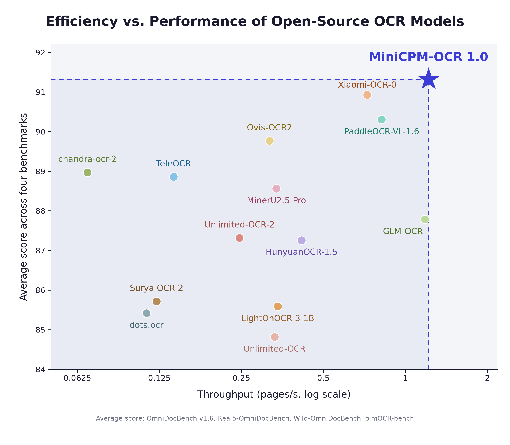

# On-premises PDF heading benchmark: scores, timings and methods

**28 completed local configurations, suitable for on-premises inference.** This experiment asks whether parsers and local models can recover heading titles, PDF pages and levels while retaining the text of long WFP evaluation reports.

**Primary metric: joint heading-and-level F0.5**, with joint precision and joint recall alongside it. A correct prediction must match the heading title, PDF page and exact level. Wrong levels and extra headings reduce precision; missed or incorrectly leveled headings reduce recall. There is no separate PASS/FAIL gate. Definitions and worked examples follow the table.

Qwen3.6-27B with sampled visual memory leads at **82.7% joint F0.5**, with **82.3% joint precision**, 65/77 correct heading-level pairs and two extras. Chandra scores **72.6% F0.5**, 73.6% joint precision and 53/77 correct pairs. These are configuration-specific results from a small, assistant-annotated sample, without independent human validation.

**Sequential GPU reruns:** seven selected MLX configurations were repeated one at a time on all 32 audit pages. Every heading title, page and level was reproduced exactly, with no parse errors, timeouts or truncations. The main table uses the new **average time per page** measurements, marked “Latest sequential run”. Chandra and LightOn were faster in these repeats; Qwen timings were mixed. [Original versus repeated timings, GPU observations and protocol](#sequential-gpu-reruns).

**New OCR field trials:** all three new candidates completed the same 32 pages, one model at a time, using pixels only. Xiaomi-OCR-0 whole-page scores **39.7% joint F0.5**; MiniCPM-OCR 1.0 and PaddleOCR-VL-1.6 with CPU layout each score **22.2%**. They retain 98.1–98.8% of measured prose and take 4 min 39 sec to 7 min 50 sec per 32 pages, but none improves on Chandra’s hierarchy score. The region pipelines use the MiniCPM SDK’s native numbering-based Markdown levels. These are Apple Silicon configurations, not replications of the external NVIDIA chart; earlier Qwen configurations also receive extra document context. [Protocol, exact settings and measured evidence](https://github.com/dividor/pdf-heading-benchmark/blob/codex/technique-explorer/outputs/field-candidates/report.md).

**Our new precision-selected method:** [jump to the highlighted row](#our-trained-model). A validation-selected confidence filter raises historical joint F0.5 from **58.8% to 70.5%** and reduces extra headings from **23 to 2**, reaching **82.9% joint precision (34/41)** and **44.2% joint recall (34/77)**. It emits fewer headings: correct title-and-level pairs fall from **50/77 to 34/77**, with 38 titles missed. This is an explicit precision/recall trade-off. The three small CPU classifiers are unchanged; the LLM supplied training annotations and is not used at inference.

The candidate was selected from a fixed 36-setting grid on four separate validation reports. The original league and the previously inspected 38-heading set were scored only after selection. Both are regression evidence, not new independent tests. The historical selection rule included a 95% heading-only precision constraint; that rule remains documented in the experiment but is no longer a league-table qualification gate. [Experiment, every setting and reproduction](https://github.com/dividor/pdf-heading-benchmark/blob/codex/technique-explorer/outputs/structure-precision/report.md).

**Coverage retraining trial:** the additional OUR METHOD row refits the trees and restores title recovery to 66/77 (85.7%), but has only 50 correct heading-level pairs and 21 extras. None of the 64 validation configurations met both 80% joint precision and recall. It is a diagnostic fallback, not a recommended replacement. [Experiment and complete evidence](https://github.com/dividor/pdf-heading-benchmark/blob/codex/technique-explorer/outputs/structure-recall/report.md).

[Repository and runnable instructions](https://github.com/dividor/pdf-heading-benchmark) · [Markdown report](https://github.com/dividor/pdf-heading-benchmark/blob/codex/technique-explorer/outputs/report/league_table.md) · [Score exports](https://github.com/dividor/pdf-heading-benchmark/blob/codex/technique-explorer/outputs/report/results.json)

[The recent OCR field: quality-versus-speed diagram and sources](#published-comparison). These external scores are separate from our WFP results.

## Documents and their sources

All four PDFs were obtained from WFP's public document servers. Each title below links directly to its official source PDF. The [corpus manifest](https://github.com/dividor/pdf-heading-benchmark/blob/main/configs/corpus.json) records the download URLs, page counts and SHA-256 hashes; the downloader verifies the files against those hashes.

The corpus contains **523 pages: three English reports and one Spanish report**. All four contain native digital text. None has PDF outline bookmarks. The standalone PDF-tag baseline is excluded from this comparison because it relies on structure already supplied by the PDF author. The recorded Qwen3.6 runs still use available author tags as input alongside text and images; their scores do not establish performance on untagged PDFs. This does not test scanned-document performance. The original 2018 resilience report that prompted the investigation was excluded after document-specific exploratory work.

The audit covers **eight selected pages per report, 32 pages and 77 reference headings in total**. Page numbers below are **one-based physical PDF pages**, including covers and front matter, rather than printed page labels. These are the exact pages scored for every completed configuration.

[Sequential GPU reruns: before/after timing, accuracy and GPU activity](#sequential-gpu-reruns). The main table marks verified rerun timings; the historical source evidence remains frozen.

| WFP report / official PDF | Language | PDF pages | Audited PDF pages | Reference headings |
| --- | --- | --- | --- | --- |
| [Strategic evaluation of WFP’s Approaches to Targeting and Prioritization for Food and Nutrition Assistance](https://api.godocs.wfp.org/api/documents/WFP-0000171594/download/) | English | 172 | 7, 11, 24, 27, 33, 67, 96, 109 | 15 |
| [Mid-Term Evaluation of WFP’s Strategic Plan 2022–2025](https://docs.wfp.org/api/documents/WFP-0000162023/download/) | English | 176 | 8, 10, 26, 27, 36, 61, 87, 98 | 18 |
| [Evaluation of Indonesia WFP country strategic plan 2021–2025 — Volume I](https://docs.wfp.org/api/documents/WFP-0000168942/download/) | English | 76 | 7, 11, 20, 33, 42, 48, 56, 68 | 21 |
| [Evaluación del Plan estratégico para Colombia 2021–2024](https://docs.wfp.org/api/documents/WFP-0000157262/download/) | Spanish | 99 | 7, 13, 28, 42, 56, 72, 73, 93 | 23 |

## What was tested and how

1. **Select and annotate pages.** Pages were deliberately selected across front matter, chapters, subsections and annexes. A single AI assistant visually annotated heading titles and levels. The [page selection](https://github.com/dividor/pdf-heading-benchmark/blob/main/configs/audit_pages.json) and [frozen reference labels](https://github.com/dividor/pdf-heading-benchmark/blob/main/configs/gold.json) are public. They have not been independently reviewed by a human, and the selection is not random.
2. **Run the configured extractor or hierarchy stage.** CPU parsers processed all 523 pages; the later local OCR models processed the 32 audit pages. Hierarchy stages consumed extracted candidates and, for some configurations, PDF tags or page images. No reference titles or reference levels were supplied to inference. The table links to each runner; [method configuration steps](https://github.com/dividor/pdf-heading-benchmark/blob/main/configs/methods.json), [model revisions](https://github.com/dividor/pdf-heading-benchmark/blob/main/configs/models.json) and [reproducibility notes](https://github.com/dividor/pdf-heading-benchmark/blob/main/docs/reproducibility.md) give dependencies, prompts and settings. No per-report heading correction rules are applied.
3. **Score the same audit pages.** The [scorer](https://github.com/dividor/pdf-heading-benchmark/blob/main/src/pdf_heading_benchmark/evaluation.py) matches titles on the same original PDF page, using normalized text similarity of at least 90% after one-to-one Hungarian assignment. A combined success requires the exact reference H level too. Main chapters and annexes are H1; the cover title does not shift the body hierarchy. Joint precision divides correct heading-level pairs by all predictions; joint recall divides them by the 77 references. Joint F0.5 combines these with more emphasis on precision, penalizing extra predictions and wrong levels as well as missed headings.
4. **Check prose and record resources.** Native prose retention measures preserved five-word sequences from native PDF blocks of at least 50 words on the audit pages. It does not measure character accuracy, reading order or table extraction. Processing times were observed on a shared 48 GB Apple M4 Pro and have different scopes. Hardware, electricity, engineering, review and licensing costs were not measured in dollars.

This is **sampled-page heading accuracy**, even when a parser processed the full document. The completed configurations include variants of the same packages and models; they are not independent products. The single annotator, small purposive sample and exploratory configuration choices limit any claim about general robustness.

## Full configuration results

**Ranked by joint heading-and-level F0.5**, with **joint precision and joint recall** next to it. The first score column is highlighted. There are no PASS/FAIL labels; heading-only precision appears in the detailed results as a diagnostic. See the definitions and worked example below the table. In HTML, select the **i** beside a configuration, or its **Method / code** for its predicted-versus-reference heading comparison, diagram, parameters and sources. Markdown retains those links and the detailed technique appendix. All configurations ran locally. Missing measurements remain unavailable rather than being assigned zero.

| Configuration | Primary score: joint F0.5 | Joint precision | Joint recall | Method / code | Status | Headings recovered | False headings | Native prose retention | Time per page | Time for 32 pages |
| --- | --- | --- | --- | --- | --- | --- | --- | --- | --- | --- |
| [Qwen3.6-27B / MLX 4-bit / sampled visual memory](https://huggingface.co/Qwen/Qwen3.6-27B) | **82.7%** | 82.3% (65/79) | 84.4% (65/77) | [Ask Qwen3.6-27B to identify headings using the current page’s image and text, possible headings from the whole document, author-supplied tags and selected earlier page images.](https://github.com/dividor/pdf-heading-benchmark/blob/main/scripts/runners/run_qwen_visual_memory.py) | completed | 100.0% (77/77) | 2 | — | **1 min 41 sec** Latest sequential run | **54 min 2 sec** Measured |
| [Qwen3.6-27B 4-bit — single image](https://github.com/dividor/pdf-heading-benchmark/blob/codex/technique-explorer/outputs/qwen-compact/report.md) | **77.1%** | 76.9% (60/78) | 77.9% (60/77) | [Qwen3.6-27B MLX 4-bit; one 1280-pixel image and text-only heading memory.](https://github.com/dividor/pdf-heading-benchmark/blob/codex/technique-explorer/scripts/runners/run_qwen_compact.py) | completed | 100.0% (77/77) | 1 | — | **1 min 7 sec** Latest sequential run | **35 min 33 sec** Measured |
| [Chandra OCR 2 / MLX](https://huggingface.co/datalab-to/chandra-ocr-2) | **72.6%** | 73.6% (53/72) | 68.8% (53/77) | [Chandra OCR 2 reads page images using its authors’ layout-reading prompt and image preparation.](https://github.com/dividor/pdf-heading-benchmark/blob/main/scripts/runners/run_chandra_batch.py) | completed | 90.9% (70/77) | 2 | 98.7% | **27.7 sec** Latest sequential run | **14 min 46 sec** Measured |
| [**OUR METHOD — confidence-filtered v2 (F0.5-selected)**](https://github.com/dividor/pdf-heading-benchmark/blob/codex/technique-explorer/outputs/structure-precision/report.md) | **70.5%** | 82.9% (34/41) | 44.2% (34/77) | [Three Extra Trees classifiers trained locally for this benchmark on 20 WFP reports: join lines, assign heading levels and compare successive levels. Reuse those models with a validation-selected 0.70 confidence filter.](https://github.com/dividor/pdf-heading-benchmark/blob/codex/technique-explorer/scripts/structure/optimize_precision.py) | completed | 50.6% (39/77) | 2 | — | **0.022 sec** | **0.714 sec** Estimated from 11.7 sec measured over 523 pages |
| [Qwen3.6-35B-A3B 4-bit — visual memory](https://github.com/dividor/pdf-heading-benchmark/blob/codex/technique-explorer/outputs/qwen-compact/report.md) | **69.0%** | 69.3% (52/75) | 67.5% (52/77) | [Qwen3.6-35B-A3B MLX 4-bit; original prompt, larger current image and up to six previous page images.](https://github.com/dividor/pdf-heading-benchmark/blob/codex/technique-explorer/scripts/runners/run_qwen_sparse_memory.py) | completed | 97.4% (75/77) | 0 | — | **15.6 sec** Latest sequential run | **8 min 19 sec** Measured |
| [Qwen3.6-35B-A3B 4-bit — single image](https://github.com/dividor/pdf-heading-benchmark/blob/codex/technique-explorer/outputs/qwen-compact/report.md) | **68.8%** | 68.8% (53/77) | 68.8% (53/77) | [Qwen3.6-35B-A3B MLX 4-bit; one 1280-pixel image and text-only heading memory.](https://github.com/dividor/pdf-heading-benchmark/blob/codex/technique-explorer/scripts/runners/run_qwen_compact.py) | completed | 100.0% (77/77) | 0 | — | **10.7 sec** Latest sequential run | **5 min 42 sec** Measured |
| [**OUR METHOD — calibrated decoding (experimental)**](https://github.com/dividor/pdf-heading-benchmark/blob/codex/technique-explorer/outputs/structure-calibration/report.md) | **59.2%** | 58.8% (47/80) | 61.0% (47/77) | [Reuse our three Extra Trees classifiers trained locally on 20 WFP reports; apply a validation-selected body-score multiplier of two.](https://github.com/dividor/pdf-heading-benchmark/blob/codex/technique-explorer/scripts/structure/calibrate.py) | completed | 76.6% (59/77) | 21 | — | **0.028 sec** | **0.885 sec** Estimated from 14.5 sec measured over 523 pages |
| [OUR METHOD — grouped context v2 (previous selection)](https://github.com/dividor/pdf-heading-benchmark/blob/codex/supervised-structure-v2/outputs/structure-v2/report.md) | **58.8%** | 57.5% (50/87) | 64.9% (50/77) | [Use three Extra Trees classifiers to join wrapped titles, recognize headings and levels, and compare the levels of neighboring headings.](https://github.com/dividor/pdf-heading-benchmark/blob/codex/supervised-structure-v2/scripts/structure/train.py) | completed | 83.1% (64/77) | 23 | — | **0.024 sec** | **0.768 sec** Estimated from 12.6 sec measured over 523 pages |
| [OUR METHOD — retrained trees (coverage trial; target not met)](https://github.com/dividor/pdf-heading-benchmark/blob/codex/technique-explorer/outputs/structure-recall/report.md) | **58.8%** | 57.5% (50/87) | 64.9% (50/77) | [Refit Extra Trees on the same 20 training reports; compare 64 validation settings for precision and coverage. No setting met both 80% targets; this is the predeclared diagnostic fallback.](https://github.com/dividor/pdf-heading-benchmark/blob/codex/technique-explorer/scripts/structure/retrain_recall.py) | completed | 85.7% (66/77) | 21 | — | **0.031 sec** | **1 sec** Estimated from 16.4 sec measured over 523 pages |
| [LightOnOCR-3-0.8B / MLX](https://huggingface.co/lightonai/LightOnOCR-3-0.8B) | **57.9%** | 57.5% (46/80) | 59.7% (46/77) | [LightOnOCR-3-0.8B reads one page image at a time and returns text with locations on the page.](https://github.com/dividor/pdf-heading-benchmark/blob/main/scripts/runners/run_lighton_mlx.py) | completed | 93.5% (72/77) | 8 | 99.5% | **11.5 sec** Latest sequential run | **6 min 9 sec** Measured |
| [LightOnOCR-3-4B / MLX grounding](https://huggingface.co/lightonai/LightOnOCR-3-4B) | **57.9%** | 57.5% (46/80) | 59.7% (46/77) | [LightOnOCR-3-4B reads page images and returns text with page locations, using the same output convention as the 0.8-billion-parameter model.](https://github.com/dividor/pdf-heading-benchmark/blob/main/scripts/runners/run_chandra_batch.py) | completed | 93.5% (72/77) | 8 | 99.3% | **33 sec** Latest sequential run | **17 min 36 sec** Measured |
| [v2: learned grouping](https://github.com/dividor/pdf-heading-benchmark/blob/codex/supervised-structure-v2/outputs/structure-v2/report.md) | **55.8%** | 53.7% (51/95) | 66.2% (51/77) | [Train two Extra Trees classifiers: one decides which neighboring lines belong to the same heading, and one labels the resulting text groups as body text or H1–H5.](https://github.com/dividor/pdf-heading-benchmark/blob/codex/supervised-structure-v2/scripts/structure/train.py) | completed | 96.1% (74/77) | 21 | — | **0.023 sec** | **0.732 sec** Estimated from 12 sec measured over 523 pages |
| [v2: more annotations](https://github.com/dividor/pdf-heading-benchmark/blob/codex/supervised-structure-v2/outputs/structure-v2/report.md) | **44.9%** | 43.2% (41/95) | 53.2% (41/77) | [Test whether more labeled examples improve the original single-classifier design.](https://github.com/dividor/pdf-heading-benchmark/blob/codex/supervised-structure-v2/scripts/structure/train.py) | completed | 89.6% (69/77) | 26 | — | **0.018 sec** | **0.567 sec** Estimated from 9.3 sec measured over 523 pages |
| [LLM annotations → Extra Trees v1 (CPU)](https://github.com/dividor/pdf-heading-benchmark/blob/main/src/pdf_heading_benchmark/supervised_models.py) | **44.5%** | 44.3% (35/79) | 45.5% (35/77) | [Train one Extra Trees classifier to decide whether each PDF text line is body text or a heading at a particular level.](https://github.com/dividor/pdf-heading-benchmark/blob/main/scripts/supervised/compare.py) | completed | 76.6% (59/77) | 20 | — | **0.015 sec** | **0.473 sec** Estimated from 7.7 sec measured over 523 pages |
| [MinerU 4.2.3 basic CPU](https://github.com/opendatalab/MinerU) | **44.4%** | 45.6% (31/68) | 40.3% (31/77) | [MinerU 4.2.3 uses its basic PDF parser on the CPU through ONNX Runtime.](https://github.com/dividor/pdf-heading-benchmark/blob/main/scripts/runners/run_mineru.py) | completed | 85.7% (66/77) | 2 | 99.1% | **1.3 sec** | **41.1 sec** Estimated from 11 min 12 sec measured over 523 pages |
| [Qwen3.5-4B / union candidates](https://huggingface.co/Qwen/Qwen3.5-4B) | **41.0%** | 43.9% (25/57) | 32.5% (25/77) | [Ask Qwen3.5-4B to assign levels to possible headings extracted by Docling and PyMuPDF4LLM.](https://github.com/dividor/pdf-heading-benchmark/blob/main/scripts/runners/run_qwen_ids.py) | completed | 70.1% (54/77) | 3 | — | Page average unavailable 1 min 41 sec for the hierarchy stage | Unavailable |
| [Xiaomi-OCR-0 — MLX whole page](https://huggingface.co/xiaomi-research/Xiaomi-OCR-0) | **39.7%** | 40.3% (29/72) | 37.7% (29/77) | [Xiaomi-OCR-0 reads each complete page through MLX and returns native Markdown.](https://github.com/dividor/pdf-heading-benchmark/blob/codex/technique-explorer/scripts/runners/run_field_candidate.py) | completed | 89.6% (69/77) | 3 | 98.8% | **11.6 sec** | **6 min 12 sec** Measured |
| [Qwen3.5-4B / PyMuPDF candidates](https://huggingface.co/Qwen/Qwen3.5-4B) | **37.5%** | 40.7% (22/54) | 28.6% (22/77) | [Ask Qwen3.5-4B to assign levels to possible headings extracted by PyMuPDF4LLM.](https://github.com/dividor/pdf-heading-benchmark/blob/main/scripts/runners/run_qwen_ids.py) | completed | 70.1% (54/77) | 0 | — | Page average unavailable 1 min 29 sec for the hierarchy stage | Unavailable |
| [PyMuPDF4LLM 2.1](https://github.com/pymupdf/pymupdf4llm) | **37.5%** | 37.8% (28/74) | 36.4% (28/77) | [PyMuPDF4LLM 2.1 turns the PDF’s existing text into Markdown.](https://github.com/dividor/pdf-heading-benchmark/blob/main/scripts/runners/run_pymupdf4llm.py) | completed | 93.5% (72/77) | 2 | 98.8% | **0.099 sec** | **3.2 sec** Estimated from 51.8 sec measured over 523 pages |
| [Qwen3.5-4B / MinerU candidates](https://huggingface.co/Qwen/Qwen3.5-4B) | **33.3%** | 34.3% (23/67) | 29.9% (23/77) | [Ask Qwen3.5-4B to assign levels to possible headings extracted by MinerU’s basic parser.](https://github.com/dividor/pdf-heading-benchmark/blob/main/scripts/runners/run_qwen_ids.py) | completed | 85.7% (66/77) | 1 | — | Page average unavailable 1 min 16 sec for the hierarchy stage | Unavailable |
| [Docling fixed tolerance 0.15](https://github.com/docling-project/docling) | **30.8%** | 31.4% (22/70) | 28.6% (22/77) | [Use Docling 2.151.1 with a fixed font-style tolerance of 0.15 in its hierarchy step.](https://github.com/dividor/pdf-heading-benchmark/blob/main/scripts/runners/run_docling.py) | completed | 88.3% (68/77) | 2 | 98.4% | **0.196 sec** | **6.3 sec** Estimated from 1 min 42 sec measured over 523 pages |
| [Marker 2.2 no OCR/LLM](https://github.com/datalab-to/marker) | **25.5%** | 25.7% (19/74) | 24.7% (19/77) | [Marker 2.2 parses the complete PDF locally on the CPU.](https://github.com/dividor/pdf-heading-benchmark/blob/main/scripts/runners/run_marker.py) | completed | 84.4% (65/77) | 9 | 98.8% | **0.084 sec** | **2.7 sec** Estimated from 44 sec measured over 523 pages |
| [Docling 2.151.1 default](https://github.com/docling-project/docling) | **22.4%** | 22.9% (16/70) | 20.8% (16/77) | [Use the heading levels returned by Docling 2.151.1 when it first reads the PDF.](https://github.com/dividor/pdf-heading-benchmark/blob/main/scripts/runners/run_docling.py) | completed | 88.3% (68/77) | 2 | 98.4% | **0.196 sec** | **6.3 sec** Estimated from 1 min 42 sec measured over 523 pages |
| [Docling built-in hierarchy](https://github.com/docling-project/docling) | **22.4%** | 22.9% (16/70) | 20.8% (16/77) | [Use Docling 2.151.1 to find headings, then run its built-in HeadingHierarchyModel to assign their levels.](https://github.com/dividor/pdf-heading-benchmark/blob/main/scripts/runners/run_docling.py) | completed | 88.3% (68/77) | 2 | 98.4% | **0.196 sec** | **6.3 sec** Estimated from 1 min 42 sec measured over 523 pages |
| [MiniCPM-OCR 1.0 — MLX + CPU layout](https://huggingface.co/openbmb/MiniCPM-OCR-1.0) | **22.2%** | 22.5% (16/71) | 20.8% (16/77) | [PP-DocLayoutV3 detects regions on CPU; MiniCPM-OCR 1.0 recognizes their content on the Metal GPU; MiniCPM SDK assembles Markdown.](https://github.com/dividor/pdf-heading-benchmark/blob/codex/technique-explorer/scripts/runners/run_field_candidate.py) | completed | 88.3% (68/77) | 3 | 98.1% | **14.7 sec** | **7 min 50 sec** Measured |
| [PaddleOCR-VL-1.6 — MLX + CPU layout](https://huggingface.co/PaddlePaddle/PaddleOCR-VL-1.6) | **22.2%** | 22.5% (16/71) | 20.8% (16/77) | [PP-DocLayoutV3 detects regions on CPU; PaddleOCR-VL-1.6 recognizes their content on the Metal GPU; MiniCPM SDK assembles Markdown.](https://github.com/dividor/pdf-heading-benchmark/blob/codex/technique-explorer/scripts/runners/run_field_candidate.py) | completed | 88.3% (68/77) | 3 | 98.4% | **8.7 sec** | **4 min 39 sec** Measured |
| [Popo + Docling / experimental MLX 8-bit](https://github.com/opendatalab/MinerU-Popo) | **21.0%** | 21.4% (15/70) | 19.5% (15/77) | [Use MinerU-Popo to assign levels to headings first detected by Docling.](https://github.com/dividor/pdf-heading-benchmark/blob/main/scripts/runners/run_popo_mlx.py) | completed | 88.3% (68/77) | 2 | 98.4% | Page average unavailable 14 min 57 sec for the hierarchy stage | Unavailable |
| [MinerU2.5-Pro-2605-1.2B / direct MLX interface](https://huggingface.co/opendatalab/MinerU2.5-Pro-2605-1.2B) | **0.0%** | 0.0% (0/72) | 0.0% (0/77) | [MinerU2.5-Pro-2605-1.2B reads the layout and text of page images.](https://github.com/dividor/pdf-heading-benchmark/blob/main/scripts/runners/run_mineru_pro.py) | completed | 89.6% (69/77) | 3 | 99.0% | **17.8 sec** | **9 min 30 sec** Measured |

## Primary metric: heading-and-level F0.5

A useful output must identify a real heading, put it on the correct PDF page and assign the correct level. Invented headings also matter. We therefore rank by **joint heading-and-level F0.5**, supported by **joint precision** and **joint recall**. All three require the heading and its level to be correct. There is no separate PASS/FAIL qualification gate.

Let **G** be the number of reference headings, **P** all predicted headings, **M** the one-to-one title/page matches and **C** those matches with the exact reference level. Matching uses the unchanged same-page, normalized-title similarity ≥0.90 contract. Counts are pooled across reports before calculating metrics (micro averaging).

| Measure | Definition | What it tells us |
| --- | --- | --- |
| Joint precision | C / P | Fraction of emitted headings with both title/page and level correct |
| Joint recall | C / G | Fraction of reference headings recovered at the correct level |
| Joint F1 | 2C / (P + G) | Equal precision/recall emphasis |
| **Joint F0.5** | **1.25C / (P + 0.25G)** | Primary score; emphasizes precision more than recall |
| Heading-detection precision | M / P | Diagnostic only: real headings regardless of level; shown in detailed results |

Joint true positives are **C**, false positives are **P − C**, and false negatives are **G − C**. A wrong-level heading is both a joint false positive and a joint false negative. A missing heading contributes a false negative; an extra heading contributes a false positive. No predictions gives a zero score. Unknown levels earn no joint credit. Heading-only precision ignores wrong levels, so it is a diagnostic rather than a quality requirement.

For example, 10 reference headings, 12 predictions, 10 title matches and 9 correct levels give joint precision 75%, recall 90%, F1 81.8% and F0.5 77.6%. Recovering every title does not imply correct hierarchy.

MinerU basic illustrates why the distinction matters: 66 of its 68 predictions match real titles, but only 31 have the correct level. Its joint precision is **45.6% (31/68)**, joint recall **40.3% (31/77)** and joint F0.5 **44.4%**. The 97.1% heading-only precision ignores 35 wrong levels. OUR METHOD's confidence-filtered configuration has **82.9% joint precision (34/41)** and **44.2% joint recall (34/77)**, yielding **70.5% joint F0.5**. Its two extra headings are separate from its five wrong-level headings.

For future optimization, select using validation joint F0.5, report joint precision and recall alongside it, then freeze the configuration before evaluation elsewhere. Do not choose settings using the main league or inspected regression pages.

**Historical selection remains unchanged:** the published 36-setting confidence-filter experiment selected the highest validation joint F0.5 among candidates with at least 95% heading-only precision. That was its actual selection rule, and its protocol and results remain available. We have removed this gate from the league table because it ignores level errors. Recomputing or presenting joint metrics does not retrain models or retroactively change how any configuration was selected.

## How to read the table

**Local resources and cost:** all configurations in this report ran locally on a shared 48 GB Apple M4 Pro. Hardware, electricity, setup, engineering, manual review and commercial licensing costs were not measured in dollars. Observed processing times are reported with their actual scope; local inference is not cost-free.

**Scopes and timing:** entries marked “Latest sequential run” use the verified sequential repeat; earlier measurements remain in the comparison below. The average time per page is total processing time divided by actual processed pages. Durations use readable minutes and seconds, with decimals for short runs. Total time and the page count remain visible. Rates are average throughput, not individual-page latency; hierarchy-only stages with no recorded page denominator show an unavailable average instead of an invented rate. Earlier CPU parsers processed all 523 pages. New local OCR models processed the complete text on the 32 audit pages. Qwen3.6 reads native page text, full-document candidate titles and author PDF tags. The original visual-memory variant adds current/previous sampled-page images; the single-image variants use only the current image and text-only prediction memory. These methods reuse native body text. Their measured times exclude candidate-generation stages. Qwen3.5 and Popo timings cover only hierarchy inference. Hardware was a shared 48 GB Apple M4 Pro. New-model times exclude downloads, loading and aborted attempts; some earlier CPU times include setup. These are observations with different scopes, not a controlled throughput benchmark.

**Text:** native prose retention measures five-word sequences preserved from native PDF blocks of at least 50 words, on the audit pages. It is not character accuracy, reading order, semantic accuracy or table correctness. A missing score means not evaluated or not applicable. Hierarchy-only stages reuse extracted text.

**Configuration caveats:** MinerU Pro's direct interface recovered headings but supplied no hierarchy levels; its 0/77 complete outputs must not be described as zero heading detection. The original Qwen3.6 visual-memory implementation uses only previously processed audit pages as visual memory; the new single-image variants omit earlier images. Neither is a reproduction of a full-document memory benchmark. The Popo result is an experimental 8-bit MLX port with 8-page chunks, not an upstream performance claim. LightOn 4B historical timing includes five single-page checkpoints followed by batch-two processing; a clean rerun uses batch two throughout. The 0.15 Docling tolerance was fixed across these reports but remains an exploratory choice, not an untuned general default.

**Reference and uncertainty:** pages were deliberately selected to span front matter, body chapters, subsections and annexes. A single assistant annotated them visually. The original 2018 resilience report was excluded after prior document-specific investigation. No per-report title/level correction rules are applied here. The sample is small, covers born-digital reports only, and has no inter-annotator agreement study. Ranking on it cannot establish robustness on arbitrary documents. No missing run is assigned a zero score.

**Reproducibility:** the repo includes the frozen audit labels, page-restricted predictions and original summary/match records. `uv run pdf-headings score --historical` recomputes the bundled historical predictions, including the local configurations selected for this report, without model downloads or credentials. Raw full-page responses remain in the original local experiment archive; they are not bundled in the public repo. Fresh runners save raw responses outside Git. Seven historical Qwen formatting deviations were accepted by a generic JSON array/wrapper/single-fence reader without changing title or level values. Refactored runners retain prompts and settings; model/GPU runs have not all been repeated after packaging. See [method details](https://github.com/dividor/pdf-heading-benchmark/blob/main/docs/reproducibility.md).

**Licenses:** the repository's MIT license covers its code, not third-party packages, model weights or WFP reports. Chandra weights have commercial-use restrictions; applicable licensing costs are additional. See each linked model/package and [third-party notices](https://github.com/dividor/pdf-heading-benchmark/blob/main/THIRD_PARTY_NOTICES.md).

**Supervised Extra Trees:** the frozen classifier was trained on 16 different WFP reports, selected using four validation reports, and first evaluated on four new test reports. It was then applied without refitting to the original four benchmark PDFs and scored with the same 77-heading matching contract as every row above: **59/77 recovered, 35/77 at the correct level, 20 extra headings**. The 7.7-second measurement covers all 523 pages, including extraction and classification but excluding model loading and output writes. Native prose retention was not evaluated. Its separate 82.0% exact-level line F1 on the new test set uses a different corpus and metric and is not the number ranked here. [Comparison runner and evidence](https://github.com/dividor/pdf-heading-benchmark/tree/main/outputs/supervised/comparison) · [Training protocol](https://github.com/dividor/pdf-heading-benchmark/blob/main/outputs/supervised/report.md).

**Earlier calibration experiment:** body-weight calibration was selected using validation F1. On the historical table its joint F0.5 is 59.2%, versus 58.8% for the original context model; joint precision is 58.8% (47/80). On the inspected 38-heading set, both configurations still have 36 correct heading-level pairs; higher F1 came from fewer extras. Those original results and selection criteria remain frozen.

**New precision optimization:** the threshold-0.70 candidate was selected on validation joint F0.5 subject to the 95% heading-precision gate. This was the experiment’s historical selection rule, not a current league-table quality gate. On the historical sample, joint precision is 82.9% (34/41), joint recall is 44.2% (34/77), and joint F0.5 is 70.5%. It has two extra headings and five genuine headings with wrong levels. On the inspected 38-heading set it emits 28 correctly leveled headings, no extras, and misses ten. Reused small validation and regression sets limit the result; a fresh independent evaluation remains necessary. [Settings, all validation scores and reproduction](https://github.com/dividor/pdf-heading-benchmark/blob/codex/technique-explorer/outputs/structure-precision/report.md).

The timing columns separate **Time per page** from **Time for 32 pages**. The latter is marked **Measured** for actual 32-page runs, or **Estimated** when calculated as 32 times the average from a longer run. Estimates retain the original measured duration and page count; they are not new benchmark measurements.

## Sequential GPU reruns

Seven selected MLX configurations were rerun one at a time on the same four PDFs, 32 audit pages and 77 reference headings. Every rerun reproduced the original heading titles, pages and levels exactly, with no parse errors, timeouts or token-limit truncations. The main table now uses these new timings, marked “Latest sequential run”; this comparison preserves the original measurements.

Chandra and the two LightOn runs took **14–31% less processing time**. Qwen results were mixed: visual-memory 27B improved **12.5%**, while single-image 27B took **4.7% longer**. Median system GPU utilization ranged from **92% to 100%**, with the Metal GPU independently verified inside each inference process. These observations confirm GPU execution; they do not establish optimal kernel efficiency or isolate the effect of background load.

How these reruns were measured: protocol, settings and hardware

**Execution and provenance:** each configuration ran in a fresh process and output directory, with only one benchmark model loaded at a time. The runner checked the default MLX device and Metal availability before model loading. It retained model/package versions, source and input hashes, raw page responses, process wall time, GPU activity and virtual-memory counters. The main timing column accepts only error-free, untruncated reruns with the same page scope and exactly matching heading predictions; the historical source evidence remains unchanged.

**Timing:** all rates below use seconds per page. Earlier and rerun processing rates use the original runners' measurement boundaries, excluding model loading and upstream candidate extraction. Whole-process rates include interpreter imports, model loading, image preparation, generation and output writes; they still exclude previously prepared candidate extraction and downloads. OCR batch time is divided by the number of pages, so it measures average throughput rather than single-page latency. Smaller values are faster. This is one repeat per configuration, not a statistical estimate of typical performance.

**Settings:** Qwen models retain their pinned MLX 4-bit weights, greedy decoding, seed 42, non-thinking prompts and 4,096-token limit. Single-image runs use a 1,280-pixel image; visual-memory runs use a 1,792-pixel current image plus up to six earlier 1,280-pixel images. Chandra retains batch four and a 12,384-token limit. LightOn 4B uses batch two throughout and a 12,384-token limit; its historical run mixed five single-page checkpoints (12,288-token limit) with batching, so that comparison includes a batching and token-limit change. LightOn 0.8B remains one image at a time with an 8,192-token limit. No headings or levels are repaired after generation.

**Hardware and limits:** this Mac has an Apple M4 Pro with a 20-core GPU and 48 GiB unified memory. GPU inference is active, but other applications still share memory and GPU resources. In the initial rerun, loading the sparse Qwen model increased total system swap usage from approximately 15 GB to 20 GB. The reruns therefore must not be described as measurements on an idle or memory-pressure-free machine. Swap-counter differences below show actual activity during each run, rather than treating existing swap allocation as proof of ongoing paging. PDF rendering, tokenization and JSON handling also use the CPU. [MLX's unified-memory and device documentation](https://ml-explore.github.io/mlx/build/html/usage/unified_memory.html) explains how CPU and GPU execution share memory; the recorded device selection and telemetry establish what happened in these runs.

[Sequential runner](https://github.com/dividor/pdf-heading-benchmark/blob/codex/technique-explorer/scripts/runners/repeat_models.py) · [Importer and scorer](https://github.com/dividor/pdf-heading-benchmark/blob/codex/technique-explorer/scripts/repeat_report.py) · [Rerun predictions versus reference](https://github.com/dividor/pdf-heading-benchmark/blob/codex/technique-explorer/outputs/sequential-repeat/report.md) · [Compact evidence](https://github.com/dividor/pdf-heading-benchmark/tree/codex/technique-explorer/outputs/sequential-repeat)

**Completed: 7/7 configurations.**

| Repeated configuration | Original time per page | Original time for 32 pages | Latest time per page | Latest time for 32 pages | Including startup, per page | Correct heading + level | Joint F0.5: earlier → rerun | Rerun extras | Errors | Timeouts |
| --- | --- | --- | --- | --- | --- | --- | --- | --- | --- | --- |
| Qwen3.6-35B-A3B 4-bit — single image | 9.8 sec | 5 min 13 sec | 10.7 sec | 5 min 42 sec | 11.6 sec | 53/77 → 53/77 | 68.8% → 68.8% | 0 | 0 | 0 |
| Qwen3.6-35B-A3B 4-bit — visual memory | 16.3 sec | 8 min 40 sec | 15.6 sec | 8 min 19 sec | 16.5 sec | 52/77 → 52/77 | 69.0% → 69.0% | 0 | 0 | 0 |
| Chandra OCR 2 / MLX | 32.3 sec | 17 min 12 sec | 27.7 sec | 14 min 46 sec | 28.2 sec | 53/77 → 53/77 | 72.6% → 72.6% | 2 | 0 | 0 |
| LightOnOCR-3-4B / MLX grounding | 44.1 sec | 23 min 33 sec | 33 sec | 17 min 36 sec | 33.5 sec | 46/77 → 46/77 | 57.9% → 57.9% | 8 | 0 | 0 |
| LightOnOCR-3-0.8B / MLX | 16.6 sec | 8 min 51 sec | 11.5 sec | 6 min 9 sec | 11.8 sec | 46/77 → 46/77 | 57.9% → 57.9% | 8 | 0 | 0 |
| Qwen3.6-27B 4-bit — single image | 1 min 4 sec | 33 min 58 sec | 1 min 7 sec | 35 min 33 sec | 1 min 7 sec | 60/77 → 60/77 | 77.1% → 77.1% | 1 | 0 | 0 |
| Qwen3.6-27B / MLX 4-bit / sampled visual memory | 1 min 56 sec | 1 hr 1 min 47 sec | 1 min 41 sec | 54 min 2 sec | 1 min 42 sec | 65/77 → 65/77 | 82.7% → 82.7% | 2 | 0 | 0 |

### GPU and memory observations

| Repeated configuration | Samples | Median GPU % | Maximum GPU % | Swap read GB | Swap written GB |
| --- | --- | --- | --- | --- | --- |
| Qwen3.6-35B-A3B 4-bit — single image | 38 | 99.0 | 100 | 0.492 | 4.719 |
| Qwen3.6-35B-A3B 4-bit — visual memory | 53 | 99 | 100 | 0.098 | 0.029 |
| Chandra OCR 2 / MLX | 90 | 99.0 | 100 | 0.099 | 0.000 |
| LightOnOCR-3-4B / MLX grounding | 107 | 99 | 100 | 0.143 | 0.000 |
| LightOnOCR-3-0.8B / MLX | 38 | 92.0 | 100 | 0.201 | 0.000 |
| Qwen3.6-27B 4-bit — single image | 215 | 100 | 100 | 0.537 | 0.238 |
| Qwen3.6-27B / MLX 4-bit / sampled visual memory | 326 | 100.0 | 100 | 0.758 | 1.513 |

GPU and swap measurements are system-wide; they include other applications and model loading. A high GPU percentage confirms activity but does not prove optimal inference or identify a bottleneck.

## Published comparison

### The recent OCR field: quality versus speed

*Figure: OpenBMB / MiniCPM-OCR, reproduced unchanged under Apache 2.0. From the October 27, 2026 model release; source snapshot checked November 23, 2026. [Original figure](https://raw.githubusercontent.com/OpenBMB/MiniCPM-OCR/c21a3ca524263ef8166cb6d350864b10c3056b61/assets/minicpm-ocr/efficiency-performance-en.png) · [Full evaluation, comparison tables and methodology](https://github.com/OpenBMB/MiniCPM-OCR/blob/c21a3ca524263ef8166cb6d350864b10c3056b61/docs/minicpm_ocr_1dot0_en.md#evaluation) · [Interactive model-size perspective from Jina, September 2026](https://jina.ai/models/jina-ocr-v1/).*

**How to read it:** farther right means more pages per second; higher means a higher average across OmniDocBench 1.6, Real5-OmniDocBench, Wild-OmniDocBench and olmOCR-bench. The horizontal axis is logarithmic. The author reports NVIDIA RTX 5090 timings with one page in flight; recognition regions within a page can run concurrently. This is a recent view of the quality/speed frontier among the included systems, not an independent or exhaustive ranking of every available model. The labels and configurations are the author's; some differ from our tested variants.

**What we tested from it:** MiniCPM-OCR 1.0, Xiaomi-OCR-0 and PaddleOCR-VL-1.6 occupied the promising high-quality, high-throughput area. All three have now completed our same 32 WFP pages, one model at a time. Their measured rows are in the main table, with diagrams, exact parameters and every predicted-versus-reference heading. [Results and timing](https://github.com/dividor/pdf-heading-benchmark/blob/codex/technique-explorer/outputs/field-candidates/report.md) · [Protocol and runnable code](https://github.com/dividor/pdf-heading-benchmark/blob/codex/technique-explorer/docs/field-candidates.md).

**What happened locally:** Xiaomi’s documented whole-page variant scores **39.7% joint F0.5**; the MiniCPM and Paddle region pipelines each score **22.2%**. Prose retention is **98.1–98.8%**. These models can read the text well without reproducing our required heading hierarchy. MiniCPM and Paddle share layout detection and native Markdown assembly here; their identical heading counts are not independent evidence for the assembly strategy. We did not adjust their levels to match the reference. Xiaomi’s strongest published scores use a different two-stage pipeline, and our Paddle row is a portable MLX adaptation rather than the complete official CUDA deployment.

**Different tasks and hardware:** broad parsing quality does not establish correct heading hierarchy. These throughput figures are not Mac measurements. Our main table continues to rank only our measured joint heading-and-level F0.5 results. The model cards, source links and deployment differences remain visible in each method’s modal.

## Results by report

| Runner / configuration | Report | Recovered | Correct heading + level | False headings | Heading-only precision (diagnostic) |
| --- | --- | --- | --- | --- | --- |
| run_docling.py / docling_default | targeting | 13/15 | 3/15 | 0 | 100.0% |
| run_docling.py / docling_default | midterm | 17/18 | 5/18 | 0 | 100.0% |
| run_docling.py / docling_default | indonesia | 17/21 | 4/21 | 0 | 100.0% |
| run_docling.py / docling_default | colombia | 21/23 | 4/23 | 2 | 91.3% |
| run_docling.py / docling_hierarchy | targeting | 13/15 | 0/15 | 0 | 100.0% |
| run_docling.py / docling_hierarchy | midterm | 17/18 | 1/18 | 0 | 100.0% |
| run_docling.py / docling_hierarchy | indonesia | 17/21 | 7/21 | 0 | 100.0% |
| run_docling.py / docling_hierarchy | colombia | 21/23 | 8/23 | 2 | 91.3% |
| run_docling.py / docling_tuned | targeting | 13/15 | 0/15 | 0 | 100.0% |
| run_docling.py / docling_tuned | midterm | 17/18 | 6/18 | 0 | 100.0% |
| run_docling.py / docling_tuned | indonesia | 17/21 | 4/21 | 0 | 100.0% |
| run_docling.py / docling_tuned | colombia | 21/23 | 12/23 | 2 | 91.3% |
| run_pymupdf4llm.py / pymupdf4llm | targeting | 14/15 | 3/15 | 0 | 100.0% |
| run_pymupdf4llm.py / pymupdf4llm | midterm | 18/18 | 0/18 | 0 | 100.0% |
| run_pymupdf4llm.py / pymupdf4llm | indonesia | 18/21 | 16/21 | 2 | 90.0% |
| run_pymupdf4llm.py / pymupdf4llm | colombia | 22/23 | 9/23 | 0 | 100.0% |
| run_marker.py / marker | targeting | 13/15 | 6/15 | 4 | 76.5% |
| run_marker.py / marker | midterm | 18/18 | 6/18 | 2 | 90.0% |
| run_marker.py / marker | indonesia | 17/21 | 4/21 | 0 | 100.0% |
| run_marker.py / marker | colombia | 17/23 | 3/23 | 3 | 85.0% |
| run_mineru.py / mineru_basic | targeting | 13/15 | 8/15 | 0 | 100.0% |
| run_mineru.py / mineru_basic | midterm | 18/18 | 9/18 | 1 | 94.7% |
| run_mineru.py / mineru_basic | indonesia | 17/21 | 7/21 | 1 | 94.4% |
| run_mineru.py / mineru_basic | colombia | 18/23 | 7/23 | 0 | 100.0% |
| run_lighton_mlx.py / lighton_mlx | targeting | 13/15 | 8/15 | 2 | 86.7% |
| run_lighton_mlx.py / lighton_mlx | midterm | 18/18 | 13/18 | 0 | 100.0% |
| run_lighton_mlx.py / lighton_mlx | indonesia | 19/21 | 13/21 | 2 | 90.5% |
| run_lighton_mlx.py / lighton_mlx | colombia | 22/23 | 12/23 | 4 | 84.6% |
| run_popo_mlx.py / popo_docling | targeting | 13/15 | 0/15 | 0 | 100.0% |
| run_popo_mlx.py / popo_docling | midterm | 17/18 | 5/18 | 0 | 100.0% |
| run_popo_mlx.py / popo_docling | indonesia | 17/21 | 5/21 | 0 | 100.0% |
| run_popo_mlx.py / popo_docling | colombia | 21/23 | 5/23 | 2 | 91.3% |
| run_qwen_ids.py / qwen_ids_union | targeting | 0/15 | 0/15 | 0 | 0.0% |
| run_qwen_ids.py / qwen_ids_union | midterm | 14/18 | 6/18 | 0 | 100.0% |
| run_qwen_ids.py / qwen_ids_union | indonesia | 18/21 | 12/21 | 1 | 94.7% |
| run_qwen_ids.py / qwen_ids_union | colombia | 22/23 | 7/23 | 2 | 91.7% |
| run_qwen_ids.py / qwen_ids_mineru_basic | targeting | 13/15 | 2/15 | 0 | 100.0% |
| run_qwen_ids.py / qwen_ids_mineru_basic | midterm | 18/18 | 10/18 | 1 | 94.7% |
| run_qwen_ids.py / qwen_ids_mineru_basic | indonesia | 17/21 | 8/21 | 0 | 100.0% |
| run_qwen_ids.py / qwen_ids_mineru_basic | colombia | 18/23 | 3/23 | 0 | 100.0% |
| run_qwen_ids.py / qwen_ids_pymupdf4llm | targeting | 14/15 | 4/15 | 0 | 100.0% |
| run_qwen_ids.py / qwen_ids_pymupdf4llm | midterm | 0/18 | 0/18 | 0 | 0.0% |
| run_qwen_ids.py / qwen_ids_pymupdf4llm | indonesia | 18/21 | 6/21 | 0 | 100.0% |
| run_qwen_ids.py / qwen_ids_pymupdf4llm | colombia | 22/23 | 12/23 | 0 | 100.0% |
| run_mineru_pro.py / mineru_pro_mlx | targeting | 13/15 | 0/15 | 0 | 100.0% |
| run_mineru_pro.py / mineru_pro_mlx | midterm | 18/18 | 0/18 | 1 | 94.7% |
| run_mineru_pro.py / mineru_pro_mlx | indonesia | 19/21 | 0/21 | 0 | 100.0% |
| run_mineru_pro.py / mineru_pro_mlx | colombia | 19/23 | 0/23 | 2 | 90.5% |
| run_chandra_batch.py / lighton4b_mlx | targeting | 13/15 | 9/15 | 3 | 81.2% |
| run_chandra_batch.py / lighton4b_mlx | midterm | 18/18 | 13/18 | 0 | 100.0% |
| run_chandra_batch.py / lighton4b_mlx | indonesia | 19/21 | 13/21 | 1 | 95.0% |
| run_chandra_batch.py / lighton4b_mlx | colombia | 22/23 | 11/23 | 4 | 84.6% |
| run_chandra_batch.py / chandra2_mlx | targeting | 13/15 | 8/15 | 0 | 100.0% |
| run_chandra_batch.py / chandra2_mlx | midterm | 18/18 | 15/18 | 0 | 100.0% |
| run_chandra_batch.py / chandra2_mlx | indonesia | 19/21 | 16/21 | 0 | 100.0% |
| run_chandra_batch.py / chandra2_mlx | colombia | 20/23 | 14/23 | 2 | 90.9% |
| run_qwen_visual_memory.py / qwen36_visual_memory | targeting | 15/15 | 12/15 | 0 | 100.0% |
| run_qwen_visual_memory.py / qwen36_visual_memory | midterm | 18/18 | 18/18 | 0 | 100.0% |
| run_qwen_visual_memory.py / qwen36_visual_memory | indonesia | 21/21 | 19/21 | 0 | 100.0% |
| run_qwen_visual_memory.py / qwen36_visual_memory | colombia | 23/23 | 16/23 | 2 | 92.0% |
| compare.py / supervised_extra_trees | targeting | 10/15 | 4/15 | 10 | 50.0% |
| compare.py / supervised_extra_trees | midterm | 16/18 | 13/18 | 2 | 88.9% |
| compare.py / supervised_extra_trees | indonesia | 14/21 | 9/21 | 6 | 70.0% |
| compare.py / supervised_extra_trees | colombia | 19/23 | 9/23 | 2 | 90.5% |
| train.py / structure_expanded_line | targeting | 12/15 | 7/15 | 11 | 52.2% |
| train.py / structure_expanded_line | midterm | 18/18 | 14/18 | 0 | 100.0% |
| train.py / structure_expanded_line | indonesia | 18/21 | 10/21 | 13 | 58.1% |
| train.py / structure_expanded_line | colombia | 21/23 | 10/23 | 2 | 91.3% |
| train.py / structure_learned_groups | targeting | 15/15 | 12/15 | 7 | 68.2% |
| train.py / structure_learned_groups | midterm | 16/18 | 14/18 | 1 | 94.1% |
| train.py / structure_learned_groups | indonesia | 21/21 | 12/21 | 11 | 65.6% |
| train.py / structure_learned_groups | colombia | 22/23 | 13/23 | 2 | 91.7% |
| train.py / structure_context_relations | targeting | 15/15 | 9/15 | 10 | 60.0% |
| train.py / structure_context_relations | midterm | 16/18 | 15/18 | 2 | 88.9% |
| train.py / structure_context_relations | indonesia | 14/21 | 13/21 | 11 | 56.0% |
| train.py / structure_context_relations | colombia | 19/23 | 13/23 | 0 | 100.0% |
| calibrate.py / structure_calibrated | targeting | 15/15 | 9/15 | 9 | 62.5% |
| calibrate.py / structure_calibrated | midterm | 16/18 | 15/18 | 2 | 88.9% |
| calibrate.py / structure_calibrated | indonesia | 12/21 | 11/21 | 10 | 54.5% |
| calibrate.py / structure_calibrated | colombia | 16/23 | 12/23 | 0 | 100.0% |
| optimize_precision.py / structure_precision | targeting | 7/15 | 6/15 | 1 | 87.5% |
| optimize_precision.py / structure_precision | midterm | 12/18 | 12/18 | 0 | 100.0% |
| optimize_precision.py / structure_precision | indonesia | 7/21 | 7/21 | 1 | 87.5% |
| optimize_precision.py / structure_precision | colombia | 13/23 | 9/23 | 0 | 100.0% |
| retrain_recall.py / structure_recall | targeting | 15/15 | 10/15 | 10 | 60.0% |
| retrain_recall.py / structure_recall | midterm | 18/18 | 16/18 | 0 | 100.0% |
| retrain_recall.py / structure_recall | indonesia | 14/21 | 12/21 | 11 | 56.0% |
| retrain_recall.py / structure_recall | colombia | 19/23 | 12/23 | 0 | 100.0% |
| run_qwen_compact.py / qwen36_27b_compact | targeting | 15/15 | 13/15 | 0 | 100.0% |
| run_qwen_compact.py / qwen36_27b_compact | midterm | 18/18 | 16/18 | 0 | 100.0% |
| run_qwen_compact.py / qwen36_27b_compact | indonesia | 21/21 | 16/21 | 0 | 100.0% |
| run_qwen_compact.py / qwen36_27b_compact | colombia | 23/23 | 15/23 | 1 | 95.8% |
| run_qwen_compact.py / qwen36_35b_compact | targeting | 15/15 | 10/15 | 0 | 100.0% |
| run_qwen_compact.py / qwen36_35b_compact | midterm | 18/18 | 16/18 | 0 | 100.0% |
| run_qwen_compact.py / qwen36_35b_compact | indonesia | 21/21 | 12/21 | 0 | 100.0% |
| run_qwen_compact.py / qwen36_35b_compact | colombia | 23/23 | 15/23 | 0 | 100.0% |
| run_qwen_sparse_memory.py / qwen36_35b_visual_memory | targeting | 15/15 | 13/15 | 0 | 100.0% |
| run_qwen_sparse_memory.py / qwen36_35b_visual_memory | midterm | 18/18 | 16/18 | 0 | 100.0% |
| run_qwen_sparse_memory.py / qwen36_35b_visual_memory | indonesia | 19/21 | 11/21 | 0 | 100.0% |
| run_qwen_sparse_memory.py / qwen36_35b_visual_memory | colombia | 23/23 | 12/23 | 0 | 100.0% |
| run_field_candidate.py / minicpm_ocr10 | targeting | 13/15 | 4/15 | 1 | 92.9% |
| run_field_candidate.py / minicpm_ocr10 | midterm | 18/18 | 5/18 | 1 | 94.7% |
| run_field_candidate.py / minicpm_ocr10 | indonesia | 17/21 | 3/21 | 1 | 94.4% |
| run_field_candidate.py / minicpm_ocr10 | colombia | 20/23 | 4/23 | 0 | 100.0% |
| run_field_candidate.py / xiaomi_ocr0 | targeting | 13/15 | 7/15 | 0 | 100.0% |
| run_field_candidate.py / xiaomi_ocr0 | midterm | 18/18 | 7/18 | 0 | 100.0% |
| run_field_candidate.py / xiaomi_ocr0 | indonesia | 17/21 | 7/21 | 1 | 94.4% |
| run_field_candidate.py / xiaomi_ocr0 | colombia | 21/23 | 8/23 | 2 | 91.3% |
| run_field_candidate.py / paddleocr_vl16 | targeting | 13/15 | 4/15 | 1 | 92.9% |
| run_field_candidate.py / paddleocr_vl16 | midterm | 18/18 | 5/18 | 1 | 94.7% |
| run_field_candidate.py / paddleocr_vl16 | indonesia | 17/21 | 3/21 | 1 | 94.4% |
| run_field_candidate.py / paddleocr_vl16 | colombia | 20/23 | 4/23 | 0 | 100.0% |

## Technique diagrams and sources

The HTML report opens these diagrams in a modal.

### Qwen3.6-27B / MLX 4-bit / sampled visual memory

Vision + document context · local MLX

Ask Qwen3.6-27B to identify headings using the current page’s image and text, possible headings from the whole document, author-supplied tags and selected earlier page images. This supplies more context to an already trained model; we did not train it on WFP labels.

**Predicted headings versus reference (all scored pages)**

65 correct · 12 wrong/absent level · 0 missed · 2 extra

Frozen assistant references; not independently human-verified. Same scorer as the table; one-to-one same-page title similarity ≥90%, exact H level. Physical PDF pages.

**[Strategic evaluation of WFP’s Approaches to Targeting and Prioritization for Food and Nutrition Assistance](https://api.godocs.wfp.org/api/documents/WFP-0000171594/download/)**

12 correct · 3 wrong/absent level · 0 missed · 0 extra

| Page | Reference heading and level | Predicted heading and level | Result |
| --- | --- | --- | --- |
| 11 | H3 — Conclusion 2: WFP has a clear understanding of the strengths and weaknesses of various targeting and prioritization approaches and increasingly takes into account vulnerabilities in the way it targets and prioritizes. Selected approaches were found to be largely appropriate for their specific contexts but evidence related to the costs of various approaches is inconclusive. In addition, WFP’s targeting and prioritization practices were found to be insufficiently agile and cooperative. | H2 — Conclusion 2: WFP has a clear understanding of the strengths and weaknesses of various targeting and prioritization approaches and increasingly takes into account vulnerabilities in the way it targets and prioritizes. Selected approaches were found to be largely appropriate for their specific contexts but evidence related to the costs of various approaches is inconclusive. In addition, WFP’s targeting and prioritization practices were found to be insufficiently agile and cooperative. | Wrong or absent level |
| 11 | H4 — Appropriateness | H3 — Appropriateness | Wrong or absent level |
| 24 | H1 — 1 Introduction | H1 — 1 Introduction | Correct heading + level |
| 24 | H2 — 1.1 Evaluation features | H2 — 1.1 Evaluation features | Correct heading + level |
| 33 | H1 — 2 Evaluation findings | H1 — 2 Evaluation findings | Correct heading + level |
| 33 | H2 — 2.1 How relevant and appropriate are WFP’s approaches to targeting and prioritization? | H2 — 2.1 How relevant and appropriate are WFP’s approaches to targeting and prioritization? | Correct heading + level |
| 33 | H3 — 2.1.1 WFP’s normative framework and support structures for targeting and prioritization provide a broad and relevant operational foundation | H3 — 2.1.1 WFP’s normative framework and support structures for targeting and prioritization provide a broad and relevant operational foundation | Correct heading + level |
| 33 | H4 — 2.1.1.1 WFP’s normative framework on targeting and prioritization has clarified key aspects of the process | H4 — 2.1.1.1 WFP’s normative framework on targeting and prioritization has clarified key aspects of the process | Correct heading + level |
| 67 | H4 — 2.2.1.4 Good practices in reducing targeting errors are unevenly applied | H4 — 2.2.1.4 Good practices in reducing targeting errors are unevenly applied | Correct heading + level |
| 96 | H1 — 3 Conclusions and recommendations | H1 — 3 Conclusions and recommendations | Correct heading + level |
| 96 | H2 — 3.1 Conclusions | H2 — 3.1 Conclusions | Correct heading + level |
| 96 | H3 — Conclusion 1: WFP’s normative framework and support structures for targeting and prioritization have evolved considerably over the past years and largely serve their purpose well, although country offices are asking for clearer strategic guidance in an era of unprecedented budget cuts. | H2 — Conclusion 1: WFP’s normative framework and support structures for targeting and prioritization have evolved considerably over the past years and largely serve their purpose well, although country offices are asking for clearer strategic guidance in an era of unprecedented budget cuts. | Wrong or absent level |
| 109 | H2 — Objectives and users of the evaluation | H2 — Objectives and users of the evaluation | Correct heading + level |
| 109 | H2 — Evaluation questions | H2 — Evaluation questions | Correct heading + level |
| 109 | H2 — Methodology and ethical considerations | H2 — Methodology and ethical considerations | Correct heading + level |

**[Mid-Term Evaluation of WFP’s Strategic Plan 2022–2025](https://docs.wfp.org/api/documents/WFP-0000162023/download/)**

18 correct · 0 wrong/absent level · 0 missed · 0 extra

| Page | Reference heading and level | Predicted heading and level | Result |
| --- | --- | --- | --- |
| 8 | H1 — Executive summary | H1 — Executive summary | Correct heading + level |
| 8 | H2 — INTRODUCTION | H2 — INTRODUCTION | Correct heading + level |
| 8 | H3 — What was evaluated? | H3 — What was evaluated? | Correct heading + level |
| 8 | H3 — Why was the evaluation conducted and in which context? | H3 — Why was the evaluation conducted and in which context? | Correct heading + level |
| 10 | H2 — FINDINGS | H2 — FINDINGS | Correct heading + level |
| 10 | H3 — Relevance and strategic focus of the design of the strategic plan | H3 — Relevance and strategic focus of the design of the strategic plan | Correct heading + level |
| 26 | H1 — 1. Introduction | H1 — 1. Introduction | Correct heading + level |
| 26 | H2 — 1.1 EVALUATION FEATURES | H2 — 1.1 EVALUATION FEATURES | Correct heading + level |
| 27 | H2 — 1.2 CONTEXT | H2 — 1.2 CONTEXT | Correct heading + level |
| 27 | H3 — Global economic, climate, conflict and inequality trends | H3 — Global economic, climate, conflict and inequality trends | Correct heading + level |
| 36 | H1 — 2. Evaluation findings | H1 — 2. Evaluation findings | Correct heading + level |
| 36 | H2 — 2.1 STRENGTH AND RELEVANCE OF STRATEGIC PLAN DESIGN | H2 — 2.1 STRENGTH AND RELEVANCE OF STRATEGIC PLAN DESIGN | Correct heading + level |
| 36 | H3 — 2.1.1 Did the SP in its design clearly articulate its intended changes? | H3 — 2.1.1 Did the SP in its design clearly articulate its intended changes? | Correct heading + level |
| 61 | H3 — 2.2.3 How does the ambition of the SP compare to the evolving reality of funding? | H3 — 2.2.3 How does the ambition of the SP compare to the evolving reality of funding? | Correct heading + level |
| 87 | H1 — 3. Conclusions and recommendations | H1 — 3. Conclusions and recommendations | Correct heading + level |
| 87 | H2 — 2.3 3.1 CONCLUSIONS | H2 — 3.1 CONCLUSIONS | Correct heading + level |
| 98 | H1 — Annex III. Methodology | H1 — Annex III. Methodology | Correct heading + level |
| 98 | H2 — Overall approach | H2 — Overall approach | Correct heading + level |

**[Evaluation of Indonesia WFP country strategic plan 2021–2025 — Volume I](https://docs.wfp.org/api/documents/WFP-0000168942/download/)**

19 correct · 2 wrong/absent level · 0 missed · 0 extra

| Page | Reference heading and level | Predicted heading and level | Result |
| --- | --- | --- | --- |
| 7 | H1 — Executive summary | H1 — Executive summary | Correct heading + level |
| 7 | H2 — Introduction | H2 — Introduction | Correct heading + level |
| 7 | H3 — Evaluation features | H3 — Evaluation features | Correct heading + level |
| 7 | H3 — Context | H3 — Context | Correct heading + level |
| 11 | H2 — Evaluation key insights and conclusions | H2 — Evaluation key insights and conclusions | Correct heading + level |
| 11 | H3 — Insight 1. CSP architecture | H3 — Insight 1. CSP architecture | Correct heading + level |
| 11 | H3 — Insight 2. Country capacity strengthening | H3 — Insight 2. Country capacity strengthening | Correct heading + level |
| 20 | H1 — Introduction | H1 — Introduction | Correct heading + level |
| 20 | H2 — 1.1. Evaluation features | H2 — 1.1. Evaluation features | Correct heading + level |
| 20 | H2 — 1.2. Context | H2 — 1.2. Context | Correct heading + level |
| 20 | H3 — Geography, Demography, and Government | H3 — Geography, Demography, and Government | Correct heading + level |
| 20 | H3 — National policies and Sustainable Development Goals (SDG) | H3 — National policies and Sustainable Development Goals (SDG) | Correct heading + level |
| 33 | H1 — Evaluation findings | H1 — Evaluation findings | Correct heading + level |
| 33 | H2 — 2.1. EQ1: To what extent and in what ways is the CSP evidence-based and strategically focused to address the institutional capacity needs on food security, nutrition, and emergency preparedness of the Government of Indonesia? | H2 — 2.1. EQ1: To what extent and in what ways is the CSP evidence-based and strategically focused to address the institutional capacity needs on food security, nutrition, and emergency preparedness of the Government of Indonesia? | Correct heading + level |
| 33 | H3 — EQ 1.1 To what extent was the design of the CSP informed by credible evidence (including by the evaluation of the previous CSP as relevant) and strategically and realistically targeted to address the food security, nutrition, and emergency preparedness institutional capacity needs of the Government? | H3 — EQ 1.1 To what extent was the design of the CSP informed by credible evidence (including by the evaluation of the previous CSP as relevant) and strategically and realistically targeted to address the food security, nutrition, and emergency preparedness institutional capacity needs of the Government? | Correct heading + level |
| 33 | H3 — EQ 1.2 To what extent and in what ways was the CSP designed to support the UN cooperation framework and the SDGs? | H3 — EQ 1.2 To what extent and in what ways was the CSP designed to support the UN cooperation framework and the SDGs? | Correct heading + level |
| 42 | H4 — EQ2.1a: CSP Output Achievements and Contributions to Outcomes | H3 — EQ2.1a: CSP Output Achievements and Contributions to Outcomes | Wrong or absent level |
| 48 | H5 — SO1: Evidence and Data | H3 — SO1: Evidence and Data | Wrong or absent level |
| 56 | H3 — EQ 2.3 To what extent are the enhanced food security, nutrition and emergency preparedness country capacities envisaged by the CSP likely to be sustainable, in particular from a financial, social, and institutional perspective? | H3 — EQ 2.3 To what extent are the enhanced food security, nutrition and emergency preparedness country capacities envisaged by the CSP likely to be sustainable, in particular from a financial, social, and institutional perspective? | Correct heading + level |
| 68 | H1 — Conclusions and recommendations | H1 — Conclusions and recommendations | Correct heading + level |
| 68 | H2 — 3.1. Conclusions | H2 — 3.1. Conclusions | Correct heading + level |

**[Evaluación del Plan estratégico para Colombia 2021–2024](https://docs.wfp.org/api/documents/WFP-0000157262/download/)**

16 correct · 7 wrong/absent level · 0 missed · 2 extra

| Page | Reference heading and level | Predicted heading and level | Result |
| --- | --- | --- | --- |
| 7 | H1 — Resumen ejecutivo | H1 — Resumen ejecutivo | Correct heading + level |
| 7 | H2 — Introducción | H2 — Introducción | Correct heading + level |
| 7 | H3 — Características de la evaluación | H3 — Características de la evaluación | Correct heading + level |
| 7 | H3 — Contexto | H3 — Contexto | Correct heading + level |
| 13 | H2 — Hallazgos derivados de la evaluación | H1 — Hallazgos derivados de la evaluación | Wrong or absent level |
| 13 | H3 — ¿En qué medida el plan estratégico para el país se basa en datos empíricos y está orientado estratégicamente para atender las necesidades de los más vulnerables? | H2 — ¿En qué medida el plan estratégico para el país se basa en datos empíricos y está orientado estratégicamente para atender las necesidades de los más vulnerables? | Wrong or absent level |
| 13 | H4 — Pertinencia con respecto a las necesidades | H3 — Pertinencia con respecto a las necesidades | Wrong or absent level |
| 13 | H3 — ¿Cuáles son el alcance y la calidad de la contribución del PMA a los efectos estratégicos del plan estratégico para Colombia? | H2 — ¿Cuáles son el alcance y la calidad de la contribución del PMA a los efectos estratégicos del plan estratégico para Colombia? | Wrong or absent level |
| 28 | H1 — 1. Introducción | H1 — 1. Introducción | Correct heading + level |
| 28 | H2 — 1.1. CARACTERÍSTICAS DE LA EVALUACIÓN | H2 — 1.1. CARACTERÍSTICAS DE LA EVALUACIÓN | Correct heading + level |
| 28 | H2 — 1.2. CONTEXTO | H2 — 1.2. CONTEXTO | Correct heading + level |
| 28 | H3 — Contexto general | H3 — Contexto general | Correct heading + level |
| 42 | H1 — 2. Resultados de la evaluación | H1 — 2. Resultados de la evaluación | Correct heading + level |
| 42 | H2 — 2.1. PE 1: ¿EN QUÉ MEDIDA EL PEP ESTÁ BASADO EN EVIDENCIA Y ORIENTADO ESTRATÉGICAMENTE A SATISFACER LAS NECESIDADES DE LOS MÁS VULNERABLES? | H2 — 2.1. PE 1: ¿EN QUÉ MEDIDA EL PEP ESTÁ BASADO EN EVIDENCIA Y ORIENTADO ESTRATÉGICAMENTE A SATISFACER LAS NECESIDADES DE LOS MÁS VULNERABLES? | Correct heading + level |
| 42 | H3 — PE 1.1: ¿En qué medida el PEP se basó en los datos empíricos existentes sobre los desafíos relacionados con el hambre y los problemas de seguridad alimentaria y nutrición imperantes en el país, para asegurar así la pertinencia de su diseño a nivel territorial, tomando en cuenta la interculturalidad? | H3 — PE 1.1: ¿En qué medida el PEP se basó en los datos empíricos existentes sobre los desafíos relacionados con el hambre y los problemas de seguridad alimentaria y nutrición imperantes en el país, para asegurar así la pertinencia de su diseño a nivel territorial, tomando en cuenta la interculturalidad? | Correct heading + level |
| 42 | — | H4 — Resumen | Extra prediction |
| 56 | H4 — Dimensión 2: Entorno político | H3 — Dimensión 2: Entorno político | Wrong or absent level |
| 56 | H5 — Productos | H4 — Productos | Wrong or absent level |
| 56 | H5 — Resultados | H4 — Resultados | Wrong or absent level |
| 72 | H2 — 2.3. PE 3: ¿EN QUÉ MEDIDA EL PMA HA UTILIZADO SUS RECURSOS DE MANERA EFICIENTE PARA CONTRIBUIR A LOS PRODUCTOS Y EFECTOS ESTRATÉGICOS DEL PEP? | H2 — 2.3. PE 3: ¿EN QUÉ MEDIDA EL PMA HA UTILIZADO SUS RECURSOS DE MANERA EFICIENTE PARA CONTRIBUIR A LOS PRODUCTOS Y EFECTOS ESTRATÉGICOS DEL PEP? | Correct heading + level |
| 72 | H3 — PE 3.1 ¿En qué medida se entregaron los productos en el plazo previsto? | H3 — PE 3.1 ¿En qué medida se entregaron los productos en el plazo previsto? | Correct heading + level |
| 72 | H4 — Productos y logros | H4 — Productos y logros | Correct heading + level |
| 72 | — | H4 — Resumen | Extra prediction |
| 93 | H1 — 3. Conclusiones y recomendaciones | H1 — 3. Conclusiones y recomendaciones | Correct heading + level |
| 93 | H2 — 3.1. CONCLUSIONES | H2 — 3.1. CONCLUSIONES | Correct heading + level |

**Inference:** Collect document-wide clues → Show the current and earlier pages → Generate heading decisions locally → Carry selected images forward

- **Collect document-wide clues:** Supply possible titles and page numbers from PyMuPDF4LLM, plus any author-supplied heading tags. Omit the parser’s predicted levels.
- **Show the current and earlier pages:** Use the current page at up to 1792 pixels and at most six earlier sampled-page images at up to 1280 pixels. This is what “visual memory” means here.
- **Generate heading decisions locally:** Run Qwen3.6-27B with 4-bit weights through MLX. Include the current page’s text; disable thinking; use temperature=0 and max_tokens=4096.
- **Carry selected images forward:** Read the predicted headings and keep the latest sampled page for each H1–H6 level as context for later pages. Unseen intervening pages are not included.

**Models and terms explained**

- [Qwen3.6-27B](https://huggingface.co/Qwen/Qwen3.6-27B): A pretrained model used here to read page images together with text context; 27B identifies its model size.
- [MLX](https://github.com/ml-explore/mlx): Apple’s machine-learning framework used here to run models locally on Apple Silicon. It is the execution software, not the heading model.
- [4-bit / 8-bit weights](https://github.com/ml-explore/mlx-lm): Reduced-precision representations of a model’s learned numbers, used to lower memory requirements. The number describes storage precision, not heading depth or model accuracy.

**Parameters used in this run**

| Parameter | Recorded value |
| --- | --- |
| Model | mlx-community/Qwen3.6-27B-4bit; revision c000ac2c2057 |
| Page ordering | Audit targets processed in ascending order within each report; memory resets between reports |
| Rendering | PyMuPDF Matrix(2,2), nominal 144 dpi; target thumbnail ≤1792; memory thumbnails ≤1280 pixels |
| Memory | Latest predicted heading page at each of H1–H6; deduplicate pages, sort; at most six earlier sampled images |
| Generation | enable_thinking=False; temperature=0; max_tokens=4096; seed=42 |
| Timeout | Soft 600-second limit, checked between streamed chunks |

**Prompt and memory update**

INSTRUCTION asks for genuine headings on the current page, their complete text and levels H1–H6. It excludes running headers/footers, captions, sidebars and TOC entries, treats document instructions as content, and permits recovery of titles missing from the outline. Tags and previous predictions are described as possibly wrong.

The full-document outline contains candidate titles and pages but omits the parser’s levels. Only earlier sampled pages can become image memory; unseen intervening pages are not silently supplied. Native target-page text is extracted in sorted order.

**Structured output**

The decoder accepts the documented array, headings-wrapper and single-fenced-JSON forms, then validates fields and levels. It does not rewrite semantic heading mistakes. The exact accepted formats are defined in the linked decoder.

**Tuning and measured scope**

Fixed prompt and pretrained 4-bit weights; no benchmark fine-tuning.

Only the 32 audited page images were processed. Scores use their 77 reference headings. Runs used local MLX on an Apple M4 Pro with 48 GB memory. A per-500-page time is an extrapolation, not a 500-page image run.

The table reports target generation time, excluding model loading and context extraction. This configuration has substantial context and generation overhead.

The main table matches titles on the same physical PDF page at normalized similarity ≥0.90, with one-to-one assignment, then checks exact H level. False headings are reported separately. This is different from the supervised group-and-level F1 used for model selection.

**Quantization and speed**

This measured configuration already uses MLX 4-bit weights and disables thinking. It repeatedly sends the full candidate outline, author tags and earlier page images. New single-image runs of the same 27B model and the Qwen3.6-35B-A3B mixture-of-experts sibling appear as separate configurations in this table. See the linked experiment for the measured speed and accuracy trade-offs.

The model saw sampled page images, not every page image. Generation overhead is substantial; measured results apply to this prompt and memory configuration.

[Benchmark code](https://github.com/dividor/pdf-heading-benchmark/blob/main/scripts/runners/run_qwen_visual_memory.py) · [Base model / Hugging Face](https://huggingface.co/Qwen/Qwen3.6-27B) · [Tested 4-bit model / HF](https://huggingface.co/mlx-community/Qwen3.6-27B-4bit) · [Full instruction and memory update](https://github.com/dividor/pdf-heading-benchmark/blob/codex/technique-explorer/scripts/runners/run_qwen_visual_memory.py) · [Structured reply decoder](https://github.com/dividor/pdf-heading-benchmark/blob/codex/technique-explorer/scripts/runners/decode_qwen.py) · [Model revision](https://github.com/dividor/pdf-heading-benchmark/blob/codex/technique-explorer/configs/models.json) · [Main-table scoring implementation](https://github.com/dividor/pdf-heading-benchmark/blob/codex/technique-explorer/src/pdf_heading_benchmark/evaluation.py) · [Qwen quantization and speed options](https://github.com/dividor/pdf-heading-benchmark/blob/codex/technique-explorer/docs/qwen-speed-options.md) · [Measured single-image speed trials](https://github.com/dividor/pdf-heading-benchmark/blob/codex/technique-explorer/outputs/qwen-compact/report.md)

### Qwen3.6-27B 4-bit — single image

Single-image vision + document context · local MLX

Ask Qwen3.6-27B to identify complete heading titles and H1–H6 levels from one current-page image, native text, the full candidate outline, PDF heading tags and previous predictions as text. This is the same dense 27B model as the earlier multi-image run; image size and history changed.

**Predicted headings versus reference (all scored pages)**

60 correct · 17 wrong/absent level · 0 missed · 1 extra

Frozen assistant references; not independently human-verified. Same scorer as the table; one-to-one same-page title similarity ≥90%, exact H level. Physical PDF pages.

**[Strategic evaluation of WFP’s Approaches to Targeting and Prioritization for Food and Nutrition Assistance](https://api.godocs.wfp.org/api/documents/WFP-0000171594/download/)**

13 correct · 2 wrong/absent level · 0 missed · 0 extra

| Page | Reference heading and level | Predicted heading and level | Result |
| --- | --- | --- | --- |
| 11 | H3 — Conclusion 2: WFP has a clear understanding of the strengths and weaknesses of various targeting and prioritization approaches and increasingly takes into account vulnerabilities in the way it targets and prioritizes. Selected approaches were found to be largely appropriate for their specific contexts but evidence related to the costs of various approaches is inconclusive. In addition, WFP’s targeting and prioritization practices were found to be insufficiently agile and cooperative. | H2 — Conclusion 2: WFP has a clear understanding of the strengths and weaknesses of various targeting and prioritization approaches and increasingly takes into account vulnerabilities in the way it targets and prioritizes. Selected approaches were found to be largely appropriate for their specific contexts but evidence related to the costs of various approaches is inconclusive. In addition, WFP’s targeting and prioritization practices were found to be insufficiently agile and cooperative. | Wrong or absent level |
| 11 | H4 — Appropriateness | H3 — Appropriateness | Wrong or absent level |
| 24 | H1 — 1 Introduction | H1 — 1 Introduction | Correct heading + level |
| 24 | H2 — 1.1 Evaluation features | H2 — 1.1 Evaluation features | Correct heading + level |
| 33 | H1 — 2 Evaluation findings | H1 — 2 Evaluation findings | Correct heading + level |
| 33 | H2 — 2.1 How relevant and appropriate are WFP’s approaches to targeting and prioritization? | H2 — 2.1 How relevant and appropriate are WFP’s approaches to targeting and prioritization? | Correct heading + level |
| 33 | H3 — 2.1.1 WFP’s normative framework and support structures for targeting and prioritization provide a broad and relevant operational foundation | H3 — 2.1.1 WFP’s normative framework and support structures for targeting and prioritization provide a broad and relevant operational foundation | Correct heading + level |
| 33 | H4 — 2.1.1.1 WFP’s normative framework on targeting and prioritization has clarified key aspects of the process | H4 — 2.1.1.1 WFP’s normative framework on targeting and prioritization has clarified key aspects of the process | Correct heading + level |
| 67 | H4 — 2.2.1.4 Good practices in reducing targeting errors are unevenly applied | H4 — 2.2.1.4 Good practices in reducing targeting errors are unevenly applied | Correct heading + level |
| 96 | H1 — 3 Conclusions and recommendations | H1 — 3 Conclusions and recommendations | Correct heading + level |
| 96 | H2 — 3.1 Conclusions | H2 — 3.1 Conclusions | Correct heading + level |
| 96 | H3 — Conclusion 1: WFP’s normative framework and support structures for targeting and prioritization have evolved considerably over the past years and largely serve their purpose well, although country offices are asking for clearer strategic guidance in an era of unprecedented budget cuts. | H3 — Conclusion 1: WFP’s normative framework and support structures for targeting and prioritization have evolved considerably over the past years and largely serve their purpose well, although country offices are asking for clearer strategic guidance in an era of unprecedented budget cuts. | Correct heading + level |
| 109 | H2 — Objectives and users of the evaluation | H2 — Objectives and users of the evaluation | Correct heading + level |
| 109 | H2 — Evaluation questions | H2 — Evaluation questions | Correct heading + level |
| 109 | H2 — Methodology and ethical considerations | H2 — Methodology and ethical considerations | Correct heading + level |

**[Mid-Term Evaluation of WFP’s Strategic Plan 2022–2025](https://docs.wfp.org/api/documents/WFP-0000162023/download/)**

16 correct · 2 wrong/absent level · 0 missed · 0 extra

| Page | Reference heading and level | Predicted heading and level | Result |
| --- | --- | --- | --- |
| 8 | H1 — Executive summary | H1 — Executive summary | Correct heading + level |
| 8 | H2 — INTRODUCTION | H2 — INTRODUCTION | Correct heading + level |
| 8 | H3 — What was evaluated? | H3 — What was evaluated? | Correct heading + level |
| 8 | H3 — Why was the evaluation conducted and in which context? | H3 — Why was the evaluation conducted and in which context? | Correct heading + level |
| 10 | H2 — FINDINGS | H1 — FINDINGS | Wrong or absent level |
| 10 | H3 — Relevance and strategic focus of the design of the strategic plan | H2 — Relevance and strategic focus of the design of the strategic plan | Wrong or absent level |
| 26 | H1 — 1. Introduction | H1 — 1. Introduction | Correct heading + level |
| 26 | H2 — 1.1 EVALUATION FEATURES | H2 — 1.1 EVALUATION FEATURES | Correct heading + level |
| 27 | H2 — 1.2 CONTEXT | H2 — 1.2 CONTEXT | Correct heading + level |
| 27 | H3 — Global economic, climate, conflict and inequality trends | H3 — Global economic, climate, conflict and inequality trends | Correct heading + level |
| 36 | H1 — 2. Evaluation findings | H1 — 2. Evaluation findings | Correct heading + level |
| 36 | H2 — 2.1 STRENGTH AND RELEVANCE OF STRATEGIC PLAN DESIGN | H2 — 2.1 STRENGTH AND RELEVANCE OF STRATEGIC PLAN DESIGN | Correct heading + level |
| 36 | H3 — 2.1.1 Did the SP in its design clearly articulate its intended changes? | H3 — 2.1.1 Did the SP in its design clearly articulate its intended changes? | Correct heading + level |
| 61 | H3 — 2.2.3 How does the ambition of the SP compare to the evolving reality of funding? | H3 — 2.2.3 How does the ambition of the SP compare to the evolving reality of funding? | Correct heading + level |
| 87 | H1 — 3. Conclusions and recommendations | H1 — 3. Conclusions and recommendations | Correct heading + level |
| 87 | H2 — 2.3 3.1 CONCLUSIONS | H2 — 3.1 CONCLUSIONS | Correct heading + level |
| 98 | H1 — Annex III. Methodology | H1 — Annex III. Methodology | Correct heading + level |
| 98 | H2 — Overall approach | H2 — Overall approach | Correct heading + level |

**[Evaluation of Indonesia WFP country strategic plan 2021–2025 — Volume I](https://docs.wfp.org/api/documents/WFP-0000168942/download/)**

16 correct · 5 wrong/absent level · 0 missed · 0 extra

| Page | Reference heading and level | Predicted heading and level | Result |
| --- | --- | --- | --- |
| 7 | H1 — Executive summary | H1 — Executive summary | Correct heading + level |
| 7 | H2 — Introduction | H2 — Introduction | Correct heading + level |
| 7 | H3 — Evaluation features | H3 — Evaluation features | Correct heading + level |
| 7 | H3 — Context | H3 — Context | Correct heading + level |
| 11 | H2 — Evaluation key insights and conclusions | H1 — Evaluation key insights and conclusions | Wrong or absent level |
| 11 | H3 — Insight 1. CSP architecture | H2 — Insight 1. CSP architecture | Wrong or absent level |
| 11 | H3 — Insight 2. Country capacity strengthening | H2 — Insight 2. Country capacity strengthening | Wrong or absent level |
| 20 | H1 — Introduction | H1 — Introduction | Correct heading + level |
| 20 | H2 — 1.1. Evaluation features | H2 — 1.1. Evaluation features | Correct heading + level |
| 20 | H2 — 1.2. Context | H2 — 1.2. Context | Correct heading + level |
| 20 | H3 — Geography, Demography, and Government | H3 — Geography, Demography, and Government | Correct heading + level |
| 20 | H3 — National policies and Sustainable Development Goals (SDG) | H3 — National policies and Sustainable Development Goals (SDG) | Correct heading + level |
| 33 | H1 — Evaluation findings | H1 — Evaluation findings | Correct heading + level |
| 33 | H2 — 2.1. EQ1: To what extent and in what ways is the CSP evidence-based and strategically focused to address the institutional capacity needs on food security, nutrition, and emergency preparedness of the Government of Indonesia? | H2 — 2.1. EQ1: To what extent and in what ways is the CSP evidence-based and strategically focused to address the institutional capacity needs on food security, nutrition, and emergency preparedness of the Government of Indonesia? | Correct heading + level |
| 33 | H3 — EQ 1.1 To what extent was the design of the CSP informed by credible evidence (including by the evaluation of the previous CSP as relevant) and strategically and realistically targeted to address the food security, nutrition, and emergency preparedness institutional capacity needs of the Government? | H3 — EQ 1.1 To what extent was the design of the CSP informed by credible evidence (including by the evaluation of the previous CSP as relevant) and strategically and realistically targeted to address the food security, nutrition, and emergency preparedness institutional capacity needs of the Government? | Correct heading + level |
| 33 | H3 — EQ 1.2 To what extent and in what ways was the CSP designed to support the UN cooperation framework and the SDGs? | H3 — EQ 1.2 To what extent and in what ways was the CSP designed to support the UN cooperation framework and the SDGs? | Correct heading + level |
| 42 | H4 — EQ2.1a: CSP Output Achievements and Contributions to Outcomes | H3 — EQ2.1a: CSP Output Achievements and Contributions to Outcomes | Wrong or absent level |
| 48 | H5 — SO1: Evidence and Data | H3 — SO1: Evidence and Data | Wrong or absent level |
| 56 | H3 — EQ 2.3 To what extent are the enhanced food security, nutrition and emergency preparedness country capacities envisaged by the CSP likely to be sustainable, in particular from a financial, social, and institutional perspective? | H3 — EQ 2.3 To what extent are the enhanced food security, nutrition and emergency preparedness country capacities envisaged by the CSP likely to be sustainable, in particular from a financial, social, and institutional perspective? | Correct heading + level |
| 68 | H1 — Conclusions and recommendations | H1 — Conclusions and recommendations | Correct heading + level |
| 68 | H2 — 3.1. Conclusions | H2 — 3.1. Conclusions | Correct heading + level |

**[Evaluación del Plan estratégico para Colombia 2021–2024](https://docs.wfp.org/api/documents/WFP-0000157262/download/)**

15 correct · 8 wrong/absent level · 0 missed · 1 extra

| Page | Reference heading and level | Predicted heading and level | Result |
| --- | --- | --- | --- |
| 7 | H1 — Resumen ejecutivo | H1 — Resumen ejecutivo | Correct heading + level |
| 7 | H2 — Introducción | H2 — Introducción | Correct heading + level |
| 7 | H3 — Características de la evaluación | H3 — Características de la evaluación | Correct heading + level |
| 7 | H3 — Contexto | H3 — Contexto | Correct heading + level |
| 13 | H2 — Hallazgos derivados de la evaluación | H1 — Hallazgos derivados de la evaluación | Wrong or absent level |
| 13 | H3 — ¿En qué medida el plan estratégico para el país se basa en datos empíricos y está orientado estratégicamente para atender las necesidades de los más vulnerables? | H2 — ¿En qué medida el plan estratégico para el país se basa en datos empíricos y está orientado estratégicamente para atender las necesidades de los más vulnerables? | Wrong or absent level |
| 13 | H4 — Pertinencia con respecto a las necesidades | H3 — Pertinencia con respecto a las necesidades | Wrong or absent level |
| 13 | H3 — ¿Cuáles son el alcance y la calidad de la contribución del PMA a los efectos estratégicos del plan estratégico para Colombia? | H2 — ¿Cuáles son el alcance y la calidad de la contribución del PMA a los efectos estratégicos del plan estratégico para Colombia? | Wrong or absent level |
| 28 | H1 — 1. Introducción | H1 — 1. Introducción | Correct heading + level |
| 28 | H2 — 1.1. CARACTERÍSTICAS DE LA EVALUACIÓN | H2 — 1.1. CARACTERÍSTICAS DE LA EVALUACIÓN | Correct heading + level |
| 28 | H2 — 1.2. CONTEXTO | H2 — 1.2. CONTEXTO | Correct heading + level |
| 28 | H3 — Contexto general | H3 — Contexto general | Correct heading + level |
| 42 | H1 — 2. Resultados de la evaluación | H1 — 2. Resultados de la evaluación | Correct heading + level |
| 42 | H2 — 2.1. PE 1: ¿EN QUÉ MEDIDA EL PEP ESTÁ BASADO EN EVIDENCIA Y ORIENTADO ESTRATÉGICAMENTE A SATISFACER LAS NECESIDADES DE LOS MÁS VULNERABLES? | H2 — 2.1. PE 1: ¿EN QUÉ MEDIDA EL PEP ESTÁ BASADO EN EVIDENCIA Y ORIENTADO ESTRATÉGICAMENTE A SATISFACER LAS NECESIDADES DE LOS MÁS VULNERABLES? | Correct heading + level |
| 42 | H3 — PE 1.1: ¿En qué medida el PEP se basó en los datos empíricos existentes sobre los desafíos relacionados con el hambre y los problemas de seguridad alimentaria y nutrición imperantes en el país, para asegurar así la pertinencia de su diseño a nivel territorial, tomando en cuenta la interculturalidad? | H3 — PE 1.1: ¿En qué medida el PEP se basó en los datos empíricos existentes sobre los desafíos relacionados con el hambre y los problemas de seguridad alimentaria y nutrición imperantes en el país, para asegurar así la pertinencia de su diseño a nivel territorial, tomando en cuenta la interculturalidad? | Correct heading + level |
| 42 | — | H4 — Resumen | Extra prediction |
| 56 | H4 — Dimensión 2: Entorno político | H3 — Dimensión 2: Entorno político | Wrong or absent level |
| 56 | H5 — Productos | H4 — Productos | Wrong or absent level |
| 56 | H5 — Resultados | H4 — Resultados | Wrong or absent level |
| 72 | H2 — 2.3. PE 3: ¿EN QUÉ MEDIDA EL PMA HA UTILIZADO SUS RECURSOS DE MANERA EFICIENTE PARA CONTRIBUIR A LOS PRODUCTOS Y EFECTOS ESTRATÉGICOS DEL PEP? | H2 — 2.3. PE 3: ¿EN QUÉ MEDIDA EL PMA HA UTILIZADO SUS RECURSOS DE MANERA EFICIENTE PARA CONTRIBUIR A LOS PRODUCTOS Y EFECTOS ESTRATÉGICOS DEL PEP? | Correct heading + level |
| 72 | H3 — PE 3.1 ¿En qué medida se entregaron los productos en el plazo previsto? | H3 — PE 3.1 ¿En qué medida se entregaron los productos en el plazo previsto? | Correct heading + level |
| 72 | H4 — Productos y logros | H3 — Productos y logros | Wrong or absent level |
| 93 | H1 — 3. Conclusiones y recomendaciones | H1 — 3. Conclusiones y recomendaciones | Correct heading + level |
| 93 | H2 — 3.1. CONCLUSIONES | H2 — 3.1. CONCLUSIONES | Correct heading + level |

**Inference:** Keep the document context → Render only the current page → Run Qwen3.6-27B with 4-bit weights → Carry predictions forward as text → Score the historical audit pages

- **Keep the document context:** Reuse the full PyMuPDF4LLM title/page outline (without its predicted levels) and author-provided PDF heading tags. No reference labels are supplied.
- **Render only the current page:** Extract sorted native text; render with PyMuPDF Matrix(2,2) and thumbnail to a maximum 1280-pixel edge. Earlier page images are omitted.
- **Run Qwen3.6-27B with 4-bit weights:** Use the dense 27B model, retaining its pinned weights so the comparison tests the reduced image inputs. MLX-VLM 0.8.0; thinking disabled; temperature 0; seed 42; 4096-token cap.
- **Carry predictions forward as text:** Keep the last predicted heading at each H1–H6 level. Reset memory per report. Save raw JSON replies and native page text; validate schema without changing titles or levels.
- **Score the historical audit pages:** Compare saved predictions on 32 pages against 77 reference headings using same-page, one-to-one title matching and exact H levels. Retain both speed-trial configurations.

**Models and terms explained**

- [Qwen3.6-27B](https://huggingface.co/Qwen/Qwen3.6-27B): A pretrained dense vision-language model used to read a page image together with document text context.
- [MLX](https://github.com/ml-explore/mlx): Apple’s machine-learning framework for local Apple Silicon inference; it is the runtime, not the heading model.
- [4-bit](https://github.com/ml-explore/mlx-lm): Quantized model weights use reduced numerical precision to lower memory requirements. This does not specify heading depth or guarantee a speedup.

**Parameters used in this run**

| Parameter | Recorded value |
| --- | --- |
| Model | mlx-community/Qwen3.6-27B-4bit; revision c000ac2c2057 |
| Architecture | Dense 27B; 64 text layers; hidden width 5120 |
| Weight quantization | Affine quantization; 4 bits; group size 64 (from the pinned model configuration) |
| Runtime | MLX 0.32.4; mlx-vlm 0.8.0; Apple M4 Pro, 48 GB shared memory |
| Images | Exactly one current-page image; aspect-preserving thumbnail ≤1280 pixels; Matrix(2,2) render |
| Context | Full candidate titles/pages; full PDF heading tags; current native text; latest prediction per H level as text |
| Generation | enable_thinking=False; temperature=0; seed=42; max_tokens=4096 |
| Timeout | Soft 600-second limit checked between streamed chunks |
| Scope | 32 sampled images, not 523-page visual inference; ascending pages; memory resets per document |

**What the model sees**

The current page image and native text can recover headings absent from the noisy candidate outline. Tags and previous predictions are explicitly described as fallible. Previous page images are absent, but the full document outline and tags are still repeated on each request.

The prompt treats instructions printed in the document as content. The output decoder validates complete heading strings and integer levels 1–6; it does not repair semantic errors.

**Training and selection**

These are pretrained, quantized weights. We did not train or fine-tune this Qwen model on WFP annotations. Both model variants and the shared input settings were fixed before scoring their outputs.

The four-report audit has already been inspected during earlier experiments. This is regression evidence, not a new independent test or evidence of generalization to arbitrary PDFs.

**Measurement and provenance**

The table sums generation-call times, including input processing. Model download/loading and earlier candidate/tag extraction are excluded. Per-page rendering/preparation, time to first chunk, tokens, errors and peak MLX allocation are stored separately in the linked compact evidence.

Both runs share an M4 Pro with other workloads. Single-run speed ratios are observational; no controlled repeated hardware benchmark was performed. Model revisions, source/input hashes and package versions were recorded before loading.

Removing visual history and shrinking the target image may lose typography clues. Correct title-and-level recall and false headings must be considered together. Only the original 32 sampled pages were scored.

[Benchmark code](https://github.com/dividor/pdf-heading-benchmark/blob/codex/technique-explorer/scripts/runners/run_qwen_compact.py) · [Official base model](https://huggingface.co/Qwen/Qwen3.6-27B) · [Tested MLX 4-bit weights](https://huggingface.co/mlx-community/Qwen3.6-27B-4bit) · [Exact prompt](https://github.com/dividor/pdf-heading-benchmark/blob/codex/technique-explorer/src/pdf_heading_benchmark/compact_prompt.py) · [Protocol, predictions and page telemetry](https://github.com/dividor/pdf-heading-benchmark/blob/codex/technique-explorer/outputs/qwen-compact/evidence/qwen36_27b_compact.json) · [Experiment and reproduction commands](https://github.com/dividor/pdf-heading-benchmark/blob/codex/technique-explorer/outputs/qwen-compact/report.md) · [Pinned architecture and quantization configuration](https://huggingface.co/mlx-community/Qwen3.6-27B-4bit/blob/c000ac2c2057d94be3fa931000c31723aac53282/config.json)

### Chandra OCR 2 / MLX

Page vision model · local MLX

Chandra OCR 2 reads page images using its authors’ layout-reading prompt and image preparation. We derive heading levels from the HTML it generates. The local MLX run processes four independent pages together with bf16 weights.

**Predicted headings versus reference (all scored pages)**

53 correct · 17 wrong/absent level · 7 missed · 2 extra

Frozen assistant references; not independently human-verified. Same scorer as the table; one-to-one same-page title similarity ≥90%, exact H level. Physical PDF pages.

**[Strategic evaluation of WFP’s Approaches to Targeting and Prioritization for Food and Nutrition Assistance](https://api.godocs.wfp.org/api/documents/WFP-0000171594/download/)**

8 correct · 5 wrong/absent level · 2 missed · 0 extra

| Page | Reference heading and level | Predicted heading and level | Result |
| --- | --- | --- | --- |
| 11 | H4 — Appropriateness | H3 — Appropriateness | Wrong or absent level |
| 11 | H3 — Conclusion 2: WFP has a clear understanding of the strengths and weaknesses of various targeting and prioritization approaches and increasingly takes into account vulnerabilities in the way it targets and prioritizes. Selected approaches were found to be largely appropriate for their specific contexts but evidence related to the costs of various approaches is inconclusive. In addition, WFP’s targeting and prioritization practices were found to be insufficiently agile and cooperative. | — | Missed heading |
| 24 | H1 — 1 Introduction | H1 — 1 Introduction | Correct heading + level |
| 24 | H2 — 1.1 Evaluation features | H2 — 1.1 Evaluation features | Correct heading + level |
| 33 | H1 — 2 Evaluation findings | H2 — 2 Evaluation findings | Wrong or absent level |
| 33 | H2 — 2.1 How relevant and appropriate are WFP’s approaches to targeting and prioritization? | H3 — 2.1 How relevant and appropriate are WFP&#x27;s approaches to targeting and prioritization? | Wrong or absent level |
| 33 | H3 — 2.1.1 WFP’s normative framework and support structures for targeting and prioritization provide a broad and relevant operational foundation | H4 — 2.1.1 WFP&#x27;s normative framework and support structures for targeting and prioritization provide a broad and relevant operational foundation | Wrong or absent level |
| 33 | H4 — 2.1.1.1 WFP’s normative framework on targeting and prioritization has clarified key aspects of the process | H5 — 2.1.1.1 WFP&#x27;s normative framework on targeting and prioritization has clarified key aspects of the process | Wrong or absent level |
| 67 | H4 — 2.2.1.4 Good practices in reducing targeting errors are unevenly applied | H4 — 2.2.1.4 Good practices in reducing targeting errors are unevenly applied | Correct heading + level |
| 96 | H1 — 3 Conclusions and recommendations | H1 — 3 Conclusions and recommendations | Correct heading + level |
| 96 | H2 — 3.1 Conclusions | H2 — 3.1 Conclusions | Correct heading + level |
| 96 | H3 — Conclusion 1: WFP’s normative framework and support structures for targeting and prioritization have evolved considerably over the past years and largely serve their purpose well, although country offices are asking for clearer strategic guidance in an era of unprecedented budget cuts. | — | Missed heading |
| 109 | H2 — Objectives and users of the evaluation | H2 — Objectives and users of the evaluation | Correct heading + level |
| 109 | H2 — Evaluation questions | H2 — Evaluation questions | Correct heading + level |
| 109 | H2 — Methodology and ethical considerations | H2 — Methodology and ethical considerations | Correct heading + level |

**[Mid-Term Evaluation of WFP’s Strategic Plan 2022–2025](https://docs.wfp.org/api/documents/WFP-0000162023/download/)**

15 correct · 3 wrong/absent level · 0 missed · 0 extra

| Page | Reference heading and level | Predicted heading and level | Result |
| --- | --- | --- | --- |
| 8 | H1 — Executive summary | H1 — Executive summary | Correct heading + level |
| 8 | H2 — INTRODUCTION | H2 — INTRODUCTION | Correct heading + level |
| 8 | H3 — What was evaluated? | H3 — What was evaluated? | Correct heading + level |
| 8 | H3 — Why was the evaluation conducted and in which context? | H3 — Why was the evaluation conducted and in which context? | Correct heading + level |
| 10 | H2 — FINDINGS | H2 — FINDINGS | Correct heading + level |
| 10 | H3 — Relevance and strategic focus of the design of the strategic plan | H3 — Relevance and strategic focus of the design of the strategic plan | Correct heading + level |
| 26 | H1 — 1. Introduction | H1 — 1. Introduction | Correct heading + level |
| 26 | H2 — 1.1 EVALUATION FEATURES | H2 — 1.1 EVALUATION FEATURES | Correct heading + level |
| 27 | H2 — 1.2 CONTEXT | H2 — 1.2 CONTEXT | Correct heading + level |
| 27 | H3 — Global economic, climate, conflict and inequality trends | H3 — Global economic, climate, conflict and inequality trends | Correct heading + level |
| 36 | H1 — 2. Evaluation findings | H2 — 2. Evaluation findings | Wrong or absent level |
| 36 | H2 — 2.1 STRENGTH AND RELEVANCE OF STRATEGIC PLAN DESIGN | H3 — 2.1 STRENGTH AND RELEVANCE OF STRATEGIC PLAN DESIGN | Wrong or absent level |
| 36 | H3 — 2.1.1 Did the SP in its design clearly articulate its intended changes? | H4 — 2.1.1 Did the SP in its design clearly articulate its intended changes? | Wrong or absent level |
| 61 | H3 — 2.2.3 How does the ambition of the SP compare to the evolving reality of funding? | H3 — 2.2.3 How does the ambition of the SP compare to the evolving reality of funding? | Correct heading + level |
| 87 | H1 — 3. Conclusions and recommendations | H1 — 3. Conclusions and recommendations | Correct heading + level |
| 87 | H2 — 2.3 3.1 CONCLUSIONS | H2 — 2.3 3.1 CONCLUSIONS | Correct heading + level |
| 98 | H1 — Annex III. Methodology | H1 — Annex III. Methodology | Correct heading + level |
| 98 | H2 — Overall approach | H2 — Overall approach | Correct heading + level |

**[Evaluation of Indonesia WFP country strategic plan 2021–2025 — Volume I](https://docs.wfp.org/api/documents/WFP-0000168942/download/)**

16 correct · 3 wrong/absent level · 2 missed · 0 extra

| Page | Reference heading and level | Predicted heading and level | Result |
| --- | --- | --- | --- |
| 7 | H1 — Executive summary | H1 — Executive summary | Correct heading + level |
| 7 | H2 — Introduction | H2 — Introduction | Correct heading + level |
| 7 | H3 — Evaluation features | H3 — Evaluation features | Correct heading + level |
| 7 | H3 — Context | H3 — Context | Correct heading + level |
| 11 | H2 — Evaluation key insights and conclusions | H2 — Evaluation key insights and conclusions | Correct heading + level |
| 11 | H3 — Insight 1. CSP architecture | H3 — Insight 1. CSP architecture | Correct heading + level |
| 11 | H3 — Insight 2. Country capacity strengthening | H3 — Insight 2. Country capacity strengthening | Correct heading + level |
| 20 | H1 — Introduction | H1 — Introduction | Correct heading + level |
| 20 | H2 — 1.1. Evaluation features | H2 — 1.1. Evaluation features | Correct heading + level |
| 20 | H2 — 1.2. Context | H2 — 1.2. Context | Correct heading + level |
| 20 | H3 — Geography, Demography, and Government | H3 — Geography, Demography, and Government | Correct heading + level |
| 20 | H3 — National policies and Sustainable Development Goals (SDG) | H3 — National policies and Sustainable Development Goals (SDG) | Correct heading + level |
| 33 | H1 — Evaluation findings | H1 — Evaluation findings | Correct heading + level |
| 33 | H2 — 2.1. EQ1: To what extent and in what ways is the CSP evidence-based and strategically focused to address the institutional capacity needs on food security, nutrition, and emergency preparedness of the Government of Indonesia? | H2 — 2.1. EQ1: To what extent and in what ways is the CSP evidence-based and strategically focused to address the institutional capacity needs on food security, nutrition, and emergency preparedness of the Government of Indonesia? | Correct heading + level |
| 33 | H3 — EQ 1.1 To what extent was the design of the CSP informed by credible evidence (including by the evaluation of the previous CSP as relevant) and strategically and realistically targeted to address the food security, nutrition, and emergency preparedness institutional capacity needs of the Government? | — | Missed heading |
| 33 | H3 — EQ 1.2 To what extent and in what ways was the CSP designed to support the UN cooperation framework and the SDGs? | — | Missed heading |
| 42 | H4 — EQ2.1a: CSP Output Achievements and Contributions to Outcomes | H3 — EQ2.1a: CSP Output Achievements and Contributions to Outcomes | Wrong or absent level |
| 48 | H5 — SO1: Evidence and Data | H3 — SO1: Evidence and Data | Wrong or absent level |
| 56 | H3 — EQ 2.3 To what extent are the enhanced food security, nutrition and emergency preparedness country capacities envisaged by the CSP likely to be sustainable, in particular from a financial, social, and institutional perspective? | Level not supplied — EQ 2.3 To what extent are the enhanced food security, nutrition and emergency preparedness country capacities envisaged by the CSP likely to be sustainable, in particular from a financial, social, and institutional perspective? | Wrong or absent level |
| 68 | H1 — Conclusions and recommendations | H1 — Conclusions and recommendations | Correct heading + level |
| 68 | H2 — 3.1. Conclusions | H2 — 3.1. Conclusions | Correct heading + level |

**[Evaluación del Plan estratégico para Colombia 2021–2024](https://docs.wfp.org/api/documents/WFP-0000157262/download/)**

14 correct · 6 wrong/absent level · 3 missed · 2 extra

| Page | Reference heading and level | Predicted heading and level | Result |
| --- | --- | --- | --- |
| 7 | H1 — Resumen ejecutivo | H1 — Resumen ejecutivo | Correct heading + level |
| 7 | H2 — Introducción | H2 — Introducción | Correct heading + level |
| 7 | H3 — Características de la evaluación | H3 — Características de la evaluación | Correct heading + level |
| 7 | H3 — Contexto | H3 — Contexto | Correct heading + level |
| 13 | H2 — Hallazgos derivados de la evaluación | H2 — Hallazgos derivados de la evaluación | Correct heading + level |
| 13 | H4 — Pertinencia con respecto a las necesidades | H3 — Pertinencia con respecto a las necesidades | Wrong or absent level |
| 13 | H3 — ¿En qué medida el plan estratégico para el país se basa en datos empíricos y está orientado estratégicamente para atender las necesidades de los más vulnerables? | — | Missed heading |
| 13 | H3 — ¿Cuáles son el alcance y la calidad de la contribución del PMA a los efectos estratégicos del plan estratégico para Colombia? | — | Missed heading |
| 28 | H1 — 1. Introducción | H1 — 1. Introducción | Correct heading + level |
| 28 | H2 — 1.1. CARACTERÍSTICAS DE LA EVALUACIÓN | H2 — 1.1. CARACTERÍSTICAS DE LA EVALUACIÓN | Correct heading + level |
| 28 | H2 — 1.2. CONTEXTO | H2 — 1.2. CONTEXTO | Correct heading + level |
| 28 | H3 — Contexto general | H3 — Contexto general | Correct heading + level |
| 42 | H1 — 2. Resultados de la evaluación | H2 — 2. Resultados de la evaluación | Wrong or absent level |
| 42 | H2 — 2.1. PE 1: ¿EN QUÉ MEDIDA EL PEP ESTÁ BASADO EN EVIDENCIA Y ORIENTADO ESTRATÉGICAMENTE A SATISFACER LAS NECESIDADES DE LOS MÁS VULNERABLES? | H3 — 2.1. PE 1: ¿EN QUÉ MEDIDA EL PEP ESTÁ BASADO EN EVIDENCIA Y ORIENTADO ESTRATÉGICAMENTE A SATISFACER LAS NECESIDADES DE LOS MÁS VULNERABLES? | Wrong or absent level |
| 42 | H3 — PE 1.1: ¿En qué medida el PEP se basó en los datos empíricos existentes sobre los desafíos relacionados con el hambre y los problemas de seguridad alimentaria y nutrición imperantes en el país, para asegurar así la pertinencia de su diseño a nivel territorial, tomando en cuenta la interculturalidad? | — | Missed heading |
| 42 | — | H4 — Resumen | Extra prediction |
| 56 | H4 — Dimensión 2: Entorno político | H2 — Dimensión 2: Entorno político | Wrong or absent level |
| 56 | H5 — Productos | H3 — Productos | Wrong or absent level |
| 56 | H5 — Resultados | H3 — Resultados 92 | Wrong or absent level |
| 72 | H2 — 2.3. PE 3: ¿EN QUÉ MEDIDA EL PMA HA UTILIZADO SUS RECURSOS DE MANERA EFICIENTE PARA CONTRIBUIR A LOS PRODUCTOS Y EFECTOS ESTRATÉGICOS DEL PEP? | H2 — 2.3. PE 3: ¿EN QUÉ MEDIDA EL PMA HA UTILIZADO SUS RECURSOS DE MANERA EFICIENTE PARA CONTRIBUIR A LOS PRODUCTOS Y EFECTOS ESTRATÉGICOS DEL PEP? | Correct heading + level |
| 72 | H3 — PE 3.1 ¿En qué medida se entregaron los productos en el plazo previsto? | H3 — PE 3.1 ¿En qué medida se entregaron los productos en el plazo previsto? | Correct heading + level |
| 72 | H4 — Productos y logros | H4 — Productos y logros | Correct heading + level |
| 72 | — | H4 — Resumen | Extra prediction |
| 93 | H1 — 3. Conclusiones y recomendaciones | H1 — 3. Conclusiones y recomendaciones | Correct heading + level |
| 93 | H2 — 3.1. CONCLUSIONES | H2 — 3.1. CONCLUSIONES | Correct heading + level |

**Inference:** Prepare images as the authors specify → Use the supplied layout prompt → Read four pages per batch → Read HTML heading tags

- **Prepare images as the authors specify:** Render at least 192 dots per inch with a minimum 1024-pixel short side, then apply the upstream scale_to_fit image function.
- **Use the supplied layout prompt:** Send OCR_LAYOUT_PROMPT, the model authors’ instructions for reading document content and layout. Use a compatible chat template with thinking disabled.
- **Read four pages per batch:** Run Chandra OCR 2 in MLX with bf16 weights, a 16,000,000-pixel batch budget, temperature=0 and max_new_tokens=12384.
- **Read HTML heading tags:** Convert <h1> through <h6> to levels. Keep section-heading blocks without such tags, but mark their levels as unknown.

**Models and terms explained**

- [Chandra OCR 2](https://huggingface.co/datalab-to/chandra-ocr-2): A document image-reading model that produces structured text; this benchmark reads HTML heading tags from its output.
- [MLX](https://github.com/ml-explore/mlx): Apple’s machine-learning framework used here to run models locally on Apple Silicon. It is the execution software, not the heading model.
- [bf16](https://ml-explore.github.io/mlx/build/html/python/data_types.html): A 16-bit floating-point number format used for model weights and calculations. It is a numerical format, not a particular model or training technique.

**Parameters used in this run**

| Parameter | Recorded value |
| --- | --- |
| Model | datalab-to/chandra-ocr-2; revision af93b47dba1b |
| Author code | datalab-to/chandra revision 9c3a195573be; OCR_LAYOUT_PROMPT and scale_to_fit |
| Runtime | MLX bf16; batch_size=4; MLX_BATCH_PIXEL_BUDGET=16000000 |
| Rendering | dpi=max(192, 1024/min(page width, page height in points) ×72), then author scale_to_fit |
| Prompt | OCR_LAYOUT_PROMPT; empty system prompt; template checked against enable_thinking=False |
| Sampling | temperature=0; top_p=1; top_k=0; max_new_tokens=12384; seed=42 |

**HTML adapter**

BeautifulSoup reads h1–h6 text and levels. A data-label="Section-Header" block without a child heading tag is retained with an unknown level. The runner does not apply document-wide hierarchy correction to those outputs.

**Tuning and measured scope**

Pretrained checkpoint and fixed author prompt; no benchmark fine-tuning. Batching is a local MLX deployment choice, not the model-card GPU setup.

Only the 32 audited page images were processed. Scores use their 77 reference headings. Runs used local MLX on an Apple M4 Pro with 48 GB memory. A per-500-page time is an extrapolation, not a 500-page image run.

Generation time excludes model loading. Batch wall time is divided among its pages, so the reported per-page allocation is not a single-page latency test.

The main table matches titles on the same physical PDF page at normalized similarity ≥0.90, with one-to-one assignment, then checks exact H level. False headings are reported separately. This is different from the supervised group-and-level F1 used for model selection.

The measured run uses MLX on the benchmark Mac. Model-card GPU benchmarks use different hardware and datasets.

[Benchmark code](https://github.com/dividor/pdf-heading-benchmark/blob/main/scripts/runners/run_chandra_batch.py) · [Model / Hugging Face](https://huggingface.co/datalab-to/chandra-ocr-2) · [Project / GitHub](https://github.com/datalab-to/chandra) · [Rendering, batch parameters and HTML decoder](https://github.com/dividor/pdf-heading-benchmark/blob/codex/technique-explorer/scripts/runners/run_chandra_batch.py) · [Author-code download pins](https://github.com/dividor/pdf-heading-benchmark/blob/codex/technique-explorer/scripts/runners/prepare_model.py) · [Model revision](https://github.com/dividor/pdf-heading-benchmark/blob/codex/technique-explorer/configs/models.json) · [Main-table scoring implementation](https://github.com/dividor/pdf-heading-benchmark/blob/codex/technique-explorer/src/pdf_heading_benchmark/evaluation.py)

### OUR METHOD — confidence-filtered v2 (F0.5-selected)

Learned classifiers · local CPU

OUR METHOD uses three Extra Trees classifiers that we trained from scratch for this benchmark in structure-v2/run-001, on the local M4 Pro CPU. They learn line joining, body/heading levels and relationships between headings from assistant annotations of 20 WFP reports. The later experiment keeps these models unchanged and selects a confidence filter. See the model provenance page for training code, source reports, versions and model hashes. The filter reduced extra headings from 23 to two, while correct heading-level pairs fell from 50/77 to 34/77.

**Predicted headings versus reference (all scored pages)**

34 correct · 5 wrong/absent level · 38 missed · 2 extra

Frozen assistant references; not independently human-verified. Same scorer as the table; one-to-one same-page title similarity ≥90%, exact H level. Physical PDF pages.

**[Strategic evaluation of WFP’s Approaches to Targeting and Prioritization for Food and Nutrition Assistance](https://api.godocs.wfp.org/api/documents/WFP-0000171594/download/)**

6 correct · 1 wrong/absent level · 8 missed · 1 extra

| Page | Reference heading and level | Predicted heading and level | Result |
| --- | --- | --- | --- |
| 11 | H4 — Appropriateness | H3 — Appropriateness | Wrong or absent level |
| 11 | H3 — Conclusion 2: WFP has a clear understanding of the strengths and weaknesses of various targeting and prioritization approaches and increasingly takes into account vulnerabilities in the way it targets and prioritizes. Selected approaches were found to be largely appropriate for their specific contexts but evidence related to the costs of various approaches is inconclusive. In addition, WFP’s targeting and prioritization practices were found to be insufficiently agile and cooperative. | — | Missed heading |
| 24 | H1 — 1 Introduction | H1 — 1 Introduction | Correct heading + level |
| 24 | H2 — 1.1 Evaluation features | H2 — 1.1 Evaluation features | Correct heading + level |
| 33 | H1 — 2 Evaluation findings | H1 — 2 Evaluation findings | Correct heading + level |
| 33 | H2 — 2.1 How relevant and appropriate are WFP’s approaches to targeting and prioritization? | H2 — 2.1 How relevant and appropriate are WFP’s approaches to targeting and prioritization? | Correct heading + level |
| 33 | H3 — 2.1.1 WFP’s normative framework and support structures for targeting and prioritization provide a broad and relevant operational foundation | — | Missed heading |
| 33 | H4 — 2.1.1.1 WFP’s normative framework on targeting and prioritization has clarified key aspects of the process | — | Missed heading |
| 33 | — | H4 — EQ4.1 | Extra prediction |
| 67 | H4 — 2.2.1.4 Good practices in reducing targeting errors are unevenly applied | — | Missed heading |
| 96 | H1 — 3 Conclusions and recommendations | H1 — 3 Conclusions and recommendations | Correct heading + level |
| 96 | H2 — 3.1 Conclusions | H2 — 3.1 Conclusions | Correct heading + level |
| 96 | H3 — Conclusion 1: WFP’s normative framework and support structures for targeting and prioritization have evolved considerably over the past years and largely serve their purpose well, although country offices are asking for clearer strategic guidance in an era of unprecedented budget cuts. | — | Missed heading |
| 109 | H2 — Objectives and users of the evaluation | — | Missed heading |
| 109 | H2 — Evaluation questions | — | Missed heading |
| 109 | H2 — Methodology and ethical considerations | — | Missed heading |

**[Mid-Term Evaluation of WFP’s Strategic Plan 2022–2025](https://docs.wfp.org/api/documents/WFP-0000162023/download/)**

12 correct · 0 wrong/absent level · 6 missed · 0 extra

| Page | Reference heading and level | Predicted heading and level | Result |
| --- | --- | --- | --- |
| 8 | H1 — Executive summary | H1 — Executive summary | Correct heading + level |
| 8 | H2 — INTRODUCTION | — | Missed heading |
| 8 | H3 — What was evaluated? | — | Missed heading |
| 8 | H3 — Why was the evaluation conducted and in which context? | — | Missed heading |
| 10 | H3 — Relevance and strategic focus of the design of the strategic plan | H3 — Relevance and strategic focus of the design of the strategic plan | Correct heading + level |
| 10 | H2 — FINDINGS | — | Missed heading |
| 26 | H1 — 1. Introduction | H1 — 1. Introduction | Correct heading + level |
| 26 | H2 — 1.1 EVALUATION FEATURES | H2 — 1.1 EVALUATION FEATURES | Correct heading + level |
| 27 | H2 — 1.2 CONTEXT | H2 — 1.2 CONTEXT | Correct heading + level |
| 27 | H3 — Global economic, climate, conflict and inequality trends | H3 — Global economic, climate, conflict and inequality trends | Correct heading + level |
| 36 | H1 — 2. Evaluation findings | H1 — 2. Evaluation findings | Correct heading + level |
| 36 | H2 — 2.1 STRENGTH AND RELEVANCE OF STRATEGIC PLAN DESIGN | H2 — 2.1 STRENGTH AND RELEVANCE OF STRATEGIC PLAN DESIGN | Correct heading + level |
| 36 | H3 — 2.1.1 Did the SP in its design clearly articulate its intended changes? | H3 — 2.1.1 Did the SP in its design clearly articulate its intended changes? | Correct heading + level |
| 61 | H3 — 2.2.3 How does the ambition of the SP compare to the evolving reality of funding? | H3 — 2.2.3 How does the ambition of the SP compare to the evolving reality of funding? | Correct heading + level |
| 87 | H1 — 3. Conclusions and recommendations | H1 — 3. Conclusions and recommendations | Correct heading + level |
| 87 | H2 — 2.3 3.1 CONCLUSIONS | — | Missed heading |
| 98 | H1 — Annex III. Methodology | H1 — Annex III. Methodology | Correct heading + level |
| 98 | H2 — Overall approach | — | Missed heading |

**[Evaluation of Indonesia WFP country strategic plan 2021–2025 — Volume I](https://docs.wfp.org/api/documents/WFP-0000168942/download/)**

7 correct · 0 wrong/absent level · 14 missed · 1 extra

| Page | Reference heading and level | Predicted heading and level | Result |
| --- | --- | --- | --- |
| 7 | H1 — Executive summary | H1 — Executive summary | Correct heading + level |
| 7 | H2 — Introduction | — | Missed heading |
| 7 | H3 — Evaluation features | — | Missed heading |
| 7 | H3 — Context | — | Missed heading |
| 11 | H2 — Evaluation key insights and conclusions | — | Missed heading |
| 11 | H3 — Insight 1. CSP architecture | — | Missed heading |
| 11 | H3 — Insight 2. Country capacity strengthening | — | Missed heading |
| 11 | — | H3 — There is an absence of strategic documentation guiding the operationalization of the CCS pathways, even though there is considerable evidence that the Government was starting to benefit from these pathways. | Extra prediction |
| 20 | H1 — Introduction | H1 — Introduction | Correct heading + level |
| 20 | H2 — 1.1. Evaluation features | H2 — 1.1. Evaluation features | Correct heading + level |
| 20 | H2 — 1.2. Context | H2 — 1.2. Context | Correct heading + level |
| 20 | H3 — Geography, Demography, and Government | — | Missed heading |
| 20 | H3 — National policies and Sustainable Development Goals (SDG) | — | Missed heading |
| 33 | H1 — Evaluation findings | H1 — Evaluation findings | Correct heading + level |
| 33 | H2 — 2.1. EQ1: To what extent and in what ways is the CSP evidence-based and strategically focused to address the institutional capacity needs on food security, nutrition, and emergency preparedness of the Government of Indonesia? | — | Missed heading |
| 33 | H3 — EQ 1.1 To what extent was the design of the CSP informed by credible evidence (including by the evaluation of the previous CSP as relevant) and strategically and realistically targeted to address the food security, nutrition, and emergency preparedness institutional capacity needs of the Government? | — | Missed heading |
| 33 | H3 — EQ 1.2 To what extent and in what ways was the CSP designed to support the UN cooperation framework and the SDGs? | — | Missed heading |
| 42 | H4 — EQ2.1a: CSP Output Achievements and Contributions to Outcomes | — | Missed heading |
| 48 | H5 — SO1: Evidence and Data | — | Missed heading |
| 56 | H3 — EQ 2.3 To what extent are the enhanced food security, nutrition and emergency preparedness country capacities envisaged by the CSP likely to be sustainable, in particular from a financial, social, and institutional perspective? | — | Missed heading |
| 68 | H1 — Conclusions and recommendations | H1 — Conclusions and recommendations | Correct heading + level |
| 68 | H2 — 3.1. Conclusions | H2 — 3.1. Conclusions | Correct heading + level |

**[Evaluación del Plan estratégico para Colombia 2021–2024](https://docs.wfp.org/api/documents/WFP-0000157262/download/)**

9 correct · 4 wrong/absent level · 10 missed · 0 extra

| Page | Reference heading and level | Predicted heading and level | Result |
| --- | --- | --- | --- |
| 7 | H1 — Resumen ejecutivo | H1 — Resumen ejecutivo | Correct heading + level |
| 7 | H2 — Introducción | — | Missed heading |
| 7 | H3 — Características de la evaluación | — | Missed heading |
| 7 | H3 — Contexto | — | Missed heading |
| 13 | H2 — Hallazgos derivados de la evaluación | H1 — Hallazgos derivados de la evaluación | Wrong or absent level |
| 13 | H4 — Pertinencia con respecto a las necesidades | H3 — Pertinencia con respecto a las necesidades | Wrong or absent level |
| 13 | H3 — ¿En qué medida el plan estratégico para el país se basa en datos empíricos y está orientado estratégicamente para atender las necesidades de los más vulnerables? | — | Missed heading |
| 13 | H3 — ¿Cuáles son el alcance y la calidad de la contribución del PMA a los efectos estratégicos del plan estratégico para Colombia? | — | Missed heading |
| 28 | H1 — 1. Introducción | H1 — 1. Introducción | Correct heading + level |
| 28 | H2 — 1.1. CARACTERÍSTICAS DE LA EVALUACIÓN | H2 — 1.1. CARACTERÍSTICAS DE LA EVALUACIÓN | Correct heading + level |
| 28 | H2 — 1.2. CONTEXTO | H2 — 1.2. CONTEXTO | Correct heading + level |
| 28 | H3 — Contexto general | — | Missed heading |
| 42 | H1 — 2. Resultados de la evaluación | H1 — 2. Resultados de la evaluación | Correct heading + level |
| 42 | H2 — 2.1. PE 1: ¿EN QUÉ MEDIDA EL PEP ESTÁ BASADO EN EVIDENCIA Y ORIENTADO ESTRATÉGICAMENTE A SATISFACER LAS NECESIDADES DE LOS MÁS VULNERABLES? | H2 — 2.1. PE 1: ¿EN QUÉ MEDIDA EL PEP ESTÁ BASADO EN EVIDENCIA Y ORIENTADO ESTRATÉGICAMENTE A SATISFACER LAS NECESIDADES DE LOS MÁS VULNERABLES? | Correct heading + level |
| 42 | H3 — PE 1.1: ¿En qué medida el PEP se basó en los datos empíricos existentes sobre los desafíos relacionados con el hambre y los problemas de seguridad alimentaria y nutrición imperantes en el país, para asegurar así la pertinencia de su diseño a nivel territorial, tomando en cuenta la interculturalidad? | — | Missed heading |
| 56 | H5 — Productos | H3 — Productos | Wrong or absent level |
| 56 | H5 — Resultados | H3 — Resultados 92 | Wrong or absent level |
| 56 | H4 — Dimensión 2: Entorno político | — | Missed heading |
| 72 | H2 — 2.3. PE 3: ¿EN QUÉ MEDIDA EL PMA HA UTILIZADO SUS RECURSOS DE MANERA EFICIENTE PARA CONTRIBUIR A LOS PRODUCTOS Y EFECTOS ESTRATÉGICOS DEL PEP? | H2 — 2.3. PE 3: ¿EN QUÉ MEDIDA EL PMA HA UTILIZADO SUS RECURSOS DE MANERA EFICIENTE PARA CONTRIBUIR A LOS PRODUCTOS Y EFECTOS ESTRATÉGICOS DEL PEP? | Correct heading + level |
| 72 | H3 — PE 3.1 ¿En qué medida se entregaron los productos en el plazo previsto? | — | Missed heading |
| 72 | H4 — Productos y logros | — | Missed heading |
| 93 | H1 — 3. Conclusiones y recomendaciones | H1 — 3. Conclusiones y recomendaciones | Correct heading + level |
| 93 | H2 — 3.1. CONCLUSIONES | H2 — 3.1. CONCLUSIONES | Correct heading + level |

**Training:** Train our three classifiers locally → Try 36 ways to reject uncertain headings → Choose the best qualifying setting

- **Train our three classifiers locally:** The structure-v2/run-001 training program fits Extra Trees on assistant annotations from 20 WFP reports, on the local M4 Pro CPU. See the model provenance page and training run record. Later decision-setting experiments reuse these fitted models. No further model training occurs in those experiments.
- **Try 36 ways to reject uncertain headings:** Use four separate validation reports to compare two text-group classifiers, body-score multipliers 1/2/4, heading-score cutoffs 0/0.5/0.7/0.85 and relationship weights 1/0 where applicable.
- **Choose the best qualifying setting:** First require at least 95% of emitted titles to be genuine headings, regardless of level. Among qualifying settings, choose the highest joint F0.5. The selected design uses document context, a 0.70 cutoff, body multiplier 1 and relationship weight 1.

**Inference:** Join lines that belong to one title → Reject uncertain heading predictions → Compare consecutive headings → Assign levels to the accepted headings

- **Join lines that belong to one title:** A 200-tree Extra Trees classifier uses 100 measurements of adjacent lines to decide whether to join them, including across PDF block boundaries.
- **Reject uncertain heading predictions:** The 47-measurement heading classifier must prefer a heading over body text, and its highest heading score must be at least 0.70. This score is not a verified 70% chance of being correct.
- **Compare consecutive headings:** A third 200-tree Extra Trees classifier uses 142 measurements to predict whether the next heading is at a higher, equal or deeper level.
- **Assign levels to the accepted headings:** Run Viterbi decoding with relationship weight 1. Keep the full extracted text, including rejected groups. On the original benchmark: 41 predictions, 39 genuine headings, 34 with the correct level.

**Models and terms explained**

- [Extra Trees](https://scikit-learn.org/stable/modules/generated/sklearn.ensemble.ExtraTreesClassifier.html): A classifier that averages predictions from many randomized decision trees. A tree makes a sequence of decisions about input measurements. This benchmark uses scikit-learn’s ExtraTreesClassifier, with 200 trees per component.
- [Features](https://github.com/dividor/pdf-heading-benchmark/blob/codex/technique-explorer/src/pdf_heading_benchmark/structure_features.py): The numeric measurements supplied to a classifier—for example font size, boldness, line spacing or whether a title occurs in the table of contents. They are calculated from the PDF, not supplied reference answers.
- [Validation reports](https://github.com/dividor/pdf-heading-benchmark/blob/codex/technique-explorer/configs/structure-v2/corpus.json): Reports kept separate from model fitting and used to choose between designs or decision settings. The later inspected test reports are now regression checks: they can expose a failure but no longer provide a fresh independent evaluation.
- [Viterbi decoding](https://github.com/dividor/pdf-heading-benchmark/blob/codex/technique-explorer/src/pdf_heading_benchmark/structure_inference.py): An algorithm for choosing the highest-scoring sequence of heading levels. Here it combines each heading’s own scores with scores for the relationship to the preceding heading. It does not train or add another model.
- [model provenance page](https://github.com/dividor/pdf-heading-benchmark/blob/codex/technique-explorer/docs/model-provenance.md): Complete training lineage, report list, model identities and reproduction command.
- [training run record](https://github.com/dividor/pdf-heading-benchmark/blob/87e044a/outputs/structure-v2/evidence/selection.json): Original structure-v2 training output: counts, versions, selection and saved model hashes.
- [training program](https://github.com/dividor/pdf-heading-benchmark/blob/87e044a/scripts/structure/train.py): Code that constructs training examples and fits the five comparison classifiers.
- [training data manifest](https://github.com/dividor/pdf-heading-benchmark/blob/87e044a/configs/structure-v2/corpus.json): Exact source reports, PDF hashes, report splits and annotation coverage.
- [Materialized training annotations](https://github.com/dividor/pdf-heading-benchmark/blob/87e044a/configs/structure-v2/annotations.json): Explicit heading line groups and levels reviewed by the assistant.
- [later filter protocol](https://github.com/dividor/pdf-heading-benchmark/blob/87e044a/outputs/structure-precision/evidence/protocol.json): Records the same model hashes before the subsequent confidence-filter search.

**Parameters used in this run**

| Parameter | Recorded value |
| --- | --- |
| Estimator | sklearn.ensemble.ExtraTreesClassifier; scikit-learn 1.9.1; Python 3.12.3 |
| Trees per classifier | n_estimators=200 |
| Tree limits | max_depth=16; min_samples_leaf=2 |
| Feature sampling / weighting | max_features=0.8; class_weight="balanced" |
| Reproducibility / parallelism | random_state=42; n_jobs=4 |
| Other estimator options | Library defaults; no tree hyperparameter search was run |
| Join classifier | ExtraTreesClassifier: 100 features; 6,267 pairs; 200 trees; separate/join |
| Context classifier | ExtraTreesClassifier: 47 features; 6,736 groups; 200 trees; body/H1–H5 |
| Relation classifier | ExtraTreesClassifier: 142 features; 867 heading pairs; 200 trees; shallower/same/deeper |
| Total deployed trees | 3 ×200 =600; join + context + relation |
| Decision filter | body_weight=1.0; min_heading_score=0.70; relation_weight=1.0 |
| Selection objective | Maximum validation joint F0.5 among candidates with heading precision ≥0.95; empty output fails |
| Grid | 36 settings: learned_groups/context_relations × body {1,2,4} × score {0,.5,.7,.85}; contextual relation {1,0} |
| Matching | Same physical page; normalized title similarity ≥0.90; exact H level; pooled counts before scoring |

**Where these three classifiers were trained**

These are our own classifiers, trained from scratch in the structure-v2/run-001 experiment on the local Apple M4 Pro with 48 GB RAM, using CPU. The training run record identifies Python 3.12.3, scikit-learn 1.9.1 and macOS 26.1 arm64. The training program fitted the models from assistant-labeled WFP examples; they were not obtained from a pretrained-model repository.

The deployed files are join.json (200 trees; 6,267 line pairs; 100 features), context.json (200 trees; 6,736 heading/body groups; 47 features), and relation.json (200 trees; 867 heading pairs; 142 features). All use max_depth=16, min_samples_leaf=2, max_features=0.8, class_weight=balanced, random_state=42 and n_jobs=4. Five classifiers were fitted for the comparison variants, but this pipeline uses only these three.

The training data manifest identifies the 20 fitting reports, their official PDF URLs, SHA-256 hashes and reviewed pages. Materialized training annotations contain explicit line groups and levels. Four separate validation reports selected the context-and-relationships pipeline; four further reports were evaluated after selection. No training labels came from the four original league-table PDFs.

The model provenance page lists all reports, the exact reproduction command and the three full model hashes. The hashes agree between the original training run record, the later filter protocol and the local saved files. Model files are stored outside Git. The source records do not capture a precise training timestamp or the annotating assistant model version.

**Training data and annotation source**

A single assistant reviewed source text, layout/page snippets and table-of-contents context and supplied explicit line groups and H levels. The annotation provenance does not record a precise model version used by the annotating assistant, and there was no independent human adjudication. These labels are reviewable training targets, not demonstrated 100%-accurate reference labels. This trains classical classifiers from labels; it does not fine-tune an LLM or transfer neural weights.

The training split contains 20 WFP reports, 887 heading groups and 7,039 labeled lines. Line classes: body=5,849; H1=238; H2=391; H3=432; H4=128; H5=1; H6=0. Negative examples come from 112 fully reviewed training pages. Unmarked lines on positive-only annotation pages are not automatically negatives. The H5/H6 coverage is a material limitation.

Validation uses reports 103, 538, 176 and 128: 21 reference groups on 20 reviewed pages. The test from the second training experiment uses reports 321, 844, 560 and 394: 38 groups on 32 reviewed pages. Splits are by report, not random lines; report-template families are not held out. Those test pages have now been inspected and are results on previously inspected test documents for subsequent changes.

**What each model learns**

The 33 measurements of selectable PDF text lines cover font size relative to document body text, font-size rank, bold/italic proportions, RGB color, normalized position/width/height, gaps, adjacent-line style/block indicators, repeated-text count, log character/word counts, uppercase/digit fractions, numeric-prefix depth, number-only lines, dot leaders, sentence endings and a generic multilingual caption-prefix indicator. Body font size is the size accounting for the most characters. These are engineered features, including text-pattern indicators; this is not a rule-free model.

The context classifier uses 47 features: the 43 group features plus style_numbered_count, style_mean_depth, style_max_depth and toc_exact_title. Style statistics group lines by rounded font size, bold/italic and color, then summarize numeric-prefix depth. table-of-contents matching normalizes title text, strips its numeric prefix and dot leaders, and checks exact membership among dot-leader lines. This is a learned input feature, not a hard TOC level override.

The relationship classifier uses 142 features: two 47-feature groups, their differences and page delta. Its 867 training pairs are consecutive annotated headings. Target −1 means the next H number is smaller (shallower), 0 means equal and +1 means larger (deeper). It learns direction, not the number of levels skipped.

**Filter and validation selection**

The largest heading-class score must be at least 0.70 and a heading must beat the weighted body score. Scores are not calibrated probabilities. Filtering precedes relationship inference and Viterbi, so rejected groups cannot return.

The fixed 36-setting grid was evaluated only on the four validation reports (21 headings). Twenty-three settings met the 95% detection-precision gate. The selected configuration emitted 14 headings, all correctly leveled, and missed seven: joint F0.5 90.9%. Exact ties retain fixed grid order. No eligible candidate would mean no selection.

**Measured result and lost recall**

On the historical 77-heading benchmark, joint F0.5 rises from 58.8% to 70.5%, extras fall from 23 to 2, and heading precision rises to 95.1%. Correct heading-level pairs fall from 50 to 34. Of 41 predictions, 39 are real headings and five of those have incorrect levels; 38 reference titles are missed.

On the previously inspected 38-heading regression set, the candidate emits 28 headings, all correctly leveled, misses ten and scores 93.3% joint F0.5. These are regression results, not independent new test evidence. The 95.1% historical precision is a narrow sample pass.

**Runtime and reproducibility**

Measured full-PDF runtime is 11.66 seconds across all 523 pages on the shared 48 GB Apple M4 Pro. It includes extraction, features and inference; model loading and writes are excluded. The 600 previously trained decision trees and data-only JSON deployment are unchanged.

Selection saves model scores for reuse for speed and reads no test documents. The protocol records the search settings before selection and source/model/configuration hashes. Regression checks those hashes. Full text and raw outputs remain external; compact audit predictions and all grid scores are committed.

The 95% gate checks whether predicted titles are real headings; it does not check their levels. Here 39/41 titles are real (95.1%), but only 34/41 have correct levels (82.9%), and 38 reference titles are missed. These small, previously inspected datasets do not establish production robustness.

[Benchmark code](https://github.com/dividor/pdf-heading-benchmark/blob/codex/technique-explorer/scripts/structure/optimize_precision.py) · [Model provenance page](https://github.com/dividor/pdf-heading-benchmark/blob/codex/technique-explorer/docs/model-provenance.md) · [Training run record](https://github.com/dividor/pdf-heading-benchmark/blob/87e044a/outputs/structure-v2/evidence/selection.json) · [Training program](https://github.com/dividor/pdf-heading-benchmark/blob/87e044a/scripts/structure/train.py) · [Training data manifest](https://github.com/dividor/pdf-heading-benchmark/blob/87e044a/configs/structure-v2/corpus.json) · [Materialized training annotations](https://github.com/dividor/pdf-heading-benchmark/blob/87e044a/configs/structure-v2/annotations.json) · [Later filter protocol](https://github.com/dividor/pdf-heading-benchmark/blob/87e044a/outputs/structure-precision/evidence/protocol.json) · [Extra Trees implementation](https://scikit-learn.org/stable/modules/generated/sklearn.ensemble.ExtraTreesClassifier.html) · [Extra Trees algorithm paper (2006)](https://doi.org/10.1007/s10994-006-6226-1) · [Exact estimator constructor and JSON export](https://github.com/dividor/pdf-heading-benchmark/blob/codex/technique-explorer/src/pdf_heading_benchmark/supervised_models.py) · [Native line features](https://github.com/dividor/pdf-heading-benchmark/blob/codex/technique-explorer/src/pdf_heading_benchmark/supervised_features.py) · [Group/context/pair features](https://github.com/dividor/pdf-heading-benchmark/blob/codex/technique-explorer/src/pdf_heading_benchmark/structure_features.py) · [Training components and variant selection](https://github.com/dividor/pdf-heading-benchmark/blob/codex/technique-explorer/scripts/structure/train.py) · [PDF sources and report splits](https://github.com/dividor/pdf-heading-benchmark/blob/codex/technique-explorer/configs/structure-v2/corpus.json) · [Reviewable heading annotations](https://github.com/dividor/pdf-heading-benchmark/blob/codex/technique-explorer/configs/structure-v2/annotations.json) · [Inference, grouping and Viterbi](https://github.com/dividor/pdf-heading-benchmark/blob/codex/technique-explorer/src/pdf_heading_benchmark/structure_inference.py) · [Main-table scoring implementation](https://github.com/dividor/pdf-heading-benchmark/blob/codex/technique-explorer/src/pdf_heading_benchmark/evaluation.py) · [Precision filter and sequence inference](https://github.com/dividor/pdf-heading-benchmark/blob/codex/technique-explorer/src/pdf_heading_benchmark/precision_inference.py) · [Joint metric implementation](https://github.com/dividor/pdf-heading-benchmark/blob/codex/technique-explorer/src/pdf_heading_benchmark/joint_metrics.py) · [All validation results](https://github.com/dividor/pdf-heading-benchmark/blob/codex/technique-explorer/outputs/structure-precision/evidence/selection.json) · [Experiment, trade-offs and reproduction](https://github.com/dividor/pdf-heading-benchmark/blob/codex/technique-explorer/outputs/structure-precision/report.md) · [Run on a new PDF](https://github.com/dividor/pdf-heading-benchmark/blob/codex/technique-explorer/scripts/runners/run_precision.py)

### Qwen3.6-35B-A3B 4-bit — visual memory

Sparse vision model + sampled visual memory · local MLX

Run Qwen3.6-35B-A3B with the exact instruction and multi-image memory procedure from the original 27B experiment. This follow-up was chosen after the sparse single-image run found all titles but assigned only 53/77 levels correctly. Restore visual typography examples while retaining the faster sparse model.

**Predicted headings versus reference (all scored pages)**

52 correct · 23 wrong/absent level · 2 missed · 0 extra

Frozen assistant references; not independently human-verified. Same scorer as the table; one-to-one same-page title similarity ≥90%, exact H level. Physical PDF pages.

**[Strategic evaluation of WFP’s Approaches to Targeting and Prioritization for Food and Nutrition Assistance](https://api.godocs.wfp.org/api/documents/WFP-0000171594/download/)**

13 correct · 2 wrong/absent level · 0 missed · 0 extra

| Page | Reference heading and level | Predicted heading and level | Result |
| --- | --- | --- | --- |
| 11 | H3 — Conclusion 2: WFP has a clear understanding of the strengths and weaknesses of various targeting and prioritization approaches and increasingly takes into account vulnerabilities in the way it targets and prioritizes. Selected approaches were found to be largely appropriate for their specific contexts but evidence related to the costs of various approaches is inconclusive. In addition, WFP’s targeting and prioritization practices were found to be insufficiently agile and cooperative. | H1 — Conclusion 2: WFP has a clear understanding of the strengths and weaknesses of various targeting and prioritization approaches and increasingly takes into account vulnerabilities in the way it targets and prioritizes. Selected approaches were found to be largely appropriate for their specific contexts but evidence related to the costs of various approaches is inconclusive. In addition, WFP’s targeting and prioritization practices were found to be insufficiently agile and cooperative. | Wrong or absent level |
| 11 | H4 — Appropriateness | H2 — Appropriateness | Wrong or absent level |
| 24 | H1 — 1 Introduction | H1 — 1 Introduction | Correct heading + level |
| 24 | H2 — 1.1 Evaluation features | H2 — 1.1 Evaluation features | Correct heading + level |
| 33 | H1 — 2 Evaluation findings | H1 — 2 Evaluation findings | Correct heading + level |
| 33 | H2 — 2.1 How relevant and appropriate are WFP’s approaches to targeting and prioritization? | H2 — 2.1 How relevant and appropriate are WFP’s approaches to targeting and prioritization? | Correct heading + level |
| 33 | H3 — 2.1.1 WFP’s normative framework and support structures for targeting and prioritization provide a broad and relevant operational foundation | H3 — 2.1.1 WFP’s normative framework and support structures for targeting and prioritization provide a broad and relevant operational foundation | Correct heading + level |
| 33 | H4 — 2.1.1.1 WFP’s normative framework on targeting and prioritization has clarified key aspects of the process | H4 — 2.1.1.1 WFP’s normative framework on targeting and prioritization has clarified key aspects of the process | Correct heading + level |
| 67 | H4 — 2.2.1.4 Good practices in reducing targeting errors are unevenly applied | H4 — 2.2.1.4 Good practices in reducing targeting errors are unevenly applied | Correct heading + level |
| 96 | H1 — 3 Conclusions and recommendations | H1 — 3 Conclusions and recommendations | Correct heading + level |
| 96 | H2 — 3.1 Conclusions | H2 — 3.1 Conclusions | Correct heading + level |
| 96 | H3 — Conclusion 1: WFP’s normative framework and support structures for targeting and prioritization have evolved considerably over the past years and largely serve their purpose well, although country offices are asking for clearer strategic guidance in an era of unprecedented budget cuts. | H3 — Conclusion 1: WFP’s normative framework and support structures for targeting and prioritization have evolved considerably over the past years and largely serve their purpose well, although country offices are asking for clearer strategic guidance in an era of unprecedented budget cuts. | Correct heading + level |
| 109 | H2 — Objectives and users of the evaluation | H2 — Objectives and users of the evaluation | Correct heading + level |
| 109 | H2 — Evaluation questions | H2 — Evaluation questions | Correct heading + level |
| 109 | H2 — Methodology and ethical considerations | H2 — Methodology and ethical considerations | Correct heading + level |

**[Mid-Term Evaluation of WFP’s Strategic Plan 2022–2025](https://docs.wfp.org/api/documents/WFP-0000162023/download/)**

16 correct · 2 wrong/absent level · 0 missed · 0 extra

| Page | Reference heading and level | Predicted heading and level | Result |
| --- | --- | --- | --- |
| 8 | H1 — Executive summary | H1 — Executive summary | Correct heading + level |
| 8 | H2 — INTRODUCTION | H2 — INTRODUCTION | Correct heading + level |
| 8 | H3 — What was evaluated? | H3 — What was evaluated? | Correct heading + level |
| 8 | H3 — Why was the evaluation conducted and in which context? | H3 — Why was the evaluation conducted and in which context? | Correct heading + level |
| 10 | H2 — FINDINGS | H1 — FINDINGS | Wrong or absent level |
| 10 | H3 — Relevance and strategic focus of the design of the strategic plan | H2 — Relevance and strategic focus of the design of the strategic plan | Wrong or absent level |
| 26 | H1 — 1. Introduction | H1 — 1. Introduction | Correct heading + level |
| 26 | H2 — 1.1 EVALUATION FEATURES | H2 — 1.1 EVALUATION FEATURES | Correct heading + level |
| 27 | H2 — 1.2 CONTEXT | H2 — 1.2 CONTEXT | Correct heading + level |
| 27 | H3 — Global economic, climate, conflict and inequality trends | H3 — Global economic, climate, conflict and inequality trends | Correct heading + level |
| 36 | H1 — 2. Evaluation findings | H1 — 2. Evaluation findings | Correct heading + level |
| 36 | H2 — 2.1 STRENGTH AND RELEVANCE OF STRATEGIC PLAN DESIGN | H2 — 2.1 STRENGTH AND RELEVANCE OF STRATEGIC PLAN DESIGN | Correct heading + level |
| 36 | H3 — 2.1.1 Did the SP in its design clearly articulate its intended changes? | H3 — 2.1.1 Did the SP in its design clearly articulate its intended changes? | Correct heading + level |
| 61 | H3 — 2.2.3 How does the ambition of the SP compare to the evolving reality of funding? | H3 — 2.2.3 How does the ambition of the SP compare to the evolving reality of funding? | Correct heading + level |
| 87 | H1 — 3. Conclusions and recommendations | H1 — 3. Conclusions and recommendations | Correct heading + level |
| 87 | H2 — 2.3 3.1 CONCLUSIONS | H2 — 3.1 CONCLUSIONS | Correct heading + level |
| 98 | H1 — Annex III. Methodology | H1 — Annex III. Methodology | Correct heading + level |
| 98 | H2 — Overall approach | H2 — Overall approach | Correct heading + level |

**[Evaluation of Indonesia WFP country strategic plan 2021–2025 — Volume I](https://docs.wfp.org/api/documents/WFP-0000168942/download/)**

11 correct · 8 wrong/absent level · 2 missed · 0 extra

| Page | Reference heading and level | Predicted heading and level | Result |
| --- | --- | --- | --- |
| 7 | H1 — Executive summary | H1 — Executive summary | Correct heading + level |
| 7 | H2 — Introduction | H2 — Introduction | Correct heading + level |
| 7 | H3 — Evaluation features | H2 — Evaluation features | Wrong or absent level |
| 7 | H3 — Context | H2 — Context | Wrong or absent level |
| 11 | H2 — Evaluation key insights and conclusions | H1 — Evaluation key insights and conclusions | Wrong or absent level |
| 11 | H3 — Insight 1. CSP architecture | H2 — Insight 1. CSP architecture | Wrong or absent level |
| 11 | H3 — Insight 2. Country capacity strengthening | H2 — Insight 2. Country capacity strengthening | Wrong or absent level |
| 20 | H1 — Introduction | H1 — Introduction | Correct heading + level |
| 20 | H2 — 1.1. Evaluation features | H2 — 1.1. Evaluation features | Correct heading + level |
| 20 | H2 — 1.2. Context | H2 — 1.2. Context | Correct heading + level |
| 20 | H3 — Geography, Demography, and Government | H3 — Geography, Demography, and Government | Correct heading + level |
| 20 | H3 — National policies and Sustainable Development Goals (SDG) | H3 — National policies and Sustainable Development Goals (SDG) | Correct heading + level |
| 33 | H1 — Evaluation findings | H1 — Evaluation findings | Correct heading + level |
| 33 | H2 — 2.1. EQ1: To what extent and in what ways is the CSP evidence-based and strategically focused to address the institutional capacity needs on food security, nutrition, and emergency preparedness of the Government of Indonesia? | H2 — 2.1. EQ1: To what extent and in what ways is the CSP evidence-based and strategically focused to address the institutional capacity needs on food security, nutrition, and emergency preparedness of the Government of Indonesia? | Correct heading + level |
| 33 | H3 — EQ 1.1 To what extent was the design of the CSP informed by credible evidence (including by the evaluation of the previous CSP as relevant) and strategically and realistically targeted to address the food security, nutrition, and emergency preparedness institutional capacity needs of the Government? | — | Missed heading |
| 33 | H3 — EQ 1.2 To what extent and in what ways was the CSP designed to support the UN cooperation framework and the SDGs? | — | Missed heading |
| 42 | H4 — EQ2.1a: CSP Output Achievements and Contributions to Outcomes | H2 — EQ2.1a: CSP Output Achievements and Contributions to Outcomes | Wrong or absent level |
| 48 | H5 — SO1: Evidence and Data | H2 — SO1: Evidence and Data | Wrong or absent level |
| 56 | H3 — EQ 2.3 To what extent are the enhanced food security, nutrition and emergency preparedness country capacities envisaged by the CSP likely to be sustainable, in particular from a financial, social, and institutional perspective? | H2 — EQ 2.3 To what extent are the enhanced food security, nutrition and emergency preparedness country capacities envisaged by the CSP likely to be sustainable, in particular from a financial, social, and institutional perspective? | Wrong or absent level |
| 68 | H1 — Conclusions and recommendations | H1 — Conclusions and recommendations | Correct heading + level |
| 68 | H2 — 3.1. Conclusions | H2 — 3.1. Conclusions | Correct heading + level |

**[Evaluación del Plan estratégico para Colombia 2021–2024](https://docs.wfp.org/api/documents/WFP-0000157262/download/)**

12 correct · 11 wrong/absent level · 0 missed · 0 extra

| Page | Reference heading and level | Predicted heading and level | Result |
| --- | --- | --- | --- |
| 7 | H1 — Resumen ejecutivo | H1 — Resumen ejecutivo | Correct heading + level |
| 7 | H2 — Introducción | H1 — Introducción | Wrong or absent level |
| 7 | H3 — Características de la evaluación | H2 — Características de la evaluación | Wrong or absent level |
| 7 | H3 — Contexto | H2 — Contexto | Wrong or absent level |
| 13 | H2 — Hallazgos derivados de la evaluación | H1 — Hallazgos derivados de la evaluación | Wrong or absent level |
| 13 | H3 — ¿En qué medida el plan estratégico para el país se basa en datos empíricos y está orientado estratégicamente para atender las necesidades de los más vulnerables? | H2 — ¿En qué medida el plan estratégico para el país se basa en datos empíricos y está orientado estratégicamente para atender las necesidades de los más vulnerables? | Wrong or absent level |
| 13 | H4 — Pertinencia con respecto a las necesidades | H3 — Pertinencia con respecto a las necesidades | Wrong or absent level |
| 13 | H3 — ¿Cuáles son el alcance y la calidad de la contribución del PMA a los efectos estratégicos del plan estratégico para Colombia? | H2 — ¿Cuáles son el alcance y la calidad de la contribución del PMA a los efectos estratégicos del plan estratégico para Colombia? | Wrong or absent level |
| 28 | H1 — 1. Introducción | H1 — 1. Introducción | Correct heading + level |
| 28 | H2 — 1.1. CARACTERÍSTICAS DE LA EVALUACIÓN | H2 — 1.1. CARACTERÍSTICAS DE LA EVALUACIÓN | Correct heading + level |
| 28 | H2 — 1.2. CONTEXTO | H2 — 1.2. CONTEXTO | Correct heading + level |
| 28 | H3 — Contexto general | H3 — Contexto general | Correct heading + level |
| 42 | H1 — 2. Resultados de la evaluación | H1 — 2. Resultados de la evaluación | Correct heading + level |
| 42 | H2 — 2.1. PE 1: ¿EN QUÉ MEDIDA EL PEP ESTÁ BASADO EN EVIDENCIA Y ORIENTADO ESTRATÉGICAMENTE A SATISFACER LAS NECESIDADES DE LOS MÁS VULNERABLES? | H2 — 2.1. PE 1: ¿EN QUÉ MEDIDA EL PEP ESTÁ BASADO EN EVIDENCIA Y ORIENTADO ESTRATÉGICAMENTE A SATISFACER LAS NECESIDADES DE LOS MÁS VULNERABLES? | Correct heading + level |
| 42 | H3 — PE 1.1: ¿En qué medida el PEP se basó en los datos empíricos existentes sobre los desafíos relacionados con el hambre y los problemas de seguridad alimentaria y nutrición imperantes en el país, para asegurar así la pertinencia de su diseño a nivel territorial, tomando en cuenta la interculturalidad? | H3 — PE 1.1: ¿En qué medida el PEP se basó en los datos empíricos existentes sobre los desafíos relacionados con el hambre y los problemas de seguridad alimentaria y nutrición imperantes en el país, para asegurar así la pertinencia de su diseño a nivel territorial, tomando en cuenta la interculturalidad? | Correct heading + level |
| 56 | H4 — Dimensión 2: Entorno político | H3 — Dimensión 2: Entorno político | Wrong or absent level |
| 56 | H5 — Productos | H3 — Productos | Wrong or absent level |
| 56 | H5 — Resultados | H3 — Resultados | Wrong or absent level |
| 72 | H2 — 2.3. PE 3: ¿EN QUÉ MEDIDA EL PMA HA UTILIZADO SUS RECURSOS DE MANERA EFICIENTE PARA CONTRIBUIR A LOS PRODUCTOS Y EFECTOS ESTRATÉGICOS DEL PEP? | H2 — 2.3. PE 3: ¿EN QUÉ MEDIDA EL PMA HA UTILIZADO SUS RECURSOS DE MANERA EFICIENTE PARA CONTRIBUIR A LOS PRODUCTOS Y EFECTOS ESTRATÉGICOS DEL PEP? | Correct heading + level |
| 72 | H3 — PE 3.1 ¿En qué medida se entregaron los productos en el plazo previsto? | H3 — PE 3.1 ¿En qué medida se entregaron los productos en el plazo previsto? | Correct heading + level |
| 72 | H4 — Productos y logros | H3 — Productos y logros | Wrong or absent level |
| 93 | H1 — 3. Conclusiones y recomendaciones | H1 — 3. Conclusiones y recomendaciones | Correct heading + level |
| 93 | H2 — 3.1. CONCLUSIONES | H2 — 3.1. CONCLUSIONES | Correct heading + level |

**Inference:** Keep the original document clues → Restore current and earlier page images → Run the sparse Qwen3.6-35B-A3B model → Update visual memory from predictions → Measure the hierarchy trade-off

- **Keep the original document clues:** Supply the full-document PyMuPDF4LLM candidate titles/pages, author PDF heading tags and current native text. Reference labels are not supplied.
- **Restore current and earlier page images:** Use a current-page thumbnail up to 1792 pixels and up to six earlier sampled images at 1280 pixels. Memory pages contain the latest predicted heading at each H1–H6 level.
- **Run the sparse Qwen3.6-35B-A3B model:** Use the same pinned 4-bit weights as the single-image sparse trial. Keep the original instruction from run_qwen_visual_memory.py; temperature 0, seed 42, thinking disabled, 4096-token cap.
- **Update visual memory from predictions:** Call the unchanged original generate_page function. Retain the latest prediction at each level, deduplicate and sort earlier pages, and reset memory between reports. Save every raw reply without semantic repair.
- **Measure the hierarchy trade-off:** Score all 32 audit pages against the same 77 references. Retain both earlier speed trials and this follow-up so its selection after observing their results remains visible.

**Models and terms explained**

- [Qwen3.6-35B-A3B](https://huggingface.co/Qwen/Qwen3.6-35B-A3B): A pretrained sparse vision-language model; only a subset of its expert parameters is active per token, although all weights are stored.
- [MLX](https://github.com/ml-explore/mlx): Apple’s machine-learning framework for local Apple Silicon inference; it is the runtime, not the heading model.
- [4-bit](https://github.com/ml-explore/mlx-lm): Quantized model weights use reduced numerical precision to lower memory requirements. This does not specify heading depth or guarantee a speedup.

**Parameters used in this run**

| Parameter | Recorded value |
| --- | --- |
| Model | mlx-community/Qwen3.6-35B-A3B-4bit; revision 38740b847e4c |
| Architecture | MoE 35B total / approximately 3B active; 40 text layers; width 2048; 256 routed experts, 8 selected per token |
| Weight quantization | Affine quantization; 4 bits; group size 64 (from the pinned model configuration) |
| Runtime | MLX 0.32.4; mlx-vlm 0.8.0; Apple M4 Pro, 48 GB shared memory |
| Images | Current thumbnail ≤1792 pixels plus up to six prior sampled-page thumbnails ≤1280 pixels; Matrix(2,2) render |
| Context | Full candidate titles/pages, PDF tags, native target text and earlier sampled images with predicted headings |
| Generation | enable_thinking=False; temperature=0; seed=42; max_tokens=4096 |
| Timeout | Soft 600-second limit checked between streamed chunks |
| Scope | 32 sampled images, not 523-page visual inference; ascending pages; memory resets per document |
| Experiment sequence | Follow-up chosen after the two single-image scores; no claim of independent test-set selection |

**Why this follow-up was run**

The sparse single-image model recovered all 77 titles without extra headings, but only 53 levels were correct. This trial tests whether restoring earlier typography examples helps hierarchy decisions. It changes image size, visual memory and the associated instruction back to the original configuration; it does not identify their separate effects.

**Exact implementation and training**

The wrapper calls the original generate_page function in run_qwen_visual_memory.py, including its instruction, image construction, strict decoder and soft 600-second limit. The only model substitution relative to the original vision-memory experiment is the pinned Qwen3.6-35B-A3B 4-bit model. No weights were trained or fine-tuned.

Earlier images come only from previously processed audit pages. Intervening pages are not silently read. Previous predictions can be wrong, so memory may propagate errors.

**Timing, provenance and limitations**

Generation time uses the original runner’s boundary. Model loading and work outside generation are recorded separately. The reused function does not record time to first token, so that measurement is explicitly unavailable for this variant.

The protocol records source and input checksums before loading. This is an exploratory follow-up on the already inspected historical corpus, selected after observing the two single-image trials; it is not an independent generalization test.

This follow-up was motivated by errors on the historical audit set. Visual memory may propagate earlier level mistakes. A new report/template holdout is needed to establish generalization.

[Benchmark code](https://github.com/dividor/pdf-heading-benchmark/blob/codex/technique-explorer/scripts/runners/run_qwen_sparse_memory.py) · [Official base model](https://huggingface.co/Qwen/Qwen3.6-35B-A3B) · [Tested MLX 4-bit weights](https://huggingface.co/mlx-community/Qwen3.6-35B-A3B-4bit) · [Experiment and reproduction commands](https://github.com/dividor/pdf-heading-benchmark/blob/codex/technique-explorer/outputs/qwen-compact/report.md) · [Pinned architecture and quantization configuration](https://huggingface.co/mlx-community/Qwen3.6-35B-A3B-4bit/blob/38740b847e4cb78f352aba30aa41c76e08e6eb46/config.json) · [Unchanged original instruction and generation function](https://github.com/dividor/pdf-heading-benchmark/blob/codex/technique-explorer/scripts/runners/run_qwen_visual_memory.py) · [Protocol, predictions and page telemetry](https://github.com/dividor/pdf-heading-benchmark/blob/codex/technique-explorer/outputs/qwen-compact/evidence/qwen36_35b_visual_memory.json)

### Qwen3.6-35B-A3B 4-bit — single image

Single-image vision + document context · local MLX

Ask Qwen3.6-35B-A3B to identify complete heading titles and H1–H6 levels from one current-page image, native text, the full candidate outline, PDF heading tags and previous predictions as text. Its mixture-of-experts architecture activates approximately 3B of 35B parameters per token.

**Predicted headings versus reference (all scored pages)**

53 correct · 24 wrong/absent level · 0 missed · 0 extra

Frozen assistant references; not independently human-verified. Same scorer as the table; one-to-one same-page title similarity ≥90%, exact H level. Physical PDF pages.

**[Strategic evaluation of WFP’s Approaches to Targeting and Prioritization for Food and Nutrition Assistance](https://api.godocs.wfp.org/api/documents/WFP-0000171594/download/)**

10 correct · 5 wrong/absent level · 0 missed · 0 extra

| Page | Reference heading and level | Predicted heading and level | Result |
| --- | --- | --- | --- |
| 11 | H3 — Conclusion 2: WFP has a clear understanding of the strengths and weaknesses of various targeting and prioritization approaches and increasingly takes into account vulnerabilities in the way it targets and prioritizes. Selected approaches were found to be largely appropriate for their specific contexts but evidence related to the costs of various approaches is inconclusive. In addition, WFP’s targeting and prioritization practices were found to be insufficiently agile and cooperative. | H1 — Conclusion 2: WFP has a clear understanding of the strengths and weaknesses of various targeting and prioritization approaches and increasingly takes into account vulnerabilities in the way it targets and prioritizes. Selected approaches were found to be largely appropriate for their specific contexts but evidence related to the costs of various approaches is inconclusive. In addition, WFP’s targeting and prioritization practices were found to be insufficiently agile and cooperative. | Wrong or absent level |
| 11 | H4 — Appropriateness | H2 — Appropriateness | Wrong or absent level |
| 24 | H1 — 1 Introduction | H1 — 1 Introduction | Correct heading + level |
| 24 | H2 — 1.1 Evaluation features | H2 — 1.1 Evaluation features | Correct heading + level |
| 33 | H1 — 2 Evaluation findings | H1 — 2 Evaluation findings | Correct heading + level |
| 33 | H2 — 2.1 How relevant and appropriate are WFP’s approaches to targeting and prioritization? | H2 — 2.1 How relevant and appropriate are WFP’s approaches to targeting and prioritization? | Correct heading + level |
| 33 | H3 — 2.1.1 WFP’s normative framework and support structures for targeting and prioritization provide a broad and relevant operational foundation | H3 — 2.1.1 WFP’s normative framework and support structures for targeting and prioritization provide a broad and relevant operational foundation | Correct heading + level |
| 33 | H4 — 2.1.1.1 WFP’s normative framework on targeting and prioritization has clarified key aspects of the process | H4 — 2.1.1.1 WFP’s normative framework on targeting and prioritization has clarified key aspects of the process | Correct heading + level |
| 67 | H4 — 2.2.1.4 Good practices in reducing targeting errors are unevenly applied | H4 — 2.2.1.4 Good practices in reducing targeting errors are unevenly applied | Correct heading + level |
| 96 | H1 — 3 Conclusions and recommendations | H1 — 3 Conclusions and recommendations | Correct heading + level |
| 96 | H2 — 3.1 Conclusions | H2 — 3.1 Conclusions | Correct heading + level |
| 96 | H3 — Conclusion 1: WFP’s normative framework and support structures for targeting and prioritization have evolved considerably over the past years and largely serve their purpose well, although country offices are asking for clearer strategic guidance in an era of unprecedented budget cuts. | H3 — Conclusion 1: WFP’s normative framework and support structures for targeting and prioritization have evolved considerably over the past years and largely serve their purpose well, although country offices are asking for clearer strategic guidance in an era of unprecedented budget cuts. | Correct heading + level |
| 109 | H2 — Objectives and users of the evaluation | H1 — Objectives and users of the evaluation | Wrong or absent level |
| 109 | H2 — Evaluation questions | H1 — Evaluation questions | Wrong or absent level |
| 109 | H2 — Methodology and ethical considerations | H1 — Methodology and ethical considerations | Wrong or absent level |

**[Mid-Term Evaluation of WFP’s Strategic Plan 2022–2025](https://docs.wfp.org/api/documents/WFP-0000162023/download/)**

16 correct · 2 wrong/absent level · 0 missed · 0 extra

| Page | Reference heading and level | Predicted heading and level | Result |
| --- | --- | --- | --- |
| 8 | H1 — Executive summary | H1 — Executive summary | Correct heading + level |
| 8 | H2 — INTRODUCTION | H2 — INTRODUCTION | Correct heading + level |
| 8 | H3 — What was evaluated? | H3 — What was evaluated? | Correct heading + level |
| 8 | H3 — Why was the evaluation conducted and in which context? | H3 — Why was the evaluation conducted and in which context? | Correct heading + level |
| 10 | H2 — FINDINGS | H1 — FINDINGS | Wrong or absent level |
| 10 | H3 — Relevance and strategic focus of the design of the strategic plan | H2 — Relevance and strategic focus of the design of the strategic plan | Wrong or absent level |
| 26 | H1 — 1. Introduction | H1 — 1. Introduction | Correct heading + level |
| 26 | H2 — 1.1 EVALUATION FEATURES | H2 — 1.1 EVALUATION FEATURES | Correct heading + level |
| 27 | H2 — 1.2 CONTEXT | H2 — 1.2 CONTEXT | Correct heading + level |
| 27 | H3 — Global economic, climate, conflict and inequality trends | H3 — Global economic, climate, conflict and inequality trends | Correct heading + level |
| 36 | H1 — 2. Evaluation findings | H1 — 2. Evaluation findings | Correct heading + level |
| 36 | H2 — 2.1 STRENGTH AND RELEVANCE OF STRATEGIC PLAN DESIGN | H2 — 2.1 STRENGTH AND RELEVANCE OF STRATEGIC PLAN DESIGN | Correct heading + level |
| 36 | H3 — 2.1.1 Did the SP in its design clearly articulate its intended changes? | H3 — 2.1.1 Did the SP in its design clearly articulate its intended changes? | Correct heading + level |
| 61 | H3 — 2.2.3 How does the ambition of the SP compare to the evolving reality of funding? | H3 — 2.2.3 How does the ambition of the SP compare to the evolving reality of funding? | Correct heading + level |
| 87 | H1 — 3. Conclusions and recommendations | H1 — 3. Conclusions and recommendations | Correct heading + level |
| 87 | H2 — 2.3 3.1 CONCLUSIONS | H2 — 3.1 CONCLUSIONS | Correct heading + level |
| 98 | H1 — Annex III. Methodology | H1 — Annex III. Methodology | Correct heading + level |
| 98 | H2 — Overall approach | H2 — Overall approach | Correct heading + level |

**[Evaluation of Indonesia WFP country strategic plan 2021–2025 — Volume I](https://docs.wfp.org/api/documents/WFP-0000168942/download/)**

12 correct · 9 wrong/absent level · 0 missed · 0 extra

| Page | Reference heading and level | Predicted heading and level | Result |
| --- | --- | --- | --- |
| 7 | H1 — Executive summary | H1 — Executive summary | Correct heading + level |
| 7 | H2 — Introduction | H2 — Introduction | Correct heading + level |
| 7 | H3 — Evaluation features | H2 — Evaluation features | Wrong or absent level |
| 7 | H3 — Context | H2 — Context | Wrong or absent level |
| 11 | H2 — Evaluation key insights and conclusions | H1 — Evaluation key insights and conclusions | Wrong or absent level |
| 11 | H3 — Insight 1. CSP architecture | H2 — Insight 1. CSP architecture | Wrong or absent level |
| 11 | H3 — Insight 2. Country capacity strengthening | H2 — Insight 2. Country capacity strengthening | Wrong or absent level |
| 20 | H1 — Introduction | H2 — Introduction | Wrong or absent level |
| 20 | H2 — 1.1. Evaluation features | H2 — 1.1. Evaluation features | Correct heading + level |
| 20 | H2 — 1.2. Context | H2 — 1.2. Context | Correct heading + level |
| 20 | H3 — Geography, Demography, and Government | H3 — Geography, Demography, and Government | Correct heading + level |
| 20 | H3 — National policies and Sustainable Development Goals (SDG) | H3 — National policies and Sustainable Development Goals (SDG) | Correct heading + level |
| 33 | H1 — Evaluation findings | H1 — Evaluation findings | Correct heading + level |
| 33 | H2 — 2.1. EQ1: To what extent and in what ways is the CSP evidence-based and strategically focused to address the institutional capacity needs on food security, nutrition, and emergency preparedness of the Government of Indonesia? | H2 — 2.1. EQ1: To what extent and in what ways is the CSP evidence-based and strategically focused to address the institutional capacity needs on food security, nutrition, and emergency preparedness of the Government of Indonesia? | Correct heading + level |
| 33 | H3 — EQ 1.1 To what extent was the design of the CSP informed by credible evidence (including by the evaluation of the previous CSP as relevant) and strategically and realistically targeted to address the food security, nutrition, and emergency preparedness institutional capacity needs of the Government? | H3 — EQ 1.1 To what extent was the design of the CSP informed by credible evidence (including by the evaluation of the previous CSP as relevant) and strategically and realistically targeted to address the food security, nutrition, and emergency preparedness institutional capacity needs of the Government? | Correct heading + level |
| 33 | H3 — EQ 1.2 To what extent and in what ways was the CSP designed to support the UN cooperation framework and the SDGs? | H3 — EQ 1.2 To what extent and in what ways was the CSP designed to support the UN cooperation framework and the SDGs? | Correct heading + level |
| 42 | H4 — EQ2.1a: CSP Output Achievements and Contributions to Outcomes | H2 — EQ2.1a: CSP Output Achievements and Contributions to Outcomes | Wrong or absent level |
| 48 | H5 — SO1: Evidence and Data | H2 — SO1: Evidence and Data | Wrong or absent level |
| 56 | H3 — EQ 2.3 To what extent are the enhanced food security, nutrition and emergency preparedness country capacities envisaged by the CSP likely to be sustainable, in particular from a financial, social, and institutional perspective? | H2 — EQ 2.3 To what extent are the enhanced food security, nutrition and emergency preparedness country capacities envisaged by the CSP likely to be sustainable, in particular from a financial, social, and institutional perspective? | Wrong or absent level |
| 68 | H1 — Conclusions and recommendations | H1 — Conclusions and recommendations | Correct heading + level |
| 68 | H2 — 3.1. Conclusions | H2 — 3.1. Conclusions | Correct heading + level |

**[Evaluación del Plan estratégico para Colombia 2021–2024](https://docs.wfp.org/api/documents/WFP-0000157262/download/)**

15 correct · 8 wrong/absent level · 0 missed · 0 extra

| Page | Reference heading and level | Predicted heading and level | Result |
| --- | --- | --- | --- |
| 7 | H1 — Resumen ejecutivo | H1 — Resumen ejecutivo | Correct heading + level |
| 7 | H2 — Introducción | H2 — Introducción | Correct heading + level |
| 7 | H3 — Características de la evaluación | H3 — Características de la evaluación | Correct heading + level |
| 7 | H3 — Contexto | H3 — Contexto | Correct heading + level |
| 13 | H2 — Hallazgos derivados de la evaluación | H1 — Hallazgos derivados de la evaluación | Wrong or absent level |
| 13 | H3 — ¿En qué medida el plan estratégico para el país se basa en datos empíricos y está orientado estratégicamente para atender las necesidades de los más vulnerables? | H2 — ¿En qué medida el plan estratégico para el país se basa en datos empíricos y está orientado estratégicamente para atender las necesidades de los más vulnerables? | Wrong or absent level |
| 13 | H4 — Pertinencia con respecto a las necesidades | H3 — Pertinencia con respecto a las necesidades | Wrong or absent level |
| 13 | H3 — ¿Cuáles son el alcance y la calidad de la contribución del PMA a los efectos estratégicos del plan estratégico para Colombia? | H2 — ¿Cuáles son el alcance y la calidad de la contribución del PMA a los efectos estratégicos del plan estratégico para Colombia? | Wrong or absent level |
| 28 | H1 — 1. Introducción | H1 — 1. Introducción | Correct heading + level |
| 28 | H2 — 1.1. CARACTERÍSTICAS DE LA EVALUACIÓN | H2 — 1.1. CARACTERÍSTICAS DE LA EVALUACIÓN | Correct heading + level |
| 28 | H2 — 1.2. CONTEXTO | H2 — 1.2. CONTEXTO | Correct heading + level |
| 28 | H3 — Contexto general | H3 — Contexto general | Correct heading + level |
| 42 | H1 — 2. Resultados de la evaluación | H1 — 2. Resultados de la evaluación | Correct heading + level |
| 42 | H2 — 2.1. PE 1: ¿EN QUÉ MEDIDA EL PEP ESTÁ BASADO EN EVIDENCIA Y ORIENTADO ESTRATÉGICAMENTE A SATISFACER LAS NECESIDADES DE LOS MÁS VULNERABLES? | H2 — 2.1. PE 1: ¿EN QUÉ MEDIDA EL PEP ESTÁ BASADO EN EVIDENCIA Y ORIENTADO ESTRATÉGICAMENTE A SATISFACER LAS NECESIDADES DE LOS MÁS VULNERABLES? | Correct heading + level |
| 42 | H3 — PE 1.1: ¿En qué medida el PEP se basó en los datos empíricos existentes sobre los desafíos relacionados con el hambre y los problemas de seguridad alimentaria y nutrición imperantes en el país, para asegurar así la pertinencia de su diseño a nivel territorial, tomando en cuenta la interculturalidad? | H3 — PE 1.1: ¿En qué medida el PEP se basó en los datos empíricos existentes sobre los desafíos relacionados con el hambre y los problemas de seguridad alimentaria y nutrición imperantes en el país, para asegurar así la pertinencia de su diseño a nivel territorial, tomando en cuenta la interculturalidad? | Correct heading + level |
| 56 | H4 — Dimensión 2: Entorno político | H3 — Dimensión 2: Entorno político | Wrong or absent level |
| 56 | H5 — Productos | H3 — Productos | Wrong or absent level |
| 56 | H5 — Resultados | H3 — Resultados92 | Wrong or absent level |
| 72 | H2 — 2.3. PE 3: ¿EN QUÉ MEDIDA EL PMA HA UTILIZADO SUS RECURSOS DE MANERA EFICIENTE PARA CONTRIBUIR A LOS PRODUCTOS Y EFECTOS ESTRATÉGICOS DEL PEP? | H2 — 2.3. PE 3: ¿EN QUÉ MEDIDA EL PMA HA UTILIZADO SUS RECURSOS DE MANERA EFICIENTE PARA CONTRIBUIR A LOS PRODUCTOS Y EFECTOS ESTRATÉGICOS DEL PEP? | Correct heading + level |
| 72 | H3 — PE 3.1 ¿En qué medida se entregaron los productos en el plazo previsto? | H3 — PE 3.1 ¿En qué medida se entregaron los productos en el plazo previsto? | Correct heading + level |
| 72 | H4 — Productos y logros | H3 — Productos y logros | Wrong or absent level |
| 93 | H1 — 3. Conclusiones y recomendaciones | H1 — 3. Conclusiones y recomendaciones | Correct heading + level |
| 93 | H2 — 3.1. CONCLUSIONES | H2 — 3.1. CONCLUSIONES | Correct heading + level |

**Inference:** Keep the document context → Render only the current page → Run Qwen3.6-35B-A3B with 4-bit weights → Carry predictions forward as text → Score the historical audit pages

- **Keep the document context:** Reuse the full PyMuPDF4LLM title/page outline (without its predicted levels) and author-provided PDF heading tags. No reference labels are supplied.
- **Render only the current page:** Extract sorted native text; render with PyMuPDF Matrix(2,2) and thumbnail to a maximum 1280-pixel edge. Earlier page images are omitted.
- **Run Qwen3.6-35B-A3B with 4-bit weights:** Use the sparse mixture-of-experts model: 35B total / approximately 3B active parameters per token; all weights still occupy memory. MLX-VLM 0.8.0; thinking disabled; temperature 0; seed 42; 4096-token cap.
- **Carry predictions forward as text:** Keep the last predicted heading at each H1–H6 level. Reset memory per report. Save raw JSON replies and native page text; validate schema without changing titles or levels.
- **Score the historical audit pages:** Compare saved predictions on 32 pages against 77 reference headings using same-page, one-to-one title matching and exact H levels. Retain both speed-trial configurations.

**Models and terms explained**

- [Qwen3.6-35B-A3B](https://huggingface.co/Qwen/Qwen3.6-35B-A3B): A pretrained sparse vision-language model; only a subset of its expert parameters is active per token, although all weights are stored.
- [MLX](https://github.com/ml-explore/mlx): Apple’s machine-learning framework for local Apple Silicon inference; it is the runtime, not the heading model.
- [4-bit](https://github.com/ml-explore/mlx-lm): Quantized model weights use reduced numerical precision to lower memory requirements. This does not specify heading depth or guarantee a speedup.

**Parameters used in this run**

| Parameter | Recorded value |
| --- | --- |
| Model | mlx-community/Qwen3.6-35B-A3B-4bit; revision 38740b847e4c |
| Architecture | MoE 35B total / approximately 3B active; 40 text layers; width 2048; 256 routed experts, 8 selected per token |
| Weight quantization | Affine quantization; 4 bits; group size 64 (from the pinned model configuration) |
| Runtime | MLX 0.32.4; mlx-vlm 0.8.0; Apple M4 Pro, 48 GB shared memory |
| Images | Exactly one current-page image; aspect-preserving thumbnail ≤1280 pixels; Matrix(2,2) render |
| Context | Full candidate titles/pages; full PDF heading tags; current native text; latest prediction per H level as text |
| Generation | enable_thinking=False; temperature=0; seed=42; max_tokens=4096 |
| Timeout | Soft 600-second limit checked between streamed chunks |
| Scope | 32 sampled images, not 523-page visual inference; ascending pages; memory resets per document |

**What the model sees**

The current page image and native text can recover headings absent from the noisy candidate outline. Tags and previous predictions are explicitly described as fallible. Previous page images are absent, but the full document outline and tags are still repeated on each request.

The prompt treats instructions printed in the document as content. The output decoder validates complete heading strings and integer levels 1–6; it does not repair semantic errors.

**Training and selection**

These are pretrained, quantized weights. We did not train or fine-tune this Qwen model on WFP annotations. Both model variants and the shared input settings were fixed before scoring their outputs.

The four-report audit has already been inspected during earlier experiments. This is regression evidence, not a new independent test or evidence of generalization to arbitrary PDFs.

**Measurement and provenance**

The table sums generation-call times, including input processing. Model download/loading and earlier candidate/tag extraction are excluded. Per-page rendering/preparation, time to first chunk, tokens, errors and peak MLX allocation are stored separately in the linked compact evidence.

Both runs share an M4 Pro with other workloads. Single-run speed ratios are observational; no controlled repeated hardware benchmark was performed. Model revisions, source/input hashes and package versions were recorded before loading.

Removing visual history and shrinking the target image may lose typography clues. Correct title-and-level recall and false headings must be considered together. Only the original 32 sampled pages were scored.

[Benchmark code](https://github.com/dividor/pdf-heading-benchmark/blob/codex/technique-explorer/scripts/runners/run_qwen_compact.py) · [Official base model](https://huggingface.co/Qwen/Qwen3.6-35B-A3B) · [Tested MLX 4-bit weights](https://huggingface.co/mlx-community/Qwen3.6-35B-A3B-4bit) · [Exact prompt](https://github.com/dividor/pdf-heading-benchmark/blob/codex/technique-explorer/src/pdf_heading_benchmark/compact_prompt.py) · [Protocol, predictions and page telemetry](https://github.com/dividor/pdf-heading-benchmark/blob/codex/technique-explorer/outputs/qwen-compact/evidence/qwen36_35b_compact.json) · [Experiment and reproduction commands](https://github.com/dividor/pdf-heading-benchmark/blob/codex/technique-explorer/outputs/qwen-compact/report.md) · [Pinned architecture and quantization configuration](https://huggingface.co/mlx-community/Qwen3.6-35B-A3B-4bit/blob/38740b847e4cb78f352aba30aa41c76e08e6eb46/config.json)

### OUR METHOD v2 + calibrated decoding (CPU)

Learned classifiers · local CPU

Use the three Extra Trees classifiers we trained locally in structure-v2/run-001, then multiply their body-text score by two before choosing a class. Only this decision rule was selected on validation reports; the fitted models are unchanged. The model provenance page documents their original training.

**Predicted headings versus reference (all scored pages)**

47 correct · 12 wrong/absent level · 18 missed · 21 extra

Frozen assistant references; not independently human-verified. Same scorer as the table; one-to-one same-page title similarity ≥90%, exact H level. Physical PDF pages.

**[Strategic evaluation of WFP’s Approaches to Targeting and Prioritization for Food and Nutrition Assistance](https://api.godocs.wfp.org/api/documents/WFP-0000171594/download/)**

9 correct · 6 wrong/absent level · 0 missed · 9 extra

| Page | Reference heading and level | Predicted heading and level | Result |
| --- | --- | --- | --- |
| 7 | — | H4 — Figure 1: Global humanitarian requirements and resources (2019–2025) | Extra prediction |
| 11 | H3 — Conclusion 2: WFP has a clear understanding of the strengths and weaknesses of various targeting and prioritization approaches and increasingly takes into account vulnerabilities in the way it targets and prioritizes. Selected approaches were found to be largely appropriate for their specific contexts but evidence related to the costs of various approaches is inconclusive. In addition, WFP’s targeting and prioritization practices were found to be insufficiently agile and cooperative. | H4 — Conclusion 2: WFP has a clear understanding of the strengths and weaknesses of various targeting and prioritization approaches and increasingly takes into account vulnerabilities in the way it targets and prioritizes. Selected approaches were found to be largely appropriate for their specific contexts but evidence related to the costs of various approaches is inconclusive. In addition, WFP’s targeting and prioritization practices were found to be insufficiently agile and cooperative. | Wrong or absent level |
| 11 | H4 — Appropriateness | H3 — Appropriateness | Wrong or absent level |
| 11 | — | H2 — TABLE 1: OVERVIEW OF TARGETING AND PRIORITIZATION APPROACHES USED | Extra prediction |
| 11 | — | H3 — Programme type Targeting and prioritization approaches (summary) | Extra prediction |
| 24 | H1 — 1 Introduction | H1 — 1 Introduction | Correct heading + level |
| 24 | H2 — 1.1 Evaluation features | H2 — 1.1 Evaluation features | Correct heading + level |
| 27 | — | H2 — Figure 2. Resources required and allocated contributions, 2018–2025 | Extra prediction |
| 33 | H1 — 2 Evaluation findings | H1 — 2 Evaluation findings | Correct heading + level |
| 33 | H2 — 2.1 How relevant and appropriate are WFP’s approaches to targeting and prioritization? | H2 — 2.1 How relevant and appropriate are WFP’s approaches to targeting and prioritization? | Correct heading + level |
| 33 | H3 — 2.1.1 WFP’s normative framework and support structures for targeting and prioritization provide a broad and relevant operational foundation | H3 — 2.1.1 WFP’s normative framework and support structures for targeting and prioritization provide a broad and relevant operational foundation | Correct heading + level |
| 33 | H4 — 2.1.1.1 WFP’s normative framework on targeting and prioritization has clarified key aspects of the process | H4 — 2.1.1.1 WFP’s normative framework on targeting and prioritization has clarified key aspects of the process | Correct heading + level |
| 33 | — | H3 — EQ1 | Extra prediction |
| 33 | — | H4 — EQ4.1 | Extra prediction |
| 67 | H4 — 2.2.1.4 Good practices in reducing targeting errors are unevenly applied | H2 — 2.2.1.4 Good practices in reducing targeting errors are unevenly applied | Wrong or absent level |
| 67 | — | H3 — EQ2.1 | Extra prediction |
| 67 | — | H3 — EQ3.1 | Extra prediction |
| 67 | — | H3 — EQ4.3 | Extra prediction |
| 96 | H1 — 3 Conclusions and recommendations | H1 — 3 Conclusions and recommendations | Correct heading + level |
| 96 | H2 — 3.1 Conclusions | H2 — 3.1 Conclusions | Correct heading + level |
| 96 | H3 — Conclusion 1: WFP’s normative framework and support structures for targeting and prioritization have evolved considerably over the past years and largely serve their purpose well, although country offices are asking for clearer strategic guidance in an era of unprecedented budget cuts. | H3 — Conclusion 1: WFP’s normative framework and support structures for targeting and prioritization have evolved considerably over the past years and largely serve their purpose well, although country offices are asking for clearer strategic guidance in an era of unprecedented budget cuts. | Correct heading + level |
| 109 | H2 — Objectives and users of the evaluation | H3 — Objectives and users of the evaluation | Wrong or absent level |
| 109 | H2 — Evaluation questions | H3 — Evaluation questions | Wrong or absent level |
| 109 | H2 — Methodology and ethical considerations | H3 — Methodology and ethical considerations | Wrong or absent level |

**[Mid-Term Evaluation of WFP’s Strategic Plan 2022–2025](https://docs.wfp.org/api/documents/WFP-0000162023/download/)**

15 correct · 1 wrong/absent level · 2 missed · 2 extra

| Page | Reference heading and level | Predicted heading and level | Result |
| --- | --- | --- | --- |
| 8 | H1 — Executive summary | H1 — Executive summary | Correct heading + level |
| 8 | H3 — Why was the evaluation conducted and in which context? | H3 — Why was the evaluation conducted and in which context? | Correct heading + level |
| 8 | H2 — INTRODUCTION | — | Missed heading |
| 8 | H3 — What was evaluated? | — | Missed heading |
| 8 | — | H3 — INTRODUCTION What was evaluated? | Extra prediction |
| 10 | H2 — FINDINGS | H1 — FINDINGS | Wrong or absent level |
| 10 | H3 — Relevance and strategic focus of the design of the strategic plan | H3 — Relevance and strategic focus of the design of the strategic plan | Correct heading + level |
| 26 | H1 — 1. Introduction | H1 — 1. Introduction | Correct heading + level |
| 26 | H2 — 1.1 EVALUATION FEATURES | H2 — 1.1 EVALUATION FEATURES | Correct heading + level |
| 27 | H2 — 1.2 CONTEXT | H2 — 1.2 CONTEXT | Correct heading + level |
| 27 | H3 — Global economic, climate, conflict and inequality trends | H3 — Global economic, climate, conflict and inequality trends | Correct heading + level |
| 36 | H1 — 2. Evaluation findings | H1 — 2. Evaluation findings | Correct heading + level |
| 36 | H2 — 2.1 STRENGTH AND RELEVANCE OF STRATEGIC PLAN DESIGN | H2 — 2.1 STRENGTH AND RELEVANCE OF STRATEGIC PLAN DESIGN | Correct heading + level |
| 36 | H3 — 2.1.1 Did the SP in its design clearly articulate its intended changes? | H3 — 2.1.1 Did the SP in its design clearly articulate its intended changes? | Correct heading + level |
| 61 | H3 — 2.2.3 How does the ambition of the SP compare to the evolving reality of funding? | H3 — 2.2.3 How does the ambition of the SP compare to the evolving reality of funding? | Correct heading + level |
| 87 | H1 — 3. Conclusions and recommendations | H1 — 3. Conclusions and recommendations | Correct heading + level |
| 87 | H2 — 2.3 3.1 CONCLUSIONS | H2 — 2.3 3.1 CONCLUSIONS | Correct heading + level |
| 98 | H1 — Annex III. Methodology | H1 — Annex III. Methodology | Correct heading + level |
| 98 | H2 — Overall approach | H2 — Overall approach | Correct heading + level |
| 98 | — | H5 — implementation. | Extra prediction |

**[Evaluation of Indonesia WFP country strategic plan 2021–2025 — Volume I](https://docs.wfp.org/api/documents/WFP-0000168942/download/)**

11 correct · 1 wrong/absent level · 9 missed · 10 extra

| Page | Reference heading and level | Predicted heading and level | Result |
| --- | --- | --- | --- |
| 7 | H1 — Executive summary | H1 — Executive summary | Correct heading + level |
| 7 | H2 — Introduction | H2 — Introduction | Correct heading + level |
| 7 | H3 — Evaluation features | H3 — Evaluation features | Correct heading + level |
| 7 | H3 — Context | H3 — Context | Correct heading + level |
| 11 | H2 — Evaluation key insights and conclusions | H1 — Evaluation key insights and conclusions | Wrong or absent level |
| 11 | H3 — Insight 1. CSP architecture | — | Missed heading |
| 11 | H3 — Insight 2. Country capacity strengthening | — | Missed heading |
| 11 | — | H3 — The CSP for 2021–2025 has facilitated WFP’s continued strategic positioning in Indonesia and supported the Government in its efforts to achieve its SDG targets. The CSP has contributed to WFP’s increased | Extra prediction |
| 11 | — | H3 — strategic engagement in an array of humanitarian and development sectors, particularly with regard to | Extra prediction |
| 11 | — | H3 — strengthening national systems for humanitarian response and food security. The CSP structure has | Extra prediction |
| 11 | — | H3 — allowed operational flexibility and responsiveness to emerging opportunities and changes in | Extra prediction |
| 11 | — | H3 — circumstances; however, while CSP activities are aligned with the priorities of government partners, they | Extra prediction |
| 11 | — | H3 — do not address some issues affecting women, older people, persons with disabilities, people living in | Extra prediction |
| 11 | — | H3 — remote areas, and children – groups identified in the common country analysis as those most at risk of | Extra prediction |
| 11 | — | H3 — being left behind. The absence of a framework for assessing emerging opportunities prevented coherent | Extra prediction |
| 11 | — | H3 — engagement. | Extra prediction |
| 11 | — | H3 — There is an absence of strategic documentation guiding the operationalization of the CCS pathways, even though there is considerable evidence that the Government was starting to benefit from these pathways. | Extra prediction |
| 20 | H1 — Introduction | H1 — Introduction | Correct heading + level |
| 20 | H2 — 1.1. Evaluation features | H2 — 1.1. Evaluation features | Correct heading + level |
| 20 | H2 — 1.2. Context | H2 — 1.2. Context | Correct heading + level |
| 20 | H3 — Geography, Demography, and Government | — | Missed heading |
| 20 | H3 — National policies and Sustainable Development Goals (SDG) | — | Missed heading |
| 33 | H1 — Evaluation findings | H1 — Evaluation findings | Correct heading + level |
| 33 | H2 — 2.1. EQ1: To what extent and in what ways is the CSP evidence-based and strategically focused to address the institutional capacity needs on food security, nutrition, and emergency preparedness of the Government of Indonesia? | H2 — 2.1. EQ1: To what extent and in what ways is the CSP evidence-based and strategically focused to address the institutional capacity needs on food security, nutrition, and emergency preparedness of the Government of Indonesia? | Correct heading + level |
| 33 | H3 — EQ 1.1 To what extent was the design of the CSP informed by credible evidence (including by the evaluation of the previous CSP as relevant) and strategically and realistically targeted to address the food security, nutrition, and emergency preparedness institutional capacity needs of the Government? | — | Missed heading |
| 33 | H3 — EQ 1.2 To what extent and in what ways was the CSP designed to support the UN cooperation framework and the SDGs? | — | Missed heading |
| 42 | H4 — EQ2.1a: CSP Output Achievements and Contributions to Outcomes | — | Missed heading |
| 48 | H5 — SO1: Evidence and Data | — | Missed heading |
| 56 | H3 — EQ 2.3 To what extent are the enhanced food security, nutrition and emergency preparedness country capacities envisaged by the CSP likely to be sustainable, in particular from a financial, social, and institutional perspective? | — | Missed heading |
| 68 | H1 — Conclusions and recommendations | H1 — Conclusions and recommendations | Correct heading + level |
| 68 | H2 — 3.1. Conclusions | H2 — 3.1. Conclusions | Correct heading + level |

**[Evaluación del Plan estratégico para Colombia 2021–2024](https://docs.wfp.org/api/documents/WFP-0000157262/download/)**

12 correct · 4 wrong/absent level · 7 missed · 0 extra

| Page | Reference heading and level | Predicted heading and level | Result |
| --- | --- | --- | --- |
| 7 | H1 — Resumen ejecutivo | H1 — Resumen ejecutivo | Correct heading + level |
| 7 | H2 — Introducción | H2 — Introducción | Correct heading + level |
| 7 | H3 — Características de la evaluación | H3 — Características de la evaluación | Correct heading + level |
| 7 | H3 — Contexto | H3 — Contexto | Correct heading + level |
| 13 | H2 — Hallazgos derivados de la evaluación | H1 — Hallazgos derivados de la evaluación | Wrong or absent level |
| 13 | H4 — Pertinencia con respecto a las necesidades | H3 — Pertinencia con respecto a las necesidades | Wrong or absent level |
| 13 | H3 — ¿En qué medida el plan estratégico para el país se basa en datos empíricos y está orientado estratégicamente para atender las necesidades de los más vulnerables? | — | Missed heading |
| 13 | H3 — ¿Cuáles son el alcance y la calidad de la contribución del PMA a los efectos estratégicos del plan estratégico para Colombia? | — | Missed heading |
| 28 | H1 — 1. Introducción | H1 — 1. Introducción | Correct heading + level |
| 28 | H2 — 1.1. CARACTERÍSTICAS DE LA EVALUACIÓN | H2 — 1.1. CARACTERÍSTICAS DE LA EVALUACIÓN | Correct heading + level |
| 28 | H2 — 1.2. CONTEXTO | H2 — 1.2. CONTEXTO | Correct heading + level |
| 28 | H3 — Contexto general | — | Missed heading |
| 42 | H1 — 2. Resultados de la evaluación | H1 — 2. Resultados de la evaluación | Correct heading + level |
| 42 | H2 — 2.1. PE 1: ¿EN QUÉ MEDIDA EL PEP ESTÁ BASADO EN EVIDENCIA Y ORIENTADO ESTRATÉGICAMENTE A SATISFACER LAS NECESIDADES DE LOS MÁS VULNERABLES? | H2 — 2.1. PE 1: ¿EN QUÉ MEDIDA EL PEP ESTÁ BASADO EN EVIDENCIA Y ORIENTADO ESTRATÉGICAMENTE A SATISFACER LAS NECESIDADES DE LOS MÁS VULNERABLES? | Correct heading + level |
| 42 | H3 — PE 1.1: ¿En qué medida el PEP se basó en los datos empíricos existentes sobre los desafíos relacionados con el hambre y los problemas de seguridad alimentaria y nutrición imperantes en el país, para asegurar así la pertinencia de su diseño a nivel territorial, tomando en cuenta la interculturalidad? | — | Missed heading |
| 56 | H5 — Productos | H3 — Productos | Wrong or absent level |
| 56 | H5 — Resultados | H3 — Resultados 92 | Wrong or absent level |
| 56 | H4 — Dimensión 2: Entorno político | — | Missed heading |
| 72 | H2 — 2.3. PE 3: ¿EN QUÉ MEDIDA EL PMA HA UTILIZADO SUS RECURSOS DE MANERA EFICIENTE PARA CONTRIBUIR A LOS PRODUCTOS Y EFECTOS ESTRATÉGICOS DEL PEP? | H2 — 2.3. PE 3: ¿EN QUÉ MEDIDA EL PMA HA UTILIZADO SUS RECURSOS DE MANERA EFICIENTE PARA CONTRIBUIR A LOS PRODUCTOS Y EFECTOS ESTRATÉGICOS DEL PEP? | Correct heading + level |
| 72 | H3 — PE 3.1 ¿En qué medida se entregaron los productos en el plazo previsto? | — | Missed heading |
| 72 | H4 — Productos y logros | — | Missed heading |
| 93 | H1 — 3. Conclusiones y recomendaciones | H1 — 3. Conclusiones y recomendaciones | Correct heading + level |
| 93 | H2 — 3.1. CONCLUSIONES | H2 — 3.1. CONCLUSIONES | Correct heading + level |

**Training:** Train our three classifiers locally → Try nine decision settings → Keep the validation choice

- **Train our three classifiers locally:** The structure-v2/run-001 training program fits Extra Trees on assistant annotations from 20 WFP reports, on the local M4 Pro CPU. See the model provenance page and training run record. Later decision-setting experiments reuse these fitted models. No further model training occurs in those experiments.
- **Try nine decision settings:** On four validation reports, combine body-score multipliers 1, 1.5 and 2 with relationship weights 1, 0.5 and 0.
- **Keep the validation choice:** Body multiplier 2 and relationship weight 1 scored 81.1% exact group-and-level F1. The original benchmark was evaluated afterwards; it did not choose these settings.

**Inference:** Join lines that belong to one title → Favor ordinary body text → Compare consecutive headings → Choose levels for the remaining headings

- **Join lines that belong to one title:** A 200-tree Extra Trees classifier uses 100 measurements of adjacent lines to decide whether to join them, including across PDF block boundaries.
- **Favor ordinary body text:** Use the same 200-tree heading classifier with 47 measurements. Double its body-text score, then choose the highest-scoring class; this can reject real headings too.
- **Compare consecutive headings:** A third 200-tree Extra Trees classifier uses 142 measurements to predict whether the next heading is at a higher, equal or deeper level.
- **Choose levels for the remaining headings:** Run Viterbi decoding with relationship weight 1. Rejected text groups cannot be recovered by this step.

**Models and terms explained**

- [Extra Trees](https://scikit-learn.org/stable/modules/generated/sklearn.ensemble.ExtraTreesClassifier.html): A classifier that averages predictions from many randomized decision trees. A tree makes a sequence of decisions about input measurements. This benchmark uses scikit-learn’s ExtraTreesClassifier, with 200 trees per component.
- [Features](https://github.com/dividor/pdf-heading-benchmark/blob/codex/technique-explorer/src/pdf_heading_benchmark/structure_features.py): The numeric measurements supplied to a classifier—for example font size, boldness, line spacing or whether a title occurs in the table of contents. They are calculated from the PDF, not supplied reference answers.
- [Validation reports](https://github.com/dividor/pdf-heading-benchmark/blob/codex/technique-explorer/configs/structure-v2/corpus.json): Reports kept separate from model fitting and used to choose between designs or decision settings. The later inspected test reports are now regression checks: they can expose a failure but no longer provide a fresh independent evaluation.
- [Viterbi decoding](https://github.com/dividor/pdf-heading-benchmark/blob/codex/technique-explorer/src/pdf_heading_benchmark/structure_inference.py): An algorithm for choosing the highest-scoring sequence of heading levels. Here it combines each heading’s own scores with scores for the relationship to the preceding heading. It does not train or add another model.
- [model provenance page](https://github.com/dividor/pdf-heading-benchmark/blob/codex/technique-explorer/docs/model-provenance.md): Complete training lineage, report list, model identities and reproduction command.
- [training run record](https://github.com/dividor/pdf-heading-benchmark/blob/87e044a/outputs/structure-v2/evidence/selection.json): Original structure-v2 training output: counts, versions, selection and saved model hashes.
- [training program](https://github.com/dividor/pdf-heading-benchmark/blob/87e044a/scripts/structure/train.py): Code that constructs training examples and fits the five comparison classifiers.
- [training data manifest](https://github.com/dividor/pdf-heading-benchmark/blob/87e044a/configs/structure-v2/corpus.json): Exact source reports, PDF hashes, report splits and annotation coverage.
- [Materialized training annotations](https://github.com/dividor/pdf-heading-benchmark/blob/87e044a/configs/structure-v2/annotations.json): Explicit heading line groups and levels reviewed by the assistant.
- [later filter protocol](https://github.com/dividor/pdf-heading-benchmark/blob/87e044a/outputs/structure-precision/evidence/protocol.json): Records the same model hashes before the subsequent confidence-filter search.

**Parameters used in this run**

| Parameter | Recorded value |
| --- | --- |
| Estimator | sklearn.ensemble.ExtraTreesClassifier; scikit-learn 1.9.1; Python 3.12.3 |
| Trees per classifier | n_estimators=200 |
| Tree limits | max_depth=16; min_samples_leaf=2 |
| Feature sampling / weighting | max_features=0.8; class_weight="balanced" |
| Reproducibility / parallelism | random_state=42; n_jobs=4 |
| Other estimator options | Library defaults; no tree hyperparameter search was run |
| Join classifier | ExtraTreesClassifier: 100 features; 6,267 pairs; 200 trees; separate/join |
| Context classifier | ExtraTreesClassifier: 47 features; 6,736 groups; 200 trees; body/H1–H5 |
| Relation classifier | ExtraTreesClassifier: 142 features; 867 heading pairs; 200 trees; shallower/same/deeper |
| Total deployed trees | 3 ×200 =600; join + context + relation |
| Grid actually searched | body_weight ∈ {1.0, 1.5, 2.0}; relation_weight ∈ {1.0, 0.5, 0.0}; 9 combinations |
| Selected decoding | body_weight=2.0; relation_weight=1.0 |
| Selection metric / ties | Validation exact group-and-level F1; first grid entry wins ties, with baseline settings ordered first |
| Model integrity | Same JSON model hashes as v2; no refitting or label changes |

**Where these three classifiers were trained**

These are our own classifiers, trained from scratch in the structure-v2/run-001 experiment on the local Apple M4 Pro with 48 GB RAM, using CPU. The training run record identifies Python 3.12.3, scikit-learn 1.9.1 and macOS 26.1 arm64. The training program fitted the models from assistant-labeled WFP examples; they were not obtained from a pretrained-model repository.

The deployed files are join.json (200 trees; 6,267 line pairs; 100 features), context.json (200 trees; 6,736 heading/body groups; 47 features), and relation.json (200 trees; 867 heading pairs; 142 features). All use max_depth=16, min_samples_leaf=2, max_features=0.8, class_weight=balanced, random_state=42 and n_jobs=4. Five classifiers were fitted for the comparison variants, but this pipeline uses only these three.

The training data manifest identifies the 20 fitting reports, their official PDF URLs, SHA-256 hashes and reviewed pages. Materialized training annotations contain explicit line groups and levels. Four separate validation reports selected the context-and-relationships pipeline; four further reports were evaluated after selection. No training labels came from the four original league-table PDFs.

The model provenance page lists all reports, the exact reproduction command and the three full model hashes. The hashes agree between the original training run record, the later filter protocol and the local saved files. Model files are stored outside Git. The source records do not capture a precise training timestamp or the annotating assistant model version.

**Previously trained models and their examples**

A single assistant reviewed source text, layout/page snippets and table-of-contents context and supplied explicit line groups and H levels. The annotation provenance does not record a precise model version used by the annotating assistant, and there was no independent human adjudication. These labels are reviewable training targets, not demonstrated 100%-accurate reference labels. This trains classical classifiers from labels; it does not fine-tune an LLM or transfer neural weights.

The training split contains 20 WFP reports, 887 heading groups and 7,039 labeled lines. Line classes: body=5,849; H1=238; H2=391; H3=432; H4=128; H5=1; H6=0. Negative examples come from 112 fully reviewed training pages. Unmarked lines on positive-only annotation pages are not automatically negatives. The H5/H6 coverage is a material limitation.

Validation uses reports 103, 538, 176 and 128: 21 reference groups on 20 reviewed pages. The test from the second training experiment uses reports 321, 844, 560 and 394: 38 groups on 32 reviewed pages. Splits are by report, not random lines; report-template families are not held out. Those test pages have now been inspected and are results on previously inspected test documents for subsequent changes.

**Features and sequence decoding**

The 33 measurements of selectable PDF text lines cover font size relative to document body text, font-size rank, bold/italic proportions, RGB color, normalized position/width/height, gaps, adjacent-line style/block indicators, repeated-text count, log character/word counts, uppercase/digit fractions, numeric-prefix depth, number-only lines, dot leaders, sentence endings and a generic multilingual caption-prefix indicator. Body font size is the size accounting for the most characters. These are engineered features, including text-pattern indicators; this is not a rule-free model.

The context classifier uses 47 features: the 43 group features plus style_numbered_count, style_mean_depth, style_max_depth and toc_exact_title. Style statistics group lines by rounded font size, bold/italic and color, then summarize numeric-prefix depth. table-of-contents matching normalizes title text, strips its numeric prefix and dot leaders, and checks exact membership among dot-leader lines. This is a learned input feature, not a hard TOC level override.

The relationship classifier uses 142 features: two 47-feature groups, their differences and page delta. Its 867 training pairs are consecutive annotated headings. Target −1 means the next H number is smaller (shallower), 0 means equal and +1 means larger (deeper). It learns direction, not the number of levels skipped.

First, choosing the highest body-or-heading score decides which predicted groups survive. Viterbi then maximizes the sum of log heading-class probabilities and weighted log relationship probabilities for transitions between retained groups. Transition class is sign(next H − previous H); probabilities are clipped below at 1e-12. Default relation weight is 1.0. This decoder is an algorithm, not a fourth trained model, and cannot recover a group already rejected as body.

**What calibration changes**

Only the body column of a copy of the group-probability array is multiplied by body_weight before choosing the highest-scoring class. Surviving headings still use the original probabilities in Viterbi. This is decision weighting, not statistical probability calibration.

On the four validation reports, body weights 1.0, 1.5 and 2.0 yield group-and-level F1 of 69.8%, 76.9% and 81.1%. All three relationship weights tie at each body weight, so the ordered grid retains relation_weight=1.0. There is no evidence from this grid that a relationship-weight change helped.

**Regression outcome and why this is not promoted**

On the previously inspected 38-heading set, F1 rises from 85.7% to 94.7%: 36 groups remain correctly leveled, false groups fall from 8 to 1, and one genuine group is now missed. This is results on previously inspected test documents, not a new independent test.

On the historical main-table 77 headings, correct title-plus-level matches fall from 50 to 47; matched titles fall from 64 to 59 and false headings from 23 to 21. The candidate therefore remains a separate historical candidate; the current highlighted method is selected using joint F0.5 and the precision gate.

**Deployment and measured scope**

Models are exported as data-only JSON arrays. Exported predict_proba is checked against scikit-learn with atol=1e-7. Runtime inference uses NumPy and float32 tree traversal; it needs no LLM or scikit-learn model server. Full selectable PDF text is retained. Parent IDs are derived from the predicted level stack, not separately learned or evaluated.

The main comparison parses all four historical PDFs (523 pages) on an Apple M4 Pro with 48 GB memory, but scores only 77 headings on 32 audited pages. Its fuzzy title matching plus exact level is different from the supervised exact group-and-level F1. Main-table scores are historical diagnostics, not the fresh supervised split. Timing covers extraction, feature construction and prediction; model-file loading occurs before the parser timer.

The runner accepts a separate calibration file and verifies the recorded model and configuration checksums. No score or inference output is changed by this documentation update.

The models and labels are unchanged. Validation selects a stricter heading decision. Regression on previously inspected pages improves F1 but misses one genuine heading. It is not new independent test evidence.

[Benchmark code](https://github.com/dividor/pdf-heading-benchmark/blob/codex/technique-explorer/scripts/structure/calibrate.py) · [Model provenance page](https://github.com/dividor/pdf-heading-benchmark/blob/codex/technique-explorer/docs/model-provenance.md) · [Training run record](https://github.com/dividor/pdf-heading-benchmark/blob/87e044a/outputs/structure-v2/evidence/selection.json) · [Training program](https://github.com/dividor/pdf-heading-benchmark/blob/87e044a/scripts/structure/train.py) · [Training data manifest](https://github.com/dividor/pdf-heading-benchmark/blob/87e044a/configs/structure-v2/corpus.json) · [Materialized training annotations](https://github.com/dividor/pdf-heading-benchmark/blob/87e044a/configs/structure-v2/annotations.json) · [Later filter protocol](https://github.com/dividor/pdf-heading-benchmark/blob/87e044a/outputs/structure-precision/evidence/protocol.json) · [Extra Trees implementation](https://scikit-learn.org/stable/modules/generated/sklearn.ensemble.ExtraTreesClassifier.html) · [Extra Trees algorithm paper (2006)](https://doi.org/10.1007/s10994-006-6226-1) · [Calibration protocol and regression evidence](https://github.com/dividor/pdf-heading-benchmark/blob/codex/technique-explorer/outputs/structure-calibration/report.md) · [Exact estimator constructor and JSON export](https://github.com/dividor/pdf-heading-benchmark/blob/codex/technique-explorer/src/pdf_heading_benchmark/supervised_models.py) · [Native line features](https://github.com/dividor/pdf-heading-benchmark/blob/codex/technique-explorer/src/pdf_heading_benchmark/supervised_features.py) · [Group/context/pair features](https://github.com/dividor/pdf-heading-benchmark/blob/codex/technique-explorer/src/pdf_heading_benchmark/structure_features.py) · [Training components and variant selection](https://github.com/dividor/pdf-heading-benchmark/blob/codex/technique-explorer/scripts/structure/train.py) · [Recorded validation scores and training settings](https://github.com/dividor/pdf-heading-benchmark/blob/codex/technique-explorer/outputs/structure-v2/evidence/selection.json) · [PDF sources and report splits](https://github.com/dividor/pdf-heading-benchmark/blob/codex/technique-explorer/configs/structure-v2/corpus.json) · [Reviewable heading annotations](https://github.com/dividor/pdf-heading-benchmark/blob/codex/technique-explorer/configs/structure-v2/annotations.json) · [Inference, grouping and Viterbi](https://github.com/dividor/pdf-heading-benchmark/blob/codex/technique-explorer/src/pdf_heading_benchmark/structure_inference.py) · [Recorded search results and selected decision settings](https://github.com/dividor/pdf-heading-benchmark/blob/codex/technique-explorer/outputs/structure-calibration/evidence/selection.json) · [Calibration runner and artifact input](https://github.com/dividor/pdf-heading-benchmark/blob/codex/technique-explorer/scripts/runners/run_structure.py) · [Main-table scoring implementation](https://github.com/dividor/pdf-heading-benchmark/blob/codex/technique-explorer/src/pdf_heading_benchmark/evaluation.py)

### v2: context + relationships (selected)

Learned classifiers · local CPU

Use three Extra Trees classifiers to join wrapped titles, recognize headings and levels, and compare the levels of neighboring headings. A Viterbi search then chooses a consistent sequence. This was the second experiment’s selected design, with 600 trees in total.

**Predicted headings versus reference (all scored pages)**

50 correct · 14 wrong/absent level · 13 missed · 23 extra

Frozen assistant references; not independently human-verified. Same scorer as the table; one-to-one same-page title similarity ≥90%, exact H level. Physical PDF pages.

**[Strategic evaluation of WFP’s Approaches to Targeting and Prioritization for Food and Nutrition Assistance](https://api.godocs.wfp.org/api/documents/WFP-0000171594/download/)**

9 correct · 6 wrong/absent level · 0 missed · 10 extra

| Page | Reference heading and level | Predicted heading and level | Result |
| --- | --- | --- | --- |
| 7 | — | H4 — Figure 1: Global humanitarian requirements and resources (2019–2025) | Extra prediction |
| 11 | H3 — Conclusion 2: WFP has a clear understanding of the strengths and weaknesses of various targeting and prioritization approaches and increasingly takes into account vulnerabilities in the way it targets and prioritizes. Selected approaches were found to be largely appropriate for their specific contexts but evidence related to the costs of various approaches is inconclusive. In addition, WFP’s targeting and prioritization practices were found to be insufficiently agile and cooperative. | H4 — Conclusion 2: WFP has a clear understanding of the strengths and weaknesses of various targeting and prioritization approaches and increasingly takes into account vulnerabilities in the way it targets and prioritizes. Selected approaches were found to be largely appropriate for their specific contexts but evidence related to the costs of various approaches is inconclusive. In addition, WFP’s targeting and prioritization practices were found to be insufficiently agile and cooperative. | Wrong or absent level |
| 11 | H4 — Appropriateness | H3 — Appropriateness | Wrong or absent level |
| 11 | — | H2 — TABLE 1: OVERVIEW OF TARGETING AND PRIORITIZATION APPROACHES USED | Extra prediction |
| 11 | — | H3 — Programme type Targeting and prioritization approaches (summary) | Extra prediction |
| 11 | — | H4 — Unconditional resource transfers | Extra prediction |
| 24 | H1 — 1 Introduction | H1 — 1 Introduction | Correct heading + level |
| 24 | H2 — 1.1 Evaluation features | H2 — 1.1 Evaluation features | Correct heading + level |
| 27 | — | H2 — Figure 2. Resources required and allocated contributions, 2018–2025 | Extra prediction |
| 33 | H1 — 2 Evaluation findings | H1 — 2 Evaluation findings | Correct heading + level |
| 33 | H2 — 2.1 How relevant and appropriate are WFP’s approaches to targeting and prioritization? | H2 — 2.1 How relevant and appropriate are WFP’s approaches to targeting and prioritization? | Correct heading + level |
| 33 | H3 — 2.1.1 WFP’s normative framework and support structures for targeting and prioritization provide a broad and relevant operational foundation | H3 — 2.1.1 WFP’s normative framework and support structures for targeting and prioritization provide a broad and relevant operational foundation | Correct heading + level |
| 33 | H4 — 2.1.1.1 WFP’s normative framework on targeting and prioritization has clarified key aspects of the process | H4 — 2.1.1.1 WFP’s normative framework on targeting and prioritization has clarified key aspects of the process | Correct heading + level |
| 33 | — | H3 — EQ1 | Extra prediction |
| 33 | — | H4 — EQ4.1 | Extra prediction |
| 67 | H4 — 2.2.1.4 Good practices in reducing targeting errors are unevenly applied | H2 — 2.2.1.4 Good practices in reducing targeting errors are unevenly applied | Wrong or absent level |
| 67 | — | H3 — EQ2.1 | Extra prediction |
| 67 | — | H3 — EQ3.1 | Extra prediction |
| 67 | — | H3 — EQ4.3 | Extra prediction |
| 96 | H1 — 3 Conclusions and recommendations | H1 — 3 Conclusions and recommendations | Correct heading + level |
| 96 | H2 — 3.1 Conclusions | H2 — 3.1 Conclusions | Correct heading + level |
| 96 | H3 — Conclusion 1: WFP’s normative framework and support structures for targeting and prioritization have evolved considerably over the past years and largely serve their purpose well, although country offices are asking for clearer strategic guidance in an era of unprecedented budget cuts. | H3 — Conclusion 1: WFP’s normative framework and support structures for targeting and prioritization have evolved considerably over the past years and largely serve their purpose well, although country offices are asking for clearer strategic guidance in an era of unprecedented budget cuts. | Correct heading + level |
| 109 | H2 — Objectives and users of the evaluation | H3 — Objectives and users of the evaluation | Wrong or absent level |
| 109 | H2 — Evaluation questions | H3 — Evaluation questions | Wrong or absent level |
| 109 | H2 — Methodology and ethical considerations | H3 — Methodology and ethical considerations | Wrong or absent level |

**[Mid-Term Evaluation of WFP’s Strategic Plan 2022–2025](https://docs.wfp.org/api/documents/WFP-0000162023/download/)**

15 correct · 1 wrong/absent level · 2 missed · 2 extra

| Page | Reference heading and level | Predicted heading and level | Result |
| --- | --- | --- | --- |
| 8 | H1 — Executive summary | H1 — Executive summary | Correct heading + level |
| 8 | H3 — Why was the evaluation conducted and in which context? | H3 — Why was the evaluation conducted and in which context? | Correct heading + level |
| 8 | H2 — INTRODUCTION | — | Missed heading |
| 8 | H3 — What was evaluated? | — | Missed heading |
| 8 | — | H3 — INTRODUCTION What was evaluated? | Extra prediction |
| 10 | H2 — FINDINGS | H1 — FINDINGS | Wrong or absent level |
| 10 | H3 — Relevance and strategic focus of the design of the strategic plan | H3 — Relevance and strategic focus of the design of the strategic plan | Correct heading + level |
| 26 | H1 — 1. Introduction | H1 — 1. Introduction | Correct heading + level |
| 26 | H2 — 1.1 EVALUATION FEATURES | H2 — 1.1 EVALUATION FEATURES | Correct heading + level |
| 27 | H2 — 1.2 CONTEXT | H2 — 1.2 CONTEXT | Correct heading + level |
| 27 | H3 — Global economic, climate, conflict and inequality trends | H3 — Global economic, climate, conflict and inequality trends | Correct heading + level |
| 36 | H1 — 2. Evaluation findings | H1 — 2. Evaluation findings | Correct heading + level |
| 36 | H2 — 2.1 STRENGTH AND RELEVANCE OF STRATEGIC PLAN DESIGN | H2 — 2.1 STRENGTH AND RELEVANCE OF STRATEGIC PLAN DESIGN | Correct heading + level |
| 36 | H3 — 2.1.1 Did the SP in its design clearly articulate its intended changes? | H3 — 2.1.1 Did the SP in its design clearly articulate its intended changes? | Correct heading + level |
| 61 | H3 — 2.2.3 How does the ambition of the SP compare to the evolving reality of funding? | H3 — 2.2.3 How does the ambition of the SP compare to the evolving reality of funding? | Correct heading + level |
| 87 | H1 — 3. Conclusions and recommendations | H1 — 3. Conclusions and recommendations | Correct heading + level |
| 87 | H2 — 2.3 3.1 CONCLUSIONS | H2 — 2.3 3.1 CONCLUSIONS | Correct heading + level |
| 98 | H1 — Annex III. Methodology | H1 — Annex III. Methodology | Correct heading + level |
| 98 | H2 — Overall approach | H2 — Overall approach | Correct heading + level |
| 98 | — | H5 — implementation. | Extra prediction |

**[Evaluation of Indonesia WFP country strategic plan 2021–2025 — Volume I](https://docs.wfp.org/api/documents/WFP-0000168942/download/)**

13 correct · 1 wrong/absent level · 7 missed · 11 extra

| Page | Reference heading and level | Predicted heading and level | Result |
| --- | --- | --- | --- |
| 7 | H1 — Executive summary | H1 — Executive summary | Correct heading + level |
| 7 | H2 — Introduction | H2 — Introduction | Correct heading + level |
| 7 | H3 — Evaluation features | H3 — Evaluation features | Correct heading + level |
| 7 | H3 — Context | H3 — Context | Correct heading + level |
| 11 | H2 — Evaluation key insights and conclusions | H1 — Evaluation key insights and conclusions | Wrong or absent level |
| 11 | H3 — Insight 1. CSP architecture | — | Missed heading |
| 11 | H3 — Insight 2. Country capacity strengthening | — | Missed heading |
| 11 | — | H3 — The CSP for 2021–2025 has facilitated WFP’s continued strategic positioning in Indonesia and supported the Government in its efforts to achieve its SDG targets. The CSP has contributed to WFP’s increased | Extra prediction |
| 11 | — | H3 — strategic engagement in an array of humanitarian and development sectors, particularly with regard to | Extra prediction |
| 11 | — | H3 — strengthening national systems for humanitarian response and food security. The CSP structure has | Extra prediction |
| 11 | — | H3 — allowed operational flexibility and responsiveness to emerging opportunities and changes in | Extra prediction |
| 11 | — | H3 — circumstances; however, while CSP activities are aligned with the priorities of government partners, they | Extra prediction |
| 11 | — | H3 — do not address some issues affecting women, older people, persons with disabilities, people living in | Extra prediction |
| 11 | — | H3 — remote areas, and children – groups identified in the common country analysis as those most at risk of | Extra prediction |
| 11 | — | H3 — being left behind. The absence of a framework for assessing emerging opportunities prevented coherent | Extra prediction |
| 11 | — | H3 — engagement. | Extra prediction |
| 11 | — | H3 — There is an absence of strategic documentation guiding the operationalization of the CCS pathways, even though there is considerable evidence that the Government was starting to benefit from these pathways. | Extra prediction |
| 20 | H1 — Introduction | H1 — Introduction | Correct heading + level |
| 20 | H2 — 1.1. Evaluation features | H2 — 1.1. Evaluation features | Correct heading + level |
| 20 | H2 — 1.2. Context | H2 — 1.2. Context | Correct heading + level |
| 20 | H3 — Geography, Demography, and Government | — | Missed heading |
| 20 | H3 — National policies and Sustainable Development Goals (SDG) | — | Missed heading |
| 33 | H1 — Evaluation findings | H1 — Evaluation findings | Correct heading + level |
| 33 | H2 — 2.1. EQ1: To what extent and in what ways is the CSP evidence-based and strategically focused to address the institutional capacity needs on food security, nutrition, and emergency preparedness of the Government of Indonesia? | H2 — 2.1. EQ1: To what extent and in what ways is the CSP evidence-based and strategically focused to address the institutional capacity needs on food security, nutrition, and emergency preparedness of the Government of Indonesia? | Correct heading + level |
| 33 | H3 — EQ 1.1 To what extent was the design of the CSP informed by credible evidence (including by the evaluation of the previous CSP as relevant) and strategically and realistically targeted to address the food security, nutrition, and emergency preparedness institutional capacity needs of the Government? | H3 — EQ 1.1 To what extent was the design of the CSP informed by credible evidence (including by the evaluation of the previous CSP as relevant) and strategically and realistically targeted to address the food security, nutrition, and emergency preparedness institutional capacity needs of the Government? | Correct heading + level |
| 33 | H3 — EQ 1.2 To what extent and in what ways was the CSP designed to support the UN cooperation framework and the SDGs? | — | Missed heading |
| 42 | H4 — EQ2.1a: CSP Output Achievements and Contributions to Outcomes | — | Missed heading |
| 48 | H5 — SO1: Evidence and Data | — | Missed heading |
| 56 | H3 — EQ 2.3 To what extent are the enhanced food security, nutrition and emergency preparedness country capacities envisaged by the CSP likely to be sustainable, in particular from a financial, social, and institutional perspective? | H3 — EQ 2.3 To what extent are the enhanced food security, nutrition and emergency preparedness country capacities envisaged by the CSP likely to be sustainable, in particular from a financial, social, and institutional perspective? | Correct heading + level |
| 68 | H1 — Conclusions and recommendations | H1 — Conclusions and recommendations | Correct heading + level |
| 68 | H2 — 3.1. Conclusions | H2 — 3.1. Conclusions | Correct heading + level |
| 68 | — | H3 — Conclusion 1 (CSP structure/architecture):  The second edition of the CSP has facilitated WFP’s continued strategic positioning, and in supporting the Government to achieve its SDG targets. The CSP has contributed to increased strategic engagement across an array of sectors within humanitarian and development fields, particularly with respect to strengthening national systems for humanitarian response and food security. The CSP structure has allowed operational flexibility and responsiveness to emergent opportunities or changes in context; CSP interventions are aligned with Government partner priorities but do not address issues highlighted by the CCA; the absence of a framework for assessing emergent opportunities prevented coherent engagement. | Extra prediction |

**[Evaluación del Plan estratégico para Colombia 2021–2024](https://docs.wfp.org/api/documents/WFP-0000157262/download/)**

13 correct · 6 wrong/absent level · 4 missed · 0 extra

| Page | Reference heading and level | Predicted heading and level | Result |
| --- | --- | --- | --- |
| 7 | H1 — Resumen ejecutivo | H1 — Resumen ejecutivo | Correct heading + level |
| 7 | H2 — Introducción | H2 — Introducción | Correct heading + level |
| 7 | H3 — Características de la evaluación | H3 — Características de la evaluación | Correct heading + level |
| 7 | H3 — Contexto | H3 — Contexto | Correct heading + level |
| 13 | H2 — Hallazgos derivados de la evaluación | H1 — Hallazgos derivados de la evaluación | Wrong or absent level |
| 13 | H3 — ¿En qué medida el plan estratégico para el país se basa en datos empíricos y está orientado estratégicamente para atender las necesidades de los más vulnerables? | H2 — ¿En qué medida el plan estratégico para el país se basa en datos empíricos y está orientado estratégicamente para atender las necesidades de los más vulnerables? | Wrong or absent level |
| 13 | H4 — Pertinencia con respecto a las necesidades | H3 — Pertinencia con respecto a las necesidades | Wrong or absent level |
| 13 | H3 — ¿Cuáles son el alcance y la calidad de la contribución del PMA a los efectos estratégicos del plan estratégico para Colombia? | H2 — ¿Cuáles son el alcance y la calidad de la contribución del PMA a los efectos estratégicos del plan estratégico para Colombia? | Wrong or absent level |
| 28 | H1 — 1. Introducción | H1 — 1. Introducción | Correct heading + level |
| 28 | H2 — 1.1. CARACTERÍSTICAS DE LA EVALUACIÓN | H2 — 1.1. CARACTERÍSTICAS DE LA EVALUACIÓN | Correct heading + level |
| 28 | H2 — 1.2. CONTEXTO | H2 — 1.2. CONTEXTO | Correct heading + level |
| 28 | H3 — Contexto general | — | Missed heading |
| 42 | H1 — 2. Resultados de la evaluación | H1 — 2. Resultados de la evaluación | Correct heading + level |
| 42 | H2 — 2.1. PE 1: ¿EN QUÉ MEDIDA EL PEP ESTÁ BASADO EN EVIDENCIA Y ORIENTADO ESTRATÉGICAMENTE A SATISFACER LAS NECESIDADES DE LOS MÁS VULNERABLES? | H2 — 2.1. PE 1: ¿EN QUÉ MEDIDA EL PEP ESTÁ BASADO EN EVIDENCIA Y ORIENTADO ESTRATÉGICAMENTE A SATISFACER LAS NECESIDADES DE LOS MÁS VULNERABLES? | Correct heading + level |
| 42 | H3 — PE 1.1: ¿En qué medida el PEP se basó en los datos empíricos existentes sobre los desafíos relacionados con el hambre y los problemas de seguridad alimentaria y nutrición imperantes en el país, para asegurar así la pertinencia de su diseño a nivel territorial, tomando en cuenta la interculturalidad? | H3 — PE 1.1: ¿En qué medida el PEP se basó en los datos empíricos existentes sobre los desafíos relacionados con el hambre y los problemas de seguridad alimentaria y nutrición imperantes en el país, para asegurar así la pertinencia de su diseño a nivel territorial, tomando en cuenta la interculturalidad? | Correct heading + level |
| 56 | H5 — Productos | H3 — Productos | Wrong or absent level |
| 56 | H5 — Resultados | H3 — Resultados 92 | Wrong or absent level |
| 56 | H4 — Dimensión 2: Entorno político | — | Missed heading |
| 72 | H2 — 2.3. PE 3: ¿EN QUÉ MEDIDA EL PMA HA UTILIZADO SUS RECURSOS DE MANERA EFICIENTE PARA CONTRIBUIR A LOS PRODUCTOS Y EFECTOS ESTRATÉGICOS DEL PEP? | H2 — 2.3. PE 3: ¿EN QUÉ MEDIDA EL PMA HA UTILIZADO SUS RECURSOS DE MANERA EFICIENTE PARA CONTRIBUIR A LOS PRODUCTOS Y EFECTOS ESTRATÉGICOS DEL PEP? | Correct heading + level |
| 72 | H3 — PE 3.1 ¿En qué medida se entregaron los productos en el plazo previsto? | — | Missed heading |
| 72 | H4 — Productos y logros | — | Missed heading |
| 93 | H1 — 3. Conclusiones y recomendaciones | H1 — 3. Conclusiones y recomendaciones | Correct heading + level |
| 93 | H2 — 3.1. CONCLUSIONES | H2 — 3.1. CONCLUSIONES | Correct heading + level |

**Training:** Train our three classifiers locally → Train Extra Trees classifiers → Compare designs on validation reports

- **Train our three classifiers locally:** The structure-v2/run-001 training program fits Extra Trees on assistant annotations from 20 WFP reports, on the local M4 Pro CPU. See the model provenance page and training run record. Later decision-setting experiments reuse these fitted models. No further model training occurs in those experiments.
- **Train Extra Trees classifiers:** An Extra Trees classifier combines many randomized decision trees. Each tree uses measurements such as font size and spacing to vote for a class. Each component here has 200 trees, maximum depth 16, minimum leaf size 2, balanced classes and seed 42.
- **Compare designs on validation reports:** Use 21 headings in four separate reports to compare the line-only, joined-text and document-context designs. Their original exact group-and-level F1 scores were 55.3%, 63.6% and 69.8%; that earlier selection predates the new F0.5 objective.

**Inference:** Join lines that belong to one title → Recognize headings and propose levels → Compare consecutive headings → Choose levels that work together

- **Join lines that belong to one title:** A 200-tree Extra Trees classifier uses 100 measurements of adjacent lines to decide whether to join them, including across PDF block boundaries.
- **Recognize headings and propose levels:** A second 200-tree Extra Trees classifier uses 47 measurements of each text group and the document’s numbering, styles and table of contents. It scores body text and levels H1–H5.
- **Compare consecutive headings:** A third 200-tree Extra Trees classifier uses 142 measurements to predict whether the next heading is at a higher, equal or deeper level.
- **Choose levels that work together:** Viterbi decoding is a search algorithm that selects the best-scoring sequence of levels using both heading scores and relationship scores. Relationship weight is 1. It is not another trained model.

**Models and terms explained**

- [Extra Trees](https://scikit-learn.org/stable/modules/generated/sklearn.ensemble.ExtraTreesClassifier.html): A classifier that averages predictions from many randomized decision trees. A tree makes a sequence of decisions about input measurements. This benchmark uses scikit-learn’s ExtraTreesClassifier, with 200 trees per component.
- [Features](https://github.com/dividor/pdf-heading-benchmark/blob/codex/technique-explorer/src/pdf_heading_benchmark/structure_features.py): The numeric measurements supplied to a classifier—for example font size, boldness, line spacing or whether a title occurs in the table of contents. They are calculated from the PDF, not supplied reference answers.
- [Validation reports](https://github.com/dividor/pdf-heading-benchmark/blob/codex/technique-explorer/configs/structure-v2/corpus.json): Reports kept separate from model fitting and used to choose between designs or decision settings. The later inspected test reports are now regression checks: they can expose a failure but no longer provide a fresh independent evaluation.
- [Viterbi decoding](https://github.com/dividor/pdf-heading-benchmark/blob/codex/technique-explorer/src/pdf_heading_benchmark/structure_inference.py): An algorithm for choosing the highest-scoring sequence of heading levels. Here it combines each heading’s own scores with scores for the relationship to the preceding heading. It does not train or add another model.
- [model provenance page](https://github.com/dividor/pdf-heading-benchmark/blob/codex/technique-explorer/docs/model-provenance.md): Complete training lineage, report list, model identities and reproduction command.
- [training run record](https://github.com/dividor/pdf-heading-benchmark/blob/87e044a/outputs/structure-v2/evidence/selection.json): Original structure-v2 training output: counts, versions, selection and saved model hashes.
- [training program](https://github.com/dividor/pdf-heading-benchmark/blob/87e044a/scripts/structure/train.py): Code that constructs training examples and fits the five comparison classifiers.
- [training data manifest](https://github.com/dividor/pdf-heading-benchmark/blob/87e044a/configs/structure-v2/corpus.json): Exact source reports, PDF hashes, report splits and annotation coverage.
- [Materialized training annotations](https://github.com/dividor/pdf-heading-benchmark/blob/87e044a/configs/structure-v2/annotations.json): Explicit heading line groups and levels reviewed by the assistant.
- [later filter protocol](https://github.com/dividor/pdf-heading-benchmark/blob/87e044a/outputs/structure-precision/evidence/protocol.json): Records the same model hashes before the subsequent confidence-filter search.

**Parameters used in this run**

| Parameter | Recorded value |
| --- | --- |
| Estimator | sklearn.ensemble.ExtraTreesClassifier; scikit-learn 1.9.1; Python 3.12.3 |
| Trees per classifier | n_estimators=200 |
| Tree limits | max_depth=16; min_samples_leaf=2 |
| Feature sampling / weighting | max_features=0.8; class_weight="balanced" |
| Reproducibility / parallelism | random_state=42; n_jobs=4 |
| Other estimator options | Library defaults; no tree hyperparameter search was run |
| Join classifier | ExtraTreesClassifier: 100 features; 6,267 pairs; 200 trees; separate/join |
| Context classifier | ExtraTreesClassifier: 47 features; 6,736 groups; 200 trees; body/H1–H5 |
| Relation classifier | ExtraTreesClassifier: 142 features; 867 heading pairs; 200 trees; shallower/same/deeper |
| Total deployed trees | 3 ×200 =600; join + context + relation |
| Decoding | body_weight=1.0; relation_weight=1.0; Viterbi over retained H1–H5 candidates |
| Artifacts / fitting | 23.2 MiB combined JSON; ≈2.09 s summed classifier fitting, excluding extraction/export/validation |

**Where these three classifiers were trained**

These are our own classifiers, trained from scratch in the structure-v2/run-001 experiment on the local Apple M4 Pro with 48 GB RAM, using CPU. The training run record identifies Python 3.12.3, scikit-learn 1.9.1 and macOS 26.1 arm64. The training program fitted the models from assistant-labeled WFP examples; they were not obtained from a pretrained-model repository.

The deployed files are join.json (200 trees; 6,267 line pairs; 100 features), context.json (200 trees; 6,736 heading/body groups; 47 features), and relation.json (200 trees; 867 heading pairs; 142 features). All use max_depth=16, min_samples_leaf=2, max_features=0.8, class_weight=balanced, random_state=42 and n_jobs=4. Five classifiers were fitted for the comparison variants, but this pipeline uses only these three.

The training data manifest identifies the 20 fitting reports, their official PDF URLs, SHA-256 hashes and reviewed pages. Materialized training annotations contain explicit line groups and levels. Four separate validation reports selected the context-and-relationships pipeline; four further reports were evaluated after selection. No training labels came from the four original league-table PDFs.

The model provenance page lists all reports, the exact reproduction command and the three full model hashes. The hashes agree between the original training run record, the later filter protocol and the local saved files. Model files are stored outside Git. The source records do not capture a precise training timestamp or the annotating assistant model version.

**Training data and annotation source**

A single assistant reviewed source text, layout/page snippets and table-of-contents context and supplied explicit line groups and H levels. The annotation provenance does not record a precise model version used by the annotating assistant, and there was no independent human adjudication. These labels are reviewable training targets, not demonstrated 100%-accurate reference labels. This trains classical classifiers from labels; it does not fine-tune an LLM or transfer neural weights.

The training split contains 20 WFP reports, 887 heading groups and 7,039 labeled lines. Line classes: body=5,849; H1=238; H2=391; H3=432; H4=128; H5=1; H6=0. Negative examples come from 112 fully reviewed training pages. Unmarked lines on positive-only annotation pages are not automatically negatives. The H5/H6 coverage is a material limitation.

Validation uses reports 103, 538, 176 and 128: 21 reference groups on 20 reviewed pages. The test from the second training experiment uses reports 321, 844, 560 and 394: 38 groups on 32 reviewed pages. Splits are by report, not random lines; report-template families are not held out. Those test pages have now been inspected and are results on previously inspected test documents for subsequent changes.

**What each model learns**

The 33 measurements of selectable PDF text lines cover font size relative to document body text, font-size rank, bold/italic proportions, RGB color, normalized position/width/height, gaps, adjacent-line style/block indicators, repeated-text count, log character/word counts, uppercase/digit fractions, numeric-prefix depth, number-only lines, dot leaders, sentence endings and a generic multilingual caption-prefix indicator. Body font size is the size accounting for the most characters. These are engineered features, including text-pattern indicators; this is not a rule-free model.

The context classifier uses 47 features: the 43 group features plus style_numbered_count, style_mean_depth, style_max_depth and toc_exact_title. Style statistics group lines by rounded font size, bold/italic and color, then summarize numeric-prefix depth. table-of-contents matching normalizes title text, strips its numeric prefix and dot leaders, and checks exact membership among dot-leader lines. This is a learned input feature, not a hard TOC level override.

The relationship classifier uses 142 features: two 47-feature groups, their differences and page delta. Its 867 training pairs are consecutive annotated headings. Target −1 means the next H number is smaller (shallower), 0 means equal and +1 means larger (deeper). It learns direction, not the number of levels skipped.

**Sequence decoding**

First, choosing the highest body-or-heading score decides which predicted groups survive. Viterbi then maximizes the sum of log heading-class probabilities and weighted log relationship probabilities for transitions between retained groups. Transition class is sign(next H − previous H); probabilities are clipped below at 1e-12. Default relation weight is 1.0. This decoder is an algorithm, not a fourth trained model, and cannot recover a group already rejected as body.

**Selection, not a tree-parameter search**

We compared three pipeline variants, with identical fixed tree settings. Validation exact group-and-level F1 was 55.3% for expanded_line, 63.6% for learned_groups and 69.8% for context_relations. The highest validation F1 selected context_relations before the test from the second training experiment. Selection did not use the historical main-table results. F1 = 2 × exact group-and-level matches / (gold groups + predicted groups); group matching requires identical source-line membership.

The original separate 38-heading v2 test achieved 85.7% exact group-and-level F1: 38 matched groups, 36 correctly leveled and 8 additional false groups. That small test is distinct from the historical 77-heading table.

**Deployment and timing**

Models are exported as data-only JSON arrays. Exported predict_proba is checked against scikit-learn with atol=1e-7. Runtime inference uses NumPy and float32 tree traversal; it needs no LLM or scikit-learn model server. Full selectable PDF text is retained. Parent IDs are derived from the predicted level stack, not separately learned or evaluated.

The main comparison parses all four historical PDFs (523 pages) on an Apple M4 Pro with 48 GB memory, but scores only 77 headings on 32 audited pages. Its fuzzy title matching plus exact level is different from the supervised exact group-and-level F1. Main-table scores are historical diagnostics, not the fresh supervised split. Timing covers extraction, feature construction and prediction; model-file loading occurs before the parser timer.

No LLM is needed at inference. Labels are assistant-assisted, not independently human-verified. Parent links are inferred, not evaluated. v2 main-table scores are historical diagnostics; the separate 38-heading pilot has a different metric.

[Benchmark code](https://github.com/dividor/pdf-heading-benchmark/blob/codex/supervised-structure-v2/scripts/structure/train.py) · [Model provenance page](https://github.com/dividor/pdf-heading-benchmark/blob/codex/technique-explorer/docs/model-provenance.md) · [Training run record](https://github.com/dividor/pdf-heading-benchmark/blob/87e044a/outputs/structure-v2/evidence/selection.json) · [Training program](https://github.com/dividor/pdf-heading-benchmark/blob/87e044a/scripts/structure/train.py) · [Training data manifest](https://github.com/dividor/pdf-heading-benchmark/blob/87e044a/configs/structure-v2/corpus.json) · [Materialized training annotations](https://github.com/dividor/pdf-heading-benchmark/blob/87e044a/configs/structure-v2/annotations.json) · [Later filter protocol](https://github.com/dividor/pdf-heading-benchmark/blob/87e044a/outputs/structure-precision/evidence/protocol.json) · [Extra Trees implementation](https://scikit-learn.org/stable/modules/generated/sklearn.ensemble.ExtraTreesClassifier.html) · [Extra Trees algorithm paper (2006)](https://doi.org/10.1007/s10994-006-6226-1) · [Exact estimator constructor and JSON export](https://github.com/dividor/pdf-heading-benchmark/blob/codex/technique-explorer/src/pdf_heading_benchmark/supervised_models.py) · [Native line features](https://github.com/dividor/pdf-heading-benchmark/blob/codex/technique-explorer/src/pdf_heading_benchmark/supervised_features.py) · [Group/context/pair features](https://github.com/dividor/pdf-heading-benchmark/blob/codex/technique-explorer/src/pdf_heading_benchmark/structure_features.py) · [Training components and variant selection](https://github.com/dividor/pdf-heading-benchmark/blob/codex/technique-explorer/scripts/structure/train.py) · [Recorded validation scores and training settings](https://github.com/dividor/pdf-heading-benchmark/blob/codex/technique-explorer/outputs/structure-v2/evidence/selection.json) · [PDF sources and report splits](https://github.com/dividor/pdf-heading-benchmark/blob/codex/technique-explorer/configs/structure-v2/corpus.json) · [Reviewable heading annotations](https://github.com/dividor/pdf-heading-benchmark/blob/codex/technique-explorer/configs/structure-v2/annotations.json) · [Inference, grouping and Viterbi](https://github.com/dividor/pdf-heading-benchmark/blob/codex/technique-explorer/src/pdf_heading_benchmark/structure_inference.py) · [Main-table scoring implementation](https://github.com/dividor/pdf-heading-benchmark/blob/codex/technique-explorer/src/pdf_heading_benchmark/evaluation.py) · [Configuration source / evidence](https://github.com/dividor/pdf-heading-benchmark/blob/codex/supervised-structure-v2/outputs/structure-v2/report.md)

### OUR METHOD — retrained trees (coverage trial; target not met)

Learned classifiers · local CPU

OUR METHOD refits Extra Trees on the same assistant annotations from 20 WFP reports. Eight tree configurations and eight decision settings give 64 validation comparisons. None reached both 80% joint precision and 80% joint recall. The documented fallback recovers more headings than the confidence filter but produces too many false predictions; it is not a validated replacement.

**Predicted headings versus reference (all scored pages)**

50 correct · 16 wrong/absent level · 11 missed · 21 extra

Frozen assistant references; not independently human-verified. Same scorer as the table; one-to-one same-page title similarity ≥90%, exact H level. Physical PDF pages.

**[Strategic evaluation of WFP’s Approaches to Targeting and Prioritization for Food and Nutrition Assistance](https://api.godocs.wfp.org/api/documents/WFP-0000171594/download/)**

10 correct · 5 wrong/absent level · 0 missed · 10 extra

| Page | Reference heading and level | Predicted heading and level | Result |
| --- | --- | --- | --- |
| 7 | — | H4 — Figure 1: Global humanitarian requirements and resources (2019–2025) | Extra prediction |
| 11 | H3 — Conclusion 2: WFP has a clear understanding of the strengths and weaknesses of various targeting and prioritization approaches and increasingly takes into account vulnerabilities in the way it targets and prioritizes. Selected approaches were found to be largely appropriate for their specific contexts but evidence related to the costs of various approaches is inconclusive. In addition, WFP’s targeting and prioritization practices were found to be insufficiently agile and cooperative. | H3 — Conclusion 2: WFP has a clear understanding of the strengths and weaknesses of various targeting and prioritization approaches and increasingly takes into account vulnerabilities in the way it targets and prioritizes. Selected approaches were found to be largely appropriate for their specific contexts but evidence related to the costs of various approaches is inconclusive. In addition, WFP’s targeting and prioritization practices were found to be insufficiently agile and cooperative. | Correct heading + level |
| 11 | H4 — Appropriateness | H3 — Appropriateness | Wrong or absent level |
| 11 | — | H2 — TABLE 1: OVERVIEW OF TARGETING AND PRIORITIZATION APPROACHES USED | Extra prediction |
| 11 | — | H2 — Targeting and prioritization approaches (summary) | Extra prediction |
| 11 | — | H3 — Unconditional resource transfers | Extra prediction |
| 24 | H1 — 1 Introduction | H1 — 1 Introduction | Correct heading + level |
| 24 | H2 — 1.1 Evaluation features | H2 — 1.1 Evaluation features | Correct heading + level |
| 27 | — | H2 — Figure 2. Resources required and allocated contributions, 2018–2025 | Extra prediction |
| 33 | H1 — 2 Evaluation findings | H1 — 2 Evaluation findings | Correct heading + level |
| 33 | H2 — 2.1 How relevant and appropriate are WFP’s approaches to targeting and prioritization? | H2 — 2.1 How relevant and appropriate are WFP’s approaches to targeting and prioritization? | Correct heading + level |
| 33 | H3 — 2.1.1 WFP’s normative framework and support structures for targeting and prioritization provide a broad and relevant operational foundation | H3 — 2.1.1 WFP’s normative framework and support structures for targeting and prioritization provide a broad and relevant operational foundation | Correct heading + level |
| 33 | H4 — 2.1.1.1 WFP’s normative framework on targeting and prioritization has clarified key aspects of the process | H3 — 2.1.1.1 WFP’s normative framework on targeting and prioritization has clarified key aspects of the process | Wrong or absent level |
| 33 | — | H3 — EQ1 | Extra prediction |
| 33 | — | H3 — EQ4.1 | Extra prediction |
| 67 | H4 — 2.2.1.4 Good practices in reducing targeting errors are unevenly applied | H4 — 2.2.1.4 Good practices in reducing targeting errors are unevenly applied | Correct heading + level |
| 67 | — | H3 — EQ2.1 | Extra prediction |
| 67 | — | H3 — EQ3.1 | Extra prediction |
| 67 | — | H3 — EQ4.3 | Extra prediction |
| 96 | H1 — 3 Conclusions and recommendations | H1 — 3 Conclusions and recommendations | Correct heading + level |
| 96 | H2 — 3.1 Conclusions | H2 — 3.1 Conclusions | Correct heading + level |
| 96 | H3 — Conclusion 1: WFP’s normative framework and support structures for targeting and prioritization have evolved considerably over the past years and largely serve their purpose well, although country offices are asking for clearer strategic guidance in an era of unprecedented budget cuts. | H3 — Conclusion 1: WFP’s normative framework and support structures for targeting and prioritization have evolved considerably over the past years and largely serve their purpose well, although country offices are asking for clearer strategic guidance in an era of unprecedented budget cuts. | Correct heading + level |
| 109 | H2 — Objectives and users of the evaluation | H3 — Objectives and users of the evaluation | Wrong or absent level |
| 109 | H2 — Evaluation questions | H1 — Evaluation questions | Wrong or absent level |
| 109 | H2 — Methodology and ethical considerations | H3 — Methodology and ethical considerations | Wrong or absent level |

**[Mid-Term Evaluation of WFP’s Strategic Plan 2022–2025](https://docs.wfp.org/api/documents/WFP-0000162023/download/)**

16 correct · 2 wrong/absent level · 0 missed · 0 extra

| Page | Reference heading and level | Predicted heading and level | Result |
| --- | --- | --- | --- |
| 8 | H1 — Executive summary | H1 — Executive summary | Correct heading + level |
| 8 | H2 — INTRODUCTION | H2 — INTRODUCTION | Correct heading + level |
| 8 | H3 — What was evaluated? | H1 — What was evaluated? | Wrong or absent level |
| 8 | H3 — Why was the evaluation conducted and in which context? | H3 — Why was the evaluation conducted and in which context? | Correct heading + level |
| 10 | H2 — FINDINGS | H1 — FINDINGS | Wrong or absent level |
| 10 | H3 — Relevance and strategic focus of the design of the strategic plan | H3 — Relevance and strategic focus of the design of the strategic plan | Correct heading + level |
| 26 | H1 — 1. Introduction | H1 — 1. Introduction | Correct heading + level |
| 26 | H2 — 1.1 EVALUATION FEATURES | H2 — 1.1 EVALUATION FEATURES | Correct heading + level |
| 27 | H2 — 1.2 CONTEXT | H2 — 1.2 CONTEXT | Correct heading + level |
| 27 | H3 — Global economic, climate, conflict and inequality trends | H3 — Global economic, climate, conflict and inequality trends | Correct heading + level |
| 36 | H1 — 2. Evaluation findings | H1 — 2. Evaluation findings | Correct heading + level |
| 36 | H2 — 2.1 STRENGTH AND RELEVANCE OF STRATEGIC PLAN DESIGN | H2 — 2.1 STRENGTH AND RELEVANCE OF STRATEGIC PLAN DESIGN | Correct heading + level |
| 36 | H3 — 2.1.1 Did the SP in its design clearly articulate its intended changes? | H3 — 2.1.1 Did the SP in its design clearly articulate its intended changes? | Correct heading + level |
| 61 | H3 — 2.2.3 How does the ambition of the SP compare to the evolving reality of funding? | H3 — 2.2.3 How does the ambition of the SP compare to the evolving reality of funding? | Correct heading + level |
| 87 | H1 — 3. Conclusions and recommendations | H1 — 3. Conclusions and recommendations | Correct heading + level |
| 87 | H2 — 2.3 3.1 CONCLUSIONS | H2 — 2.3 3.1 CONCLUSIONS | Correct heading + level |
| 98 | H1 — Annex III. Methodology | H1 — Annex III. Methodology | Correct heading + level |
| 98 | H2 — Overall approach | H2 — Overall approach | Correct heading + level |

**[Evaluation of Indonesia WFP country strategic plan 2021–2025 — Volume I](https://docs.wfp.org/api/documents/WFP-0000168942/download/)**

12 correct · 2 wrong/absent level · 7 missed · 11 extra

| Page | Reference heading and level | Predicted heading and level | Result |
| --- | --- | --- | --- |
| 7 | H1 — Executive summary | H1 — Executive summary | Correct heading + level |
| 7 | H2 — Introduction | H3 — Introduction | Wrong or absent level |
| 7 | H3 — Evaluation features | H3 — Evaluation features | Correct heading + level |
| 7 | H3 — Context | H3 — Context | Correct heading + level |
| 11 | H2 — Evaluation key insights and conclusions | H1 — Evaluation key insights and conclusions | Wrong or absent level |
| 11 | H3 — Insight 1. CSP architecture | — | Missed heading |
| 11 | H3 — Insight 2. Country capacity strengthening | — | Missed heading |
| 11 | — | H3 — The CSP for 2021–2025 has facilitated WFP’s continued strategic positioning in Indonesia and supported | Extra prediction |
| 11 | — | H3 — the Government in its efforts to achieve its SDG targets. The CSP has contributed to WFP’s increased | Extra prediction |
| 11 | — | H3 — strategic engagement in an array of humanitarian and development sectors, particularly with regard to | Extra prediction |
| 11 | — | H3 — strengthening national systems for humanitarian response and food security. The CSP structure has | Extra prediction |
| 11 | — | H3 — allowed operational flexibility and responsiveness to emerging opportunities and changes in | Extra prediction |
| 11 | — | H3 — circumstances; however, while CSP activities are aligned with the priorities of government partners, they | Extra prediction |
| 11 | — | H3 — do not address some issues affecting women, older people, persons with disabilities, people living in | Extra prediction |
| 11 | — | H3 — remote areas, and children – groups identified in the common country analysis as those most at risk of | Extra prediction |
| 11 | — | H3 — being left behind. The absence of a framework for assessing emerging opportunities prevented coherent | Extra prediction |
| 11 | — | H3 — engagement. | Extra prediction |
| 11 | — | H3 — There is an absence of strategic documentation guiding the operationalization of the CCS pathways, even though there is considerable evidence that the Government was starting to benefit from these pathways. | Extra prediction |
| 20 | H1 — Introduction | H1 — Introduction | Correct heading + level |
| 20 | H2 — 1.1. Evaluation features | H2 — 1.1. Evaluation features | Correct heading + level |
| 20 | H2 — 1.2. Context | H2 — 1.2. Context | Correct heading + level |
| 20 | H3 — Geography, Demography, and Government | — | Missed heading |
| 20 | H3 — National policies and Sustainable Development Goals (SDG) | — | Missed heading |
| 33 | H1 — Evaluation findings | H1 — Evaluation findings | Correct heading + level |
| 33 | H2 — 2.1. EQ1: To what extent and in what ways is the CSP evidence-based and strategically focused to address the institutional capacity needs on food security, nutrition, and emergency preparedness of the Government of Indonesia? | H2 — 2.1. EQ1: To what extent and in what ways is the CSP evidence-based and strategically focused to address the institutional capacity needs on food security, nutrition, and emergency preparedness of the Government of Indonesia? | Correct heading + level |
| 33 | H3 — EQ 1.1 To what extent was the design of the CSP informed by credible evidence (including by the evaluation of the previous CSP as relevant) and strategically and realistically targeted to address the food security, nutrition, and emergency preparedness institutional capacity needs of the Government? | H3 — EQ 1.1 To what extent was the design of the CSP informed by credible evidence (including by the evaluation of the previous CSP as relevant) and strategically and realistically targeted to address the food security, nutrition, and emergency preparedness institutional capacity needs of the Government? | Correct heading + level |
| 33 | H3 — EQ 1.2 To what extent and in what ways was the CSP designed to support the UN cooperation framework and the SDGs? | — | Missed heading |
| 42 | H4 — EQ2.1a: CSP Output Achievements and Contributions to Outcomes | — | Missed heading |
| 48 | H5 — SO1: Evidence and Data | — | Missed heading |
| 56 | H3 — EQ 2.3 To what extent are the enhanced food security, nutrition and emergency preparedness country capacities envisaged by the CSP likely to be sustainable, in particular from a financial, social, and institutional perspective? | H3 — EQ 2.3 To what extent are the enhanced food security, nutrition and emergency preparedness country capacities envisaged by the CSP likely to be sustainable, in particular from a financial, social, and institutional perspective? | Correct heading + level |
| 68 | H1 — Conclusions and recommendations | H1 — Conclusions and recommendations | Correct heading + level |
| 68 | H2 — 3.1. Conclusions | H2 — 3.1. Conclusions | Correct heading + level |

**[Evaluación del Plan estratégico para Colombia 2021–2024](https://docs.wfp.org/api/documents/WFP-0000157262/download/)**

12 correct · 7 wrong/absent level · 4 missed · 0 extra

| Page | Reference heading and level | Predicted heading and level | Result |
| --- | --- | --- | --- |
| 7 | H1 — Resumen ejecutivo | H1 — Resumen ejecutivo | Correct heading + level |
| 7 | H2 — Introducción | H3 — Introducción | Wrong or absent level |
| 7 | H3 — Características de la evaluación | H3 — Características de la evaluación | Correct heading + level |
| 7 | H3 — Contexto | H3 — Contexto | Correct heading + level |
| 13 | H2 — Hallazgos derivados de la evaluación | H1 — Hallazgos derivados de la evaluación | Wrong or absent level |
| 13 | H3 — ¿En qué medida el plan estratégico para el país se basa en datos empíricos y está orientado estratégicamente para atender las necesidades de los más vulnerables? | H2 — ¿En qué medida el plan estratégico para el país se basa en datos empíricos y está orientado estratégicamente para atender las necesidades de los más vulnerables? | Wrong or absent level |
| 13 | H4 — Pertinencia con respecto a las necesidades | H3 — Pertinencia con respecto a las necesidades | Wrong or absent level |
| 13 | H3 — ¿Cuáles son el alcance y la calidad de la contribución del PMA a los efectos estratégicos del plan estratégico para Colombia? | H2 — ¿Cuáles son el alcance y la calidad de la contribución del PMA a los efectos estratégicos del plan estratégico para Colombia? | Wrong or absent level |
| 28 | H1 — 1. Introducción | H1 — 1. Introducción | Correct heading + level |
| 28 | H2 — 1.1. CARACTERÍSTICAS DE LA EVALUACIÓN | H2 — 1.1. CARACTERÍSTICAS DE LA EVALUACIÓN | Correct heading + level |
| 28 | H2 — 1.2. CONTEXTO | H2 — 1.2. CONTEXTO | Correct heading + level |
| 28 | H3 — Contexto general | — | Missed heading |
| 42 | H1 — 2. Resultados de la evaluación | H1 — 2. Resultados de la evaluación | Correct heading + level |
| 42 | H2 — 2.1. PE 1: ¿EN QUÉ MEDIDA EL PEP ESTÁ BASADO EN EVIDENCIA Y ORIENTADO ESTRATÉGICAMENTE A SATISFACER LAS NECESIDADES DE LOS MÁS VULNERABLES? | H2 — 2.1. PE 1: ¿EN QUÉ MEDIDA EL PEP ESTÁ BASADO EN EVIDENCIA Y ORIENTADO ESTRATÉGICAMENTE A SATISFACER LAS NECESIDADES DE LOS MÁS VULNERABLES? | Correct heading + level |
| 42 | H3 — PE 1.1: ¿En qué medida el PEP se basó en los datos empíricos existentes sobre los desafíos relacionados con el hambre y los problemas de seguridad alimentaria y nutrición imperantes en el país, para asegurar así la pertinencia de su diseño a nivel territorial, tomando en cuenta la interculturalidad? | H3 — PE 1.1: ¿En qué medida el PEP se basó en los datos empíricos existentes sobre los desafíos relacionados con el hambre y los problemas de seguridad alimentaria y nutrición imperantes en el país, para asegurar así la pertinencia de su diseño a nivel territorial, tomando en cuenta la interculturalidad? | Correct heading + level |
| 56 | H5 — Productos | H3 — Productos | Wrong or absent level |
| 56 | H5 — Resultados | H3 — Resultados 92 | Wrong or absent level |
| 56 | H4 — Dimensión 2: Entorno político | — | Missed heading |
| 72 | H2 — 2.3. PE 3: ¿EN QUÉ MEDIDA EL PMA HA UTILIZADO SUS RECURSOS DE MANERA EFICIENTE PARA CONTRIBUIR A LOS PRODUCTOS Y EFECTOS ESTRATÉGICOS DEL PEP? | H2 — 2.3. PE 3: ¿EN QUÉ MEDIDA EL PMA HA UTILIZADO SUS RECURSOS DE MANERA EFICIENTE PARA CONTRIBUIR A LOS PRODUCTOS Y EFECTOS ESTRATÉGICOS DEL PEP? | Correct heading + level |
| 72 | H3 — PE 3.1 ¿En qué medida se entregaron los productos en el plazo previsto? | — | Missed heading |
| 72 | H4 — Productos y logros | — | Missed heading |
| 93 | H1 — 3. Conclusiones y recomendaciones | H1 — 3. Conclusiones y recomendaciones | Correct heading + level |
| 93 | H2 — 3.1. CONCLUSIONES | H2 — 3.1. CONCLUSIONES | Correct heading + level |

**Training:** Reuse reviewed training examples → Fit eight Extra Trees bundles → Select using coverage and precision

- **Reuse reviewed training examples:** Use the unchanged 20-report fitting split: 6,267 adjacent-line pairs, 6,736 text groups and 867 heading pairs. Validation and regression reports do not contribute labels to fitting.
- **Fit eight Extra Trees bundles:** Cross max_depth 16/unlimited, min_samples_leaf 1/2 and max_features 0.8/1.0. Fit join, context and relation models with 200 trees each, balanced class weights and seed 42.
- **Select using coverage and precision:** Evaluate 64 configurations on four validation reports. None meets both 80% joint precision and recall. The predeclared fallback maximizes the smaller metric, then joint F0.5; it reaches 84.2% precision and 76.2% recall.

**Inference:** Join wrapped heading lines → Assign body or heading level → Use the selected direct decision → Retain text and score recorded predictions

- **Join wrapped heading lines:** The newly fitted 200-tree join classifier groups adjacent lines, using 100 features. PDF text is extracted locally.
- **Assign body or heading level:** The newly fitted context classifier uses 47 features. Its unlimited-depth trees allow one training sample per leaf and consider all features at each split.
- **Use the selected direct decision:** Choose the largest class score with body multiplier 1 and no confidence cutoff. Relationship weight is 0, so the fitted relation model and Viterbi are not used.
- **Retain text and score recorded predictions:** Keep all native text. On the original 77-heading regression sample: 87 predictions, 66 genuine titles, 50 correct heading-level pairs. This is the same matching contract as every other row.

**Models and terms explained**

- [Extra Trees](https://scikit-learn.org/stable/modules/generated/sklearn.ensemble.ExtraTreesClassifier.html): A classifier that averages predictions from many randomized decision trees. A tree makes a sequence of decisions about input measurements. This benchmark uses scikit-learn’s ExtraTreesClassifier, with 200 trees per component.
- [Features](https://github.com/dividor/pdf-heading-benchmark/blob/codex/technique-explorer/src/pdf_heading_benchmark/structure_features.py): The numeric measurements supplied to a classifier—for example font size, boldness, line spacing or whether a title occurs in the table of contents. They are calculated from the PDF, not supplied reference answers.
- [Validation reports](https://github.com/dividor/pdf-heading-benchmark/blob/codex/technique-explorer/configs/structure-v2/corpus.json): Reports kept separate from model fitting and used to choose between designs or decision settings. The later inspected test reports are now regression checks: they can expose a failure but no longer provide a fresh independent evaluation.

**Parameters used in this run**

| Parameter | Recorded value |
| --- | --- |
| Estimator | scikit-learn 1.9.1 ExtraTreesClassifier; Python 3.12.3 |
| Trees | 200 per classifier; three fitted, two used by selected inference |
| Selected tree settings | max_depth=None; min_samples_leaf=1; max_features=1.0 |
| Fixed settings | class_weight=balanced; random_state=42; n_jobs=4 |
| Selected decision settings | body_weight=1.0; min_heading_score=0.0; relation_weight=0.0 |
| Validation search | 8 tree bundles × 8 decision configurations = 64 |
| Selection result | No eligible candidate; predeclared diagnostic fallback |
| Measured time | 16.42 seconds / 523 pages; excludes model loading and writes |

**Training provenance**

Trained locally on the M4 Pro CPU in structure-recall/run-002. The same 887 assistant-annotated heading groups and fully reviewed body examples were used as in structure-v2. No new labels were added. The source/configuration hashes were recorded before fitting; the selected model hashes and all validation results are committed. Model files and full extracted text remain outside Git.

**Why the result is not an improvement in usable quality**

Title recovery rises from 39/77 to 66/77 relative to the confidence filter, but extras rise from two to 21. Correct heading-level pairs are 50/77, exactly the older unfiltered context model’s count. On the inspected 38-heading set, joint recall is 94.7% and joint precision 81.8%. The large difference between sets limits any generalization claim.

Original league: 66/77 titles recovered, 50/77 correct heading-level pairs, 21 extra headings and 16 wrong levels. Same correct-pair count as the older unfiltered model. Small reused validation and inspected regression sets; no independent new test or new annotations.

[Benchmark code](https://github.com/dividor/pdf-heading-benchmark/blob/codex/technique-explorer/scripts/structure/retrain_recall.py) · [Full trial and reproduction](https://github.com/dividor/pdf-heading-benchmark/blob/codex/technique-explorer/outputs/structure-recall/report.md) · [Predeclared protocol](https://github.com/dividor/pdf-heading-benchmark/blob/codex/technique-explorer/outputs/structure-recall/evidence/protocol.json) · [All validation scores and model hashes](https://github.com/dividor/pdf-heading-benchmark/blob/codex/technique-explorer/outputs/structure-recall/evidence/selection.json) · [Fitting code](https://github.com/dividor/pdf-heading-benchmark/blob/codex/technique-explorer/src/pdf_heading_benchmark/recall_training.py) · [Original training labels and source reports](https://github.com/dividor/pdf-heading-benchmark/blob/codex/technique-explorer/docs/model-provenance.md) · [Run on a new PDF](https://github.com/dividor/pdf-heading-benchmark/blob/codex/technique-explorer/scripts/runners/run_recall.py)

### LightOnOCR-3-0.8B / MLX

Page vision model · local MLX

LightOnOCR-3-0.8B reads one page image at a time and returns text with locations on the page. We extract its title blocks and use any Markdown heading markers to determine the level.

**Predicted headings versus reference (all scored pages)**

46 correct · 26 wrong/absent level · 5 missed · 8 extra

Frozen assistant references; not independently human-verified. Same scorer as the table; one-to-one same-page title similarity ≥90%, exact H level. Physical PDF pages.

**[Strategic evaluation of WFP’s Approaches to Targeting and Prioritization for Food and Nutrition Assistance](https://api.godocs.wfp.org/api/documents/WFP-0000171594/download/)**

8 correct · 5 wrong/absent level · 2 missed · 2 extra

| Page | Reference heading and level | Predicted heading and level | Result |
| --- | --- | --- | --- |
| 7 | — | H1 — Figure 1: Global humanitarian requirements and resources (2019-2025) | Extra prediction |
| 11 | H4 — Appropriateness | Level not supplied — **Appropriateness** | Wrong or absent level |
| 11 | H3 — Conclusion 2: WFP has a clear understanding of the strengths and weaknesses of various targeting and prioritization approaches and increasingly takes into account vulnerabilities in the way it targets and prioritizes. Selected approaches were found to be largely appropriate for their specific contexts but evidence related to the costs of various approaches is inconclusive. In addition, WFP’s targeting and prioritization practices were found to be insufficiently agile and cooperative. | — | Missed heading |
| 24 | H1 — 1 Introduction | H1 — 1 Introduction | Correct heading + level |
| 24 | H2 — 1.1 Evaluation features | H2 — 1.1 Evaluation features | Correct heading + level |
| 27 | — | H1 — Figure 2. Resources required and allocated contributions, 2018–2025 | Extra prediction |
| 33 | H1 — 2 Evaluation findings | H1 — 2 Evaluation findings | Correct heading + level |
| 33 | H2 — 2.1 How relevant and appropriate are WFP’s approaches to targeting and prioritization? | H2 — **EQ1** 2.1 How relevant and appropriate are WFP’s approaches to targeting and prioritization? | Correct heading + level |
| 33 | H3 — 2.1.1 WFP’s normative framework and support structures for targeting and prioritization provide a broad and relevant operational foundation | H3 — **EQ4.1** 2.1.1 WFP’s normative framework and support structures for targeting and prioritization provide a broad and relevant operational foundation | Correct heading + level |
| 33 | H4 — 2.1.1.1 WFP’s normative framework on targeting and prioritization has clarified key aspects of the process | H4 — 2.1.1.1 WFP’s normative framework on targeting and prioritization has clarified key aspects of the process | Correct heading + level |
| 67 | H4 — 2.2.1.4 Good practices in reducing targeting errors are unevenly applied | Level not supplied — 2.2.1.4 Good practices in reducing targeting errors are unevenly applied | Wrong or absent level |
| 96 | H1 — 3 Conclusions and recommendations | H1 — 3 Conclusions and recommendations | Correct heading + level |
| 96 | H2 — 3.1 Conclusions | H2 — 3.1 Conclusions | Correct heading + level |
| 96 | H3 — Conclusion 1: WFP’s normative framework and support structures for targeting and prioritization have evolved considerably over the past years and largely serve their purpose well, although country offices are asking for clearer strategic guidance in an era of unprecedented budget cuts. | — | Missed heading |
| 109 | H2 — Objectives and users of the evaluation | H1 — Objectives and users of the evaluation | Wrong or absent level |
| 109 | H2 — Evaluation questions | H1 — Evaluation questions | Wrong or absent level |
| 109 | H2 — Methodology and ethical considerations | H1 — Methodology and ethical considerations | Wrong or absent level |

**[Mid-Term Evaluation of WFP’s Strategic Plan 2022–2025](https://docs.wfp.org/api/documents/WFP-0000162023/download/)**

13 correct · 5 wrong/absent level · 0 missed · 0 extra

| Page | Reference heading and level | Predicted heading and level | Result |
| --- | --- | --- | --- |
| 8 | H1 — Executive summary | H1 — Executive summary | Correct heading + level |
| 8 | H2 — INTRODUCTION | H2 — INTRODUCTION | Correct heading + level |
| 8 | H3 — What was evaluated? | H3 — What was evaluated? | Correct heading + level |
| 8 | H3 — Why was the evaluation conducted and in which context? | H3 — Why was the evaluation conducted and in which context? | Correct heading + level |
| 10 | H2 — FINDINGS | H1 — FINDINGS | Wrong or absent level |
| 10 | H3 — Relevance and strategic focus of the design of the strategic plan | H2 — Relevance and strategic focus of the design of the strategic plan | Wrong or absent level |
| 26 | H1 — 1. Introduction | H1 — 1. Introduction | Correct heading + level |
| 26 | H2 — 1.1 EVALUATION FEATURES | H2 — 1.1 EVALUATION FEATURES | Correct heading + level |
| 27 | H2 — 1.2 CONTEXT | H1 — 1.2 CONTEXT | Wrong or absent level |
| 27 | H3 — Global economic, climate, conflict and inequality trends | H2 — Global economic, climate, conflict and inequality trends | Wrong or absent level |
| 36 | H1 — 2. Evaluation findings | H1 — 2. Evaluation findings | Correct heading + level |
| 36 | H2 — 2.1 STRENGTH AND RELEVANCE OF STRATEGIC PLAN DESIGN | H2 — 2.1 STRENGTH AND RELEVANCE OF STRATEGIC PLAN DESIGN | Correct heading + level |
| 36 | H3 — 2.1.1 Did the SP in its design clearly articulate its intended changes? | H3 — 2.1.1 Did the SP in its design clearly articulate its intended changes? | Correct heading + level |
| 61 | H3 — 2.2.3 How does the ambition of the SP compare to the evolving reality of funding? | H1 — 2.2.3 How does the ambition of the SP compare to the evolving reality of funding? | Wrong or absent level |
| 87 | H1 — 3. Conclusions and recommendations | H1 — 3. Conclusions and recommendations | Correct heading + level |
| 87 | H2 — 2.3 3.1 CONCLUSIONS | H2 — 2.3 3.1 CONCLUSIONS | Correct heading + level |
| 98 | H1 — Annex III. Methodology | H1 — Annex III. Methodology | Correct heading + level |
| 98 | H2 — Overall approach | H2 — Overall approach | Correct heading + level |

**[Evaluation of Indonesia WFP country strategic plan 2021–2025 — Volume I](https://docs.wfp.org/api/documents/WFP-0000168942/download/)**

13 correct · 6 wrong/absent level · 2 missed · 2 extra

| Page | Reference heading and level | Predicted heading and level | Result |
| --- | --- | --- | --- |
| 7 | H1 — Executive summary | H1 — Executive summary | Correct heading + level |
| 7 | H2 — Introduction | H2 — Introduction | Correct heading + level |
| 7 | H3 — Evaluation features | H3 — Evaluation features | Correct heading + level |
| 7 | H3 — Context | H3 — Context | Correct heading + level |
| 11 | H2 — Evaluation key insights and conclusions | H1 — Evaluation key insights and conclusions | Wrong or absent level |
| 11 | H3 — Insight 1. CSP architecture | H2 — Insight 1. CSP architecture | Wrong or absent level |
| 11 | H3 — Insight 2. Country capacity strengthening | H2 — Insight 2. Country capacity strengthening | Wrong or absent level |
| 20 | H1 — Introduction | H1 — Introduction | Correct heading + level |
| 20 | H2 — 1.1. Evaluation features | H2 — 1.1. Evaluation features | Correct heading + level |
| 20 | H2 — 1.2. Context | H2 — 1.2. Context | Correct heading + level |
| 20 | H3 — Geography, Demography, and Government | H3 — Geography, Demography, and Government | Correct heading + level |
| 20 | H3 — National policies and Sustainable Development Goals (SDG) | H3 — National policies and Sustainable Development Goals (SDG) | Correct heading + level |
| 33 | H1 — Evaluation findings | H1 — Evaluation findings | Correct heading + level |
| 33 | H2 — 2.1. EQ1: To what extent and in what ways is the CSP evidence-based and strategically focused to address the institutional capacity needs on food security, nutrition, and emergency preparedness of the Government of Indonesia? | H2 — 2.1. EQ1: To what extent and in what ways is the CSP evidence-based and strategically focused to address the institutional capacity needs on food security, nutrition, and emergency preparedness of the Government of Indonesia? | Correct heading + level |
| 33 | H3 — EQ 1.1 To what extent was the design of the CSP informed by credible evidence (including by the evaluation of the previous CSP as relevant) and strategically and realistically targeted to address the food security, nutrition, and emergency preparedness institutional capacity needs of the Government? | — | Missed heading |
| 33 | H3 — EQ 1.2 To what extent and in what ways was the CSP designed to support the UN cooperation framework and the SDGs? | — | Missed heading |
| 33 | — | H3 — Table 9: Strategic Review Gaps and CSP Interventions | Extra prediction |
| 42 | H4 — EQ2.1a: CSP Output Achievements and Contributions to Outcomes | H1 — EQ2.1a: CSP Output Achievements and Contributions to Outcomes | Wrong or absent level |
| 42 | — | H2 — Table 15: Output Indicators Annual Achievements Against Targets | Extra prediction |
| 48 | H5 — SO1: Evidence and Data | Level not supplied — **SO1: Evidence and Data** | Wrong or absent level |
| 56 | H3 — EQ 2.3 To what extent are the enhanced food security, nutrition and emergency preparedness country capacities envisaged by the CSP likely to be sustainable, in particular from a financial, social, and institutional perspective? | Level not supplied — EQ 2.3 To what extent are the enhanced food security, nutrition and emergency preparedness country capacities envisaged by the CSP likely to be sustainable, in particular from a financial, social, and institutional perspective? | Wrong or absent level |
| 68 | H1 — Conclusions and recommendations | H1 — Conclusions and recommendations | Correct heading + level |
| 68 | H2 — 3.1. Conclusions | H2 — 3.1. Conclusions | Correct heading + level |

**[Evaluación del Plan estratégico para Colombia 2021–2024](https://docs.wfp.org/api/documents/WFP-0000157262/download/)**

12 correct · 10 wrong/absent level · 1 missed · 4 extra

| Page | Reference heading and level | Predicted heading and level | Result |
| --- | --- | --- | --- |
| 7 | H1 — Resumen ejecutivo | H1 — Resumen ejecutivo | Correct heading + level |
| 7 | H2 — Introducción | H2 — Introducción | Correct heading + level |
| 7 | H3 — Características de la evaluación | H3 — Características de la evaluación | Correct heading + level |
| 7 | H3 — Contexto | H3 — Contexto | Correct heading + level |
| 13 | H2 — Hallazgos derivados de la evaluación | H1 — Hallazgos derivados de la evaluación | Wrong or absent level |
| 13 | H3 — ¿En qué medida el plan estratégico para el país se basa en datos empíricos y está orientado estratégicamente para atender las necesidades de los más vulnerables? | Level not supplied — ¿En qué medida el plan estratégico para el país se basa en datos empíricos y está orientado estratégicamente para atender las necesidades de los más vulnerables? | Wrong or absent level |
| 13 | H4 — Pertinencia con respecto a las necesidades | H2 — Pertinencia con respecto a las necesidades | Wrong or absent level |
| 13 | H3 — ¿Cuáles son el alcance y la calidad de la contribución del PMA a los efectos estratégicos del plan estratégico para Colombia? | H2 — ¿Cuáles son el alcance y la calidad de la contribución del PMA a los efectos estratégicos del plan estratégico para Colombia? | Wrong or absent level |
| 28 | H1 — 1. Introducción | H1 — 1. Introducción | Correct heading + level |
| 28 | H2 — 1.1. CARACTERÍSTICAS DE LA EVALUACIÓN | H2 — 1.1. CARACTERÍSTICAS DE LA EVALUACIÓN | Correct heading + level |
| 28 | H2 — 1.2. CONTEXTO | H2 — 1.2. CONTEXTO | Correct heading + level |
| 28 | H3 — Contexto general | H3 — Contexto general | Correct heading + level |
| 42 | H1 — 2. Resultados de la evaluación | H1 — 2. Resultados de la evaluación | Correct heading + level |
| 42 | H2 — 2.1. PE 1: ¿EN QUÉ MEDIDA EL PEP ESTÁ BASADO EN EVIDENCIA Y ORIENTADO ESTRATÉGICAMENTE A SATISFACER LAS NECESIDADES DE LOS MÁS VULNERABLES? | H2 — 2.1. PE 1: ¿EN QUÉ MEDIDA EL PEP ESTÁ BASADO EN EVIDENCIA Y ORIENTADO ESTRATÉGICAMENTE A SATISFACER LAS NECESIDADES DE LOS MÁS VULNERABLES? | Correct heading + level |
| 42 | H3 — PE 1.1: ¿En qué medida el PEP se basó en los datos empíricos existentes sobre los desafíos relacionados con el hambre y los problemas de seguridad alimentaria y nutrición imperantes en el país, para asegurar así la pertinencia de su diseño a nivel territorial, tomando en cuenta la interculturalidad? | — | Missed heading |
| 42 | — | H3 — Resumen | Extra prediction |
| 56 | H4 — Dimensión 2: Entorno político | H1 — Dimensión 2: Entorno político | Wrong or absent level |
| 56 | H5 — Productos | H2 — Productos | Wrong or absent level |
| 56 | H5 — Resultados | H2 — Resultados⁹² | Wrong or absent level |
| 72 | H2 — 2.3. PE 3: ¿EN QUÉ MEDIDA EL PMA HA UTILIZADO SUS RECURSOS DE MANERA EFICIENTE PARA CONTRIBUIR A LOS PRODUCTOS Y EFECTOS ESTRATÉGICOS DEL PEP? | H1 — 2.3. PE 3: ¿EN QUÉ MEDIDA EL PMA HA UTILIZADO SUS RECURSOS DE MANERA EFICIENTE PARA CONTRIBUIR A LOS PRODUCTOS Y EFECTOS ESTRATÉGICOS DEL PEP? | Wrong or absent level |
| 72 | H3 — PE 3.1 ¿En qué medida se entregaron los productos en el plazo previsto? | H2 — PE 3.1 ¿En qué medida se entregaron los productos en el plazo previsto? | Wrong or absent level |
| 72 | H4 — Productos y logros | H3 — Productos y logros | Wrong or absent level |
| 72 | — | H3 — Resumen | Extra prediction |
| 73 | — | H1 — Figura 11: Total de dólares anuales en transferencias de efectivo ejecutadas | Extra prediction |
| 73 | — | H1 — Figura 12: Total de dólares anuales en transferencias de alimentos ejecutadas | Extra prediction |
| 93 | H1 — 3. Conclusiones y recomendaciones | H1 — 3. Conclusiones y recomendaciones | Correct heading + level |
| 93 | H2 — 3.1. CONCLUSIONES | H2 — 3.1. CONCLUSIONES | Correct heading + level |

**Inference:** Make images of the 32 audit pages → Request text with locations → Read the reported title blocks → Join wrapped titles and read levels

- **Make images of the 32 audit pages:** Render at 400 dots per inch, then shrink each image so its longest side is at most 2048 pixels.
- **Request text with locations:** Run LightOnOCR-3-0.8B through MLX using the “grounding” prompt, which asks the model to associate content with page regions. Disable thinking; use temperature=0 and at most 8192 output tokens.
- **Read the reported title blocks:** The model marks titles and supplies bounding boxes—the rectangles locating them on the page.
- **Join wrapped titles and read levels:** A title+ block continues the previous title. Count any leading # characters to obtain its level; retain an unknown level when none is supplied.

**Models and terms explained**

- [LightOnOCR-3-0.8B](https://huggingface.co/lightonai/LightOnOCR-3-0.8B): A document image-reading model with approximately 0.8 billion parameters. Its output includes text and page regions.
- [MLX](https://github.com/ml-explore/mlx): Apple’s machine-learning framework used here to run models locally on Apple Silicon. It is the execution software, not the heading model.
- [Grounding](https://huggingface.co/lightonai/LightOnOCR-3-0.8B): Returning text together with the page regions it refers to. In these OCR runs, the response locates title blocks; a location alone does not establish a heading’s level.

**Parameters used in this run**

| Parameter | Recorded value |
| --- | --- |
| Model | lightonai/LightOnOCR-3-0.8B; revision 36d863692532 (pin in runner) |
| Runtime | MLX native checkpoint; no quantization conversion in the runner; one page per call |
| Image | 400 dpi → longest side ≤2048 pixels |
| Prompt | Literal “grounding”; num_images=1; enable_thinking=False |
| Generation | temperature=0; max_tokens=8192; MLX seed=42 |
| Timeout | Soft 300-second limit, checked between streamed chunks; not a hard interrupt |

**Grounding decoder**

Grounded title blocks include bounding boxes on a 0–1000 coordinate scale, normalized by the adapter. A title+ block is appended only when the preceding block is title/title+. Markdown # through ###### supplies level; an unmarked title retains level=null. Raw text, token counts and limit/timeout status are saved.

**Tuning and measured scope**

Pretrained weights and a fixed grounding prompt; no benchmark fine-tuning. The linked 2026 LightOnOCR paper is earlier research, not a claim that this benchmark replicates a LightOnOCR-3 paper.

Only the 32 audited page images were processed. Scores use their 77 reference headings. Runs used local MLX on an Apple M4 Pro with 48 GB memory. A per-500-page time is an extrapolation, not a 500-page image run.

The reported time sums page generation; model loading is excluded. Cached completed pages support resumption.

The main table matches titles on the same physical PDF page at normalized similarity ≥0.90, with one-to-one assignment, then checks exact H level. False headings are reported separately. This is different from the supervised group-and-level F1 used for model selection.

Page-local recognition has less document-wide hierarchy context. These are local MLX measurements, not vendor throughput claims.

[Benchmark code](https://github.com/dividor/pdf-heading-benchmark/blob/main/scripts/runners/run_lighton_mlx.py) · [Model / Hugging Face](https://huggingface.co/lightonai/LightOnOCR-3-0.8B) · [Project / GitHub](https://github.com/lightonai/LightOnOCR) · [Earlier LightOnOCR research paper](https://arxiv.org/abs/2601.14251) · [Grounding prompt, image sizing and decoder](https://github.com/dividor/pdf-heading-benchmark/blob/codex/technique-explorer/scripts/runners/run_lighton_mlx.py) · [MLX package pins](https://github.com/dividor/pdf-heading-benchmark/blob/codex/technique-explorer/configs/environments/mlx.txt) · [Main-table scoring implementation](https://github.com/dividor/pdf-heading-benchmark/blob/codex/technique-explorer/src/pdf_heading_benchmark/evaluation.py)

### LightOnOCR-3-4B / MLX grounding

Page vision model · local MLX

LightOnOCR-3-4B reads page images and returns text with page locations, using the same output convention as the 0.8-billion-parameter model. This run processes two independent pages together using bf16 weights, with five saved outputs from an earlier single-page run.

**Predicted headings versus reference (all scored pages)**

46 correct · 26 wrong/absent level · 5 missed · 8 extra

Frozen assistant references; not independently human-verified. Same scorer as the table; one-to-one same-page title similarity ≥90%, exact H level. Physical PDF pages.

**[Strategic evaluation of WFP’s Approaches to Targeting and Prioritization for Food and Nutrition Assistance](https://api.godocs.wfp.org/api/documents/WFP-0000171594/download/)**

9 correct · 4 wrong/absent level · 2 missed · 3 extra

| Page | Reference heading and level | Predicted heading and level | Result |
| --- | --- | --- | --- |
| 7 | — | H1 — Figure 1: Global humanitarian requirements and resources (2019-2025) | Extra prediction |
| 11 | H4 — Appropriateness | Level not supplied — Appropriateness | Wrong or absent level |
| 11 | H3 — Conclusion 2: WFP has a clear understanding of the strengths and weaknesses of various targeting and prioritization approaches and increasingly takes into account vulnerabilities in the way it targets and prioritizes. Selected approaches were found to be largely appropriate for their specific contexts but evidence related to the costs of various approaches is inconclusive. In addition, WFP’s targeting and prioritization practices were found to be insufficiently agile and cooperative. | — | Missed heading |
| 24 | H1 — 1 Introduction | H1 — 1 Introduction | Correct heading + level |
| 24 | H2 — 1.1 Evaluation features | H2 — 1.1 Evaluation features | Correct heading + level |
| 27 | — | H1 — Figure 2. Resources required and allocated contributions, 2018–2025 | Extra prediction |
| 33 | H1 — 2 Evaluation findings | H1 — 2 Evaluation findings | Correct heading + level |
| 33 | H2 — 2.1 How relevant and appropriate are WFP’s approaches to targeting and prioritization? | H2 — EQ1 2.1 How relevant and appropriate are WFP’s approaches to targeting and prioritization? | Correct heading + level |
| 33 | H3 — 2.1.1 WFP’s normative framework and support structures for targeting and prioritization provide a broad and relevant operational foundation | H2 — EQ4.1 2.1.1 WFP’s normative framework and support structures for targeting and prioritization provide a broad and relevant operational foundation | Wrong or absent level |
| 33 | H4 — 2.1.1.1 WFP’s normative framework on targeting and prioritization has clarified key aspects of the process | H3 — 2.1.1.1 WFP’s normative framework on targeting and prioritization has clarified key aspects of the process | Wrong or absent level |
| 67 | H4 — 2.2.1.4 Good practices in reducing targeting errors are unevenly applied | Level not supplied — 2.2.1.4 Good practices in reducing targeting errors are unevenly applied | Wrong or absent level |
| 67 | — | Level not supplied — EQ2.1 EQ3.1 EQ4.3 | Extra prediction |
| 96 | H1 — 3 Conclusions and recommendations | H1 — 3 Conclusions and recommendations | Correct heading + level |
| 96 | H2 — 3.1 Conclusions | H2 — 3.1 Conclusions | Correct heading + level |
| 96 | H3 — Conclusion 1: WFP’s normative framework and support structures for targeting and prioritization have evolved considerably over the past years and largely serve their purpose well, although country offices are asking for clearer strategic guidance in an era of unprecedented budget cuts. | — | Missed heading |
| 109 | H2 — Objectives and users of the evaluation | H2 — Objectives and users of the evaluation | Correct heading + level |
| 109 | H2 — Evaluation questions | H2 — Evaluation questions | Correct heading + level |
| 109 | H2 — Methodology and ethical considerations | H2 — Methodology and ethical considerations | Correct heading + level |

**[Mid-Term Evaluation of WFP’s Strategic Plan 2022–2025](https://docs.wfp.org/api/documents/WFP-0000162023/download/)**

13 correct · 5 wrong/absent level · 0 missed · 0 extra

| Page | Reference heading and level | Predicted heading and level | Result |
| --- | --- | --- | --- |
| 8 | H1 — Executive summary | H1 — Executive summary | Correct heading + level |
| 8 | H2 — INTRODUCTION | H2 — INTRODUCTION | Correct heading + level |
| 8 | H3 — What was evaluated? | H3 — What was evaluated? | Correct heading + level |
| 8 | H3 — Why was the evaluation conducted and in which context? | H3 — Why was the evaluation conducted and in which context? | Correct heading + level |
| 10 | H2 — FINDINGS | H1 — FINDINGS | Wrong or absent level |
| 10 | H3 — Relevance and strategic focus of the design of the strategic plan | H2 — Relevance and strategic focus of the design of the strategic plan | Wrong or absent level |
| 26 | H1 — 1. Introduction | H1 — 1. Introduction | Correct heading + level |
| 26 | H2 — 1.1 EVALUATION FEATURES | H2 — 1.1 EVALUATION FEATURES | Correct heading + level |
| 27 | H2 — 1.2 CONTEXT | H1 — 1.2 CONTEXT | Wrong or absent level |
| 27 | H3 — Global economic, climate, conflict and inequality trends | H2 — Global economic, climate, conflict and inequality trends | Wrong or absent level |
| 36 | H1 — 2. Evaluation findings | H1 — 2. Evaluation findings | Correct heading + level |
| 36 | H2 — 2.1 STRENGTH AND RELEVANCE OF STRATEGIC PLAN DESIGN | H2 — 2.1 STRENGTH AND RELEVANCE OF STRATEGIC PLAN DESIGN | Correct heading + level |
| 36 | H3 — 2.1.1 Did the SP in its design clearly articulate its intended changes? | H3 — 2.1.1 Did the SP in its design clearly articulate its intended changes? | Correct heading + level |
| 61 | H3 — 2.2.3 How does the ambition of the SP compare to the evolving reality of funding? | H1 — 2.2.3 How does the ambition of the SP compare to the evolving reality of funding? | Wrong or absent level |
| 87 | H1 — 3. Conclusions and recommendations | H1 — 3. Conclusions and recommendations | Correct heading + level |
| 87 | H2 — 2.3 3.1 CONCLUSIONS | H2 — 2.3 3.1 CONCLUSIONS | Correct heading + level |
| 98 | H1 — Annex III. Methodology | H1 — Annex III. Methodology | Correct heading + level |
| 98 | H2 — Overall approach | H2 — Overall approach | Correct heading + level |

**[Evaluation of Indonesia WFP country strategic plan 2021–2025 — Volume I](https://docs.wfp.org/api/documents/WFP-0000168942/download/)**

13 correct · 6 wrong/absent level · 2 missed · 1 extra

| Page | Reference heading and level | Predicted heading and level | Result |
| --- | --- | --- | --- |
| 7 | H1 — Executive summary | H1 — Executive summary | Correct heading + level |
| 7 | H2 — Introduction | H2 — Introduction | Correct heading + level |
| 7 | H3 — Evaluation features | H3 — Evaluation features | Correct heading + level |
| 7 | H3 — Context | H3 — Context | Correct heading + level |
| 11 | H2 — Evaluation key insights and conclusions | H1 — Evaluation key insights and conclusions | Wrong or absent level |
| 11 | H3 — Insight 1. CSP architecture | H2 — Insight 1. CSP architecture | Wrong or absent level |
| 11 | H3 — Insight 2. Country capacity strengthening | H2 — Insight 2. Country capacity strengthening | Wrong or absent level |
| 20 | H1 — Introduction | H1 — Introduction | Correct heading + level |
| 20 | H2 — 1.1. Evaluation features | H2 — 1.1. Evaluation features | Correct heading + level |
| 20 | H2 — 1.2. Context | H2 — 1.2. Context | Correct heading + level |
| 20 | H3 — Geography, Demography, and Government | H3 — Geography, Demography, and Government | Correct heading + level |
| 20 | H3 — National policies and Sustainable Development Goals (SDG) | H3 — National policies and Sustainable Development Goals (SDG) | Correct heading + level |
| 33 | H1 — Evaluation findings | H1 — Evaluation findings | Correct heading + level |
| 33 | H2 — 2.1. EQ1: To what extent and in what ways is the CSP evidence-based and strategically focused to address the institutional capacity needs on food security, nutrition, and emergency preparedness of the Government of Indonesia? | H2 — 2.1. EQ1: To what extent and in what ways is the CSP evidence-based and strategically focused to address the institutional capacity needs on food security, nutrition, and emergency preparedness of the Government of Indonesia? | Correct heading + level |
| 33 | H3 — EQ 1.1 To what extent was the design of the CSP informed by credible evidence (including by the evaluation of the previous CSP as relevant) and strategically and realistically targeted to address the food security, nutrition, and emergency preparedness institutional capacity needs of the Government? | — | Missed heading |
| 33 | H3 — EQ 1.2 To what extent and in what ways was the CSP designed to support the UN cooperation framework and the SDGs? | — | Missed heading |
| 42 | H4 — EQ2.1a: CSP Output Achievements and Contributions to Outcomes | H1 — EQ2.1a: CSP Output Achievements and Contributions to Outcomes | Wrong or absent level |
| 42 | — | H2 — Table 15: Output Indicators Annual Achievements Against Targets | Extra prediction |
| 48 | H5 — SO1: Evidence and Data | Level not supplied — **SO1: Evidence and Data** | Wrong or absent level |
| 56 | H3 — EQ 2.3 To what extent are the enhanced food security, nutrition and emergency preparedness country capacities envisaged by the CSP likely to be sustainable, in particular from a financial, social, and institutional perspective? | Level not supplied — EQ 2.3 To what extent are the enhanced food security, nutrition and emergency preparedness country capacities envisaged by the CSP likely to be sustainable, in particular from a financial, social, and institutional perspective? | Wrong or absent level |
| 68 | H1 — Conclusions and recommendations | H1 — Conclusions and recommendations | Correct heading + level |
| 68 | H2 — 3.1. Conclusions | H2 — 3.1. Conclusions | Correct heading + level |

**[Evaluación del Plan estratégico para Colombia 2021–2024](https://docs.wfp.org/api/documents/WFP-0000157262/download/)**

11 correct · 11 wrong/absent level · 1 missed · 4 extra

| Page | Reference heading and level | Predicted heading and level | Result |
| --- | --- | --- | --- |
| 7 | H1 — Resumen ejecutivo | H1 — Resumen ejecutivo | Correct heading + level |
| 7 | H2 — Introducción | H2 — Introducción | Correct heading + level |
| 7 | H3 — Características de la evaluación | H3 — Características de la evaluación | Correct heading + level |
| 7 | H3 — Contexto | H2 — Contexto | Wrong or absent level |
| 13 | H2 — Hallazgos derivados de la evaluación | H1 — Hallazgos derivados de la evaluación | Wrong or absent level |
| 13 | H3 — ¿En qué medida el plan estratégico para el país se basa en datos empíricos y está orientado estratégicamente para atender las necesidades de los más vulnerables? | Level not supplied — ¿En qué medida el plan estratégico para el país se basa en datos empíricos y está orientado estratégicamente para atender las necesidades de los más vulnerables? | Wrong or absent level |
| 13 | H4 — Pertinencia con respecto a las necesidades | H2 — Pertinencia con respecto a las necesidades | Wrong or absent level |
| 13 | H3 — ¿Cuáles son el alcance y la calidad de la contribución del PMA a los efectos estratégicos del plan estratégico para Colombia? | H2 — ¿Cuáles son el alcance y la calidad de la contribución del PMA a los efectos estratégicos del plan estratégico para Colombia? | Wrong or absent level |
| 28 | H1 — 1. Introducción | H1 — 1. Introducción | Correct heading + level |
| 28 | H2 — 1.1. CARACTERÍSTICAS DE LA EVALUACIÓN | H2 — 1.1. CARACTERÍSTICAS DE LA EVALUACIÓN | Correct heading + level |
| 28 | H2 — 1.2. CONTEXTO | H2 — 1.2. CONTEXTO | Correct heading + level |
| 28 | H3 — Contexto general | H3 — Contexto general | Correct heading + level |
| 42 | H1 — 2. Resultados de la evaluación | H1 — 2. Resultados de la evaluación | Correct heading + level |
| 42 | H2 — 2.1. PE 1: ¿EN QUÉ MEDIDA EL PEP ESTÁ BASADO EN EVIDENCIA Y ORIENTADO ESTRATÉGICAMENTE A SATISFACER LAS NECESIDADES DE LOS MÁS VULNERABLES? | H2 — 2.1. PE 1: ¿EN QUÉ MEDIDA EL PEP ESTÁ BASADO EN EVIDENCIA Y ORIENTADO ESTRATÉGICAMENTE A SATISFACER LAS NECESIDADES DE LOS MÁS VULNERABLES? | Correct heading + level |
| 42 | H3 — PE 1.1: ¿En qué medida el PEP se basó en los datos empíricos existentes sobre los desafíos relacionados con el hambre y los problemas de seguridad alimentaria y nutrición imperantes en el país, para asegurar así la pertinencia de su diseño a nivel territorial, tomando en cuenta la interculturalidad? | — | Missed heading |
| 42 | — | H3 — Resumen | Extra prediction |
| 56 | H4 — Dimensión 2: Entorno político | H1 — Dimensión 2: Entorno político | Wrong or absent level |
| 56 | H5 — Productos | H2 — Productos | Wrong or absent level |
| 56 | H5 — Resultados | H2 — Resultados $^{92}$ | Wrong or absent level |
| 72 | H2 — 2.3. PE 3: ¿EN QUÉ MEDIDA EL PMA HA UTILIZADO SUS RECURSOS DE MANERA EFICIENTE PARA CONTRIBUIR A LOS PRODUCTOS Y EFECTOS ESTRATÉGICOS DEL PEP? | H1 — 2.3. PE 3: ¿EN QUÉ MEDIDA EL PMA HA UTILIZADO SUS RECURSOS DE MANERA EFICIENTE PARA CONTRIBUIR A LOS PRODUCTOS Y EFECTOS ESTRATÉGICOS DEL PEP? | Wrong or absent level |
| 72 | H3 — PE 3.1 ¿En qué medida se entregaron los productos en el plazo previsto? | H2 — PE 3.1 ¿En qué medida se entregaron los productos en el plazo previsto? | Wrong or absent level |
| 72 | H4 — Productos y logros | H3 — Productos y logros | Wrong or absent level |
| 72 | — | H3 — Resumen | Extra prediction |
| 73 | — | H1 — Figura 11: Total de dólares anuales en transferencias de efectivo ejecutadas | Extra prediction |
| 73 | — | H1 — Figura 12: Total de dólares anuales en transferencias de alimentos ejecutadas | Extra prediction |
| 93 | H1 — 3. Conclusiones y recomendaciones | H1 — 3. Conclusiones y recomendaciones | Correct heading + level |
| 93 | H2 — 3.1. CONCLUSIONES | H2 — 3.1. CONCLUSIONES | Correct heading + level |

**Inference:** Render each audit page → Process two pages together → Include five earlier outputs → Extract titles and their levels

- **Render each audit page:** Render at 400 dots per inch and shrink to a maximum 2048-pixel side. Each page is a separate input; batching does not share context.
- **Process two pages together:** Run LightOnOCR-3-4B through MLX with bf16 weights, the “grounding” prompt, temperature=0 and a 12,384-token output limit.
- **Include five earlier outputs:** The published run retained five already completed single-page results. Those used a 12,288-token limit; it was not a clean rerun of all pages with one batch setting.
- **Extract titles and their levels:** Join title+ continuation blocks, read Markdown # levels where supplied, and retain page numbers and bounding boxes.

**Models and terms explained**

- [LightOnOCR-3-4B](https://huggingface.co/lightonai/LightOnOCR-3-4B): The four-billion-parameter document image-reading model used in this run.
- [MLX](https://github.com/ml-explore/mlx): Apple’s machine-learning framework used here to run models locally on Apple Silicon. It is the execution software, not the heading model.
- [bf16](https://ml-explore.github.io/mlx/build/html/python/data_types.html): A 16-bit floating-point number format used for model weights and calculations. It is a numerical format, not a particular model or training technique.
- [Grounding](https://huggingface.co/lightonai/LightOnOCR-3-0.8B): Returning text together with the page regions it refers to. In these OCR runs, the response locates title blocks; a location alone does not establish a heading’s level.

**Parameters used in this run**

| Parameter | Recorded value |
| --- | --- |
| Model | lightonai/LightOnOCR-3-4B; revision b71010f095dc |
| Runtime | MLX bf16; MlxVlmClient; batch_size=2; no quantization conversion |
| Image | 400 dpi → longest side ≤2048 pixels |
| Prompt | Literal “grounding”; empty system prompt; wrapper checked against template with enable_thinking=False |
| Sampling | temperature=0; top_p=1; top_k=0; max_new_tokens=12384; seed=42 |
| Historical exception | Five cached single-page outputs use max_tokens=12288; fresh packaged runs batch all 32 pages |

**Output and provenance**

The grounded title/title+ decoder is shared with the 0.8B path. It retains unknown levels rather than inferring them. The table’s measured result combines the five earlier checkpoints with the subsequent batch outputs; it is not a claim that all 32 historical pages used an identical batching configuration.

**Tuning and measured scope**

No benchmark fine-tuning or parameter search. Batch size and token limits are fixed runtime choices.

Only the 32 audited page images were processed. Scores use their 77 reference headings. Runs used local MLX on an Apple M4 Pro with 48 GB memory. A per-500-page time is an extrapolation, not a 500-page image run.

Timing sums recorded generation, excludes model loading, and allocates a batch’s wall time equally across its pages. Allocated per-page times are not individual-page latency measurements.

The main table matches titles on the same physical PDF page at normalized similarity ≥0.90, with one-to-one assignment, then checks exact H level. False headings are reported separately. This is different from the supervised group-and-level F1 used for model selection.

Page-local recognition has less document-wide hierarchy context. These are local MLX measurements, not vendor throughput claims.

[Benchmark code](https://github.com/dividor/pdf-heading-benchmark/blob/main/scripts/runners/run_chandra_batch.py) · [Model / Hugging Face](https://huggingface.co/lightonai/LightOnOCR-3-4B) · [Project / GitHub](https://github.com/lightonai/LightOnOCR) · [Earlier LightOnOCR research paper](https://arxiv.org/abs/2601.14251) · [Batch settings and prompt verification](https://github.com/dividor/pdf-heading-benchmark/blob/codex/technique-explorer/scripts/runners/run_chandra_batch.py) · [Grounded title decoder](https://github.com/dividor/pdf-heading-benchmark/blob/codex/technique-explorer/scripts/runners/run_lighton_mlx.py) · [Checkpoint revisions](https://github.com/dividor/pdf-heading-benchmark/blob/codex/technique-explorer/configs/models.json) · [Main-table scoring implementation](https://github.com/dividor/pdf-heading-benchmark/blob/codex/technique-explorer/src/pdf_heading_benchmark/evaluation.py)

### v2: learned grouping

Learned classifiers · local CPU

Train two Extra Trees classifiers: one decides which neighboring lines belong to the same heading, and one labels the resulting text groups as body text or H1–H5. This tests whether learning how to join wrapped titles helps; it uses 400 trees in total.

**Predicted headings versus reference (all scored pages)**

51 correct · 23 wrong/absent level · 3 missed · 21 extra

Frozen assistant references; not independently human-verified. Same scorer as the table; one-to-one same-page title similarity ≥90%, exact H level. Physical PDF pages.

**[Strategic evaluation of WFP’s Approaches to Targeting and Prioritization for Food and Nutrition Assistance](https://api.godocs.wfp.org/api/documents/WFP-0000171594/download/)**

12 correct · 3 wrong/absent level · 0 missed · 7 extra

| Page | Reference heading and level | Predicted heading and level | Result |
| --- | --- | --- | --- |
| 7 | — | H4 — Figure 1: Global humanitarian requirements and resources (2019–2025) | Extra prediction |
| 11 | H3 — Conclusion 2: WFP has a clear understanding of the strengths and weaknesses of various targeting and prioritization approaches and increasingly takes into account vulnerabilities in the way it targets and prioritizes. Selected approaches were found to be largely appropriate for their specific contexts but evidence related to the costs of various approaches is inconclusive. In addition, WFP’s targeting and prioritization practices were found to be insufficiently agile and cooperative. | H3 — Conclusion 2: WFP has a clear understanding of the strengths and weaknesses of various targeting and prioritization approaches and increasingly takes into account vulnerabilities in the way it targets and prioritizes. Selected approaches were found to be largely appropriate for their specific contexts but evidence related to the costs of various approaches is inconclusive. In addition, WFP’s targeting and prioritization practices were found to be insufficiently agile and cooperative. | Correct heading + level |
| 11 | H4 — Appropriateness | H3 — Appropriateness | Wrong or absent level |
| 24 | H1 — 1 Introduction | H1 — 1 Introduction | Correct heading + level |
| 24 | H2 — 1.1 Evaluation features | H2 — 1.1 Evaluation features | Correct heading + level |
| 27 | — | H4 — Figure 2. Resources required and allocated contributions, 2018–2025 | Extra prediction |
| 33 | H1 — 2 Evaluation findings | H1 — 2 Evaluation findings | Correct heading + level |
| 33 | H2 — 2.1 How relevant and appropriate are WFP’s approaches to targeting and prioritization? | H2 — 2.1 How relevant and appropriate are WFP’s approaches to targeting and prioritization? | Correct heading + level |
| 33 | H3 — 2.1.1 WFP’s normative framework and support structures for targeting and prioritization provide a broad and relevant operational foundation | H3 — 2.1.1 WFP’s normative framework and support structures for targeting and prioritization provide a broad and relevant operational foundation | Correct heading + level |
| 33 | H4 — 2.1.1.1 WFP’s normative framework on targeting and prioritization has clarified key aspects of the process | H4 — 2.1.1.1 WFP’s normative framework on targeting and prioritization has clarified key aspects of the process | Correct heading + level |
| 33 | — | H3 — EQ1 | Extra prediction |
| 33 | — | H3 — EQ4.1 | Extra prediction |
| 67 | H4 — 2.2.1.4 Good practices in reducing targeting errors are unevenly applied | H4 — 2.2.1.4 Good practices in reducing targeting errors are unevenly applied | Correct heading + level |
| 67 | — | H3 — EQ2.1 | Extra prediction |
| 67 | — | H3 — EQ3.1 | Extra prediction |
| 67 | — | H3 — EQ4.3 | Extra prediction |
| 96 | H1 — 3 Conclusions and recommendations | H1 — 3 Conclusions and recommendations | Correct heading + level |
| 96 | H2 — 3.1 Conclusions | H2 — 3.1 Conclusions | Correct heading + level |
| 96 | H3 — Conclusion 1: WFP’s normative framework and support structures for targeting and prioritization have evolved considerably over the past years and largely serve their purpose well, although country offices are asking for clearer strategic guidance in an era of unprecedented budget cuts. | H3 — Conclusion 1: WFP’s normative framework and support structures for targeting and prioritization have evolved considerably over the past years and largely serve their purpose well, although country offices are asking for clearer strategic guidance in an era of unprecedented budget cuts. | Correct heading + level |
| 109 | H2 — Objectives and users of the evaluation | H3 — Objectives and users of the evaluation | Wrong or absent level |
| 109 | H2 — Evaluation questions | H2 — Evaluation questions | Correct heading + level |
| 109 | H2 — Methodology and ethical considerations | H3 — Methodology and ethical considerations | Wrong or absent level |

**[Mid-Term Evaluation of WFP’s Strategic Plan 2022–2025](https://docs.wfp.org/api/documents/WFP-0000162023/download/)**

14 correct · 2 wrong/absent level · 2 missed · 1 extra

| Page | Reference heading and level | Predicted heading and level | Result |
| --- | --- | --- | --- |
| 8 | H1 — Executive summary | H1 — Executive summary | Correct heading + level |
| 8 | H3 — Why was the evaluation conducted and in which context? | H1 — Why was the evaluation conducted and in which context? | Wrong or absent level |
| 8 | H2 — INTRODUCTION | — | Missed heading |
| 8 | H3 — What was evaluated? | — | Missed heading |
| 8 | — | H1 — INTRODUCTION What was evaluated? | Extra prediction |
| 10 | H2 — FINDINGS | H1 — FINDINGS | Wrong or absent level |
| 10 | H3 — Relevance and strategic focus of the design of the strategic plan | H3 — Relevance and strategic focus of the design of the strategic plan | Correct heading + level |
| 26 | H1 — 1. Introduction | H1 — 1. Introduction | Correct heading + level |
| 26 | H2 — 1.1 EVALUATION FEATURES | H2 — 1.1 EVALUATION FEATURES | Correct heading + level |
| 27 | H2 — 1.2 CONTEXT | H2 — 1.2 CONTEXT | Correct heading + level |
| 27 | H3 — Global economic, climate, conflict and inequality trends | H3 — Global economic, climate, conflict and inequality trends | Correct heading + level |
| 36 | H1 — 2. Evaluation findings | H1 — 2. Evaluation findings | Correct heading + level |
| 36 | H2 — 2.1 STRENGTH AND RELEVANCE OF STRATEGIC PLAN DESIGN | H2 — 2.1 STRENGTH AND RELEVANCE OF STRATEGIC PLAN DESIGN | Correct heading + level |
| 36 | H3 — 2.1.1 Did the SP in its design clearly articulate its intended changes? | H3 — 2.1.1 Did the SP in its design clearly articulate its intended changes? | Correct heading + level |
| 61 | H3 — 2.2.3 How does the ambition of the SP compare to the evolving reality of funding? | H3 — 2.2.3 How does the ambition of the SP compare to the evolving reality of funding? | Correct heading + level |
| 87 | H1 — 3. Conclusions and recommendations | H1 — 3. Conclusions and recommendations | Correct heading + level |
| 87 | H2 — 2.3 3.1 CONCLUSIONS | H2 — 2.3 3.1 CONCLUSIONS | Correct heading + level |
| 98 | H1 — Annex III. Methodology | H1 — Annex III. Methodology | Correct heading + level |
| 98 | H2 — Overall approach | H2 — Overall approach | Correct heading + level |

**[Evaluation of Indonesia WFP country strategic plan 2021–2025 — Volume I](https://docs.wfp.org/api/documents/WFP-0000168942/download/)**

12 correct · 9 wrong/absent level · 0 missed · 11 extra

| Page | Reference heading and level | Predicted heading and level | Result |
| --- | --- | --- | --- |
| 7 | H1 — Executive summary | H1 — Executive summary | Correct heading + level |
| 7 | H2 — Introduction | H1 — Introduction | Wrong or absent level |
| 7 | H3 — Evaluation features | H2 — Evaluation features | Wrong or absent level |
| 7 | H3 — Context | H2 — Context | Wrong or absent level |
| 11 | H2 — Evaluation key insights and conclusions | H1 — Evaluation key insights and conclusions | Wrong or absent level |
| 11 | H3 — Insight 1. CSP architecture | H2 — Insight 1. CSP architecture | Wrong or absent level |
| 11 | H3 — Insight 2. Country capacity strengthening | H4 — Insight 2. Country capacity strengthening | Wrong or absent level |
| 11 | — | H3 — The CSP for 2021–2025 has facilitated WFP’s continued strategic positioning in Indonesia and supported the Government in its efforts to achieve its SDG targets. The CSP has contributed to WFP’s increased | Extra prediction |
| 11 | — | H3 — strategic engagement in an array of humanitarian and development sectors, particularly with regard to | Extra prediction |
| 11 | — | H3 — strengthening national systems for humanitarian response and food security. The CSP structure has | Extra prediction |
| 11 | — | H3 — allowed operational flexibility and responsiveness to emerging opportunities and changes in | Extra prediction |
| 11 | — | H3 — circumstances; however, while CSP activities are aligned with the priorities of government partners, they | Extra prediction |
| 11 | — | H3 — do not address some issues affecting women, older people, persons with disabilities, people living in | Extra prediction |
| 11 | — | H3 — remote areas, and children – groups identified in the common country analysis as those most at risk of | Extra prediction |
| 11 | — | H3 — being left behind. The absence of a framework for assessing emerging opportunities prevented coherent | Extra prediction |
| 11 | — | H3 — engagement. | Extra prediction |
| 11 | — | H3 — There is an absence of strategic documentation guiding the operationalization of the CCS pathways, even though there is considerable evidence that the Government was starting to benefit from these pathways. | Extra prediction |
| 20 | H1 — Introduction | H1 — Introduction | Correct heading + level |
| 20 | H2 — 1.1. Evaluation features | H2 — 1.1. Evaluation features | Correct heading + level |
| 20 | H2 — 1.2. Context | H2 — 1.2. Context | Correct heading + level |
| 20 | H3 — Geography, Demography, and Government | H3 — Geography, Demography, and Government | Correct heading + level |
| 20 | H3 — National policies and Sustainable Development Goals (SDG) | H3 — National policies and Sustainable Development Goals (SDG) | Correct heading + level |
| 33 | H1 — Evaluation findings | H1 — Evaluation findings | Correct heading + level |
| 33 | H2 — 2.1. EQ1: To what extent and in what ways is the CSP evidence-based and strategically focused to address the institutional capacity needs on food security, nutrition, and emergency preparedness of the Government of Indonesia? | H2 — 2.1. EQ1: To what extent and in what ways is the CSP evidence-based and strategically focused to address the institutional capacity needs on food security, nutrition, and emergency preparedness of the Government of Indonesia? | Correct heading + level |
| 33 | H3 — EQ 1.1 To what extent was the design of the CSP informed by credible evidence (including by the evaluation of the previous CSP as relevant) and strategically and realistically targeted to address the food security, nutrition, and emergency preparedness institutional capacity needs of the Government? | H3 — EQ 1.1 To what extent was the design of the CSP informed by credible evidence (including by the evaluation of the previous CSP as relevant) and strategically and realistically targeted to address the food security, nutrition, and emergency preparedness institutional capacity needs of the Government? | Correct heading + level |
| 33 | H3 — EQ 1.2 To what extent and in what ways was the CSP designed to support the UN cooperation framework and the SDGs? | H4 — EQ 1.2 To what extent and in what ways was the CSP designed to support the UN cooperation framework and the SDGs? 51 | Wrong or absent level |
| 42 | H4 — EQ2.1a: CSP Output Achievements and Contributions to Outcomes | H4 — EQ2.1a: CSP Output Achievements and Contributions to Outcomes | Correct heading + level |
| 48 | H5 — SO1: Evidence and Data | H3 — SO1: Evidence and Data | Wrong or absent level |
| 56 | H3 — EQ 2.3 To what extent are the enhanced food security, nutrition and emergency preparedness country capacities envisaged by the CSP likely to be sustainable, in particular from a financial, social, and institutional perspective? | H2 — EQ 2.3 To what extent are the enhanced food security, nutrition and emergency preparedness country capacities envisaged by the CSP likely to be sustainable, in particular from a financial, social, and institutional perspective? | Wrong or absent level |
| 68 | H1 — Conclusions and recommendations | H1 — Conclusions and recommendations | Correct heading + level |
| 68 | H2 — 3.1. Conclusions | H2 — 3.1. Conclusions | Correct heading + level |
| 68 | — | H3 — Conclusion 1 (CSP structure/architecture):  The second edition of the CSP has facilitated WFP’s continued strategic positioning, and in supporting the Government to achieve its SDG targets. The CSP has contributed to increased strategic engagement across an array of sectors within humanitarian and development fields, particularly with respect to strengthening national systems for humanitarian response and food security. The CSP structure has allowed operational flexibility and responsiveness to emergent opportunities or changes in context; CSP interventions are aligned with Government partner priorities but do not address issues highlighted by the CCA; the absence of a framework for assessing emergent opportunities prevented coherent engagement. | Extra prediction |

**[Evaluación del Plan estratégico para Colombia 2021–2024](https://docs.wfp.org/api/documents/WFP-0000157262/download/)**

13 correct · 9 wrong/absent level · 1 missed · 2 extra

| Page | Reference heading and level | Predicted heading and level | Result |
| --- | --- | --- | --- |
| 7 | H1 — Resumen ejecutivo | H1 — Resumen ejecutivo | Correct heading + level |
| 7 | H2 — Introducción | H1 — Introducción | Wrong or absent level |
| 7 | H3 — Características de la evaluación | H3 — Características de la evaluación | Correct heading + level |
| 7 | H3 — Contexto | H2 — Contexto | Wrong or absent level |
| 13 | H2 — Hallazgos derivados de la evaluación | H1 — Hallazgos derivados de la evaluación | Wrong or absent level |
| 13 | H3 — ¿En qué medida el plan estratégico para el país se basa en datos empíricos y está orientado estratégicamente para atender las necesidades de los más vulnerables? | H2 — ¿En qué medida el plan estratégico para el país se basa en datos empíricos y está orientado estratégicamente para atender las necesidades de los más vulnerables? | Wrong or absent level |
| 13 | H4 — Pertinencia con respecto a las necesidades | H3 — Pertinencia con respecto a las necesidades | Wrong or absent level |
| 13 | H3 — ¿Cuáles son el alcance y la calidad de la contribución del PMA a los efectos estratégicos del plan estratégico para Colombia? | H3 — ¿Cuáles son el alcance y la calidad de la contribución del PMA a los efectos estratégicos del plan estratégico para Colombia? | Correct heading + level |
| 28 | H1 — 1. Introducción | H1 — 1. Introducción | Correct heading + level |
| 28 | H2 — 1.1. CARACTERÍSTICAS DE LA EVALUACIÓN | H2 — 1.1. CARACTERÍSTICAS DE LA EVALUACIÓN | Correct heading + level |
| 28 | H2 — 1.2. CONTEXTO | H2 — 1.2. CONTEXTO | Correct heading + level |
| 28 | H3 — Contexto general | H2 — Contexto general | Wrong or absent level |
| 42 | H1 — 2. Resultados de la evaluación | H1 — 2. Resultados de la evaluación | Correct heading + level |
| 42 | H2 — 2.1. PE 1: ¿EN QUÉ MEDIDA EL PEP ESTÁ BASADO EN EVIDENCIA Y ORIENTADO ESTRATÉGICAMENTE A SATISFACER LAS NECESIDADES DE LOS MÁS VULNERABLES? | H2 — 2.1. PE 1: ¿EN QUÉ MEDIDA EL PEP ESTÁ BASADO EN EVIDENCIA Y ORIENTADO ESTRATÉGICAMENTE A SATISFACER LAS NECESIDADES DE LOS MÁS VULNERABLES? | Correct heading + level |
| 42 | H3 — PE 1.1: ¿En qué medida el PEP se basó en los datos empíricos existentes sobre los desafíos relacionados con el hambre y los problemas de seguridad alimentaria y nutrición imperantes en el país, para asegurar así la pertinencia de su diseño a nivel territorial, tomando en cuenta la interculturalidad? | H3 — PE 1.1: ¿En qué medida el PEP se basó en los datos empíricos existentes sobre los desafíos relacionados con el hambre y los problemas de seguridad alimentaria y nutrición imperantes en el país, para asegurar así la pertinencia de su diseño a nivel territorial, tomando en cuenta la interculturalidad? | Correct heading + level |
| 56 | H5 — Productos | H3 — Productos | Wrong or absent level |
| 56 | H5 — Resultados | H3 — Resultados 92 | Wrong or absent level |
| 56 | H4 — Dimensión 2: Entorno político | — | Missed heading |
| 72 | H2 — 2.3. PE 3: ¿EN QUÉ MEDIDA EL PMA HA UTILIZADO SUS RECURSOS DE MANERA EFICIENTE PARA CONTRIBUIR A LOS PRODUCTOS Y EFECTOS ESTRATÉGICOS DEL PEP? | H2 — 2.3. PE 3: ¿EN QUÉ MEDIDA EL PMA HA UTILIZADO SUS RECURSOS DE MANERA EFICIENTE PARA CONTRIBUIR A LOS PRODUCTOS Y EFECTOS ESTRATÉGICOS DEL PEP? | Correct heading + level |
| 72 | H3 — PE 3.1 ¿En qué medida se entregaron los productos en el plazo previsto? | H3 — PE 3.1 ¿En qué medida se entregaron los productos en el plazo previsto? | Correct heading + level |
| 72 | H4 — Productos y logros | H2 — Productos y logros | Wrong or absent level |
| 73 | — | H4 — Figura 11: Total de dólares anuales en transferencias de efectivo ejecutadas | Extra prediction |
| 73 | — | H4 — Figura 12: Total de dólares anuales en transferencias de alimentos ejecutadas | Extra prediction |
| 93 | H1 — 3. Conclusiones y recomendaciones | H1 — 3. Conclusiones y recomendaciones | Correct heading + level |
| 93 | H2 — 3.1. CONCLUSIONES | H2 — 3.1. CONCLUSIONES | Correct heading + level |

**Training:** Annotate examples in other WFP reports → Train Extra Trees classifiers → Compare designs on validation reports

- **Annotate examples in other WFP reports:** An assistant labels heading text, levels and ordinary body text. The expanded training set contains 887 heading groups in 20 reports; validation and test reports are separate.
- **Train Extra Trees classifiers:** An Extra Trees classifier combines many randomized decision trees. Each tree uses measurements such as font size and spacing to vote for a class. Each component here has 200 trees, maximum depth 16, minimum leaf size 2, balanced classes and seed 42.
- **Compare designs on validation reports:** Use 21 headings in four separate reports to compare the line-only, joined-text and document-context designs. Their original exact group-and-level F1 scores were 55.3%, 63.6% and 69.8%; that earlier selection predates the new F0.5 objective.

**Inference:** Decide whether neighboring lines belong together → Build complete title groups → Classify the joined text → Choose each group’s level independently

- **Decide whether neighboring lines belong together:** A 200-tree Extra Trees classifier uses 100 measurements of the two lines, their differences and their page separation to predict join or separate.
- **Build complete title groups:** Join predicted continuations even across PDF block boundaries. Keep the IDs of the original lines so every group can be traced to the PDF.
- **Classify the joined text:** A second 200-tree Extra Trees classifier uses 43 text-and-style measurements to choose body text or H1–H5.
- **Choose each group’s level independently:** Take the highest-scoring class. This variant does not use table-of-contents clues or the predicted relationships between headings.

**Models and terms explained**

- [Extra Trees](https://scikit-learn.org/stable/modules/generated/sklearn.ensemble.ExtraTreesClassifier.html): A classifier that averages predictions from many randomized decision trees. A tree makes a sequence of decisions about input measurements. This benchmark uses scikit-learn’s ExtraTreesClassifier, with 200 trees per component.
- [Features](https://github.com/dividor/pdf-heading-benchmark/blob/codex/technique-explorer/src/pdf_heading_benchmark/structure_features.py): The numeric measurements supplied to a classifier—for example font size, boldness, line spacing or whether a title occurs in the table of contents. They are calculated from the PDF, not supplied reference answers.
- [Validation reports](https://github.com/dividor/pdf-heading-benchmark/blob/codex/technique-explorer/configs/structure-v2/corpus.json): Reports kept separate from model fitting and used to choose between designs or decision settings. The later inspected test reports are now regression checks: they can expose a failure but no longer provide a fresh independent evaluation.

**Parameters used in this run**

| Parameter | Recorded value |
| --- | --- |
| Estimator | sklearn.ensemble.ExtraTreesClassifier; scikit-learn 1.9.1; Python 3.12.3 |
| Trees per classifier | n_estimators=200 |
| Tree limits | max_depth=16; min_samples_leaf=2 |
| Feature sampling / weighting | max_features=0.8; class_weight="balanced" |
| Reproducibility / parallelism | random_state=42; n_jobs=4 |
| Other estimator options | Library defaults; no tree hyperparameter search was run |
| Join classifier | 100 features; 6,267 labeled adjacent-line pairs; classes 0=separate, 1=join |
| Group classifier | 43 features; 6,736 examples; classes body/H1–H5 |
| Total deployed trees | 2 ×200 =400 |
| Artifact sizes / fit | join.json 1,958,200 bytes / ≈0.816 s; group.json 17,519,049 bytes / ≈0.995 s |

**Training set and annotation source**

A single assistant reviewed source text, layout/page snippets and table-of-contents context and supplied explicit line groups and H levels. The annotation provenance does not record a precise model version used by the annotating assistant, and there was no independent human adjudication. These labels are reviewable training targets, not demonstrated 100%-accurate reference labels. This trains classical classifiers from labels; it does not fine-tune an LLM or transfer neural weights.

The training split contains 20 WFP reports, 887 heading groups and 7,039 labeled lines. Line classes: body=5,849; H1=238; H2=391; H3=432; H4=128; H5=1; H6=0. Negative examples come from 112 fully reviewed training pages. Unmarked lines on positive-only annotation pages are not automatically negatives. The H5/H6 coverage is a material limitation.

Validation uses reports 103, 538, 176 and 128: 21 reference groups on 20 reviewed pages. The test from the second training experiment uses reports 321, 844, 560 and 394: 38 groups on 32 reviewed pages. Splits are by report, not random lines; report-template families are not held out. Those test pages have now been inspected and are results on previously inspected test documents for subsequent changes.

**Join and group targets**

The 33 measurements of selectable PDF text lines cover font size relative to document body text, font-size rank, bold/italic proportions, RGB color, normalized position/width/height, gaps, adjacent-line style/block indicators, repeated-text count, log character/word counts, uppercase/digit fractions, numeric-prefix depth, number-only lines, dot leaders, sentence endings and a generic multilingual caption-prefix indicator. Body font size is the size accounting for the most characters. These are engineered features, including text-pattern indicators; this is not a rule-free model.

An adjacent pair is positive only if both lines belong to the same explicit annotated heading. Only pairs with known labels on both lines are trained. Pair features concatenate A, B, B−A and page difference: 3×33+1=100.

The group classifier trains on 887 annotated heading groups plus 5,849 reviewed singleton body lines. Its 43 features start from the 33 line features, recompute text indicators on the joined title, use the last line’s following gap, and add group length/page span plus mean/max size, bold, italic and width. Inference uses predicted groups, so join errors can propagate into classification.

**Selection and deployment**

We compared three pipeline variants, with identical fixed tree settings. Validation exact group-and-level F1 was 55.3% for expanded_line, 63.6% for learned_groups and 69.8% for context_relations. The highest validation F1 selected context_relations before the test from the second training experiment. Selection did not use the historical main-table results. F1 = 2 × exact group-and-level matches / (gold groups + predicted groups); group matching requires identical source-line membership.

Models are exported as data-only JSON arrays. Exported predict_proba is checked against scikit-learn with atol=1e-7. Runtime inference uses NumPy and float32 tree traversal; it needs no LLM or scikit-learn model server. Full selectable PDF text is retained. Parent IDs are derived from the predicted level stack, not separately learned or evaluated.

The main comparison parses all four historical PDFs (523 pages) on an Apple M4 Pro with 48 GB memory, but scores only 77 headings on 32 audited pages. Its fuzzy title matching plus exact level is different from the supervised exact group-and-level F1. Main-table scores are historical diagnostics, not the fresh supervised split. Timing covers extraction, feature construction and prediction; model-file loading occurs before the parser timer.

No LLM is needed at inference. Labels are assistant-assisted, not independently human-verified. Parent links are inferred, not evaluated. v2 main-table scores are historical diagnostics; the separate 38-heading pilot has a different metric.

[Benchmark code](https://github.com/dividor/pdf-heading-benchmark/blob/codex/supervised-structure-v2/scripts/structure/train.py) · [Extra Trees implementation](https://scikit-learn.org/stable/modules/generated/sklearn.ensemble.ExtraTreesClassifier.html) · [Extra Trees algorithm paper (2006)](https://doi.org/10.1007/s10994-006-6226-1) · [Exact estimator constructor and JSON export](https://github.com/dividor/pdf-heading-benchmark/blob/codex/technique-explorer/src/pdf_heading_benchmark/supervised_models.py) · [Native line features](https://github.com/dividor/pdf-heading-benchmark/blob/codex/technique-explorer/src/pdf_heading_benchmark/supervised_features.py) · [Group/context/pair features](https://github.com/dividor/pdf-heading-benchmark/blob/codex/technique-explorer/src/pdf_heading_benchmark/structure_features.py) · [Training components and variant selection](https://github.com/dividor/pdf-heading-benchmark/blob/codex/technique-explorer/scripts/structure/train.py) · [Recorded validation scores and training settings](https://github.com/dividor/pdf-heading-benchmark/blob/codex/technique-explorer/outputs/structure-v2/evidence/selection.json) · [PDF sources and report splits](https://github.com/dividor/pdf-heading-benchmark/blob/codex/technique-explorer/configs/structure-v2/corpus.json) · [Reviewable heading annotations](https://github.com/dividor/pdf-heading-benchmark/blob/codex/technique-explorer/configs/structure-v2/annotations.json) · [Inference, grouping and Viterbi](https://github.com/dividor/pdf-heading-benchmark/blob/codex/technique-explorer/src/pdf_heading_benchmark/structure_inference.py) · [Main-table scoring implementation](https://github.com/dividor/pdf-heading-benchmark/blob/codex/technique-explorer/src/pdf_heading_benchmark/evaluation.py) · [Configuration source / evidence](https://github.com/dividor/pdf-heading-benchmark/blob/codex/supervised-structure-v2/outputs/structure-v2/report.md)

### v2: more annotations

Learned classifiers · local CPU

Test whether more labeled examples improve the original single-classifier design. The same Extra Trees approach now learns from 887 heading groups in 20 reports; heading lines are still joined using their PDF text blocks.

**Predicted headings versus reference (all scored pages)**

41 correct · 28 wrong/absent level · 8 missed · 26 extra

Frozen assistant references; not independently human-verified. Same scorer as the table; one-to-one same-page title similarity ≥90%, exact H level. Physical PDF pages.

**[Strategic evaluation of WFP’s Approaches to Targeting and Prioritization for Food and Nutrition Assistance](https://api.godocs.wfp.org/api/documents/WFP-0000171594/download/)**

7 correct · 5 wrong/absent level · 3 missed · 11 extra

| Page | Reference heading and level | Predicted heading and level | Result |
| --- | --- | --- | --- |
| 7 | — | H4 — Figure 1: Global humanitarian requirements and resources (2019–2025) | Extra prediction |
| 11 | H4 — Appropriateness | H3 — Appropriateness | Wrong or absent level |
| 11 | H3 — Conclusion 2: WFP has a clear understanding of the strengths and weaknesses of various targeting and prioritization approaches and increasingly takes into account vulnerabilities in the way it targets and prioritizes. Selected approaches were found to be largely appropriate for their specific contexts but evidence related to the costs of various approaches is inconclusive. In addition, WFP’s targeting and prioritization practices were found to be insufficiently agile and cooperative. | — | Missed heading |
| 11 | — | H3 — Conclusion 2: WFP has a clear understanding of the strengths and weaknesses of various targeting | Extra prediction |
| 11 | — | H3 — programmes | Extra prediction |
| 24 | H1 — 1 Introduction | H1 — 1 Introduction | Correct heading + level |
| 24 | H2 — 1.1 Evaluation features | H2 — 1.1 Evaluation features | Correct heading + level |
| 27 | — | H4 — Figure 2. Resources required and allocated contributions, 2018–2025 | Extra prediction |
| 33 | H1 — 2 Evaluation findings | H1 — 2 Evaluation findings | Correct heading + level |
| 33 | H3 — 2.1.1 WFP’s normative framework and support structures for targeting and prioritization provide a broad and relevant operational foundation | H3 — 2.1.1 WFP’s normative framework and support structures for targeting and prioritization provide a broad and relevant operational foundation | Correct heading + level |
| 33 | H4 — 2.1.1.1 WFP’s normative framework on targeting and prioritization has clarified key aspects of the process | H3 — WFP’s normative framework on targeting and prioritization has clarified key aspects of the process | Wrong or absent level |
| 33 | H2 — 2.1 How relevant and appropriate are WFP’s approaches to targeting and prioritization? | — | Missed heading |
| 33 | — | H2 — 2.1 How relevant and appropriate are WFP’s approaches to targeting and | Extra prediction |
| 33 | — | H1 — prioritization? | Extra prediction |
| 33 | — | H4 — 2.1.1.1 | Extra prediction |
| 33 | — | H3 — EQ1 | Extra prediction |
| 33 | — | H3 — EQ4.1 | Extra prediction |
| 67 | H4 — 2.2.1.4 Good practices in reducing targeting errors are unevenly applied | H3 — 2.2.1.4 Good practices in reducing targeting errors are unevenly applied | Wrong or absent level |
| 67 | — | H3 — EQ2.1 EQ3.1 EQ4.3 | Extra prediction |
| 96 | H1 — 3 Conclusions and recommendations | H1 — 3 Conclusions and recommendations | Correct heading + level |
| 96 | H2 — 3.1 Conclusions | H2 — 3.1 Conclusions | Correct heading + level |
| 96 | H3 — Conclusion 1: WFP’s normative framework and support structures for targeting and prioritization have evolved considerably over the past years and largely serve their purpose well, although country offices are asking for clearer strategic guidance in an era of unprecedented budget cuts. | — | Missed heading |
| 96 | — | H3 — have evolved considerably over the past years and largely serve their purpose well, although country offices are asking for clearer strategic guidance in an era of unprecedented budget cuts. | Extra prediction |
| 109 | H2 — Objectives and users of the evaluation | H3 — Objectives and users of the evaluation | Wrong or absent level |
| 109 | H2 — Evaluation questions | H2 — Evaluation questions | Correct heading + level |
| 109 | H2 — Methodology and ethical considerations | H3 — Methodology and ethical considerations | Wrong or absent level |

**[Mid-Term Evaluation of WFP’s Strategic Plan 2022–2025](https://docs.wfp.org/api/documents/WFP-0000162023/download/)**

14 correct · 4 wrong/absent level · 0 missed · 0 extra

| Page | Reference heading and level | Predicted heading and level | Result |
| --- | --- | --- | --- |
| 8 | H1 — Executive summary | H1 — Executive summary | Correct heading + level |
| 8 | H2 — INTRODUCTION | H1 — INTRODUCTION | Wrong or absent level |
| 8 | H3 — What was evaluated? | H1 — What was evaluated? | Wrong or absent level |
| 8 | H3 — Why was the evaluation conducted and in which context? | H1 — Why was the evaluation conducted and in which context? | Wrong or absent level |
| 10 | H2 — FINDINGS | H1 — FINDINGS | Wrong or absent level |
| 10 | H3 — Relevance and strategic focus of the design of the strategic plan | H3 — Relevance and strategic focus of the design of the strategic plan | Correct heading + level |
| 26 | H1 — 1. Introduction | H1 — 1. Introduction | Correct heading + level |
| 26 | H2 — 1.1 EVALUATION FEATURES | H2 — 1.1 EVALUATION FEATURES | Correct heading + level |
| 27 | H2 — 1.2 CONTEXT | H2 — 1.2 CONTEXT | Correct heading + level |
| 27 | H3 — Global economic, climate, conflict and inequality trends | H3 — Global economic, climate, conflict and inequality trends | Correct heading + level |
| 36 | H1 — 2. Evaluation findings | H1 — 2. Evaluation findings | Correct heading + level |
| 36 | H2 — 2.1 STRENGTH AND RELEVANCE OF STRATEGIC PLAN DESIGN | H2 — 2.1 STRENGTH AND RELEVANCE OF STRATEGIC PLAN DESIGN | Correct heading + level |
| 36 | H3 — 2.1.1 Did the SP in its design clearly articulate its intended changes? | H3 — 2.1.1 Did the SP in its design clearly articulate its intended changes? | Correct heading + level |
| 61 | H3 — 2.2.3 How does the ambition of the SP compare to the evolving reality of funding? | H3 — 2.2.3 How does the ambition of the SP compare to the evolving reality of funding? | Correct heading + level |
| 87 | H1 — 3. Conclusions and recommendations | H1 — 3. Conclusions and recommendations | Correct heading + level |
| 87 | H2 — 2.3 3.1 CONCLUSIONS | H2 — 2.3 3.1 CONCLUSIONS | Correct heading + level |
| 98 | H1 — Annex III. Methodology | H1 — Annex III. Methodology | Correct heading + level |
| 98 | H2 — Overall approach | H2 — Overall approach | Correct heading + level |

**[Evaluation of Indonesia WFP country strategic plan 2021–2025 — Volume I](https://docs.wfp.org/api/documents/WFP-0000168942/download/)**

10 correct · 8 wrong/absent level · 3 missed · 13 extra

| Page | Reference heading and level | Predicted heading and level | Result |
| --- | --- | --- | --- |
| 7 | H1 — Executive summary | H1 — Executive summary | Correct heading + level |
| 7 | H2 — Introduction | H1 — Introduction | Wrong or absent level |
| 7 | H3 — Evaluation features | H2 — Evaluation features | Wrong or absent level |
| 7 | H3 — Context | H2 — Context | Wrong or absent level |
| 11 | H2 — Evaluation key insights and conclusions | H1 — Evaluation key insights and conclusions | Wrong or absent level |
| 11 | H3 — Insight 1. CSP architecture | H2 — Insight 1. CSP architecture | Wrong or absent level |
| 11 | H3 — Insight 2. Country capacity strengthening | H4 — Insight 2. Country capacity strengthening | Wrong or absent level |
| 11 | — | H3 — The CSP for 2021–2025 has facilitated WFP’s continued strategic positioning in Indonesia and supported the Government in its efforts to achieve its SDG targets. The CSP has contributed to WFP’s increased strategic engagement in an array of humanitarian and development sectors, particularly with regard to strengthening national systems for humanitarian response and food security. The CSP structure has allowed operational flexibility and responsiveness to emerging opportunities and changes in circumstances; however, while CSP activities are aligned with the priorities of government partners, they do not address some issues affecting women, older people, persons with disabilities, people living in remote areas, and children – groups identified in the common country analysis as those most at risk of being left behind. The absence of a framework for assessing emerging opportunities prevented coherent engagement. | Extra prediction |
| 11 | — | H3 — There is an absence of strategic documentation guiding the operationalization of the CCS pathways, even though there is considerable evidence that the Government was starting to benefit from these pathways. | Extra prediction |
| 20 | H1 — Introduction | H1 — Introduction | Correct heading + level |
| 20 | H2 — 1.1. Evaluation features | H2 — 1.1. Evaluation features | Correct heading + level |
| 20 | H2 — 1.2. Context | H2 — 1.2. Context | Correct heading + level |
| 20 | H3 — Geography, Demography, and Government | H3 — Geography, Demography, and Government | Correct heading + level |
| 20 | H3 — National policies and Sustainable Development Goals (SDG) | H3 — National policies and Sustainable Development Goals (SDG) | Correct heading + level |
| 33 | H1 — Evaluation findings | H1 — Evaluation findings | Correct heading + level |
| 33 | H2 — 2.1. EQ1: To what extent and in what ways is the CSP evidence-based and strategically focused to address the institutional capacity needs on food security, nutrition, and emergency preparedness of the Government of Indonesia? | — | Missed heading |
| 33 | H3 — EQ 1.1 To what extent was the design of the CSP informed by credible evidence (including by the evaluation of the previous CSP as relevant) and strategically and realistically targeted to address the food security, nutrition, and emergency preparedness institutional capacity needs of the Government? | — | Missed heading |
| 33 | H3 — EQ 1.2 To what extent and in what ways was the CSP designed to support the UN cooperation framework and the SDGs? | — | Missed heading |
| 33 | — | H2 — 2.1. EQ1: To what extent and in what ways is the CSP evidence-based and | Extra prediction |
| 33 | — | H1 — strategically focused to address the institutional capacity needs on food security, nutrition, and emergency preparedness of the Government of Indonesia? | Extra prediction |
| 33 | — | H3 — the food security, nutrition, and emergency preparedness institutional capacity needs of the | Extra prediction |
| 33 | — | H2 — Government? | Extra prediction |
| 33 | — | H4 — Table 9: Strategic Review Gaps and CSP Interventions | Extra prediction |
| 42 | H4 — EQ2.1a: CSP Output Achievements and Contributions to Outcomes | H2 — EQ2.1a: CSP Output Achievements and Contributions to Outcomes | Wrong or absent level |
| 42 | — | H3 — Annual output targets for the three SO vary significantly from year to year but with a | Extra prediction |
| 42 | — | H4 — Table 15: Output Indicators Annual Achievements Against Targets | Extra prediction |
| 48 | H5 — SO1: Evidence and Data | H3 — SO1: Evidence and Data | Wrong or absent level |
| 48 | — | H4 — Table 21: SO1 Progress, Challenges and Next Steps | Extra prediction |
| 56 | H3 — EQ 2.3 To what extent are the enhanced food security, nutrition and emergency preparedness country capacities envisaged by the CSP likely to be sustainable, in particular from a financial, social, and institutional perspective? | H3 — EQ 2.3 To what extent are the enhanced food security, nutrition and emergency preparedness country capacities envisaged by the CSP likely to be sustainable, in particular from a financial, social, and institutional perspective? | Correct heading + level |
| 56 | — | H4 — Table 25: Sustainability Ratings by Workstream | Extra prediction |
| 68 | H1 — Conclusions and recommendations | H1 — Conclusions and recommendations | Correct heading + level |
| 68 | H2 — 3.1. Conclusions | H2 — 3.1. Conclusions | Correct heading + level |
| 68 | — | H3 — a framework for assessing emergent opportunities prevented coherent engagement. | Extra prediction |
| 68 | — | H3 — support to government via the CCS pathways. | Extra prediction |

**[Evaluación del Plan estratégico para Colombia 2021–2024](https://docs.wfp.org/api/documents/WFP-0000157262/download/)**

10 correct · 11 wrong/absent level · 2 missed · 2 extra

| Page | Reference heading and level | Predicted heading and level | Result |
| --- | --- | --- | --- |
| 7 | H1 — Resumen ejecutivo | H1 — Resumen ejecutivo | Correct heading + level |
| 7 | H2 — Introducción | H1 — Introducción | Wrong or absent level |
| 7 | H3 — Características de la evaluación | H2 — Características de la evaluación | Wrong or absent level |
| 7 | H3 — Contexto | H2 — Contexto | Wrong or absent level |
| 13 | H2 — Hallazgos derivados de la evaluación | H1 — Hallazgos derivados de la evaluación | Wrong or absent level |
| 13 | H3 — ¿En qué medida el plan estratégico para el país se basa en datos empíricos y está orientado estratégicamente para atender las necesidades de los más vulnerables? | H2 — ¿En qué medida el plan estratégico para el país se basa en datos empíricos y está orientado estratégicamente para atender las necesidades de los más vulnerables? | Wrong or absent level |
| 13 | H4 — Pertinencia con respecto a las necesidades | H3 — Pertinencia con respecto a las necesidades | Wrong or absent level |
| 13 | H3 — ¿Cuáles son el alcance y la calidad de la contribución del PMA a los efectos estratégicos del plan estratégico para Colombia? | H3 — ¿Cuáles son el alcance y la calidad de la contribución del PMA a los efectos estratégicos del plan estratégico para Colombia? | Correct heading + level |
| 28 | H1 — 1. Introducción | H1 — 1. Introducción | Correct heading + level |
| 28 | H2 — 1.1. CARACTERÍSTICAS DE LA EVALUACIÓN | H2 — 1.1. CARACTERÍSTICAS DE LA EVALUACIÓN | Correct heading + level |
| 28 | H2 — 1.2. CONTEXTO | H2 — 1.2. CONTEXTO | Correct heading + level |
| 28 | H3 — Contexto general | H2 — Contexto general | Wrong or absent level |
| 42 | H1 — 2. Resultados de la evaluación | H1 — 2. Resultados de la evaluación | Correct heading + level |
| 42 | H2 — 2.1. PE 1: ¿EN QUÉ MEDIDA EL PEP ESTÁ BASADO EN EVIDENCIA Y ORIENTADO ESTRATÉGICAMENTE A SATISFACER LAS NECESIDADES DE LOS MÁS VULNERABLES? | H2 — 2.1. PE 1: ¿EN QUÉ MEDIDA EL PEP ESTÁ BASADO EN EVIDENCIA Y ORIENTADO ESTRATÉGICAMENTE A SATISFACER LAS NECESIDADES DE LOS MÁS VULNERABLES? | Correct heading + level |
| 42 | H3 — PE 1.1: ¿En qué medida el PEP se basó en los datos empíricos existentes sobre los desafíos relacionados con el hambre y los problemas de seguridad alimentaria y nutrición imperantes en el país, para asegurar así la pertinencia de su diseño a nivel territorial, tomando en cuenta la interculturalidad? | — | Missed heading |
| 42 | — | H3 — interculturalidad? | Extra prediction |
| 56 | H4 — Dimensión 2: Entorno político | H2 — Dimensión 2: Entorno político | Wrong or absent level |
| 56 | H5 — Productos | H3 — Productos | Wrong or absent level |
| 56 | H5 — Resultados | H3 — Resultados 92 | Wrong or absent level |
| 72 | H2 — 2.3. PE 3: ¿EN QUÉ MEDIDA EL PMA HA UTILIZADO SUS RECURSOS DE MANERA EFICIENTE PARA CONTRIBUIR A LOS PRODUCTOS Y EFECTOS ESTRATÉGICOS DEL PEP? | H2 — 2.3. PE 3: ¿EN QUÉ MEDIDA EL PMA HA UTILIZADO SUS RECURSOS DE MANERA EFICIENTE PARA CONTRIBUIR A LOS PRODUCTOS Y EFECTOS ESTRATÉGICOS DEL PEP? | Correct heading + level |
| 72 | H4 — Productos y logros | H2 — Productos y logros | Wrong or absent level |
| 72 | H3 — PE 3.1 ¿En qué medida se entregaron los productos en el plazo previsto? | — | Missed heading |
| 73 | — | H3 — Figura 11: Total de dólares anuales en transferencias de efectivo ejecutadas | Extra prediction |
| 93 | H1 — 3. Conclusiones y recomendaciones | H1 — 3. Conclusiones y recomendaciones | Correct heading + level |
| 93 | H2 — 3.1. CONCLUSIONES | H2 — 3.1. CONCLUSIONES | Correct heading + level |

**Training:** Annotate examples in other WFP reports → Train Extra Trees classifiers → Compare designs on validation reports

- **Annotate examples in other WFP reports:** An assistant labels heading text, levels and ordinary body text. The expanded training set contains 887 heading groups in 20 reports; validation and test reports are separate.
- **Train Extra Trees classifiers:** An Extra Trees classifier combines many randomized decision trees. Each tree uses measurements such as font size and spacing to vote for a class. Each component here has 200 trees, maximum depth 16, minimum leaf size 2, balanced classes and seed 42.
- **Compare designs on validation reports:** Use 21 headings in four separate reports to compare the line-only, joined-text and document-context designs. Their original exact group-and-level F1 scores were 55.3%, 63.6% and 69.8%; that earlier selection predates the new F0.5 objective.

**Inference:** Train on the expanded examples → Classify each new line → Join lines using PDF blocks → Keep the simpler design

- **Train on the expanded examples:** Fit a 200-tree Extra Trees classifier on 7,039 labeled lines, using 33 measurements per line.
- **Classify each new line:** Predict scores for ordinary body text and H1–H5. Choose the class with the highest score.
- **Join lines using PDF blocks:** Merge adjacent same-level heading lines only inside the same source PDF block. No model learns how to join lines in this variant.
- **Keep the simpler design:** Do not add table-of-contents context or a model for relationships between headings. Validation group-and-level F1 was 55.3%.

**Models and terms explained**

- [Extra Trees](https://scikit-learn.org/stable/modules/generated/sklearn.ensemble.ExtraTreesClassifier.html): A classifier that averages predictions from many randomized decision trees. A tree makes a sequence of decisions about input measurements. This benchmark uses scikit-learn’s ExtraTreesClassifier, with 200 trees per component.
- [Features](https://github.com/dividor/pdf-heading-benchmark/blob/codex/technique-explorer/src/pdf_heading_benchmark/structure_features.py): The numeric measurements supplied to a classifier—for example font size, boldness, line spacing or whether a title occurs in the table of contents. They are calculated from the PDF, not supplied reference answers.
- [Validation reports](https://github.com/dividor/pdf-heading-benchmark/blob/codex/technique-explorer/configs/structure-v2/corpus.json): Reports kept separate from model fitting and used to choose between designs or decision settings. The later inspected test reports are now regression checks: they can expose a failure but no longer provide a fresh independent evaluation.

**Parameters used in this run**

| Parameter | Recorded value |
| --- | --- |
| Estimator | sklearn.ensemble.ExtraTreesClassifier; scikit-learn 1.9.1; Python 3.12.3 |
| Trees per classifier | n_estimators=200 |
| Tree limits | max_depth=16; min_samples_leaf=2 |
| Feature sampling / weighting | max_features=0.8; class_weight="balanced" |
| Reproducibility / parallelism | random_state=42; n_jobs=4 |
| Other estimator options | Library defaults; no tree hyperparameter search was run |
| Deployed components | line: 33 features, 7,039 examples, 200 trees |
| Observed target classes | 0=body, 1–5=heading level; no H6 training examples |
| Artifact / fit | line.json: 22,737,104 bytes; fit ≈1.007 s; excludes extraction/export/validation |

**Training set and annotation source**

A single assistant reviewed source text, layout/page snippets and table-of-contents context and supplied explicit line groups and H levels. The annotation provenance does not record a precise model version used by the annotating assistant, and there was no independent human adjudication. These labels are reviewable training targets, not demonstrated 100%-accurate reference labels. This trains classical classifiers from labels; it does not fine-tune an LLM or transfer neural weights.

The training split contains 20 WFP reports, 887 heading groups and 7,039 labeled lines. Line classes: body=5,849; H1=238; H2=391; H3=432; H4=128; H5=1; H6=0. Negative examples come from 112 fully reviewed training pages. Unmarked lines on positive-only annotation pages are not automatically negatives. The H5/H6 coverage is a material limitation.

Validation uses reports 103, 538, 176 and 128: 21 reference groups on 20 reviewed pages. The test from the second training experiment uses reports 321, 844, 560 and 394: 38 groups on 32 reviewed pages. Splits are by report, not random lines; report-template families are not held out. Those test pages have now been inspected and are results on previously inspected test documents for subsequent changes.

**Features and grouping**

The 33 measurements of selectable PDF text lines cover font size relative to document body text, font-size rank, bold/italic proportions, RGB color, normalized position/width/height, gaps, adjacent-line style/block indicators, repeated-text count, log character/word counts, uppercase/digit fractions, numeric-prefix depth, number-only lines, dot leaders, sentence endings and a generic multilingual caption-prefix indicator. Body font size is the size accounting for the most characters. These are engineered features, including text-pattern indicators; this is not a rule-free model.

Line classification uses the largest class probability. The original grouping combines adjacent heading lines only when their PDF block and predicted level agree. There is no learned line-joining model, group classifier or Viterbi stage in this comparison.

**Selection and deployment**

We compared three pipeline variants, with identical fixed tree settings. Validation exact group-and-level F1 was 55.3% for expanded_line, 63.6% for learned_groups and 69.8% for context_relations. The highest validation F1 selected context_relations before the test from the second training experiment. Selection did not use the historical main-table results. F1 = 2 × exact group-and-level matches / (gold groups + predicted groups); group matching requires identical source-line membership.

Models are exported as data-only JSON arrays. Exported predict_proba is checked against scikit-learn with atol=1e-7. Runtime inference uses NumPy and float32 tree traversal; it needs no LLM or scikit-learn model server. Full selectable PDF text is retained. Parent IDs are derived from the predicted level stack, not separately learned or evaluated.

The main comparison parses all four historical PDFs (523 pages) on an Apple M4 Pro with 48 GB memory, but scores only 77 headings on 32 audited pages. Its fuzzy title matching plus exact level is different from the supervised exact group-and-level F1. Main-table scores are historical diagnostics, not the fresh supervised split. Timing covers extraction, feature construction and prediction; model-file loading occurs before the parser timer.

No LLM is needed at inference. Labels are assistant-assisted, not independently human-verified. Parent links are inferred, not evaluated. v2 main-table scores are historical diagnostics; the separate 38-heading pilot has a different metric.

[Benchmark code](https://github.com/dividor/pdf-heading-benchmark/blob/codex/supervised-structure-v2/scripts/structure/train.py) · [Extra Trees implementation](https://scikit-learn.org/stable/modules/generated/sklearn.ensemble.ExtraTreesClassifier.html) · [Extra Trees algorithm paper (2006)](https://doi.org/10.1007/s10994-006-6226-1) · [Exact estimator constructor and JSON export](https://github.com/dividor/pdf-heading-benchmark/blob/codex/technique-explorer/src/pdf_heading_benchmark/supervised_models.py) · [Native line features](https://github.com/dividor/pdf-heading-benchmark/blob/codex/technique-explorer/src/pdf_heading_benchmark/supervised_features.py) · [Group/context/pair features](https://github.com/dividor/pdf-heading-benchmark/blob/codex/technique-explorer/src/pdf_heading_benchmark/structure_features.py) · [Training components and variant selection](https://github.com/dividor/pdf-heading-benchmark/blob/codex/technique-explorer/scripts/structure/train.py) · [Recorded validation scores and training settings](https://github.com/dividor/pdf-heading-benchmark/blob/codex/technique-explorer/outputs/structure-v2/evidence/selection.json) · [PDF sources and report splits](https://github.com/dividor/pdf-heading-benchmark/blob/codex/technique-explorer/configs/structure-v2/corpus.json) · [Reviewable heading annotations](https://github.com/dividor/pdf-heading-benchmark/blob/codex/technique-explorer/configs/structure-v2/annotations.json) · [Inference, grouping and Viterbi](https://github.com/dividor/pdf-heading-benchmark/blob/codex/technique-explorer/src/pdf_heading_benchmark/structure_inference.py) · [Main-table scoring implementation](https://github.com/dividor/pdf-heading-benchmark/blob/codex/technique-explorer/src/pdf_heading_benchmark/evaluation.py) · [Configuration source / evidence](https://github.com/dividor/pdf-heading-benchmark/blob/codex/supervised-structure-v2/outputs/structure-v2/report.md)

### Supervised Extra Trees / CPU / assistant labels

Learned classifiers · local CPU

Train one Extra Trees classifier to decide whether each PDF text line is body text or a heading at a particular level. Extra Trees combines votes from many randomized decision trees. An assistant supplied training labels; no language model runs when a new PDF is parsed.

**Predicted headings versus reference (all scored pages)**

35 correct · 24 wrong/absent level · 18 missed · 20 extra

Frozen assistant references; not independently human-verified. Same scorer as the table; one-to-one same-page title similarity ≥90%, exact H level. Physical PDF pages.

**[Strategic evaluation of WFP’s Approaches to Targeting and Prioritization for Food and Nutrition Assistance](https://api.godocs.wfp.org/api/documents/WFP-0000171594/download/)**

4 correct · 6 wrong/absent level · 5 missed · 10 extra

| Page | Reference heading and level | Predicted heading and level | Result |
| --- | --- | --- | --- |
| 7 | — | H3 — Figure 1: Global humanitarian requirements and resources (2019–2025) | Extra prediction |
| 11 | H4 — Appropriateness | H3 — Appropriateness | Wrong or absent level |
| 11 | H3 — Conclusion 2: WFP has a clear understanding of the strengths and weaknesses of various targeting and prioritization approaches and increasingly takes into account vulnerabilities in the way it targets and prioritizes. Selected approaches were found to be largely appropriate for their specific contexts but evidence related to the costs of various approaches is inconclusive. In addition, WFP’s targeting and prioritization practices were found to be insufficiently agile and cooperative. | — | Missed heading |
| 24 | H1 — 1 Introduction | H1 — 1 Introduction | Correct heading + level |
| 24 | H2 — 1.1 Evaluation features | H2 — 1.1 Evaluation features | Correct heading + level |
| 27 | — | H4 — Figure 2. Resources required and allocated contributions, 2018–2025 | Extra prediction |
| 33 | H1 — 2 Evaluation findings | H1 — 2 Evaluation findings | Correct heading + level |
| 33 | H2 — 2.1 How relevant and appropriate are WFP’s approaches to targeting and prioritization? | H2 — 2.1 How relevant and appropriate are WFP’s approaches to targeting and prioritization? | Correct heading + level |
| 33 | H3 — 2.1.1 WFP’s normative framework and support structures for targeting and prioritization provide a broad and relevant operational foundation | — | Missed heading |
| 33 | H4 — 2.1.1.1 WFP’s normative framework on targeting and prioritization has clarified key aspects of the process | — | Missed heading |
| 33 | — | H3 — 2.1.1 | Extra prediction |
| 33 | — | H3 — 2.1.1.1 | Extra prediction |
| 33 | — | H3 — EQ1 | Extra prediction |
| 33 | — | H3 — EQ4.1 | Extra prediction |
| 67 | H4 — 2.2.1.4 Good practices in reducing targeting errors are unevenly applied | H3 — Good practices in reducing targeting errors are unevenly applied | Wrong or absent level |
| 67 | — | H1 — 2.2.1.4 | Extra prediction |
| 96 | H2 — 3.1 Conclusions | H1 — Conclusions | Wrong or absent level |
| 96 | H1 — 3 Conclusions and recommendations | — | Missed heading |
| 96 | H3 — Conclusion 1: WFP’s normative framework and support structures for targeting and prioritization have evolved considerably over the past years and largely serve their purpose well, although country offices are asking for clearer strategic guidance in an era of unprecedented budget cuts. | — | Missed heading |
| 96 | — | H1 — 3 Conclusions and | Extra prediction |
| 96 | — | H2 — recommendations | Extra prediction |
| 96 | — | H2 — 3.1 | Extra prediction |
| 109 | H2 — Objectives and users of the evaluation | H3 — Objectives and users of the evaluation | Wrong or absent level |
| 109 | H2 — Evaluation questions | H3 — Evaluation questions | Wrong or absent level |
| 109 | H2 — Methodology and ethical considerations | H3 — Methodology and ethical considerations | Wrong or absent level |

**[Mid-Term Evaluation of WFP’s Strategic Plan 2022–2025](https://docs.wfp.org/api/documents/WFP-0000162023/download/)**

13 correct · 3 wrong/absent level · 2 missed · 2 extra

| Page | Reference heading and level | Predicted heading and level | Result |
| --- | --- | --- | --- |
| 8 | H1 — Executive summary | H1 — Executive summary | Correct heading + level |
| 8 | H3 — What was evaluated? | H2 — What was evaluated? | Wrong or absent level |
| 8 | H3 — Why was the evaluation conducted and in which context? | H3 — Why was the evaluation conducted and in which context? | Correct heading + level |
| 8 | H2 — INTRODUCTION | — | Missed heading |
| 10 | H2 — FINDINGS | H1 — FINDINGS | Wrong or absent level |
| 10 | H3 — Relevance and strategic focus of the design of the strategic plan | H3 — Relevance and strategic focus of the design of the strategic plan | Correct heading + level |
| 26 | H1 — 1. Introduction | H1 — 1. Introduction | Correct heading + level |
| 26 | H2 — 1.1 EVALUATION FEATURES | H2 — 1.1 EVALUATION FEATURES | Correct heading + level |
| 27 | H3 — Global economic, climate, conflict and inequality trends | H3 — Global economic, climate, conflict and inequality trends | Correct heading + level |
| 27 | H2 — 1.2 CONTEXT | — | Missed heading |
| 27 | — | H1 — 1.2 | Extra prediction |
| 27 | — | H2 — CONTEXT | Extra prediction |
| 36 | H1 — 2. Evaluation findings | H1 — 2. Evaluation findings | Correct heading + level |
| 36 | H2 — 2.1 STRENGTH AND RELEVANCE OF STRATEGIC PLAN DESIGN | H2 — 2.1 STRENGTH AND RELEVANCE OF STRATEGIC PLAN DESIGN | Correct heading + level |
| 36 | H3 — 2.1.1 Did the SP in its design clearly articulate its intended changes? | H3 — 2.1.1 Did the SP in its design clearly articulate its intended changes? | Correct heading + level |
| 61 | H3 — 2.2.3 How does the ambition of the SP compare to the evolving reality of funding? | H2 — 2.2.3 How does the ambition of the SP compare to the evolving reality of funding? | Wrong or absent level |
| 87 | H1 — 3. Conclusions and recommendations | H1 — 3. Conclusions and recommendations | Correct heading + level |
| 87 | H2 — 2.3 3.1 CONCLUSIONS | H2 — 2.3 3.1 CONCLUSIONS | Correct heading + level |
| 98 | H1 — Annex III. Methodology | H1 — Annex III. Methodology | Correct heading + level |
| 98 | H2 — Overall approach | H2 — Overall approach | Correct heading + level |

**[Evaluation of Indonesia WFP country strategic plan 2021–2025 — Volume I](https://docs.wfp.org/api/documents/WFP-0000168942/download/)**

9 correct · 5 wrong/absent level · 7 missed · 6 extra

| Page | Reference heading and level | Predicted heading and level | Result |
| --- | --- | --- | --- |
| 7 | H1 — Executive summary | H1 — Executive summary | Correct heading + level |
| 7 | H2 — Introduction | H1 — Introduction | Wrong or absent level |
| 7 | H3 — Evaluation features | H2 — Evaluation features | Wrong or absent level |
| 7 | H3 — Context | H2 — Context | Wrong or absent level |
| 11 | H2 — Evaluation key insights and conclusions | H1 — Evaluation key insights and conclusions | Wrong or absent level |
| 11 | H3 — Insight 1. CSP architecture | — | Missed heading |
| 11 | H3 — Insight 2. Country capacity strengthening | — | Missed heading |
| 11 | — | H3 — engagement. | Extra prediction |
| 11 | — | H3 — There is an absence of strategic documentation guiding the operationalization of the CCS pathways, even though there is considerable evidence that the Government was starting to benefit from these pathways. | Extra prediction |
| 20 | H1 — Introduction | H1 — Introduction | Correct heading + level |
| 20 | H2 — 1.1. Evaluation features | H2 — 1.1. Evaluation features | Correct heading + level |
| 20 | H2 — 1.2. Context | H2 — 1.2. Context | Correct heading + level |
| 20 | H3 — Geography, Demography, and Government | H3 — Geography, Demography, and Government | Correct heading + level |
| 20 | H3 — National policies and Sustainable Development Goals (SDG) | H3 — National policies and Sustainable Development Goals (SDG) | Correct heading + level |
| 33 | H1 — Evaluation findings | H1 — Evaluation findings | Correct heading + level |
| 33 | H2 — 2.1. EQ1: To what extent and in what ways is the CSP evidence-based and strategically focused to address the institutional capacity needs on food security, nutrition, and emergency preparedness of the Government of Indonesia? | — | Missed heading |
| 33 | H3 — EQ 1.1 To what extent was the design of the CSP informed by credible evidence (including by the evaluation of the previous CSP as relevant) and strategically and realistically targeted to address the food security, nutrition, and emergency preparedness institutional capacity needs of the Government? | — | Missed heading |
| 33 | H3 — EQ 1.2 To what extent and in what ways was the CSP designed to support the UN cooperation framework and the SDGs? | — | Missed heading |
| 33 | — | H2 — 2.1. EQ1: To what extent and in what ways is the CSP evidence-based and | Extra prediction |
| 42 | H4 — EQ2.1a: CSP Output Achievements and Contributions to Outcomes | H4 — EQ2.1a: CSP Output Achievements and Contributions to Outcomes | Correct heading + level |
| 48 | H5 — SO1: Evidence and Data | H2 — SO1: Evidence and Data | Wrong or absent level |
| 56 | H3 — EQ 2.3 To what extent are the enhanced food security, nutrition and emergency preparedness country capacities envisaged by the CSP likely to be sustainable, in particular from a financial, social, and institutional perspective? | — | Missed heading |
| 56 | — | H2 — EQ 2.3 To what extent are the enhanced food security, nutrition and emergency preparedness | Extra prediction |
| 68 | H2 — 3.1. Conclusions | H2 — 3.1. Conclusions | Correct heading + level |
| 68 | H1 — Conclusions and recommendations | — | Missed heading |
| 68 | — | H1 — Conclusions and | Extra prediction |
| 68 | — | H2 — recommendations | Extra prediction |

**[Evaluación del Plan estratégico para Colombia 2021–2024](https://docs.wfp.org/api/documents/WFP-0000157262/download/)**

9 correct · 10 wrong/absent level · 4 missed · 2 extra

| Page | Reference heading and level | Predicted heading and level | Result |
| --- | --- | --- | --- |
| 7 | H1 — Resumen ejecutivo | H1 — Resumen ejecutivo | Correct heading + level |
| 7 | H2 — Introducción | H1 — Introducción | Wrong or absent level |
| 7 | H3 — Características de la evaluación | H2 — Características de la evaluación | Wrong or absent level |
| 7 | H3 — Contexto | H2 — Contexto | Wrong or absent level |
| 13 | H2 — Hallazgos derivados de la evaluación | H1 — Hallazgos derivados de la evaluación | Wrong or absent level |
| 13 | H3 — ¿En qué medida el plan estratégico para el país se basa en datos empíricos y está orientado estratégicamente para atender las necesidades de los más vulnerables? | H2 — ¿En qué medida el plan estratégico para el país se basa en datos empíricos y está orientado estratégicamente para atender las necesidades de los más vulnerables? | Wrong or absent level |
| 13 | H4 — Pertinencia con respecto a las necesidades | H3 — Pertinencia con respecto a las necesidades | Wrong or absent level |
| 13 | H3 — ¿Cuáles son el alcance y la calidad de la contribución del PMA a los efectos estratégicos del plan estratégico para Colombia? | — | Missed heading |
| 13 | — | H2 — plan estratégico para Colombia? | Extra prediction |
| 28 | H1 — 1. Introducción | H1 — 1. Introducción | Correct heading + level |
| 28 | H2 — 1.1. CARACTERÍSTICAS DE LA EVALUACIÓN | H2 — 1.1. CARACTERÍSTICAS DE LA EVALUACIÓN | Correct heading + level |
| 28 | H2 — 1.2. CONTEXTO | H2 — 1.2. CONTEXTO | Correct heading + level |
| 28 | H3 — Contexto general | — | Missed heading |
| 42 | H1 — 2. Resultados de la evaluación | H1 — 2. Resultados de la evaluación | Correct heading + level |
| 42 | H2 — 2.1. PE 1: ¿EN QUÉ MEDIDA EL PEP ESTÁ BASADO EN EVIDENCIA Y ORIENTADO ESTRATÉGICAMENTE A SATISFACER LAS NECESIDADES DE LOS MÁS VULNERABLES? | H2 — 2.1. PE 1: ¿EN QUÉ MEDIDA EL PEP ESTÁ BASADO EN EVIDENCIA Y ORIENTADO ESTRATÉGICAMENTE A SATISFACER LAS NECESIDADES DE LOS MÁS VULNERABLES? | Correct heading + level |
| 42 | H3 — PE 1.1: ¿En qué medida el PEP se basó en los datos empíricos existentes sobre los desafíos relacionados con el hambre y los problemas de seguridad alimentaria y nutrición imperantes en el país, para asegurar así la pertinencia de su diseño a nivel territorial, tomando en cuenta la interculturalidad? | — | Missed heading |
| 56 | H4 — Dimensión 2: Entorno político | H1 — Dimensión 2: Entorno político | Wrong or absent level |
| 56 | H5 — Productos | H3 — Productos | Wrong or absent level |
| 56 | H5 — Resultados | H3 — Resultados 92 | Wrong or absent level |
| 72 | H2 — 2.3. PE 3: ¿EN QUÉ MEDIDA EL PMA HA UTILIZADO SUS RECURSOS DE MANERA EFICIENTE PARA CONTRIBUIR A LOS PRODUCTOS Y EFECTOS ESTRATÉGICOS DEL PEP? | H2 — 2.3. PE 3: ¿EN QUÉ MEDIDA EL PMA HA UTILIZADO SUS RECURSOS DE MANERA EFICIENTE PARA CONTRIBUIR A LOS PRODUCTOS Y EFECTOS ESTRATÉGICOS DEL PEP? | Correct heading + level |
| 72 | H4 — Productos y logros | H2 — Productos y logros | Wrong or absent level |
| 72 | H3 — PE 3.1 ¿En qué medida se entregaron los productos en el plazo previsto? | — | Missed heading |
| 73 | — | H4 — Figura 11: Total de dólares anuales en transferencias de efectivo ejecutadas | Extra prediction |
| 93 | H1 — 3. Conclusiones y recomendaciones | H1 — 3. Conclusiones y recomendaciones | Correct heading + level |
| 93 | H2 — 3.1. CONCLUSIONES | H2 — 3.1. CONCLUSIONES | Correct heading + level |

**Training:** Label training examples → Compare two classifiers → Choose the validation winner

- **Label training examples:** An assistant annotated 154 heading groups from 16 training reports. Separate reports were reserved for validation and testing.
- **Compare two classifiers:** Fit scaled LogisticRegression(C=1), a linear classifier, and a 200-tree Extra Trees classifier using fixed settings.
- **Choose the validation winner:** Extra Trees scored 69.1% exact-level line F1 versus 47.6% for logistic regression. Save the winning trained classifier without fitting it on the benchmark PDFs.

**Inference:** Measure each text line → Classify the line → Join wrapped heading lines → Export text and the outline

- **Measure each text line:** PyMuPDF reads the selectable text and 33 measurements, including font size, position, spacing and text patterns.
- **Classify the line:** A scikit-learn ExtraTreesClassifier with 200 trees predicts body text or a heading level. Each tree is limited to depth 16 and at least two training examples per leaf.
- **Join wrapped heading lines:** Merge adjacent heading lines with the same predicted level only when they are in the same PDF text block.
- **Export text and the outline:** Keep source lines and page numbers. Record each heading’s level and infer its parent from the preceding heading levels.

**Models and terms explained**

- [Extra Trees](https://scikit-learn.org/stable/modules/generated/sklearn.ensemble.ExtraTreesClassifier.html): A classifier that averages predictions from many randomized decision trees. A tree makes a sequence of decisions about input measurements. This benchmark uses scikit-learn’s ExtraTreesClassifier, with 200 trees per component.
- [Features](https://github.com/dividor/pdf-heading-benchmark/blob/codex/technique-explorer/src/pdf_heading_benchmark/structure_features.py): The numeric measurements supplied to a classifier—for example font size, boldness, line spacing or whether a title occurs in the table of contents. They are calculated from the PDF, not supplied reference answers.
- [Validation reports](https://github.com/dividor/pdf-heading-benchmark/blob/codex/technique-explorer/configs/structure-v2/corpus.json): Reports kept separate from model fitting and used to choose between designs or decision settings. The later inspected test reports are now regression checks: they can expose a failure but no longer provide a fresh independent evaluation.

**Parameters used in this run**

| Parameter | Recorded value |
| --- | --- |
| Estimator | sklearn.ensemble.ExtraTreesClassifier; scikit-learn 1.9.1; Python 3.12.3 |
| Trees per classifier | n_estimators=200 |
| Tree limits | max_depth=16; min_samples_leaf=2 |
| Feature sampling / weighting | max_features=0.8; class_weight="balanced" |
| Reproducibility / parallelism | random_state=42; n_jobs=4 |
| Other estimator options | Library defaults; no tree hyperparameter search was run |
| Training set | 154 heading groups / 16 WFP reports |
| Alternative estimator | StandardScaler + LogisticRegression(C=1, class_weight="balanced", max_iter=3000, random_state=42) |
| Selected artifact | 200-tree JSON model, 9.97 MiB; recorded fit time ≈0.455 s, excluding preparation |

**Labels and features**

A single assistant reviewed source text, layout/page snippets and table-of-contents context and supplied explicit line groups and H levels. The annotation provenance does not record a precise model version used by the annotating assistant, and there was no independent human adjudication. These labels are reviewable training targets, not demonstrated 100%-accurate reference labels. This trains classical classifiers from labels; it does not fine-tune an LLM or transfer neural weights.

The 33 measurements of selectable PDF text lines cover font size relative to document body text, font-size rank, bold/italic proportions, RGB color, normalized position/width/height, gaps, adjacent-line style/block indicators, repeated-text count, log character/word counts, uppercase/digit fractions, numeric-prefix depth, number-only lines, dot leaders, sentence endings and a generic multilingual caption-prefix indicator. Body font size is the size accounting for the most characters. These are engineered features, including text-pattern indicators; this is not a rule-free model.

**What was actually tuned**

Two estimator families were compared using validation exact-level LINE F1: logistic regression 47.6%, Extra Trees 69.1%. Tree parameters and logistic C were fixed, not searched. Validation contains 21 heading groups across four reports; the separate v1 test contains 27 groups across four reports.

The v1 test scored 82.0% exact-level line F1 and 22/27 complete heading groups at the right level. This differs from the v2 group-F1 metric. The v1 training set was expanded with additional reviewed training pages before the reported selection/test; it is smaller than the later 887-group v2 set.

**Export and measured scope**

Models are exported as data-only JSON arrays. Exported predict_proba is checked against scikit-learn with atol=1e-7. Runtime inference uses NumPy and float32 tree traversal; it needs no LLM or scikit-learn model server. Full selectable PDF text is retained. Parent IDs are derived from the predicted level stack, not separately learned or evaluated.

The main comparison parses all four historical PDFs (523 pages) on an Apple M4 Pro with 48 GB memory, but scores only 77 headings on 32 audited pages. Its fuzzy title matching plus exact level is different from the supervised exact group-and-level F1. Main-table scores are historical diagnostics, not the fresh supervised split. Timing covers extraction, feature construction and prediction; model-file loading occurs before the parser timer.

Assistant-produced labels lack independent adjudication. V1 selection uses line F1, not v2 group F1. Same-block grouping can split multi-block headings; parent edges are inferred and unscored.

[Benchmark code](https://github.com/dividor/pdf-heading-benchmark/blob/main/scripts/supervised/compare.py) · [Extra Trees implementation](https://scikit-learn.org/stable/modules/generated/sklearn.ensemble.ExtraTreesClassifier.html) · [Extra Trees algorithm paper (2006)](https://doi.org/10.1007/s10994-006-6226-1) · [Estimator definitions](https://github.com/dividor/pdf-heading-benchmark/blob/codex/technique-explorer/src/pdf_heading_benchmark/supervised_models.py) · [Line features](https://github.com/dividor/pdf-heading-benchmark/blob/codex/technique-explorer/src/pdf_heading_benchmark/supervised_features.py) · [V1 training and selection](https://github.com/dividor/pdf-heading-benchmark/blob/codex/technique-explorer/scripts/supervised/train.py) · [V1 validation evidence](https://github.com/dividor/pdf-heading-benchmark/blob/codex/technique-explorer/outputs/supervised/evidence/selection.json) · [V1 corpus and source URLs](https://github.com/dividor/pdf-heading-benchmark/blob/codex/technique-explorer/configs/supervised/corpus.json) · [Grouping and parent inference](https://github.com/dividor/pdf-heading-benchmark/blob/codex/technique-explorer/src/pdf_heading_benchmark/supervised_inference.py) · [Main-table scoring implementation](https://github.com/dividor/pdf-heading-benchmark/blob/codex/technique-explorer/src/pdf_heading_benchmark/evaluation.py) · [Configuration source / evidence](https://github.com/dividor/pdf-heading-benchmark/blob/main/src/pdf_heading_benchmark/supervised_models.py)

### MinerU 4.2.3 basic CPU

Layout parser · CPU

MinerU 4.2.3 uses its basic PDF parser on the CPU through ONNX Runtime. We keep the titles and levels it returns without asking another model to repair them. This is a different implementation from the MinerU Pro image model.

**Predicted headings versus reference (all scored pages)**

31 correct · 35 wrong/absent level · 11 missed · 2 extra

Frozen assistant references; not independently human-verified. Same scorer as the table; one-to-one same-page title similarity ≥90%, exact H level. Physical PDF pages.

**[Strategic evaluation of WFP’s Approaches to Targeting and Prioritization for Food and Nutrition Assistance](https://api.godocs.wfp.org/api/documents/WFP-0000171594/download/)**

8 correct · 5 wrong/absent level · 2 missed · 0 extra

| Page | Reference heading and level | Predicted heading and level | Result |
| --- | --- | --- | --- |
| 11 | H4 — Appropriateness | H2 — Appropriateness | Wrong or absent level |
| 11 | H3 — Conclusion 2: WFP has a clear understanding of the strengths and weaknesses of various targeting and prioritization approaches and increasingly takes into account vulnerabilities in the way it targets and prioritizes. Selected approaches were found to be largely appropriate for their specific contexts but evidence related to the costs of various approaches is inconclusive. In addition, WFP’s targeting and prioritization practices were found to be insufficiently agile and cooperative. | — | Missed heading |
| 24 | H1 — 1 Introduction | H1 — 1 Introduction | Correct heading + level |
| 24 | H2 — 1.1 Evaluation features | H2 — 1.1 Evaluation features | Correct heading + level |
| 33 | H1 — 2 Evaluation findings | H2 — 2 Evaluation findings | Wrong or absent level |
| 33 | H2 — 2.1 How relevant and appropriate are WFP’s approaches to targeting and prioritization? | H2 — 2.1 How relevant and appropriate are WFP’s approaches to targeting and prioritization? | Correct heading + level |
| 33 | H3 — 2.1.1 WFP’s normative framework and support structures for targeting and prioritization provide a broad and relevant operational foundation | H2 — 2.1.1 WFP’s normative framework and support structures for targeting and prioritization provide a broad and relevant operational foundation | Wrong or absent level |
| 33 | H4 — 2.1.1.1 WFP’s normative framework on targeting and prioritization has clarified key aspects of the process | H2 — 2.1.1.1 WFP’s normative framework on targeting and prioritization has clarified key aspects of the process | Wrong or absent level |
| 67 | H4 — 2.2.1.4 Good practices in reducing targeting errors are unevenly applied | H2 — 2.2.1.4 Good practices in reducing targeting errors are unevenly applied | Wrong or absent level |
| 96 | H1 — 3 Conclusions and recommendations | H1 — 3 Conclusions and recommendations | Correct heading + level |
| 96 | H2 — 3.1 Conclusions | H2 — 3.1 Conclusions | Correct heading + level |
| 96 | H3 — Conclusion 1: WFP’s normative framework and support structures for targeting and prioritization have evolved considerably over the past years and largely serve their purpose well, although country offices are asking for clearer strategic guidance in an era of unprecedented budget cuts. | — | Missed heading |
| 109 | H2 — Objectives and users of the evaluation | H2 — Objectives and users of the evaluation | Correct heading + level |
| 109 | H2 — Evaluation questions | H2 — Evaluation questions | Correct heading + level |
| 109 | H2 — Methodology and ethical considerations | H2 — Methodology and ethical considerations | Correct heading + level |

**[Mid-Term Evaluation of WFP’s Strategic Plan 2022–2025](https://docs.wfp.org/api/documents/WFP-0000162023/download/)**

9 correct · 9 wrong/absent level · 0 missed · 1 extra

| Page | Reference heading and level | Predicted heading and level | Result |
| --- | --- | --- | --- |
| 8 | H1 — Executive summary | H1 — Executive summary | Correct heading + level |
| 8 | H2 — INTRODUCTION | H2 — INTRODUCTION | Correct heading + level |
| 8 | H3 — What was evaluated? | H2 — What was evaluated? | Wrong or absent level |
| 8 | H3 — Why was the evaluation conducted and in which context? | H2 — Why was the evaluation conducted and in which context? | Wrong or absent level |
| 10 | H2 — FINDINGS | H2 — FINDINGS | Correct heading + level |
| 10 | H3 — Relevance and strategic focus of the design of the strategic plan | H2 — Relevance and strategic focus of the design of the strategic plan | Wrong or absent level |
| 26 | H1 — 1. Introduction | H2 — 1. Introduction | Wrong or absent level |
| 26 | H2 — 1.1 EVALUATION FEATURES | H2 — 1.1 EVALUATION FEATURES | Correct heading + level |
| 26 | — | H2 — 3. The MTE’s key features are: | Extra prediction |
| 27 | H2 — 1.2 CONTEXT | H2 — 1.2 CONTEXT | Correct heading + level |
| 27 | H3 — Global economic, climate, conflict and inequality trends | H2 — Global economic, climate, conflict and inequality trends | Wrong or absent level |
| 36 | H1 — 2. Evaluation findings | H2 — 2. Evaluation findings | Wrong or absent level |
| 36 | H2 — 2.1 STRENGTH AND RELEVANCE OF STRATEGIC PLAN DESIGN | H2 — 2.1 STRENGTH AND RELEVANCE OF STRATEGIC PLAN DESIGN | Correct heading + level |
| 36 | H3 — 2.1.1 Did the SP in its design clearly articulate its intended changes? | H2 — 2.1.1 Did the SP in its design clearly articulate its intended changes? | Wrong or absent level |
| 61 | H3 — 2.2.3 How does the ambition of the SP compare to the evolving reality of funding? | H2 — 2.2.3 How does the ambition of the SP compare to the evolving reality of funding? | Wrong or absent level |
| 87 | H1 — 3. Conclusions and recommendations | H2 — 3. Conclusions and recommendations | Wrong or absent level |
| 87 | H2 — 2.3 3.1 CONCLUSIONS | H2 — 2.3 3.1 CONCLUSIONS | Correct heading + level |
| 98 | H1 — Annex III. Methodology | H1 — Annex III. Methodology | Correct heading + level |
| 98 | H2 — Overall approach | H2 — Overall approach | Correct heading + level |

**[Evaluation of Indonesia WFP country strategic plan 2021–2025 — Volume I](https://docs.wfp.org/api/documents/WFP-0000168942/download/)**

7 correct · 10 wrong/absent level · 4 missed · 1 extra

| Page | Reference heading and level | Predicted heading and level | Result |
| --- | --- | --- | --- |
| 7 | H1 — Executive summary | H1 — Executive summary | Correct heading + level |
| 7 | H2 — Introduction | H2 — Introduction | Correct heading + level |
| 7 | H3 — Evaluation features | H2 — Evaluation features | Wrong or absent level |
| 7 | H3 — Context | H2 — Context | Wrong or absent level |
| 11 | H2 — Evaluation key insights and conclusions | H2 — Evaluation key insights and conclusions | Correct heading + level |
| 11 | H3 — Insight 1. CSP architecture | H2 — Insight 1. CSP architecture | Wrong or absent level |
| 11 | H3 — Insight 2. Country capacity strengthening | H2 — Insight 2. Country capacity strengthening | Wrong or absent level |
| 11 | — | H2 — OEV/2024/006 | Extra prediction |
| 20 | H1 — Introduction | H2 — Introduction | Wrong or absent level |
| 20 | H2 — 1.1. Evaluation features | H2 — 1.1. Evaluation features | Correct heading + level |
| 20 | H2 — 1.2. Context | H2 — 1.2. Context | Correct heading + level |
| 20 | H3 — Geography, Demography, and Government | H2 — Geography, Demography, and Government | Wrong or absent level |
| 20 | H3 — National policies and Sustainable Development Goals (SDG) | H2 — National policies and Sustainable Development Goals (SDG) | Wrong or absent level |
| 33 | H1 — Evaluation findings | H2 — Evaluation findings | Wrong or absent level |
| 33 | H2 — 2.1. EQ1: To what extent and in what ways is the CSP evidence-based and strategically focused to address the institutional capacity needs on food security, nutrition, and emergency preparedness of the Government of Indonesia? | — | Missed heading |
| 33 | H3 — EQ 1.1 To what extent was the design of the CSP informed by credible evidence (including by the evaluation of the previous CSP as relevant) and strategically and realistically targeted to address the food security, nutrition, and emergency preparedness institutional capacity needs of the Government? | — | Missed heading |
| 33 | H3 — EQ 1.2 To what extent and in what ways was the CSP designed to support the UN cooperation framework and the SDGs? | — | Missed heading |
| 42 | H4 — EQ2.1a: CSP Output Achievements and Contributions to Outcomes | H2 — EQ2.1a: CSP Output Achievements and Contributions to Outcomes | Wrong or absent level |
| 48 | H5 — SO1: Evidence and Data | H2 — SO1: Evidence and Data | Wrong or absent level |
| 56 | H3 — EQ 2.3 To what extent are the enhanced food security, nutrition and emergency preparedness country capacities envisaged by the CSP likely to be sustainable, in particular from a financial, social, and institutional perspective? | — | Missed heading |
| 68 | H1 — Conclusions and recommendations | H1 — Conclusions and recommendations | Correct heading + level |
| 68 | H2 — 3.1. Conclusions | H2 — 3.1. Conclusions | Correct heading + level |

**[Evaluación del Plan estratégico para Colombia 2021–2024](https://docs.wfp.org/api/documents/WFP-0000157262/download/)**

7 correct · 11 wrong/absent level · 5 missed · 0 extra

| Page | Reference heading and level | Predicted heading and level | Result |
| --- | --- | --- | --- |
| 7 | H1 — Resumen ejecutivo | H1 — Resumen ejecutivo | Correct heading + level |
| 7 | H2 — Introducción | H2 — Introducción | Correct heading + level |
| 7 | H3 — Características de la evaluación | H2 — Características de la evaluación | Wrong or absent level |
| 7 | H3 — Contexto | H2 — Contexto | Wrong or absent level |
| 13 | H2 — Hallazgos derivados de la evaluación | H2 — Hallazgos derivados de la evaluación | Correct heading + level |
| 13 | H4 — Pertinencia con respecto a las necesidades | H2 — Pertinencia con respecto a las necesidades | Wrong or absent level |
| 13 | H3 — ¿En qué medida el plan estratégico para el país se basa en datos empíricos y está orientado estratégicamente para atender las necesidades de los más vulnerables? | — | Missed heading |
| 13 | H3 — ¿Cuáles son el alcance y la calidad de la contribución del PMA a los efectos estratégicos del plan estratégico para Colombia? | — | Missed heading |
| 28 | H1 — 1. Introducción | H2 — 1. Introducción | Wrong or absent level |
| 28 | H2 — 1.1. CARACTERÍSTICAS DE LA EVALUACIÓN | H2 — 1.1. CARACTERÍSTICAS DE LA EVALUACIÓN | Correct heading + level |
| 28 | H2 — 1.2. CONTEXTO | H2 — 1.2. CONTEXTO | Correct heading + level |
| 28 | H3 — Contexto general | H2 — Contexto general | Wrong or absent level |
| 42 | H1 — 2. Resultados de la evaluación | H2 — 2. Resultados de la evaluación | Wrong or absent level |
| 42 | H2 — 2.1. PE 1: ¿EN QUÉ MEDIDA EL PEP ESTÁ BASADO EN EVIDENCIA Y ORIENTADO ESTRATÉGICAMENTE A SATISFACER LAS NECESIDADES DE LOS MÁS VULNERABLES? | H2 — 2.1. PE 1: ¿EN QUÉ MEDIDA EL PEP ESTÁ BASADO EN EVIDENCIA Y ORIENTADO ESTRATÉGICAMENTE A SATISFACER LAS NECESIDADES DE LOS MÁS VULNERABLES? | Correct heading + level |
| 42 | H3 — PE 1.1: ¿En qué medida el PEP se basó en los datos empíricos existentes sobre los desafíos relacionados con el hambre y los problemas de seguridad alimentaria y nutrición imperantes en el país, para asegurar así la pertinencia de su diseño a nivel territorial, tomando en cuenta la interculturalidad? | — | Missed heading |
| 56 | H4 — Dimensión 2: Entorno político | H2 — Dimensión 2: Entorno político | Wrong or absent level |
| 56 | H5 — Productos | H2 — Productos | Wrong or absent level |
| 56 | H5 — Resultados | H2 — Resultados92 | Wrong or absent level |
| 72 | H4 — Productos y logros | H2 — Productos y logros | Wrong or absent level |
| 72 | H2 — 2.3. PE 3: ¿EN QUÉ MEDIDA EL PMA HA UTILIZADO SUS RECURSOS DE MANERA EFICIENTE PARA CONTRIBUIR A LOS PRODUCTOS Y EFECTOS ESTRATÉGICOS DEL PEP? | — | Missed heading |
| 72 | H3 — PE 3.1 ¿En qué medida se entregaron los productos en el plazo previsto? | — | Missed heading |
| 93 | H1 — 3. Conclusiones y recomendaciones | H2 — 3. Conclusiones y recomendaciones | Wrong or absent level |
| 93 | H2 — 3.1. CONCLUSIONES | H2 — 3.1. CONCLUSIONES | Correct heading + level |

**Inference:** Run the basic CPU parser → Process every PDF page → Collect detected titles → Keep the supplied hierarchy

- **Run the basic CPU parser:** Set small_backend="onnx" and onnx_device="cpu". ONNX Runtime executes the parser’s model on the CPU.
- **Process every PDF page:** Use MinerUParser with parse_mode="auto", page_range="all" and image_analysis=False.
- **Collect detected titles:** Read the parser’s document-title and paragraph-title blocks: DocTitleBlock and ParagraphTitleBlock.
- **Keep the supplied hierarchy:** Export the block’s text, level and bounding box. No extra level classifier or document-specific repair is applied.

**Models and terms explained**

- [MinerU](https://github.com/opendatalab/MinerU): Document parsing software; this row uses its basic CPU parser, not the separate Pro image model.
- [ONNX Runtime](https://onnxruntime.ai/docs/): Software that executes a model saved in the ONNX format. The basic MinerU run uses it on the CPU.

**Parameters used in this run**

| Parameter | Recorded value |
| --- | --- |
| Package | mineru==4.2.3 |
| Backend | small_backend="onnx"; onnx_device="cpu" |
| Parser | tier="basic"; parse_mode="auto"; image_analysis=False; page_range="all" |
| External assistance | Empty VLM server URL; runner rejects enabled LLM title leveling or cross-page table-cell merging |
| Tuning | No benchmark training; individual parser model revisions are not explicitly pinned by this runner |

**Native extraction**

Heading text, level, box and page are taken from the parser’s title objects. The runner does not add a title hierarchy prompt or rewrite missing levels.

**Measured scope and timing**

All four complete PDFs (523 pages) were parsed. Scores use only the shared 32 audited pages / 77 reference headings; they are not full-document accuracy. Runs used an Apple M4 Pro with 48 GB memory.

The parse call is timed; parser construction happens before that timer.

The main table matches titles on the same physical PDF page at normalized similarity ≥0.90, with one-to-one assignment, then checks exact H level. False headings are reported separately. This is different from the supervised group-and-level F1 used for model selection.

This CPU tier is different from the MinerU Pro vision model below.

[Benchmark code](https://github.com/dividor/pdf-heading-benchmark/blob/main/scripts/runners/run_mineru.py) · [Project / GitHub](https://github.com/opendatalab/MinerU) · [ONNX configuration and block extraction](https://github.com/dividor/pdf-heading-benchmark/blob/codex/technique-explorer/scripts/runners/run_mineru.py) · [Pinned environment](https://github.com/dividor/pdf-heading-benchmark/blob/codex/technique-explorer/configs/environments/mineru.txt) · [Main-table scoring implementation](https://github.com/dividor/pdf-heading-benchmark/blob/codex/technique-explorer/src/pdf_heading_benchmark/evaluation.py)

### Qwen3.5-4B / union candidates

Text-only LLM refinement · local MLX

Ask Qwen3.5-4B to assign levels to possible headings extracted by Docling and PyMuPDF4LLM. The model receives titles and page numbers for the whole document, but no page images or parser-supplied levels. It runs locally through MLX using 4-bit weights.

**Predicted headings versus reference (all scored pages)**

25 correct · 29 wrong/absent level · 23 missed · 3 extra

Frozen assistant references; not independently human-verified. Same scorer as the table; one-to-one same-page title similarity ≥90%, exact H level. Physical PDF pages.

**[Strategic evaluation of WFP’s Approaches to Targeting and Prioritization for Food and Nutrition Assistance](https://api.godocs.wfp.org/api/documents/WFP-0000171594/download/)**

0 correct · 0 wrong/absent level · 15 missed · 0 extra

| Page | Reference heading and level | Predicted heading and level | Result |
| --- | --- | --- | --- |
| 11 | H3 — Conclusion 2: WFP has a clear understanding of the strengths and weaknesses of various targeting and prioritization approaches and increasingly takes into account vulnerabilities in the way it targets and prioritizes. Selected approaches were found to be largely appropriate for their specific contexts but evidence related to the costs of various approaches is inconclusive. In addition, WFP’s targeting and prioritization practices were found to be insufficiently agile and cooperative. | — | Missed heading |
| 11 | H4 — Appropriateness | — | Missed heading |
| 24 | H1 — 1 Introduction | — | Missed heading |
| 24 | H2 — 1.1 Evaluation features | — | Missed heading |
| 33 | H1 — 2 Evaluation findings | — | Missed heading |
| 33 | H2 — 2.1 How relevant and appropriate are WFP’s approaches to targeting and prioritization? | — | Missed heading |
| 33 | H3 — 2.1.1 WFP’s normative framework and support structures for targeting and prioritization provide a broad and relevant operational foundation | — | Missed heading |
| 33 | H4 — 2.1.1.1 WFP’s normative framework on targeting and prioritization has clarified key aspects of the process | — | Missed heading |
| 67 | H4 — 2.2.1.4 Good practices in reducing targeting errors are unevenly applied | — | Missed heading |
| 96 | H1 — 3 Conclusions and recommendations | — | Missed heading |
| 96 | H2 — 3.1 Conclusions | — | Missed heading |
| 96 | H3 — Conclusion 1: WFP’s normative framework and support structures for targeting and prioritization have evolved considerably over the past years and largely serve their purpose well, although country offices are asking for clearer strategic guidance in an era of unprecedented budget cuts. | — | Missed heading |
| 109 | H2 — Objectives and users of the evaluation | — | Missed heading |
| 109 | H2 — Evaluation questions | — | Missed heading |
| 109 | H2 — Methodology and ethical considerations | — | Missed heading |

**[Mid-Term Evaluation of WFP’s Strategic Plan 2022–2025](https://docs.wfp.org/api/documents/WFP-0000162023/download/)**

6 correct · 8 wrong/absent level · 4 missed · 0 extra

| Page | Reference heading and level | Predicted heading and level | Result |
| --- | --- | --- | --- |
| 8 | H1 — Executive summary | H1 — Executive summary | Correct heading + level |
| 8 | H2 — INTRODUCTION | H2 — INTRODUCTION | Correct heading + level |
| 8 | H3 — What was evaluated? | H3 — What was evaluated? | Correct heading + level |
| 8 | H3 — Why was the evaluation conducted and in which context? | H3 — Why was the evaluation conducted and in which context? | Correct heading + level |
| 10 | H2 — FINDINGS | H2 — FINDINGS | Correct heading + level |
| 10 | H3 — Relevance and strategic focus of the design of the strategic plan | H3 — Relevance and strategic focus of the design of the strategic plan | Correct heading + level |
| 26 | H1 — 1. Introduction | H2 — 1. Introduction | Wrong or absent level |
| 26 | H2 — 1.1 EVALUATION FEATURES | H3 — 1.1 EVALUATION FEATURES | Wrong or absent level |
| 27 | H2 — 1.2 CONTEXT | H3 — **1.2 CONTEXT** | Wrong or absent level |
| 27 | H3 — Global economic, climate, conflict and inequality trends | H4 — Global economic, climate, conflict and inequality trends | Wrong or absent level |
| 36 | H1 — 2. Evaluation findings | H2 — 2. Evaluation findings | Wrong or absent level |
| 36 | H2 — 2.1 STRENGTH AND RELEVANCE OF STRATEGIC PLAN DESIGN | H3 — 2.1 STRENGTH AND RELEVANCE OF STRATEGIC PLAN DESIGN | Wrong or absent level |
| 36 | H3 — 2.1.1 Did the SP in its design clearly articulate its intended changes? | H4 — 2.1.1 Did the SP in its design clearly articulate its intended changes? | Wrong or absent level |
| 61 | H3 — 2.2.3 How does the ambition of the SP compare to the evolving reality of funding? | — | Missed heading |
| 87 | H1 — 3. Conclusions and recommendations | H2 — 3. Conclusions and recommendations | Wrong or absent level |
| 87 | H2 — 2.3 3.1 CONCLUSIONS | — | Missed heading |
| 98 | H1 — Annex III. Methodology | — | Missed heading |
| 98 | H2 — Overall approach | — | Missed heading |

**[Evaluation of Indonesia WFP country strategic plan 2021–2025 — Volume I](https://docs.wfp.org/api/documents/WFP-0000168942/download/)**

12 correct · 6 wrong/absent level · 3 missed · 1 extra

| Page | Reference heading and level | Predicted heading and level | Result |
| --- | --- | --- | --- |
| 7 | H1 — Executive summary | H1 — Executive summary | Correct heading + level |
| 7 | H2 — Introduction | H2 — Introduction | Correct heading + level |
| 7 | H3 — Evaluation features | H3 — Evaluation features | Correct heading + level |
| 7 | H3 — Context | H4 — Context | Wrong or absent level |
| 11 | H2 — Evaluation key insights and conclusions | H2 — Evaluation key insights and conclusions | Correct heading + level |
| 11 | H3 — Insight 1. CSP architecture | H3 — Insight 1. CSP architecture | Correct heading + level |
| 11 | H3 — Insight 2. Country capacity strengthening | H3 — Insight 2. Country capacity strengthening | Correct heading + level |
| 20 | H1 — Introduction | H1 — Introduction | Correct heading + level |
| 20 | H2 — 1.1. Evaluation features | H2 — 1.1. Evaluation features | Correct heading + level |
| 20 | H2 — 1.2. Context | H2 — 1.2. Context | Correct heading + level |
| 20 | H3 — Geography, Demography, and Government | H3 — Geography, Demography, and Government | Correct heading + level |
| 20 | H3 — National policies and Sustainable Development Goals (SDG) | H3 — National policies and Sustainable Development Goals (SDG) | Correct heading + level |
| 33 | H1 — Evaluation findings | H2 — Evaluation findings | Wrong or absent level |
| 33 | H2 — 2.1. EQ1: To what extent and in what ways is the CSP evidence-based and strategically focused to address the institutional capacity needs on food security, nutrition, and emergency preparedness of the Government of Indonesia? | H3 — **2.1. EQ1: To what extent and in what ways is the CSP evidence-based and strategically focused to address the institutional capacity needs on food security, nutrition, and emergency preparedness of the Government of Indonesia?** | Wrong or absent level |
| 33 | H3 — EQ 1.1 To what extent was the design of the CSP informed by credible evidence (including by the evaluation of the previous CSP as relevant) and strategically and realistically targeted to address the food security, nutrition, and emergency preparedness institutional capacity needs of the Government? | — | Missed heading |
| 33 | H3 — EQ 1.2 To what extent and in what ways was the CSP designed to support the UN cooperation framework and the SDGs? | — | Missed heading |
| 42 | H4 — EQ2.1a: CSP Output Achievements and Contributions to Outcomes | H4 — EQ2.1a: CSP Output Achievements and Contributions to Outcomes | Correct heading + level |
| 48 | H5 — SO1: Evidence and Data | H4 — SO1: Evidence and Data | Wrong or absent level |
| 56 | H3 — EQ 2.3 To what extent are the enhanced food security, nutrition and emergency preparedness country capacities envisaged by the CSP likely to be sustainable, in particular from a financial, social, and institutional perspective? | — | Missed heading |
| 68 | H1 — Conclusions and recommendations | H2 — Conclusions and recommendations | Wrong or absent level |
| 68 | H2 — 3.1. Conclusions | H3 — 3.1. Conclusions | Wrong or absent level |
| 68 | — | H3 — 142. **Conclusion 2 (CCS): There is an absence of strategic documentation guiding the operationalization of the CCS pathways, even though there is considerable evidence of emergent support to government via the CCS pathways.** | Extra prediction |

**[Evaluación del Plan estratégico para Colombia 2021–2024](https://docs.wfp.org/api/documents/WFP-0000157262/download/)**

7 correct · 15 wrong/absent level · 1 missed · 2 extra

| Page | Reference heading and level | Predicted heading and level | Result |
| --- | --- | --- | --- |
| 7 | H1 — Resumen ejecutivo | H2 — Resumen ejecutivo | Wrong or absent level |
| 7 | H2 — Introducción | H2 — Introducción | Correct heading + level |
| 7 | H3 — Características de la evaluación | H2 — Características de la evaluación | Wrong or absent level |
| 7 | H3 — Contexto | H3 — Contexto | Correct heading + level |
| 13 | H2 — Hallazgos derivados de la evaluación | H2 — Hallazgos derivados de la evaluación | Correct heading + level |
| 13 | H3 — ¿En qué medida el plan estratégico para el país se basa en datos empíricos y está orientado estratégicamente para atender las necesidades de los más vulnerables? | H3 — **¿En qué medida el plan estratégico para el país se basa en datos empíricos y está orientado estratégicamente para atender las necesidades de los más vulnerables?** | Correct heading + level |
| 13 | H4 — Pertinencia con respecto a las necesidades | H3 — Pertinencia con respecto a las necesidades | Wrong or absent level |
| 13 | H3 — ¿Cuáles son el alcance y la calidad de la contribución del PMA a los efectos estratégicos del plan estratégico para Colombia? | H3 — ¿Cuáles son el alcance y la calidad de la contribución del PMA a los efectos estratégicos del plan estratégico para Colombia? | Correct heading + level |
| 28 | H1 — 1. Introducción | H2 — 1. Introducción | Wrong or absent level |
| 28 | H2 — 1.1. CARACTERÍSTICAS DE LA EVALUACIÓN | H3 — 1.1. CARACTERÍSTICAS DE LA EVALUACIÓN | Wrong or absent level |
| 28 | H2 — 1.2. CONTEXTO | H3 — 1.2. CONTEXTO | Wrong or absent level |
| 28 | H3 — Contexto general | H4 — Contexto general | Wrong or absent level |
| 42 | H1 — 2. Resultados de la evaluación | H2 — 2. Resultados de la evaluación | Wrong or absent level |
| 42 | H2 — 2.1. PE 1: ¿EN QUÉ MEDIDA EL PEP ESTÁ BASADO EN EVIDENCIA Y ORIENTADO ESTRATÉGICAMENTE A SATISFACER LAS NECESIDADES DE LOS MÁS VULNERABLES? | H3 — 2.1. PE 1: ¿EN QUÉ MEDIDA EL PEP ESTÁ BASADO EN EVIDENCIA Y ORIENTADO ESTRATÉGICAMENTE A SATISFACER LAS NECESIDADES DE LOS MÁS VULNERABLES? | Wrong or absent level |
| 42 | H3 — PE 1.1: ¿En qué medida el PEP se basó en los datos empíricos existentes sobre los desafíos relacionados con el hambre y los problemas de seguridad alimentaria y nutrición imperantes en el país, para asegurar así la pertinencia de su diseño a nivel territorial, tomando en cuenta la interculturalidad? | — | Missed heading |
| 42 | — | H3 — Resumen | Extra prediction |
| 56 | H4 — Dimensión 2: Entorno político | H3 — Dimensión 2: Entorno político | Wrong or absent level |
| 56 | H5 — Productos | H3 — Productos | Wrong or absent level |
| 56 | H5 — Resultados | H3 — Resultados 92 | Wrong or absent level |
| 72 | H2 — 2.3. PE 3: ¿EN QUÉ MEDIDA EL PMA HA UTILIZADO SUS RECURSOS DE MANERA EFICIENTE PARA CONTRIBUIR A LOS PRODUCTOS Y EFECTOS ESTRATÉGICOS DEL PEP? | H2 — 2.3. PE 3: ¿EN QUÉ MEDIDA EL PMA HA UTILIZADO SUS RECURSOS DE MANERA EFICIENTE PARA CONTRIBUIR A LOS PRODUCTOS Y EFECTOS ESTRATÉGICOS DEL PEP? | Correct heading + level |
| 72 | H3 — PE 3.1 ¿En qué medida se entregaron los productos en el plazo previsto? | H3 — PE 3.1 ¿En qué medida se entregaron los productos en el plazo previsto? | Correct heading + level |
| 72 | H4 — Productos y logros | H3 — Productos y logros | Wrong or absent level |
| 72 | — | H3 — Resumen | Extra prediction |
| 93 | H1 — 3. Conclusiones y recomendaciones | H2 — 3. Conclusiones y recomendaciones | Wrong or absent level |
| 93 | H2 — 3.1. CONCLUSIONES | H3 — 3.1. CONCLUSIONES | Wrong or absent level |

**Inference:** Collect possible headings → Give each title a reference ID → Ask Qwen to assign levels → Validate the reply

- **Collect possible headings:** Combine headings proposed by both parsers. Merge same-page titles with normalized similarity of at least 0.90.
- **Give each title a reference ID:** Send one list per document containing IDs such as h0000, title text and page number. An ID lets the reply refer unambiguously to an input title.
- **Ask Qwen to assign levels:** Use Qwen3.5-4B with temperature=0, max_tokens=4096, seed=42 and thinking disabled. These are fixed generation settings, not training.
- **Validate the reply:** Require a JSON mapping from every supplied ID to a level 1–20 or null. Null means rejected as a heading. Invalid replies are rejected rather than silently repaired.

**Models and terms explained**

- [Qwen3.5-4B](https://huggingface.co/Qwen/Qwen3.5-4B): A pretrained language model with approximately four billion parameters. Here it reads lists of possible headings and assigns levels.
- [MLX](https://github.com/ml-explore/mlx): Apple’s machine-learning framework used here to run models locally on Apple Silicon. It is the execution software, not the heading model.
- [4-bit / 8-bit weights](https://github.com/ml-explore/mlx-lm): Reduced-precision representations of a model’s learned numbers, used to lower memory requirements. The number describes storage precision, not heading depth or model accuracy.

**Parameters used in this run**

| Parameter | Recorded value |
| --- | --- |
| Model | mlx-community/Qwen3.5-4B-MLX-4bit; revision 32f3e8ecf654 (full pin in configs/models.json) |
| Input | One full-document text candidate list; num_images=0; enable_thinking=False |
| Generation | temperature=0; max_tokens=4096; prefill_step_size=256; MLX seed=42 |
| Candidate source | Docling + PyMuPDF4LLM |
| Output contract | Exact input-ID key set; integer level 1–20 or null; invalid response produces null levels for that document |
| Tuning | Fixed prompt and pretrained quantized weights; no fine-tuning or recorded prompt search |

**Candidate construction**

The union uses same-page greedy one-to-one matching at normalized title similarity ≥0.90. It strips HTML, normalizes Unicode and alphanumeric text, and uses SequenceMatcher with autojunk=False. Matched source candidates are deduplicated; unmatched candidates are merged while preserving relative order. This operates on parser outputs, not gold labels.

**Prompt and decoding**

The same PROMPT is used for each report. It asks for logical hierarchy, treats executive summaries/main sections/annexes as top level, rejects captions, table cells, running headers, emphasis and TOC entries, and requires consistent parallel sections. Cover text must not shift body levels; absolute page number must not determine level. The complete prompt is linked in the runner.

The decoder strips a code-fence wrapper, then validates every ID and value. Accepted IDs are joined back to their original titles and pages; null rejects a candidate. A missing source title cannot be created by this method. Invalid responses are recorded as errors and yield no accepted headings for that document.

**Measured scope and timing**

All four complete PDFs (523 pages) were parsed. Scores use only the shared 32 audited pages / 77 reference headings; they are not full-document accuracy. Runs used an Apple M4 Pro with 48 GB memory.

Reported time covers the hierarchy-generation stage only. Candidate extraction and model loading/download are excluded; end-to-end deployment must also pay for the source parser.

The main table matches titles on the same physical PDF page at normalized similarity ≥0.90, with one-to-one assignment, then checks exact H level. False headings are reported separately. This is different from the supervised group-and-level F1 used for model selection.

A missing candidate cannot be recovered by this refinement. JSON is validated; invalid replies are not silently repaired.

[Benchmark code](https://github.com/dividor/pdf-heading-benchmark/blob/main/scripts/runners/run_qwen_ids.py) · [Base model / Hugging Face](https://huggingface.co/Qwen/Qwen3.5-4B) · [Tested 4-bit model / HF](https://huggingface.co/mlx-community/Qwen3.5-4B-MLX-4bit) · [Exact PROMPT, sampling and validation](https://github.com/dividor/pdf-heading-benchmark/blob/codex/technique-explorer/scripts/runners/run_qwen_ids.py) · [Model revision pins](https://github.com/dividor/pdf-heading-benchmark/blob/codex/technique-explorer/configs/models.json) · [Candidate union and order preservation](https://github.com/dividor/pdf-heading-benchmark/blob/codex/technique-explorer/scripts/runners/build_union.py) · [Main-table scoring implementation](https://github.com/dividor/pdf-heading-benchmark/blob/codex/technique-explorer/src/pdf_heading_benchmark/evaluation.py)

### Xiaomi-OCR-0 — MLX whole page

Whole-page vision-language OCR

Xiaomi-OCR-0 reads each complete page through MLX and returns native Markdown.

**Predicted headings versus reference (all scored pages)**

29 correct · 40 wrong/absent level · 8 missed · 3 extra

Frozen assistant references; not independently human-verified. Same scorer as the table; one-to-one same-page title similarity ≥90%, exact H level. Physical PDF pages.

**[Strategic evaluation of WFP’s Approaches to Targeting and Prioritization for Food and Nutrition Assistance](https://api.godocs.wfp.org/api/documents/WFP-0000171594/download/)**

7 correct · 6 wrong/absent level · 2 missed · 0 extra

| Page | Reference heading and level | Predicted heading and level | Result |
| --- | --- | --- | --- |
| 11 | H4 — Appropriateness | H2 — Appropriateness | Wrong or absent level |
| 11 | H3 — Conclusion 2: WFP has a clear understanding of the strengths and weaknesses of various targeting and prioritization approaches and increasingly takes into account vulnerabilities in the way it targets and prioritizes. Selected approaches were found to be largely appropriate for their specific contexts but evidence related to the costs of various approaches is inconclusive. In addition, WFP’s targeting and prioritization practices were found to be insufficiently agile and cooperative. | — | Missed heading |
| 24 | H1 — 1 Introduction | H2 — 1 Introduction | Wrong or absent level |
| 24 | H2 — 1.1 Evaluation features | H2 — 1.1 Evaluation features | Correct heading + level |
| 33 | H1 — 2 Evaluation findings | H2 — 2 Evaluation findings | Wrong or absent level |
| 33 | H2 — 2.1 How relevant and appropriate are WFP’s approaches to targeting and prioritization? | H2 — 2.1 How relevant and appropriate are WFP&#x27;s approaches to targeting and prioritization? | Correct heading + level |
| 33 | H3 — 2.1.1 WFP’s normative framework and support structures for targeting and prioritization provide a broad and relevant operational foundation | H2 — 2.1.1 WFP&#x27;s normative framework and support structures for targeting and prioritization provide a broad and relevant operational foundation | Wrong or absent level |
| 33 | H4 — 2.1.1.1 WFP’s normative framework on targeting and prioritization has clarified key aspects of the process | H2 — 2.1.1.1 WFP&#x27;s normative framework on targeting and prioritization has clarified key aspects of the process | Wrong or absent level |
| 67 | H4 — 2.2.1.4 Good practices in reducing targeting errors are unevenly applied | H2 — 2.2.1.4 Good practices in reducing targeting errors are unevenly applied | Wrong or absent level |
| 96 | H1 — 3 Conclusions and recommendations | H1 — 3 Conclusions and recommendations | Correct heading + level |
| 96 | H2 — 3.1 Conclusions | H2 — 3.1 Conclusions | Correct heading + level |
| 96 | H3 — Conclusion 1: WFP’s normative framework and support structures for targeting and prioritization have evolved considerably over the past years and largely serve their purpose well, although country offices are asking for clearer strategic guidance in an era of unprecedented budget cuts. | — | Missed heading |
| 109 | H2 — Objectives and users of the evaluation | H2 — Objectives and users of the evaluation | Correct heading + level |
| 109 | H2 — Evaluation questions | H2 — Evaluation questions | Correct heading + level |
| 109 | H2 — Methodology and ethical considerations | H2 — Methodology and ethical considerations | Correct heading + level |

**[Mid-Term Evaluation of WFP’s Strategic Plan 2022–2025](https://docs.wfp.org/api/documents/WFP-0000162023/download/)**

7 correct · 11 wrong/absent level · 0 missed · 0 extra

| Page | Reference heading and level | Predicted heading and level | Result |
| --- | --- | --- | --- |
| 8 | H1 — Executive summary | H2 — Executive summary | Wrong or absent level |
| 8 | H2 — INTRODUCTION | H2 — INTRODUCTION | Correct heading + level |
| 8 | H3 — What was evaluated? | H2 — What was evaluated? | Wrong or absent level |
| 8 | H3 — Why was the evaluation conducted and in which context? | H2 — Why was the evaluation conducted and in which context? | Wrong or absent level |
| 10 | H2 — FINDINGS | H2 — FINDINGS | Correct heading + level |
| 10 | H3 — Relevance and strategic focus of the design of the strategic plan | H2 — Relevance and strategic focus of the design of the strategic plan | Wrong or absent level |
| 26 | H1 — 1. Introduction | H2 — 1. Introduction | Wrong or absent level |
| 26 | H2 — 1.1 EVALUATION FEATURES | H2 — 1.1 EVALUATION FEATURES | Correct heading + level |
| 27 | H2 — 1.2 CONTEXT | H2 — 1.2 CONTEXT | Correct heading + level |
| 27 | H3 — Global economic, climate, conflict and inequality trends | H2 — Global economic, climate, conflict and inequality trends | Wrong or absent level |
| 36 | H1 — 2. Evaluation findings | H2 — 2. Evaluation findings | Wrong or absent level |
| 36 | H2 — 2.1 STRENGTH AND RELEVANCE OF STRATEGIC PLAN DESIGN | H2 — 2.1 STRENGTH AND RELEVANCE OF STRATEGIC PLAN DESIGN | Correct heading + level |
| 36 | H3 — 2.1.1 Did the SP in its design clearly articulate its intended changes? | H2 — 2.1.1 Did the SP in its design clearly articulate its intended changes? | Wrong or absent level |
| 61 | H3 — 2.2.3 How does the ambition of the SP compare to the evolving reality of funding? | H2 — 2.2.3 How does the ambition of the SP compare to the evolving reality of funding? | Wrong or absent level |
| 87 | H1 — 3. Conclusions and recommendations | H2 — 3. Conclusions and recommendations | Wrong or absent level |
| 87 | H2 — 2.3 3.1 CONCLUSIONS | H2 — 2.3 3.1 CONCLUSIONS | Correct heading + level |
| 98 | H1 — Annex III. Methodology | H2 — Annex III. Methodology | Wrong or absent level |
| 98 | H2 — Overall approach | H2 — Overall approach | Correct heading + level |

**[Evaluation of Indonesia WFP country strategic plan 2021–2025 — Volume I](https://docs.wfp.org/api/documents/WFP-0000168942/download/)**

7 correct · 10 wrong/absent level · 4 missed · 1 extra

| Page | Reference heading and level | Predicted heading and level | Result |
| --- | --- | --- | --- |
| 7 | H1 — Executive summary | H1 — Executive summary | Correct heading + level |
| 7 | H2 — Introduction | H2 — Introduction | Correct heading + level |
| 7 | H3 — Evaluation features | H2 — Evaluation features | Wrong or absent level |
| 7 | H3 — Context | H2 — Context | Wrong or absent level |
| 11 | H2 — Evaluation key insights and conclusions | H2 — Evaluation key insights and conclusions | Correct heading + level |
| 11 | H3 — Insight 1. CSP architecture | H2 — Insight 1. CSP architecture | Wrong or absent level |
| 11 | H3 — Insight 2. Country capacity strengthening | H2 — Insight 2. Country capacity strengthening | Wrong or absent level |
| 20 | H1 — Introduction | H2 — Introduction | Wrong or absent level |
| 20 | H2 — 1.1. Evaluation features | H2 — 1.1. Evaluation features | Correct heading + level |
| 20 | H2 — 1.2. Context | H2 — 1.2. Context | Correct heading + level |
| 20 | H3 — Geography, Demography, and Government | H2 — Geography, Demography, and Government | Wrong or absent level |
| 20 | H3 — National policies and Sustainable Development Goals (SDG) | H2 — National policies and Sustainable Development Goals (SDG) | Wrong or absent level |
| 33 | H1 — Evaluation findings | H2 — Evaluation findings | Wrong or absent level |
| 33 | H2 — 2.1. EQ1: To what extent and in what ways is the CSP evidence-based and strategically focused to address the institutional capacity needs on food security, nutrition, and emergency preparedness of the Government of Indonesia? | — | Missed heading |
| 33 | H3 — EQ 1.1 To what extent was the design of the CSP informed by credible evidence (including by the evaluation of the previous CSP as relevant) and strategically and realistically targeted to address the food security, nutrition, and emergency preparedness institutional capacity needs of the Government? | — | Missed heading |
| 33 | H3 — EQ 1.2 To what extent and in what ways was the CSP designed to support the UN cooperation framework and the SDGs? | — | Missed heading |
| 42 | H4 — EQ2.1a: CSP Output Achievements and Contributions to Outcomes | H2 — EQ2.1a: CSP Output Achievements and Contributions to Outcomes | Wrong or absent level |
| 48 | H5 — SO1: Evidence and Data | H2 — SO1: Evidence and Data | Wrong or absent level |
| 56 | H3 — EQ 2.3 To what extent are the enhanced food security, nutrition and emergency preparedness country capacities envisaged by the CSP likely to be sustainable, in particular from a financial, social, and institutional perspective? | — | Missed heading |
| 68 | H1 — Conclusions and recommendations | H1 — Conclusions and recommendations | Correct heading + level |
| 68 | H2 — 3.1. Conclusions | H2 — 3.1. Conclusions | Correct heading + level |
| 68 | — | H2 — 142. Conclusion 2 (CCS): There is an absence of strategic documentation guiding the operationalization of the CCS pathways, even though there is considerable evidence of emergent support to government via the CCS pathways. | Extra prediction |

**[Evaluación del Plan estratégico para Colombia 2021–2024](https://docs.wfp.org/api/documents/WFP-0000157262/download/)**

8 correct · 13 wrong/absent level · 2 missed · 2 extra

| Page | Reference heading and level | Predicted heading and level | Result |
| --- | --- | --- | --- |
| 7 | H1 — Resumen ejecutivo | H1 — Resumen ejecutivo | Correct heading + level |
| 7 | H2 — Introducción | H2 — Introducción | Correct heading + level |
| 7 | H3 — Características de la evaluación | H2 — Características de la evaluación | Wrong or absent level |
| 7 | H3 — Contexto | H2 — Contexto | Wrong or absent level |
| 13 | H2 — Hallazgos derivados de la evaluación | H2 — Hallazgos derivados de la evaluación | Correct heading + level |
| 13 | H3 — ¿En qué medida el plan estratégico para el país se basa en datos empíricos y está orientado estratégicamente para atender las necesidades de los más vulnerables? | H2 — ¿En qué medida el plan estratégico para el país se basa en datos empíricos y está orientado estratégicamente para atender las necesidades de los más vulnerables? | Wrong or absent level |
| 13 | H4 — Pertinencia con respecto a las necesidades | H2 — Pertinencia con respecto a las necesidades | Wrong or absent level |
| 13 | H3 — ¿Cuáles son el alcance y la calidad de la contribución del PMA a los efectos estratégicos del plan estratégico para Colombia? | H2 — ¿Cuáles son el alcance y la calidad de la contribución del PMA a los efectos estratégicos del plan estratégico para Colombia? | Wrong or absent level |
| 28 | H1 — 1. Introducción | H2 — 1. Introducción | Wrong or absent level |
| 28 | H2 — 1.1. CARACTERÍSTICAS DE LA EVALUACIÓN | H2 — 1.1. CARACTERÍSTICAS DE LA EVALUACIÓN | Correct heading + level |
| 28 | H2 — 1.2. CONTEXTO | H2 — 1.2. CONTEXTO | Correct heading + level |
| 28 | H3 — Contexto general | H2 — Contexto general | Wrong or absent level |
| 42 | H1 — 2. Resultados de la evaluación | H2 — 2. Resultados de la evaluación | Wrong or absent level |
| 42 | H2 — 2.1. PE 1: ¿EN QUÉ MEDIDA EL PEP ESTÁ BASADO EN EVIDENCIA Y ORIENTADO ESTRATÉGICAMENTE A SATISFACER LAS NECESIDADES DE LOS MÁS VULNERABLES? | H2 — 2.1. PE 1: ¿EN QUÉ MEDIDA EL PEP ESTÁ BASADO EN EVIDENCIA Y ORIENTADO ESTRATÉGICAMENTE A SATISFACER LAS NECESIDADES DE LOS MÁS VULNERABLES? | Correct heading + level |
| 42 | H3 — PE 1.1: ¿En qué medida el PEP se basó en los datos empíricos existentes sobre los desafíos relacionados con el hambre y los problemas de seguridad alimentaria y nutrición imperantes en el país, para asegurar así la pertinencia de su diseño a nivel territorial, tomando en cuenta la interculturalidad? | — | Missed heading |
| 42 | — | H2 — Resumen | Extra prediction |
| 56 | H4 — Dimensión 2: Entorno político | H2 — Dimensión 2: Entorno político | Wrong or absent level |
| 56 | H5 — Productos | H2 — Productos | Wrong or absent level |
| 56 | H5 — Resultados | H2 — Resultados \( ^{92} \) | Wrong or absent level |
| 72 | H2 — 2.3. PE 3: ¿EN QUÉ MEDIDA EL PMA HA UTILIZADO SUS RECURSOS DE MANERA EFICIENTE PARA CONTRIBUIR A LOS PRODUCTOS Y EFECTOS ESTRATÉGICOS DEL PEP? | H2 — 2.3. PE 3: ¿EN QUÉ MEDIDA EL PMA HA UTILIZADO SUS RECURSOS DE MANERA EFICIENTE PARA CONTRIBUIR A LOS PRODUCTOS Y EFECTOS ESTRATÉGICOS DEL PEP? | Correct heading + level |
| 72 | H4 — Productos y logros | H2 — Productos y logros | Wrong or absent level |
| 72 | H3 — PE 3.1 ¿En qué medida se entregaron los productos en el plazo previsto? | — | Missed heading |
| 72 | — | H2 — Resumen | Extra prediction |
| 93 | H1 — 3. Conclusiones y recomendaciones | H2 — 3. Conclusiones y recomendaciones | Wrong or absent level |
| 93 | H2 — 3.1. CONCLUSIONES | H2 — 3.1. CONCLUSIONES | Correct heading + level |

**Inference:** Render the fixed WFP sample → Read the entire page with Xiaomi-OCR-0 → Keep the model’s own hierarchy → Score titles and levels together

- **Render the fixed WFP sample:** Render all 32 audit pages at 200 DPI for Xiaomi-OCR-0. Supply pixels only: no native PDF text, tags, reference headings or earlier-page memory.
- **Read the entire page with Xiaomi-OCR-0:** Use the documented e2e_img2md instruction: extract the main body in reading order as Markdown, with OTSL tables and LaTeX formulas; ignore headers and footers. The Qwen3.5-based 0.8B model runs through MLX on Metal.
- **Keep the model’s own hierarchy:** Greedy decoding, temperature 0, seed 42, thinking disabled, maximum 16,384 output tokens per page. Read Markdown heading tokens as H1–H6, including setext headings. Do not infer headings from bold text or adjust levels.
- **Score titles and levels together:** Match output headings one-to-one against the 77 fixed references by physical PDF page and the existing title matcher; a true positive also needs the exact level. Publish joint F0.5, precision, recall, every predicted-versus-reference row, prose retention and measured 32-page processing time.

**Models and terms explained**

- [Xiaomi-OCR-0](https://huggingface.co/xiaomi-research/Xiaomi-OCR-0): The upstream 0.8B-parameter visual recognition model, loaded from its pinned Hugging Face revision.
- [MLX](https://github.com/ml-explore/mlx): Apple’s machine-learning framework; recognition uses Metal GPU kernels. Layout detection, where present, runs separately on CPU.

**Parameters used in this run**

| Parameter | Recorded value |
| --- | --- |
| Model | xiaomi-research/Xiaomi-OCR-0; revision bbd8cf8d21f256b3644b44cb860f3a7cecb93c30 |
| Model size / weights | 0.8B parameters; original BF16 weights, no weight quantization or fine-tuning |
| Runtime | MLX 0.32.4; mlx-vlm 0.8.0; Transformers 5.23.0; Apple M4 Pro, 48 GB unified memory |
| Input | 32 fixed physical PDF pages; PyMuPDF render at 200 DPI; pixels only |
| Decoding | temperature=0; seed=42; enable_thinking=False |
| Concurrency | One model and one page at a time; region recognition sequential; Metal kernels internally parallel |
| Limits | Soft 600-second timeout per recognition request, checked between streamed chunks |
| Timing | Includes rendering, CPU layout when used, recognition and assembly; model loading recorded separately |
| Output budget | 16,384 tokens per whole page |
| Prompt | Exact upstream evaluation_pipeline/e2e_img2md.py whole-page Markdown instruction; recorded in runner |

**What was trained, and by whom**

We use the published Xiaomi-OCR-0 weights at the pinned revision. We do not train, fine-tune or select checkpoints on these four WFP reports. The model card documents the upstream training; our contribution here is the Apple Silicon evaluation adapter.

**What this row establishes**

This is the documented whole-page variant, not Xiaomi’s two-stage layout-plus-recognition configuration behind its strongest published scores.

Broad OCR benchmark quality does not establish correct heading depth. This row scores the headings the pipeline actually emits, without document-specific corrections. Native prose retention measures overlapping five-word sequences from PDF paragraphs of at least 50 words; it does not measure table accuracy or reading order.

This is the documented whole-page variant, not Xiaomi’s two-stage layout-plus-recognition configuration behind its strongest published scores.

[Benchmark code](https://github.com/dividor/pdf-heading-benchmark/blob/codex/technique-explorer/scripts/runners/run_field_candidate.py) · [Official model and model card](https://huggingface.co/xiaomi-research/Xiaomi-OCR-0) · [Upstream implementation and documentation](https://github.com/xiaomi-research/Xiaomi-OCR-0) · [Download pins](https://github.com/dividor/pdf-heading-benchmark/blob/codex/technique-explorer/configs/field-candidates.json) · [Protocol and reproduction commands](https://github.com/dividor/pdf-heading-benchmark/blob/codex/technique-explorer/docs/field-candidates.md) · [Measured predictions and page telemetry](https://github.com/dividor/pdf-heading-benchmark/blob/codex/technique-explorer/outputs/field-candidates/xiaomi_ocr0.json)

### Qwen3.5-4B / PyMuPDF candidates

Text-only LLM refinement · local MLX

Ask Qwen3.5-4B to assign levels to possible headings extracted by PyMuPDF4LLM. The model receives titles and page numbers for the whole document, but no page images or parser-supplied levels. It runs locally through MLX using 4-bit weights.

**Predicted headings versus reference (all scored pages)**

22 correct · 32 wrong/absent level · 23 missed · 0 extra

Frozen assistant references; not independently human-verified. Same scorer as the table; one-to-one same-page title similarity ≥90%, exact H level. Physical PDF pages.

**[Strategic evaluation of WFP’s Approaches to Targeting and Prioritization for Food and Nutrition Assistance](https://api.godocs.wfp.org/api/documents/WFP-0000171594/download/)**

4 correct · 10 wrong/absent level · 1 missed · 0 extra

| Page | Reference heading and level | Predicted heading and level | Result |
| --- | --- | --- | --- |
| 11 | H3 — Conclusion 2: WFP has a clear understanding of the strengths and weaknesses of various targeting and prioritization approaches and increasingly takes into account vulnerabilities in the way it targets and prioritizes. Selected approaches were found to be largely appropriate for their specific contexts but evidence related to the costs of various approaches is inconclusive. In addition, WFP’s targeting and prioritization practices were found to be insufficiently agile and cooperative. | H2 — **Conclusion 2: WFP has a clear understanding of the strengths and weaknesses of various targeting and prioritization approaches and increasingly takes into account vulnerabilities in the way it targets and prioritizes. Selected approaches were found to be largely appropriate for their specific contexts but evidence related to the costs of various approaches is inconclusive. In addition, WFP’s targeting and prioritization practices were found to be insufficiently agile and cooperative.** | Wrong or absent level |
| 11 | H4 — Appropriateness | H2 — **_Appropriateness_** | Wrong or absent level |
| 24 | H1 — 1 Introduction | H1 — **1 Introduction** | Correct heading + level |
| 24 | H2 — 1.1 Evaluation features | H2 — **1.1 Evaluation features** | Correct heading + level |
| 33 | H1 — 2 Evaluation findings | H2 — **2 Evaluation findings** | Wrong or absent level |
| 33 | H2 — 2.1 How relevant and appropriate are WFP’s approaches to targeting and prioritization? | H3 — **2.1 How relevant and appropriate are WFP’s approaches to targeting and prioritization?** | Wrong or absent level |
| 33 | H4 — 2.1.1.1 WFP’s normative framework on targeting and prioritization has clarified key aspects of the process | H4 — **2.1.1.1 WFP’s normative framework on targeting and prioritization has clarified key aspects of the process** | Correct heading + level |
| 33 | H3 — 2.1.1 WFP’s normative framework and support structures for targeting and prioritization provide a broad and relevant operational foundation | — | Missed heading |
| 67 | H4 — 2.2.1.4 Good practices in reducing targeting errors are unevenly applied | H4 — **2.2.1.4 Good practices in reducing targeting errors are unevenly applied** | Correct heading + level |
| 96 | H1 — 3 Conclusions and recommendations | H2 — **3 Conclusions and recommendations** | Wrong or absent level |
| 96 | H2 — 3.1 Conclusions | H1 — **3.1 Conclusions** | Wrong or absent level |
| 96 | H3 — Conclusion 1: WFP’s normative framework and support structures for targeting and prioritization have evolved considerably over the past years and largely serve their purpose well, although country offices are asking for clearer strategic guidance in an era of unprecedented budget cuts. | H2 — **Conclusion 1: WFP’s normative framework and support structures for targeting and prioritization have evolved considerably over the past years and largely serve their purpose well, although country offices are asking for clearer strategic guidance in an era of unprecedented budget cuts.** | Wrong or absent level |
| 109 | H2 — Objectives and users of the evaluation | H1 — **Objectives and users of the evaluation** | Wrong or absent level |
| 109 | H2 — Evaluation questions | H1 — **Evaluation questions** | Wrong or absent level |
| 109 | H2 — Methodology and ethical considerations | H1 — **Methodology and ethical considerations** | Wrong or absent level |

**[Mid-Term Evaluation of WFP’s Strategic Plan 2022–2025](https://docs.wfp.org/api/documents/WFP-0000162023/download/)**

0 correct · 0 wrong/absent level · 18 missed · 0 extra

| Page | Reference heading and level | Predicted heading and level | Result |
| --- | --- | --- | --- |
| 8 | H1 — Executive summary | — | Missed heading |
| 8 | H2 — INTRODUCTION | — | Missed heading |
| 8 | H3 — What was evaluated? | — | Missed heading |
| 8 | H3 — Why was the evaluation conducted and in which context? | — | Missed heading |
| 10 | H2 — FINDINGS | — | Missed heading |
| 10 | H3 — Relevance and strategic focus of the design of the strategic plan | — | Missed heading |
| 26 | H1 — 1. Introduction | — | Missed heading |
| 26 | H2 — 1.1 EVALUATION FEATURES | — | Missed heading |
| 27 | H2 — 1.2 CONTEXT | — | Missed heading |
| 27 | H3 — Global economic, climate, conflict and inequality trends | — | Missed heading |
| 36 | H1 — 2. Evaluation findings | — | Missed heading |
| 36 | H2 — 2.1 STRENGTH AND RELEVANCE OF STRATEGIC PLAN DESIGN | — | Missed heading |
| 36 | H3 — 2.1.1 Did the SP in its design clearly articulate its intended changes? | — | Missed heading |
| 61 | H3 — 2.2.3 How does the ambition of the SP compare to the evolving reality of funding? | — | Missed heading |
| 87 | H1 — 3. Conclusions and recommendations | — | Missed heading |
| 87 | H2 — 2.3 3.1 CONCLUSIONS | — | Missed heading |
| 98 | H1 — Annex III. Methodology | — | Missed heading |
| 98 | H2 — Overall approach | — | Missed heading |

**[Evaluation of Indonesia WFP country strategic plan 2021–2025 — Volume I](https://docs.wfp.org/api/documents/WFP-0000168942/download/)**

6 correct · 12 wrong/absent level · 3 missed · 0 extra

| Page | Reference heading and level | Predicted heading and level | Result |
| --- | --- | --- | --- |
| 7 | H1 — Executive summary | H1 — **Executive summary** | Correct heading + level |
| 7 | H2 — Introduction | H2 — **Introduction** | Correct heading + level |
| 7 | H3 — Evaluation features | H2 — **Evaluation features** | Wrong or absent level |
| 7 | H3 — Context | H2 — **Context** | Wrong or absent level |
| 11 | H2 — Evaluation key insights and conclusions | H2 — **Evaluation key insights and conclusions** | Correct heading + level |
| 11 | H3 — Insight 1. CSP architecture | H3 — **Insight 1. CSP architecture** | Correct heading + level |
| 11 | H3 — Insight 2. Country capacity strengthening | H3 — **Insight 2. Country capacity strengthening** | Correct heading + level |
| 20 | H1 — Introduction | H2 — **Introduction** | Wrong or absent level |
| 20 | H2 — 1.1. Evaluation features | H3 — **1.1. Evaluation features** | Wrong or absent level |
| 20 | H2 — 1.2. Context | H3 — **1.2. Context** | Wrong or absent level |
| 20 | H3 — Geography, Demography, and Government | H4 — **Geography, Demography, and Government** | Wrong or absent level |
| 20 | H3 — National policies and Sustainable Development Goals (SDG) | H4 — **National policies and Sustainable Development Goals (SDG)** | Wrong or absent level |
| 33 | H1 — Evaluation findings | H2 — **Evaluation findings** | Wrong or absent level |
| 33 | H2 — 2.1. EQ1: To what extent and in what ways is the CSP evidence-based and strategically focused to address the institutional capacity needs on food security, nutrition, and emergency preparedness of the Government of Indonesia? | H3 — **2.1. EQ1: To what extent and in what ways is the CSP evidence-based and strategically focused to address the institutional capacity needs on food security, nutrition, and emergency preparedness of the Government of Indonesia?** | Wrong or absent level |
| 33 | H3 — EQ 1.1 To what extent was the design of the CSP informed by credible evidence (including by the evaluation of the previous CSP as relevant) and strategically and realistically targeted to address the food security, nutrition, and emergency preparedness institutional capacity needs of the Government? | — | Missed heading |
| 33 | H3 — EQ 1.2 To what extent and in what ways was the CSP designed to support the UN cooperation framework and the SDGs? | — | Missed heading |
| 42 | H4 — EQ2.1a: CSP Output Achievements and Contributions to Outcomes | H4 — **EQ2.1a: CSP Output Achievements and Contributions to Outcomes** | Correct heading + level |
| 48 | H5 — SO1: Evidence and Data | H4 — **SO1: Evidence and Data** | Wrong or absent level |
| 56 | H3 — EQ 2.3 To what extent are the enhanced food security, nutrition and emergency preparedness country capacities envisaged by the CSP likely to be sustainable, in particular from a financial, social, and institutional perspective? | — | Missed heading |
| 68 | H1 — Conclusions and recommendations | H2 — **Conclusions and recommendations** | Wrong or absent level |
| 68 | H2 — 3.1. Conclusions | H3 — **3.1. Conclusions** | Wrong or absent level |

**[Evaluación del Plan estratégico para Colombia 2021–2024](https://docs.wfp.org/api/documents/WFP-0000157262/download/)**

12 correct · 10 wrong/absent level · 1 missed · 0 extra

| Page | Reference heading and level | Predicted heading and level | Result |
| --- | --- | --- | --- |
| 7 | H1 — Resumen ejecutivo | H1 — **Resumen ejecutivo** | Correct heading + level |
| 7 | H2 — Introducción | H1 — **Introducción** | Wrong or absent level |
| 7 | H3 — Características de la evaluación | H1 — **Características de la evaluación** | Wrong or absent level |
| 7 | H3 — Contexto | H1 — **Contexto** | Wrong or absent level |
| 13 | H2 — Hallazgos derivados de la evaluación | H1 — **Hallazgos derivados de la evaluación** | Wrong or absent level |
| 13 | H3 — ¿En qué medida el plan estratégico para el país se basa en datos empíricos y está orientado estratégicamente para atender las necesidades de los más vulnerables? | H1 — **¿En qué medida el plan estratégico para el país se basa en datos empíricos y está orientado estratégicamente para atender las necesidades de los más vulnerables?** | Wrong or absent level |
| 13 | H4 — Pertinencia con respecto a las necesidades | H2 — **_Pertinencia con respecto a las necesidades_** | Wrong or absent level |
| 13 | H3 — ¿Cuáles son el alcance y la calidad de la contribución del PMA a los efectos estratégicos del plan estratégico para Colombia? | H1 — **¿Cuáles son el alcance y la calidad de la contribución del PMA a los efectos estratégicos del plan estratégico para Colombia?** | Wrong or absent level |
| 28 | H1 — 1. Introducción | H1 — **1. Introducción** | Correct heading + level |
| 28 | H2 — 1.1. CARACTERÍSTICAS DE LA EVALUACIÓN | H2 — **1.1. CARACTERÍSTICAS DE LA EVALUACIÓN** | Correct heading + level |
| 28 | H2 — 1.2. CONTEXTO | H2 — **1.2. CONTEXTO** | Correct heading + level |
| 28 | H3 — Contexto general | H3 — **Contexto general** | Correct heading + level |
| 42 | H1 — 2. Resultados de la evaluación | H1 — **2. Resultados de la evaluación** | Correct heading + level |
| 42 | H2 — 2.1. PE 1: ¿EN QUÉ MEDIDA EL PEP ESTÁ BASADO EN EVIDENCIA Y ORIENTADO ESTRATÉGICAMENTE A SATISFACER LAS NECESIDADES DE LOS MÁS VULNERABLES? | H2 — **2.1. PE 1: ¿EN QUÉ MEDIDA EL PEP ESTÁ BASADO EN EVIDENCIA Y ORIENTADO ESTRATÉGICAMENTE A SATISFACER LAS NECESIDADES DE LOS MÁS VULNERABLES?** | Correct heading + level |
| 42 | H3 — PE 1.1: ¿En qué medida el PEP se basó en los datos empíricos existentes sobre los desafíos relacionados con el hambre y los problemas de seguridad alimentaria y nutrición imperantes en el país, para asegurar así la pertinencia de su diseño a nivel territorial, tomando en cuenta la interculturalidad? | — | Missed heading |
| 56 | H4 — Dimensión 2: Entorno político | H3 — **Dimensión 2: Entorno político** | Wrong or absent level |
| 56 | H5 — Productos | H4 — **_Productos_** | Wrong or absent level |
| 56 | H5 — Resultados | H4 — **_Resultados_**&lt;sup&gt;**_92_**&lt;/sup&gt; | Wrong or absent level |
| 72 | H2 — 2.3. PE 3: ¿EN QUÉ MEDIDA EL PMA HA UTILIZADO SUS RECURSOS DE MANERA EFICIENTE PARA CONTRIBUIR A LOS PRODUCTOS Y EFECTOS ESTRATÉGICOS DEL PEP? | H2 — **2.3. PE 3: ¿EN QUÉ MEDIDA EL PMA HA UTILIZADO SUS RECURSOS DE MANERA EFICIENTE PARA CONTRIBUIR A LOS PRODUCTOS Y EFECTOS ESTRATÉGICOS DEL PEP?** | Correct heading + level |
| 72 | H3 — PE 3.1 ¿En qué medida se entregaron los productos en el plazo previsto? | H3 — **PE 3.1 ¿En qué medida se entregaron los productos en el plazo previsto?** | Correct heading + level |
| 72 | H4 — Productos y logros | H4 — **Productos y logros** | Correct heading + level |
| 93 | H1 — 3. Conclusiones y recomendaciones | H1 — **3. Conclusiones y recomendaciones** | Correct heading + level |
| 93 | H2 — 3.1. CONCLUSIONES | H2 — **3.1. CONCLUSIONES** | Correct heading + level |

**Inference:** Collect possible headings → Give each title a reference ID → Ask Qwen to assign levels → Validate the reply

- **Collect possible headings:** Use the headings marked in PyMuPDF4LLM’s Markdown for the full PDF.
- **Give each title a reference ID:** Send one list per document containing IDs such as h0000, title text and page number. An ID lets the reply refer unambiguously to an input title.
- **Ask Qwen to assign levels:** Use Qwen3.5-4B with temperature=0, max_tokens=4096, seed=42 and thinking disabled. These are fixed generation settings, not training.
- **Validate the reply:** Require a JSON mapping from every supplied ID to a level 1–20 or null. Null means rejected as a heading. Invalid replies are rejected rather than silently repaired.

**Models and terms explained**

- [Qwen3.5-4B](https://huggingface.co/Qwen/Qwen3.5-4B): A pretrained language model with approximately four billion parameters. Here it reads lists of possible headings and assigns levels.
- [MLX](https://github.com/ml-explore/mlx): Apple’s machine-learning framework used here to run models locally on Apple Silicon. It is the execution software, not the heading model.
- [4-bit / 8-bit weights](https://github.com/ml-explore/mlx-lm): Reduced-precision representations of a model’s learned numbers, used to lower memory requirements. The number describes storage precision, not heading depth or model accuracy.

**Parameters used in this run**

| Parameter | Recorded value |
| --- | --- |
| Model | mlx-community/Qwen3.5-4B-MLX-4bit; revision 32f3e8ecf654 (full pin in configs/models.json) |
| Input | One full-document text candidate list; num_images=0; enable_thinking=False |
| Generation | temperature=0; max_tokens=4096; prefill_step_size=256; MLX seed=42 |
| Candidate source | PyMuPDF4LLM |
| Output contract | Exact input-ID key set; integer level 1–20 or null; invalid response produces null levels for that document |
| Tuning | Fixed prompt and pretrained quantized weights; no fine-tuning or recorded prompt search |

**Candidate construction**

Only PyMuPDF4LLM supplies candidates. This variant changes the candidate source, while keeping the Qwen model, prompt and generation settings the same as the other ID-refinement rows.

**Prompt and decoding**

The same PROMPT is used for each report. It asks for logical hierarchy, treats executive summaries/main sections/annexes as top level, rejects captions, table cells, running headers, emphasis and TOC entries, and requires consistent parallel sections. Cover text must not shift body levels; absolute page number must not determine level. The complete prompt is linked in the runner.

The decoder strips a code-fence wrapper, then validates every ID and value. Accepted IDs are joined back to their original titles and pages; null rejects a candidate. A missing source title cannot be created by this method. Invalid responses are recorded as errors and yield no accepted headings for that document.

**Measured scope and timing**

All four complete PDFs (523 pages) were parsed. Scores use only the shared 32 audited pages / 77 reference headings; they are not full-document accuracy. Runs used an Apple M4 Pro with 48 GB memory.

Reported time covers the hierarchy-generation stage only. Candidate extraction and model loading/download are excluded; end-to-end deployment must also pay for the source parser.

The main table matches titles on the same physical PDF page at normalized similarity ≥0.90, with one-to-one assignment, then checks exact H level. False headings are reported separately. This is different from the supervised group-and-level F1 used for model selection.

A missing candidate cannot be recovered by this refinement. JSON is validated; invalid replies are not silently repaired.

[Benchmark code](https://github.com/dividor/pdf-heading-benchmark/blob/main/scripts/runners/run_qwen_ids.py) · [Base model / Hugging Face](https://huggingface.co/Qwen/Qwen3.5-4B) · [Tested 4-bit model / HF](https://huggingface.co/mlx-community/Qwen3.5-4B-MLX-4bit) · [Exact PROMPT, sampling and validation](https://github.com/dividor/pdf-heading-benchmark/blob/codex/technique-explorer/scripts/runners/run_qwen_ids.py) · [Model revision pins](https://github.com/dividor/pdf-heading-benchmark/blob/codex/technique-explorer/configs/models.json) · [Candidate parser](https://github.com/dividor/pdf-heading-benchmark/blob/codex/technique-explorer/scripts/runners/run_pymupdf4llm.py) · [Main-table scoring implementation](https://github.com/dividor/pdf-heading-benchmark/blob/codex/technique-explorer/src/pdf_heading_benchmark/evaluation.py)

### PyMuPDF4LLM 2.1

Native PDF parser · CPU

PyMuPDF4LLM 2.1 turns the PDF’s existing text into Markdown. We treat its #, ## and subsequent heading markers as H1, H2 and deeper levels; no language model makes a second decision.

**Predicted headings versus reference (all scored pages)**

28 correct · 44 wrong/absent level · 5 missed · 2 extra

Frozen assistant references; not independently human-verified. Same scorer as the table; one-to-one same-page title similarity ≥90%, exact H level. Physical PDF pages.

**[Strategic evaluation of WFP’s Approaches to Targeting and Prioritization for Food and Nutrition Assistance](https://api.godocs.wfp.org/api/documents/WFP-0000171594/download/)**

3 correct · 11 wrong/absent level · 1 missed · 0 extra

| Page | Reference heading and level | Predicted heading and level | Result |
| --- | --- | --- | --- |
| 11 | H3 — Conclusion 2: WFP has a clear understanding of the strengths and weaknesses of various targeting and prioritization approaches and increasingly takes into account vulnerabilities in the way it targets and prioritizes. Selected approaches were found to be largely appropriate for their specific contexts but evidence related to the costs of various approaches is inconclusive. In addition, WFP’s targeting and prioritization practices were found to be insufficiently agile and cooperative. | H6 — **Conclusion 2: WFP has a clear understanding of the strengths and weaknesses of various targeting and prioritization approaches and increasingly takes into account vulnerabilities in the way it targets and prioritizes. Selected approaches were found to be largely appropriate for their specific contexts but evidence related to the costs of various approaches is inconclusive. In addition, WFP’s targeting and prioritization practices were found to be insufficiently agile and cooperative.** | Wrong or absent level |
| 11 | H4 — Appropriateness | H6 — **_Appropriateness_** | Wrong or absent level |
| 24 | H1 — 1 Introduction | H1 — **1 Introduction** | Correct heading + level |
| 24 | H2 — 1.1 Evaluation features | H4 — **1.1 Evaluation features** | Wrong or absent level |
| 33 | H1 — 2 Evaluation findings | H1 — **2 Evaluation findings** | Correct heading + level |
| 33 | H2 — 2.1 How relevant and appropriate are WFP’s approaches to targeting and prioritization? | H4 — **2.1 How relevant and appropriate are WFP’s approaches to targeting and prioritization?** | Wrong or absent level |
| 33 | H4 — 2.1.1.1 WFP’s normative framework on targeting and prioritization has clarified key aspects of the process | H6 — **2.1.1.1 WFP’s normative framework on targeting and prioritization has clarified key aspects of the process** | Wrong or absent level |
| 33 | H3 — 2.1.1 WFP’s normative framework and support structures for targeting and prioritization provide a broad and relevant operational foundation | — | Missed heading |
| 67 | H4 — 2.2.1.4 Good practices in reducing targeting errors are unevenly applied | H6 — **2.2.1.4 Good practices in reducing targeting errors are unevenly applied** | Wrong or absent level |
| 96 | H1 — 3 Conclusions and recommendations | H1 — **3 Conclusions and recommendations** | Correct heading + level |
| 96 | H2 — 3.1 Conclusions | H4 — **3.1 Conclusions** | Wrong or absent level |
| 96 | H3 — Conclusion 1: WFP’s normative framework and support structures for targeting and prioritization have evolved considerably over the past years and largely serve their purpose well, although country offices are asking for clearer strategic guidance in an era of unprecedented budget cuts. | H6 — **Conclusion 1: WFP’s normative framework and support structures for targeting and prioritization have evolved considerably over the past years and largely serve their purpose well, although country offices are asking for clearer strategic guidance in an era of unprecedented budget cuts.** | Wrong or absent level |
| 109 | H2 — Objectives and users of the evaluation | H4 — **Objectives and users of the evaluation** | Wrong or absent level |
| 109 | H2 — Evaluation questions | H4 — **Evaluation questions** | Wrong or absent level |
| 109 | H2 — Methodology and ethical considerations | H4 — **Methodology and ethical considerations** | Wrong or absent level |

**[Mid-Term Evaluation of WFP’s Strategic Plan 2022–2025](https://docs.wfp.org/api/documents/WFP-0000162023/download/)**

0 correct · 18 wrong/absent level · 0 missed · 0 extra

| Page | Reference heading and level | Predicted heading and level | Result |
| --- | --- | --- | --- |
| 8 | H1 — Executive summary | H2 — **Executive summary** | Wrong or absent level |
| 8 | H2 — INTRODUCTION | H4 — **INTRODUCTION** | Wrong or absent level |
| 8 | H3 — What was evaluated? | H4 — **What was evaluated?** | Wrong or absent level |
| 8 | H3 — Why was the evaluation conducted and in which context? | H4 — **Why was the evaluation conducted and in which context?** | Wrong or absent level |
| 10 | H2 — FINDINGS | H4 — **FINDINGS** | Wrong or absent level |
| 10 | H3 — Relevance and strategic focus of the design of the strategic plan | H5 — **_Relevance and strategic focus of the design of the strategic plan_** | Wrong or absent level |
| 26 | H1 — 1. Introduction | H2 — **1. Introduction** | Wrong or absent level |
| 26 | H2 — 1.1 EVALUATION FEATURES | H4 — **1.1 EVALUATION FEATURES** | Wrong or absent level |
| 27 | H2 — 1.2 CONTEXT | H4 — **1.2 CONTEXT** | Wrong or absent level |
| 27 | H3 — Global economic, climate, conflict and inequality trends | H5 — **_Global economic, climate, conflict and inequality trends_** | Wrong or absent level |
| 36 | H1 — 2. Evaluation findings | H2 — **2. Evaluation findings** | Wrong or absent level |
| 36 | H2 — 2.1 STRENGTH AND RELEVANCE OF STRATEGIC PLAN DESIGN | H4 — **2.1 STRENGTH AND RELEVANCE OF STRATEGIC PLAN DESIGN** | Wrong or absent level |
| 36 | H3 — 2.1.1 Did the SP in its design clearly articulate its intended changes? | H5 — **_2.1.1 Did the SP in its design clearly articulate its intended changes?_** | Wrong or absent level |
| 61 | H3 — 2.2.3 How does the ambition of the SP compare to the evolving reality of funding? | H5 — **_2.2.3 How does the ambition of the SP compare to the evolving reality of funding?_** | Wrong or absent level |
| 87 | H1 — 3. Conclusions and recommendations | H2 — **3. Conclusions and recommendations** | Wrong or absent level |
| 87 | H2 — 2.3 3.1 CONCLUSIONS | H4 — **2.3 3.1 CONCLUSIONS** | Wrong or absent level |
| 98 | H1 — Annex III. Methodology | H2 — **Annex III. Methodology** | Wrong or absent level |
| 98 | H2 — Overall approach | H5 — **Overall approach** | Wrong or absent level |

**[Evaluation of Indonesia WFP country strategic plan 2021–2025 — Volume I](https://docs.wfp.org/api/documents/WFP-0000168942/download/)**

16 correct · 2 wrong/absent level · 3 missed · 2 extra

| Page | Reference heading and level | Predicted heading and level | Result |
| --- | --- | --- | --- |
| 7 | H1 — Executive summary | H1 — **Executive summary** | Correct heading + level |
| 7 | H2 — Introduction | H2 — **Introduction** | Correct heading + level |
| 7 | H3 — Evaluation features | H3 — **Evaluation features** | Correct heading + level |
| 7 | H3 — Context | H3 — **Context** | Correct heading + level |
| 11 | H2 — Evaluation key insights and conclusions | H2 — **Evaluation key insights and conclusions** | Correct heading + level |
| 11 | H3 — Insight 1. CSP architecture | H3 — **Insight 1. CSP architecture** | Correct heading + level |
| 11 | H3 — Insight 2. Country capacity strengthening | H3 — **Insight 2. Country capacity strengthening** | Correct heading + level |
| 11 | — | H3 — **_There is an absence of strategic documentation guiding the operationalization of the CCS pathways, even though there is considerable evidence that the Government was starting to benefit from these pathways._** | Extra prediction |
| 20 | H1 — Introduction | H1 — **Introduction** | Correct heading + level |
| 20 | H2 — 1.1. Evaluation features | H2 — **1.1. Evaluation features** | Correct heading + level |
| 20 | H2 — 1.2. Context | H2 — **1.2. Context** | Correct heading + level |
| 20 | H3 — Geography, Demography, and Government | H3 — **Geography, Demography, and Government** | Correct heading + level |
| 20 | H3 — National policies and Sustainable Development Goals (SDG) | H3 — **National policies and Sustainable Development Goals (SDG)** | Correct heading + level |
| 33 | H1 — Evaluation findings | H1 — **Evaluation findings** | Correct heading + level |
| 33 | H2 — 2.1. EQ1: To what extent and in what ways is the CSP evidence-based and strategically focused to address the institutional capacity needs on food security, nutrition, and emergency preparedness of the Government of Indonesia? | H2 — **2.1. EQ1: To what extent and in what ways is the CSP evidence-based and strategically focused to address the institutional capacity needs on food security, nutrition, and emergency preparedness of the Government of Indonesia?** | Correct heading + level |
| 33 | H3 — EQ 1.1 To what extent was the design of the CSP informed by credible evidence (including by the evaluation of the previous CSP as relevant) and strategically and realistically targeted to address the food security, nutrition, and emergency preparedness institutional capacity needs of the Government? | — | Missed heading |
| 33 | H3 — EQ 1.2 To what extent and in what ways was the CSP designed to support the UN cooperation framework and the SDGs? | — | Missed heading |
| 42 | H4 — EQ2.1a: CSP Output Achievements and Contributions to Outcomes | H3 — **EQ2.1a: CSP Output Achievements and Contributions to Outcomes** | Wrong or absent level |
| 48 | H5 — SO1: Evidence and Data | H3 — **SO1: Evidence and Data** | Wrong or absent level |
| 56 | H3 — EQ 2.3 To what extent are the enhanced food security, nutrition and emergency preparedness country capacities envisaged by the CSP likely to be sustainable, in particular from a financial, social, and institutional perspective? | — | Missed heading |
| 68 | H1 — Conclusions and recommendations | H1 — **Conclusions and recommendations** | Correct heading + level |
| 68 | H2 — 3.1. Conclusions | H2 — **3.1. Conclusions** | Correct heading + level |
| 68 | — | H3 — 142. **Conclusion 2 (CCS): There is an absence of strategic documentation guiding the operationalization of the CCS pathways, even though there is considerable evidence of emergent support to government via the CCS pathways.** | Extra prediction |

**[Evaluación del Plan estratégico para Colombia 2021–2024](https://docs.wfp.org/api/documents/WFP-0000157262/download/)**

9 correct · 13 wrong/absent level · 1 missed · 0 extra

| Page | Reference heading and level | Predicted heading and level | Result |
| --- | --- | --- | --- |
| 7 | H1 — Resumen ejecutivo | H1 — **Resumen ejecutivo** | Correct heading + level |
| 7 | H2 — Introducción | H2 — **Introducción** | Correct heading + level |
| 7 | H3 — Características de la evaluación | H4 — **Características de la evaluación** | Wrong or absent level |
| 7 | H3 — Contexto | H4 — **Contexto** | Wrong or absent level |
| 13 | H2 — Hallazgos derivados de la evaluación | H2 — **Hallazgos derivados de la evaluación** | Correct heading + level |
| 13 | H3 — ¿En qué medida el plan estratégico para el país se basa en datos empíricos y está orientado estratégicamente para atender las necesidades de los más vulnerables? | H4 — **¿En qué medida el plan estratégico para el país se basa en datos empíricos y está orientado estratégicamente para atender las necesidades de los más vulnerables?** | Wrong or absent level |
| 13 | H4 — Pertinencia con respecto a las necesidades | H4 — **_Pertinencia con respecto a las necesidades_** | Correct heading + level |
| 13 | H3 — ¿Cuáles son el alcance y la calidad de la contribución del PMA a los efectos estratégicos del plan estratégico para Colombia? | H4 — **¿Cuáles son el alcance y la calidad de la contribución del PMA a los efectos estratégicos del plan estratégico para Colombia?** | Wrong or absent level |
| 28 | H1 — 1. Introducción | H1 — **1. Introducción** | Correct heading + level |
| 28 | H2 — 1.1. CARACTERÍSTICAS DE LA EVALUACIÓN | H3 — **1.1. CARACTERÍSTICAS DE LA EVALUACIÓN** | Wrong or absent level |
| 28 | H2 — 1.2. CONTEXTO | H3 — **1.2. CONTEXTO** | Wrong or absent level |
| 28 | H3 — Contexto general | H5 — **Contexto general** | Wrong or absent level |
| 42 | H1 — 2. Resultados de la evaluación | H1 — **2. Resultados de la evaluación** | Correct heading + level |
| 42 | H2 — 2.1. PE 1: ¿EN QUÉ MEDIDA EL PEP ESTÁ BASADO EN EVIDENCIA Y ORIENTADO ESTRATÉGICAMENTE A SATISFACER LAS NECESIDADES DE LOS MÁS VULNERABLES? | H3 — **2.1. PE 1: ¿EN QUÉ MEDIDA EL PEP ESTÁ BASADO EN EVIDENCIA Y ORIENTADO ESTRATÉGICAMENTE A SATISFACER LAS NECESIDADES DE LOS MÁS VULNERABLES?** | Wrong or absent level |
| 42 | H3 — PE 1.1: ¿En qué medida el PEP se basó en los datos empíricos existentes sobre los desafíos relacionados con el hambre y los problemas de seguridad alimentaria y nutrición imperantes en el país, para asegurar así la pertinencia de su diseño a nivel territorial, tomando en cuenta la interculturalidad? | — | Missed heading |
| 56 | H4 — Dimensión 2: Entorno político | H5 — **Dimensión 2: Entorno político** | Wrong or absent level |
| 56 | H5 — Productos | H5 — **_Productos_** | Correct heading + level |
| 56 | H5 — Resultados | H5 — **_Resultados_**&lt;sup&gt;**_92_**&lt;/sup&gt; | Correct heading + level |
| 72 | H2 — 2.3. PE 3: ¿EN QUÉ MEDIDA EL PMA HA UTILIZADO SUS RECURSOS DE MANERA EFICIENTE PARA CONTRIBUIR A LOS PRODUCTOS Y EFECTOS ESTRATÉGICOS DEL PEP? | H3 — **2.3. PE 3: ¿EN QUÉ MEDIDA EL PMA HA UTILIZADO SUS RECURSOS DE MANERA EFICIENTE PARA CONTRIBUIR A LOS PRODUCTOS Y EFECTOS ESTRATÉGICOS DEL PEP?** | Wrong or absent level |
| 72 | H3 — PE 3.1 ¿En qué medida se entregaron los productos en el plazo previsto? | H5 — **PE 3.1 ¿En qué medida se entregaron los productos en el plazo previsto?** | Wrong or absent level |
| 72 | H4 — Productos y logros | H5 — **Productos y logros** | Wrong or absent level |
| 93 | H1 — 3. Conclusiones y recomendaciones | H1 — **3. Conclusiones y recomendaciones** | Correct heading + level |
| 93 | H2 — 3.1. CONCLUSIONES | H3 — **3.1. CONCLUSIONES** | Wrong or absent level |

**Inference:** Read the complete PDF → Convert one page at a time → Read Markdown headings → Keep text and page numbers

- **Read the complete PDF:** Use the PDF’s selectable text, fonts and layout rather than recognizing text from images.
- **Convert one page at a time:** Run to_markdown with page_chunks=True and use_ocr=False. Each output keeps its original PDF page number.
- **Read Markdown headings:** A line starting with # is H1; ## is H2, and so on through H6. We do not add a custom font-size threshold.
- **Keep text and page numbers:** Export heading titles and levels together with the Markdown text and the original page numbers.

**Models and terms explained**

- [PyMuPDF4LLM](https://github.com/pymupdf/pymupdf4llm): A library that converts PDF text and layout into Markdown, including heading markers.

**Parameters used in this run**

| Parameter | Recorded value |
| --- | --- |
| Package | pymupdf4llm==2.1 |
| Call | to_markdown(pdf, page_chunks=True, use_ocr=False) |
| Heading parser | Start-of-line #{1,6}, followed by whitespace and nonempty text |
| Tuning / prompt | No benchmark fitting, prompt or manual font-threshold override; other options use package defaults |

**Extraction and decoding**

Markdown determines both heading membership and H level. The adapter does not repair typography-driven mistakes or infer hierarchy from section numbers. Full text is retained in page chunks and Markdown.

**Measured scope and timing**

All four complete PDFs (523 pages) were parsed. Scores use only the shared 32 audited pages / 77 reference headings; they are not full-document accuracy. Runs used an Apple M4 Pro with 48 GB memory.

Timing covers the conversion call; JSON/Markdown heading decoding is a separate adapter step.

The main table matches titles on the same physical PDF page at normalized similarity ≥0.90, with one-to-one assignment, then checks exact H level. False headings are reported separately. This is different from the supervised group-and-level F1 used for model selection.

Typography-driven Markdown can confuse display text with section headings.

[Benchmark code](https://github.com/dividor/pdf-heading-benchmark/blob/main/scripts/runners/run_pymupdf4llm.py) · [Project / GitHub](https://github.com/pymupdf/pymupdf4llm) · [Documentation](https://pymupdf.readthedocs.io/en/latest/pymupdf4llm/) · [Markdown conversion and heading regex](https://github.com/dividor/pdf-heading-benchmark/blob/codex/technique-explorer/scripts/runners/run_pymupdf4llm.py) · [Pinned environment](https://github.com/dividor/pdf-heading-benchmark/blob/codex/technique-explorer/configs/environments/pymupdf.txt) · [Main-table scoring implementation](https://github.com/dividor/pdf-heading-benchmark/blob/codex/technique-explorer/src/pdf_heading_benchmark/evaluation.py)

### Qwen3.5-4B / MinerU candidates

Text-only LLM refinement · local MLX

Ask Qwen3.5-4B to assign levels to possible headings extracted by MinerU’s basic parser. The model receives titles and page numbers for the whole document, but no page images or parser-supplied levels. It runs locally through MLX using 4-bit weights.

**Predicted headings versus reference (all scored pages)**

23 correct · 43 wrong/absent level · 11 missed · 1 extra

Frozen assistant references; not independently human-verified. Same scorer as the table; one-to-one same-page title similarity ≥90%, exact H level. Physical PDF pages.

**[Strategic evaluation of WFP’s Approaches to Targeting and Prioritization for Food and Nutrition Assistance](https://api.godocs.wfp.org/api/documents/WFP-0000171594/download/)**

2 correct · 11 wrong/absent level · 2 missed · 0 extra

| Page | Reference heading and level | Predicted heading and level | Result |
| --- | --- | --- | --- |
| 11 | H4 — Appropriateness | H2 — Appropriateness | Wrong or absent level |
| 11 | H3 — Conclusion 2: WFP has a clear understanding of the strengths and weaknesses of various targeting and prioritization approaches and increasingly takes into account vulnerabilities in the way it targets and prioritizes. Selected approaches were found to be largely appropriate for their specific contexts but evidence related to the costs of various approaches is inconclusive. In addition, WFP’s targeting and prioritization practices were found to be insufficiently agile and cooperative. | — | Missed heading |
| 24 | H1 — 1 Introduction | H3 — 1 Introduction | Wrong or absent level |
| 24 | H2 — 1.1 Evaluation features | H3 — 1.1 Evaluation features | Wrong or absent level |
| 33 | H1 — 2 Evaluation findings | H4 — 2 Evaluation findings | Wrong or absent level |
| 33 | H2 — 2.1 How relevant and appropriate are WFP’s approaches to targeting and prioritization? | H4 — 2.1 How relevant and appropriate are WFP’s approaches to targeting and prioritization? | Wrong or absent level |
| 33 | H3 — 2.1.1 WFP’s normative framework and support structures for targeting and prioritization provide a broad and relevant operational foundation | H4 — 2.1.1 WFP’s normative framework and support structures for targeting and prioritization provide a broad and relevant operational foundation | Wrong or absent level |
| 33 | H4 — 2.1.1.1 WFP’s normative framework on targeting and prioritization has clarified key aspects of the process | H4 — 2.1.1.1 WFP’s normative framework on targeting and prioritization has clarified key aspects of the process | Correct heading + level |
| 67 | H4 — 2.2.1.4 Good practices in reducing targeting errors are unevenly applied | H4 — 2.2.1.4 Good practices in reducing targeting errors are unevenly applied | Correct heading + level |
| 96 | H1 — 3 Conclusions and recommendations | H5 — 3 Conclusions and recommendations | Wrong or absent level |
| 96 | H2 — 3.1 Conclusions | H5 — 3.1 Conclusions | Wrong or absent level |
| 96 | H3 — Conclusion 1: WFP’s normative framework and support structures for targeting and prioritization have evolved considerably over the past years and largely serve their purpose well, although country offices are asking for clearer strategic guidance in an era of unprecedented budget cuts. | — | Missed heading |
| 109 | H2 — Objectives and users of the evaluation | H5 — Objectives and users of the evaluation | Wrong or absent level |
| 109 | H2 — Evaluation questions | H5 — Evaluation questions | Wrong or absent level |
| 109 | H2 — Methodology and ethical considerations | H5 — Methodology and ethical considerations | Wrong or absent level |

**[Mid-Term Evaluation of WFP’s Strategic Plan 2022–2025](https://docs.wfp.org/api/documents/WFP-0000162023/download/)**

10 correct · 8 wrong/absent level · 0 missed · 1 extra

| Page | Reference heading and level | Predicted heading and level | Result |
| --- | --- | --- | --- |
| 8 | H1 — Executive summary | H1 — Executive summary | Correct heading + level |
| 8 | H2 — INTRODUCTION | H1 — INTRODUCTION | Wrong or absent level |
| 8 | H3 — What was evaluated? | H2 — What was evaluated? | Wrong or absent level |
| 8 | H3 — Why was the evaluation conducted and in which context? | H2 — Why was the evaluation conducted and in which context? | Wrong or absent level |
| 10 | H2 — FINDINGS | H1 — FINDINGS | Wrong or absent level |
| 10 | H3 — Relevance and strategic focus of the design of the strategic plan | H2 — Relevance and strategic focus of the design of the strategic plan | Wrong or absent level |
| 26 | H1 — 1. Introduction | H1 — 1. Introduction | Correct heading + level |
| 26 | H2 — 1.1 EVALUATION FEATURES | H2 — 1.1 EVALUATION FEATURES | Correct heading + level |
| 26 | — | H2 — 3. The MTE’s key features are: | Extra prediction |
| 27 | H2 — 1.2 CONTEXT | H2 — 1.2 CONTEXT | Correct heading + level |
| 27 | H3 — Global economic, climate, conflict and inequality trends | H3 — Global economic, climate, conflict and inequality trends | Correct heading + level |
| 36 | H1 — 2. Evaluation findings | H2 — 2. Evaluation findings | Wrong or absent level |
| 36 | H2 — 2.1 STRENGTH AND RELEVANCE OF STRATEGIC PLAN DESIGN | H3 — 2.1 STRENGTH AND RELEVANCE OF STRATEGIC PLAN DESIGN | Wrong or absent level |
| 36 | H3 — 2.1.1 Did the SP in its design clearly articulate its intended changes? | H4 — 2.1.1 Did the SP in its design clearly articulate its intended changes? | Wrong or absent level |
| 61 | H3 — 2.2.3 How does the ambition of the SP compare to the evolving reality of funding? | H3 — 2.2.3 How does the ambition of the SP compare to the evolving reality of funding? | Correct heading + level |
| 87 | H1 — 3. Conclusions and recommendations | H1 — 3. Conclusions and recommendations | Correct heading + level |
| 87 | H2 — 2.3 3.1 CONCLUSIONS | H2 — 2.3 3.1 CONCLUSIONS | Correct heading + level |
| 98 | H1 — Annex III. Methodology | H1 — Annex III. Methodology | Correct heading + level |
| 98 | H2 — Overall approach | H2 — Overall approach | Correct heading + level |

**[Evaluation of Indonesia WFP country strategic plan 2021–2025 — Volume I](https://docs.wfp.org/api/documents/WFP-0000168942/download/)**

8 correct · 9 wrong/absent level · 4 missed · 0 extra

| Page | Reference heading and level | Predicted heading and level | Result |
| --- | --- | --- | --- |
| 7 | H1 — Executive summary | H2 — Executive summary | Wrong or absent level |
| 7 | H2 — Introduction | H3 — Introduction | Wrong or absent level |
| 7 | H3 — Evaluation features | H3 — Evaluation features | Correct heading + level |
| 7 | H3 — Context | H3 — Context | Correct heading + level |
| 11 | H2 — Evaluation key insights and conclusions | H2 — Evaluation key insights and conclusions | Correct heading + level |
| 11 | H3 — Insight 1. CSP architecture | H3 — Insight 1. CSP architecture | Correct heading + level |
| 11 | H3 — Insight 2. Country capacity strengthening | H3 — Insight 2. Country capacity strengthening | Correct heading + level |
| 20 | H1 — Introduction | H2 — Introduction | Wrong or absent level |
| 20 | H2 — 1.1. Evaluation features | H3 — 1.1. Evaluation features | Wrong or absent level |
| 20 | H2 — 1.2. Context | H3 — 1.2. Context | Wrong or absent level |
| 20 | H3 — Geography, Demography, and Government | H3 — Geography, Demography, and Government | Correct heading + level |
| 20 | H3 — National policies and Sustainable Development Goals (SDG) | H3 — National policies and Sustainable Development Goals (SDG) | Correct heading + level |
| 33 | H1 — Evaluation findings | H2 — Evaluation findings | Wrong or absent level |
| 33 | H2 — 2.1. EQ1: To what extent and in what ways is the CSP evidence-based and strategically focused to address the institutional capacity needs on food security, nutrition, and emergency preparedness of the Government of Indonesia? | — | Missed heading |
| 33 | H3 — EQ 1.1 To what extent was the design of the CSP informed by credible evidence (including by the evaluation of the previous CSP as relevant) and strategically and realistically targeted to address the food security, nutrition, and emergency preparedness institutional capacity needs of the Government? | — | Missed heading |
| 33 | H3 — EQ 1.2 To what extent and in what ways was the CSP designed to support the UN cooperation framework and the SDGs? | — | Missed heading |
| 42 | H4 — EQ2.1a: CSP Output Achievements and Contributions to Outcomes | H4 — EQ2.1a: CSP Output Achievements and Contributions to Outcomes | Correct heading + level |
| 48 | H5 — SO1: Evidence and Data | H4 — SO1: Evidence and Data | Wrong or absent level |
| 56 | H3 — EQ 2.3 To what extent are the enhanced food security, nutrition and emergency preparedness country capacities envisaged by the CSP likely to be sustainable, in particular from a financial, social, and institutional perspective? | — | Missed heading |
| 68 | H1 — Conclusions and recommendations | H2 — Conclusions and recommendations | Wrong or absent level |
| 68 | H2 — 3.1. Conclusions | H3 — 3.1. Conclusions | Wrong or absent level |

**[Evaluación del Plan estratégico para Colombia 2021–2024](https://docs.wfp.org/api/documents/WFP-0000157262/download/)**

3 correct · 15 wrong/absent level · 5 missed · 0 extra

| Page | Reference heading and level | Predicted heading and level | Result |
| --- | --- | --- | --- |
| 7 | H1 — Resumen ejecutivo | H2 — Resumen ejecutivo | Wrong or absent level |
| 7 | H2 — Introducción | H2 — Introducción | Correct heading + level |
| 7 | H3 — Características de la evaluación | H2 — Características de la evaluación | Wrong or absent level |
| 7 | H3 — Contexto | H3 — Contexto | Correct heading + level |
| 13 | H2 — Hallazgos derivados de la evaluación | H2 — Hallazgos derivados de la evaluación | Correct heading + level |
| 13 | H4 — Pertinencia con respecto a las necesidades | H3 — Pertinencia con respecto a las necesidades | Wrong or absent level |
| 13 | H3 — ¿En qué medida el plan estratégico para el país se basa en datos empíricos y está orientado estratégicamente para atender las necesidades de los más vulnerables? | — | Missed heading |
| 13 | H3 — ¿Cuáles son el alcance y la calidad de la contribución del PMA a los efectos estratégicos del plan estratégico para Colombia? | — | Missed heading |
| 28 | H1 — 1. Introducción | H2 — 1. Introducción | Wrong or absent level |
| 28 | H2 — 1.1. CARACTERÍSTICAS DE LA EVALUACIÓN | H3 — 1.1. CARACTERÍSTICAS DE LA EVALUACIÓN | Wrong or absent level |
| 28 | H2 — 1.2. CONTEXTO | H3 — 1.2. CONTEXTO | Wrong or absent level |
| 28 | H3 — Contexto general | H4 — Contexto general | Wrong or absent level |
| 42 | H1 — 2. Resultados de la evaluación | H2 — 2. Resultados de la evaluación | Wrong or absent level |
| 42 | H2 — 2.1. PE 1: ¿EN QUÉ MEDIDA EL PEP ESTÁ BASADO EN EVIDENCIA Y ORIENTADO ESTRATÉGICAMENTE A SATISFACER LAS NECESIDADES DE LOS MÁS VULNERABLES? | H3 — 2.1. PE 1: ¿EN QUÉ MEDIDA EL PEP ESTÁ BASADO EN EVIDENCIA Y ORIENTADO ESTRATÉGICAMENTE A SATISFACER LAS NECESIDADES DE LOS MÁS VULNERABLES? | Wrong or absent level |
| 42 | H3 — PE 1.1: ¿En qué medida el PEP se basó en los datos empíricos existentes sobre los desafíos relacionados con el hambre y los problemas de seguridad alimentaria y nutrición imperantes en el país, para asegurar así la pertinencia de su diseño a nivel territorial, tomando en cuenta la interculturalidad? | — | Missed heading |
| 56 | H4 — Dimensión 2: Entorno político | H3 — Dimensión 2: Entorno político | Wrong or absent level |
| 56 | H5 — Productos | H4 — Productos | Wrong or absent level |
| 56 | H5 — Resultados | H4 — Resultados92 | Wrong or absent level |
| 72 | H4 — Productos y logros | H3 — Productos y logros | Wrong or absent level |
| 72 | H2 — 2.3. PE 3: ¿EN QUÉ MEDIDA EL PMA HA UTILIZADO SUS RECURSOS DE MANERA EFICIENTE PARA CONTRIBUIR A LOS PRODUCTOS Y EFECTOS ESTRATÉGICOS DEL PEP? | — | Missed heading |
| 72 | H3 — PE 3.1 ¿En qué medida se entregaron los productos en el plazo previsto? | — | Missed heading |
| 93 | H1 — 3. Conclusiones y recomendaciones | H2 — 3. Conclusiones y recomendaciones | Wrong or absent level |
| 93 | H2 — 3.1. CONCLUSIONES | H3 — 3.1. CONCLUSIONES | Wrong or absent level |

**Inference:** Collect possible headings → Give each title a reference ID → Ask Qwen to assign levels → Validate the reply

- **Collect possible headings:** Use the document-title and paragraph-title blocks proposed by MinerU across the full PDF.
- **Give each title a reference ID:** Send one list per document containing IDs such as h0000, title text and page number. An ID lets the reply refer unambiguously to an input title.
- **Ask Qwen to assign levels:** Use Qwen3.5-4B with temperature=0, max_tokens=4096, seed=42 and thinking disabled. These are fixed generation settings, not training.
- **Validate the reply:** Require a JSON mapping from every supplied ID to a level 1–20 or null. Null means rejected as a heading. Invalid replies are rejected rather than silently repaired.

**Models and terms explained**

- [Qwen3.5-4B](https://huggingface.co/Qwen/Qwen3.5-4B): A pretrained language model with approximately four billion parameters. Here it reads lists of possible headings and assigns levels.
- [MLX](https://github.com/ml-explore/mlx): Apple’s machine-learning framework used here to run models locally on Apple Silicon. It is the execution software, not the heading model.
- [4-bit / 8-bit weights](https://github.com/ml-explore/mlx-lm): Reduced-precision representations of a model’s learned numbers, used to lower memory requirements. The number describes storage precision, not heading depth or model accuracy.

**Parameters used in this run**

| Parameter | Recorded value |
| --- | --- |
| Model | mlx-community/Qwen3.5-4B-MLX-4bit; revision 32f3e8ecf654 (full pin in configs/models.json) |
| Input | One full-document text candidate list; num_images=0; enable_thinking=False |
| Generation | temperature=0; max_tokens=4096; prefill_step_size=256; MLX seed=42 |
| Candidate source | MinerU basic |
| Output contract | Exact input-ID key set; integer level 1–20 or null; invalid response produces null levels for that document |
| Tuning | Fixed prompt and pretrained quantized weights; no fine-tuning or recorded prompt search |

**Candidate construction**

Only MinerU basic supplies candidates. This variant changes the candidate source, while keeping the Qwen model, prompt and generation settings the same as the other ID-refinement rows.

**Prompt and decoding**

The same PROMPT is used for each report. It asks for logical hierarchy, treats executive summaries/main sections/annexes as top level, rejects captions, table cells, running headers, emphasis and TOC entries, and requires consistent parallel sections. Cover text must not shift body levels; absolute page number must not determine level. The complete prompt is linked in the runner.

The decoder strips a code-fence wrapper, then validates every ID and value. Accepted IDs are joined back to their original titles and pages; null rejects a candidate. A missing source title cannot be created by this method. Invalid responses are recorded as errors and yield no accepted headings for that document.

**Measured scope and timing**

All four complete PDFs (523 pages) were parsed. Scores use only the shared 32 audited pages / 77 reference headings; they are not full-document accuracy. Runs used an Apple M4 Pro with 48 GB memory.

Reported time covers the hierarchy-generation stage only. Candidate extraction and model loading/download are excluded; end-to-end deployment must also pay for the source parser.

The main table matches titles on the same physical PDF page at normalized similarity ≥0.90, with one-to-one assignment, then checks exact H level. False headings are reported separately. This is different from the supervised group-and-level F1 used for model selection.

A missing candidate cannot be recovered by this refinement. JSON is validated; invalid replies are not silently repaired.

[Benchmark code](https://github.com/dividor/pdf-heading-benchmark/blob/main/scripts/runners/run_qwen_ids.py) · [Base model / Hugging Face](https://huggingface.co/Qwen/Qwen3.5-4B) · [Tested 4-bit model / HF](https://huggingface.co/mlx-community/Qwen3.5-4B-MLX-4bit) · [Exact PROMPT, sampling and validation](https://github.com/dividor/pdf-heading-benchmark/blob/codex/technique-explorer/scripts/runners/run_qwen_ids.py) · [Model revision pins](https://github.com/dividor/pdf-heading-benchmark/blob/codex/technique-explorer/configs/models.json) · [Candidate parser](https://github.com/dividor/pdf-heading-benchmark/blob/codex/technique-explorer/scripts/runners/run_mineru.py) · [Main-table scoring implementation](https://github.com/dividor/pdf-heading-benchmark/blob/codex/technique-explorer/src/pdf_heading_benchmark/evaluation.py)

### Docling fixed tolerance 0.15

Layout parser · CPU

Use Docling 2.151.1 with a fixed font-style tolerance of 0.15 in its hierarchy step. This setting was applied to every report; it was an exploratory choice, not a demonstrated best setting.

**Predicted headings versus reference (all scored pages)**

22 correct · 46 wrong/absent level · 9 missed · 2 extra

Frozen assistant references; not independently human-verified. Same scorer as the table; one-to-one same-page title similarity ≥90%, exact H level. Physical PDF pages.

**[Strategic evaluation of WFP’s Approaches to Targeting and Prioritization for Food and Nutrition Assistance](https://api.godocs.wfp.org/api/documents/WFP-0000171594/download/)**

0 correct · 13 wrong/absent level · 2 missed · 0 extra

| Page | Reference heading and level | Predicted heading and level | Result |
| --- | --- | --- | --- |
| 11 | H4 — Appropriateness | H6 — Appropriateness | Wrong or absent level |
| 11 | H3 — Conclusion 2: WFP has a clear understanding of the strengths and weaknesses of various targeting and prioritization approaches and increasingly takes into account vulnerabilities in the way it targets and prioritizes. Selected approaches were found to be largely appropriate for their specific contexts but evidence related to the costs of various approaches is inconclusive. In addition, WFP’s targeting and prioritization practices were found to be insufficiently agile and cooperative. | — | Missed heading |
| 24 | H1 — 1 Introduction | H2 — 1 Introduction | Wrong or absent level |
| 24 | H2 — 1.1 Evaluation features | H3 — 1.1 Evaluation features | Wrong or absent level |
| 33 | H1 — 2 Evaluation findings | H2 — 2 Evaluation findings | Wrong or absent level |
| 33 | H2 — 2.1 How relevant and appropriate are WFP’s approaches to targeting and prioritization? | H3 — 2.1 How relevant and appropriate are WFP&#x27;s approaches to targeting and prioritization? | Wrong or absent level |
| 33 | H3 — 2.1.1 WFP’s normative framework and support structures for targeting and prioritization provide a broad and relevant operational foundation | H4 — 2.1.1 WFP&#x27;s normative framework and support structures for targeting and prioritization provide a broad and relevant operational foundation | Wrong or absent level |
| 33 | H4 — 2.1.1.1 WFP’s normative framework on targeting and prioritization has clarified key aspects of the process | H5 — 2.1.1.1 WFP&#x27;s normative framework on targeting and prioritization has clarified key aspects of the process | Wrong or absent level |
| 67 | H4 — 2.2.1.4 Good practices in reducing targeting errors are unevenly applied | H5 — 2.2.1.4 Good practices in reducing targeting errors are unevenly applied | Wrong or absent level |
| 96 | H1 — 3 Conclusions and recommendations | H2 — 3 Conclusions and recommendations | Wrong or absent level |
| 96 | H2 — 3.1 Conclusions | H3 — 3.1 Conclusions | Wrong or absent level |
| 96 | H3 — Conclusion 1: WFP’s normative framework and support structures for targeting and prioritization have evolved considerably over the past years and largely serve their purpose well, although country offices are asking for clearer strategic guidance in an era of unprecedented budget cuts. | — | Missed heading |
| 109 | H2 — Objectives and users of the evaluation | H4 — Objectives and users of the evaluation | Wrong or absent level |
| 109 | H2 — Evaluation questions | H4 — Evaluation questions | Wrong or absent level |
| 109 | H2 — Methodology and ethical considerations | H4 — Methodology and ethical considerations | Wrong or absent level |

**[Mid-Term Evaluation of WFP’s Strategic Plan 2022–2025](https://docs.wfp.org/api/documents/WFP-0000162023/download/)**

6 correct · 11 wrong/absent level · 1 missed · 0 extra

| Page | Reference heading and level | Predicted heading and level | Result |
| --- | --- | --- | --- |
| 8 | H1 — Executive summary | H1 — Executive summary | Correct heading + level |
| 8 | H2 — INTRODUCTION | H2 — INTRODUCTION | Correct heading + level |
| 8 | H3 — What was evaluated? | H3 — What was evaluated? | Correct heading + level |
| 8 | H3 — Why was the evaluation conducted and in which context? | H3 — Why was the evaluation conducted and in which context? | Correct heading + level |
| 10 | H2 — FINDINGS | H2 — FINDINGS | Correct heading + level |
| 10 | H3 — Relevance and strategic focus of the design of the strategic plan | H4 — Relevance and strategic focus of the design of the strategic plan | Wrong or absent level |
| 26 | H1 — 1. Introduction | H2 — 1. Introduction | Wrong or absent level |
| 26 | H2 — 1.1 EVALUATION FEATURES | H3 — 1.1 EVALUATION FEATURES | Wrong or absent level |
| 27 | H3 — Global economic, climate, conflict and inequality trends | H4 — Global economic, climate, conflict and inequality trends | Wrong or absent level |
| 27 | H2 — 1.2 CONTEXT | — | Missed heading |
| 36 | H1 — 2. Evaluation findings | H2 — 2. Evaluation findings | Wrong or absent level |
| 36 | H2 — 2.1 STRENGTH AND RELEVANCE OF STRATEGIC PLAN DESIGN | H3 — 2.1 STRENGTH AND RELEVANCE OF STRATEGIC PLAN DESIGN | Wrong or absent level |
| 36 | H3 — 2.1.1 Did the SP in its design clearly articulate its intended changes? | H4 — 2.1.1 Did the SP in its design clearly articulate its intended changes? | Wrong or absent level |
| 61 | H3 — 2.2.3 How does the ambition of the SP compare to the evolving reality of funding? | H4 — 2.2.3 How does the ambition of the SP compare to the evolving reality of funding? | Wrong or absent level |
| 87 | H1 — 3. Conclusions and recommendations | H2 — 3. Conclusions and recommendations | Wrong or absent level |
| 87 | H2 — 2.3 3.1 CONCLUSIONS | H3 — 2.3 3.1 CONCLUSIONS | Wrong or absent level |
| 98 | H1 — Annex III. Methodology | H1 — Annex III. Methodology | Correct heading + level |
| 98 | H2 — Overall approach | H3 — Overall approach | Wrong or absent level |

**[Evaluation of Indonesia WFP country strategic plan 2021–2025 — Volume I](https://docs.wfp.org/api/documents/WFP-0000168942/download/)**

4 correct · 13 wrong/absent level · 4 missed · 0 extra

| Page | Reference heading and level | Predicted heading and level | Result |
| --- | --- | --- | --- |
| 7 | H1 — Executive summary | H2 — Executive summary | Wrong or absent level |
| 7 | H2 — Introduction | H3 — Introduction | Wrong or absent level |
| 7 | H3 — Evaluation features | H5 — Evaluation features | Wrong or absent level |
| 7 | H3 — Context | H5 — Context | Wrong or absent level |
| 11 | H2 — Evaluation key insights and conclusions | H3 — Evaluation key insights and conclusions | Wrong or absent level |
| 11 | H3 — Insight 1. CSP architecture | H5 — Insight 1. CSP architecture | Wrong or absent level |
| 11 | H3 — Insight 2. Country capacity strengthening | H5 — Insight 2. Country capacity strengthening | Wrong or absent level |
| 20 | H1 — Introduction | H2 — Introduction | Wrong or absent level |
| 20 | H2 — 1.1. Evaluation features | H2 — 1.1. Evaluation features | Correct heading + level |
| 20 | H2 — 1.2. Context | H2 — 1.2. Context | Correct heading + level |
| 20 | H3 — Geography, Demography, and Government | H5 — Geography, Demography, and Government | Wrong or absent level |
| 20 | H3 — National policies and Sustainable Development Goals (SDG) | H5 — National policies and Sustainable Development Goals (SDG) | Wrong or absent level |
| 33 | H1 — Evaluation findings | H2 — Evaluation findings | Wrong or absent level |
| 33 | H2 — 2.1. EQ1: To what extent and in what ways is the CSP evidence-based and strategically focused to address the institutional capacity needs on food security, nutrition, and emergency preparedness of the Government of Indonesia? | — | Missed heading |
| 33 | H3 — EQ 1.1 To what extent was the design of the CSP informed by credible evidence (including by the evaluation of the previous CSP as relevant) and strategically and realistically targeted to address the food security, nutrition, and emergency preparedness institutional capacity needs of the Government? | — | Missed heading |
| 33 | H3 — EQ 1.2 To what extent and in what ways was the CSP designed to support the UN cooperation framework and the SDGs? | — | Missed heading |
| 42 | H4 — EQ2.1a: CSP Output Achievements and Contributions to Outcomes | H5 — EQ2.1a: CSP Output Achievements and Contributions to Outcomes | Wrong or absent level |
| 48 | H5 — SO1: Evidence and Data | H5 — SO1: Evidence and Data | Correct heading + level |
| 56 | H3 — EQ 2.3 To what extent are the enhanced food security, nutrition and emergency preparedness country capacities envisaged by the CSP likely to be sustainable, in particular from a financial, social, and institutional perspective? | — | Missed heading |
| 68 | H1 — Conclusions and recommendations | H2 — Conclusions and recommendations | Wrong or absent level |
| 68 | H2 — 3.1. Conclusions | H2 — 3.1. Conclusions | Correct heading + level |

**[Evaluación del Plan estratégico para Colombia 2021–2024](https://docs.wfp.org/api/documents/WFP-0000157262/download/)**

12 correct · 9 wrong/absent level · 2 missed · 2 extra

| Page | Reference heading and level | Predicted heading and level | Result |
| --- | --- | --- | --- |
| 7 | H1 — Resumen ejecutivo | H2 — Resumen ejecutivo | Wrong or absent level |
| 7 | H2 — Introducción | H4 — Introducción | Wrong or absent level |
| 7 | H3 — Características de la evaluación | H4 — Características de la evaluación | Wrong or absent level |
| 7 | H3 — Contexto | H4 — Contexto | Wrong or absent level |
| 13 | H2 — Hallazgos derivados de la evaluación | H4 — Hallazgos derivados de la evaluación | Wrong or absent level |
| 13 | H4 — Pertinencia con respecto a las necesidades | H5 — Pertinencia con respecto a las necesidades | Wrong or absent level |
| 13 | H3 — ¿Cuáles son el alcance y la calidad de la contribución del PMA a los efectos estratégicos del plan estratégico para Colombia? | H4 — ¿Cuáles son el alcance y la calidad de la contribución del PMA a los efectos estratégicos del plan estratégico para Colombia? | Wrong or absent level |
| 13 | H3 — ¿En qué medida el plan estratégico para el país se basa en datos empíricos y está orientado estratégicamente para atender las necesidades de los más vulnerables? | — | Missed heading |
| 28 | H1 — 1. Introducción | H1 — 1. Introducción | Correct heading + level |
| 28 | H2 — 1.1. CARACTERÍSTICAS DE LA EVALUACIÓN | H2 — 1.1. CARACTERÍSTICAS DE LA EVALUACIÓN | Correct heading + level |
| 28 | H2 — 1.2. CONTEXTO | H2 — 1.2. CONTEXTO | Correct heading + level |
| 28 | H3 — Contexto general | H4 — Contexto general | Wrong or absent level |
| 42 | H1 — 2. Resultados de la evaluación | H1 — 2. Resultados de la evaluación | Correct heading + level |
| 42 | H2 — 2.1. PE 1: ¿EN QUÉ MEDIDA EL PEP ESTÁ BASADO EN EVIDENCIA Y ORIENTADO ESTRATÉGICAMENTE A SATISFACER LAS NECESIDADES DE LOS MÁS VULNERABLES? | H2 — 2.1. PE 1: ¿EN QUÉ MEDIDA EL PEP ESTÁ BASADO EN EVIDENCIA Y ORIENTADO ESTRATÉGICAMENTE A SATISFACER LAS NECESIDADES DE LOS MÁS VULNERABLES? | Correct heading + level |
| 42 | H3 — PE 1.1: ¿En qué medida el PEP se basó en los datos empíricos existentes sobre los desafíos relacionados con el hambre y los problemas de seguridad alimentaria y nutrición imperantes en el país, para asegurar así la pertinencia de su diseño a nivel territorial, tomando en cuenta la interculturalidad? | — | Missed heading |
| 42 | — | H4 — Resumen | Extra prediction |
| 56 | H4 — Dimensión 2: Entorno político | H4 — Dimensión 2: Entorno político | Correct heading + level |
| 56 | H5 — Productos | H5 — Productos | Correct heading + level |
| 56 | H5 — Resultados | H5 — Resultados 92 | Correct heading + level |
| 72 | H2 — 2.3. PE 3: ¿EN QUÉ MEDIDA EL PMA HA UTILIZADO SUS RECURSOS DE MANERA EFICIENTE PARA CONTRIBUIR A LOS PRODUCTOS Y EFECTOS ESTRATÉGICOS DEL PEP? | H2 — 2.3. PE 3: ¿EN QUÉ MEDIDA EL PMA HA UTILIZADO SUS RECURSOS DE MANERA EFICIENTE PARA CONTRIBUIR A LOS PRODUCTOS Y EFECTOS ESTRATÉGICOS DEL PEP? | Correct heading + level |
| 72 | H3 — PE 3.1 ¿En qué medida se entregaron los productos en el plazo previsto? | H4 — PE 3.1 ¿En qué medida se entregaron los productos en el plazo previsto? | Wrong or absent level |
| 72 | H4 — Productos y logros | H4 — Productos y logros | Correct heading + level |
| 72 | — | H4 — Resumen | Extra prediction |
| 93 | H1 — 3. Conclusiones y recomendaciones | H1 — 3. Conclusiones y recomendaciones | Correct heading + level |
| 93 | H2 — 3.1. CONCLUSIONES | H2 — 3.1. CONCLUSIONES | Correct heading + level |

**Inference:** Read the text and page layout → Keep each item’s location → Change the style tolerance → Export headings and levels

- **Read the text and page layout:** Process the full PDF on the CPU with eight threads. Optical character recognition (OCR) and table reconstruction are disabled because these PDFs already contain selectable text.
- **Keep each item’s location:** Save parsed page information, including text positions, so the hierarchy step can inspect layout. The code option is generate_parsed_pages=True.
- **Change the style tolerance:** Set style_size_tolerance=0.15 in HeadingHierarchyModel. Start from the original conversion so this is not a second refinement of the default hierarchy result.
- **Export headings and levels:** Save each heading’s text, supplied H level, PDF page and bounding box—the rectangle around its text.

**Models and terms explained**

- [Docling](https://github.com/docling-project/docling): PDF conversion software used here to identify section headings and read or infer their levels.

**Parameters used in this run**

| Parameter | Recorded value |
| --- | --- |
| Package | docling==2.151.1 |
| Device / parallelism | CPU; num_threads=8 |
| Conversion | do_ocr=False; do_table_structure=False; generate_parsed_pages=True |
| Hierarchy | enabled=True; style_size_tolerance=0.15; other settings use library defaults |
| Model provenance | Package-managed layout models; the runner does not explicitly pin individual layout-model revisions. |

**What changed and how it was selected**

Use Docling 2.151.1 with a fixed font-style tolerance of 0.15 in its hierarchy step. This setting was applied to every report; it was an exploratory choice, not a demonstrated best setting.

These are fixed configurations, not a learned WFP-specific correction or a recorded hyperparameter search. The tolerance variant is exploratory; “tuned” in its historical row name should not be read as a validated optimum.

**Output and timing**

All four complete PDFs (523 pages) were parsed. Scores use only the shared 32 audited pages / 77 reference headings; they are not full-document accuracy. Runs used an Apple M4 Pro with 48 GB memory.

The variants share one base conversion. Its recorded time includes first model load/download. The ordinary hierarchy pass has a separate timer; the tolerance pass was not separately timed. Their table times therefore do not represent three independent end-to-end conversions.

The main table matches titles on the same physical PDF page at normalized similarity ≥0.90, with one-to-one assignment, then checks exact H level. False headings are reported separately. This is different from the supervised group-and-level F1 used for model selection.

These variants share detected blocks. A hierarchy stage cannot recover a heading absent from its inputs. The tolerance variant is exploratory.

[Benchmark code](https://github.com/dividor/pdf-heading-benchmark/blob/main/scripts/runners/run_docling.py) · [Project / GitHub](https://github.com/docling-project/docling) · [Docling technical report (2024)](https://arxiv.org/abs/2408.09869) · [Conversion and both hierarchy passes](https://github.com/dividor/pdf-heading-benchmark/blob/codex/technique-explorer/scripts/runners/run_docling.py) · [Pinned environment](https://github.com/dividor/pdf-heading-benchmark/blob/codex/technique-explorer/configs/environments/docling.txt) · [Main-table scoring implementation](https://github.com/dividor/pdf-heading-benchmark/blob/codex/technique-explorer/src/pdf_heading_benchmark/evaluation.py)

### Marker 2.2 no OCR/LLM

Layout parser · CPU

Marker 2.2 parses the complete PDF locally on the CPU. We read the levels from HTML heading tags in the blocks Marker identifies as section headings; OCR and language-model assistance are disabled.

**Predicted headings versus reference (all scored pages)**

19 correct · 46 wrong/absent level · 12 missed · 9 extra

Frozen assistant references; not independently human-verified. Same scorer as the table; one-to-one same-page title similarity ≥90%, exact H level. Physical PDF pages.

**[Strategic evaluation of WFP’s Approaches to Targeting and Prioritization for Food and Nutrition Assistance](https://api.godocs.wfp.org/api/documents/WFP-0000171594/download/)**

6 correct · 7 wrong/absent level · 2 missed · 4 extra

| Page | Reference heading and level | Predicted heading and level | Result |
| --- | --- | --- | --- |
| 7 | — | H4 — Figure 1: Global humanitarian requirements and resources (2019–2025) | Extra prediction |
| 11 | H4 — Appropriateness | H4 — Appropriateness | Correct heading + level |
| 11 | H3 — Conclusion 2: WFP has a clear understanding of the strengths and weaknesses of various targeting and prioritization approaches and increasingly takes into account vulnerabilities in the way it targets and prioritizes. Selected approaches were found to be largely appropriate for their specific contexts but evidence related to the costs of various approaches is inconclusive. In addition, WFP’s targeting and prioritization practices were found to be insufficiently agile and cooperative. | — | Missed heading |
| 11 | — | H4 — TABLE 1: OVERVIEW OF TARGETING AND PRIORITIZATION APPROACHES USED | Extra prediction |
| 11 | — | H4 — Programme type Targeting and prioritization approaches (summary) | Extra prediction |
| 24 | H1 — 1 Introduction | H1 — 1 Introduction | Correct heading + level |
| 24 | H2 — 1.1 Evaluation features | H3 — 1.1 Evaluation features | Wrong or absent level |
| 33 | H1 — 2 Evaluation findings | H1 — 2 Evaluation findings | Correct heading + level |
| 33 | H2 — 2.1 How relevant and appropriate are WFP’s approaches to targeting and prioritization? | H3 — 2.1 How relevant and appropriate are WFP&#x27;s approaches to targeting and prioritization? | Wrong or absent level |
| 33 | H3 — 2.1.1 WFP’s normative framework and support structures for targeting and prioritization provide a broad and relevant operational foundation | H4 — 2.1.1 WFP&#x27;s normative framework and support structures for targeting and prioritization provide a broad and relevant operational foundation | Wrong or absent level |
| 33 | H4 — 2.1.1.1 WFP’s normative framework on targeting and prioritization has clarified key aspects of the process | H4 — 2.1.1.1 WFP&#x27;s normative framework on targeting and prioritization has clarified key aspects of the | Correct heading + level |
| 33 | — | H4 — process | Extra prediction |
| 67 | H4 — 2.2.1.4 Good practices in reducing targeting errors are unevenly applied | H4 — 2.2.1.4 Good practices in reducing targeting errors are unevenly applied | Correct heading + level |
| 96 | H1 — 3 Conclusions and recommendations | H1 — 3 Conclusions and recommendations | Correct heading + level |
| 96 | H2 — 3.1 Conclusions | H3 — 3.1 Conclusions | Wrong or absent level |
| 96 | H3 — Conclusion 1: WFP’s normative framework and support structures for targeting and prioritization have evolved considerably over the past years and largely serve their purpose well, although country offices are asking for clearer strategic guidance in an era of unprecedented budget cuts. | — | Missed heading |
| 109 | H2 — Objectives and users of the evaluation | H3 — Objectives and users of the evaluation | Wrong or absent level |
| 109 | H2 — Evaluation questions | H3 — Evaluation questions | Wrong or absent level |
| 109 | H2 — Methodology and ethical considerations | H3 — Methodology and ethical considerations | Wrong or absent level |

**[Mid-Term Evaluation of WFP’s Strategic Plan 2022–2025](https://docs.wfp.org/api/documents/WFP-0000162023/download/)**

6 correct · 12 wrong/absent level · 0 missed · 2 extra

| Page | Reference heading and level | Predicted heading and level | Result |
| --- | --- | --- | --- |
| 8 | H1 — Executive summary | H2 — Executive summary | Wrong or absent level |
| 8 | H2 — INTRODUCTION | H3 — INTRODUCTION | Wrong or absent level |
| 8 | H3 — What was evaluated? | H3 — What was evaluated? | Correct heading + level |
| 8 | H3 — Why was the evaluation conducted and in which context? | H3 — Why was the evaluation conducted and in which context? | Correct heading + level |
| 10 | H2 — FINDINGS | H3 — FINDINGS | Wrong or absent level |
| 10 | H3 — Relevance and strategic focus of the design of the strategic plan | H3 — Relevance and strategic focus of the design of the strategic plan | Correct heading + level |
| 26 | H1 — 1. Introduction | H2 — 1. Introduction | Wrong or absent level |
| 26 | H2 — 1.1 EVALUATION FEATURES | H3 — 1.1 EVALUATION FEATURES | Wrong or absent level |
| 26 | — | Level not supplied —  | Extra prediction |
| 26 | — | H3 — 3. The MTE&#x27;s key features are: | Extra prediction |
| 27 | H2 — 1.2 CONTEXT | H3 — 1.2 CONTEXT | Wrong or absent level |
| 27 | H3 — Global economic, climate, conflict and inequality trends | H3 — Global economic, climate, conflict and inequality trends | Correct heading + level |
| 36 | H1 — 2. Evaluation findings | H2 — 2. Evaluation findings | Wrong or absent level |
| 36 | H2 — 2.1 STRENGTH AND RELEVANCE OF STRATEGIC PLAN DESIGN | H3 — 2.1 STRENGTH AND RELEVANCE OF STRATEGIC PLAN DESIGN | Wrong or absent level |
| 36 | H3 — 2.1.1 Did the SP in its design clearly articulate its intended changes? | H3 — 2.1.1 Did the SP in its design clearly articulate its intended changes? | Correct heading + level |
| 61 | H3 — 2.2.3 How does the ambition of the SP compare to the evolving reality of funding? | H3 — 2.2.3 How does the ambition of the SP compare to the evolving reality of funding? | Correct heading + level |
| 87 | H1 — 3. Conclusions and recommendations | H2 — 3. Conclusions and recommendations | Wrong or absent level |
| 87 | H2 — 2.3 3.1 CONCLUSIONS | H3 — 2.3 3.1 CONCLUSIONS | Wrong or absent level |
| 98 | H1 — Annex III. Methodology | H2 — Annex III. Methodology | Wrong or absent level |
| 98 | H2 — Overall approach | H3 — Overall approach | Wrong or absent level |

**[Evaluation of Indonesia WFP country strategic plan 2021–2025 — Volume I](https://docs.wfp.org/api/documents/WFP-0000168942/download/)**

4 correct · 13 wrong/absent level · 4 missed · 0 extra

| Page | Reference heading and level | Predicted heading and level | Result |
| --- | --- | --- | --- |
| 7 | H1 — Executive summary | H1 — Executive summary | Correct heading + level |
| 7 | H2 — Introduction | H3 — Introduction | Wrong or absent level |
| 7 | H3 — Evaluation features | H4 — Evaluation features | Wrong or absent level |
| 7 | H3 — Context | H4 — Context | Wrong or absent level |
| 11 | H2 — Evaluation key insights and conclusions | H3 — Evaluation key insights and conclusions | Wrong or absent level |
| 11 | H3 — Insight 1. CSP architecture | H4 — Insight 1. CSP architecture | Wrong or absent level |
| 11 | H3 — Insight 2. Country capacity strengthening | H4 — Insight 2. Country capacity strengthening | Wrong or absent level |
| 20 | H1 — Introduction | H1 — Introduction | Correct heading + level |
| 20 | H2 — 1.1. Evaluation features | H3 — 1.1. Evaluation features | Wrong or absent level |
| 20 | H2 — 1.2. Context | H3 — 1.2. Context | Wrong or absent level |
| 20 | H3 — Geography, Demography, and Government | H4 — Geography, Demography, and Government | Wrong or absent level |
| 20 | H3 — National policies and Sustainable Development Goals (SDG) | H4 — National policies and Sustainable Development Goals (SDG) | Wrong or absent level |
| 33 | H1 — Evaluation findings | H1 — Evaluation findings | Correct heading + level |
| 33 | H2 — 2.1. EQ1: To what extent and in what ways is the CSP evidence-based and strategically focused to address the institutional capacity needs on food security, nutrition, and emergency preparedness of the Government of Indonesia? | — | Missed heading |
| 33 | H3 — EQ 1.1 To what extent was the design of the CSP informed by credible evidence (including by the evaluation of the previous CSP as relevant) and strategically and realistically targeted to address the food security, nutrition, and emergency preparedness institutional capacity needs of the Government? | — | Missed heading |
| 33 | H3 — EQ 1.2 To what extent and in what ways was the CSP designed to support the UN cooperation framework and the SDGs? | — | Missed heading |
| 42 | H4 — EQ2.1a: CSP Output Achievements and Contributions to Outcomes | H4 — EQ2.1a: CSP Output Achievements and Contributions to Outcomes | Correct heading + level |
| 48 | H5 — SO1: Evidence and Data | H4 — SO1: Evidence and Data | Wrong or absent level |
| 56 | H3 — EQ 2.3 To what extent are the enhanced food security, nutrition and emergency preparedness country capacities envisaged by the CSP likely to be sustainable, in particular from a financial, social, and institutional perspective? | — | Missed heading |
| 68 | H1 — Conclusions and recommendations | H2 — Conclusions and recommendations | Wrong or absent level |
| 68 | H2 — 3.1. Conclusions | H3 — 3.1. Conclusions | Wrong or absent level |

**[Evaluación del Plan estratégico para Colombia 2021–2024](https://docs.wfp.org/api/documents/WFP-0000157262/download/)**

3 correct · 14 wrong/absent level · 6 missed · 3 extra

| Page | Reference heading and level | Predicted heading and level | Result |
| --- | --- | --- | --- |
| 7 | H1 — Resumen ejecutivo | H2 — Resumen ejecutivo | Wrong or absent level |
| 7 | H2 — Introducción | H3 — Introducción | Wrong or absent level |
| 7 | H3 — Características de la evaluación | H4 — Características de la evaluación | Wrong or absent level |
| 7 | H3 — Contexto | H4 — Contexto | Wrong or absent level |
| 13 | H2 — Hallazgos derivados de la evaluación | H3 — Hallazgos derivados de la evaluación | Wrong or absent level |
| 13 | H4 — Pertinencia con respecto a las necesidades | H4 — Pertinencia con respecto a las necesidades | Correct heading + level |
| 13 | H3 — ¿En qué medida el plan estratégico para el país se basa en datos empíricos y está orientado estratégicamente para atender las necesidades de los más vulnerables? | — | Missed heading |
| 13 | H3 — ¿Cuáles son el alcance y la calidad de la contribución del PMA a los efectos estratégicos del plan estratégico para Colombia? | — | Missed heading |
| 28 | H1 — 1. Introducción | H2 — 1. Introducción | Wrong or absent level |
| 28 | H2 — 1.1. CARACTERÍSTICAS DE LA EVALUACIÓN | H3 — 1.1. CARACTERÍSTICAS DE LA EVALUACIÓN | Wrong or absent level |
| 28 | H2 — 1.2. CONTEXTO | H3 — 1.2. CONTEXTO | Wrong or absent level |
| 28 | H3 — Contexto general | H4 — Contexto general | Wrong or absent level |
| 42 | H1 — 2. Resultados de la evaluación | H2 — 2. Resultados de la evaluación | Wrong or absent level |
| 42 | H2 — 2.1. PE 1: ¿EN QUÉ MEDIDA EL PEP ESTÁ BASADO EN EVIDENCIA Y ORIENTADO ESTRATÉGICAMENTE A SATISFACER LAS NECESIDADES DE LOS MÁS VULNERABLES? | — | Missed heading |
| 42 | H3 — PE 1.1: ¿En qué medida el PEP se basó en los datos empíricos existentes sobre los desafíos relacionados con el hambre y los problemas de seguridad alimentaria y nutrición imperantes en el país, para asegurar así la pertinencia de su diseño a nivel territorial, tomando en cuenta la interculturalidad? | — | Missed heading |
| 42 | — | H4 — Resumen | Extra prediction |
| 56 | H4 — Dimensión 2: Entorno político | H4 — Dimensión 2: Entorno político | Correct heading + level |
| 56 | H5 — Productos | H4 — Productos | Wrong or absent level |
| 56 | H5 — Resultados | H4 — Resultados 92 | Wrong or absent level |
| 72 | H4 — Productos y logros | H4 — Productos y logros | Correct heading + level |
| 72 | H2 — 2.3. PE 3: ¿EN QUÉ MEDIDA EL PMA HA UTILIZADO SUS RECURSOS DE MANERA EFICIENTE PARA CONTRIBUIR A LOS PRODUCTOS Y EFECTOS ESTRATÉGICOS DEL PEP? | — | Missed heading |
| 72 | H3 — PE 3.1 ¿En qué medida se entregaron los productos en el plazo previsto? | — | Missed heading |
| 72 | — | H3 — 2.3. PE 3: ¿EN QUÉ MEDIDA EL PMA HA UTILIZADO SUS RECURSOS DE MANERA EFICIENTE PARA CONTRIBUIR A LOS PRODUCTOS Y EFECTOS ESTRATÉGICOS DEL PEP? PE 3.1 ¿En qué medida se entregaron los productos en el plazo previsto? | Extra prediction |
| 72 | — | H4 — Resumen | Extra prediction |
| 93 | H1 — 3. Conclusiones y recomendaciones | H2 — 3. Conclusiones y recomendaciones | Wrong or absent level |
| 93 | H2 — 3.1. CONCLUSIONES | H3 — 3.1. CONCLUSIONES | Wrong or absent level |

**Inference:** Load Marker’s local models → Read the PDF’s existing text → Find section-heading blocks → Preserve unknown levels

- **Load Marker’s local models:** Use create_model_dict(device="cpu", no_server=True). Model inference runs on this machine.
- **Read the PDF’s existing text:** Convert the full document with JSONRenderer, no_ocr mode and use_llm=False.
- **Find section-heading blocks:** Inspect each SectionHeader block. HTML tags such as <h1> and <h2> specify its heading level.
- **Preserve unknown levels:** If Marker identifies a title but supplies no heading tag, keep its text with an unknown level. Do not guess a replacement.

**Models and terms explained**

- [Marker](https://github.com/datalab-to/marker): Document conversion software. This run uses its local models on the CPU and reads heading tags from the output.

**Parameters used in this run**

| Parameter | Recorded value |
| --- | --- |
| Package | marker-pdf==2.2 |
| Models | create_model_dict(device="cpu", no_server=True); internal checkpoints not explicitly pinned by this runner |
| Renderer | marker.renderers.json.JSONRenderer |
| Configuration | mode="no_ocr"; disable_ocr=True; use_llm=False; disable_image_extraction=True; disable_tqdm=True |
| Tuning | No benchmark fine-tuning or prompt; remaining options use package defaults |

**Output adapter**

The adapter enumerates output pages from 1, visits nested SectionHeader blocks and uses BeautifulSoup to identify h1–h6 tags. A title without such a tag remains a heading candidate with an unknown level.

**Measured scope and timing**

All four complete PDFs (523 pages) were parsed. Scores use only the shared 32 audited pages / 77 reference headings; they are not full-document accuracy. Runs used an Apple M4 Pro with 48 GB memory.

The timer starts before create_model_dict, so model loading/download and shutdown are included. This timing boundary differs from the vision-model generation-only measurements.

The main table matches titles on the same physical PDF page at normalized similarity ≥0.90, with one-to-one assignment, then checks exact H level. False headings are reported separately. This is different from the supervised group-and-level F1 used for model selection.

This benchmark is the local no-OCR/no-LLM configuration, not Marker with generative assistance.

[Benchmark code](https://github.com/dividor/pdf-heading-benchmark/blob/main/scripts/runners/run_marker.py) · [Project / GitHub](https://github.com/datalab-to/marker) · [Model construction and JSON decoding](https://github.com/dividor/pdf-heading-benchmark/blob/codex/technique-explorer/scripts/runners/run_marker.py) · [Pinned environment](https://github.com/dividor/pdf-heading-benchmark/blob/codex/technique-explorer/configs/environments/marker.txt) · [Main-table scoring implementation](https://github.com/dividor/pdf-heading-benchmark/blob/codex/technique-explorer/src/pdf_heading_benchmark/evaluation.py)

### Docling 2.151.1 default

Layout parser · CPU

Use the heading levels returned by Docling 2.151.1 when it first reads the PDF. No additional step changes the hierarchy.

**Predicted headings versus reference (all scored pages)**

16 correct · 52 wrong/absent level · 9 missed · 2 extra

Frozen assistant references; not independently human-verified. Same scorer as the table; one-to-one same-page title similarity ≥90%, exact H level. Physical PDF pages.

**[Strategic evaluation of WFP’s Approaches to Targeting and Prioritization for Food and Nutrition Assistance](https://api.godocs.wfp.org/api/documents/WFP-0000171594/download/)**

3 correct · 10 wrong/absent level · 2 missed · 0 extra

| Page | Reference heading and level | Predicted heading and level | Result |
| --- | --- | --- | --- |
| 11 | H4 — Appropriateness | H1 — Appropriateness | Wrong or absent level |
| 11 | H3 — Conclusion 2: WFP has a clear understanding of the strengths and weaknesses of various targeting and prioritization approaches and increasingly takes into account vulnerabilities in the way it targets and prioritizes. Selected approaches were found to be largely appropriate for their specific contexts but evidence related to the costs of various approaches is inconclusive. In addition, WFP’s targeting and prioritization practices were found to be insufficiently agile and cooperative. | — | Missed heading |
| 24 | H1 — 1 Introduction | H1 — 1 Introduction | Correct heading + level |
| 24 | H2 — 1.1 Evaluation features | H1 — 1.1 Evaluation features | Wrong or absent level |
| 33 | H1 — 2 Evaluation findings | H1 — 2 Evaluation findings | Correct heading + level |
| 33 | H2 — 2.1 How relevant and appropriate are WFP’s approaches to targeting and prioritization? | H1 — 2.1 How relevant and appropriate are WFP&#x27;s approaches to targeting and prioritization? | Wrong or absent level |
| 33 | H3 — 2.1.1 WFP’s normative framework and support structures for targeting and prioritization provide a broad and relevant operational foundation | H1 — 2.1.1 WFP&#x27;s normative framework and support structures for targeting and prioritization provide a broad and relevant operational foundation | Wrong or absent level |
| 33 | H4 — 2.1.1.1 WFP’s normative framework on targeting and prioritization has clarified key aspects of the process | H1 — 2.1.1.1 WFP&#x27;s normative framework on targeting and prioritization has clarified key aspects of the process | Wrong or absent level |
| 67 | H4 — 2.2.1.4 Good practices in reducing targeting errors are unevenly applied | H1 — 2.2.1.4 Good practices in reducing targeting errors are unevenly applied | Wrong or absent level |
| 96 | H1 — 3 Conclusions and recommendations | H1 — 3 Conclusions and recommendations | Correct heading + level |
| 96 | H2 — 3.1 Conclusions | H1 — 3.1 Conclusions | Wrong or absent level |
| 96 | H3 — Conclusion 1: WFP’s normative framework and support structures for targeting and prioritization have evolved considerably over the past years and largely serve their purpose well, although country offices are asking for clearer strategic guidance in an era of unprecedented budget cuts. | — | Missed heading |
| 109 | H2 — Objectives and users of the evaluation | H1 — Objectives and users of the evaluation | Wrong or absent level |
| 109 | H2 — Evaluation questions | H1 — Evaluation questions | Wrong or absent level |
| 109 | H2 — Methodology and ethical considerations | H1 — Methodology and ethical considerations | Wrong or absent level |

**[Mid-Term Evaluation of WFP’s Strategic Plan 2022–2025](https://docs.wfp.org/api/documents/WFP-0000162023/download/)**

5 correct · 12 wrong/absent level · 1 missed · 0 extra

| Page | Reference heading and level | Predicted heading and level | Result |
| --- | --- | --- | --- |
| 8 | H1 — Executive summary | H1 — Executive summary | Correct heading + level |
| 8 | H2 — INTRODUCTION | H1 — INTRODUCTION | Wrong or absent level |
| 8 | H3 — What was evaluated? | H1 — What was evaluated? | Wrong or absent level |
| 8 | H3 — Why was the evaluation conducted and in which context? | H1 — Why was the evaluation conducted and in which context? | Wrong or absent level |
| 10 | H2 — FINDINGS | H1 — FINDINGS | Wrong or absent level |
| 10 | H3 — Relevance and strategic focus of the design of the strategic plan | H1 — Relevance and strategic focus of the design of the strategic plan | Wrong or absent level |
| 26 | H1 — 1. Introduction | H1 — 1. Introduction | Correct heading + level |
| 26 | H2 — 1.1 EVALUATION FEATURES | H1 — 1.1 EVALUATION FEATURES | Wrong or absent level |
| 27 | H3 — Global economic, climate, conflict and inequality trends | H1 — Global economic, climate, conflict and inequality trends | Wrong or absent level |
| 27 | H2 — 1.2 CONTEXT | — | Missed heading |
| 36 | H1 — 2. Evaluation findings | H1 — 2. Evaluation findings | Correct heading + level |
| 36 | H2 — 2.1 STRENGTH AND RELEVANCE OF STRATEGIC PLAN DESIGN | H1 — 2.1 STRENGTH AND RELEVANCE OF STRATEGIC PLAN DESIGN | Wrong or absent level |
| 36 | H3 — 2.1.1 Did the SP in its design clearly articulate its intended changes? | H1 — 2.1.1 Did the SP in its design clearly articulate its intended changes? | Wrong or absent level |
| 61 | H3 — 2.2.3 How does the ambition of the SP compare to the evolving reality of funding? | H1 — 2.2.3 How does the ambition of the SP compare to the evolving reality of funding? | Wrong or absent level |
| 87 | H1 — 3. Conclusions and recommendations | H1 — 3. Conclusions and recommendations | Correct heading + level |
| 87 | H2 — 2.3 3.1 CONCLUSIONS | H1 — 2.3 3.1 CONCLUSIONS | Wrong or absent level |
| 98 | H1 — Annex III. Methodology | H1 — Annex III. Methodology | Correct heading + level |
| 98 | H2 — Overall approach | H1 — Overall approach | Wrong or absent level |

**[Evaluation of Indonesia WFP country strategic plan 2021–2025 — Volume I](https://docs.wfp.org/api/documents/WFP-0000168942/download/)**

4 correct · 13 wrong/absent level · 4 missed · 0 extra

| Page | Reference heading and level | Predicted heading and level | Result |
| --- | --- | --- | --- |
| 7 | H1 — Executive summary | H1 — Executive summary | Correct heading + level |
| 7 | H2 — Introduction | H1 — Introduction | Wrong or absent level |
| 7 | H3 — Evaluation features | H1 — Evaluation features | Wrong or absent level |
| 7 | H3 — Context | H1 — Context | Wrong or absent level |
| 11 | H2 — Evaluation key insights and conclusions | H1 — Evaluation key insights and conclusions | Wrong or absent level |
| 11 | H3 — Insight 1. CSP architecture | H1 — Insight 1. CSP architecture | Wrong or absent level |
| 11 | H3 — Insight 2. Country capacity strengthening | H1 — Insight 2. Country capacity strengthening | Wrong or absent level |
| 20 | H1 — Introduction | H1 — Introduction | Correct heading + level |
| 20 | H2 — 1.1. Evaluation features | H1 — 1.1. Evaluation features | Wrong or absent level |
| 20 | H2 — 1.2. Context | H1 — 1.2. Context | Wrong or absent level |
| 20 | H3 — Geography, Demography, and Government | H1 — Geography, Demography, and Government | Wrong or absent level |
| 20 | H3 — National policies and Sustainable Development Goals (SDG) | H1 — National policies and Sustainable Development Goals (SDG) | Wrong or absent level |
| 33 | H1 — Evaluation findings | H1 — Evaluation findings | Correct heading + level |
| 33 | H2 — 2.1. EQ1: To what extent and in what ways is the CSP evidence-based and strategically focused to address the institutional capacity needs on food security, nutrition, and emergency preparedness of the Government of Indonesia? | — | Missed heading |
| 33 | H3 — EQ 1.1 To what extent was the design of the CSP informed by credible evidence (including by the evaluation of the previous CSP as relevant) and strategically and realistically targeted to address the food security, nutrition, and emergency preparedness institutional capacity needs of the Government? | — | Missed heading |
| 33 | H3 — EQ 1.2 To what extent and in what ways was the CSP designed to support the UN cooperation framework and the SDGs? | — | Missed heading |
| 42 | H4 — EQ2.1a: CSP Output Achievements and Contributions to Outcomes | H1 — EQ2.1a: CSP Output Achievements and Contributions to Outcomes | Wrong or absent level |
| 48 | H5 — SO1: Evidence and Data | H1 — SO1: Evidence and Data | Wrong or absent level |
| 56 | H3 — EQ 2.3 To what extent are the enhanced food security, nutrition and emergency preparedness country capacities envisaged by the CSP likely to be sustainable, in particular from a financial, social, and institutional perspective? | — | Missed heading |
| 68 | H1 — Conclusions and recommendations | H1 — Conclusions and recommendations | Correct heading + level |
| 68 | H2 — 3.1. Conclusions | H1 — 3.1. Conclusions | Wrong or absent level |

**[Evaluación del Plan estratégico para Colombia 2021–2024](https://docs.wfp.org/api/documents/WFP-0000157262/download/)**

4 correct · 17 wrong/absent level · 2 missed · 2 extra

| Page | Reference heading and level | Predicted heading and level | Result |
| --- | --- | --- | --- |
| 7 | H1 — Resumen ejecutivo | H1 — Resumen ejecutivo | Correct heading + level |
| 7 | H2 — Introducción | H1 — Introducción | Wrong or absent level |
| 7 | H3 — Características de la evaluación | H1 — Características de la evaluación | Wrong or absent level |
| 7 | H3 — Contexto | H1 — Contexto | Wrong or absent level |
| 13 | H2 — Hallazgos derivados de la evaluación | H1 — Hallazgos derivados de la evaluación | Wrong or absent level |
| 13 | H4 — Pertinencia con respecto a las necesidades | H1 — Pertinencia con respecto a las necesidades | Wrong or absent level |
| 13 | H3 — ¿Cuáles son el alcance y la calidad de la contribución del PMA a los efectos estratégicos del plan estratégico para Colombia? | H1 — ¿Cuáles son el alcance y la calidad de la contribución del PMA a los efectos estratégicos del plan estratégico para Colombia? | Wrong or absent level |
| 13 | H3 — ¿En qué medida el plan estratégico para el país se basa en datos empíricos y está orientado estratégicamente para atender las necesidades de los más vulnerables? | — | Missed heading |
| 28 | H1 — 1. Introducción | H1 — 1. Introducción | Correct heading + level |
| 28 | H2 — 1.1. CARACTERÍSTICAS DE LA EVALUACIÓN | H1 — 1.1. CARACTERÍSTICAS DE LA EVALUACIÓN | Wrong or absent level |
| 28 | H2 — 1.2. CONTEXTO | H1 — 1.2. CONTEXTO | Wrong or absent level |
| 28 | H3 — Contexto general | H1 — Contexto general | Wrong or absent level |
| 42 | H1 — 2. Resultados de la evaluación | H1 — 2. Resultados de la evaluación | Correct heading + level |
| 42 | H2 — 2.1. PE 1: ¿EN QUÉ MEDIDA EL PEP ESTÁ BASADO EN EVIDENCIA Y ORIENTADO ESTRATÉGICAMENTE A SATISFACER LAS NECESIDADES DE LOS MÁS VULNERABLES? | H1 — 2.1. PE 1: ¿EN QUÉ MEDIDA EL PEP ESTÁ BASADO EN EVIDENCIA Y ORIENTADO ESTRATÉGICAMENTE A SATISFACER LAS NECESIDADES DE LOS MÁS VULNERABLES? | Wrong or absent level |
| 42 | H3 — PE 1.1: ¿En qué medida el PEP se basó en los datos empíricos existentes sobre los desafíos relacionados con el hambre y los problemas de seguridad alimentaria y nutrición imperantes en el país, para asegurar así la pertinencia de su diseño a nivel territorial, tomando en cuenta la interculturalidad? | — | Missed heading |
| 42 | — | H1 — Resumen | Extra prediction |
| 56 | H4 — Dimensión 2: Entorno político | H1 — Dimensión 2: Entorno político | Wrong or absent level |
| 56 | H5 — Productos | H1 — Productos | Wrong or absent level |
| 56 | H5 — Resultados | H1 — Resultados 92 | Wrong or absent level |
| 72 | H2 — 2.3. PE 3: ¿EN QUÉ MEDIDA EL PMA HA UTILIZADO SUS RECURSOS DE MANERA EFICIENTE PARA CONTRIBUIR A LOS PRODUCTOS Y EFECTOS ESTRATÉGICOS DEL PEP? | H1 — 2.3. PE 3: ¿EN QUÉ MEDIDA EL PMA HA UTILIZADO SUS RECURSOS DE MANERA EFICIENTE PARA CONTRIBUIR A LOS PRODUCTOS Y EFECTOS ESTRATÉGICOS DEL PEP? | Wrong or absent level |
| 72 | H3 — PE 3.1 ¿En qué medida se entregaron los productos en el plazo previsto? | H1 — PE 3.1 ¿En qué medida se entregaron los productos en el plazo previsto? | Wrong or absent level |
| 72 | H4 — Productos y logros | H1 — Productos y logros | Wrong or absent level |
| 72 | — | H1 — Resumen | Extra prediction |
| 93 | H1 — 3. Conclusiones y recomendaciones | H1 — 3. Conclusiones y recomendaciones | Correct heading + level |
| 93 | H2 — 3.1. CONCLUSIONES | H1 — 3.1. CONCLUSIONES | Wrong or absent level |

**Inference:** Read the text and page layout → Keep each item’s location → Keep Docling’s original levels → Export headings and levels

- **Read the text and page layout:** Process the full PDF on the CPU with eight threads. Optical character recognition (OCR) and table reconstruction are disabled because these PDFs already contain selectable text.
- **Keep each item’s location:** Save parsed page information, including text positions, so the hierarchy step can inspect layout. The code option is generate_parsed_pages=True.
- **Keep Docling’s original levels:** Read the level attached to each detected section heading directly from Docling’s conversion output.
- **Export headings and levels:** Save each heading’s text, supplied H level, PDF page and bounding box—the rectangle around its text.

**Models and terms explained**

- [Docling](https://github.com/docling-project/docling): PDF conversion software used here to identify section headings and read or infer their levels.

**Parameters used in this run**

| Parameter | Recorded value |
| --- | --- |
| Package | docling==2.151.1 |
| Device / parallelism | CPU; num_threads=8 |
| Conversion | do_ocr=False; do_table_structure=False; generate_parsed_pages=True |
| Hierarchy | No explicit HeadingHierarchyModel pass |
| Model provenance | Package-managed layout models; the runner does not explicitly pin individual layout-model revisions. |

**What changed and how it was selected**

Use the heading levels returned by Docling 2.151.1 when it first reads the PDF. No additional step changes the hierarchy.

These are fixed configurations, not a learned WFP-specific correction or a recorded hyperparameter search. The tolerance variant is exploratory; “tuned” in its historical row name should not be read as a validated optimum.

**Output and timing**

All four complete PDFs (523 pages) were parsed. Scores use only the shared 32 audited pages / 77 reference headings; they are not full-document accuracy. Runs used an Apple M4 Pro with 48 GB memory.

The variants share one base conversion. Its recorded time includes first model load/download. The ordinary hierarchy pass has a separate timer; the tolerance pass was not separately timed. Their table times therefore do not represent three independent end-to-end conversions.

The main table matches titles on the same physical PDF page at normalized similarity ≥0.90, with one-to-one assignment, then checks exact H level. False headings are reported separately. This is different from the supervised group-and-level F1 used for model selection.

These variants share detected blocks. A hierarchy stage cannot recover a heading absent from its inputs. The tolerance variant is exploratory.

[Benchmark code](https://github.com/dividor/pdf-heading-benchmark/blob/main/scripts/runners/run_docling.py) · [Project / GitHub](https://github.com/docling-project/docling) · [Docling technical report (2024)](https://arxiv.org/abs/2408.09869) · [Conversion and both hierarchy passes](https://github.com/dividor/pdf-heading-benchmark/blob/codex/technique-explorer/scripts/runners/run_docling.py) · [Pinned environment](https://github.com/dividor/pdf-heading-benchmark/blob/codex/technique-explorer/configs/environments/docling.txt) · [Main-table scoring implementation](https://github.com/dividor/pdf-heading-benchmark/blob/codex/technique-explorer/src/pdf_heading_benchmark/evaluation.py)

### Docling built-in hierarchy

Layout parser · CPU

Use Docling 2.151.1 to find headings, then run its built-in HeadingHierarchyModel to assign their levels. This tests whether Docling’s extra hierarchy step improves the same detected headings.

**Predicted headings versus reference (all scored pages)**

16 correct · 52 wrong/absent level · 9 missed · 2 extra

Frozen assistant references; not independently human-verified. Same scorer as the table; one-to-one same-page title similarity ≥90%, exact H level. Physical PDF pages.

**[Strategic evaluation of WFP’s Approaches to Targeting and Prioritization for Food and Nutrition Assistance](https://api.godocs.wfp.org/api/documents/WFP-0000171594/download/)**

0 correct · 13 wrong/absent level · 2 missed · 0 extra

| Page | Reference heading and level | Predicted heading and level | Result |
| --- | --- | --- | --- |
| 11 | H4 — Appropriateness | H6 — Appropriateness | Wrong or absent level |
| 11 | H3 — Conclusion 2: WFP has a clear understanding of the strengths and weaknesses of various targeting and prioritization approaches and increasingly takes into account vulnerabilities in the way it targets and prioritizes. Selected approaches were found to be largely appropriate for their specific contexts but evidence related to the costs of various approaches is inconclusive. In addition, WFP’s targeting and prioritization practices were found to be insufficiently agile and cooperative. | — | Missed heading |
| 24 | H1 — 1 Introduction | H2 — 1 Introduction | Wrong or absent level |
| 24 | H2 — 1.1 Evaluation features | H3 — 1.1 Evaluation features | Wrong or absent level |
| 33 | H1 — 2 Evaluation findings | H2 — 2 Evaluation findings | Wrong or absent level |
| 33 | H2 — 2.1 How relevant and appropriate are WFP’s approaches to targeting and prioritization? | H3 — 2.1 How relevant and appropriate are WFP&#x27;s approaches to targeting and prioritization? | Wrong or absent level |
| 33 | H3 — 2.1.1 WFP’s normative framework and support structures for targeting and prioritization provide a broad and relevant operational foundation | H4 — 2.1.1 WFP&#x27;s normative framework and support structures for targeting and prioritization provide a broad and relevant operational foundation | Wrong or absent level |
| 33 | H4 — 2.1.1.1 WFP’s normative framework on targeting and prioritization has clarified key aspects of the process | H5 — 2.1.1.1 WFP&#x27;s normative framework on targeting and prioritization has clarified key aspects of the process | Wrong or absent level |
| 67 | H4 — 2.2.1.4 Good practices in reducing targeting errors are unevenly applied | H5 — 2.2.1.4 Good practices in reducing targeting errors are unevenly applied | Wrong or absent level |
| 96 | H1 — 3 Conclusions and recommendations | H2 — 3 Conclusions and recommendations | Wrong or absent level |
| 96 | H2 — 3.1 Conclusions | H3 — 3.1 Conclusions | Wrong or absent level |
| 96 | H3 — Conclusion 1: WFP’s normative framework and support structures for targeting and prioritization have evolved considerably over the past years and largely serve their purpose well, although country offices are asking for clearer strategic guidance in an era of unprecedented budget cuts. | — | Missed heading |
| 109 | H2 — Objectives and users of the evaluation | H5 — Objectives and users of the evaluation | Wrong or absent level |
| 109 | H2 — Evaluation questions | H5 — Evaluation questions | Wrong or absent level |
| 109 | H2 — Methodology and ethical considerations | H5 — Methodology and ethical considerations | Wrong or absent level |

**[Mid-Term Evaluation of WFP’s Strategic Plan 2022–2025](https://docs.wfp.org/api/documents/WFP-0000162023/download/)**

1 correct · 16 wrong/absent level · 1 missed · 0 extra

| Page | Reference heading and level | Predicted heading and level | Result |
| --- | --- | --- | --- |
| 8 | H1 — Executive summary | H2 — Executive summary | Wrong or absent level |
| 8 | H2 — INTRODUCTION | H4 — INTRODUCTION | Wrong or absent level |
| 8 | H3 — What was evaluated? | H5 — What was evaluated? | Wrong or absent level |
| 8 | H3 — Why was the evaluation conducted and in which context? | H5 — Why was the evaluation conducted and in which context? | Wrong or absent level |
| 10 | H2 — FINDINGS | H4 — FINDINGS | Wrong or absent level |
| 10 | H3 — Relevance and strategic focus of the design of the strategic plan | H6 — Relevance and strategic focus of the design of the strategic plan | Wrong or absent level |
| 26 | H1 — 1. Introduction | H2 — 1. Introduction | Wrong or absent level |
| 26 | H2 — 1.1 EVALUATION FEATURES | H3 — 1.1 EVALUATION FEATURES | Wrong or absent level |
| 27 | H3 — Global economic, climate, conflict and inequality trends | H6 — Global economic, climate, conflict and inequality trends | Wrong or absent level |
| 27 | H2 — 1.2 CONTEXT | — | Missed heading |
| 36 | H1 — 2. Evaluation findings | H2 — 2. Evaluation findings | Wrong or absent level |
| 36 | H2 — 2.1 STRENGTH AND RELEVANCE OF STRATEGIC PLAN DESIGN | H3 — 2.1 STRENGTH AND RELEVANCE OF STRATEGIC PLAN DESIGN | Wrong or absent level |
| 36 | H3 — 2.1.1 Did the SP in its design clearly articulate its intended changes? | H4 — 2.1.1 Did the SP in its design clearly articulate its intended changes? | Wrong or absent level |
| 61 | H3 — 2.2.3 How does the ambition of the SP compare to the evolving reality of funding? | H4 — 2.2.3 How does the ambition of the SP compare to the evolving reality of funding? | Wrong or absent level |
| 87 | H1 — 3. Conclusions and recommendations | H2 — 3. Conclusions and recommendations | Wrong or absent level |
| 87 | H2 — 2.3 3.1 CONCLUSIONS | H3 — 2.3 3.1 CONCLUSIONS | Wrong or absent level |
| 98 | H1 — Annex III. Methodology | H1 — Annex III. Methodology | Correct heading + level |
| 98 | H2 — Overall approach | H6 — Overall approach | Wrong or absent level |

**[Evaluation of Indonesia WFP country strategic plan 2021–2025 — Volume I](https://docs.wfp.org/api/documents/WFP-0000168942/download/)**

7 correct · 10 wrong/absent level · 4 missed · 0 extra

| Page | Reference heading and level | Predicted heading and level | Result |
| --- | --- | --- | --- |
| 7 | H1 — Executive summary | H1 — Executive summary | Correct heading + level |
| 7 | H2 — Introduction | H4 — Introduction | Wrong or absent level |
| 7 | H3 — Evaluation features | H6 — Evaluation features | Wrong or absent level |
| 7 | H3 — Context | H6 — Context | Wrong or absent level |
| 11 | H2 — Evaluation key insights and conclusions | H4 — Evaluation key insights and conclusions | Wrong or absent level |
| 11 | H3 — Insight 1. CSP architecture | H6 — Insight 1. CSP architecture | Wrong or absent level |
| 11 | H3 — Insight 2. Country capacity strengthening | H6 — Insight 2. Country capacity strengthening | Wrong or absent level |
| 20 | H1 — Introduction | H1 — Introduction | Correct heading + level |
| 20 | H2 — 1.1. Evaluation features | H2 — 1.1. Evaluation features | Correct heading + level |
| 20 | H2 — 1.2. Context | H2 — 1.2. Context | Correct heading + level |
| 20 | H3 — Geography, Demography, and Government | H6 — Geography, Demography, and Government | Wrong or absent level |
| 20 | H3 — National policies and Sustainable Development Goals (SDG) | H6 — National policies and Sustainable Development Goals (SDG) | Wrong or absent level |
| 33 | H1 — Evaluation findings | H1 — Evaluation findings | Correct heading + level |
| 33 | H2 — 2.1. EQ1: To what extent and in what ways is the CSP evidence-based and strategically focused to address the institutional capacity needs on food security, nutrition, and emergency preparedness of the Government of Indonesia? | — | Missed heading |
| 33 | H3 — EQ 1.1 To what extent was the design of the CSP informed by credible evidence (including by the evaluation of the previous CSP as relevant) and strategically and realistically targeted to address the food security, nutrition, and emergency preparedness institutional capacity needs of the Government? | — | Missed heading |
| 33 | H3 — EQ 1.2 To what extent and in what ways was the CSP designed to support the UN cooperation framework and the SDGs? | — | Missed heading |
| 42 | H4 — EQ2.1a: CSP Output Achievements and Contributions to Outcomes | H6 — EQ2.1a: CSP Output Achievements and Contributions to Outcomes | Wrong or absent level |
| 48 | H5 — SO1: Evidence and Data | H6 — SO1: Evidence and Data | Wrong or absent level |
| 56 | H3 — EQ 2.3 To what extent are the enhanced food security, nutrition and emergency preparedness country capacities envisaged by the CSP likely to be sustainable, in particular from a financial, social, and institutional perspective? | — | Missed heading |
| 68 | H1 — Conclusions and recommendations | H1 — Conclusions and recommendations | Correct heading + level |
| 68 | H2 — 3.1. Conclusions | H2 — 3.1. Conclusions | Correct heading + level |

**[Evaluación del Plan estratégico para Colombia 2021–2024](https://docs.wfp.org/api/documents/WFP-0000157262/download/)**

8 correct · 13 wrong/absent level · 2 missed · 2 extra

| Page | Reference heading and level | Predicted heading and level | Result |
| --- | --- | --- | --- |
| 7 | H1 — Resumen ejecutivo | H2 — Resumen ejecutivo | Wrong or absent level |
| 7 | H2 — Introducción | H4 — Introducción | Wrong or absent level |
| 7 | H3 — Características de la evaluación | H6 — Características de la evaluación | Wrong or absent level |
| 7 | H3 — Contexto | H6 — Contexto | Wrong or absent level |
| 13 | H2 — Hallazgos derivados de la evaluación | H4 — Hallazgos derivados de la evaluación | Wrong or absent level |
| 13 | H4 — Pertinencia con respecto a las necesidades | H6 — Pertinencia con respecto a las necesidades | Wrong or absent level |
| 13 | H3 — ¿Cuáles son el alcance y la calidad de la contribución del PMA a los efectos estratégicos del plan estratégico para Colombia? | H6 — ¿Cuáles son el alcance y la calidad de la contribución del PMA a los efectos estratégicos del plan estratégico para Colombia? | Wrong or absent level |
| 13 | H3 — ¿En qué medida el plan estratégico para el país se basa en datos empíricos y está orientado estratégicamente para atender las necesidades de los más vulnerables? | — | Missed heading |
| 28 | H1 — 1. Introducción | H1 — 1. Introducción | Correct heading + level |
| 28 | H2 — 1.1. CARACTERÍSTICAS DE LA EVALUACIÓN | H2 — 1.1. CARACTERÍSTICAS DE LA EVALUACIÓN | Correct heading + level |
| 28 | H2 — 1.2. CONTEXTO | H2 — 1.2. CONTEXTO | Correct heading + level |
| 28 | H3 — Contexto general | H6 — Contexto general | Wrong or absent level |
| 42 | H1 — 2. Resultados de la evaluación | H1 — 2. Resultados de la evaluación | Correct heading + level |
| 42 | H2 — 2.1. PE 1: ¿EN QUÉ MEDIDA EL PEP ESTÁ BASADO EN EVIDENCIA Y ORIENTADO ESTRATÉGICAMENTE A SATISFACER LAS NECESIDADES DE LOS MÁS VULNERABLES? | H2 — 2.1. PE 1: ¿EN QUÉ MEDIDA EL PEP ESTÁ BASADO EN EVIDENCIA Y ORIENTADO ESTRATÉGICAMENTE A SATISFACER LAS NECESIDADES DE LOS MÁS VULNERABLES? | Correct heading + level |
| 42 | H3 — PE 1.1: ¿En qué medida el PEP se basó en los datos empíricos existentes sobre los desafíos relacionados con el hambre y los problemas de seguridad alimentaria y nutrición imperantes en el país, para asegurar así la pertinencia de su diseño a nivel territorial, tomando en cuenta la interculturalidad? | — | Missed heading |
| 42 | — | H6 — Resumen | Extra prediction |
| 56 | H4 — Dimensión 2: Entorno político | H6 — Dimensión 2: Entorno político | Wrong or absent level |
| 56 | H5 — Productos | H6 — Productos | Wrong or absent level |
| 56 | H5 — Resultados | H6 — Resultados 92 | Wrong or absent level |
| 72 | H2 — 2.3. PE 3: ¿EN QUÉ MEDIDA EL PMA HA UTILIZADO SUS RECURSOS DE MANERA EFICIENTE PARA CONTRIBUIR A LOS PRODUCTOS Y EFECTOS ESTRATÉGICOS DEL PEP? | H2 — 2.3. PE 3: ¿EN QUÉ MEDIDA EL PMA HA UTILIZADO SUS RECURSOS DE MANERA EFICIENTE PARA CONTRIBUIR A LOS PRODUCTOS Y EFECTOS ESTRATÉGICOS DEL PEP? | Correct heading + level |
| 72 | H3 — PE 3.1 ¿En qué medida se entregaron los productos en el plazo previsto? | H6 — PE 3.1 ¿En qué medida se entregaron los productos en el plazo previsto? | Wrong or absent level |
| 72 | H4 — Productos y logros | H6 — Productos y logros | Wrong or absent level |
| 72 | — | H6 — Resumen | Extra prediction |
| 93 | H1 — 3. Conclusiones y recomendaciones | H1 — 3. Conclusiones y recomendaciones | Correct heading + level |
| 93 | H2 — 3.1. CONCLUSIONES | H2 — 3.1. CONCLUSIONES | Correct heading + level |

**Inference:** Read the text and page layout → Keep each item’s location → Assign levels in a second pass → Export headings and levels

- **Read the text and page layout:** Process the full PDF on the CPU with eight threads. Optical character recognition (OCR) and table reconstruction are disabled because these PDFs already contain selectable text.
- **Keep each item’s location:** Save parsed page information, including text positions, so the hierarchy step can inspect layout. The code option is generate_parsed_pages=True.
- **Assign levels in a second pass:** Run Docling’s HeadingHierarchyModel on the detected headings, using its default enabled options.
- **Export headings and levels:** Save each heading’s text, supplied H level, PDF page and bounding box—the rectangle around its text.

**Models and terms explained**

- [Docling](https://github.com/docling-project/docling): PDF conversion software used here to identify section headings and read or infer their levels.

**Parameters used in this run**

| Parameter | Recorded value |
| --- | --- |
| Package | docling==2.151.1 |
| Device / parallelism | CPU; num_threads=8 |
| Conversion | do_ocr=False; do_table_structure=False; generate_parsed_pages=True |
| Hierarchy | HeadingHierarchyOptions(enabled=True); other hierarchy settings use library defaults |
| Model provenance | Package-managed layout models; the runner does not explicitly pin individual layout-model revisions. |

**What changed and how it was selected**

Use Docling 2.151.1 to find headings, then run its built-in HeadingHierarchyModel to assign their levels. This tests whether Docling’s extra hierarchy step improves the same detected headings.

These are fixed configurations, not a learned WFP-specific correction or a recorded hyperparameter search. The tolerance variant is exploratory; “tuned” in its historical row name should not be read as a validated optimum.

**Output and timing**

All four complete PDFs (523 pages) were parsed. Scores use only the shared 32 audited pages / 77 reference headings; they are not full-document accuracy. Runs used an Apple M4 Pro with 48 GB memory.

The variants share one base conversion. Its recorded time includes first model load/download. The ordinary hierarchy pass has a separate timer; the tolerance pass was not separately timed. Their table times therefore do not represent three independent end-to-end conversions.

The main table matches titles on the same physical PDF page at normalized similarity ≥0.90, with one-to-one assignment, then checks exact H level. False headings are reported separately. This is different from the supervised group-and-level F1 used for model selection.

These variants share detected blocks. A hierarchy stage cannot recover a heading absent from its inputs. The tolerance variant is exploratory.

[Benchmark code](https://github.com/dividor/pdf-heading-benchmark/blob/main/scripts/runners/run_docling.py) · [Project / GitHub](https://github.com/docling-project/docling) · [Docling technical report (2024)](https://arxiv.org/abs/2408.09869) · [Conversion and both hierarchy passes](https://github.com/dividor/pdf-heading-benchmark/blob/codex/technique-explorer/scripts/runners/run_docling.py) · [Pinned environment](https://github.com/dividor/pdf-heading-benchmark/blob/codex/technique-explorer/configs/environments/docling.txt) · [Main-table scoring implementation](https://github.com/dividor/pdf-heading-benchmark/blob/codex/technique-explorer/src/pdf_heading_benchmark/evaluation.py)

### MiniCPM-OCR 1.0 — MLX + CPU layout

Layout detection plus regional vision-language OCR

PP-DocLayoutV3 detects regions on CPU; MiniCPM-OCR 1.0 recognizes their content on the Metal GPU; MiniCPM SDK assembles Markdown.

**Predicted headings versus reference (all scored pages)**

16 correct · 52 wrong/absent level · 9 missed · 3 extra

Frozen assistant references; not independently human-verified. Same scorer as the table; one-to-one same-page title similarity ≥90%, exact H level. Physical PDF pages.

**[Strategic evaluation of WFP’s Approaches to Targeting and Prioritization for Food and Nutrition Assistance](https://api.godocs.wfp.org/api/documents/WFP-0000171594/download/)**

4 correct · 9 wrong/absent level · 2 missed · 1 extra

| Page | Reference heading and level | Predicted heading and level | Result |
| --- | --- | --- | --- |
| 11 | H4 — Appropriateness | H2 — Appropriateness | Wrong or absent level |
| 11 | H3 — Conclusion 2: WFP has a clear understanding of the strengths and weaknesses of various targeting and prioritization approaches and increasingly takes into account vulnerabilities in the way it targets and prioritizes. Selected approaches were found to be largely appropriate for their specific contexts but evidence related to the costs of various approaches is inconclusive. In addition, WFP’s targeting and prioritization practices were found to be insufficiently agile and cooperative. | — | Missed heading |
| 24 | H1 — 1 Introduction | H2 — 1 Introduction | Wrong or absent level |
| 24 | H2 — 1.1 Evaluation features | H3 — 1.1 Evaluation features | Wrong or absent level |
| 33 | H1 — 2 Evaluation findings | H2 — 2 Evaluation findings | Wrong or absent level |
| 33 | H2 — 2.1 How relevant and appropriate are WFP’s approaches to targeting and prioritization? | H3 — 2.1 How relevant and appropriate are WFP&#x27;s approaches to targeting and prioritization? | Wrong or absent level |
| 33 | H3 — 2.1.1 WFP’s normative framework and support structures for targeting and prioritization provide a broad and relevant operational foundation | H4 — 2.1.1 WFP&#x27;s normative framework and support structures for targeting and prioritization provide a broad and relevant operational foundation | Wrong or absent level |
| 33 | H4 — 2.1.1.1 WFP’s normative framework on targeting and prioritization has clarified key aspects of the process | H5 — 2.1.1.1 WFP&#x27;s normative framework on targeting and prioritization has clarified key aspects of the process | Wrong or absent level |
| 67 | H4 — 2.2.1.4 Good practices in reducing targeting errors are unevenly applied | H5 — 2.2.1.4 Good practices in reducing targeting errors are unevenly applied | Wrong or absent level |
| 67 | — | H2 — EQ2.1 EQ3.1 EQ4.3 | Extra prediction |
| 96 | H1 — 3 Conclusions and recommendations | H1 — 3 Conclusions and recommendations | Correct heading + level |
| 96 | H2 — 3.1 Conclusions | H3 — 3.1 Conclusions | Wrong or absent level |
| 96 | H3 — Conclusion 1: WFP’s normative framework and support structures for targeting and prioritization have evolved considerably over the past years and largely serve their purpose well, although country offices are asking for clearer strategic guidance in an era of unprecedented budget cuts. | — | Missed heading |
| 109 | H2 — Objectives and users of the evaluation | H2 — Objectives and users of the evaluation | Correct heading + level |
| 109 | H2 — Evaluation questions | H2 — Evaluation questions | Correct heading + level |
| 109 | H2 — Methodology and ethical considerations | H2 — Methodology and ethical considerations | Correct heading + level |

**[Mid-Term Evaluation of WFP’s Strategic Plan 2022–2025](https://docs.wfp.org/api/documents/WFP-0000162023/download/)**

5 correct · 13 wrong/absent level · 0 missed · 1 extra

| Page | Reference heading and level | Predicted heading and level | Result |
| --- | --- | --- | --- |
| 8 | H1 — Executive summary | H1 — Executive summary | Correct heading + level |
| 8 | H2 — INTRODUCTION | H2 — INTRODUCTION | Correct heading + level |
| 8 | H3 — What was evaluated? | H2 — What was evaluated? | Wrong or absent level |
| 8 | H3 — Why was the evaluation conducted and in which context? | H2 — Why was the evaluation conducted and in which context? | Wrong or absent level |
| 10 | H2 — FINDINGS | H2 — FINDINGS | Correct heading + level |
| 10 | H3 — Relevance and strategic focus of the design of the strategic plan | H2 — Relevance and strategic focus of the design of the strategic plan | Wrong or absent level |
| 26 | H1 — 1. Introduction | H3 — 1. Introduction | Wrong or absent level |
| 26 | H2 — 1.1 EVALUATION FEATURES | H3 — 1.1 EVALUATION FEATURES | Wrong or absent level |
| 26 | — | H3 — 3. The MTE&#x27;s key features are: | Extra prediction |
| 27 | H2 — 1.2 CONTEXT | H3 — 1.2 CONTEXT | Wrong or absent level |
| 27 | H3 — Global economic, climate, conflict and inequality trends | H2 — Global economic, climate, conflict and inequality trends | Wrong or absent level |
| 36 | H1 — 2. Evaluation findings | H3 — 2. Evaluation findings | Wrong or absent level |
| 36 | H2 — 2.1 STRENGTH AND RELEVANCE OF STRATEGIC PLAN DESIGN | H3 — 2.1 STRENGTH AND RELEVANCE OF STRATEGIC PLAN DESIGN | Wrong or absent level |
| 36 | H3 — 2.1.1 Did the SP in its design clearly articulate its intended changes? | H4 — 2.1.1 Did the SP in its design clearly articulate its intended changes? | Wrong or absent level |
| 61 | H3 — 2.2.3 How does the ambition of the SP compare to the evolving reality of funding? | H4 — 2.2.3 How does the ambition of the SP compare to the evolving reality of funding? | Wrong or absent level |
| 87 | H1 — 3. Conclusions and recommendations | H3 — 3. Conclusions and recommendations | Wrong or absent level |
| 87 | H2 — 2.3 3.1 CONCLUSIONS | H3 — 2.3 3.1 CONCLUSIONS | Wrong or absent level |
| 98 | H1 — Annex III. Methodology | H1 — Annex III. Methodology | Correct heading + level |
| 98 | H2 — Overall approach | H2 — Overall approach | Correct heading + level |

**[Evaluation of Indonesia WFP country strategic plan 2021–2025 — Volume I](https://docs.wfp.org/api/documents/WFP-0000168942/download/)**

3 correct · 14 wrong/absent level · 4 missed · 1 extra

| Page | Reference heading and level | Predicted heading and level | Result |
| --- | --- | --- | --- |
| 7 | H1 — Executive summary | H1 — Executive summary | Correct heading + level |
| 7 | H2 — Introduction | H2 — Introduction | Correct heading + level |
| 7 | H3 — Evaluation features | H2 — Evaluation features | Wrong or absent level |
| 7 | H3 — Context | H2 — Context | Wrong or absent level |
| 11 | H2 — Evaluation key insights and conclusions | H1 — Evaluation key insights and conclusions | Wrong or absent level |
| 11 | H3 — Insight 1. CSP architecture | H2 — Insight 1. CSP architecture | Wrong or absent level |
| 11 | H3 — Insight 2. Country capacity strengthening | H2 — Insight 2. Country capacity strengthening | Wrong or absent level |
| 20 | H1 — Introduction | H2 — Introduction | Wrong or absent level |
| 20 | H2 — 1.1. Evaluation features | H4 — 1.1. Evaluation features | Wrong or absent level |
| 20 | H2 — 1.2. Context | H4 — 1.2. Context | Wrong or absent level |
| 20 | H3 — Geography, Demography, and Government | H2 — Geography, Demography, and Government | Wrong or absent level |
| 20 | H3 — National policies and Sustainable Development Goals (SDG) | H2 — National policies and Sustainable Development Goals (SDG) | Wrong or absent level |
| 33 | H1 — Evaluation findings | H2 — Evaluation findings | Wrong or absent level |
| 33 | H2 — 2.1. EQ1: To what extent and in what ways is the CSP evidence-based and strategically focused to address the institutional capacity needs on food security, nutrition, and emergency preparedness of the Government of Indonesia? | — | Missed heading |
| 33 | H3 — EQ 1.1 To what extent was the design of the CSP informed by credible evidence (including by the evaluation of the previous CSP as relevant) and strategically and realistically targeted to address the food security, nutrition, and emergency preparedness institutional capacity needs of the Government? | — | Missed heading |
| 33 | H3 — EQ 1.2 To what extent and in what ways was the CSP designed to support the UN cooperation framework and the SDGs? | — | Missed heading |
| 42 | H4 — EQ2.1a: CSP Output Achievements and Contributions to Outcomes | H2 — EQ2.1a: CSP Output Achievements and Contributions to Outcomes | Wrong or absent level |
| 48 | H5 — SO1: Evidence and Data | H2 — SO1: Evidence and Data | Wrong or absent level |
| 56 | H3 — EQ 2.3 To what extent are the enhanced food security, nutrition and emergency preparedness country capacities envisaged by the CSP likely to be sustainable, in particular from a financial, social, and institutional perspective? | — | Missed heading |
| 68 | H1 — Conclusions and recommendations | H1 — Conclusions and recommendations | Correct heading + level |
| 68 | H2 — 3.1. Conclusions | H4 — 3.1. Conclusions | Wrong or absent level |
| 68 | — | H3 — 142. Conclusion 2 (CCS): There is an absence of strategic documentation guiding the operationalization of the CCS pathways, even though there is considerable evidence of emergent support to government via the CCS pathways | Extra prediction |

**[Evaluación del Plan estratégico para Colombia 2021–2024](https://docs.wfp.org/api/documents/WFP-0000157262/download/)**

4 correct · 16 wrong/absent level · 3 missed · 0 extra

| Page | Reference heading and level | Predicted heading and level | Result |
| --- | --- | --- | --- |
| 7 | H1 — Resumen ejecutivo | H1 — Resumen ejecutivo | Correct heading + level |
| 7 | H2 — Introducción | H2 — Introducción | Correct heading + level |
| 7 | H3 — Características de la evaluación | H2 — Características de la evaluación | Wrong or absent level |
| 7 | H3 — Contexto | H2 — Contexto | Wrong or absent level |
| 13 | H2 — Hallazgos derivados de la evaluación | H2 — Hallazgos derivados de la evaluación | Correct heading + level |
| 13 | H4 — Pertinencia con respecto a las necesidades | H2 — Pertinencia con respecto a las necesidades | Wrong or absent level |
| 13 | H3 — ¿Cuáles son el alcance y la calidad de la contribución del PMA a los efectos estratégicos del plan estratégico para Colombia? | H2 — ¿Cuáles son el alcance y la calidad de la contribución del PMA a los efectos estratégicos del plan estratégico para Colombia? | Wrong or absent level |
| 13 | H3 — ¿En qué medida el plan estratégico para el país se basa en datos empíricos y está orientado estratégicamente para atender las necesidades de los más vulnerables? | — | Missed heading |
| 28 | H1 — 1. Introducción | H3 — 1. Introducción | Wrong or absent level |
| 28 | H2 — 1.1. CARACTERÍSTICAS DE LA EVALUACIÓN | H4 — 1.1. CARACTERÍSTICAS DE LA EVALUACIÓN | Wrong or absent level |
| 28 | H2 — 1.2. CONTEXTO | H4 — 1.2. CONTEXTO | Wrong or absent level |
| 28 | H3 — Contexto general | H2 — Contexto general | Wrong or absent level |
| 42 | H1 — 2. Resultados de la evaluación | H3 — 2. Resultados de la evaluación | Wrong or absent level |
| 42 | H2 — 2.1. PE 1: ¿EN QUÉ MEDIDA EL PEP ESTÁ BASADO EN EVIDENCIA Y ORIENTADO ESTRATÉGICAMENTE A SATISFACER LAS NECESIDADES DE LOS MÁS VULNERABLES? | H4 — 2.1. PE 1: ¿EN QUÉ MEDIDA EL PEP ESTÁ BASADO EN EVIDENCIA Y ORIENTADO ESTRATÉGICAMENTE A SATISFACER LAS NECESIDADES DE LOS MÁS VULNERABLES? | Wrong or absent level |
| 42 | H3 — PE 1.1: ¿En qué medida el PEP se basó en los datos empíricos existentes sobre los desafíos relacionados con el hambre y los problemas de seguridad alimentaria y nutrición imperantes en el país, para asegurar así la pertinencia de su diseño a nivel territorial, tomando en cuenta la interculturalidad? | — | Missed heading |
| 56 | H4 — Dimensión 2: Entorno político | H2 — Dimensión 2: Entorno político | Wrong or absent level |
| 56 | H5 — Productos | H2 — Productos | Wrong or absent level |
| 56 | H5 — Resultados | H2 — Resultados \( ^{92} \) | Wrong or absent level |
| 72 | H2 — 2.3. PE 3: ¿EN QUÉ MEDIDA EL PMA HA UTILIZADO SUS RECURSOS DE MANERA EFICIENTE PARA CONTRIBUIR A LOS PRODUCTOS Y EFECTOS ESTRATÉGICOS DEL PEP? | H4 — 2.3. PE 3: ¿EN QUÉ MEDIDA EL PMA HA UTILIZADO SUS RECURSOS DE MANERA EFICIENTE PARA CONTRIBUIR A LOS PRODUCTOS Y EFECTOS ESTRATÉGICOS DEL PEP? | Wrong or absent level |
| 72 | H4 — Productos y logros | H2 — Productos y logros | Wrong or absent level |
| 72 | H3 — PE 3.1 ¿En qué medida se entregaron los productos en el plazo previsto? | — | Missed heading |
| 93 | H1 — 3. Conclusiones y recomendaciones | H1 — 3. Conclusiones y recomendaciones | Correct heading + level |
| 93 | H2 — 3.1. CONCLUSIONES | H4 — 3.1. CONCLUSIONES | Wrong or absent level |

**Inference:** Render the fixed WFP sample → Locate and crop document regions → Recognize each crop with MiniCPM-OCR 1.0 → Assemble the native Markdown outline → Score titles and levels together

- **Render the fixed WFP sample:** Render all 32 audit pages at 200 DPI for MiniCPM-OCR 1.0. Supply pixels only: no native PDF text, tags, reference headings or earlier-page memory.
- **Locate and crop document regions:** Run PP-DocLayoutV3 on CPU with four Torch threads, detection threshold 0.3 and non-maximum suppression. MiniCPM SDK 1.0.5 provides the layout detector, ordered crops and block labels.
- **Recognize each crop with MiniCPM-OCR 1.0:** Load original BF16 weights in MLX on Metal. Use class-specific instructions: Text Recognition:, Table Recognition:, Formula Recognition:, Chart to Table:, Seal Recognition: Decode one region at a time, temperature 0; retain the raw response and region metadata.
- **Assemble the native Markdown outline:** MiniCPM SDK 1.0.5 assigns document titles H1. Its default numbered paragraph-title formatter makes “2” H2, “2.1” H3 and unnumbered section titles H2. Headers, footers and footnotes are excluded by the upstream assembly defaults. We retain this hierarchy even when it disagrees with the reference.
- **Score titles and levels together:** Match output headings one-to-one against the 77 fixed references by physical PDF page and the existing title matcher; a true positive also needs the exact level. Publish joint F0.5, precision, recall, every predicted-versus-reference row, prose retention and measured 32-page processing time.

**Models and terms explained**

- [MiniCPM-OCR 1.0](https://huggingface.co/openbmb/MiniCPM-OCR-1.0): The upstream 1.3B-parameter visual recognition model, loaded from its pinned Hugging Face revision.
- [MLX](https://github.com/ml-explore/mlx): Apple’s machine-learning framework; recognition uses Metal GPU kernels. Layout detection, where present, runs separately on CPU.
- [PP-DocLayoutV3](https://huggingface.co/PaddlePaddle/PP-DocLayoutV3_safetensors): A document-layout detector that labels regions such as titles, text, tables and figures. Its block labels and the Markdown assembler help determine the emitted hierarchy.

**Parameters used in this run**

| Parameter | Recorded value |
| --- | --- |
| Model | openbmb/MiniCPM-OCR-1.0; revision 883ca368d17335b9ce5aa6fef4d000ef0684fcaa |
| Model size / weights | 1.3B parameters; original BF16 weights, no weight quantization or fine-tuning |
| Runtime | MLX 0.32.4; mlx-vlm 0.8.0; Transformers 5.23.0; Apple M4 Pro, 48 GB unified memory |
| Input | 32 fixed physical PDF pages; PyMuPDF render at 200 DPI; pixels only |
| Decoding | temperature=0; seed=42; enable_thinking=False |
| Concurrency | One model and one page at a time; region recognition sequential; Metal kernels internally parallel |
| Limits | Soft 600-second timeout per recognition request, checked between streamed chunks |
| Timing | Includes rendering, CPU layout when used, recognition and assembly; model loading recorded separately |
| Layout model | PaddlePaddle/PP-DocLayoutV3_safetensors; revision e4f489dc536556fc1be02b973ba06756e0d4a2ac |
| Layout settings | CPU; torch.set_num_threads(4); threshold=0.3; nms=True; chart and seal recognition enabled; image-block OCR disabled |
| SDK | minicpm-ocr==1.0.5; direct detector/crop/assemble_markdown components |
| Output budgets | Upstream class recipes: titles 512; body text 4096; tables 8192; display formulas 2048; charts 4096; seals 256 tokens |
| Hierarchy | SDK title_style=numbered; no offset correction or WFP-specific rules |

**What was trained, and by whom**

We use the published MiniCPM-OCR 1.0 weights at the pinned revision. We do not train, fine-tune or select checkpoints on these four WFP reports. The model card documents the upstream training; our contribution here is the Apple Silicon evaluation adapter.

**What this row establishes**

This is a portable MLX recognition and CPU layout adaptation. It is not the vendor’s CUDA deployment, and its speed cannot be compared directly with the NVIDIA field chart.

Broad OCR benchmark quality does not establish correct heading depth. This row scores the headings the pipeline actually emits, without document-specific corrections. Native prose retention measures overlapping five-word sequences from PDF paragraphs of at least 50 words; it does not measure table accuracy or reading order.

This is a portable MLX recognition and CPU layout adaptation. It is not the vendor’s CUDA deployment, and its speed cannot be compared directly with the NVIDIA field chart.

[Benchmark code](https://github.com/dividor/pdf-heading-benchmark/blob/codex/technique-explorer/scripts/runners/run_field_candidate.py) · [Official model and model card](https://huggingface.co/openbmb/MiniCPM-OCR-1.0) · [Upstream implementation and documentation](https://github.com/OpenBMB/MiniCPM-OCR) · [Download pins](https://github.com/dividor/pdf-heading-benchmark/blob/codex/technique-explorer/configs/field-candidates.json) · [Protocol and reproduction commands](https://github.com/dividor/pdf-heading-benchmark/blob/codex/technique-explorer/docs/field-candidates.md) · [Measured predictions and page telemetry](https://github.com/dividor/pdf-heading-benchmark/blob/codex/technique-explorer/outputs/field-candidates/minicpm_ocr10.json)

### PaddleOCR-VL-1.6 — MLX + CPU layout

Layout detection plus regional vision-language OCR

PP-DocLayoutV3 detects regions on CPU; PaddleOCR-VL-1.6 recognizes their content on the Metal GPU; MiniCPM SDK assembles Markdown.

**Predicted headings versus reference (all scored pages)**

16 correct · 52 wrong/absent level · 9 missed · 3 extra

Frozen assistant references; not independently human-verified. Same scorer as the table; one-to-one same-page title similarity ≥90%, exact H level. Physical PDF pages.

**[Strategic evaluation of WFP’s Approaches to Targeting and Prioritization for Food and Nutrition Assistance](https://api.godocs.wfp.org/api/documents/WFP-0000171594/download/)**

4 correct · 9 wrong/absent level · 2 missed · 1 extra

| Page | Reference heading and level | Predicted heading and level | Result |
| --- | --- | --- | --- |
| 11 | H4 — Appropriateness | H2 — Appropriateness | Wrong or absent level |
| 11 | H3 — Conclusion 2: WFP has a clear understanding of the strengths and weaknesses of various targeting and prioritization approaches and increasingly takes into account vulnerabilities in the way it targets and prioritizes. Selected approaches were found to be largely appropriate for their specific contexts but evidence related to the costs of various approaches is inconclusive. In addition, WFP’s targeting and prioritization practices were found to be insufficiently agile and cooperative. | — | Missed heading |
| 24 | H1 — 1 Introduction | H2 — 1 Introduction | Wrong or absent level |
| 24 | H2 — 1.1 Evaluation features | H3 — 1.1 Evaluation features | Wrong or absent level |
| 33 | H1 — 2 Evaluation findings | H2 — 2 Evaluation findings | Wrong or absent level |
| 33 | H2 — 2.1 How relevant and appropriate are WFP’s approaches to targeting and prioritization? | H3 — 2.1 How relevant and appropriate are WFP&#x27;s approaches to targeting and prioritization? | Wrong or absent level |
| 33 | H3 — 2.1.1 WFP’s normative framework and support structures for targeting and prioritization provide a broad and relevant operational foundation | H4 — 2.1.1 WFP&#x27;s normative framework and support structures for targeting and prioritization provide a broad and relevant operational foundation | Wrong or absent level |
| 33 | H4 — 2.1.1.1 WFP’s normative framework on targeting and prioritization has clarified key aspects of the process | H5 — 2.1.1.1 WFP&#x27;s normative framework on targeting and prioritization has clarified key aspects of the process | Wrong or absent level |
| 67 | H4 — 2.2.1.4 Good practices in reducing targeting errors are unevenly applied | H5 — 2.2.1.4 Good practices in reducing targeting errors are unevenly applied | Wrong or absent level |
| 67 | — | H2 — EQ2.1 EQ3.1 EQ4.3 | Extra prediction |
| 96 | H1 — 3 Conclusions and recommendations | H1 — 3 Conclusions and recommendations | Correct heading + level |
| 96 | H2 — 3.1 Conclusions | H3 — 3.1 Conclusions | Wrong or absent level |
| 96 | H3 — Conclusion 1: WFP’s normative framework and support structures for targeting and prioritization have evolved considerably over the past years and largely serve their purpose well, although country offices are asking for clearer strategic guidance in an era of unprecedented budget cuts. | — | Missed heading |
| 109 | H2 — Objectives and users of the evaluation | H2 — Objectives and users of the evaluation | Correct heading + level |
| 109 | H2 — Evaluation questions | H2 — Evaluation questions | Correct heading + level |
| 109 | H2 — Methodology and ethical considerations | H2 — Methodology and ethical considerations | Correct heading + level |

**[Mid-Term Evaluation of WFP’s Strategic Plan 2022–2025](https://docs.wfp.org/api/documents/WFP-0000162023/download/)**

5 correct · 13 wrong/absent level · 0 missed · 1 extra

| Page | Reference heading and level | Predicted heading and level | Result |
| --- | --- | --- | --- |
| 8 | H1 — Executive summary | H1 — Executive summary | Correct heading + level |
| 8 | H2 — INTRODUCTION | H2 — INTRODUCTION | Correct heading + level |
| 8 | H3 — What was evaluated? | H2 — What was evaluated? | Wrong or absent level |
| 8 | H3 — Why was the evaluation conducted and in which context? | H2 — Why was the evaluation conducted and in which context? | Wrong or absent level |
| 10 | H2 — FINDINGS | H2 — FINDINGS | Correct heading + level |
| 10 | H3 — Relevance and strategic focus of the design of the strategic plan | H2 — Relevance and strategic focus of the design of the strategic plan | Wrong or absent level |
| 26 | H1 — 1. Introduction | H3 — 1. Introduction | Wrong or absent level |
| 26 | H2 — 1.1 EVALUATION FEATURES | H3 — 1.1 EVALUATION FEATURES | Wrong or absent level |
| 26 | — | H3 — 3. The MTE&#x27;s key features are: | Extra prediction |
| 27 | H2 — 1.2 CONTEXT | H3 — 1.2 CONTEXT | Wrong or absent level |
| 27 | H3 — Global economic, climate, conflict and inequality trends | H2 — Global economic, climate, conflict and inequality trends | Wrong or absent level |
| 36 | H1 — 2. Evaluation findings | H3 — 2. Evaluation findings | Wrong or absent level |
| 36 | H2 — 2.1 STRENGTH AND RELEVANCE OF STRATEGIC PLAN DESIGN | H3 — 2.1 STRENGTH AND RELEVANCE OF STRATEGIC PLAN DESIGN | Wrong or absent level |
| 36 | H3 — 2.1.1 Did the SP in its design clearly articulate its intended changes? | H4 — 2.1.1 Did the SP in its design clearly articulate its intended changes? | Wrong or absent level |
| 61 | H3 — 2.2.3 How does the ambition of the SP compare to the evolving reality of funding? | H4 — 2.2.3 How does the ambition of the SP compare to the evolving reality of funding? | Wrong or absent level |
| 87 | H1 — 3. Conclusions and recommendations | H3 — 3. Conclusions and recommendations | Wrong or absent level |
| 87 | H2 — 2.3 3.1 CONCLUSIONS | H3 — 2.3 3.1 CONCLUSIONS | Wrong or absent level |
| 98 | H1 — Annex III. Methodology | H1 — Annex III. Methodology | Correct heading + level |
| 98 | H2 — Overall approach | H2 — Overall approach | Correct heading + level |

**[Evaluation of Indonesia WFP country strategic plan 2021–2025 — Volume I](https://docs.wfp.org/api/documents/WFP-0000168942/download/)**

3 correct · 14 wrong/absent level · 4 missed · 1 extra

| Page | Reference heading and level | Predicted heading and level | Result |
| --- | --- | --- | --- |
| 7 | H1 — Executive summary | H1 — Executive summary | Correct heading + level |
| 7 | H2 — Introduction | H2 — Introduction | Correct heading + level |
| 7 | H3 — Evaluation features | H2 — Evaluation features | Wrong or absent level |
| 7 | H3 — Context | H2 — Context | Wrong or absent level |
| 11 | H2 — Evaluation key insights and conclusions | H1 — Evaluation key insights and conclusions | Wrong or absent level |
| 11 | H3 — Insight 1. CSP architecture | H2 — Insight 1. CSP architecture | Wrong or absent level |
| 11 | H3 — Insight 2. Country capacity strengthening | H2 — Insight 2. Country capacity strengthening | Wrong or absent level |
| 20 | H1 — Introduction | H2 — Introduction | Wrong or absent level |
| 20 | H2 — 1.1. Evaluation features | H4 — 1.1. Evaluation features | Wrong or absent level |
| 20 | H2 — 1.2. Context | H4 — 1.2. Context | Wrong or absent level |
| 20 | H3 — Geography, Demography, and Government | H2 — Geography, Demography, and Government | Wrong or absent level |
| 20 | H3 — National policies and Sustainable Development Goals (SDG) | H2 — National policies and Sustainable Development Goals (SDG) | Wrong or absent level |
| 33 | H1 — Evaluation findings | H2 — Evaluation findings | Wrong or absent level |
| 33 | H2 — 2.1. EQ1: To what extent and in what ways is the CSP evidence-based and strategically focused to address the institutional capacity needs on food security, nutrition, and emergency preparedness of the Government of Indonesia? | — | Missed heading |
| 33 | H3 — EQ 1.1 To what extent was the design of the CSP informed by credible evidence (including by the evaluation of the previous CSP as relevant) and strategically and realistically targeted to address the food security, nutrition, and emergency preparedness institutional capacity needs of the Government? | — | Missed heading |
| 33 | H3 — EQ 1.2 To what extent and in what ways was the CSP designed to support the UN cooperation framework and the SDGs? | — | Missed heading |
| 42 | H4 — EQ2.1a: CSP Output Achievements and Contributions to Outcomes | H2 — EQ2.1a: CSP Output Achievements and Contributions to Outcomes | Wrong or absent level |
| 48 | H5 — SO1: Evidence and Data | H2 — SO1: Evidence and Data | Wrong or absent level |
| 56 | H3 — EQ 2.3 To what extent are the enhanced food security, nutrition and emergency preparedness country capacities envisaged by the CSP likely to be sustainable, in particular from a financial, social, and institutional perspective? | — | Missed heading |
| 68 | H1 — Conclusions and recommendations | H1 — Conclusions and recommendations | Correct heading + level |
| 68 | H2 — 3.1. Conclusions | H4 — 3.1. Conclusions | Wrong or absent level |
| 68 | — | H3 — 142. Conclusion 2 (CCS): There is an absence of strategic documentation guiding the operationalization of the CCS pathways, even though there is considerable evidence of emergent support to government via the CCS pathways | Extra prediction |

**[Evaluación del Plan estratégico para Colombia 2021–2024](https://docs.wfp.org/api/documents/WFP-0000157262/download/)**

4 correct · 16 wrong/absent level · 3 missed · 0 extra

| Page | Reference heading and level | Predicted heading and level | Result |
| --- | --- | --- | --- |
| 7 | H1 — Resumen ejecutivo | H1 — Resumen ejecutivo | Correct heading + level |
| 7 | H2 — Introducción | H2 — Introducción | Correct heading + level |
| 7 | H3 — Características de la evaluación | H2 — Características de la evaluación | Wrong or absent level |
| 7 | H3 — Contexto | H2 — Contexto | Wrong or absent level |
| 13 | H2 — Hallazgos derivados de la evaluación | H2 — Hallazgos derivados de la evaluación | Correct heading + level |
| 13 | H4 — Pertinencia con respecto a las necesidades | H2 — Pertinencia con respecto a las necesidades | Wrong or absent level |
| 13 | H3 — ¿Cuáles son el alcance y la calidad de la contribución del PMA a los efectos estratégicos del plan estratégico para Colombia? | H2 — ¿Cuáles son el alcance y la calidad de la contribución del PMA a los efectos estratégicos del plan estratégico para Colombia? | Wrong or absent level |
| 13 | H3 — ¿En qué medida el plan estratégico para el país se basa en datos empíricos y está orientado estratégicamente para atender las necesidades de los más vulnerables? | — | Missed heading |
| 28 | H1 — 1. Introducción | H3 — 1. Introducción | Wrong or absent level |
| 28 | H2 — 1.1. CARACTERÍSTICAS DE LA EVALUACIÓN | H4 — 1.1. CARACTERÍSTICAS DE LA EVALUACIÓN | Wrong or absent level |
| 28 | H2 — 1.2. CONTEXTO | H4 — 1.2. CONTEXTO | Wrong or absent level |
| 28 | H3 — Contexto general | H2 — Contexto general | Wrong or absent level |
| 42 | H1 — 2. Resultados de la evaluación | H3 — 2. Resultados de la evaluación | Wrong or absent level |
| 42 | H2 — 2.1. PE 1: ¿EN QUÉ MEDIDA EL PEP ESTÁ BASADO EN EVIDENCIA Y ORIENTADO ESTRATÉGICAMENTE A SATISFACER LAS NECESIDADES DE LOS MÁS VULNERABLES? | H4 — 2.1. PE 1: ¿EN QUÉ MEDIDA EL PEP ESTÁ BASADO EN EVIDENCIA Y ORIENTADO ESTRATÉGICAMENTE A SATISFACER LAS NECESIDADES DE LOS MÁS VULNERABLES? | Wrong or absent level |
| 42 | H3 — PE 1.1: ¿En qué medida el PEP se basó en los datos empíricos existentes sobre los desafíos relacionados con el hambre y los problemas de seguridad alimentaria y nutrición imperantes en el país, para asegurar así la pertinencia de su diseño a nivel territorial, tomando en cuenta la interculturalidad? | — | Missed heading |
| 56 | H4 — Dimensión 2: Entorno político | H2 — Dimensión 2: Entorno político | Wrong or absent level |
| 56 | H5 — Productos | H2 — Productos | Wrong or absent level |
| 56 | H5 — Resultados | H2 — Resultados\(^{92}\) | Wrong or absent level |
| 72 | H2 — 2.3. PE 3: ¿EN QUÉ MEDIDA EL PMA HA UTILIZADO SUS RECURSOS DE MANERA EFICIENTE PARA CONTRIBUIR A LOS PRODUCTOS Y EFECTOS ESTRATÉGICOS DEL PEP? | H4 — 2.3. PE 3: ¿EN QUÉ MEDIDA EL PMA HA UTILIZADO SUS RECURSOS DE MANERA EFICIENTE PARA CONTRIBUIR A LOS PRODUCTOS Y EFECTOS ESTRATÉGICOS DEL PEP? | Wrong or absent level |
| 72 | H4 — Productos y logros | H2 — Productos y logros | Wrong or absent level |
| 72 | H3 — PE 3.1 ¿En qué medida se entregaron los productos en el plazo previsto? | — | Missed heading |
| 93 | H1 — 3. Conclusiones y recomendaciones | H1 — 3. Conclusiones y recomendaciones | Correct heading + level |
| 93 | H2 — 3.1. CONCLUSIONES | H4 — 3.1. CONCLUSIONES | Wrong or absent level |

**Inference:** Render the fixed WFP sample → Locate and crop document regions → Recognize each crop with PaddleOCR-VL-1.6 → Assemble the native Markdown outline → Score titles and levels together

- **Render the fixed WFP sample:** Render all 32 audit pages at 200 DPI for PaddleOCR-VL-1.6. Supply pixels only: no native PDF text, tags, reference headings or earlier-page memory.
- **Locate and crop document regions:** Run PP-DocLayoutV3 on CPU with four Torch threads, detection threshold 0.3 and non-maximum suppression. MiniCPM SDK 1.0.5 provides the layout detector, ordered crops and block labels.
- **Recognize each crop with PaddleOCR-VL-1.6:** Load original BF16 weights in MLX on Metal. Use class-specific instructions: OCR:, Table Recognition:, Formula Recognition:, Chart Recognition:, Seal Recognition: Decode one region at a time, temperature 0; retain the raw response and region metadata.
- **Assemble the native Markdown outline:** MiniCPM SDK 1.0.5 assigns document titles H1. Its default numbered paragraph-title formatter makes “2” H2, “2.1” H3 and unnumbered section titles H2. Headers, footers and footnotes are excluded by the upstream assembly defaults. We retain this hierarchy even when it disagrees with the reference.
- **Score titles and levels together:** Match output headings one-to-one against the 77 fixed references by physical PDF page and the existing title matcher; a true positive also needs the exact level. Publish joint F0.5, precision, recall, every predicted-versus-reference row, prose retention and measured 32-page processing time.

**Models and terms explained**

- [PaddleOCR-VL-1.6](https://huggingface.co/PaddlePaddle/PaddleOCR-VL-1.6): The upstream 0.9B-parameter visual recognition model, loaded from its pinned Hugging Face revision.
- [MLX](https://github.com/ml-explore/mlx): Apple’s machine-learning framework; recognition uses Metal GPU kernels. Layout detection, where present, runs separately on CPU.
- [PP-DocLayoutV3](https://huggingface.co/PaddlePaddle/PP-DocLayoutV3_safetensors): A document-layout detector that labels regions such as titles, text, tables and figures. Its block labels and the Markdown assembler help determine the emitted hierarchy.

**Parameters used in this run**

| Parameter | Recorded value |
| --- | --- |
| Model | PaddlePaddle/PaddleOCR-VL-1.6; revision 132c45f52c0a26ed5a6b2f6bd8e3985794cc27dd |
| Model size / weights | 0.9B parameters; original BF16 weights, no weight quantization or fine-tuning |
| Runtime | MLX 0.32.4; mlx-vlm 0.8.0; Transformers 5.23.0; Apple M4 Pro, 48 GB unified memory |
| Input | 32 fixed physical PDF pages; PyMuPDF render at 200 DPI; pixels only |
| Decoding | temperature=0; seed=42; enable_thinking=False |
| Concurrency | One model and one page at a time; region recognition sequential; Metal kernels internally parallel |
| Limits | Soft 600-second timeout per recognition request, checked between streamed chunks |
| Timing | Includes rendering, CPU layout when used, recognition and assembly; model loading recorded separately |
| Layout model | PaddlePaddle/PP-DocLayoutV3_safetensors; revision e4f489dc536556fc1be02b973ba06756e0d4a2ac |
| Layout settings | CPU; torch.set_num_threads(4); threshold=0.3; nms=True; chart and seal recognition enabled; image-block OCR disabled |
| SDK | minicpm-ocr==1.0.5; direct detector/crop/assemble_markdown components |
| Output budgets | Upstream class recipes: titles 512; body text 4096; tables 8192; display formulas 2048; charts 4096; seals 256 tokens |
| Hierarchy | SDK title_style=numbered; no offset correction or WFP-specific rules |

**What was trained, and by whom**

We use the published PaddleOCR-VL-1.6 weights at the pinned revision. We do not train, fine-tune or select checkpoints on these four WFP reports. The model card documents the upstream training; our contribution here is the Apple Silicon evaluation adapter.

**What this row establishes**

This is a portable MLX recognition and CPU layout adaptation. It is not the vendor’s CUDA deployment, and its speed cannot be compared directly with the NVIDIA field chart.

Broad OCR benchmark quality does not establish correct heading depth. This row scores the headings the pipeline actually emits, without document-specific corrections. Native prose retention measures overlapping five-word sequences from PDF paragraphs of at least 50 words; it does not measure table accuracy or reading order.

This is a portable MLX recognition and CPU layout adaptation. It is not the vendor’s CUDA deployment, and its speed cannot be compared directly with the NVIDIA field chart.

[Benchmark code](https://github.com/dividor/pdf-heading-benchmark/blob/codex/technique-explorer/scripts/runners/run_field_candidate.py) · [Official model and model card](https://huggingface.co/PaddlePaddle/PaddleOCR-VL-1.6) · [Upstream implementation and documentation](https://github.com/PaddlePaddle/PaddleOCR) · [Download pins](https://github.com/dividor/pdf-heading-benchmark/blob/codex/technique-explorer/configs/field-candidates.json) · [Protocol and reproduction commands](https://github.com/dividor/pdf-heading-benchmark/blob/codex/technique-explorer/docs/field-candidates.md) · [Measured predictions and page telemetry](https://github.com/dividor/pdf-heading-benchmark/blob/codex/technique-explorer/outputs/field-candidates/paddleocr_vl16.json) · [PaddleOCR-VL-1.6 paper](https://arxiv.org/abs/2606.03264)

### Popo + Docling / experimental MLX 8-bit

Visual hierarchy post-processing · local MLX

Use MinerU-Popo to assign levels to headings first detected by Docling. This is an experimental local adaptation: model weights were converted to 8-bit MLX, and predictions from overlapping groups of page images were reconciled.

**Predicted headings versus reference (all scored pages)**

15 correct · 53 wrong/absent level · 9 missed · 2 extra

Frozen assistant references; not independently human-verified. Same scorer as the table; one-to-one same-page title similarity ≥90%, exact H level. Physical PDF pages.

**[Strategic evaluation of WFP’s Approaches to Targeting and Prioritization for Food and Nutrition Assistance](https://api.godocs.wfp.org/api/documents/WFP-0000171594/download/)**

0 correct · 13 wrong/absent level · 2 missed · 0 extra

| Page | Reference heading and level | Predicted heading and level | Result |
| --- | --- | --- | --- |
| 11 | H4 — Appropriateness | H3 — Appropriateness | Wrong or absent level |
| 11 | H3 — Conclusion 2: WFP has a clear understanding of the strengths and weaknesses of various targeting and prioritization approaches and increasingly takes into account vulnerabilities in the way it targets and prioritizes. Selected approaches were found to be largely appropriate for their specific contexts but evidence related to the costs of various approaches is inconclusive. In addition, WFP’s targeting and prioritization practices were found to be insufficiently agile and cooperative. | — | Missed heading |
| 24 | H1 — 1 Introduction | H2 — 1 Introduction | Wrong or absent level |
| 24 | H2 — 1.1 Evaluation features | H3 — 1.1 Evaluation features | Wrong or absent level |
| 33 | H1 — 2 Evaluation findings | H2 — 2 Evaluation findings | Wrong or absent level |
| 33 | H2 — 2.1 How relevant and appropriate are WFP’s approaches to targeting and prioritization? | H3 — 2.1 How relevant and appropriate are WFP&#x27;s approaches to targeting and prioritization? | Wrong or absent level |
| 33 | H3 — 2.1.1 WFP’s normative framework and support structures for targeting and prioritization provide a broad and relevant operational foundation | H4 — 2.1.1 WFP&#x27;s normative framework and support structures for targeting and prioritization provide a broad and relevant operational foundation | Wrong or absent level |
| 33 | H4 — 2.1.1.1 WFP’s normative framework on targeting and prioritization has clarified key aspects of the process | H5 — 2.1.1.1 WFP&#x27;s normative framework on targeting and prioritization has clarified key aspects of the process | Wrong or absent level |
| 67 | H4 — 2.2.1.4 Good practices in reducing targeting errors are unevenly applied | H5 — 2.2.1.4 Good practices in reducing targeting errors are unevenly applied | Wrong or absent level |
| 96 | H1 — 3 Conclusions and recommendations | H3 — 3 Conclusions and recommendations | Wrong or absent level |
| 96 | H2 — 3.1 Conclusions | H4 — 3.1 Conclusions | Wrong or absent level |
| 96 | H3 — Conclusion 1: WFP’s normative framework and support structures for targeting and prioritization have evolved considerably over the past years and largely serve their purpose well, although country offices are asking for clearer strategic guidance in an era of unprecedented budget cuts. | — | Missed heading |
| 109 | H2 — Objectives and users of the evaluation | H5 — Objectives and users of the evaluation | Wrong or absent level |
| 109 | H2 — Evaluation questions | H5 — Evaluation questions | Wrong or absent level |
| 109 | H2 — Methodology and ethical considerations | H5 — Methodology and ethical considerations | Wrong or absent level |

**[Mid-Term Evaluation of WFP’s Strategic Plan 2022–2025](https://docs.wfp.org/api/documents/WFP-0000162023/download/)**

5 correct · 12 wrong/absent level · 1 missed · 0 extra

| Page | Reference heading and level | Predicted heading and level | Result |
| --- | --- | --- | --- |
| 8 | H1 — Executive summary | H2 — Executive summary | Wrong or absent level |
| 8 | H2 — INTRODUCTION | H2 — INTRODUCTION | Correct heading + level |
| 8 | H3 — What was evaluated? | H3 — What was evaluated? | Correct heading + level |
| 8 | H3 — Why was the evaluation conducted and in which context? | H3 — Why was the evaluation conducted and in which context? | Correct heading + level |
| 10 | H2 — FINDINGS | H2 — FINDINGS | Correct heading + level |
| 10 | H3 — Relevance and strategic focus of the design of the strategic plan | H3 — Relevance and strategic focus of the design of the strategic plan | Correct heading + level |
| 26 | H1 — 1. Introduction | H2 — 1. Introduction | Wrong or absent level |
| 26 | H2 — 1.1 EVALUATION FEATURES | H3 — 1.1 EVALUATION FEATURES | Wrong or absent level |
| 27 | H3 — Global economic, climate, conflict and inequality trends | H4 — Global economic, climate, conflict and inequality trends | Wrong or absent level |
| 27 | H2 — 1.2 CONTEXT | — | Missed heading |
| 36 | H1 — 2. Evaluation findings | H2 — 2. Evaluation findings | Wrong or absent level |
| 36 | H2 — 2.1 STRENGTH AND RELEVANCE OF STRATEGIC PLAN DESIGN | H3 — 2.1 STRENGTH AND RELEVANCE OF STRATEGIC PLAN DESIGN | Wrong or absent level |
| 36 | H3 — 2.1.1 Did the SP in its design clearly articulate its intended changes? | H4 — 2.1.1 Did the SP in its design clearly articulate its intended changes? | Wrong or absent level |
| 61 | H3 — 2.2.3 How does the ambition of the SP compare to the evolving reality of funding? | H5 — 2.2.3 How does the ambition of the SP compare to the evolving reality of funding? | Wrong or absent level |
| 87 | H1 — 3. Conclusions and recommendations | H5 — 3. Conclusions and recommendations | Wrong or absent level |
| 87 | H2 — 2.3 3.1 CONCLUSIONS | H6 — 2.3 3.1 CONCLUSIONS | Wrong or absent level |
| 98 | H1 — Annex III. Methodology | H5 — Annex III. Methodology | Wrong or absent level |
| 98 | H2 — Overall approach | H6 — Overall approach | Wrong or absent level |

**[Evaluation of Indonesia WFP country strategic plan 2021–2025 — Volume I](https://docs.wfp.org/api/documents/WFP-0000168942/download/)**

5 correct · 12 wrong/absent level · 4 missed · 0 extra

| Page | Reference heading and level | Predicted heading and level | Result |
| --- | --- | --- | --- |
| 7 | H1 — Executive summary | H2 — Executive summary | Wrong or absent level |
| 7 | H2 — Introduction | H2 — Introduction | Correct heading + level |
| 7 | H3 — Evaluation features | H3 — Evaluation features | Correct heading + level |
| 7 | H3 — Context | H2 — Context | Wrong or absent level |
| 11 | H2 — Evaluation key insights and conclusions | H2 — Evaluation key insights and conclusions | Correct heading + level |
| 11 | H3 — Insight 1. CSP architecture | H3 — Insight 1. CSP architecture | Correct heading + level |
| 11 | H3 — Insight 2. Country capacity strengthening | H3 — Insight 2. Country capacity strengthening | Correct heading + level |
| 20 | H1 — Introduction | H2 — Introduction | Wrong or absent level |
| 20 | H2 — 1.1. Evaluation features | H3 — 1.1. Evaluation features | Wrong or absent level |
| 20 | H2 — 1.2. Context | H3 — 1.2. Context | Wrong or absent level |
| 20 | H3 — Geography, Demography, and Government | H4 — Geography, Demography, and Government | Wrong or absent level |
| 20 | H3 — National policies and Sustainable Development Goals (SDG) | H4 — National policies and Sustainable Development Goals (SDG) | Wrong or absent level |
| 33 | H1 — Evaluation findings | H3 — Evaluation findings | Wrong or absent level |
| 33 | H2 — 2.1. EQ1: To what extent and in what ways is the CSP evidence-based and strategically focused to address the institutional capacity needs on food security, nutrition, and emergency preparedness of the Government of Indonesia? | — | Missed heading |
| 33 | H3 — EQ 1.1 To what extent was the design of the CSP informed by credible evidence (including by the evaluation of the previous CSP as relevant) and strategically and realistically targeted to address the food security, nutrition, and emergency preparedness institutional capacity needs of the Government? | — | Missed heading |
| 33 | H3 — EQ 1.2 To what extent and in what ways was the CSP designed to support the UN cooperation framework and the SDGs? | — | Missed heading |
| 42 | H4 — EQ2.1a: CSP Output Achievements and Contributions to Outcomes | H5 — EQ2.1a: CSP Output Achievements and Contributions to Outcomes | Wrong or absent level |
| 48 | H5 — SO1: Evidence and Data | H6 — SO1: Evidence and Data | Wrong or absent level |
| 56 | H3 — EQ 2.3 To what extent are the enhanced food security, nutrition and emergency preparedness country capacities envisaged by the CSP likely to be sustainable, in particular from a financial, social, and institutional perspective? | — | Missed heading |
| 68 | H1 — Conclusions and recommendations | H5 — Conclusions and recommendations | Wrong or absent level |
| 68 | H2 — 3.1. Conclusions | H6 — 3.1. Conclusions | Wrong or absent level |

**[Evaluación del Plan estratégico para Colombia 2021–2024](https://docs.wfp.org/api/documents/WFP-0000157262/download/)**

5 correct · 16 wrong/absent level · 2 missed · 2 extra

| Page | Reference heading and level | Predicted heading and level | Result |
| --- | --- | --- | --- |
| 7 | H1 — Resumen ejecutivo | H2 — Resumen ejecutivo | Wrong or absent level |
| 7 | H2 — Introducción | H2 — Introducción | Correct heading + level |
| 7 | H3 — Características de la evaluación | H3 — Características de la evaluación | Correct heading + level |
| 7 | H3 — Contexto | H3 — Contexto | Correct heading + level |
| 13 | H2 — Hallazgos derivados de la evaluación | H2 — Hallazgos derivados de la evaluación | Correct heading + level |
| 13 | H4 — Pertinencia con respecto a las necesidades | H3 — Pertinencia con respecto a las necesidades | Wrong or absent level |
| 13 | H3 — ¿Cuáles son el alcance y la calidad de la contribución del PMA a los efectos estratégicos del plan estratégico para Colombia? | H3 — ¿Cuáles son el alcance y la calidad de la contribución del PMA a los efectos estratégicos del plan estratégico para Colombia? | Correct heading + level |
| 13 | H3 — ¿En qué medida el plan estratégico para el país se basa en datos empíricos y está orientado estratégicamente para atender las necesidades de los más vulnerables? | — | Missed heading |
| 28 | H1 — 1. Introducción | H3 — 1. Introducción | Wrong or absent level |
| 28 | H2 — 1.1. CARACTERÍSTICAS DE LA EVALUACIÓN | H4 — 1.1. CARACTERÍSTICAS DE LA EVALUACIÓN | Wrong or absent level |
| 28 | H2 — 1.2. CONTEXTO | H4 — 1.2. CONTEXTO | Wrong or absent level |
| 28 | H3 — Contexto general | H5 — Contexto general | Wrong or absent level |
| 42 | H1 — 2. Resultados de la evaluación | H5 — 2. Resultados de la evaluación | Wrong or absent level |
| 42 | H2 — 2.1. PE 1: ¿EN QUÉ MEDIDA EL PEP ESTÁ BASADO EN EVIDENCIA Y ORIENTADO ESTRATÉGICAMENTE A SATISFACER LAS NECESIDADES DE LOS MÁS VULNERABLES? | H6 — 2.1. PE 1: ¿EN QUÉ MEDIDA EL PEP ESTÁ BASADO EN EVIDENCIA Y ORIENTADO ESTRATÉGICAMENTE A SATISFACER LAS NECESIDADES DE LOS MÁS VULNERABLES? | Wrong or absent level |
| 42 | H3 — PE 1.1: ¿En qué medida el PEP se basó en los datos empíricos existentes sobre los desafíos relacionados con el hambre y los problemas de seguridad alimentaria y nutrición imperantes en el país, para asegurar así la pertinencia de su diseño a nivel territorial, tomando en cuenta la interculturalidad? | — | Missed heading |
| 42 | — | H7 — Resumen | Extra prediction |
| 56 | H4 — Dimensión 2: Entorno político | H8 — Dimensión 2: Entorno político | Wrong or absent level |
| 56 | H5 — Productos | H9 — Productos | Wrong or absent level |
| 56 | H5 — Resultados | H9 — Resultados 92 | Wrong or absent level |
| 72 | H2 — 2.3. PE 3: ¿EN QUÉ MEDIDA EL PMA HA UTILIZADO SUS RECURSOS DE MANERA EFICIENTE PARA CONTRIBUIR A LOS PRODUCTOS Y EFECTOS ESTRATÉGICOS DEL PEP? | H8 — 2.3. PE 3: ¿EN QUÉ MEDIDA EL PMA HA UTILIZADO SUS RECURSOS DE MANERA EFICIENTE PARA CONTRIBUIR A LOS PRODUCTOS Y EFECTOS ESTRATÉGICOS DEL PEP? | Wrong or absent level |
| 72 | H3 — PE 3.1 ¿En qué medida se entregaron los productos en el plazo previsto? | H9 — PE 3.1 ¿En qué medida se entregaron los productos en el plazo previsto? | Wrong or absent level |
| 72 | H4 — Productos y logros | H10 — Productos y logros | Wrong or absent level |
| 72 | — | H10 — Resumen | Extra prediction |
| 93 | H1 — 3. Conclusiones y recomendaciones | H9 — 3. Conclusiones y recomendaciones | Wrong or absent level |
| 93 | H2 — 3.1. CONCLUSIONES | H10 — 3.1. CONCLUSIONES | Wrong or absent level |

**Inference:** Find possible titles with Docling → Arrange eight pages for the model → Ask MinerU-Popo for heading levels → Reconcile the repeated page

- **Find possible titles with Docling:** Collect section-header text and its page rectangle. Skip content inside picture and table blocks.
- **Arrange eight pages for the model:** Use the author’s adaptive_chunk routine and bordered image mosaics—several page images arranged together—with one page repeated between consecutive groups.
- **Ask MinerU-Popo for heading levels:** Run the “Title Level Analysis” prompt with title IDs, pages, boxes and text. Use 8-bit weights through MLX and max_tokens=8192.
- **Reconcile the repeated page:** Apply the author’s output-reading and overlap-alignment code to make levels agree across page groups. Map answers back to source title IDs; reject negative level labels.

**Models and terms explained**

- [MinerU-Popo](https://github.com/opendatalab/MinerU-Popo): A model and supporting code for assigning levels to document titles. This benchmark uses an experimental MLX adaptation.
- [MLX](https://github.com/ml-explore/mlx): Apple’s machine-learning framework used here to run models locally on Apple Silicon. It is the execution software, not the heading model.
- [4-bit / 8-bit weights](https://github.com/ml-explore/mlx-lm): Reduced-precision representations of a model’s learned numbers, used to lower memory requirements. The number describes storage precision, not heading depth or model accuracy.

**Parameters used in this run**

| Parameter | Recorded value |
| --- | --- |
| Model | DreamEternal/MinerU-Popo; revision af75342abdc5 |
| Author code | opendatalab/MinerU-Popo revision 8b9a8bd57ef3 |
| Quantization | mlx_vlm.convert; affine 8-bit; group_size=64 |
| Chunking | adaptive_chunk(..., chunk_size=8); recorded one-page overlap; author concatenate_pdf_pages_with_border |
| Prompt | &lt;image&gt; then “Title Level Analysis: ” and candidate ID/page/box/content fields |
| Generation | temperature=0; max_tokens=8192; prefill_step_size=256; seed=42; thinking not explicitly overridden |

**Candidate and overlap processing**

The adapter reads Docling’s default body hierarchy, excludes picture/table subtrees, and converts boxes to normalized page coordinates with the proper origin. Author preprocessing functions prepare title candidates and visual chunks.

extract_label2 decodes the response. Overlap disagreements involving a negative label reject both copies; otherwise the rounded mean level difference supplies an offset for new positive labels. Repeated IDs retain existing assignments. Nonnegative output labels are accepted as emitted, including 0; negative or missing labels are demoted to text. No hidden +1 shift is applied.

**Tuning and measured scope**

No fine-tuning or parameter search; fixed conversion and inference settings. Only the title-level task was run, not summary generation or other Popo tasks.

All four complete PDFs (523 pages) were parsed. Scores use only the shared 32 audited pages / 77 reference headings; they are not full-document accuracy. Runs used an Apple M4 Pro with 48 GB memory.

The reported hierarchy-stage time excludes base Docling extraction and model loading. This MLX adapter is experimental and is not an end-to-end replication of the authors’ benchmark.

The main table matches titles on the same physical PDF page at normalized similarity ≥0.90, with one-to-one assignment, then checks exact H level. False headings are reported separately. This is different from the supervised group-and-level F1 used for model selection.

This is our experimental Docling + MLX adapter, not the authors’ standard end-to-end deployment. No summary task was run.

[Benchmark code](https://github.com/dividor/pdf-heading-benchmark/blob/main/scripts/runners/run_popo_mlx.py) · [Project / GitHub](https://github.com/opendatalab/MinerU-Popo) · [Model / Hugging Face](https://huggingface.co/DreamEternal/MinerU-Popo) · [MinerU-Popo paper](https://arxiv.org/abs/2605.24973) · [Mosaic prompt and overlap alignment](https://github.com/dividor/pdf-heading-benchmark/blob/codex/technique-explorer/scripts/runners/run_popo_mlx.py) · [Quantization and author-code preparation](https://github.com/dividor/pdf-heading-benchmark/blob/codex/technique-explorer/scripts/runners/prepare_model.py) · [Model revision](https://github.com/dividor/pdf-heading-benchmark/blob/codex/technique-explorer/configs/models.json) · [Main-table scoring implementation](https://github.com/dividor/pdf-heading-benchmark/blob/codex/technique-explorer/src/pdf_heading_benchmark/evaluation.py)

### MinerU2.5-Pro-2605-1.2B / direct MLX interface

Page vision model · local MLX

MinerU2.5-Pro-2605-1.2B reads the layout and text of page images. Its tested two_step_extract interface found title blocks but supplied no heading levels, so it earns no credit for complete title-and-level answers.

**Predicted headings versus reference (all scored pages)**

0 correct · 69 wrong/absent level · 8 missed · 3 extra

Frozen assistant references; not independently human-verified. Same scorer as the table; one-to-one same-page title similarity ≥90%, exact H level. Physical PDF pages.

**[Strategic evaluation of WFP’s Approaches to Targeting and Prioritization for Food and Nutrition Assistance](https://api.godocs.wfp.org/api/documents/WFP-0000171594/download/)**

0 correct · 13 wrong/absent level · 2 missed · 0 extra

| Page | Reference heading and level | Predicted heading and level | Result |
| --- | --- | --- | --- |
| 11 | H4 — Appropriateness | Level not supplied — Appropriateness | Wrong or absent level |
| 11 | H3 — Conclusion 2: WFP has a clear understanding of the strengths and weaknesses of various targeting and prioritization approaches and increasingly takes into account vulnerabilities in the way it targets and prioritizes. Selected approaches were found to be largely appropriate for their specific contexts but evidence related to the costs of various approaches is inconclusive. In addition, WFP’s targeting and prioritization practices were found to be insufficiently agile and cooperative. | — | Missed heading |
| 24 | H1 — 1 Introduction | Level not supplied — 1 Introduction | Wrong or absent level |
| 24 | H2 — 1.1 Evaluation features | Level not supplied — 1.1 Evaluation features | Wrong or absent level |
| 33 | H1 — 2 Evaluation findings | Level not supplied — 2 Evaluation findings | Wrong or absent level |
| 33 | H2 — 2.1 How relevant and appropriate are WFP’s approaches to targeting and prioritization? | Level not supplied — 2.1 How relevant and appropriate are WFP&#x27;s approaches to targeting and prioritization? | Wrong or absent level |
| 33 | H3 — 2.1.1 WFP’s normative framework and support structures for targeting and prioritization provide a broad and relevant operational foundation | Level not supplied — 2.1.1 WFP&#x27;s normative framework and support structures for targeting and prioritization provide a broad and relevant operational foundation | Wrong or absent level |
| 33 | H4 — 2.1.1.1 WFP’s normative framework on targeting and prioritization has clarified key aspects of the process | Level not supplied — 2.1.1.1 WFP&#x27;s normative framework on targeting and prioritization has clarified key aspects of the process | Wrong or absent level |
| 67 | H4 — 2.2.1.4 Good practices in reducing targeting errors are unevenly applied | Level not supplied — 2.2.1.4 Good practices in reducing targeting errors are unevenly applied | Wrong or absent level |
| 96 | H1 — 3 Conclusions and recommendations | Level not supplied — 3 Conclusions and recommendations | Wrong or absent level |
| 96 | H2 — 3.1 Conclusions | Level not supplied — 3.1 Conclusions | Wrong or absent level |
| 96 | H3 — Conclusion 1: WFP’s normative framework and support structures for targeting and prioritization have evolved considerably over the past years and largely serve their purpose well, although country offices are asking for clearer strategic guidance in an era of unprecedented budget cuts. | — | Missed heading |
| 109 | H2 — Objectives and users of the evaluation | Level not supplied — Objectives and users of the evaluation | Wrong or absent level |
| 109 | H2 — Evaluation questions | Level not supplied — Evaluation questions | Wrong or absent level |
| 109 | H2 — Methodology and ethical considerations | Level not supplied — Methodology and ethical considerations | Wrong or absent level |

**[Mid-Term Evaluation of WFP’s Strategic Plan 2022–2025](https://docs.wfp.org/api/documents/WFP-0000162023/download/)**

0 correct · 18 wrong/absent level · 0 missed · 1 extra

| Page | Reference heading and level | Predicted heading and level | Result |
| --- | --- | --- | --- |
| 8 | H1 — Executive summary | Level not supplied — Executive summary | Wrong or absent level |
| 8 | H2 — INTRODUCTION | Level not supplied — INTRODUCTION | Wrong or absent level |
| 8 | H3 — What was evaluated? | Level not supplied — What was evaluated? | Wrong or absent level |
| 8 | H3 — Why was the evaluation conducted and in which context? | Level not supplied — Why was the evaluation conducted and in which context? | Wrong or absent level |
| 10 | H2 — FINDINGS | Level not supplied — FINDINGS | Wrong or absent level |
| 10 | H3 — Relevance and strategic focus of the design of the strategic plan | Level not supplied — Relevance and strategic focus of the design of the strategic plan | Wrong or absent level |
| 26 | H1 — 1. Introduction | Level not supplied — 1. Introduction | Wrong or absent level |
| 26 | H2 — 1.1 EVALUATION FEATURES | Level not supplied — 1.1 EVALUATION FEATURES | Wrong or absent level |
| 27 | H2 — 1.2 CONTEXT | Level not supplied — 1.2 CONTEXT | Wrong or absent level |
| 27 | H3 — Global economic, climate, conflict and inequality trends | Level not supplied — Global economic, climate, conflict and inequality trends | Wrong or absent level |
| 36 | H1 — 2. Evaluation findings | Level not supplied — 2. Evaluation findings | Wrong or absent level |
| 36 | H2 — 2.1 STRENGTH AND RELEVANCE OF STRATEGIC PLAN DESIGN | Level not supplied — 2.1 STRENGTH AND RELEVANCE OF STRATEGIC PLAN DESIGN | Wrong or absent level |
| 36 | H3 — 2.1.1 Did the SP in its design clearly articulate its intended changes? | Level not supplied — 2.1.1 Did the SP in its design clearly articulate its intended changes? | Wrong or absent level |
| 61 | H3 — 2.2.3 How does the ambition of the SP compare to the evolving reality of funding? | Level not supplied — 2.2.3 How does the ambition of the SP compare to the evolving reality of funding? | Wrong or absent level |
| 61 | — | Level not supplied — 111. The ambitions of the SP were realistic about the funding landscape when it was adopted. | Extra prediction |
| 87 | H1 — 3. Conclusions and recommendations | Level not supplied — 3. Conclusions and recommendations | Wrong or absent level |
| 87 | H2 — 2.3 3.1 CONCLUSIONS | Level not supplied — 2.3 3.1 CONCLUSIONS | Wrong or absent level |
| 98 | H1 — Annex III. Methodology | Level not supplied — Annex III. Methodology | Wrong or absent level |
| 98 | H2 — Overall approach | Level not supplied — Overall approach | Wrong or absent level |

**[Evaluation of Indonesia WFP country strategic plan 2021–2025 — Volume I](https://docs.wfp.org/api/documents/WFP-0000168942/download/)**

0 correct · 19 wrong/absent level · 2 missed · 0 extra

| Page | Reference heading and level | Predicted heading and level | Result |
| --- | --- | --- | --- |
| 7 | H1 — Executive summary | Level not supplied — Executive summary | Wrong or absent level |
| 7 | H2 — Introduction | Level not supplied — Introduction | Wrong or absent level |
| 7 | H3 — Evaluation features | Level not supplied — Evaluation features | Wrong or absent level |
| 7 | H3 — Context | Level not supplied — Context | Wrong or absent level |
| 11 | H2 — Evaluation key insights and conclusions | Level not supplied — Evaluation key insights and conclusions | Wrong or absent level |
| 11 | H3 — Insight 1. CSP architecture | Level not supplied — Insight 1. CSP architecture | Wrong or absent level |
| 11 | H3 — Insight 2. Country capacity strengthening | Level not supplied — Insight 2. Country capacity strengthening | Wrong or absent level |
| 20 | H1 — Introduction | Level not supplied — Introduction | Wrong or absent level |
| 20 | H2 — 1.1. Evaluation features | Level not supplied — 1.1. Evaluation features | Wrong or absent level |
| 20 | H2 — 1.2. Context | Level not supplied — 1.2. Context | Wrong or absent level |
| 20 | H3 — Geography, Demography, and Government | Level not supplied — Geography, Demography, and Government | Wrong or absent level |
| 20 | H3 — National policies and Sustainable Development Goals (SDG) | Level not supplied — National policies and Sustainable Development Goals (SDG) | Wrong or absent level |
| 33 | H1 — Evaluation findings | Level not supplied — Evaluation findings | Wrong or absent level |
| 33 | H2 — 2.1. EQ1: To what extent and in what ways is the CSP evidence-based and strategically focused to address the institutional capacity needs on food security, nutrition, and emergency preparedness of the Government of Indonesia? | Level not supplied — 2.1. EQ1: To what extent and in what ways is the CSP evidence-based and strategically focused to address the institutional capacity needs on food security, nutrition, and emergency preparedness of the Government of Indonesia? | Wrong or absent level |
| 33 | H3 — EQ 1.1 To what extent was the design of the CSP informed by credible evidence (including by the evaluation of the previous CSP as relevant) and strategically and realistically targeted to address the food security, nutrition, and emergency preparedness institutional capacity needs of the Government? | — | Missed heading |
| 33 | H3 — EQ 1.2 To what extent and in what ways was the CSP designed to support the UN cooperation framework and the SDGs? | — | Missed heading |
| 42 | H4 — EQ2.1a: CSP Output Achievements and Contributions to Outcomes | Level not supplied — EQ2.1a: CSP Output Achievements and Contributions to Outcomes | Wrong or absent level |
| 48 | H5 — SO1: Evidence and Data | Level not supplied — SO1: Evidence and Data | Wrong or absent level |
| 56 | H3 — EQ 2.3 To what extent are the enhanced food security, nutrition and emergency preparedness country capacities envisaged by the CSP likely to be sustainable, in particular from a financial, social, and institutional perspective? | Level not supplied — EQ 2.3 To what extent are the enhanced food security, nutrition and emergency preparedness country capacities envisaged by the CSP likely to be sustainable, in particular from a financial, social, and institutional perspective? | Wrong or absent level |
| 68 | H1 — Conclusions and recommendations | Level not supplied — Conclusions and recommendations | Wrong or absent level |
| 68 | H2 — 3.1. Conclusions | Level not supplied — 3.1. Conclusions | Wrong or absent level |

**[Evaluación del Plan estratégico para Colombia 2021–2024](https://docs.wfp.org/api/documents/WFP-0000157262/download/)**

0 correct · 19 wrong/absent level · 4 missed · 2 extra

| Page | Reference heading and level | Predicted heading and level | Result |
| --- | --- | --- | --- |
| 7 | H1 — Resumen ejecutivo | Level not supplied — Resumen ejecutivo | Wrong or absent level |
| 7 | H2 — Introducción | Level not supplied — Introducción | Wrong or absent level |
| 7 | H3 — Características de la evaluación | Level not supplied — Características de la evaluación | Wrong or absent level |
| 7 | H3 — Contexto | Level not supplied — Contexto | Wrong or absent level |
| 13 | H2 — Hallazgos derivados de la evaluación | Level not supplied — Hallazgos derivados de la evaluación | Wrong or absent level |
| 13 | H4 — Pertinencia con respecto a las necesidades | Level not supplied — Pertinencia con respecto a las necesidades | Wrong or absent level |
| 13 | H3 — ¿En qué medida el plan estratégico para el país se basa en datos empíricos y está orientado estratégicamente para atender las necesidades de los más vulnerables? | — | Missed heading |
| 13 | H3 — ¿Cuáles son el alcance y la calidad de la contribución del PMA a los efectos estratégicos del plan estratégico para Colombia? | — | Missed heading |
| 28 | H1 — 1. Introducción | Level not supplied — 1. Introducción | Wrong or absent level |
| 28 | H2 — 1.1. CARACTERÍSTICAS DE LA EVALUACIÓN | Level not supplied — 1.1. CARACTERÍSTICAS DE LA EVALUACIÓN | Wrong or absent level |
| 28 | H2 — 1.2. CONTEXTO | Level not supplied — 1.2. CONTEXTO | Wrong or absent level |
| 28 | H3 — Contexto general | Level not supplied — Contexto general | Wrong or absent level |
| 42 | H1 — 2. Resultados de la evaluación | Level not supplied — 2. Resultados de la evaluación | Wrong or absent level |
| 42 | H2 — 2.1. PE 1: ¿EN QUÉ MEDIDA EL PEP ESTÁ BASADO EN EVIDENCIA Y ORIENTADO ESTRATÉGICAMENTE A SATISFACER LAS NECESIDADES DE LOS MÁS VULNERABLES? | Level not supplied — 2.1. PE 1: ¿EN QUÉ MEDIDA EL PEP ESTÁ BASADO EN EVIDENCIA Y ORIENTADO ESTRATÉGICAMENTE A SATISFACER LAS NECESIDADES DE LOS MÁS VULNERABLES? | Wrong or absent level |
| 42 | H3 — PE 1.1: ¿En qué medida el PEP se basó en los datos empíricos existentes sobre los desafíos relacionados con el hambre y los problemas de seguridad alimentaria y nutrición imperantes en el país, para asegurar así la pertinencia de su diseño a nivel territorial, tomando en cuenta la interculturalidad? | — | Missed heading |
| 42 | — | Level not supplied — Resumen | Extra prediction |
| 56 | H4 — Dimensión 2: Entorno político | Level not supplied — Dimensión 2: Entorno político | Wrong or absent level |
| 56 | H5 — Productos | Level not supplied — Productos | Wrong or absent level |
| 56 | H5 — Resultados | Level not supplied — Resultados \( ^{92} \) | Wrong or absent level |
| 72 | H2 — 2.3. PE 3: ¿EN QUÉ MEDIDA EL PMA HA UTILIZADO SUS RECURSOS DE MANERA EFICIENTE PARA CONTRIBUIR A LOS PRODUCTOS Y EFECTOS ESTRATÉGICOS DEL PEP? | Level not supplied — 2.3. PE 3: ¿EN QUÉ MEDIDA EL PMA HA UTILIZADO SUS RECURSOS DE MANERA EFICIENTE PARA CONTRIBUIR A LOS PRODUCTOS Y EFECTOS ESTRATÉGICOS DEL PEP? | Wrong or absent level |
| 72 | H4 — Productos y logros | Level not supplied — Productos y logros | Wrong or absent level |
| 72 | H3 — PE 3.1 ¿En qué medida se entregaron los productos en el plazo previsto? | — | Missed heading |
| 72 | — | Level not supplied — Resumen | Extra prediction |
| 93 | H1 — 3. Conclusiones y recomendaciones | Level not supplied — 3. Conclusiones y recomendaciones | Wrong or absent level |
| 93 | H2 — 3.1. CONCLUSIONES | Level not supplied — 3.1. CONCLUSIONES | Wrong or absent level |

**Inference:** Render the 32 audit pages → Process one image at a time → Read layout, then content → Record the missing hierarchy

- **Render the 32 audit pages:** Render at 400 dots per inch and shrink to at most 2048 pixels on the longest side.
- **Process one image at a time:** Call MinerUClient.two_step_extract with mlx-engine, batch_size=1 and max_concurrency=1.
- **Read layout, then content:** The two steps locate page blocks and read their content. Convert the returned blocks with json2md and retain recognized title types.
- **Record the missing hierarchy:** Save detected title text and bounding boxes. With no supplied # heading levels, leave the level unknown; do not add another classifier.

**Models and terms explained**

- [MinerU2.5-Pro-2605-1.2B](https://huggingface.co/opendatalab/MinerU2.5-Pro-2605-1.2B): The 1.2-billion-parameter document image model tested through its direct two-step interface. It supplied title blocks but no levels in this run.
- [MLX](https://github.com/ml-explore/mlx): Apple’s machine-learning framework used here to run models locally on Apple Silicon. It is the execution software, not the heading model.

**Parameters used in this run**

| Parameter | Recorded value |
| --- | --- |
| Model | opendatalab/MinerU2.5-Pro-2605-1.2B; revision 08aaea840498 |
| Runtime | MLX bf16; mineru-vl-utils==2.0.9; backend="mlx-engine" |
| Parallelism | batch_size=1; max_concurrency=1; use_tqdm=False |
| Image / seed | 400 dpi → longest side ≤2048 pixels; MLX seed=42; image_analysis=False |
| Prompt / sampling | Internal two_step_extract library defaults; prompt, temperature and token ceiling are not explicitly overridden or individually recorded by this runner |

**What the score means**

The adapter checks the Markdown rendering of each title block for # through ######. When those markers are absent, level remains null. The historical result recovered 69 of 77 reference titles but no complete title-plus-level matches. Zero complete matches is not zero title detection.

**Tuning and measured scope**

No benchmark training and no additional title-leveling stage. This configuration should not be generalized to every MinerU deployment.

Only the 32 audited page images were processed. Scores use their 77 reference headings. Runs used local MLX on an Apple M4 Pro with 48 GB memory. A per-500-page time is an extrapolation, not a 500-page image run.

Timing surrounds two_step_extract and excludes model/client loading.

The main table matches titles on the same physical PDF page at normalized similarity ≥0.90, with one-to-one assignment, then checks exact H level. False headings are reported separately. This is different from the supervised group-and-level F1 used for model selection.

This direct interface did not supply heading levels. Title detection alone is not a complete heading-and-level output.

[Benchmark code](https://github.com/dividor/pdf-heading-benchmark/blob/main/scripts/runners/run_mineru_pro.py) · [Model / Hugging Face](https://huggingface.co/opendatalab/MinerU2.5-Pro-2605-1.2B) · [Project / GitHub](https://github.com/opendatalab/MinerU) · [Research paper linked by model card](https://arxiv.org/abs/2604.04771) · [Two-step interface and null-level handling](https://github.com/dividor/pdf-heading-benchmark/blob/codex/technique-explorer/scripts/runners/run_mineru_pro.py) · [Model revision](https://github.com/dividor/pdf-heading-benchmark/blob/codex/technique-explorer/configs/models.json) · [Library pins](https://github.com/dividor/pdf-heading-benchmark/blob/codex/technique-explorer/configs/environments/mlx.txt) · [Main-table scoring implementation](https://github.com/dividor/pdf-heading-benchmark/blob/codex/technique-explorer/src/pdf_heading_benchmark/evaluation.py)
