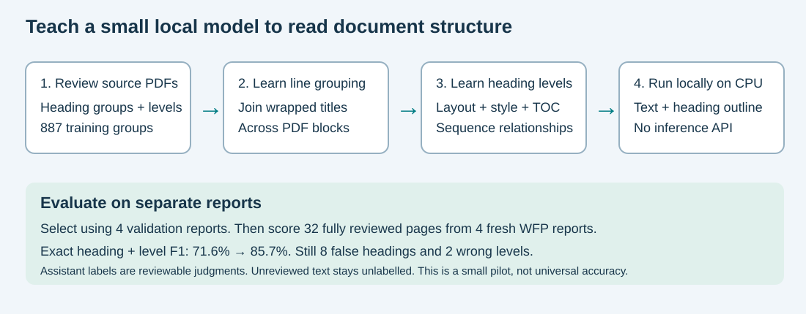

# Training a small local heading model: second experiment

**Current comparison metric:** the league now ranks by joint heading-and-level F0.5 with joint precision and joint recall alongside it; no league-table PASS/FAIL gate. [Definitions and worked example](../../docs/joint-metric.md) · [New precision experiment](../structure-precision/report.md). The F1 results and selection criteria below describe the original frozen experiment; they have not been retroactively changed. Published primary scores use the league's same-page title matching rule.

The selected model improved exact heading-group-and-level F1 from **71.6% to 85.7%** on 32 fully reviewed pages from four fresh WFP reports. It recovered all 38 reference groups, assigned 36 the correct level, and emitted eight extra groups. This is a small pilot using one assistant's labels, without independent human adjudication.



## What changed

The original Extra Trees model had 154 training heading groups from 16 reports. The expanded set has **887 groups from 20 training reports**, including English, French and Spanish. There are 7,039 labelled training lines. These are 859 newly reviewed group decisions (including re-reviewed existing headings) plus retained v1 annotations; they are not 859 additional disjoint headings. Three changes to overlapping v1 annotations are recorded explicitly in `configs/structure-v2/annotation-changes.json`; v1 evidence is unchanged.

Training coverage is deliberately partial. The 112 original fully reviewed training pages supply ordinary-text negatives. Added candidate-guided headings supply positive labels on other pages. Unreviewed lines stay unlabelled. Candidate review used boldness, font size and numbering to propose examples, with extracted text, TOCs and rendered page/snippet inspection to assess them. This can under-sample subtle headings and still contains annotation errors. It is not a complete-document gold corpus.

The four validation reports retain their original 20 reviewed pages and 21 groups. Selection used exact group-and-level F1 on those reports. The final test uses **32 fully reviewed pages and 38 groups from four new reports**: Niger malnutrition interventions (English), anticipatory action in Nepal (English), Chad country strategic plan (French), and Ecuador country strategic plan (Spanish). Each contributes two continuous four-page windows, covering introduction/context and findings. All page numbers are physical PDF pages. Labels and the protocol were frozen before fitting; the test was evaluated after selection. The original four test reports from v1 were excluded entirely.

These are report-disjoint splits, **not template-family-disjoint splits**. For example, the Niger and Chad impact evaluations share a 3ie publishing style. The selection was purposive rather than random and the test has only one H4 and no H5/H6 headings. It does not establish whole-document or cross-publisher accuracy.

## Three controlled variants

1. **Extra annotations only:** retain v1's line features, 200-tree Extra Trees settings and same-block grouping. This isolates the effect of more labels and four extra training reports.
2. **Learned grouping:** a separate tree classifier learns whether adjacent extracted lines belong to one heading, including across PDF block boundaries. Another classifier assigns the resulting group a body/H1–H6 label.
3. **Context and relationships:** add document-wide style/numbering statistics and an exact normalized TOC-title feature. A learned pair model scores whether successive heading levels rise, stay equal or fall; Viterbi decoding combines those scores with group-level probabilities. The relation weight is fixed at 1.0. TOC presence is optional. This is a lightweight context model, not a fine-tuned language model.

All variants use the same training split and seed. Group training uses explicitly annotated groups plus known ordinary-text lines. Pair training only uses pairs whose labels are known. Context features use the input PDF, never reference labels. No report-specific inference corrections were added. The context variant combines extra features and sequence decoding; this experiment does not isolate their individual contributions.

Parent IDs are inferred from the resulting level sequence and remain unevaluated. Native text is retained, but reading order, tables and OCR quality are not solved by this model. Non-adjacent fragments and headings separated by running headers remain possible grouping failures.

## Results and costs

Exact group F1 requires the complete ordered set of source line IDs; matching individual fragments does not count. Exact group-and-level F1 additionally requires the right H level. F1 is `2 × correct / (reference groups + predicted groups)`, so false headings reduce the score. This is stricter than the title-matching metric in the historical league table.

| Variant | Validation exact F1 | Fresh test exact F1 | Groups recovered | Groups + levels correct | Extra groups |
| --- | --- | --- | --- | --- | --- |
| Original model v1 | Not used for v2 selection | 71.6% | 35/38 | 29/38 | 8 |
| v2: more annotations | 55.3% | 81.4% | 37/38 | 35/38 | 11 |
| v2: learned grouping | 63.6% | 80.5% | 38/38 | 35/38 | 11 |
| v2: context + relationships (selected) | 69.8% | 85.7% | 38/38 | 36/38 | 8 |

**Selection remains the context model**, chosen before looking at the test or historical results. Learned grouping alone scored slightly better on the historical benchmark. That does not justify switching after examining those results. The new context model also regressed slightly on Chad's exact F1 despite getting one more level right: false positives increased. More data is not a substitute for testing individual reports.

| Fresh report ID | v1 exact F1 | Selected v2 exact F1 | Correct groups + levels | Extra groups |
| --- | --- | --- | --- | --- |
| 321 | 85.7% | 90.9% | 10/10 | 2 |
| 844 | 94.1% | 100.0% | 8/8 | 0 |
| 560 | 66.7% | 64.0% | 8/10 | 5 |
| 394 | 45.5% | 95.2% | 10/10 | 1 |

The original 77-heading benchmark was already inspected during development and is now a **diagnostic**. Each new variant ran over all 523 pages, then used the unchanged reference, audit pages and title matcher. Fresh-test F1 and historical correct-heading recall have different denominators and should not be compared directly.

| Variant | Titles recovered | Correct title + level | Extra headings |
| --- | --- | --- | --- |
| v2: more annotations | 69/77 | 41/77 | 26 |
| v2: learned grouping | 74/77 | 51/77 | 21 |
| v2: context + relationships (selected) | 64/77 | 50/77 | 23 |

Runs were local on an Apple M4 Pro with 48 GB RAM. There were no inference API calls or per-page service charges. Dollar costs for electricity, hardware ownership and annotation work were not measured. Model fit time excludes feature preparation, JSON export and validation; inference time includes PDF extraction, features and model inference, but excludes model loading and output writes. The 500-page number below is a linear normalization of an actual 523-page run, not another measured run.

| Variant | Component model fits | Deployment JSON | Measured / 523 pages | Normalized / 500 pages |
| --- | --- | --- | --- | --- |
| v2: more annotations | 1.01 s | 21.7 MiB | 9.27 s | 8.86 s |
| v2: learned grouping | 1.81 s | 18.6 MiB | 11.97 s | 11.44 s |
| v2: context + relationships (selected) | 2.09 s | 23.2 MiB | 12.56 s | 12.00 s |

The selected deployment needs the join, context and relation JSON models. Models, original PDFs, rendered pages and complete extracted text remain outside Git. Published annotations, compact predictions, scores and model/configuration hashes are committed for audit. PyMuPDF's licensing must be considered separately from this repository's MIT code license.

## Source documents and exact coverage

Reports came from the supplied **Evaluation list – Phase 1.xlsx** catalogue and its `20261121T043910Z` local archive snapshot. The reproducible preparation script extracts exact manifest members, verifies their SHA-256 hashes and checks document overlap. It does not require a public download service. Official public source links are listed below; archive filesystem locations are not published. Catalogue entry 962 (GAFSP) was excluded before fitting because it was not a WFP evaluation and was replaced by Niger report 321.

“Full pages” below means every extracted line on those pages has an annotation decision. Extra positive headings can appear elsewhere on training reports. The annotation viewer includes **all 946 groups**, full reviewed pages including zero-heading pages, and pages containing additional positive groups; it distinguishes those coverage types.

| ID | Report / public source | Language | Split | PDF pages | Full pages | Groups |
| --- | --- | --- | --- | --- | --- | --- |
| 347 | [Annual Synthesis of Operation Evaluations (2016-2017)](https://docs.wfp.org/api/documents/WFP-0000023485/download/) | English | train | 31 | 3, 6, 11, 13, 21, 23, 28 | 61 |
| 534 | [Synthesis of evidence and lessons from WFP's policy evaluations (2011 - 2019)](https://docs.wfp.org/api/documents/WFP-0000115570/download) | English | train | 32 | 2, 3, 7, 11, 12, 20, 29 | 22 |
| 584 | [Synthesis of evidence and lessons on country capacity strengthening from decentralized evaluations](https://docs.wfp.org/api/documents/WFP-0000127565/download/) | English | train | 30 | 2, 4, 10, 13, 15, 18, 21 | 28 |
| 425 | [Four Evaluations of the Impact of WFP Programmes on Nutrition in Humanitarian Contexts in the Sahel: A Synthesis](https://docs.wfp.org/api/documents/WFP-0000063326/download/) | English | train | 38 | 3, 7, 8, 13, 17, 26, 36 | 32 |
| 443 | [Evaluation Series on Emergency School Feeding in Lebanon 2015-2019](https://docs.wfp.org/api/documents/WFP-0000127163/download/) | English | train | 49 | 3, 10, 23, 35, 36, 39, 49 | 66 |
| 44 | [Evaluation of the Satellite Index Insurance for Pastoralists in Ethiopia (SIIPE) Programme: Impact Evaluation of the SIIPE Pilot (2017 – 2019)](https://docs.wfp.org/api/documents/WFP-0000107946/download/) | English | train | 50 | 3, 10, 15, 23, 34, 36, 49 | 60 |
| 104 | [Final Evaluation of USDA McGovern-Dole-funded International Food for Education and Child Nutrition Program’s Support in Liberia (2013-2016)](https://docs.wfp.org/api/documents/WFP-0000023073/download/) | English | train | 58 | 3, 17, 30, 31, 44, 57, 58 | 71 |
| 79 | [Evaluation of WFP’s General Food Assistance to Syrian Refugees in Jordan from 2015 to mid-2018](https://docs.wfp.org/api/documents/WFP-0000101797/download/) | English | train | 58 | 3, 9, 15, 24, 36, 40, 55 | 53 |
| 177 | [Emergency Social Safety Nets (ESSN) Mid-term Evaluation in Turkey](https://docs.wfp.org/api/documents/WFP-0000100401/download/) | English | train | 64 | 3, 10, 17, 27, 43, 60, 63 | 43 |
| 35 | [Evaluation of the Nutrition Components of the Algeria PRRO 200301](https://docs.wfp.org/api/documents/WFP-0000099834/download/) | English | train | 64 | 3, 13, 15, 30, 37, 46, 63 | 26 |
| 448 | [Evaluation of WFP’s support to smallholder farmers and expanded portfolio across the agriculture value chain in Bhutan, 2019-2021](https://docs.wfp.org/api/documents/WFP-0000139663/download/) | English | train | 62 | 4, 11, 28, 30, 34, 44, 61 | 71 |
| 857 | [Mid-term Evaluation of WFP’s Private Sector Partnerships and Fundraising Strategy 2020-2025](https://docs.wfp.org/api/documents/WFP-0000160228/download/) | English | train | 78 | 4, 17, 28, 36, 56, 60, 75 | 13 |
| 37 | [Evaluación final de la relevancia del rol y la respuesta del PMA para avanzar en un enfoque de asistencia alimentaria vinculado a los sistemas de protección social en Ecuador](https://docs.wfp.org/api/documents/WFP-0000073498/download/) | Spanish | train | 53 | 3, 12, 24, 30, 37, 42, 49 | 59 |
| 494 | [Contribution des cantines scolaires aux résultats de l’éducation dans le sud de Madagascar (2015 à 2019) : Une analyse de la contribution](https://docs.wfp.org/api/documents/WFP-0000118909/download/) | French | train | 93 | 3, 9, 21, 33, 45, 52, 83 | 56 |
| 340 | [Djibouti IPSR 200824 : Une évaluation d’opération à mi-parcours du PAM](https://docs.wfp.org/api/documents/72403381cf214e11925fb73b5b1968b9/download/) | French | train | 96 | 2, 27, 49, 72, 87, 90, 94 | 7 |
| 324 | [The Impact of Humanitarian Aid on Food Insecure Populations During Conflict in Mali: An impact evaluation](https://www.3ieimpact.org/sites/default/files/GFR-TW6.1039-food-insecure-population-mali.pdf) | English | train | 78 | 5, 7, 25, 29, 38, 42, 60 | 5 |
| 103 | [Evaluation of WFP Livelihoods and Resilience Activities in Lebanon from 2016 to 2019](https://docs.wfp.org/api/documents/WFP-0000128024/download/) | English | validation | 54 | 3, 10, 24, 39, 53 | 3 |
| 538 | [Evaluation of School Feeding Modalities Applied in Armenia](https://docs.wfp.org/api/documents/WFP-0000164067/download/) | English | validation | 65 | 4, 10, 28, 46, 64 | 9 |
| 176 | [Evaluation of WFP’s capacity strengthening activities  to develop the  School Meals Programme from 2016 to 2018 in Tunisia](https://docs.wfp.org/api/documents/WFP-0000108206/download/) | French | validation | 105 | 3, 10, 24, 37, 51 | 5 |
| 128 | [Evaluación Intermedia del Proyecto BOOST en las zonas de Nueva Segovia, Madriz, Estelí, Matagalpa,  Jinotega y la RACCN en Nicaragua, 2018-2021](https://docs.wfp.org/api/documents/WFP-0000138855/download/) | Spanish | validation | 89 | 4, 11, 27, 44, 60 | 4 |
| 321 | [WFP Malnutrition Interventions in Niger](https://www.3ieimpact.org/sites/default/files/2019-01/IE80-WFP-malnutrition-Niger.pdf) | English | test | 73 | 13, 14, 15, 16, 34, 35, 36, 37 | 10 |
| 844 | [Impact evaluation of Anticipatory Action in Nepal](https://docs.wfp.org/api/documents/WFP-0000165767/download/?_ga=2.213186772.1572714128.1747122969-1660177980.1674680269) | English | test | 67 | 10, 11, 12, 13, 19, 20, 21, 22 | 8 |
| 560 | [Evaluation of Chad WFP Country Strategic Plan 2019-2023](https://docs.wfp.org/api/documents/WFP-0000146206/download/) | French | test | 92 | 21, 22, 23, 24, 36, 37, 38, 39 | 10 |
| 394 | [Ecuador: an Evaluation of WFP's Strategic Plan (2017-2021)](https://docs.wfp.org/api/documents/WFP-0000143384/download/) | Spanish | test | 103 | 27, 28, 29, 30, 46, 47, 48, 49 | 10 |
| 323 | [Targeting Moderate Acute Malnutrition in Humanitarian Situations in Chad](https://www.3ieimpact.org/sites/default/files/2019-01/IE78-MAM-Chad_1.pdf) | English | train | 80 | None: positive-only additions | 51 |
| 33 | [Cote d'Ivoire PRRO 200464: a decentralized evaluation](https://docs.wfp.org/api/documents/WFP-0000063843/download/) | French | train | 140 | None: positive-only additions | 47 |
| 15 | [Evaluación Final del Programa de País del Programa Mundial de Alimentos de las Naciones Unidas en el Estado Plurinacional de Bolivia – PP 200381 2013 - 2017](https://docs.wfp.org/api/documents/WFP-0000103099/download/) | Spanish | train | 118 | None: positive-only additions | 92 |
| 334 | [Evaluation of the WFP Corporate Partnership Strategy (2014-2017)](https://docs.wfp.org/api/documents/WFP-0000015489/download/) | English | train | 83 | None: positive-only additions | 24 |

## Reproduce and run on your own PDF

For a fresh checkout, follow the [complete public-download guide](https://github.com/dividor/pdf-heading-benchmark/blob/codex/full-method-verification/docs/rebuild-heading-model.md) or [run the notebook](https://github.com/dividor/pdf-heading-benchmark/blob/codex/full-method-verification/notebooks/rebuild_heading_model.ipynb). That path rebuilds the confidence-filtered method without the private archive or the old v1 model. The commands below reproduce the older comparison when those additional local inputs are available.

Use Python 3.12 and the committed uv lockfile. From a checkout:

```bash
uv sync --locked --extra training
export STRUCTURE_DATA=/path/outside/the/repository/structure-v2
uv run python scripts/structure/prepare.py --data "$STRUCTURE_DATA" --archive /path/to/wfp-20261121T043910Z.tar
uv run python scripts/structure/train.py --data "$STRUCTURE_DATA" --output "$STRUCTURE_DATA/run-001"
uv run python scripts/structure/evaluate.py --data "$STRUCTURE_DATA" --run "$STRUCTURE_DATA/run-001" --original-model /path/to/v1/trees.json
uv run python scripts/structure/predict.py --pdf /path/to/report.pdf --run "$STRUCTURE_DATA/run-001" --output /path/to/new-output.json
uv run python scripts/structure/review.py --data "$STRUCTURE_DATA" --run "$STRUCTURE_DATA/run-001" --output "$STRUCTURE_DATA/viewer"
uv run python scripts/structure/active_review.py --data "$STRUCTURE_DATA" --run "$STRUCTURE_DATA/run-001" --output "$STRUCTURE_DATA/next-review-queue.json"
```

Preparation uses the committed materialized annotations. `compile_annotations.py` can rebuild them from the explicit index decisions and v1 labels; it never generates labels using typography rules. Training/evaluation reject stale configuration hashes and existing run directories. Evaluation additionally needs the four historical PDFs in the sibling `corpus` directory, prepared by the original benchmark instructions, and the frozen v1 model for the before/after comparison. Output JSON contains every native text line, headings and tentative parent IDs; Markdown retains those lines with heading markers.

The package runner is also available through `pdf-headings run structure_context_relations` with `PDF_HEADING_STRUCTURE_RUN` pointing at the trained run. Native digital PDFs are required; scanned documents need a text/OCR stage first.

## Next improvement target

The remaining problem is primarily false positives and transfer across document styles. Review the eight fresh-test false headings as diagnostic examples, but reserve another untouched test set before further tuning. Expand fully reviewed sections, especially caption/table-heavy pages and unnumbered H3–H5 headings; independently check ambiguous labels; and hold out entire template families. The current 887-group training set is the completed first expansion, short of the proposed 1,000–2,000-group target. `active_review.py` ranks up to 200 unlabelled groups from training reports by uncalibrated predictive entropy. It never samples validation or test reports and never turns its suggestions into labels automatically. A queue for the next annotation round has been generated outside Git. A calibrated reject/review option is also a useful next experiment. No confidence calibration or human review guarantee is claimed here.
