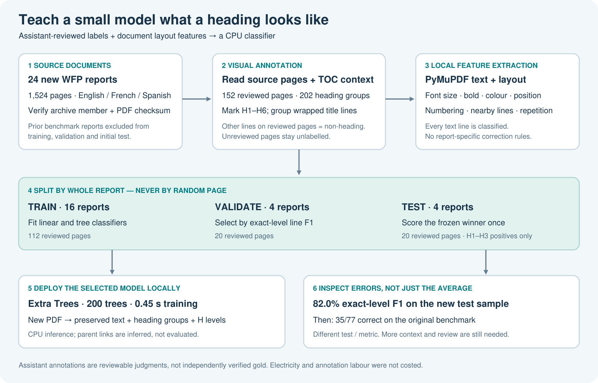
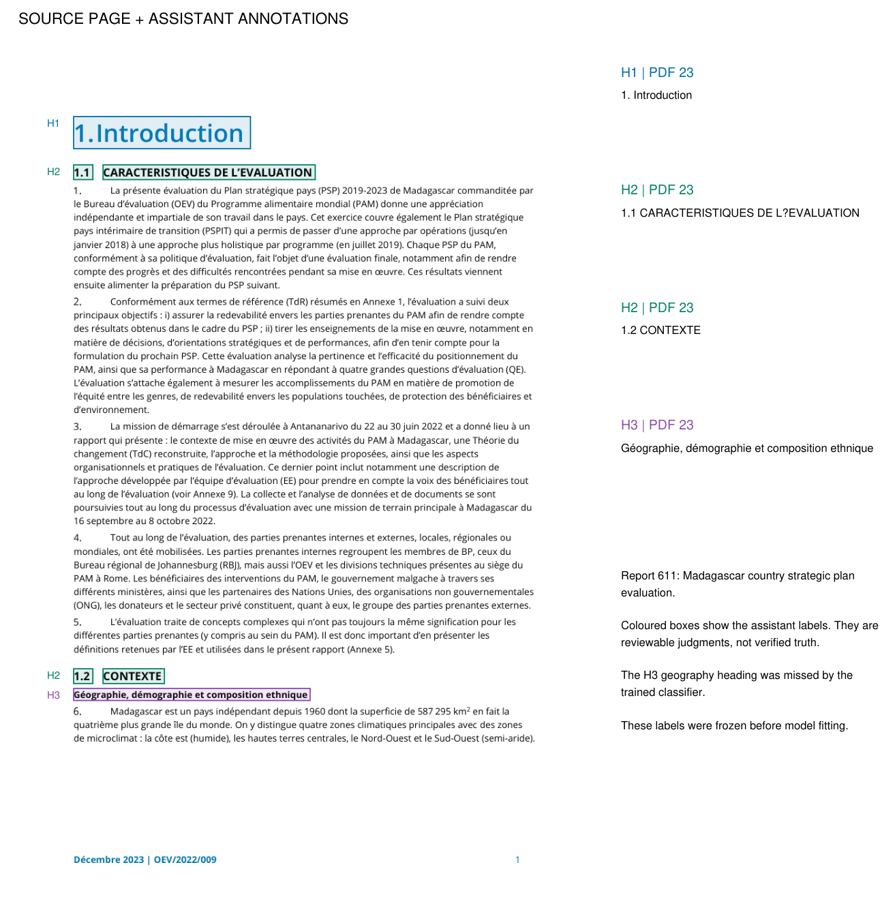

# Can assistant annotations train a small local heading model?

**Yes, as a promising pilot—not yet a robust general document parser.** A small CPU tree classifier learned from assistant-labelled WFP reports and reached 82.0% exact-level F1 on sampled pages of four unseen reports. It correctly labelled every line of 22 of 27 test headings. This experiment evaluates supervised heading classification, not fine-tuning a language model.

The goal is to preserve extracted text while identifying heading levels cheaply. Headings tell retrieval systems what a passage belongs to: an acronyms list and an executive summary can contain similar words but serve very different user needs. A wrong heading or parent can attach useful text to the wrong section.

## Documents and separation

The supplied **Evaluation list - Phase 1.xlsx**, sheet **Evaluation list**, contains 335 catalogue entries. We matched 333 original PDFs in the supplied WFP archive snapshot **20261121T043910Z**. We selected 24 reports dated 2017–2026: 17 English, four French and three Spanish; 1,524 PDF pages altogether. Selection is a deliberately varied convenience sample, not a random estimate of all WFP reports.

Sources, catalogue row numbers, exact archive member names and SHA-256 checksums are recorded in the [corpus manifest](https://github.com/dividor/pdf-heading-benchmark/blob/main/configs/supervised/corpus.json). Archive extraction uses exact members and verifies size and checksum. No network download script was added: the supplied local archive is the reproducible source. Public PDF links are supplied in the table for access outside that archive; their future bytes may change.

Prior benchmark reports—Colombia, Indonesia, the mid-term strategic plan, targeting, and the original 2018 resilience report—are excluded by catalogue identity, WFP document identifier and checksum where available. An additional resilience entry was conservatively excluded. A GAFSP report was removed during source review because it was not a WFP evaluation, and replaced before fitting. See the [exclusion manifest](https://github.com/dividor/pdf-heading-benchmark/blob/main/configs/supervised/excluded.json).

| Split | Reports | All PDF pages | Reviewed pages | Reviewed text lines | Positive heading lines |
|---|---:|---:|---:|---:|---:|
| Training | 16 | 934 | 112 | 6,052 | 203 |
| Validation | 4 | 313 | 20 | 1,028 | 31 |
| Test | 4 | 277 | 20 | 834 | 33 |

Splits are by entire report. No page from a validation or test report is used for fitting. Shared WFP templates, countries and report families can still occur across splits; this is not a template-disjoint experiment.

## How the training labels were created

The assistant inspected rendered page images, extracted text, contents pages and surrounding sections, assigning body/non-heading (0) or H1–H6. There are **202 heading groups**: 154 training, 21 validation and 27 test. Wrapped titles have explicit constituent line IDs. These are assistant annotations with documented decisions, not independently adjudicated human gold or established 100% accuracy.

Initially five pages per report were reviewed: contents when detected (otherwise page 2), approximate body start, one-third, two-thirds and end. The catalogue's machine-generated heading columns were not used as labels. The El Salvador body start was corrected from the catalogue using the PDF. After initial validation, two additional pages per training report were selected using numbered/bold-line counts and visually reviewed. Validation and test pages stayed fixed. Exact 1-based PDF pages appear below; they differ from printed page numbers.

Only reviewed pages contribute examples. Every other extracted line on a reviewed page is a negative. Unreviewed pages are **unlabelled**, never automatically treated as negatives. Contents entries, table captions, boxed findings, running headers and inline bold paragraph lead-ins are excluded. A standalone contents-section title is a heading. These policy choices matter; other applications may want different labels.

The [labels](https://github.com/dividor/pdf-heading-benchmark/blob/main/configs/supervised/labels.tsv) and [readable annotations with bounding boxes](https://github.com/dividor/pdf-heading-benchmark/blob/main/outputs/supervised/evidence/annotations.json) are committed for review. No model predictions were used as ground truth. Training labels were clarified during expansion; test labels were fixed before fitting and no test scores were examined until final selection.

## Methods and runnable code

| Stage / model | Method | Code |
|---|---|---|
| Local archive preparation | Extract the selected regular-file members; verify SHA-256 and reject prior-document overlap | [prepare.py](https://github.com/dividor/pdf-heading-benchmark/blob/main/scripts/supervised/prepare.py), [data validation](https://github.com/dividor/pdf-heading-benchmark/blob/main/src/pdf_heading_benchmark/supervised_data.py) |
| Text and features | PyMuPDF text lines; relative font size, bold/italic, colour, position, repetition, numbering and neighbouring lines | [feature extractor](https://github.com/dividor/pdf-heading-benchmark/blob/main/src/pdf_heading_benchmark/supervised_features.py) |
| Logistic regression | Standardized features; balanced class weights; C=1; seed 42 | [model implementation](https://github.com/dividor/pdf-heading-benchmark/blob/main/src/pdf_heading_benchmark/supervised_models.py) |
| Extra Trees | 200 trees; depth 16; minimum leaf 2; 80% features; balanced class weights; seed 42; four CPU workers | [model implementation](https://github.com/dividor/pdf-heading-benchmark/blob/main/src/pdf_heading_benchmark/supervised_models.py) |
| Selection | Fit only training reports; choose highest validation exact-level F1 | [train.py](https://github.com/dividor/pdf-heading-benchmark/blob/main/scripts/supervised/train.py) |
| Final test | Evaluate only the selected model; refuse changed labels/corpus/model or an existing test result | [evaluate_test.py](https://github.com/dividor/pdf-heading-benchmark/blob/main/scripts/supervised/evaluate_test.py) |
| Deployment | Data-only JSON classifier, preserved text and predicted heading groups; inferred parents flagged as unevaluated | [predict.py](https://github.com/dividor/pdf-heading-benchmark/blob/main/scripts/supervised/predict.py), [inference](https://github.com/dividor/pdf-heading-benchmark/blob/main/src/pdf_heading_benchmark/supervised_inference.py) |
| Timing | Run extraction and classification over every page of all 24 PDFs | [benchmark.py](https://github.com/dividor/pdf-heading-benchmark/blob/main/scripts/supervised/benchmark.py) |

This baseline learns the classification decisions. It still uses engineered layout/text features, including general numbering and caption patterns; it is not a rule-free neural model. There are no per-report correction rules, report IDs as features or hard heading-candidate filters. Full-document font/repetition statistics are calculated without labels, including at inference. Docling is not required for this baseline.

## Results and measured local cost

| Model | Scored set | Detection precision | Recall | Detection F1 | Exact-level F1 | Whole headings correct | Fit time |
|---|---|---:|---:|---:|---:|---:|---:|
| Logistic regression | Validation | 52.8% | 90.3% | 66.7% | 47.6% | 15/21 | 0.253s |
| Extra Trees, 200 trees | Validation | 95.8% | 74.2% | 83.6% | 69.1% | 15/21 | 0.455s |
| Extra Trees, selected | Held-out test | 100.0% | 84.8% | 91.8% | 82.0% | 22/27 | 0.455s |

Test evaluation was performed once. The linear model was not scored on test.

Actual full-document inference covered **1,524 pages in 21.88 seconds** on an Apple M4 Pro Mac mini (14 CPU cores, 48 GB RAM), CPU only. This sums extraction, feature calculation, classification and heading grouping, excluding interpreter/model loading and output-file writes. That is **7.18 seconds per 500 pages**, a throughput normalization, not a separately timed run. Peak process RSS was 557.5 MiB. The selected JSON model is 9.97 MiB.

**Cost:** no metered API inference spend and no GPU. Electricity, hardware amortization and annotation labour were not measured, so total cost is not reported as zero. Assistant annotation was used to create the dataset; the preparation, training and deployed classifier run locally.

Detection F1 treats any positive level as a detected heading. Exact-level F1 counts a heading line as correct only at the annotated level; wrong-level predictions reduce both precision and recall. True-negative body lines do not inflate either score. Whole-headings-correct requires every constituent line to have the right level, but does not measure whether predicted groups have perfect boundaries. Scores are micro-averaged over reviewed lines, not full documents.

The initial 120-page tree run scored 70.4% validation exact-level F1. With 32 extra training pages this was 69.1%, while complete correctly levelled validation headings increased from 14/21 to 15/21. More examples did not automatically improve the line metric. The expanded tree model was selected against the expanded linear baseline (47.6%). An intermediate export failed its sklearn probability-parity check and was corrected to match sklearn's float32 tree traversal; no test was scored during that failure. Frozen run history and predictions are in [evidence](https://github.com/dividor/pdf-heading-benchmark/tree/main/outputs/supervised/evidence).

### Where the test failed

| Held-out report | Reviewed pages | Positive heading lines | Exact-level F1 |
|---|---:|---:|---:|
| Madagascar country strategic plan (611) | 5 | 12 | 63.2% |
| El Salvador country strategic plan (585) | 5 | 8 | 75.0% |
| Guatemala school programmes impact (815) | 5 | 8 | 100.0% |
| UN humanitarian coordination synthesis (1037) | 5 | 5 | 100.0% |

All five incorrectly or incompletely levelled heading groups occurred in the French and Spanish country-plan reports. In Madagascar, a geography subsection was missed; one long question was partly missed and partly promoted from H3 to H2; another wrapped question was missed entirely. In El Salvador, two H3 questions were wholly or partly demoted to H4. These small samples cannot isolate a language effect from report style. Perfect scores on the other ten sampled pages do not imply perfect parsing of those reports.

## What this establishes—and what it does not

- Small learned classifiers can capture useful WFP layout patterns with very little local compute. They are a credible third technique to investigate alongside parsers and larger models.
- The test contains only 27 heading groups and **only H1–H3 positives**. It does not establish H4–H6 reliability. Training has only one H5 line and no H6 examples.
- We have not independently verified the assistant labels. An annotator can make consistent hierarchy mistakes that a model then learns. A separate reviewer should adjudicate ambiguous cases and a larger untouched test set.
- The new test-set results cannot be ranked directly against the earlier league table: the reports, page sample, labels and line-based metric differ. A subsequent unchanged-model run on the original corpus, described below, supplies a comparable row.
- This is embedded-text PDF extraction. It performs no OCR, does not recover glyphs missing from the text layer, and does not evaluate text completeness, reading order, table reconstruction or parent links. JSON retains each extracted line; Markdown is a readable line-preserving view.
- Nearby-line features provide limited context. Document-wide semantic hierarchy, long question headings, bold recommendations and unfamiliar layouts remain difficult. Confidence scores are uncalibrated.

The next justified experiment is to expand independently reviewed H4–H6 examples and different template families, then compare this baseline with a small model that learns from text, layout and surrounding blocks. Keep a new untouched test set for that round. More assistant-labelled data is feasible; the present evidence supports proceeding, not a claim that it already works on any document.

## Visual review and comparison with the original benchmark





The [visual review pack](https://github.com/dividor/pdf-heading-benchmark/blob/main/docs/annotation-review/README.md) displays collated TOCs, all 152 reviewed pages, frozen H-level boxes and optional classifier predictions. You can confirm or propose changes and export a separate review JSON. None of those actions alters the scored labels.

The frozen model was subsequently tested on the original four benchmark PDFs, all excluded from training. Under the original title-matching and exact-level scoring contract, it recovered **59/77 titles (76.6%)**, with **35/77 correct levels (45.5%)** and **20 extra headings**. Full-document inference took **7.7 seconds over 523 pages**. This result appears in the [main comparison table](https://github.com/dividor/pdf-heading-benchmark/blob/main/outputs/report/league_table.md), with [frozen evidence](https://github.com/dividor/pdf-heading-benchmark/tree/main/outputs/supervised/comparison). It gives a direct comparison to the other methods; the new test set's 82.0% line F1 remains a separate result.

## Selected-report table

| Split | Catalogue ID / row | Report (source PDF) | Year | Language | PDF pages | Reviewed PDF pages |
|---|---|---|---:|---|---:|---|
| train | 347 / 2 | [Annual Synthesis of Operation Evaluations (2016-2017)](https://docs.wfp.org/api/documents/WFP-0000023485/download/) | 2017 | English | 31 | 3, 6, 11, 13, 21, 23, 28 |
| train | 534 / 112 | [Synthesis of evidence and lessons from WFP's policy evaluations (2011 - 2019)](https://docs.wfp.org/api/documents/WFP-0000115570/download) | 2020 | English | 32 | 2, 3, 7, 11, 12, 20, 29 |
| train | 584 / 138 | [Synthesis of evidence and lessons on country capacity strengthening from decentralized evaluations](https://docs.wfp.org/api/documents/WFP-0000127565/download/) | 2021 | English | 30 | 2, 4, 10, 13, 15, 18, 21 |
| train | 425 / 13 | [Four Evaluations of the Impact of WFP Programmes on Nutrition in Humanitarian Contexts in the Sahel: A Synthesis](https://docs.wfp.org/api/documents/WFP-0000063326/download/) | 2017 | English | 38 | 3, 7, 8, 13, 17, 26, 36 |
| train | 443 / 97 | [Evaluation Series on Emergency School Feeding in Lebanon 2015-2019](https://docs.wfp.org/api/documents/WFP-0000127163/download/) | 2020 | English | 49 | 3, 10, 23, 35, 36, 39, 49 |
| train | 44 / 68 | [Evaluation of the Satellite Index Insurance for Pastoralists in Ethiopia (SIIPE) Programme: Impact Evaluation of the SIIPE Pilot (2017 – 2019)](https://docs.wfp.org/api/documents/WFP-0000107946/download/) | 2019 | English | 50 | 3, 10, 15, 23, 34, 36, 49 |
| train | 104 / 12 | [Final Evaluation of USDA McGovern-Dole-funded International Food for Education and Child Nutrition Program’s Support in Liberia (2013-2016)](https://docs.wfp.org/api/documents/WFP-0000023073/download/) | 2017 | English | 58 | 3, 17, 30, 31, 44, 57, 58 |
| train | 79 / 44 | [Evaluation of WFP’s General Food Assistance to Syrian Refugees in Jordan from 2015 to mid-2018](https://docs.wfp.org/api/documents/WFP-0000101797/download/) | 2018 | English | 58 | 3, 9, 15, 24, 36, 40, 55 |
| train | 177 / 33 | [Emergency Social Safety Nets (ESSN) Mid-term Evaluation in Turkey](https://docs.wfp.org/api/documents/WFP-0000100401/download/) | 2018 | English | 64 | 3, 10, 17, 27, 43, 60, 63 |
| train | 35 / 40 | [Evaluation of the Nutrition Components of the Algeria PRRO 200301](https://docs.wfp.org/api/documents/WFP-0000099834/download/) | 2018 | English | 64 | 3, 13, 15, 30, 37, 46, 63 |
| train | 448 / 169 | [Evaluation of WFP’s support to smallholder farmers and expanded portfolio across the agriculture value chain in Bhutan, 2019-2021](https://docs.wfp.org/api/documents/WFP-0000139663/download/) | 2022 | English | 62 | 4, 11, 28, 30, 34, 44, 61 |
| train | 857 / 250 | [Mid-term Evaluation of WFP’s Private Sector Partnerships and Fundraising Strategy 2020-2025](https://docs.wfp.org/api/documents/WFP-0000160228/download/) | 2024 | English | 78 | 4, 17, 28, 36, 56, 60, 75 |
| train | 37 / 35 | [Evaluación final de la relevancia del rol y la respuesta del PMA para avanzar en un enfoque de asistencia alimentaria vinculado a los sistemas de protección social en Ecuador](https://docs.wfp.org/api/documents/WFP-0000073498/download/) | 2018 | Spanish | 53 | 3, 12, 24, 30, 37, 42, 49 |
| train | 494 / 82 | [Contribution des cantines scolaires aux résultats de l’éducation dans le sud de Madagascar (2015 à 2019) : Une analyse de la contribution](https://docs.wfp.org/api/documents/WFP-0000118909/download/) | 2020 | French | 93 | 3, 9, 21, 33, 45, 52, 83 |
| train | 340 / 6 | [Djibouti IPSR 200824 : Une évaluation d’opération à mi-parcours du PAM](https://docs.wfp.org/api/documents/72403381cf214e11925fb73b5b1968b9/download/) | 2017 | French | 96 | 2, 27, 49, 72, 87, 90, 94 |
| train | 324 / 28 | [The Impact of Humanitarian Aid on Food Insecure Populations During Conflict in Mali: An impact evaluation](https://www.3ieimpact.org/sites/default/files/GFR-TW6.1039-food-insecure-population-mali.pdf) | 2017 | English | 78 | 5, 7, 25, 29, 38, 42, 60 |
| validation | 103 / 96 | [Evaluation of WFP Livelihoods and Resilience Activities in Lebanon from 2016 to 2019](https://docs.wfp.org/api/documents/WFP-0000128024/download/) | 2020 | English | 54 | 3, 10, 24, 39, 53 |
| validation | 538 / 298 | [Evaluation of School Feeding Modalities Applied in Armenia](https://docs.wfp.org/api/documents/WFP-0000164067/download/) | 2024 | English | 65 | 4, 10, 28, 46, 64 |
| validation | 176 / 70 | [Evaluation of WFP’s capacity strengthening activities  to develop the  School Meals Programme from 2016 to 2018 in Tunisia](https://docs.wfp.org/api/documents/WFP-0000108206/download/) | 2019 | French | 105 | 3, 10, 24, 37, 51 |
| validation | 128 / 148 | [Evaluación Intermedia del Proyecto BOOST en las zonas de Nueva Segovia, Madriz, Estelí, Matagalpa,  Jinotega y la RACCN en Nicaragua, 2018-2021](https://docs.wfp.org/api/documents/WFP-0000138855/download/) | 2022 | Spanish | 89 | 4, 11, 27, 44, 60 |
| test | 611 / 211 | [Evaluation of Madagascar WFP Country Strategic Plan, 2019-2023](https://docs.wfp.org/api/documents/WFP-0000154968/download/) | 2023 | French | 87 | 4, 23, 44, 65, 86 |
| test | 585 / 120 | [Evaluación del plan estratégico para El Salvador (2017-2022)](https://docs.wfp.org/api/documents/WFP-0000136296/download/) | 2021 | Spanish | 100 | 4, 27, 51, 75, 99 |
| test | 815 / 281 | [Guatemala: School-based Programmes Impact Evaluation](https://docs.wfp.org/api/documents/WFP-0000166224/download/) | 2025 | English | 42 | 2, 7, 16, 25, 34 |
| test | 1037 / 333 | [Synthesis on WFP's engagement in UN humanitarian coordination](https://docs.wfp.org/api/documents/WFP-0000173295/download/) | 2026 | English | 48 | 4, 6, 17, 29, 40 |

## Reproduce locally

Use Python 3.12 and the committed uv.lock. This run used scikit-learn 1.9.1. PDFs, extracted full text and fitted models remain outside Git. Source PDF and package licences are separate from the repository licence.

```bash
uv sync --locked --extra training
# Set these to your existing local archive and an external output directory.
ARCHIVE=/path/to/wfp-20261121T043910Z.tar
DATA=/path/to/external/supervised-v1
uv run python scripts/supervised/prepare.py --archive "$ARCHIVE" --data "$DATA"
# Optional: generate page images and line IDs for reviewing or expanding annotations.
uv run python scripts/supervised/review.py --data "$DATA" --output "$DATA/review-pack"
uv run --extra training python scripts/supervised/train.py --data "$DATA" --output "$DATA/my-run"
# Inspect validation first; this is the final held-out test, not a tuning loop.
uv run python scripts/supervised/evaluate_test.py --data "$DATA" --run "$DATA/my-run"
uv run python scripts/supervised/benchmark.py --data "$DATA" --run "$DATA/my-run"
uv run python scripts/supervised/predict.py --pdf /path/to/new-report.pdf \
  --model "$DATA/my-run/trees.json" --output "$DATA/new-report-output"
uv run python scripts/supervised/report.py
```

Use the selected model named in `my-run/selection.json`; `trees.json` is the winner in this recorded run. New reports need an embedded text layer and the same feature schema. The report generator regenerates the **committed frozen evidence**, not a new experiment's results. Changing the corpus or labels requires preparing features again and a fresh run directory. Do not repeatedly use the published test for model selection.
